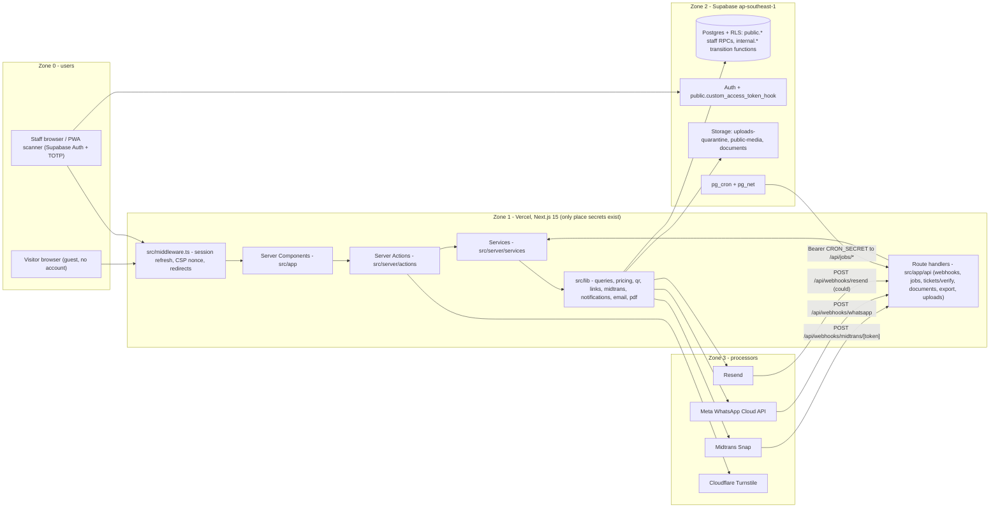

# Project Context & Coding Rules for AI-assisted development

| Field | Value |
|---|---|
| Document | `CLAUDE.md` (repository root; read automatically by Claude Code and Cursor) |
| Version | 1.0 |
| Date | 2026-10-15 |
| Status | Draft for review |
| Owner | Kelurahan Gisikdrono Edu Center project team |
| Companion documents | `docs/PRD.md`, `docs/Task.md`, `docs/StyleGuide.md`, `docs/Security.md` |

---

## 1. Project identity & mission

**Edu Center & Edu Wisata Kelurahan Gisikdrono** is the digital edu-tourism platform of Kelurahan Gisikdrono (a *kelurahan* is an urban-village administrative unit) in Semarang Barat. It promotes and sells educational visits to two neighbourhood units (*RW*, Rukun Warga): **RW 05 "Ecowastreme"** (zero-waste ecotourism: *Bank Sampah* community waste bank, composting, maggot farming, urban farming, recycled crafts by *PKK*, the family-welfare women's group) and **RW 08 "Kampung Seni Budaya"** (arts and culture: traditional dance, a children's *sanggar* arts studio, and *dolanan*, traditional Javanese children's games). Visitors are schools, universities, government offices, companies and families; they book a dated visit session, optionally pre-order *UMKM* (micro, small and medium enterprise) products, pay through Midtrans, receive a signed QR ticket by WhatsApp and email, are checked in at the gate with a PWA scanner, and receive e-certificates and a review invitation afterwards.

The platform is operated by a small municipal team: one Superadmin Kelurahan and one admin per RW. Money is real (payouts to the kelurahan, RW treasuries and UMKM vendors), participants include children, and the operators are not full-time engineers. Every rule in this file therefore optimises for three things, in this order: **correctness of money and quota**, **isolation of RW data and participant PII**, and **code that a future maintainer can read in one sitting**. Clean code is a project requirement, not a preference.

### 1.1 How to use this file

- Read this file fully at the start of every coding session. It is the contract for how code is written here.
- Follow it as imperative instructions. When a rule says "never", there is no exception without a written decision in `docs/PRD.md` §13.1 (Open decisions).
- Every name in this file (table, column, enum value, route, folder, env var, RPC, bucket, template, tag) is canonical. Use it verbatim. Do not invent synonyms.

### 1.2 Document map and precedence

| Document | Owns | Read it when |
|---|---|---|
| `supabase/migrations/*.sql` | The truth about tables, enums, RLS, RPCs, triggers, cron | Before touching any data access |
| `docs/PRD.md` | Requirements (`FR-*`, `NFR-*`), personas, sitemap, full DDL, state machine, integration flows, open decisions | Before implementing any feature; when a requirement ID is cited |
| `CLAUDE.md` (this file) | Conventions, layering, strict rules, commands, recipes | Always |
| `docs/Security.md` | Threat model, controls matrix (`PAY-*`, `WH-*`, `AUTH-*`, `AZ-*`, ...), runbooks, go-live checklist | Before touching payments, auth, RLS, uploads, secrets, logging |
| `docs/StyleGuide.md` | Tokens, typography, components, dashboard shell, motion, a11y | Before writing any UI |
| `docs/Task.md` | Phase order (`P<phase>.<module>.<nn>`), checklists, exit criteria | At the start of a task and when ticking a finished item |

**Precedence on conflict:** `supabase/migrations` > `docs/PRD.md` > `CLAUDE.md` > `docs/Security.md` (security rules are additive and are never relaxed by a higher document) > `docs/StyleGuide.md`. When two sources disagree, stop, quote both, propose a resolution, and wait. Never choose silently.

### 1.3 Read-first instructions

1. Read `docs/PRD.md` for the requirement you are implementing and for the schema (tables, columns, enums).
2. Read `docs/StyleGuide.md` before writing JSX; never invent colours, spacing, radii or motion values.
3. Read `docs/Security.md` before writing anything that touches money, tickets, auth, PII, uploads, secrets or outbound HTTP.
4. Read `docs/Task.md` to find the phase and item you are working on; tick the `[ ]` item in the same PR that completes it.

---

## 2. Tech stack & architecture

### 2.1 Pinned stack

| Layer | Choice | Notes |
|---|---|---|
| Runtime | Node 22 LTS, pnpm 10 (`--frozen-lockfile`) | `.npmrc`: `ignore-scripts=true`, `min-release-age=7` (npm, days); `pnpm-workspace.yaml`: `onlyBuiltDependencies: [sharp]`, `minimumReleaseAge: 10080` (pnpm, 7 days in minutes) |
| Framework | Next.js 15 App Router, React 19, TypeScript 5 `strict` + `noUncheckedIndexedAccess` | Path alias `@/*` -> `src/*` |
| Styling | Tailwind CSS v4 (tokens as CSS variables consumed via `@theme inline`), shadcn/ui `new-york`, `tw-animate-css` | Tokens in `src/styles/globals.css` |
| Motion | `motion` package (`import { motion } from 'motion/react'`) | `MotionConfig reducedMotion="user"` + `LazyMotion` |
| Data | Supabase: Postgres + RLS, Auth (staff only, TOTP), Storage; `@supabase/supabase-js` v2 + `@supabase/ssr` | Region `ap-southeast-1`; separate `staging` and `production` projects |
| Forms & validation | `zod` (`.strict()` schemas), `react-hook-form` + `@hookform/resolvers` | Schemas shared client/server in `src/lib/validations` |
| Env validation | `@t3-oss/env-nextjs` + `zod` | `src/lib/env.ts` (`serverEnv`, server-only) extends `src/lib/public-env.ts` (`publicEnv`, `NEXT_PUBLIC_*` only); see §7.7 |
| Tables, charts, URL state | `@tanstack/react-table`, Recharts via shadcn Chart, `nuqs` | Dashboard only |
| Dates | `date-fns` + `@date-fns/tz`, locale `id`, `APP_TZ = 'Asia/Jakarta'` | DB `timestamptz`; visit dates `date` |
| Payments | Midtrans Snap, **redirect mode**, thin typed fetch wrapper in `src/lib/midtrans/client.ts` (no SDK) | QRIS + Virtual Account only |
| Messaging | Meta WhatsApp Business Cloud API (Graph v21+), Resend + React Email | Outbox table `notifications` |
| Documents | `@react-pdf/renderer`, `pdf-lib`, `qrcode`, `exceljs` | Node route handlers only |
| Scanner / PWA | `@serwist/next`, `@yudiel/react-qr-scanner` over `barcode-detector` (native `BarcodeDetector`, ZXing-WASM fallback) | Online-only validation |
| Bot protection & limits | Cloudflare Turnstile; Postgres `rate_limit_buckets` via `internal.rate_limit_hit` | No external rate-limit vendor |
| Observability | `pino` JSON logs with redaction (`src/lib/logger.ts`; custom rule `scripts/eslint-rules/no-logging-whole-records.mjs`), `@sentry/nextjs` (tunnel `/monitoring`, `sendDefaultPii: false`), `@vercel/analytics` | `/api/health` for uptime monitor |
| Testing | Vitest (`@vitest/coverage-v8`), Playwright, pgTAP (`supabase test db`) | See §9; projects `unit` (`src/**/*.test.ts`) and `integration` (`tests/integration`) in `vitest.config.ts` |
| Lint, format, hooks | ESLint 9 flat config (`eslint-config-next` loaded through `@eslint/eslintrc` `FlatCompat`, `typescript-eslint`, `eslint-plugin-check-file` for kebab-case filenames), Prettier + `prettier-plugin-tailwindcss`, Husky + `lint-staged`, `@commitlint/cli` + `@commitlint/config-conventional`, gitleaks | Husky is enabled once per clone with `pnpm exec husky` because `ignore-scripts=true` skips `prepare`; see §9.2 |
| Scripts and local tools | `tsx` for `scripts/*.ts`, `react-email` CLI for `pnpm email:preview`, `@next/bundle-analyzer` for `pnpm analyze`; Supabase CLI and `cloudflared` installed globally | The `supabase` npm package is not used because its binary download is an install script, which `ignore-scripts=true` blocks; `.npmrc` `shell-emulator=true` makes scripts run the same on Windows and Linux |
| Hosting | Vercel (Production from `main`; Preview = staging Supabase + Midtrans sandbox) | pg_cron + pg_net drive scheduled jobs |

### 2.2 Architecture



### 2.3 Request lifecycle

| Step | Where | Rule |
|---|---|---|
| 1. Edge | `src/middleware.ts` | Refresh Supabase session (`@supabase/ssr`, `getUser()`), set CSP nonce, redirect unauthenticated `/dashboard/*` to `/login?next=`. Authorization is **never** decided here alone. |
| 2. Page | `src/app/**/page.tsx` (Server Component) | Thin: fetch via `src/lib/queries` (public, cached) or a service (staff, uncached), compose components. No business logic. |
| 3. Mutation | `src/server/actions/<domain>.ts` | Mandatory order (§5.2): validate -> guard -> service -> revalidate -> `ActionResult`. |
| 4. Orchestration | `src/server/services/<domain>-service.ts` | Calls data access and RPCs; only the allow-listed services may use the service-role client. |
| 5. Data access | `src/lib/supabase/server.ts` under RLS, or `public.*` / `internal.*` RPCs | Status columns and quota counters are written only inside `internal.*` functions. |
| 6. Database | Postgres with RLS **enabled and forced** on every table | Deny-by-default grants; helpers `app_role()`, `app_rw_id()`, `is_superadmin()`, `owns_rw()`; an AAL2 restrictive policy on every table `authenticated` may touch. |
| 7. Side effects | `notifications` outbox, `documents` bucket, `booking_events`, `audit_logs` | Written in the same transaction as the state change; delivery is asynchronous. |
| Machine callers | `api/webhooks/*`, `api/jobs/*` | Outside auth middleware; verify signature or `CRON_SECRET` first, read raw body, persist, then process. |

---

## 3. Repository & folder structure

### 3.1 Tree

```
CLAUDE.md                      this file (root)
docs/                          PRD.md, Task.md, StyleGuide.md, Security.md, notifications.md
src/
  app/                         routes only; thin page files (fetch -> compose)
    (public)/                  Indonesian slugs, ISR 3600 + tag revalidation
    (booking)/                 pesan/[packageSlug], reservasi/cari, reservasi/[bookingCode]/{bayar,tiket,sertifikat,ulasan}
    (auth)/                    login, forgot-password, reset-password, mfa/enroll, mfa/verify, onboarding
    (admin)/dashboard/         layout.tsx = requireRole() + AAL2 gate + RwSwitcher; force-dynamic, noindex
    api/                       webhooks/, jobs/, tickets/verify, documents/[kind]/[id], export/[kind], uploads/{sign,finalize}, health
    auth/{callback,signout}/   route handlers
    sitemap.ts robots.ts manifest.ts opengraph-image.tsx layout.tsx not-found.tsx error.tsx global-error.tsx
  components/
    ui/                        shadcn primitives (generated; theme-level edits only)
    layout/ marketing/ map/ gallery/ booklet/ packages/ products/ articles/ reviews/
    booking/ ticket/ certificates/ seo/ forms/ providers/
    admin/{shell,kpi,data-table,scanner,charts,status,calendar}/
  lib/
    supabase/                  server.ts (cookies, RLS) | anon.ts (server, public reads, no session) | client.ts (browser, public only, no session) | admin.ts (service role, allow-listed)
    queries/                   cached public reads + tags.ts (revalidation tag registry)
    pricing/                   computeBookingQuote() - pure, 100 % coverage
    qr/                        sign.ts, verify.ts - the only place QR tokens are signed/verified
    links/                     scoped guest links (HMAC) - the only place they are minted/verified
    midtrans/                  client.ts (fetch wrapper), snap.ts, verify-signature.ts, map-status.ts, schemas.ts
    notifications/             NotificationProvider interface, whatsapp-meta.ts, templates.ts, enqueue
    email/                     React Email templates (links only, never attachments)
    pdf/                       quotation.tsx, invoice.tsx, receipt.tsx, ticket.tsx, certificate.tsx, fonts/
    seo/ images/ motion/ validations/ utils/ copy/id.ts
    rate-limit.ts env.ts public-env.ts csp.ts logger.ts errors.ts turnstile.ts
  server/
    actions/                   Server Actions, one file per domain ('use server')
    services/                  orchestration, one file per domain (<domain>-service.ts), booking-state.ts
    auth/                      guards.ts (requireUser, requireRole, requireRwAccess, requireGuestToken), session helpers
  db/                          types.ts (generated), enums.ts (TS mirror of Postgres enums), rpc.ts (typed RPC wrappers)
  types/                       action-result.ts, domain DTOs, API contracts (VerifyTicketRequest/Response)
  hooks/                       use-*.ts client hooks
  config/                      site.ts, nav.ts, rw.ts, fonts.ts, auth.ts (cookie options, login paths), routes.ts (private route prefixes), status.ts (enum -> label/variant)
  styles/globals.css           tokens (light/dark), @theme inline
  middleware.ts
supabase/
  migrations/                  0001_extensions ... 0008_seed, then <YYYYMMDDHHMMSS>_<slug>.sql
  seed.sql config.toml tests/  pgTAP (rls_*.sql, triggers, append-only, concurrency, enumeration)
scripts/                       seed-dev.ts, midtrans-simulate.ts, midtrans-status.ts, wa-send-test.ts, check-client-bundle-secrets.mjs
tests/                         integration/ (Vitest against supabase start), e2e/ (Playwright), fixtures/
public/                        icons/, map/denah.svg, fonts/, og/
```

### 3.2 What goes where / what must never go where

| Folder | Put here | Never put here |
|---|---|---|
| `src/app` | Route files, `layout.tsx`, `loading.tsx`, `error.tsx`, `generateMetadata`, route handlers | Business logic, SQL, pricing, signing, direct table writes, `'use client'` on `page.tsx` |
| `src/components/ui` | shadcn-generated primitives | Hand-written components, domain logic, data fetching |
| `src/components/*` | Presentational and island components; props are serialisable (ISO strings, not `Date`) | Imports of `src/server/**`, `src/lib/supabase/admin`, `server-only` modules |
| `src/lib/queries` | Public cached reads wrapped in `unstable_cache` with tags from `tags.ts`, through the session-less anon client `src/lib/supabase/anon.ts` only (ESLint) | Session-bound or service-role queries, `next/headers` (never cache those) |
| `src/lib/pricing`, `src/lib/qr`, `src/lib/links` | Pure functions with 100 % line coverage | Side effects, I/O, React |
| `src/lib/midtrans`, `src/lib/notifications`, `src/lib/email`, `src/lib/turnstile.ts` | The **only** modules allowed to call `fetch` to external hosts (base URLs from `src/lib/env.ts`) | Anything user-supplied as a URL |
| `src/server/actions` | Server Actions following §5.2 | Raw `supabase.from(...).update` of status/money/quota columns; `redirect()` inside `try` |
| `src/server/services` | Orchestration, transactions via RPC, outbox enqueue | UI concerns, copy, formatting |
| `src/db` | Generated `types.ts`, `enums.ts`, typed `rpc.ts` | Hand edits to `types.ts` |
| `src/types` | `action-result.ts`, domain DTOs (narrowed, PII-free where public), API contracts (`VerifyTicketRequest` / `VerifyTicketResponse`); types only | Runtime code, zod schemas (those live in `src/lib/validations`), re-exports of raw `Database` row types to client code |
| `src/hooks` | `use-*.ts` client hooks (camera, media query, debounced URL state, countdown) | Data fetching from Supabase, business rules, anything importing `src/server/**` |
| `src/config` | Constants, nav per role, status maps, site metadata | Secrets, runtime toggles (those live in `site_settings`) |
| `supabase/migrations` | Tables + RLS + grants + triggers + pgTAP-covered functions, one concern per file | Edits to an applied migration; data fixes without a new migration |
| `scripts` | Local/CI tooling; `seed-dev.ts` refuses non-local `SUPABASE_URL` | Production data manipulation |
| `tests` | `integration/` (Vitest against `supabase start`), `e2e/` (Playwright), `fixtures/` (synthetic data only; a real booking-shaped fixture for the redaction test) | Real PII, real keys, production URLs; unit tests (those are colocated `*.test.ts` next to the module) |
| `docs` | `PRD.md`, `Task.md`, `StyleGuide.md`, `Security.md`, `notifications.md` (template texts for Meta approval) | Secrets, env values, generated artefacts, copies of code that drift from `src` |

### 3.3 Naming conventions

| Thing | Convention | Example |
|---|---|---|
| Files | kebab-case | `session-picker.tsx`, `booking-service.ts` |
| Components | PascalCase, one default export per file | `SessionPicker` |
| Hooks | `use-*.ts`, `useX` | `use-scanner.ts` |
| Server Actions | `<verb><Noun>Action` | `createBookingAction` |
| Services | `src/server/services/<domain>-service.ts` | `payment-service.ts` |
| Zod schemas | `<noun>Schema` in `src/lib/validations/<domain>.ts` | `createPackageSchema` |
| Postgres | snake_case; enums in migrations mirrored in `src/db/enums.ts` | `booking_status`, `visit_sessions` |
| Public URL slugs | Indonesian, `^[a-z0-9]+(-[a-z0-9]+)*$` | `/paket-wisata/eduwisata-ecowastreme` |
| Admin/API paths | English | `/dashboard/sessions`, `/api/tickets/verify` |
| Constants | `UPPER_SNAKE` in `src/config` or module top (build-time only; tunable values live in `site_settings`) | `APP_TZ`, `WEBHOOK_BODY_LIMIT_BYTES` |
| Copy | Indonesian in `src/lib/copy/id.ts` (shared) or inline (page-specific) | `copy.errors.QUOTA_EXCEEDED` |
| Identifiers, comments, commits, docs | English | — |

---

## 4. Clean code rules (mandatory)

These rules are enforced in review and by lint. A PR that violates them is not mergeable.

1. **Names say what things are.** No abbreviations beyond the domain glossary (`rw`, `pax` = number of visitors, `pic` = PIC, the person in charge who books on behalf of a group, `umkm`). Booleans read as predicates (`isPaid`, `hasRwAccess`). Functions are verbs (`reserveSessionQuota`), types are nouns (`BookingSummary`).
2. **Functions are small and do one thing.** Target <= 40 lines; one level of abstraction per function; extract when a comment would be needed to separate parts.
3. **No magic values.** Numbers, strings and keys live as named constants (`src/config/*`, module-level `const`) or enums (`src/db/enums.ts`). Runtime-tunable values live in `site_settings` (`booking.hold_minutes_individual`, `checkin.grace_before_minutes`, ...), read through a typed accessor, never hard-coded.
4. **DRY with judgement.** Shared zod schema for client and server; shared `StatusBadge` map; shared copy keys. Do not abstract two similar lines into a framework.
5. **Strict layering.** `UI -> action -> service -> data-access -> DB`. A layer calls only the layer below it. UI never calls Supabase; actions never write SQL; services never render.
6. **TypeScript `strict`, no escape hatches.** No `any`, no `as unknown as`, no `@ts-ignore`, no `!` non-null assertions on data from outside the process. Narrow with zod or type guards.
7. **Early returns.** Validate and guard at the top; the happy path is the un-indented remainder.
8. **Explicit error handling.** Actions return `ActionResult`; services throw `AppError` with an `ActionErrorCode`; business outcomes (`QUOTA_EXCEEDED`, `STATE_INVALID`) are results, not exceptions that reach Sentry.
9. **Comments explain why, never what.** Reference the rule or requirement (`// docs/PRD.md §9: a quotation holds no quota, legs stay 'unreserved'`). Delete commented-out code.
10. **No dead code.** Unused exports, parameters, flags and files are removed in the same PR that makes them unused.
11. **Import order** (ESLint `import/order`): `server-only` / `'use client'` directive first, then node built-ins, external packages, `@/` aliases, relative imports; blank line between groups; type imports with `import type`.
12. **File size.** Target <= 300 lines. Split by responsibility, not by line count.
13. **Pure functions for critical logic.** Pricing (`computeBookingQuote`), QR signing/verification, guest-link minting, Midtrans status mapping and the booking state map are pure, side-effect-free and unit-tested to 100 % lines.
14. **One language per surface.** UI copy, WhatsApp templates, emails and PDFs in Indonesian; code and docs in English.

### 4.1 Review checklist (apply before opening a PR)

- [ ] Names read naturally; no abbreviations outside the glossary
- [ ] Every function <= 40 lines and single-purpose; every file <= 300 lines
- [ ] No magic numbers/strings; constants or `site_settings` used
- [ ] Layering respected; no cross-layer import (lint passes `no-restricted-imports`)
- [ ] No `any`, no `@ts-ignore`, no unsafe casts; `pnpm typecheck` green
- [ ] Early returns; errors mapped to `ActionResult`; no swallowed `catch`
- [ ] Comments are "why" only; no dead or commented-out code
- [ ] Pure logic has unit tests; critical modules keep 100 % coverage
- [ ] Indonesian copy reviewed; English identifiers

### 4.2 Tone of code and commits

These rules apply to all code and every commit. Language rules stay as in §3.3 and rule 14: identifiers, comments and commits in English, user-facing text in Indonesian.

**Code**

- Write code the way you would explain it to a colleague, not like a textbook. Variable and function names use everyday words that say what they are for (`remainingSeats`, `isGateOpenNow`, `sendTicketToPic`). Avoid generic or academic names (`data`, `handler2`, `processEntity`).
- Comment only when there is a reason the code itself does not show, written as a plain sentence: `// Midtrans can send the same notification twice, so we check event_hash before processing it.` Never write a comment that repeats the code.
- Choose the simplest solution that is correct. Do not add abstractions, patterns or extra layers "just in case". One function, one purpose, readable top to bottom without jumping around.
- Error messages and UI text are friendly, clear Indonesian, as if talking to the visitor: "Kuota sesi ini sudah penuh, coba pilih jam lain ya", not "QUOTA_EXCEEDED: session full". The `ActionErrorCode` stays for machines; the `message` from `src/lib/copy/id.ts` is what people read.

**Commits**

- Keep the Conventional Commits format (`type(scope): summary`), but write the summary and body the way a person tells what changed and why, not as a list of files. Example:

  ```text
  feat(booking): hold quota only after the WhatsApp number is verified

  Until now anyone could lock a session's quota without paying, just by
  filling in the form. A hold is now created only after the OTP passes, so
  bots and pranksters can no longer use up seats meant for other schools.
  Limit of 2 active holds per number.
  Task: P3.4.02
  ```

- One commit is one complete change that can be explained in a single sentence.

---

## 5. Next.js conventions

### 5.1 Server vs Client decision table

| Situation | Component type | Rule |
|---|---|---|
| Page, layout, data display, lists, tables rendered from `searchParams` | **Server** (default) | Fetch via queries/services; pass serialisable props |
| Forms with local state (booking wizard, admin sheets) | Client leaf | `react-hook-form` + `zodResolver(schema)`; submit to a Server Action |
| Camera scanner, Leaflet map, SVG hotspots, flipbook, charts, TanStack table interactions, `motion` animations, theme toggle, command menu | Client leaf, loaded with `next/dynamic` (`ssr: false` where DOM-only) | Heavy modules code-split |
| Live counters (session availability in the wizard, today's check-in count on the dashboard) | Client leaf that re-reads through the server (`router.refresh()` or a read-only Server Action on a 15 s interval) | The browser client (`src/lib/supabase/client.ts`) may subscribe to Realtime only on public, non-PII data (`v_session_availability`); staff counters never come from the browser client |
| Anything touching secrets, service role, QR, links, pricing, PDF, Midtrans, notifications | **Server only**; module starts with `import 'server-only'` | Never imported by client files |

Rules: `'use client'` only on leaf islands, never on `page.tsx`. Public pages read only through `src/lib/queries`: no Supabase client, no `src/server/**` and no `cookies()` under `src/app/(public)` (ESLint, `scripts/eslint-config.test.mjs`), so a signed-in staff member sees exactly the site a visitor sees. Client components receive serialisable props (ISO strings, numbers, plain objects). Public pages export `revalidate` (3600; `/rw-08-kampung-seni-budaya/jadwal` 1800; `/e-booklet/*` 86400) plus tags. Booking, auth and dashboard routes export `dynamic = 'force-dynamic'` and send `Cache-Control: private, no-store` + `X-Robots-Tag: noindex`.

CSP follows the same split (docs/Security.md §8.2, decision of 2026-10-15). Private routes, listed in `src/config/routes.ts` (`/dashboard`, `/pesan`, `/reservasi`, `/login`, `/forgot-password`, `/reset-password`, `/mfa`, `/onboarding`, `/auth`, `/v`), get a per-request nonce with `'strict-dynamic'` from `src/middleware.ts`. Public ISR pages are rendered before any request exists, so they get a static CSP without a nonce (`script-src 'self' 'unsafe-inline'`). Never put an inline `next/script` or anything else that needs a nonce on a public page; never render raw HTML there either.

### 5.2 Server Actions: mandatory order

File `src/server/actions/<domain>.ts`, first line `'use server'`, exports only `async` functions named `<verb><Noun>Action`, input typed `unknown`.

1. **Validate**: `schema.safeParse(input)` -> on failure return `fail('VALIDATION', fieldErrors)`.
2. **Guard** (from `src/server/auth/guards.ts`): staff -> `requireUser()`, `requireRole('superadmin')`, `requireRwAccess(rwId)`; public -> `rateLimit()` + `verifyTurnstile()` + `requireGuestToken(scope)` where a booking is addressed.
3. **Call** the service or RPC.
4. **Revalidate** with constants from `src/lib/queries/tags.ts` (`revalidateTag`) or `revalidatePath`.
5. **Return** `ok(data)`.

Steps 3-5 sit inside `try/catch`; the catch returns `mapError(error)`. Never call `redirect()` inside the `try` (Next.js implements redirect by throwing); redirect after the block or let the client navigate.

```ts
'use server';

import { revalidateTag } from 'next/cache';

import { fail, mapError, ok } from '@/lib/errors';
import { TAGS } from '@/lib/queries/tags';
import { updatePackageSchema } from '@/lib/validations/package';
import { requireRwAccess } from '@/server/auth/guards';
import { updatePackage } from '@/server/services/package-service';
import type { ActionResult } from '@/types/action-result';
import type { PackageSummary } from '@/types/package';

export async function updatePackageAction(input: unknown): Promise<ActionResult<PackageSummary>> {
  const parsed = updatePackageSchema.safeParse(input);
  if (!parsed.success) return fail('VALIDATION', parsed.error.flatten().fieldErrors);

  const guard = await requireRwAccess(parsed.data.rwId);
  if (!guard.ok) return guard;

  try {
    const pkg = await updatePackage(guard.ctx, parsed.data);
    revalidateTag(TAGS.packages(parsed.data.rwId));
    return ok(pkg);
  } catch (error) {
    return mapError(error);
  }
}
```

### 5.3 `ActionResult`, `ActionErrorCode`, `mapError`, copy

`src/types/action-result.ts`:

```ts
export type ActionErrorCode =
  | 'UNAUTHENTICATED' | 'FORBIDDEN' | 'VALIDATION' | 'NOT_FOUND' | 'CONFLICT'
  | 'QUOTA_EXCEEDED' | 'STATE_INVALID' | 'PRICE_MISMATCH' | 'RATE_LIMITED'
  | 'PAYMENT' | 'INTERNAL';

export type ActionResult<T> =
  | { ok: true; data: T }
  | { ok: false; error: { code: ActionErrorCode; message: string; fieldErrors?: Record<string, string[]> } };
```

`src/lib/errors.ts` exports `AppError { code; status; userMessage }`, `ok()`, `fail()`, `mapError()`:

| Input | Code |
|---|---|
| zod failure | `VALIDATION` (with `fieldErrors`) |
| Postgres `23505` unique violation | `CONFLICT` |
| Postgres `P0001` with hint `QUOTA_UNAVAILABLE` | `QUOTA_EXCEEDED` |
| Postgres `P0001` with hint `STATE_INVALID` / `PRICE_MISMATCH` / `RATE_LIMITED` | same code |
| `AppError` | its `code` |
| Anything else | `INTERNAL`; logged with `requestId`, captured by Sentry, generic Indonesian message |

`message` is always Indonesian copy from `src/lib/copy/id.ts` keyed by code. Never return raw exception text, SQL, or stack traces to the client.

### 5.4 Route handler conventions

Route handlers exist only for: webhooks, jobs, `POST /api/tickets/verify` (stable JSON contract for the PWA across deploys), `api/documents/[kind]/[id]` (PDF streaming), `api/export/[kind]`, `api/uploads/{sign,finalize}`, `api/health`, `auth/callback`, `auth/signout`.

```ts
export const runtime = 'nodejs';
export const dynamic = 'force-dynamic';
export const maxDuration = 15; // webhooks 15, jobs/PDF/export 60
```

| Handler family | Contract |
|---|---|
| Webhooks `api/webhooks/midtrans/[token]`, `api/webhooks/whatsapp`, `api/webhooks/resend` (could) | Outside auth middleware. `await req.text()` first; verify signature on the raw body with `timingSafeEqual`; persist raw event; then process. Body cap 16 KB (Midtrans) / 64 KB (others). 200 for processed/duplicate/ignored; 400/413/415 malformed; 403 bad signature; 404 bad path token; 429; 503 transient so the provider retries. Never 500 for business-rule failures: store, alert, return 200. `api/webhooks/resend` (POST) receives Svix-signed bounce/complaint events (`svix-id`, `svix-timestamp`, `svix-signature` verified with `RESEND_WEBHOOK_SECRET`); informational only: updates `notifications.provider_status` by `provider_message_id`, never touches booking state. |
| Jobs `api/jobs/{process-notifications,payments-poll,reconcile-payments,anomaly-scan,expire-bookings,purge-storage}` | `Authorization: Bearer ${CRON_SECRET}` compared with `timingSafeEqual`, else 401. Idempotent, batch-limited, log `{ job, processed, failed, runId }`. Triggered by pg_cron + pg_net (and `after()` kicks from the Midtrans webhook and check-in). `process-notifications` dead-letters a row by keeping `status = 'failed'` and setting `notifications.dead_at` (after 8 attempts or a permanent provider error); there is no `dead` status value. |
| Documents `api/documents/[kind]/[id]` | Authorise first (staff RLS check or verified guest cookie, plus last-4 of verified phone for participant-bearing PDFs); render lazily on first request; store in `documents`; `Content-Type: application/pdf`, `Content-Disposition: inline`, `Cache-Control: private, no-store`. `kind = booklet` is the one public kind: no auth, rate-limited per IP, calls `internal.increment_booklet_download` under the service role (`document-service.ts`), then redirects to the published `public-media` object served as an attachment. No RPC is ever granted to `anon`. |
| Export `api/export/[kind]` (`visits`, `attendance`, `finance`, `audit`) | Via `rpc_create_export`; superadmin AAL2 (admin_rw: own-RW attendance without contact columns); cap 50 000 rows / 12 months; 10 exports/h/user; watermark footer; 300 s signed URL; auto-delete 24 h. |
| Uploads `api/uploads/sign`, `api/uploads/finalize` | Signed upload URL (5 min) into `uploads-quarantine/rw-XX/<uuid>`; `finalize` re-encodes with sharp (strip EXIF, max 1600 px, webp, magic-byte check) or scans PDFs with `pdf-lib`, moves to `public-media`, deletes the quarantine object. SVG rejected. |

No CORS headers on any route. All handlers reject bodies above their cap and parse with zod.

### 5.5 Caching and revalidation tag registry

`src/lib/queries/tags.ts` is the only place tag strings are built. Public reads wrap `unstable_cache(fn, keys, { tags, revalidate })` with these tags; actions revalidate the same constants.

| Tag | Invalidated by |
|---|---|
| `packages:<rw\|combo>` | package create/update/archive, price change |
| `sessions:<rwId>:<YYYY-MM>` | session generate/edit/close |
| `products:<rwId>` | product CRUD |
| `galleries:<rwId>` | gallery CRUD |
| `articles` | article publish/unpublish |
| `banners` | hero banner CRUD |
| `booklets` | booklet upload/publish |
| `schedules` | performance schedule CRUD |
| `reviews` | review moderation |
| `settings` | `site_settings` edits |
| `booking:<id>` | any booking transition (status hub pages) |

Never cache a query that uses the user session or the service-role client.

### 5.6 Metadata and SEO

- `metadataBase` from `NEXT_PUBLIC_SITE_URL`; title template `%s | Edu Wisata Gisikdrono`; canonical per page; single locale (`<html lang="id">`).
- `generateMetadata` on dynamic public pages; JSON-LD via typed builders in `src/lib/seo/json-ld.ts` rendered by `src/components/seo/json-ld.tsx` (escapes `</`).
- `sitemap.ts` lists static routes plus published `paket-wisata/[slug]`, `produk/[slug]`, `artikel/[slug]`, `e-booklet/[slug]`; `robots.ts` disallows `/dashboard`, `/api`, `/pesan`, `/reservasi`, `/login`, `/v`.
- `opengraph-image.tsx` per dynamic entity (1200x630) with a default at root.
- `robots: noindex` on `(booking)`, `(auth)`, `/dashboard/**`, `/v/[token]`.

### 5.7 Images and fonts

- `next/image` with `src/lib/images/supabase-loader.ts`; `images.remotePatterns` pinned to the `public-media` bucket path only; `sizes` mandatory; explicit `aspect-ratio`; hero image `priority`.
- Fonts via `next/font` in `src/config/fonts.ts`: Plus Jakarta Sans (600/700/800, display) and Inter (400/500/600, body), `display: swap`. PDF fonts are TTF files in `src/lib/pdf/fonts/` registered with `Font.register`.

---

## 6. Supabase patterns

### 6.1 The Supabase clients

| File | Factory | Key | Allowed importers | Use |
|---|---|---|---|---|
| `src/lib/supabase/server.ts` | `createServerClient` + `cookies()` | anon | Server Components, Server Actions, route handlers | All user-facing reads and writes under RLS; staff RPCs (`public.*`) so `auth.uid()` is set |
| `src/lib/supabase/anon.ts` (`import 'server-only'`) | `createClient(url, anon key, { auth: { persistSession: false } })` | anon, no session | `src/lib/queries/**` only (ESLint) | Public reads as a visitor: no cookie and no session, so a signed-in staff member sees the same public site and every read can be cached for everyone |
| `src/lib/supabase/client.ts` | `createClient(url, anon key, { auth: { persistSession: false } })` | anon, no session | Client Components only | Public reads, Realtime on public data, signed-URL uploads, without the session of whoever is signed in in that browser. **Never** staff data, never bookings |
| `src/lib/supabase/admin.ts` (`import 'server-only'`) | `createClient(url, SUPABASE_SERVICE_ROLE_KEY, { auth: { persistSession: false } })` | service role | `src/app/api/webhooks/**`, `src/app/api/jobs/**`, `src/server/services/{booking,payment,ticket,notification,document,export,staff}-service.ts`, `scripts/**` | Guest flows keyed by a verified token, `internal.*` functions, outbox worker |

ESLint `no-restricted-imports` and a CI grep enforce the allow-list. Every importer of `admin.ts` carries a header comment stating why RLS cannot apply, and every query in it filters by an id derived from a verified token or signature. `admin.ts` reaches `internal.*` only through `public.svc_<name>` wrappers (decision of 2026-10-16): PostgREST exposes `public` alone, so each `internal` function the server calls gets a `security definer` wrapper named `svc_` + its own name in the same migration, executable by `service_role` only (revoked from `public`, `anon`, `authenticated`; pgTAP checks that no `svc_*` is callable by either), and `service_role` holds no right on `internal` itself. Never `.schema('internal')`. A PostgREST call cannot carry a `set_config` into the next one, so service-role writes pass the acting user to the wrapper (`p_actor_id`, e.g. `svc_log_audit`; `create_booking` takes `p_actor_id` itself) and audit rows never carry a NULL actor.

### 6.2 RLS reliance and the `getUser()` rule

- RLS is **enabled and forced** on every table; `revoke all ... from anon, authenticated` then minimal grants; functions revoked from `public` by default. CI pgTAP fails when a table lacks RLS, when any function is executable by `anon` (none is: public writes go through Server Actions or route handlers that call `internal.*` under the service role), or when a function is executable by `authenticated` outside the staff-RPC allow-list. Stable read-only RLS helpers are the one exception to the function-grant rule: `today_jkt()` is granted to `anon` and `authenticated` because anon policies call it; `app_role()`, `app_rw_id()`, `is_superadmin()`, `is_admin_rw()`, `is_staff()`, `owns_rw(rw_id)`, `owns_any_rw(rw_ids)`, `aal2()`, `fresh_totp()` and the storage helper `storage_owner_prefix_ok(name)` are granted to `authenticated` only. `app_role()` is the only helper that is `security definer` (it reads `profiles`, so an invoker version would recurse through the `profiles` policies); it skips the role-check line of the definer template. The pgTAP allow-list of P1.9.01 names exactly this list.
- Two schemas: `public` (tables, views, staff-callable RPCs, and the `svc_*` wrappers executable by `service_role` only) and `internal` (SECURITY DEFINER transition functions, not exposed to PostgREST, executed by `postgres` for pg_cron and reached by the server only through the `svc_*` wrappers).
- Authorise with `supabase.auth.getUser()` and RLS. Never `getSession()` for authorization, never client-side role checks alone, never `user_metadata` in policies.
- Claims `app_role`, `app_rw_id`, `claims_version` come from `public.custom_access_token_hook`; helpers `app_role()`, `app_rw_id()`, `is_superadmin()`, `is_admin_rw()`, `is_staff()`, `owns_rw(rw_id)`, `owns_any_rw(rw_ids)`, `aal2()`, `fresh_totp()`, `today_jkt()` are wrapped as `(select ...)` in policies.
- Application guards are the first line; RLS is the second. Both are required.

Policy template for an RW-scoped content table:

```sql
alter table public.tour_packages enable row level security;
alter table public.tour_packages force row level security;
revoke all on public.tour_packages from anon, authenticated;
grant select on public.tour_packages to anon, authenticated;
grant insert, update on public.tour_packages to authenticated;

create policy tour_packages_public_read on public.tour_packages
  for select to anon, authenticated
  using (status = 'published');

create policy tour_packages_staff_rw on public.tour_packages
  for all to authenticated
  using ((select public.is_superadmin()) or (select public.owns_rw(rw_id)))
  with check ((select public.is_superadmin()) or (select public.owns_rw(rw_id)));
```

SECURITY DEFINER hygiene: owner `postgres`, `set search_path = ''` with fully-qualified names, explicit role check as the first statement, `revoke execute ... from public`. Trigger functions are definer too (a trigger runs with the privileges of whoever fired it, and API roles hold nothing on `internal.*`); their caller check is Postgres' own refusal to run a `returns trigger` function outside a trigger. Views use `with (security_invoker = true)`.

### 6.3 Typed `Database`, queries and services

- `src/db/types.ts` is generated (`pnpm db:types` = `supabase gen types typescript --local > src/db/types.ts`) and committed; CI `db:types:check` fails on drift. Never hand-edit.
- `src/db/enums.ts` mirrors Postgres enums (source of truth is the migration). `src/db/rpc.ts` holds typed wrappers for `public.*` and `internal.*` functions.
- `src/lib/queries/<domain>.ts`: public cached reads returning narrowed DTOs (never raw rows with PII). `src/server/services/<domain>-service.ts`: staff and guest orchestration. Staff PII is read through `v_bookings_staff` + `rpc_reveal_booking_contact(booking_id, reason)` (audited, daily cap 50) + `rpc_get_participants(booking_id)`; never via raw `SELECT` on `bookings`.
- Use supabase-js builder methods with validated values only; `.or()` / `.filter()` with non-literal input are banned; use `escapeLike()` for `ilike`.
- Inserts and updates map explicit columns; never spread a request body into `.insert()` / `.update()`.

### 6.4 Migrations and seed rules

- Bootstrap set `supabase/migrations/0001_extensions ... 0008_seed`; afterwards `<YYYYMMDDHHMMSS>_<slug>.sql`, one concern per file, forward-only (fix with a new migration, never edit an applied one).
- The bootstrap set follows `docs/PRD.md` §8.1 and §8.4, split by dependency (decision of 2026-10-16): `0003_tables` creates each table with RLS enabled and forced, a revoke for `anon` and `authenticated` and `set_updated_at`, so it denies everything from birth; `0004_functions` adds `log_audit` and append-only triggers with their functions; `0005_policies_grants` adds grants and policies. The rule below and Recipe D apply to the timestamped migrations that come after the bootstrap.
- A migration that adds a table includes, in the same file: enable + force RLS, revokes, explicit grants, policies, `rw_id smallint` when RW-scoped (`NULL` = kelurahan-level), audit trigger when it holds PII or money, append-only trigger when it is a ledger/log, and is accompanied by a pgTAP test under `supabase/tests/`. CI fails otherwise.
- `supabase/seed.sql` = reference data only (`rw_units` 5 and 8, `site_settings`, `revenue_share_rules` defaults, demo content flagged `is_demo`). `scripts/seed-dev.ts` creates local staff users (superadmin, admin_rw 05, admin_rw 08) and refuses to run unless `SUPABASE_URL` points at `127.0.0.1`.
- pg_cron schedules are defined only in migrations and call `SECURITY DEFINER` functions with no dynamic SQL.

### 6.5 Local development loop

```bash
pnpm db:start          # supabase start (Docker)
pnpm db:reset          # drop + migrate + seed + db:types
pnpm db:seed           # local staff users
pnpm dev               # http://localhost:3000
pnpm tunnel            # cloudflared: receive Midtrans sandbox webhooks locally
pnpm midtrans:simulate -- --order GSK-7F3K9Q2M-01 --status settlement
pnpm db:test           # pgTAP
pnpm check             # lint + typecheck + unit + types drift
```

`.env.local` points at the local URL/keys and is git-ignored; `.env.example` holds placeholders only. Preview deployments use the `staging` project and Midtrans sandbox; production is a separate project and is migrated only by the release job (`pnpm db:push` in CI).

### 6.6 Storage usage

| Bucket | Visibility | Path | Rule |
|---|---|---|---|
| `uploads-quarantine` | private | `rw-05/<uuid>`, `rw-08/<uuid>`, `kelurahan/<uuid>` | Raw admin uploads via 5-min signed upload URL; `finalize` re-encodes/scans then deletes; hourly purge > 24 h |
| `public-media` | public | `rw-05/...`, `rw-08/...`, `kelurahan/...` | Gallery, products, packages, hero, articles, activity points, booklet PDF + `pages/0001.webp`, avatars; staff write own prefix only, at AAL2 (storage policies call `public.storage_owner_prefix_ok(name)`) |
| `documents` | private | `bookings/<id>/...`, `certificates/<booking_id>/...`, `payouts/<batch>/...`, `exports/<profile_id>/...` | No anon/authenticated policies; server-issued signed URLs only after authorisation: 600 s tickets/certificates, 900 s invoices, 300 s exports, 60 min WhatsApp document header. Signed URLs are never persisted or messaged. |

---

## 7. Strict rules (security-critical)

Each rule names the module that owns the logic. Code outside that module must call it, never reimplement it.

### 7.1 Money — owner `src/lib/pricing` (pure) + `internal.create_booking` / `internal.apply_payment_event`

- Store money as integer IDR (`bigint` in Postgres, safe-range `number` in TS). Never `float`, `numeric` with decimals, `parseFloat`.
- The client sends identifiers and quantities only (`{ packageId, visitSessionIds, pax, addons: [{ productId, qty }] }`) in a zod `.strict()` DTO. The server computes every price from database rows, every time.
- `computeBookingQuote()` produces the preview; `internal.create_booking` recomputes inside the transaction and raises `PRICE_MISMATCH` on disagreement. Invariant: `sum(lines) = total > 0`.
- Snapshot prices at hold (`bookings` money columns, `booking_addons` price snapshot). Later catalogue edits never alter a booking. Financial columns are frozen by trigger after settlement.
- Status columns of `bookings`, `payments`, `tickets_qr`, `certificates` and quota counters (`visit_sessions.reserved_pax`) are written only inside `internal.*` functions; TS never updates them directly. Outside those functions a new row starts at its first state (`guard_status_inserts`), `bookings.status` moves only along the transition table of `docs/PRD.md` §9.2 (`bookings_status_transition`), and a function that opens the fence (`app.in_rpc`, `app.purge`, `app.privileged_rpc`) restores the flag before it returns (`internal.push_settings` / `restore_settings`). A booking becomes `refunded` only inside `record_refund` (`app.recording_refund`, superadmin at AAL2, a `settled` payment present).
- Every transition writes `booking_events`; ledger rows in `revenue_share_entries` are append-only and hash-chained; corrections are new rows (reversal = negative row), never edits.
- Quota lives in the stored counter `visit_sessions.reserved_pax` (CHECK `reserved_pax <= capacity`). `internal.reserve_session_quota` does one conditional `UPDATE ... WHERE reserved_pax + p_pax <= capacity` under a row lock, and every function that touches quota takes its row locks in one order: the `bookings` row first, then its `booking_legs`, then `visit_sessions` in `ORDER BY visit_session_id` (reserve and release alike, so two bookings can never wait on each other); a function that needs a booking's row after holding a session lock is a deadlock and is not written, both-or-nothing for combo bookings; release is idempotent via `quota_released_at`. A `quoted` booking holds **no** quota (`booking_legs.status = unreserved`); only "Konfirmasi & Bayar" after OTP verification reserves and starts the TTL. Never count rows to derive availability; read `v_session_availability`.
- `bookings.expires_at` is set once in `internal.create_booking` (`NOT NULL` while `pending_payment`) and is never rewritten by a payment attempt; only `extend_booking_hold` (staff, <= 14 days) may move it.
- Format with `formatIDR()` from `src/lib/utils/currency.ts` (`Intl.NumberFormat('id-ID', { style: 'currency', currency: 'IDR', maximumFractionDigits: 0 })`).

### 7.2 Midtrans webhook — owner `src/app/api/webhooks/midtrans/[token]/route.ts` + `src/lib/midtrans` + `payment-service.ts`

Pipeline, in this order, no step skipped:

1. Path token equals `MIDTRANS_WEBHOOK_PATH_TOKEN` (404 otherwise).
2. Rate limit before any DB write.
3. Body <= 16 KB, `Content-Type` JSON, `await req.text()` raw.
4. Zod parse (`src/lib/midtrans/schemas.ts`).
5. `signature_key === sha512(order_id + status_code + gross_amount + MIDTRANS_SERVER_KEY)` with `timingSafeEqual` (accept `MIDTRANS_SERVER_KEY_PREVIOUS` during rotation overlap). Mismatch -> `webhook_rejections` (metadata only) + 403.
6. `merchant_id` equals `MIDTRANS_MERCHANT_ID`.
7. Persist to `payment_events` (`event_hash` unique; replay -> 200 no-op). The trigger `midtrans_payload_minimise` keeps only an allow-list of the keys reconciliation reads and drops everything else, `customer_details` and every other booker field included, from `payment_events.payload` and `payments.last_payload` before storage (docs/Security.md §7.2); never work around it.
8. Lookup by exact `order_id` (`<booking_code>-NN`); `gross_amount` and `IDR` must equal the DB; mismatch -> `payment_status = needs_review` + alert, never paid.
9. For every state-changing transition (settlement, refund, cancel, expire, chargeback) re-check the Midtrans Status API via `src/lib/midtrans/client.ts` (10 s timeout).
10. `internal.apply_payment_event(event_id, source, confirmed)` applies payment + booking transition, invoice/receipt numbers, tickets, ledger, outbox and audit in one transaction.
11. Return 200; kick `process-notifications` with `after()`.

Status map (`src/lib/midtrans/map-status.ts`, pure): `settlement` / `capture+accept` -> `settled` (booking `paid`); `capture+challenge` -> `needs_review`; `pending` -> `pending`; `deny` / `failure` -> `denied` / `failed` (booking stays `pending_payment`); `cancel` / `expire` -> `cancelled` / `expired`; `refund` / `partial_refund` -> `refunded` / `partially_refunded`; `chargeback` -> `disputed` (tickets `suspended`). Never trust `order_id` or status from redirect URLs or query strings; `/reservasi/[bookingCode]` reads DB state and polls. Snap tokens are created only server-side; `enabled_payments = ['qris','bca_va','bni_va','bri_va','permata_va','cimb_va','other_va']`; `customer_details` = PIC only; Snap `expiry.duration` = minutes until `bookings.expires_at`; `callbacks.finish = /reservasi/<code>`.

Attempts (`internal.create_payment_attempt` + `attach_snap_token`): at most one open payment per booking (`initiated`, `pending` or `needs_review`; partial unique index); a new attempt first calls `/v2/{order_id}/expire` on the previous order and is refused when fewer than 5 minutes remain before `expires_at`; a second settlement for an already-paid booking becomes `payment_status = duplicate` with an auto-refund task and a high alert. The hosted redirect URL (`snap_redirect_url`) is stored and also sent in the pending-payment WhatsApp/email so a treasurer can pay from another device.

### 7.3 QR signing / verification — owner `src/lib/qr/{sign,verify}.ts` (`server-only`)

- Token: `'GSK.' + kid + '.' + base64url(ticket_id) + '.' + base64url(HMAC-SHA256(QR_SIGNING_KEYS[kid], 'GSK.' + kid + '.' + ticket_id + '|' + rw_id + '|' + valid_on))[0..22]`. QR content is `https://<site>/v/<token>`. No PII, no `booking_code`.
- Keys: `QR_SIGNING_KEYS` (JSON by `kid`) + `QR_SIGNING_ACTIVE_KID`; `tickets_qr.key_id` records the kid; old kids retire 30 days after their last `valid_on`.
- Sign and verify only here. The `/v/[token]` landing shows valid/invalid only. `tickets_qr` INSERT requires a `paid` booking with a settled payment (DB trigger).
- One `tickets_qr` row per booking **leg** (per RW): `ticket_code = <booking_code>-<rw 2 digits>`, `valid_on` = the leg's visit date; a combo booking carries two tickets. Tickets are issued only inside `internal.apply_payment_event` and are `revoke`d together on cancel/refund in the same transaction.

### 7.4 Scanner — owner `POST /api/tickets/verify` + `validate_ticket` / `check_in_ticket`

- Client decoding is a hint; the client posts the raw string plus a client-generated `attemptId`. Contract: `{ token, attemptId, mode: 'preview' | 'commit', attendeeCount? }` typed in `src/types`.
- Server: staff session (AAL2) + Origin check -> HMAC verify in Node -> `validate_ticket` (read-only, logs `ticket_scans`) -> officer confirms identity and count -> `commit` -> `check_in_ticket` (SECURITY DEFINER, derives admin/RW from `auth.uid()`, atomic `issued -> used`, grace `checkin.grace_before_minutes 60` / `checkin.grace_after_minutes 120`, superadmin override, `checked_in_pax` <= 2x `pax_count` with `unpaid_pax` recorded).
- Results use the `scan_result` enum: `ok | invalid_signature | not_found | already_used | suspended | revoked | wrong_rw | wrong_date | outside_window | booking_not_paid | ticket_expired | forbidden`.
- `ticket_scans.attempt_id` is unique: a retried request returns the stored result instead of a second check-in. Online-only; no offline queue; never a cached whitelist. Manual check-in = `booking_code` + last-4 of verified phone, today only, logged `manual_checkin`.
- No service role on this path. `Permissions-Policy: camera=(self)` only on `/dashboard/scanner`; `camera=()` elsewhere.

### 7.5 Guest links & OTP — owner `src/lib/links` + `internal.issue_phone_otp` / `internal.verify_phone_otp`

- Visitors have no accounts. Identity = `booking_code` (`GSK-` + 8 chars Crockford base32) + OTP-verified phone.
- Link: `base64url({ b: booking_id, s: scope, v: token_version, exp }).base64url(HMAC-SHA256(BOOKING_LINK_SECRET))`; scopes and TTLs: `pay` 24 h, `manage` 72 h, `view` 72 h, `review` 14 d, `certificate` 90 d. Verified only in the Next.js server with `timingSafeEqual`, then upgraded to httpOnly cookie `bk_<code>`. Revocation = bump `bookings.token_version`.
- WhatsApp (OTP-verified) receives `manage`; email receives `view` until `email_verified_at` is set. Participant-bearing PDFs require the link **plus** last-4 of the verified phone.
- `/reservasi/cari` (code + phone/email) only re-sends a link; it never displays data. Duplicate holds never return another hold's code.
- OTP: hashed with `OTP_PEPPER` in `guest_otps`; template `gsk_otp_v1`; caps 5/phone/day, 20/IP/day, global soft breaker 500/day that degrades to interactive Turnstile + email OTP. OTP verification precedes any quota reservation.
- URLs never contain uuids or sequential ids.

### 7.6 PII & logging — owner `src/lib/logger.ts`

- Collect only: PIC name, phone (E.164 `+62`), email, institution, optional participant name + group label + role label (`student`, `teacher`, `chaperone`, `participant`). Never NIK, birth dates, addresses, photos of participants.
- Never log phone, email, participant names, tokens, signatures, Snap tokens or full webhook bodies. `pino` redaction paths: `booking.pic_phone`, `booking.pic_email`, `booking.pic_name`, `customer_details.*`, `participants[*].full_name`, `req.headers.authorization`, `req.headers.cookie`, `*.token`, `*.signature_key`, `*.snap_token`. Log ids and hashes, never whole `bookings` / `booking_participants` objects (lint rule). `no-console` outside the logger.
- PII never appears in URLs, QR payloads, client bundles, public pages (reviews show institution + first name only), error messages or Sentry (`sendDefaultPii: false`).
- Retention is enforced by pg_cron (`purge/retention 02:00 WIB` running `internal.purge_participants` and `internal.anonymise_booker_pii`): participants 90 d after the visit, unpaid-expired PII 7 d, booker PII set to NULL (`pii_purged_at` stamped, `token_version` bumped) after `pii_retention_months` (24). SQL only marks rows; the files themselves (participant PDFs, expired exports, `uploads-quarantine` > 24 h, ticket PDFs > 12 months) are deleted by `api/jobs/purge-storage` through the Storage API, because Supabase blocks `delete from storage.objects`. Pages that show PII are `force-dynamic` with `private, no-store`.
- Every PII reveal and export is audited (`security_events` `pii_revealed`, `export_downloaded`).

### 7.7 Secrets & env — owner `src/lib/env.ts`

- All env access goes through `src/lib/env.ts` (`serverEnv`, behind `import 'server-only'`) and `src/lib/public-env.ts` (`publicEnv`, `NEXT_PUBLIC_*` only, safe for client components because Next.js inlines those names). `process.env` elsewhere is an ESLint error; the one exception is `next.config.ts`, which runs at build time and reads only the `npm_lifecycle_event` build switch. `NODE_ENV` and `VERCEL_ENV` come from `publicEnv` as shared values.
- Fail-fast matrix: `VERCEL_ENV=production` <=> `MIDTRANS_IS_PRODUCTION=true` <=> keys prefixed `Mid-server-` / `Mid-client-`; otherwise `SB-` prefixes. Any `NEXT_PUBLIC_` name containing `SECRET|KEY|TOKEN` outside the known public keys fails CI.
- `pnpm check:secrets` scans `.next/static` for `Mid-server-`, `service_role`, `MIDTRANS_SERVER_KEY` after build. gitleaks runs pre-commit and in CI.
- `experimental.taint` + `experimental_taintUniqueValue` on the service key and `CRON_SECRET`. Secrets are never pasted into issues, chats, docs or seed files.

### 7.8 RLS & privileged RPCs — owner `supabase/migrations` + `src/server/auth/guards.ts`

- Deny-by-default; a new table without RLS, grants, policies and a pgTAP test does not merge.
- Staff accounts are invite-only (`staff_invites`, public sign-up disabled). TOTP MFA is mandatory for **every** staff role (`superadmin` and `admin_rw`): `(admin)/dashboard/layout.tsx` redirects AAL1 sessions to `/mfa/verify` (or `/mfa/enroll` when no factor exists); enrolment happens only at onboarding or at AAL2; the password-verification hook `public.hook_password_verification_attempt` enforces lockout inside Auth.
- Staff RPCs (`public.*`, granted to `authenticated`) re-check scope inside the function. `internal.*` functions are executed only by the service role from allow-listed services or by cron.
- `profiles.role`, `rw_id`, `is_active`, `mfa_required` are not updatable by `authenticated`; changes go through `set_staff_role` / `set_staff_status` (superadmin, fresh TOTP <= 5 min, never own row). Deactivation also removes the role and RW; a returning officer gets them back only through `set_staff_role`. Every change bumps `claims_version` and deletes sessions.
- Every table `authenticated` holds a right on carries a restrictive AAL2 policy `<table>_aal2` (decision of 2026-10-17), so no staff read or write works at AAL1; a migration that grants a new table to `authenticated` adds its policy in the same file (`rls_hygiene.sql` fails otherwise). The superadmin's writes to `staff_invites`, `site_settings`, `revenue_share_rules`, `revenue_share_rule_lines` and the acknowledgement of `security_alerts` also need `fresh_totp()` (a TOTP code from the last five minutes) through restrictive per-command policies `<table>_fresh_totp_<command>` (docs/Security.md §5.3). A superadmin is invited only through `invite_superadmin` (accepted no sooner than 24 h later, with the promotion alerts), and a revoked invite is never revoked back (`staff_invites_guard`).
- Rich text is Tiptap/ProseMirror JSON in `articles.body_json` rendered by an allowlisted React renderer; `react/no-danger: error`; HTML is never stored. SVG uploads are rejected.
- Hardening defaults in `next.config.ts`: `poweredByHeader: false`, `productionBrowserSourceMaps: false`, `images.remotePatterns` pinned, `experimental.serverActions.bodySizeLimit '512kb'`, `allowedOrigins` empty, CSP built in `src/middleware.ts` from `src/lib/csp.ts` (nonce + `strict-dynamic` on the private routes of `src/config/routes.ts`, static policy without a nonce on public ISR pages), HSTS, `frame-ancestors 'none'`, COOP/CORP `same-origin`. `safeRedirect()` accepts only `^/(?![/\\])`. Supabase Auth redirect allow-list = `/auth/callback` only.

---

## 8. UI rules summary

Full detail lives in `docs/StyleGuide.md`; these are the non-negotiables.

- **Tokens only.** Colours, radii, shadows, spacing and type come from CSS variables in `src/styles/globals.css` (`--primary`, `--background`, `--brand-deep`, `--brand-royal`, `--brand-ice`, semantic `success|warning|info|danger|neutral` with `-foreground` / `-soft`, `--radius 0.75rem`). No hex values or arbitrary Tailwind values in components.
- **shadcn primitives first.** Compose from `src/components/ui`; extend via variants (`Button`: `default|secondary|outline|ghost|link|destructive|success`, sizes `sm|default|lg|xl|icon`; `Card`: `base|interactive|glass|feature`). `ResponsiveDialog` = Dialog >= md, Drawer < md. `StatusBadge` maps enum values through `src/config/status.ts`; never hand-colour a status.
- **Motion tokens.** Use variants from `src/lib/motion/variants.ts` (`fadeIn, fadeInUp, fadeInDown, scaleIn, slideInRight, staggerContainer`) and durations micro 150 / short 200 / base 300 / long 500 / max 700 ms. Never animate tables, forms, the sidebar, charts or the LCP element. Respect `prefers-reduced-motion`.
- **Dashboard shell.** Sidebar 264/72 px, Topbar, `QuickScannerBar`, `KpiCard` + `Sparkline`, `DataTable` (TanStack + `nuqs`), empty/skeleton/error states per segment. Superadmin sees `RwSwitcher`; admin_rw never does.
- **Accessibility (WCAG 2.1 AA).** `focus-visible` ring everywhere; semantic landmarks; SVG hotspots are real `<button>`s with `aria-label`; `alt_text` required for every gallery image; form errors via `aria-describedby` + `aria-invalid`; countdowns and scan results use `aria-live`; touch targets >= 44 px; dialogs trap and restore focus.
- **Copy.** Indonesian UI text (for example the booking CTA "Konfirmasi & Bayar"); typography Plus Jakarta Sans (display) + Inter (body); `lucide-react` icons only.
- **Budgets.** LCP <= 2.5 s, CLS <= 0.05, INP <= 200 ms; first-load JS public <= 170 KB, wizard <= 250 KB, admin <= 350 KB. Verify every screen at 360 px.

---

## 9. Testing & quality gates

### 9.1 What to test where

| Layer | Tool | Location | Must cover |
|---|---|---|---|
| Pure logic | Vitest (colocated `*.test.ts`) | `src/lib/pricing`, `src/lib/qr`, `src/lib/links`, `src/lib/midtrans/{verify-signature,map-status}`, `src/server/services/booking-state.ts`, `src/lib/env.ts` matrix, logger redaction (real booking fixture), `escapeLike`, `safeRedirect`, phone/codes utils | 100 % lines on `src/lib/{pricing,qr,links}` and `booking-state.ts`; tamper, wrong kid, expired, wrong version cases |
| Schemas | Vitest | `src/lib/validations/*.test.ts` | Extra fields rejected (`.strict()`), boundary values |
| Database | pgTAP (`supabase test db`) | `supabase/tests/` | RLS matrix (anon / admin_rw 05 / admin_rw 08 / superadmin aal1 & aal2 / none), cross-RW selects return 0 rows, `profiles.role` not self-updatable, append-only triggers raise, `check_in_ticket` second call -> `already_used`, concurrent `create_booking` over capacity fails, no table without RLS, no function exposed outside the allow-list |
| Integration | Vitest against `supabase start` | `tests/integration/` | 20 parallel bookings into capacity 10 -> exactly 10 succeed; combo reserves both legs or none; `expire_stale_bookings` frees quota; late settlement -> re-reserve or `needs_review`; ledger sums equal totals; `rls.jwt.test.ts` with four real JWTs |
| End-to-end | Playwright | `tests/e2e/` | Booking wizard to Snap redirect; settlement via `scripts/midtrans-simulate.ts`; ticket page + QR; outbox row; scanner `preview` + `commit`; certificate availability; scanner with mocked camera |
| Security smoke | Playwright on preview | `tests/e2e/security.spec.ts` | Headers/CSP; `/dashboard` unauthenticated -> `/login`; admin_rw 05 opening RW 08 resource -> 403; webhooks/jobs without credentials -> 401/403; cross-origin Server Action -> 403; `.svg` upload rejected; XSS canary article renders as text; `/reservasi/<random>` -> 404 |

Coverage rule: Vitest `coverage.thresholds` enforce 100 % lines per file on `src/lib/{pricing,qr,links}` and `src/server/services/booking-state.ts`; everything else has no numeric threshold but every bug fix adds the failing case first. Commands: `pnpm test` (unit), `pnpm test:integration`, `pnpm test:rls`, `pnpm db:test` (pgTAP), `pnpm e2e`; `pnpm check` + `pnpm db:test` is the minimum before a push (§10.1).

### 9.2 Static gates

ESLint flat config (`next/core-web-vitals`, `typescript-eslint` strict-type-checked, `import/order`, `no-restricted-imports` for `admin.ts` and `server/**` from client files, `react/no-danger: error`, `@typescript-eslint/no-explicit-any: error`, `no-console` outside the logger, `no-restricted-syntax` on `process.env`), Prettier + `prettier-plugin-tailwindcss`, `tsc --noEmit`. Semgrep (`p/nextjs p/typescript p/react p/owasp-top-ten p/secrets`) plus custom rules: `dangerouslySetInnerHTML` anywhere; `admin.ts` import outside the allow-list; `fetch(` outside `src/lib/{midtrans,notifications,email,turnstile}`; `.or(` / `.filter(` with a non-literal argument; a Server Action export that calls none of `requireUser|requireRole|requireRwAccess|requireGuestToken|verifyTurnstile`; object spread into `.insert(` / `.update(`. gitleaks, `pnpm audit --prod --audit-level=high`, Renovate weekly with 7-day release age.

### 9.3 CI jobs (GitHub Actions)

| Job | Runs | Required on `main` |
|---|---|---|
| `check` | `pnpm lint`, `pnpm typecheck`, `pnpm test`, `pnpm db:types:check` | yes |
| `db` | `supabase start`, apply migrations, `pnpm db:test`, `pnpm test:integration` | yes |
| `security` | semgrep, gitleaks, `pnpm audit`, `pnpm build` + `pnpm check:secrets` | yes |
| `e2e` | Playwright against the Vercel preview (staging Supabase + Midtrans sandbox) | on PRs touching `booking\|payment\|qr\|scanner`, `supabase/migrations/**`, `src/server/services/**` or `src/lib/{pricing,qr,links,midtrans}/**` |

Branch protection on `main`: PR required, all checks green, no force push, linear history. Pre-commit: Husky + lint-staged + commitlint + gitleaks.

### 9.4 Conventional Commits

Format `type(scope): summary`; scopes `booking|payment|qr|scanner|admin|public|db|rls|notify|pdf|seo|infra|docs|deps`; body references the Task item.

```text
feat(booking): reserve quota atomically in internal.create_booking

Locks visit_sessions ORDER BY id, re-checks reserved_pax + pax <= capacity.
Task: P3.4.02
```

### 9.5 PR checklist

- [ ] PRD requirement ID cited in the description
- [ ] New tables: migration + RLS + grants + pgTAP in one PR; `pnpm db:types` regenerated
- [ ] Actions follow the five-step order and return `ActionResult`
- [ ] No new `admin.ts` importer outside the allow-list; header comment present where allowed
- [ ] Money as integer IDR with snapshots; status/quota written only in `internal.*`
- [ ] No new env var without `.env.example` + §10.2 registry + `src/lib/env.ts` schema
- [ ] Indonesian copy reviewed; 360 px layout verified; a11y checked
- [ ] `pnpm check` and `pnpm db:test` green; screenshots for UI changes
- [ ] `docs/Task.md` item ticked; preview tested on a phone for scanner/booking changes

### 9.6 Definition of done (per feature)

PRD requirement cited; migration + RLS + pgTAP merged; types regenerated; validation shared client/server; action order followed and returns `ActionResult`; money as integers with snapshots; state changes recorded in `booking_events` / `audit_logs`; Indonesian copy reviewed; 360 px layout verified; a11y checked; unit + integration tests green; no new env var without registry update; Task.md item ticked; preview deployment smoke-tested on a phone for scanner/booking changes.

---

## 10. Command library & environment registry

### 10.1 pnpm scripts

| Script | Purpose |
|---|---|
| `pnpm dev` / `build` / `start` | Next.js dev server / production build / serve build |
| `pnpm lint` / `lint:fix` | ESLint (flat config) / with autofix |
| `pnpm format` / `format:check` | Prettier write / verify |
| `pnpm typecheck` | `tsc --noEmit` (strict, `noUncheckedIndexedAccess`) |
| `pnpm test` / `test:watch` | Vitest unit suite / watch mode |
| `pnpm test:integration` | Vitest integration suite against `supabase start` |
| `pnpm test:rls` | RLS isolation subset: pgTAP `rls_*.sql` + `tests/integration/rls.jwt.test.ts` |
| `pnpm e2e` / `e2e:ui` | Playwright headless / UI mode |
| `pnpm check` | `lint` + `typecheck` + `test` + `db:types:check` (run before every push) |
| `pnpm db:start` / `db:stop` / `db:status` | Supabase CLI local stack |
| `pnpm db:reset` | `supabase db reset` + seed + `db:types` |
| `pnpm db:migrate:new <slug>` | Create an empty timestamped migration |
| `pnpm db:diff <slug>` | `supabase db diff -f` from local schema changes (review before committing) |
| `pnpm db:push` | `supabase db push --linked` to staging/production; **CI only** |
| `pnpm db:types` / `db:types:check` | Regenerate `src/db/types.ts` / fail on drift |
| `pnpm db:seed` | `tsx scripts/seed-dev.ts` (local only; refuses non-127.0.0.1) |
| `pnpm db:test` | `supabase test db` (all pgTAP suites) |
| `pnpm midtrans:simulate -- --order <code> --status settlement\|expire\|deny` | Post a correctly signed sandbox notification to the local webhook |
| `pnpm midtrans:status -- --order <code>` | Query the Midtrans Status API for an order |
| `pnpm tunnel` | cloudflared tunnel to receive sandbox webhooks locally |
| `pnpm wa:send-test -- --to +62... --template <name>` | Send a WhatsApp template to a test number |
| `pnpm email:preview` | React Email dev server |
| `pnpm check:secrets` | Scan `.next/static` for server key / service-role fingerprints after build |
| `pnpm shadcn add <component>` | Add a shadcn primitive into `src/components/ui` |
| `pnpm analyze` | Bundle analyzer against the first-load JS budgets |

### 10.2 Environment variable registry (names only; values never appear in the repo)

| Variable | Side | Purpose |
|---|---|---|
| `NEXT_PUBLIC_SITE_URL` | P | `metadataBase`, absolute links in messages |
| `NEXT_PUBLIC_SUPABASE_URL` | P | Supabase project URL |
| `NEXT_PUBLIC_SUPABASE_ANON_KEY` | P | Publishable key for server/browser RLS clients |
| `SUPABASE_SERVICE_ROLE_KEY` | S | Service-role key for `admin.ts` (allow-listed modules only) |
| `SUPABASE_DB_URL`, `SUPABASE_ACCESS_TOKEN` | CI | Migrations and pgTAP in CI only |
| `MIDTRANS_SERVER_KEY` | S | Snap/Status API auth, webhook signature |
| `MIDTRANS_SERVER_KEY_PREVIOUS` | S | Rotation overlap (max 15 min) |
| `MIDTRANS_CLIENT_KEY` | S | Kept server-side; redirect mode needs no browser key |
| `MIDTRANS_IS_PRODUCTION` | S | Sandbox/production switch; validated against `VERCEL_ENV` |
| `MIDTRANS_MERCHANT_ID` | S | Webhook `merchant_id` check |
| `MIDTRANS_WEBHOOK_PATH_TOKEN` | S | Secret segment of `api/webhooks/midtrans/[token]` |
| `WHATSAPP_ACCESS_TOKEN` | S | Meta System User token (`whatsapp_business_messaging` only) |
| `WHATSAPP_PHONE_NUMBER_ID` | S | Sending number id |
| `WHATSAPP_BUSINESS_ACCOUNT_ID` | S | WABA id for template management |
| `WHATSAPP_APP_SECRET` | S | `X-Hub-Signature-256` verification |
| `WHATSAPP_VERIFY_TOKEN` | S | Webhook `hub.verify_token` handshake |
| `RESEND_API_KEY` | S | Transactional email |
| `RESEND_WEBHOOK_SECRET` | S | Bounce/complaint webhook verification |
| `EMAIL_FROM` | S | Sender identity on the DKIM-signed subdomain |
| `QR_SIGNING_KEYS` | S | JSON map `{ "<kid>": "<base64 32 bytes>" }` |
| `QR_SIGNING_ACTIVE_KID` | S | Kid used for new tickets |
| `BOOKING_LINK_SECRET` | S | HMAC key for scoped guest links |
| `OTP_PEPPER` | S | Pepper for hashed OTP codes |
| `PARTICIPANT_PII_KEYS`, `PARTICIPANT_PII_ACTIVE_KID` | S (should) | Versioned column encryption for participant names |
| `CRON_SECRET` | S | Bearer token for `api/jobs/*` (stored in Supabase Vault for pg_net) |
| `TURNSTILE_SECRET_KEY` | S | Turnstile siteverify |
| `NEXT_PUBLIC_TURNSTILE_SITE_KEY` | P | Turnstile widget |
| `NEXT_PUBLIC_WHATSAPP_CONTACT_NUMBER` | P | Floating WhatsApp chat button |
| `NEXT_PUBLIC_FLAG_*` | P | Build-time feature flags read in `src/config` |
| `SECURITY_ALERT_EMAIL`, `SECURITY_ALERT_WA_PHONE` | S | Out-of-band critical alert recipients |
| `NEXT_PUBLIC_SENTRY_DSN` | P | Sentry client/server DSN |
| `SENTRY_AUTH_TOKEN` | CI | Source-map upload |
| `VERCEL_AUTOMATION_BYPASS_SECRET` | CI | Lets CI Playwright reach Vercel preview deployments behind Deployment Protection (`x-vercel-protection-bypass` header) |
| `BACKUP_AGE_PUBLIC_KEY`, `R2_*` | CI | Weekly encrypted off-site dump |

Side: P = public bundle (`NEXT_PUBLIC_*` only), S = server-only (flagged Sensitive in Vercel), CI = GitHub Actions secret only. Runtime toggles are not env vars; they live in `site_settings` (keys per `docs/PRD.md` §8.6: `booking_enabled, whatsapp_enabled, email_enabled, maintenance_mode, rate_limit_profile, checkin.grace_before_minutes, checkin.grace_after_minutes, booking.hold_minutes_individual, booking.hold_hours_institution, booking.quotation_valid_days, booking.min_lead_hours, booking.max_advance_days, booking.max_pax, pricing.min_price_per_pax, pii_retention_months, finance.expected_payout_account_masked, contact.whatsapp_number, contact.email, kelurahan.address, kelurahan.signatory_name, kelurahan.signatory_title, certificate.template_version, seo.default_description`).

---

## 11. Prompt recipes

Copy, fill the angle-bracket slots, paste.

### Recipe A — feature end-to-end

```text
Implement <feature> per docs/PRD.md §<n> (<FR-ID>) and docs/Task.md item <P#.#.##>.
Follow CLAUDE.md strictly, in this order:
1. Migration supabase/migrations/<YYYYMMDDHHMMSS>_<slug>.sql: tables, enums, indexes,
   enable + force RLS, revokes, explicit grants, policies using (select public.owns_rw(rw_id)) /
   (select public.is_superadmin()), triggers (audit, append-only where applicable).
2. pgTAP test in supabase/tests/<slug>.sql covering anon, admin_rw 05, admin_rw 08, superadmin.
3. pnpm db:types (commit src/db/types.ts); mirror new enums in src/db/enums.ts.
4. Zod schema (.strict()) in src/lib/validations/<domain>.ts shared by client and server.
5. Reads in src/lib/queries/<domain>.ts (public, cached with TAGS.*) and/or
   src/server/services/<domain>-service.ts (staff/guest orchestration).
6. Server Action in src/server/actions/<domain>.ts using the five-step order and ActionResult.
7. UI in src/components/<area> and the route in src/app/... using docs/StyleGuide.md tokens
   and shadcn primitives; Indonesian copy; 360 px layout.
8. Vitest for pure logic and schema; integration test for any RPC.
9. Tick the item in docs/Task.md.
Stop after step 1 and show the migration for review before continuing.
Do not introduce names that are not in CLAUDE.md Appendix A; ask if one is missing.
```

### Recipe B — dashboard CRUD module

```text
Add the admin module <entity> under src/app/(admin)/dashboard/<entity>/ for RW scope.
- List page page.tsx as a Server Component reading searchParams (search, sort, filter, page via nuqs)
  through <domain>-service list<Entity>().
- src/components/admin/<entity>/data-table.tsx: TanStack DataTable with column defs,
  StatusBadge from src/config/status.ts, toolbar faceted filters, pagination, row actions.
- Create/edit form in a shadcn Sheet (>= md) / Drawer (< md) with react-hook-form +
  zodResolver(<entity>Schema) from src/lib/validations/<entity>.ts; confirmations use ResponsiveDialog.
- Actions create<Entity>Action / update<Entity>Action / archive<Entity>Action in
  src/server/actions/<entity>.ts: validate -> requireRwAccess(rwId) -> service -> revalidateTag(TAGS.<entity>(rwId)) -> ok().
- Empty, loading (skeleton) and error states per segment.
- Vitest for the schema; pgTAP asserting admin_rw 05 sees 0 rows of RW 08.
- Superadmin sees the RwSwitcher; admin_rw never sees it and never receives an rwId from the form.
Use only names from CLAUDE.md Appendix A. Show the migration (if any) first.
```

### Recipe C — notification template

```text
Add notification template <key> (must be a notification_template enum value).
1. Register in src/lib/notifications/templates.ts with typed params; free text goes through freeTextSchema (src/lib/validations/free-text.ts: no links, hosts, IP addresses, email addresses or phone numbers; academic titles such as S.Pd. or Univ. pass). The database holds a message with refused text as cancelled instead of failing the transaction.
2. Map the Meta template name (gsk_<key>_v1 pattern, language id; exact names in CLAUDE.md Appendix A.4,
   e.g. payment_received_ticket -> gsk_ticket_issued_v1) in src/config/site.ts.
3. React Email template in src/lib/email/<key>.tsx carrying links only (never attachments).
4. Enqueue from the triggering internal.* function or service via enqueueNotification with a dedupe_key.
5. Vitest for the param mapping; verify the outbox row in an integration test.
6. Add the Indonesian template text to docs/notifications.md for Meta approval.
7. Respect site_settings.whatsapp_enabled / email_enabled.
Do not send anything synchronously from a webhook or action; the outbox worker delivers.
```

### Recipe D — new table + RLS + types

```text
Add table public.<table> per docs/PRD.md §8 (<columns>). In one migration
supabase/migrations/<YYYYMMDDHHMMSS>_<table>.sql:
- create type ... as enum (...) if new; create table with uuid pk default gen_random_uuid(),
  rw_id smallint references public.rw_units(id) when RW-scoped (NULL = kelurahan-level),
  created_at/updated_at timestamptz, CHECK constraints, indexes.
- alter table ... enable row level security; alter table ... force row level security;
  revoke all on public.<table> from anon, authenticated; explicit grants.
- Policies: anon/authenticated read only published rows (if public content);
  staff via (select public.is_superadmin()) or (select public.owns_rw(rw_id));
  restrictive AAL2 policy <table>_aal2 whenever authenticated is granted anything on it.
- Audit trigger (log_audit) if PII or money; append-only trigger if it is a log or ledger.
Then: supabase/tests/<table>.sql pgTAP (RLS enabled, cross-RW 0 rows, write denied for wrong role),
pnpm db:types, mirror enums in src/db/enums.ts, DTO in src/types/<table>.ts,
and a revalidation tag in src/lib/queries/tags.ts if the data is public.
Show the migration first and wait for review.
```

---

## 12. NEVER list and escalation

### 12.1 Never

1. Never use the service-role client outside the allow-list, expose it to the browser, or put it behind a `NEXT_PUBLIC_` name.
2. Never compute or accept prices, totals, discounts or `gross_amount` from the browser.
3. Never store money as float or decimal; never `parseFloat` an amount.
4. Never write `bookings.status`, `payments.status`, `tickets_qr.status`, `certificates.status` or `visit_sessions.reserved_pax` from TypeScript; only `internal.*` functions may.
5. Never skip signature verification, the Status API re-check, or idempotency in a webhook; never return 500 for a business-rule failure.
6. Never trust `order_id`, status or any state from redirect URLs, query strings or client payloads.
7. Never sign or verify QR tokens or guest links outside `src/lib/qr` / `src/lib/links`; never embed PII or `booking_code` in a QR.
8. Never treat client-side QR decoding as proof; never mark a ticket used from the client; never build an offline check-in queue.
9. Never log or print PII, secrets, tokens, signatures or full webhook bodies.
10. Never hand-edit `src/db/types.ts` or an applied migration.
11. Never add a table without RLS enabled + forced, grants, policies and a pgTAP test; never create a public read policy without `status = 'published'`; never grant `execute` on any function to `anon`, except the stable read-only RLS helper `today_jkt()` listed in §6.2.
12. Never put admin writes in Client Components; never fetch staff data with `src/lib/supabase/client.ts`.
13. Never use `any`, `as unknown as`, `@ts-ignore` or `!` on external data to pass typecheck.
14. Never use `dangerouslySetInnerHTML`; never store HTML for rich text; never accept SVG uploads.
15. Never call `fetch` to an external host outside `src/lib/{midtrans,notifications,email,turnstile}`; never fetch a user-supplied URL.
16. Never read `process.env` outside `src/lib/env.ts`.
17. Never add a dependency, env var, cron job, bucket, template or table without updating this file, `.env.example`, and the relevant doc.
18. Never use English in user-facing copy or Indonesian in identifiers.
19. Never commit without Conventional Commit format; never run `pnpm db:push` against production outside CI; never force-push `main`.
20. Never relax a rule in `docs/Security.md` to satisfy a UI or convenience request.

### 12.2 When unsure

Stop and ask, in this format: **what** you need, **which two sources** disagree or which name is missing, **your proposed default**, and what you will do while waiting. Escalate whenever:

- a table, column, enum value, route, RPC, bucket, template, tag or env var you need is not in Appendix A;
- two documents conflict (apply the precedence in §1.2 only after quoting both);
- the change touches money, status transitions, quota, RLS policies, secrets, PII retention or outbound messaging;
- a migration would need to alter an applied migration or drop data;
- a UI needs a token, variant or motion value not in `docs/StyleGuide.md`;
- a requirement is not in `docs/PRD.md` or depends on an item in its "Open decisions".

Do not guess, do not invent a placeholder name, and do not disable a lint rule to proceed.

### 12.3 Open decisions

| Item | Default in force | Decided in |
|---|---|---|
| Vercel plan (Hobby vs Pro) | pg_cron + pg_net call `api/jobs/*`; no `vercel.json` crons required | `docs/PRD.md` §13.1 |
| Data residency (PP 71/2019 scope) | Supabase + Vercel Singapore; launch blocker to confirm with Diskominfo | `docs/PRD.md` §13.1 (A10), `docs/Security.md` |
| Signed commits on `main` | Should; enabled once every developer has SSH signing | `docs/Security.md` |

---

## Appendix A — Naming registry quick reference

### A.1 Tables

| Group | Tables |
|---|---|
| Config | `rw_units`, `profiles`, `staff_invites`, `site_settings` |
| Sessions | `session_templates`, `visit_sessions` |
| Catalogue | `tour_packages`, `tour_package_legs`, `tour_package_price_tiers`, `umkm_vendors`, `products_umkm`, `package_price_history` |
| Booking | `bookings`, `booking_legs`, `booking_addons`, `booking_participants`, `booking_events`, `guest_otps` |
| Payment | `payments`, `payment_events`, `webhook_rejections`, `payment_adjustments`, `reconciliation_runs`, `reconciliation_issues` |
| Documents | `quotations`, `invoices`, `document_sequences`, `certificates` |
| Tickets | `tickets_qr`, `ticket_scans` |
| Content | `galleries`, `articles`, `booklets`, `hero_banners`, `activity_points`, `performance_schedules` |
| Community | `reviews` |
| Finance | `revenue_share_rules`, `revenue_share_rule_lines`, `revenue_share_entries`, `payout_batches` |
| Ops | `notifications`, `security_events`, `security_alerts`, `exports`, `dsr_requests`, `audit_logs`, `login_attempts`, `rate_limit_buckets`, `job_heartbeats` |

Codes: `booking_code` = `GSK-` + 8 chars Crockford base32 (`GSK-7F3K9Q2M`); `payments.order_id` = `<booking_code>-NN`; `ticket_code` = `<booking_code>-<rw 2 digits>`; `SP/GSK/YYYY/MM/NNNN` quotation, `INV/GSK/YYYY/MM/NNNN` invoice, `KW/GSK/YYYY/MM/NNNN` receipt, `CN/GSK/YYYY/NNNN` credit note, `SERT/GSK/YYYY/NNNNN` certificate; `quotations.verify_code` and `certificates.verify_code` = 10 chars Crockford base32, random, used only in the public verify URL `/verifikasi/[code]`.

### A.2 Enums

| Enum | Values |
|---|---|
| `app_role` | `superadmin \| admin_rw \| none` |
| `content_status` | `draft \| pending_review \| published \| archived` |
| `session_status` | `open \| closed \| cancelled` |
| `package_category` | `regular \| student \| institutional \| combo` |
| `pricing_basis` | `per_pax \| flat_group` |
| `product_category` | `compost \| seedling \| recycled_craft \| snack \| souvenir \| other` |
| `booker_type` | `individual \| school \| university \| government \| company \| community \| other` |
| `booking_channel` | `web \| admin` |
| `booking_status` | `quoted \| pending_payment \| paid \| checked_in \| completed \| no_show \| expired \| cancelled \| refunded` |
| `booking_leg_status` | `unreserved \| reserved \| checked_in \| released` |
| `addon_fulfillment_status` | `pending \| prepared \| handed_over \| cancelled` |
| `payment_provider` | `midtrans \| manual` |
| `payment_method` | `qris \| virtual_account \| manual_transfer \| cash` |
| `payment_status` | `initiated \| pending \| needs_review \| settled \| denied \| failed \| cancelled \| expired \| refunded \| partially_refunded \| disputed \| duplicate` |
| `quotation_status` | `issued \| accepted \| expired \| superseded \| void` |
| `invoice_status` | `issued \| paid \| void` |
| `ticket_status` | `issued \| used \| suspended \| revoked \| expired` |
| `scan_phase` | `validate \| check_in` |
| `scan_result` | `ok \| invalid_signature \| not_found \| already_used \| suspended \| revoked \| wrong_rw \| wrong_date \| outside_window \| booking_not_paid \| ticket_expired \| forbidden` |
| `certificate_kind` / `certificate_status` | `group \| participant` / `issued \| revoked` |
| `review_status` | `pending \| published \| rejected` |
| `gallery_category` / `media_type` | `activity \| umkm \| visit \| event` / `image \| video` |
| `article_category` | `news \| education \| announcement` |
| `booklet_kind` | `ebooklet \| visit_proposal \| price_list` |
| `activity_point_type` | `bank_sampah \| composter \| maggot \| urban_farming \| pkk_craft \| sanggar \| culture_house \| stage \| dolanan_area \| umkm_stall \| meeting_point \| other` |
| `schedule_type` | `dance_performance \| dolanan_session \| workshop \| art_class \| other` |
| `revenue_rule_scope` | `package_default \| addon_default \| package \| product` |
| `revenue_beneficiary` | `kelurahan \| rw_treasury \| umkm_vendor` |
| `revenue_entry_type` | `settlement \| reversal \| adjustment` |
| `adjustment_type` | `manual_mark_paid \| manual_refund \| write_off \| reclassify_share \| pax_correction` |
| `adjustment_status` | `proposed \| approved \| rejected \| applied` |
| `notification_channel` | `whatsapp \| email` |
| `notification_status` | `queued \| sending \| sent \| delivered \| read \| failed \| cancelled` |
| `notification_template` | `phone_otp \| booking_created \| quotation_ready \| payment_reminder \| payment_received_ticket \| booking_expired \| booking_cancelled \| visit_reminder_d1 \| checked_in_thanks \| certificate_ready \| review_invite \| refund_processed \| admin_new_paid_booking \| admin_booking_needs_review \| security_alert` |
| `document_kind` | `quotation \| invoice \| receipt \| credit_note \| certificate` |
| `otp_purpose` | `booking_phone \| dsr_identity` |
| `export_kind` | `visits \| attendance \| finance \| audit` |
| `alert_severity` | `info \| medium \| high \| critical` |

`notification_status` has no `dead` value: a dead-lettered notification keeps `status = 'failed'` with `notifications.dead_at` set (8 attempts exhausted or a permanent provider error) and raises a `security_events` row `notification_dead`.

### A.3 Routes

| Group | Routes |
|---|---|
| Public (ISR 3600) | `/`, `/rw-05-ecowastreme`, `/rw-08-kampung-seni-budaya`, `/rw-08-kampung-seni-budaya/jadwal`, `/paket-wisata`, `/paket-wisata/[slug]`, `/produk`, `/produk/[slug]`, `/galeri`, `/e-booklet`, `/e-booklet/[slug]`, `/artikel`, `/artikel/[slug]`, `/ulasan`, `/peta-kontak`, `/privasi`, `/privasi/permintaan`, `/verifikasi/[code]`, `/v/[token]` |
| Booking (force-dynamic, noindex) | `/pesan/[packageSlug]?step=jadwal\|data\|tambahan\|ringkasan`, `/reservasi/cari`, `/reservasi/[bookingCode]`, `/reservasi/[bookingCode]/bayar`, `/reservasi/[bookingCode]/tiket`, `/reservasi/[bookingCode]/sertifikat`, `/reservasi/[bookingCode]/ulasan` |
| Auth | `/login`, `/forgot-password`, `/reset-password`, `/mfa/enroll`, `/mfa/verify`, `/onboarding`, `auth/callback`, `auth/signout` |
| Admin `(admin)/dashboard` | `/dashboard`, `bookings`, `bookings/[id]`, `sessions`, `scanner`, `attendance`, `certificates`, `packages`, `packages/new`, `packages/[id]/edit`, `products` (same pattern), `galleries`, `articles` (same pattern), `booklets`, `schedules`, `activity-points`, `pages`, `reviews`, `finance`, `finance/revenue-share`, `finance/reconciliation`, `finance/adjustments`, `exports`, `users`, `settings`, `settings/hero-banners`, `audit-logs`, `security-alerts`, `profile` |
| API | `api/webhooks/midtrans/[token]`, `api/webhooks/whatsapp`, `api/webhooks/resend` (could), `api/jobs/process-notifications`, `api/jobs/payments-poll`, `api/jobs/reconcile-payments`, `api/jobs/anomaly-scan`, `api/jobs/expire-bookings`, `api/jobs/purge-storage`, `api/tickets/verify`, `api/documents/[kind]/[id]`, `api/export/[kind]`, `api/uploads/sign`, `api/uploads/finalize`, `api/health`, `sitemap.ts`, `robots.ts`, `manifest.ts`, `opengraph-image.tsx` |

### A.4 RPCs, views, buckets, jobs

| Kind | Names |
|---|---|
| Staff RPCs (`public`, re-check scope) | `validate_ticket`, `check_in_ticket`, `undo_check_in`, `mark_booking_paid_manually`, `cancel_booking`, `extend_booking_hold`, `reactivate_booking`, `record_refund`, `resolve_booking_review`, `issue_certificates`, `revoke_ticket`, `revoke_certificate`, `settle_revenue_entries`, `revenue_recap`, `visit_stats`, `generate_visit_sessions`, `request_notification_resend`, `rpc_reveal_booking_contact`, `rpc_get_participants`, `rpc_create_export`, `rpc_log_ui_event`, `propose_adjustment`, `approve_adjustment`, `apply_adjustment`, `set_staff_role`, `set_staff_status`, `reset_staff_mfa`, `cancel_staff_mfa_reset`, `cancel_superadmin_promotion`, `invite_superadmin` |
| Service-role entry points (`public`, `service_role` only) | `svc_rate_limit_hit`, `svc_enqueue_notification`, `svc_increment_booklet_download`, `svc_expire_stale_bookings`, `svc_log_audit`, `svc_purgeable_files`, `svc_forget_purged_files`, `svc_record_job_run`, `svc_job_health`; every later `internal` function the server calls adds `svc_<its name>` |
| Internal functions (`internal`, cron / via `svc_*`) | `create_booking`, `reserve_session_quota`, `release_booking_quota`, `create_payment_attempt`, `attach_snap_token`, `apply_payment_event`, `record_payment_failure`, `create_quotation`, `next_document_number`, `allocate_revenue_share`, `reverse_revenue_share`, `issue_phone_otp`, `verify_phone_otp`, `submit_review`, `expire_stale_bookings`, `close_past_bookings`, `enqueue_visit_reminders`, `reconcile_session_counters`, `increment_booklet_download`, `claim_notifications`, `complete_notification`, `fail_notification`, `enqueue_notification`, `rate_limit_hit`, `prune_operational_tables`, `purge_participants`, `anonymise_booker_pii`, `purgeable_files`, `forget_purged_files`, `verify_ledger_chain`, `verify_audit_chain`, `log_audit`, `hash_email`, `run_scheduled_job`, `call_job`, `record_job_run`, `environment` (0007: the scheduled jobs, their heartbeats and the Vault `environment` marker), `staff_token_claims`, `record_login_attempt` (the last three are the bodies behind the Auth hooks and the keyed email hash; owned by `postgres`, never granted) |
| Auth hooks | `public.custom_access_token_hook`, `public.hook_password_verification_attempt` |
| RLS and storage helpers (`public`) | `app_role()`, `app_rw_id()`, `is_superadmin()`, `is_admin_rw()`, `is_staff()`, `owns_rw(rw_id)`, `owns_any_rw(rw_ids)`, `aal2()`, `fresh_totp()`, `today_jkt()`, `storage_owner_prefix_ok(name)` |
| Views | `v_session_availability`, `v_public_reviews`, `v_bookings_staff`, `v_booking_admin`, `v_attendance_today`, `v_booking_export`, `v_revenue_recap_daily`, `v_revenue_recap_by_party`, `v_revenue_recap_by_booking`, `v_finance_daily` |
| Buckets | `uploads-quarantine`, `public-media`, `documents` |
| pg_cron jobs | `expire_stale_bookings */5`, `process-notifications * * * * *` (pg_net), `payments-poll */5` (pg_net), `enqueue_visit_reminders 09:00 WIB`, `close_past_bookings + reconcile_session_counters 23:30 WIB`, `generate_visit_sessions 00:00 WIB`, `reconcile-payments 02:30 WIB` (pg_net), `anomaly-scan */5` (pg_net), `purge/retention 02:00 WIB` (`purge_participants` + `anonymise_booker_pii` + `guest_otps` > 24 h), `purge-storage 02:15 WIB` (pg_net; deletes the files the retention run marked plus `uploads-quarantine` > 24 h), `prune_rate_limit_buckets hourly`, `prune_operational_tables monthly`; every database job runs as `internal.run_scheduled_job('<job>')` and every pg_net job as `internal.call_job('<job>')` (0007), each leaving a heartbeat in `job_heartbeats` |
| WhatsApp templates (language `id`) | `gsk_otp_v1`, `gsk_booking_created_v1`, `gsk_quotation_ready_v1`, `gsk_payment_reminder_v1`, `gsk_ticket_issued_v1`, `gsk_booking_expired_v1`, `gsk_booking_cancelled_v1`, `gsk_visit_reminder_d1_v1`, `gsk_checked_in_thanks_v1`, `gsk_certificate_ready_v1`, `gsk_review_invite_v1`, `gsk_refund_processed_v1`, `gsk_admin_new_paid_booking_v1`, `gsk_security_alert_v1` |
| Revalidation tags | `packages:<rw\|combo>`, `sessions:<rwId>:<YYYY-MM>`, `products:<rwId>`, `galleries:<rwId>`, `articles`, `banners`, `booklets`, `schedules`, `reviews`, `settings`, `booking:<id>` |
| Security control prefixes | `PAY, WH, REC, BOOK, AUTH, AZ, GUEST, DATA, PDP, APP, HDR, RL, UPL, SEC, DB, QR, SC, OPS, MON, STAFF, DOC, RES` |

### A.5 Env vars (names)

Public: `NEXT_PUBLIC_SITE_URL`, `NEXT_PUBLIC_SUPABASE_URL`, `NEXT_PUBLIC_SUPABASE_ANON_KEY`, `NEXT_PUBLIC_TURNSTILE_SITE_KEY`, `NEXT_PUBLIC_WHATSAPP_CONTACT_NUMBER`, `NEXT_PUBLIC_FLAG_*`, `NEXT_PUBLIC_SENTRY_DSN`.

Server-only: `SUPABASE_SERVICE_ROLE_KEY`, `MIDTRANS_SERVER_KEY`, `MIDTRANS_SERVER_KEY_PREVIOUS`, `MIDTRANS_CLIENT_KEY`, `MIDTRANS_IS_PRODUCTION`, `MIDTRANS_MERCHANT_ID`, `MIDTRANS_WEBHOOK_PATH_TOKEN`, `WHATSAPP_ACCESS_TOKEN`, `WHATSAPP_PHONE_NUMBER_ID`, `WHATSAPP_BUSINESS_ACCOUNT_ID`, `WHATSAPP_APP_SECRET`, `WHATSAPP_VERIFY_TOKEN`, `RESEND_API_KEY`, `RESEND_WEBHOOK_SECRET`, `EMAIL_FROM`, `QR_SIGNING_KEYS`, `QR_SIGNING_ACTIVE_KID`, `BOOKING_LINK_SECRET`, `OTP_PEPPER`, `PARTICIPANT_PII_KEYS`, `PARTICIPANT_PII_ACTIVE_KID`, `CRON_SECRET`, `TURNSTILE_SECRET_KEY`, `SECURITY_ALERT_EMAIL`, `SECURITY_ALERT_WA_PHONE`.

CI-only: `SUPABASE_DB_URL`, `SUPABASE_ACCESS_TOKEN`, `SENTRY_AUTH_TOKEN`, `VERCEL_AUTOMATION_BYPASS_SECRET`, `BACKUP_AGE_PUBLIC_KEY`, `R2_*`.
