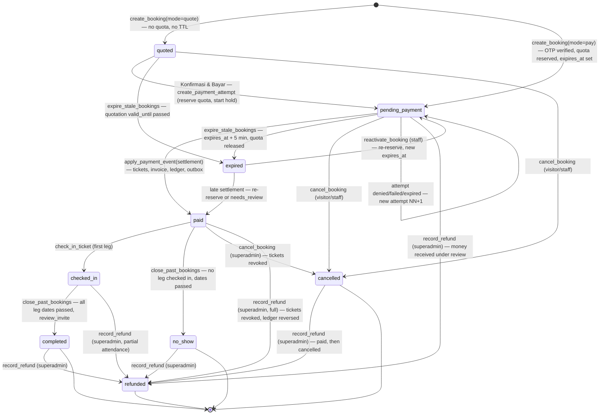
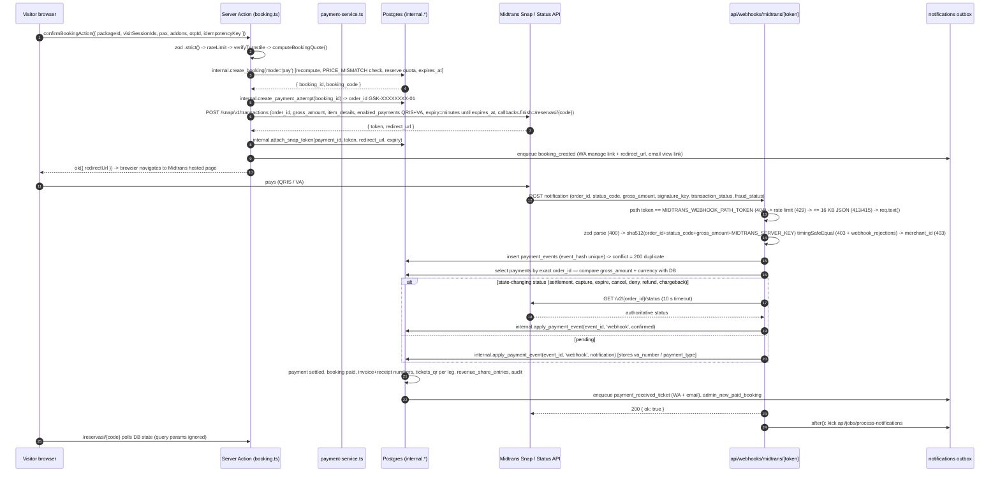
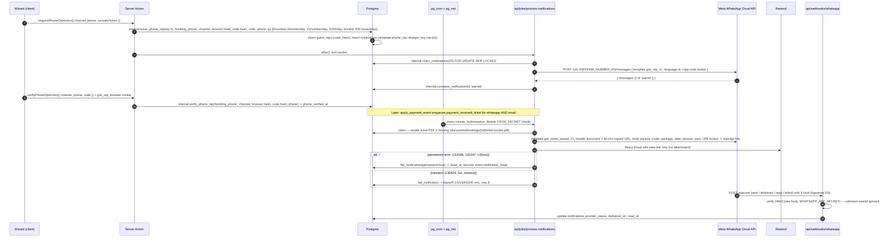
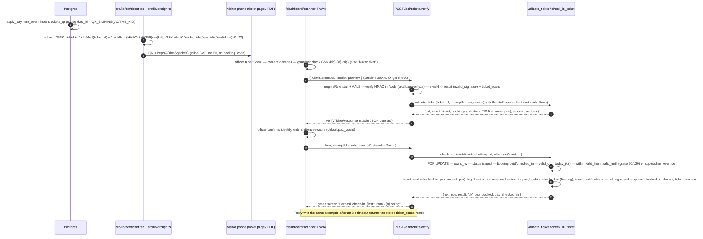
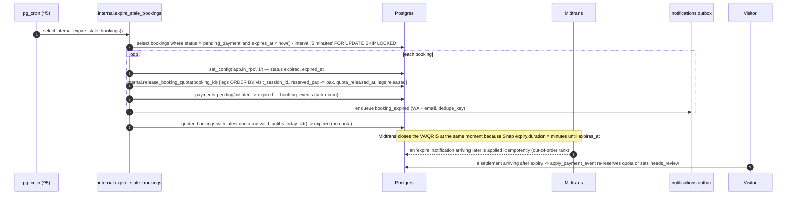
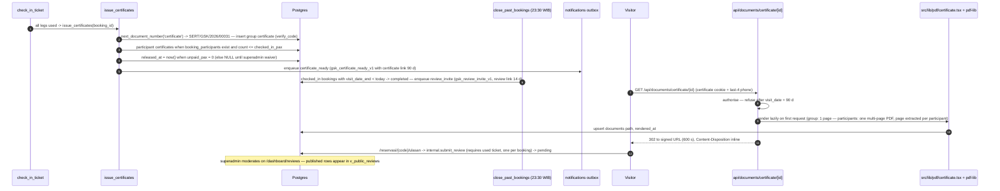

# Product Requirement Document (PRD)

## Edu Center & Edu Wisata Kelurahan Gisikdrono

---

## 1. Document control

| Field | Value |
|---|---|
| Document | `docs/PRD.md` |
| Version | 1.0 |
| Date | 2026-10-15 |
| Status | Draft for review |
| Owner | Kelurahan Gisikdrono Edu Center project team |
| Companion documents | `CLAUDE.md` (repository root), `docs/Task.md`, `docs/StyleGuide.md`, `docs/Security.md` |
| Precedence | `supabase/migrations` > `docs/PRD.md` > `CLAUDE.md` > `docs/Security.md` (security rules are additive and never relaxed) > `docs/StyleGuide.md` |

### 1.1 Table of contents

1. Document control
2. Executive summary, problem statement, vision, goals and success metrics
3. Scope and glossary
4. User personas
5. Sitemap mapped to routes
6. Functional requirements (`FR-<MODULE>-nn`)
7. Non-functional requirements (`NFR-nn`)
8. Database architecture
9. Booking and payment state machine
10. System integration flows
11. Reporting, exports, revenue share and price governance
12. Risks and mitigations
13. Open decisions and appendices

### 1.2 How to read this document

- Every table, column, enum value, route, RPC, bucket, template and environment variable named here is canonical and is used verbatim by `CLAUDE.md`, `docs/Task.md` and `docs/Security.md`. The naming registry in `CLAUDE.md` Appendix A is derived from this document and from the migrations.
- Requirement IDs (`FR-BOOK-07`, `NFR-05`) are cited in pull requests and in `docs/Task.md` items.
- Section 8 (database) is the contract for `supabase/migrations/0001_extensions … 0008_seed`; the migrations are the final truth once applied.
- Security controls are summarised as non-functional requirements in §7; the full threat model, controls matrix and runbooks live in `docs/Security.md`.

---

## 2. Executive summary

### 2.1 Summary

Kelurahan Gisikdrono (an urban-village administrative unit in Semarang Barat) runs community edu-tourism programmes in three of its RWs (decision of 2026-10-21; the site reads them from `rw_units`): **RW 05 "Ecowastreme"** (zero-waste ecotourism: *Bank Sampah* community waste bank, composting, maggot farming, urban farming and recycled crafts by the *PKK* women's family-welfare group), **RW 13 "Kampung Budaya & Seni"** (traditional dance, a children's *sanggar* arts studio and *dolanan*, traditional Javanese children's games) and **RW 08 "Kampung Inklusif & Ramah Anak"** (the kelurahan's public service centre, with *Semar Cakep*, an inclusive service for vulnerable groups and people with disabilities, and *Ketan Ronggolawe*, a child-friendly community hall; a profile page until the kelurahan sets up its study-visit packages). Today these programmes are promoted and booked by phone, chat and paper.

The **Edu Center & Edu Wisata Kelurahan Gisikdrono** platform is a single public website plus a role-based administration portal that:

1. **Promotes** both programmes with an SEO-ready public site (profiles, interactive map, galleries, UMKM marketplace, articles, e-booklets).
2. **Sells dated visit sessions** with hard per-session quotas, optional pre-ordered UMKM products, automatic B2B quotation and invoice PDFs, and online payment through Midtrans (QRIS and virtual accounts).
3. **Issues signed QR tickets** delivered by WhatsApp and email, validated at the gate by a PWA camera scanner operated by RW officers.
4. **Closes the loop** with automatic e-certificates after check-in, a moderated guest book and revenue-share recaps for the kelurahan treasury, the RW treasuries and UMKM vendors.

The platform is a Next.js 15 application on Vercel backed by Supabase (Postgres with Row Level Security, Auth for staff only, Storage), with Midtrans Snap, the Meta WhatsApp Business Cloud API and Resend as processors. Visitors never create accounts; staff (one Superadmin Kelurahan and one admin per RW) authenticate with password plus mandatory TOTP.

### 2.2 Problem statement

| Problem today | Consequence | Platform answer |
|---|---|---|
| Bookings arrive through personal WhatsApp numbers, phone calls and visits; availability is tracked in notebooks | Double bookings, lost requests, no capacity planning | Session calendar with stored quota and atomic reservation (`visit_sessions.reserved_pax`) |
| Schools and offices require an official quotation, invoice and receipt before and after payment | Staff hand-write documents; numbering is inconsistent; payments are informal transfers | Automatic `SP/`, `INV/`, `KW/` PDFs with gapless numbering; payment only through Midtrans |
| Payments to personal accounts | No audit trail; revenue share to RW treasuries and UMKM is negotiated case by case | Hash-chained revenue ledger and configurable share rules; payouts recorded with proof |
| Visitor counting at the gate is manual | Attendance statistics are unreliable; certificates are issued by hand | Signed QR group tickets, single-use atomic check-in, automatic certificates |
| No single online presence | Programmes are invisible to search engines and to institutions outside Semarang | Indonesian-language public site with structured data, articles and e-booklets |
| Data of school children handled informally | Privacy exposure under UU PDP No. 27/2022 | PII minimisation, retention jobs, masked staff views and audited reveals |

### 2.3 Project vision

A visiting teacher can find the programme on Google on Monday, download a visit proposal, obtain an official quotation the same day, pay through the school treasurer's virtual account on Wednesday, receive the QR ticket on WhatsApp within a minute of payment, walk 40 pupils through the RW 05 gate in under a minute on Saturday, and download every pupil's certificate on Sunday, while the kelurahan sees the revenue split to the RW treasury and the PKK vendor without touching a spreadsheet.

### 2.4 Goals and measurable success metrics

| # | Goal | Metric | Target (6 months after go-live) | Source |
|---|---|---|---|---|
| G1 | Grow bookings | Paid bookings per month | >= 40 | `visit_stats` |
| G2 | Convert visitors | Wizard conversion (step `jadwal` started -> `paid`) | >= 35 % | `@vercel/analytics` custom events + `bookings` |
| G3 | Fast ticketing | Settlement -> WhatsApp ticket delivered (p95) | <= 60 s | `payment_events.processed_at` -> `notifications.delivered_at` |
| G4 | Fast gate | Scan `preview` -> `commit` per group (median) | <= 60 s | `ticket_scans` |
| G5 | Never oversell | Sessions with `reserved_pax > capacity` | 0 (CHECK constraint) | `reconcile_session_counters` drift log |
| G6 | Money correctness | Open reconciliation issues older than 48 h | 0 | `reconciliation_issues` |
| G7 | Social proof | Completed bookings that leave a review | >= 60 % | `reviews` / `bookings.completed_at` |
| G8 | Self-service content | Content types editable by RW admins without a developer | 100 % (pages, galleries, products, packages, sessions, schedules, articles as draft) | manual audit |
| G9 | Web performance | LCP on 4G, 360 px, public pages | <= 2.5 s (p75) | Vercel Analytics |
| G10 | Availability | Booking flow availability per month | >= 99.5 % | `/api/health` monitor |
| G11 | Privacy | PII retention jobs run and audited | 100 % of scheduled runs | `audit_logs` |

---

## 3. Scope and glossary

### 3.1 In scope (release 1.0)

| Area | Included |
|---|---|
| Public site | Home, one page per RW (RW 05, RW 13, RW 08), package catalogue, UMKM marketplace, integrated gallery, e-booklets (flipbook + PDF), articles, reviews, map and contact, privacy notice, certificate verification, QR landing |
| Booking engine | Session calendar with quota, booking wizard, WhatsApp OTP, add-ons, server-side pricing, Midtrans Snap (redirect mode, QRIS + VA), hold expiry, guest links, lookup, cancellation |
| B2B automation | Quotation PDF, invoice and receipt PDF, credit note, participant list, hold extension, manual payment recording, walk-in bookings |
| Tickets and scanner | Signed QR per booking leg, WhatsApp + email delivery, PWA scanner (preview/commit), manual check-in, undo, manifest |
| Post-visit | Group and participant e-certificates, verification page, review invitation and moderation, reminders |
| Admin CMS | Dashboard shell, bookings, sessions, attendance, certificates, packages, products, galleries, articles, booklets, schedules, activity points, pages, reviews, finance (recap, revenue share, reconciliation, adjustments), exports, users, settings, hero banners, audit logs, security alerts, profile |
| Platform | Supabase schema with RLS on every table, `internal` schema for transitions, pg_cron jobs, notification outbox, PDF rendering, observability, backups |

### 3.2 Out of scope (release 1.0)

| Excluded | Reason / future path |
|---|---|
| Visitor accounts, loyalty, saved profiles | Guest checkout only; `bookings.user_id` can be added later as a non-breaking migration |
| Online sales of UMKM products outside a booking (standalone e-commerce, shipping) | Products are showcased and pre-ordered as booking add-ons only |
| Offline check-in queue in the scanner | Online-only by design; paper manifest is the contingency |
| Payment methods other than QRIS and virtual accounts (cards, e-wallets, instalments) | `enabled_payments` fixed to QRIS + VA |
| Multi-language public site | Indonesian only (`<html lang="id">`); code and docs in English |
| Native mobile apps | PWA for the scanner; responsive web for everything else |
| Accounting integration, tax invoices (e-Faktur) | Exports (XLSX/CSV/PDF) feed the kelurahan's existing process |
| Live chat / chatbot | Floating WhatsApp button opens a human chat outside the system |
| Payment in instalments, deposits, partial payments | One settlement per booking; partial refunds are supported |

### 3.3 Glossary

| Term | Meaning |
|---|---|
| Kelurahan | Urban-village administrative unit (here Kelurahan Gisikdrono, Semarang Barat); the platform owner and the `rw_id IS NULL` level of content |
| RW (Rukun Warga) | Neighbourhood unit inside a kelurahan; `rw_units` rows `5`, `13` and `8`, in that order (`sort_order`) |
| RW 05 Ecowastreme | RW 05's zero-waste ecotourism programme (`rw_id = 5`) |
| RW 13 Kampung Budaya & Seni | RW 13's arts-and-culture village programme (`rw_id = 13`), Jl. Jatisari; until 2026-10-21 the site called it "RW 08 Kampung Seni Budaya" |
| RW 08 Kampung Inklusif & Ramah Anak | RW 08's programme (`rw_id = 8`): the public service centre with Semar Cakep and Ketan Ronggolawe |
| Semar Cakep | Semarang Barat Cinta Kelompok Rentan & Penyandang Disabilitas: the district's inclusive public service and its Rumah Pemberdayaan in RW 08 (`activity_point_type` `inclusion_center`) |
| Ketan Ronggolawe | RW 08's community hall turned into a safe place for children to play and learn (`activity_point_type` `child_friendly_space`) |
| UMKM | Usaha Mikro, Kecil dan Menengah: micro, small and medium enterprises; the vendors behind `products_umkm` |
| PKK | Pemberdayaan Kesejahteraan Keluarga: the family-welfare women's group; an UMKM vendor of recycled crafts in RW 05 |
| Bank Sampah | Community waste bank where residents deposit sorted recyclables; an activity point in RW 05 |
| Dolanan | Traditional Javanese children's games performed and taught in RW 13 |
| Sanggar | Community arts studio (dance, music) for children in RW 13 |
| PIC | Person in charge: the booker who represents a group; the only contact stored on a booking |
| Pax | Number of visitors in a booking (`pax_count`) |
| Session | A bookable time window on one date for one RW (`visit_sessions`) |
| Leg | The part of a booking that visits one RW (`booking_legs`); combo bookings have two legs |
| Combo package | Kelurahan-owned package visiting two or more RWs (`tour_packages.category = 'combo'`, `rw_id IS NULL`) |
| Hold | The period a `pending_payment` booking keeps quota reserved (`bookings.expires_at`) |
| Quotation (Surat Penawaran) | B2B offer letter `SP/GSK/YYYY/MM/NNNN`; holds no quota |
| Invoice / receipt (Kwitansi) | `INV/GSK/YYYY/MM/NNNN` issued at settlement; `KW/GSK/YYYY/MM/NNNN` receipt |
| AAL2 | Supabase Auth assurance level 2: session verified with TOTP |
| Superadmin | `app_role = 'superadmin'`; kelurahan staff with full scope |
| Admin RW | `app_role = 'admin_rw'`; RW officer scoped to one `rw_id` |
| Guest link | HMAC-signed scoped link (`pay`, `manage`, `view`, `review`, `certificate`) that identifies a booking without an account |
| Outbox | `notifications` table drained by the worker job; the only way messages leave the system |
| Ledger | `revenue_share_entries`, append-only, hash-chained |

---

## 4. User personas

### 4.1 Superadmin Kelurahan

| Attribute | Detail |
|---|---|
| Who | Kelurahan staff member (Kasi Pelayanan, the head of the public-service section, or a designated operator) accountable to the Lurah (the kelurahan head); one or two accounts |
| Role | `superadmin`; sees every RW through `RwSwitcher`; AAL2 mandatory |
| Goals | Correct money: every paid booking reconciled, revenue split transparently, payouts documented; moderated public content; staff accounts under control; exportable statistics for the kelurahan and for Diskominfo (the municipal communications and informatics office) reports |
| Pain points | Not a full-time engineer; limited time; fears personal liability for mishandled funds or children's data; receives escalations from every RW |
| Devices | Office laptop (Chrome, 1366 px) and personal Android phone |
| Key scenarios | Invite an RW admin (FR-ADMIN-18); approve a price change and moderate an article (FR-ADMIN-11, §11.4); resolve a `needs_review` booking after a late settlement (FR-ADMIN-26); record a payout batch with proof (FR-ADMIN-20); export monthly visits to XLSX (FR-ADMIN-22); review `security-alerts` after a signature-failure burst (FR-ADMIN-25) |

### 4.2 RW officer / Admin RW 05, Admin RW 13 and Admin RW 08

| Attribute | Detail |
|---|---|
| Who | Pokdarwis (tourism awareness group) or RW committee member; one account per RW; operates the gate on visit days |
| Role | `admin_rw` with `app_rw_id = 5`, `13` or `8`; AAL2 mandatory |
| Goals | Keep the RW page, gallery and product catalogue current; set weekly session templates and close sessions for holidays; see tomorrow's groups; check in a group in seconds; print the day's manifest; see what the RW treasury and local vendors earned |
| Pain points | Works from a phone in the field, often with poor signal and bright sunlight; cannot see or should not see another RW's data; cannot handle money disputes |
| Devices | Android phone (Chrome, 360-412 px) as the scanner; occasional laptop for content |
| Key scenarios | Generate next month's sessions from templates (FR-ADMIN-05); upload gallery photos (FR-ADMIN-10, FR-ADMIN-16); scan a ticket at the gate and record 38 attendees (FR-SCAN-03, FR-SCAN-04); manual check-in when a QR is unreadable (FR-SCAN-07); draft an article for superadmin review (FR-ADMIN-11); record a cash walk-in (FR-B2B-08) |

### 4.3 Group booker (school, university, government office, company, community)

| Attribute | Detail |
|---|---|
| Who | Teacher, lecturer, office administrator, HR or CSR staff booking for 20-200 people; needs internal approval and an official document trail |
| Role | Guest (no account); identified by `booking_code` + OTP-verified phone; `booker_type` in `school \| university \| government \| company \| community` |
| Goals | Download a proposal, obtain a quotation to attach to a budget request, pay by VA from the institution's account, receive invoice and receipt, get certificates for every participant |
| Pain points | Approval takes days; the treasurer, not the booker, pays; participant lists change until the last day; needs proof documents for audits |
| Devices | Office laptop and WhatsApp on a phone |
| Key scenarios | Request a quotation without losing the slot immediately (FR-B2B-01); confirm and pay within the 24-hour institutional hold (FR-B2B-04); forward the payment link to the treasurer (FR-B2B-10); upload 120 participant names (FR-B2B-09); download the group and per-participant certificates (FR-POST-02) |

### 4.4 General tourist (family, small group)

| Attribute | Detail |
|---|---|
| Who | Family or friends (2-15 people) from Semarang or visiting the city; found the site through search or social media |
| Role | Guest; `booker_type = 'individual'` |
| Goals | See what the visit includes, pick a date, pay with QRIS in two minutes, show the QR at the gate from a phone, leave a review |
| Pain points | Does not want an account; distrusts transfers to personal accounts; may book on a 360 px phone with mobile data |
| Devices | Android or iOS phone (Chrome, Safari) |
| Key scenarios | Book from a package card (FR-BOOK-01); verify phone by WhatsApp OTP (FR-BOOK-06); pay with QRIS on the Midtrans hosted page (FR-BOOK-10); open the ticket from the WhatsApp link (FR-BOOK-14); submit a review from the invitation (FR-POST-06) |

---

## 5. Sitemap mapped to routes

Public slugs are Indonesian; admin and API paths are English. Public pages use ISR `revalidate = 3600` (schedule page 1800, e-booklets 86400) with tag revalidation; booking, auth and dashboard routes are `force-dynamic`, `Cache-Control: private, no-store`, `noindex`.

### 5.1 Public site

| Sitemap node | Route | Requirements |
|---|---|---|
| Home (Beranda Utama) | `/` | FR-PUB-01..07 |
| Hero Banner (Produk Unggulan UMKM & Direct CTA) | `/` (section, `hero_banners`) | FR-PUB-01 |
| Quick Highlight Edu Wisata (every RW online) | `/#kampung` (section, `rw_units`; the desktop header's `Kampung Wisata` link, decision of 2026-10-22) | FR-PUB-02 |
| Peta Denah Interaktif | `/` (section, `activity_points` + `public/map/denah.svg`) | FR-PUB-03 |
| Katalog Paket Wisata Pilihan | `/` (section, `tour_packages.is_featured`) | FR-PUB-04 |
| Ulasan & Testimoni Rombongan | `/` (section, `v_public_reviews.is_featured`) | FR-PUB-05 |
| Berita & Artikel Edukasi Terkini | `/` (section, latest `articles`) | FR-PUB-06 |
| Unduh E-Booklet & Proposal Kunjungan | `/` (section, `booklets`) | FR-PUB-07 |
| Edu Wisata RW 05 (Ecowastreme / Lingkungan) | `/rw-05-ecowastreme` | FR-PUB-08 |
| Profil, Visi & Filosofi Ecowastreme | `/rw-05-ecowastreme#profil` | FR-PUB-08 |
| Titik Wahana & Aktivitas | `/rw-05-ecowastreme#titik-aktivitas` | FR-PUB-08, FR-PUB-03 |
| Galeri Dokumentasi Kegiatan RW 05 | `/rw-05-ecowastreme#galeri`, `/galeri?filter=rw05` | FR-PUB-08, FR-PUB-14 |
| Marketplace / Produk Olahan UMKM RW 05 | `/rw-05-ecowastreme#produk`, `/produk?rw=05` | FR-PUB-13 |
| Paket Wisata Khusus RW 05 | `/rw-05-ecowastreme#paket`, `/paket-wisata?rw=05` | FR-PUB-11 |
| Edu Wisata RW 13 (Kampung Budaya & Seni) | `/rw-13-kampung-budaya-seni` (the old `/rw-08-kampung-seni-budaya` answers 308 here) | FR-PUB-09 |
| Profil Sanggar Seni & Rumah Budaya | `/rw-13-kampung-budaya-seni#profil` | FR-PUB-09 |
| Jadwal Pertunjukan & Workshop | `/rw-13-kampung-budaya-seni/jadwal` (the old `/rw-08-kampung-seni-budaya/jadwal` answers 308 here) | FR-PUB-10 |
| Galeri Dokumentasi Kegiatan RW 13 | `/rw-13-kampung-budaya-seni#galeri`, `/galeri?filter=rw13` | FR-PUB-14 |
| Suvenir & Cinderamata Khas RW 13 | `/rw-13-kampung-budaya-seni#produk`, `/produk?rw=13` | FR-PUB-13 |
| Edu Wisata RW 08 (Kampung Inklusif & Ramah Anak) | `/rw-08-inklusif-ramah-anak` | FR-PUB-24 |
| Profil Semar Cakep & Ketan Ronggolawe | `/rw-08-inklusif-ramah-anak#profil`, `#titik-aktivitas` | FR-PUB-24 |
| Marketplace UMKM terpadu (katalog gabungan dan detail produk) | `/produk`, `/produk/[slug]` | FR-PUB-13 |
| Paket Wisata Khusus RW 13 | `/rw-13-kampung-budaya-seni#paket`, `/paket-wisata?rw=13` | FR-PUB-11 |
| Paket Wisata & Pemesanan Tiket: Katalog Semua Paket | `/paket-wisata`, `/paket-wisata/[slug]` | FR-PUB-11, FR-PUB-12 |
| Kalender Kunjungan & Pemilihan Kuota/Sesi Waktu | `/pesan/[packageSlug]?step=jadwal` | FR-BOOK-01, FR-BOOK-02 |
| Add-on Rombongan (Pre-order Snack / Oleh-oleh UMKM) | `/pesan/[packageSlug]?step=tambahan` | FR-BOOK-04 |
| Generator Surat Penawaran & Invoice Resmi B2B | `/pesan/[packageSlug]?step=ringkasan`, `/reservasi/[bookingCode]`, `api/documents/[kind]/[id]` | FR-B2B-01..06 |
| Formulir Reservasi & Pembayaran (QRIS & VA) | `/pesan/[packageSlug]?step=data`, `/reservasi/[bookingCode]/bayar` | FR-BOOK-03, FR-BOOK-10 |
| Tiket Digital (QR + WhatsApp & Email) | `/reservasi/[bookingCode]/tiket`, `/v/[token]` | FR-BOOK-13, FR-BOOK-14, FR-PUB-21 |
| Layanan Pasca Kunjungan: Unduh E-Sertifikat | `/reservasi/[bookingCode]/sertifikat`, `/verifikasi/[code]` | FR-POST-01..04 |
| Formulir Buku Tamu, Rating & Ulasan | `/reservasi/[bookingCode]/ulasan` | FR-POST-05, FR-POST-06 |
| Galeri Terpadu (Filter per RW, UMKM, Kunjungan) | `/galeri?filter=rw05\|rw13\|rw08\|umkm\|kunjungan` | FR-PUB-14 |
| E-Booklet (Flipbook & Unduhan PDF) | `/e-booklet`, `/e-booklet/[slug]`, `api/documents/booklet/[id]` | FR-PUB-07, FR-PUB-15 |
| Artikel & Kabar Edu Center Kelurahan | `/artikel`, `/artikel/[slug]` | FR-PUB-16 |
| Ulasan (published guest book) | `/ulasan` | FR-PUB-17 |
| Peta & Kontak (Embed Maps & Floating WhatsApp) | `/peta-kontak` + `WhatsAppFab` on every public page | FR-PUB-18 |
| Privasi & permintaan hak subjek data | `/privasi`, `/privasi/permintaan` | FR-PUB-19 |
| Cari reservasi (kirim ulang tautan) | `/reservasi/cari` | FR-BOOK-16 |

### 5.2 Auth and admin portal

| Sitemap node | Route (`(admin)/dashboard`) | Role | Requirements |
|---|---|---|---|
| Login, reset, MFA, onboarding | `/login`, `/forgot-password`, `/reset-password`, `/mfa/enroll`, `/mfa/verify`, `/onboarding`, `/auth/continue` (the page an email link opens first; its button posts the link to `auth/callback`), `auth/callback`, `auth/signout` | staff | FR-ADMIN-01 |
| Overview | `/dashboard` | all staff | FR-ADMIN-02, FR-ADMIN-03 |
| Reservasi | `/dashboard/bookings`, `/dashboard/bookings/[id]` | all staff (scope) | FR-ADMIN-04 |
| Pengaturan Kuota Harian & Jam Sesi (per RW) | `/dashboard/sessions` | admin_rw own RW, superadmin | FR-ADMIN-05 |
| Web PWA QR Scanner (per RW) | `/dashboard/scanner` | all staff | FR-SCAN-01..11 |
| Daftar Kehadiran | `/dashboard/attendance` | all staff (scope) | FR-ADMIN-06 |
| Penerbitan E-Sertifikat (per RW) | `/dashboard/certificates` | all staff (scope) | FR-ADMIN-07 |
| Manajemen Paket Wisata (per RW) | `/dashboard/packages`, `/new`, `/[id]/edit` | admin_rw own RW; combos superadmin | FR-ADMIN-08 |
| Katalog Produk UMKM / Suvenir (per RW) | `/dashboard/products`, `/new`, `/[id]/edit` | admin_rw own RW, superadmin | FR-ADMIN-09 |
| CMS Galeri (per RW) | `/dashboard/galleries` | admin_rw own RW, superadmin | FR-ADMIN-10 |
| CMS Edukasi / Artikel | `/dashboard/articles`, `/new`, `/[id]/edit` | admin_rw drafts; superadmin publishes | FR-ADMIN-11 |
| E-Booklet | `/dashboard/booklets` | admin_rw own RW, superadmin | FR-ADMIN-12 |
| Jadwal Pagelaran (an RW with `schedule_enabled`: RW 13) | `/dashboard/schedules` | admin_rw of such an RW, superadmin | FR-ADMIN-13 |
| Titik Aktivitas | `/dashboard/activity-points` | admin_rw own RW, superadmin | FR-ADMIN-14 |
| CMS Halaman RW | `/dashboard/pages` | admin_rw own RW, superadmin | FR-ADMIN-15 |
| Moderasi Ulasan | `/dashboard/reviews` | superadmin (admin_rw read-only) | FR-ADMIN-19 |
| Rekapitulasi Finansial & Bagi Hasil | `/dashboard/finance`, `/dashboard/finance/revenue-share` | superadmin (admin_rw: own recap on `/dashboard/finance`) | FR-ADMIN-20 |
| Rekonsiliasi & Penyesuaian | `/dashboard/finance/reconciliation`, `/dashboard/finance/adjustments` | superadmin | FR-ADMIN-21 |
| Ekspor Laporan (Excel / CSV / PDF) | `/dashboard/exports`, `api/export/[kind]` | superadmin (admin_rw: own-RW attendance) | FR-ADMIN-22 |
| Manajemen Akun & Hak Akses Pengurus RW | `/dashboard/users` | superadmin | FR-ADMIN-18 |
| Pengaturan & Banner Hero | `/dashboard/settings`, `/dashboard/settings/hero-banners` | superadmin | FR-ADMIN-23 |
| Log Aktivitas | `/dashboard/audit-logs` | superadmin | FR-ADMIN-24 |
| Peringatan Keamanan | `/dashboard/security-alerts` | superadmin | FR-ADMIN-25 |
| Profil | `/dashboard/profile` | all staff | FR-ADMIN-01 |

### 5.3 Machine endpoints

| Route | Caller | Requirements |
|---|---|---|
| `POST api/webhooks/midtrans/[token]` | Midtrans | FR-BOOK-12, §10.1 |
| `GET/POST api/webhooks/whatsapp` | Meta | FR-BOOK-14, §10.2 |
| `POST api/jobs/process-notifications`, `payments-poll`, `reconcile-payments`, `anomaly-scan`, `expire-bookings` | pg_cron via pg_net, `Bearer CRON_SECRET` | §8.9, §10.4 |
| `POST api/tickets/verify` | PWA scanner (staff session) | FR-SCAN-03, FR-SCAN-04 |
| `GET api/documents/[kind]/[id]` | guest (cookie) / staff; `kind = booklet` is public (rate-limited, counts the download, redirects to `public-media`) | FR-B2B-02, FR-B2B-05, FR-POST-03, FR-PUB-07 |
| `POST api/webhooks/resend` (could) | Resend: Svix-signed bounce/complaint events, verified with `RESEND_WEBHOOK_SECRET`; informational only | §10.2 |
| `GET api/export/[kind]` | staff | FR-ADMIN-22 |
| `POST api/uploads/sign`, `api/uploads/finalize` | staff | FR-ADMIN-16 |
| `GET api/health` | uptime monitor | NFR-07 |
| `sitemap.ts`, `robots.ts`, `manifest.ts`, `opengraph-image.tsx` | crawlers / browsers | FR-PUB-22, FR-SCAN-01 |

---

## 6. Functional requirements

Priority uses MoSCoW: **M** must, **S** should, **C** could, **W** won't (this release). Every requirement is testable through the acceptance criteria column; IDs are stable.

### 6.1 PUB: Public pages

| ID | Requirement | Pri | Acceptance criteria |
|---|---|---|---|
| FR-PUB-01 | Home hero carousel from `hero_banners` (active, within `starts_at`/`ends_at`), each slide optionally linking a featured `products_umkm` row and carrying a CTA | M | Slides render in `sort_order`; inactive or out-of-window slides never appear; first slide image is the LCP element with `priority`; CTA deep-links to `/paket-wisata` or the product |
| FR-PUB-02 | Quick highlight of every RW online from `rw_units` (name, `theme_label`, tagline, hero image) as an RW mosaic in `sort_order`, the first RW as the large tile (amended 2026-10-23 for the home page redesign the user asked for that day; it replaces "one RW to a row with photo and text alternating"; tiles differ in size, accent and photo, so `docs/StyleGuide.md` §1.3 G7 holds) | M | Each tile links to its RW page as a whole-card link; the eyebrow counts the RWs online; content editable from `/dashboard/pages` |
| FR-PUB-03 | Interactive map: inline SVG floor plan (`public/map/denah.svg`) with hotspots bound to `activity_points.svg_hotspot_id`, zoom/pan, and a Leaflet (OSM) layer using `lat`/`lng` | M | Every hotspot is a `<button aria-label>`; clicking opens the point's card (name, type, description, image); works with keyboard; map island is `next/dynamic` |
| FR-PUB-04 | Featured package cards (`tour_packages.is_featured`, `status = 'published'`) with price from `price_per_pax`/`flat_price` formatted by `formatIDR()` | M | Max 6 cards; each links to `/paket-wisata/[slug]`; price shown as "mulai Rp …" when tiers exist |
| FR-PUB-05 | Testimonials section from `v_public_reviews` where `is_featured`, showing rating, excerpt, institution and first name only | M | Anonymous reviews show "Pengunjung"; no PII beyond institution + first name |
| FR-PUB-06 | Latest 3 published articles with cover, category, date | M | Ordered by `published_at desc`; links to `/artikel/[slug]` |
| FR-PUB-07 | E-booklet and visit-proposal download block (`booklets` published, kinds `ebooklet`, `visit_proposal`, `price_list`) | M | Download link is `api/documents/booklet/[id]` (public, rate-limited per IP), which increments `download_count` through `internal.increment_booklet_download` under the service role (`document-service.ts`) and then redirects to the published `public-media` object served as an attachment; no RPC is executable by `anon` |
| FR-PUB-08 | RW 05 page: profile/vision/philosophy (`rw_units.description_md`, `vision_md`), activity points list, gallery preview, UMKM products, RW packages | M | All sections read only `rw_id = 5` published rows; anchors `#profil #titik-aktivitas #galeri #produk #paket` |
| FR-PUB-09 | RW 13 page (Kampung Budaya & Seni): profile of sanggar and culture house, upcoming schedule preview, gallery, souvenirs, RW packages | M | Schedule preview shows next 5 published `performance_schedules`; same anchor pattern |
| FR-PUB-10 | Full schedule page `/<rw slug>/jadwal` of an RW with `schedule_enabled` (`/rw-13-kampung-budaya-seni/jadwal`) with month navigation and `Event` JSON-LD | M | Shows `starts_at`/`ends_at` in WIB, venue, type badge; links to the bookable package when `package_id` is set |
| FR-PUB-11 | Package catalogue with filters `?rw=<RW number>\|combo&type=regular\|student\|institutional\|combo` via `nuqs` | M | Filters apply in memory on the cached list; empty state in Indonesian; URL is shareable |
| FR-PUB-12 | Package detail: highlights, inclusions, itinerary, duration, pricing tiers, gallery, availability preview for the next 14 days from `v_session_availability`, CTA "Pesan Sekarang" | M | Availability island fetches uncached through the server; CTA goes to `/pesan/[slug]?step=jadwal`; `Product`/`Offer` JSON-LD with IDR price |
| FR-PUB-13 | UMKM marketplace list and detail (`products_umkm` published) with vendor name, category filter and "Pesan sebagai tambahan" hint | M | No cart; add-on-eligible products show the hint; vendor private columns never serialised |
| FR-PUB-14 | Integrated gallery with filters `rwNN` (one per RW online: `rw05 \| rw13 \| rw08`) `\| umkm \| kunjungan`, CSS-column masonry, lightbox, load-more cursor | M | Filter maps to `rw_id`/`category`; every image has `alt_text`; videos embed YouTube by `video_url` |
| FR-PUB-15 | E-booklet viewer: flipbook over pre-rendered `pages/0001.webp…` with PDF download | M | Flipbook is `next/dynamic` `ssr:false`; page images lazy; download link is `api/documents/booklet/[id]` (FR-PUB-07) |
| FR-PUB-16 | Articles list and detail rendering `articles.body_json` through the allowlisted `RichText` React renderer | M | Unknown node types are dropped, never rendered as HTML; `Article` JSON-LD; reading time |
| FR-PUB-17 | Reviews page listing published reviews with rating filter and aggregate rating | M | Reads `v_public_reviews` only; `AggregateRating` JSON-LD |
| FR-PUB-18 | Map and contact page: Google Maps embed, Leaflet markers, route deep link, contact from public `site_settings`; floating WhatsApp button on all public pages using `NEXT_PUBLIC_WHATSAPP_CONTACT_NUMBER` | M | Embed origin allow-listed in CSP; WhatsApp button opens `wa.me` with a prefilled Indonesian message |
| FR-PUB-19 | Privacy notice `/privasi` (controller, purposes, retention incl. 90-day participant window, Singapore processors, DPO contact) and DSR form `/privasi/permintaan` creating `dsr_requests` after OTP identity check | M | Form protected by Turnstile; request confirmation sent through the outbox; superadmin sees requests |
| FR-PUB-20 | Verification page `/verifikasi/[code]` for certificates (recipient name, institution, visit date, status) and quotations (quotation number, institution, validity, status) by their `verify_code`; nothing else is shown | M | Unknown code -> 404; revoked certificates show "Dicabut"; superseded or void quotations show their status; rate-limited |
| FR-PUB-21 | QR landing `/v/[token]` showing "Tiket valid / tidak valid" only | M | Verifies the HMAC via `src/lib/qr/verify.ts`; no PII, no booking code; `noindex` |
| FR-PUB-22 | SEO infrastructure: `metadataBase`, title template `%s \| Edu Wisata Gisikdrono`, canonical, `generateMetadata` on dynamic pages, JSON-LD builders, `sitemap.ts`, `robots.ts`, OG images | M | Lighthouse SEO >= 95; sitemap lists all published slugs; robots disallows `/dashboard`, `/api`, `/pesan`, `/reservasi`, `/login`, `/v` |
| FR-PUB-23 | Every public page verified at 360 px with no horizontal scroll and touch targets >= 44 px | M | Playwright viewport test; StyleGuide checklist |
| FR-PUB-24 | RW 08 page (Kampung Inklusif & Ramah Anak): profile of the public service centre, Semar Cakep and Ketan Ronggolawe, activity points (`inclusion_center`, `child_friendly_space`), gallery; packages, products and the schedule stay hidden until RW 08 has them (decision of 2026-10-21) | M | Same route and anchors as every RW page; sections without rows are hidden whole (`docs/StyleGuide.md` §6.9) |

### 6.2 BOOK: Booking engine and QR system

| ID | Requirement | Pri | Acceptance criteria |
|---|---|---|---|
| FR-BOOK-01 | Booking wizard `/pesan/[packageSlug]` with steps `jadwal -> data -> tambahan -> ringkasan` driven by `?step=`, one `react-hook-form` instance with a zod schema per step, draft persisted in `sessionStorage` | M | Refresh keeps the draft; back navigation keeps values; `booking_enabled = false` or `maintenance_mode` shows a closed notice instead of the wizard |
| FR-BOOK-02 | Session picker reads `v_session_availability` for the package's RW (every RW of a combo, in its leg order); shows remaining seats; refreshes every 15 s through the server | M | Sessions with `remaining < pax` are disabled; sessions earlier than `booking.min_lead_hours` or later than `booking.max_advance_days` are hidden; combo requires one session per leg |
| FR-BOOK-03 | Booker form: `booker_type`, institution (required for non-individual), PIC name, phone (`+62`), email, pax within package `min_pax..max_pax` and `booking.max_pax`, notes, consent checkbox with version | M | Phone normalised to E.164; validation messages in Indonesian; `aria-invalid` + `aria-describedby`; consent stored as `consent_version`, `consented_at`; the guardians' consent to a participant list as `guardian_consented_at` (independent review of PR #27, L4) |
| FR-BOOK-04 | Add-on step lists `products_umkm` where `is_addon_eligible` and published for the package's RW(s), with quantity steppers within `min_order_qty..max_order_qty` | M | Add-on subtotal updates from a server-computed quote; lead-time note shown |
| FR-BOOK-05 | Summary step shows the server-computed quote (`computeBookingQuote()`), the unticked checkbox "Saya telah membaca Pemberitahuan Privasi" linking `/privasi`, whose version `PRIVACY_NOTICE_VERSION` is stored as `consent_version` (the kelurahan's visit terms, Syarat & Ketentuan kunjungan, join it before go-live; decision of 2026-10-22 on P3.5, Q3), and the CTA "Konfirmasi & Bayar" (or "Minta Surat Penawaran" for school, university, government and company) | M | Client never sends prices; quote lines sum to total; `PRICE_MISMATCH` re-renders the summary with the new total |
| FR-BOOK-06 | WhatsApp OTP verification of the PIC phone before any quota reservation (`internal.issue_phone_otp` / `verify_phone_otp`, template `gsk_otp_v1`) | M | 6-digit code, 5 min validity, 5 attempts; a code belongs to the browser that asked for it; caps 5 per number and browser a day, 15 per number a day from all browsers, 20/IP/day; the same answer for sent, cooldown and capped; global soft breaker 500 issued WhatsApp codes a day degrades to interactive Turnstile + email OTP; `phone_verified_at` set on success |
| FR-BOOK-07 | `internal.create_booking` reserves quota atomically per leg (`internal.reserve_session_quota`, `ORDER BY id`, both-or-nothing for combo), snapshots prices, sets `expires_at`, writes `booking_events`, enqueues `booking_created` | M | 20 parallel holds into a session with room for 10 seats -> exactly 10 succeed (room the unpaid-share bound of FR-BOOK-08 does not cut short, decision of 2026-10-22); combo never reserves one leg only; `QUOTA_EXCEEDED` returned as `ActionResult`, not an exception |
| FR-BOOK-08 | Abuse caps: Turnstile on every public form; max 2 concurrent unpaid bookings per proven contact, that is the OTP-verified WhatsApp number or, while WhatsApp codes are degraded, the verified address in its BOOK-11 spelling, the other contact being only what was typed and counting toward nothing (independent review of PR #26, M2); 5 bookings/day per proven contact; 10/day per IP+UA bucket; unpaid holds <= 50 % of a session's capacity (beyond: "bayar untuk konfirmasi" mode, hold created only when Snap reports `pending`; until that flow lands with P3.7.03/04, `create_booking` answers `pay_to_confirm` and writes nothing, decision of 2026-10-22, Q3); pax > 20 hold shortened to 30 min for individual, community and other bookers, while a school, university, government office or company keeps its 24 h hold (Q5); pax > 60 raises one info `security_alerts` row `large_group`, never `needs_review` (Q4) | M | Limits enforced in `rate_limit_buckets` + `create_booking`; `rate_limit_profile = 'strict'` tightens all windows; `quota_pressure` security event (`anomaly-scan`) when a session's pending share > 60 %, which with the 50 % bound only a lowered capacity can cause |
| FR-BOOK-09 | Hold TTL: `pending_payment` bookings expire at `expires_at` (individual `booking.hold_minutes_individual` 120; institutions `booking.hold_hours_institution` 24, capped at first session start - 1 h); `internal.expire_stale_bookings` every 5 min with 5 min grace releases quota and enqueues `booking_expired` | M | `expires_at` written once by the function that starts the hold and never by a payment attempt; quota release idempotent via `quota_released_at` |
| FR-BOOK-10 | Payment attempt: `internal.create_payment_attempt` (one open attempt per booking: `initiated`, `pending` or `needs_review`; previous order expired via `/v2/{order_id}/expire`, refused when < 5 min remain) -> Snap transaction created server-side -> `attach_snap_token` -> redirect to `snap_redirect_url` | M | `enabled_payments = ['qris','bca_va','bni_va','bri_va','permata_va','cimb_va','other_va']`; `customer_details` = PIC only; `expiry.duration` = minutes until `expires_at`; `callbacks.finish = /reservasi/<code>`; no `snap.js` on our origin |
| FR-BOOK-11 | Status hub `/reservasi/[bookingCode]` reads DB state only, polls every 5 s while a payment is `pending`, shows VA number / QRIS instructions, countdown to `expires_at` with `aria-live` | M | Query parameters from the Midtrans finish redirect are ignored; page is `force-dynamic`, `private, no-store` |
| FR-BOOK-12 | Midtrans webhook pipeline (path token, rate limit, size, zod, SHA-512 signature with `timingSafeEqual`, merchant id, `payment_events` idempotency, amount check, Status API re-check, `internal.apply_payment_event`) per §10.1 | M | Replayed notification -> 200 no-op; tampered signature -> 403 + `webhook_rejections`; amount mismatch -> `needs_review`, never `paid`; business failures never return 500 |
| FR-BOOK-13 | On settlement `internal.apply_payment_event` issues one `tickets_qr` row per leg (`ticket_code = <booking_code>-<rw 2 digits>`, `valid_on`, `valid_from/valid_until`, `key_id`) in the same transaction as `paid`, invoice/receipt numbers, ledger entries, outbox rows and audit | M | DB trigger rejects `tickets_qr` INSERT unless the booking is `paid` with a settled payment; combo booking has two tickets |
| FR-BOOK-14 | Ticket delivery: WhatsApp `gsk_ticket_issued_v1` with a 60-min signed ticket PDF as document header and email (links only) with the `view` link; both enqueued in parallel | M | WA failure never loses the ticket (email still sent); dedupe keys prevent duplicates; delivery status updated from the WhatsApp webhook |
| FR-BOOK-15 | Guest links: scoped HMAC links (`pay` 24 h, `manage` 72 h, `view` 72 h, `review` 14 d, `certificate` 90 d) verified in `src/lib/links` and upgraded to httpOnly cookie `bk_<code>`; the OTP-verified WhatsApp number receives `manage`, email receives `view` until `email_verified_at` | M | Tampered, expired or version-bumped links -> 404; revocation by bumping `bookings.token_version`; links never contain uuids |
| FR-BOOK-16 | Lookup `/reservasi/cari` with `booking_code` + phone or email re-sends the link to the channel on file and never displays data | M | Rate-limited 5/15 min per IP; identical response for hit and miss |
| FR-BOOK-17 | Visitor cancellation of unpaid bookings from the `manage` page (`cancel_booking` with `actor_type = 'visitor'`); a paid booking follows FR-BOOK-23 (decision A16) | M | Quota released; Midtrans order cancelled best-effort; `booking_cancelled` enqueued |
| FR-BOOK-18 | Duplicate holds: a new booking by a phone that already holds 2 unpaid bookings is refused with "sudah ada reservasi dengan nomor ini, tautan dikirim ulang" and a resume link | M | The other hold's code is never returned in the response |
| FR-BOOK-19 | Retry after `denied`/`failed`/`expired` attempt while the booking is still `pending_payment` creates attempt `NN+1` | M | Partial unique index allows one open payment (`initiated`, `pending` or `needs_review`) per booking |
| FR-BOOK-20 | Idempotency: `bookings.idempotency_key` (client UUID per wizard mount) returns the existing booking on resubmit | M | Double-submit creates one booking |
| FR-BOOK-21 | Ticket page `/reservasi/[bookingCode]/tiket` renders each leg's QR (`https://<site>/v/<token>`) with gate label, date, session, pax and rules; PDF download through `api/documents/ticket/[id]` | M | QR image is inline SVG; page requires the `view` or `manage` cookie |
| FR-BOOK-22 | Walk-in and admin-channel bookings created by staff (`channel = 'admin'`) through the same `internal.create_booking` with `requireRwAccess` | S | Admin bookings skip OTP but record `created_by`; cash payment path per FR-B2B-08 |
| FR-BOOK-23 | Cancellation of a paid booking under the visit terms (decision A16): the status hub previews the refund the server computes (the package part H-3 or earlier 90 %, H-2 80 %, H-1 50 %, H-0 0 %; add-ons in full), and the `manage` link confirms it | S | The preview and the cancellation use the same server computation; tickets revoked and seats released in the cancelling transaction; the refund is requested, not paid, until Midtrans or the treasurer confirms it, and only then recorded with the ledger reversal; the kept package part is split between the kelurahan and the RW treasury only (largest remainder, refund + retained = paid) |
| FR-BOOK-24 | Reschedule for weather (decision A17): after the kelurahan or RW declares a session stopped by the weather, the `manage` link may move the stopped leg to another open session of the same RW, up to 3 times within the 24 h window of that notice; the rights belong to the booking and the notice, so a move keeps them open, and a combo's other leg keeps its day | S | `weather_notice_bookings` holds the window and the moves; release and re-reserve in one transaction; the moved leg's ticket takes the new day and the ticket message goes out again; `booking_events` row per move |
| FR-BOOK-25 | Refund for weather (decision A18): while the window is open, also after a move, the group may take the amount paid minus that payment's Midtrans fee; a window that closes with no choice (no move, no refund) cancels the booking and requests the weather refund automatically, with a superadmin alert | S | Fee from `site_settings` per method; the whole ledger is reversed; the sweep runs in `payments-poll`; while the fee is unset the booking stays `paid` and a high alert goes to the superadmin |

### 6.3 B2B: B2B automation

| ID | Requirement | Pri | Acceptance criteria |
|---|---|---|---|
| FR-B2B-01 | Institutional booker types may request a quotation from the summary step: `create_booking(mode = 'quote')` creates a `quoted` booking with `booking_legs.status = 'unreserved'` (no quota, no TTL) | M | `quoted` bookings never change `reserved_pax`; the status hub shows the quotation and "Konfirmasi & Bayar" |
| FR-B2B-02 | Quotation PDF (`SP/GSK/YYYY/MM/NNNN`) rendered by `src/lib/pdf/quotation.tsx` with kelurahan letterhead, item table, validity (`booking.quotation_valid_days` 14), signatory, fixed line "Pembayaran hanya melalui sistem (QRIS/VA); kelurahan tidak pernah meminta transfer ke rekening pribadi" and verify URL `/verifikasi/<verify_code>` printed beside the quotation number | M | Only whitelisted length-limited fields are rendered (no free text); numbers are consumed only after `phone_verified_at` is set; rendered lazily on first request and stored in `documents` |
| FR-B2B-03 | Quotation versioning: a changed booking supersedes the previous quotation (`superseded`); maximum 3 quotations per booking | M | 4th request -> `STATE_INVALID` with Indonesian message; old PDFs remain downloadable and marked superseded |
| FR-B2B-04 | "Konfirmasi & Bayar" on a `quoted` booking (after OTP) reserves quota, starts the institutional hold (24 h) and creates the first payment attempt (`quoted -> pending_payment`, quotation `accepted`) | M | Quota failure returns `QUOTA_EXCEEDED` and keeps the booking `quoted` with a session-change prompt |
| FR-B2B-05 | Invoice (`INV/GSK/YYYY/MM/NNNN`) and receipt (`KW/GSK/YYYY/MM/NNNN`) numbers consumed inside `internal.apply_payment_event` at settlement; PDFs `invoice.tsx`, `receipt.tsx` with "LUNAS" stamp | M | One live invoice per booking (partial unique index); numbers are gapless per month (`document_sequences`) |
| FR-B2B-06 | Credit note (`CN/GSK/YYYY/NNNN`) generated on refund; invoice set to `void` with reason | M | Credit note snapshot stored on the invoice; ledger reversal rows written in the same transaction |
| FR-B2B-07 | Staff `extend_booking_hold` for `pending_payment` bookings in scope up to 14 days and before first session start | M | Audited in `audit_logs` and `booking_events`; Snap expiry of the live attempt is re-aligned by expiring and recreating the attempt |
| FR-B2B-08 | Manual payment recording via `mark_booking_paid_manually`: `manual_transfer` by superadmin with proof and reference; `cash` by admin_rw only for `channel = 'admin'` walk-ins | M | Creates `payments` (`provider = 'manual'`, `recorded_by`) and runs the same settlement path (tickets, invoice, ledger); superadmin manual transfers are flagged for the 24 h dual-control review in `payment_adjustments` |
| FR-B2B-09 | Participant list (name + group label + role label) entered manually, pasted from CSV/XLSX, or uploaded from the `manage` page until the visit date; count <= `pax_count` | M | Max 300 rows; names 2-120 chars; stored in `booking_participants`; used only for certificates and the attendance manifest |
| FR-B2B-10 | Pending-payment WhatsApp/email (`gsk_booking_created_v1`, `gsk_payment_reminder_v1`) include the hosted `snap_redirect_url` so a treasurer can pay from another device; reminder at `expires_at - 6 h` for institutional holds | M | Reminder deduped by `dedupe_key`; link is the Midtrans hosted page, never a Snap token |
| FR-B2B-11 | Staff can download quotation, invoice, receipt and credit note from the booking detail; guests from the `manage` page | M | Documents served through `api/documents/[kind]/[id]` with `private, no-store`; signed URLs 900 s for invoices |

### 6.4 POST: Post-visit service

| ID | Requirement | Pri | Acceptance criteria |
|---|---|---|---|
| FR-POST-01 | Group certificate (`SERT/GSK/YYYY/NNNNN`) auto-issued by `issue_certificates` when all legs are checked in; idempotent; rendered lazily on first download | M | Combo bookings get one group certificate covering every RW visited; second call creates nothing |
| FR-POST-02 | Participant certificates issued for `booking_participants` when the list exists and count <= `checked_in_pax`; single multi-page PDF rendered on first download, individual pages extracted with `pdf-lib` | M | Released only when `unpaid_pax = 0` or a superadmin waiver is recorded (audited) |
| FR-POST-03 | Certificate page `/reservasi/[bookingCode]/sertifikat` requires the `certificate` or `manage` link plus the last 4 digits of the verified phone; refuses after `visit_date + 90 d` | M | Wrong last-4 -> generic error, rate-limited; signed URLs 600 s |
| FR-POST-04 | Public verification `/verifikasi/[code]` per FR-PUB-20; superadmin may `revoke_certificate` with reason | M | Revoked certificate verification shows status "Dicabut" |
| FR-POST-05 | Review invitation: `close_past_bookings` sets `completed` and enqueues `review_invite` (`gsk_review_invite_v1`) carrying a single-use `review` link (14 d) | M | One invitation per booking; link invalid after use or after a review exists |
| FR-POST-06 | Review form: rating 1-5, title, body 10-2000 chars, display name, anonymous option; `internal.submit_review` requires a used ticket; status `pending` until superadmin moderation | M | Second submission -> `CONFLICT`; published reviews appear on `/ulasan` and, when featured, on the home page |
| FR-POST-07 | Thank-you message `checked_in_thanks` after the first check-in and D-1 reminder `visit_reminder_d1` at 09:00 WIB for paid bookings | M | Both deduped; reminder includes gate, session time and the `view` link |
| FR-POST-08 | Retention: `purge/retention` job at 02:00 WIB deletes `booking_participants` and participant-bearing PDFs 90 d after the visit, unpaid-expired PII after 7 d, anonymises booker PII after `pii_retention_months` (24), prunes OTPs after 24 h | M | Each run audited; certificates registry rows keep number and status (recipient name replaced by "[dihapus]") |
| FR-POST-09 | Visit-documentation photos linked to a booking (`galleries.booking_id`) shown on the manage page when published | C | Only images with `status = 'published'`; no participant faces policy stated in the admin UI |

### 6.5 SCAN: PWA scanner

| ID | Requirement | Pri | Acceptance criteria |
|---|---|---|---|
| FR-SCAN-01 | Installable PWA (`@serwist/next`, `manifest.ts` with `start_url: /dashboard/scanner`, `display: standalone`), shell cached only, `NetworkOnly` for `/api/*`, no PII cached | M | Lighthouse PWA installable; offline opens the shell and shows "Tidak ada sinyal" |
| FR-SCAN-02 | Camera scanning with `@yudiel/react-qr-scanner` (native `BarcodeDetector`, ZXing-WASM fallback), rear camera, torch toggle when supported, started by a tap; `Permissions-Policy: camera=(self)` only on `/dashboard/scanner` | M | Works in Android Chrome and iOS Safari >= 16 (NFR-13); in-app browsers show "Buka di Safari/Chrome" |
| FR-SCAN-03 | Preview: client posts `{ token, attemptId, mode: 'preview' }` to `POST /api/tickets/verify`; server checks staff session (AAL2) + Origin, verifies HMAC in Node, calls `validate_ticket` (read-only, logs `ticket_scans`) and returns the group card (institution, PIC first name, package, session, `pax_count`, participant count, add-ons) | M | Client decoding is a hint only; payloads not matching `GSK.<kid>.<id>.<sig>` are reported as "bukan tiket" and not sent as attempts |
| FR-SCAN-04 | Commit: officer confirms identity and enters attendee count (default `pax_count`, keypad) -> `{ mode: 'commit', attendeeCount }` -> `check_in_ticket` atomically moves `issued -> used`, records `checked_in_pax`, `unpaid_pax = max(0, attendees - pax_count)` (max 2x), updates leg, session counter, booking (`checked_in` on first leg), issues certificates when all legs are used, enqueues `checked_in_thanks` | M | Second commit of the same ticket -> `already_used` with who/when; attendee count outside 1..2x -> validation error |
| FR-SCAN-05 | Result UX by `scan_result`: green `ok`; amber `already_used`, `outside_window`, `wrong_date`; red `invalid_signature`, `not_found`, `suspended`, `revoked`, `wrong_rw`, `booking_not_paid`, `ticket_expired`, `forbidden`; full-screen colour, vibration, `aria-live` text in Indonesian | M | Every result shows a next action ("Cek manual", "Hubungi superadmin") |
| FR-SCAN-06 | Idempotent attempts: `ticket_scans` unique on `(attempt_id, phase)` (the commit reuses its preview's attempt); a retried request after the 8 s timeout returns the stored result; same payload ignored for 3 s; one tap per scan (no continuous auto-scan) | M | Retry never produces a second check-in |
| FR-SCAN-07 | Manual check-in when the QR is unreadable: `booking_code` + last 4 digits of the verified phone, today only, logged as `manual_checkin` security event | M | Uses `check_in_ticket` with the resolved ticket; visible in attendance with a "manual" badge |
| FR-SCAN-08 | Superadmin `undo_check_in` within 15 min (`used -> issued`, counters reverted, audited); trigger `tickets_no_revive` blocks any other revival | M | Undo after 15 min -> `STATE_INVALID` |
| FR-SCAN-09 | Grace window `checkin.grace_before_minutes` 60 / `checkin.grace_after_minutes` 120 from `site_settings`; superadmin override for `wrong_date` and `outside_window` with reason | M | Override recorded in `ticket_scans.device_info` and `audit_logs` |
| FR-SCAN-10 | Scanner abuse protection: 30 distinct invalid payloads in 5 min -> progressive slow-down (1 s, 2 s, 5 s) + `scanner_lockout` event; superadmin "unlock officer" | M | Rate limit `scanner:user:<id>` 120/min fails closed |
| FR-SCAN-11 | Daily manifest: admin_rw prints today's bookings for the RW (code, institution, PIC, pax, session; no participant names) for paper check-in; superadmin back-fills as `manual_backfill` | M | PDF via `api/export/attendance` with `date = today`; watermark footer |
| FR-SCAN-12 | `QuickScannerBar` in the dashboard topbar opens the scanner modal on any admin page | S | Modal traps focus; camera released on close |

### 6.6 ADMIN: Admin CMS

#### 6.6.1 Shared (all staff)

| ID | Requirement | Pri | Acceptance criteria |
|---|---|---|---|
| FR-ADMIN-01 | Staff authentication: invite-only accounts (`staff_invites`, code shown once in the UI, 72 h), onboarding sets password (>= 8 chars, leaked-password protection) and enrols TOTP; role assigned only at onboarding completion; AAL1 sessions are redirected to `/mfa/verify` or `/mfa/enroll`; lockout after 5 failures / 15 min inside Auth (`hook_password_verification_attempt`); Turnstile on login; profile page for name, phone, avatar | M | Public sign-up disabled; `/dashboard/*` unreachable at AAL1; deactivation deletes sessions and factors |
| FR-ADMIN-02 | Dashboard shell: collapsible sidebar 264/72 px, topbar, `QuickScannerBar`, nav per role (Overview; Operasional; Konten; Katalog; Moderasi [superadmin]; Keuangan [superadmin]; Administrasi [superadmin]); `RwSwitcher` for superadmin only | M | admin_rw never sees `RwSwitcher` or superadmin groups; active RW is a server-side parameter, never trusted from the client for authorization |
| FR-ADMIN-03 | Overview KPIs from `visit_stats` / `revenue_recap`: superadmin = Pendapatan bulan ini, Reservasi lunas, Pengunjung check-in, Rating rata-rata; admin_rw = Kuota hari ini terpakai, Reservasi mendatang, Check-in hari ini, Produk terjual; sparklines 30 d; today's check-in counter refreshes every 15 s through the server | M | KPI cards show skeletons while loading and an error state with id |
| FR-ADMIN-04 | Bookings list (`v_bookings_staff`, masked PII) with search (`escapeLike`), status/RW/date filters, sorting and pagination via `nuqs`; detail page with timeline (`booking_events`), legs, add-ons, payments, documents, tickets, notifications; contact reveal through `rpc_reveal_booking_contact(booking_id, reason)` (audited, cap 50/day) and participants through `rpc_get_participants` (window -7/+30 d) | M | admin_rw sees only bookings with their RW in `rw_ids`; raw `SELECT` on `bookings` is never used for PII |
| FR-ADMIN-05 | Sessions: weekly `session_templates` editor, `generate_visit_sessions` on demand, calendar of `visit_sessions` with capacity/label/status edit, close or cancel (blocked while `reserved_pax > 0`), `quota_pressure` indicator and "void hold" action | M | Capacity cannot be set below `reserved_pax`; date/time/RW change with reservations blocked by trigger and logged `session_changed_with_bookings` |
| FR-ADMIN-06 | Attendance page from `v_attendance_today` and `ticket_scans`: today's groups, booked vs checked-in pax, unpaid pax, manual badges, history by date range | M | admin_rw scoped to own RW; export to XLSX for own RW without contact columns |
| FR-ADMIN-07 | Certificates page: list by booking, issue (`issue_certificates`), re-render, revoke (superadmin), waiver for `unpaid_pax > 0` (superadmin, audited) | M | Download opens the private document through `api/documents/certificate/[id]` |
| FR-ADMIN-08 | Packages CRUD (RW packages by admin_rw; combo packages by superadmin): details, highlights, inclusions, itinerary, pricing basis, tiers, images, validity, status; price changes audited to `package_price_history`; floor `pricing.min_price_per_pax` | M | admin_rw sees combos touching their RW read-only; publishing a combo with < 2 legs is blocked |
| FR-ADMIN-09 | Products and vendors CRUD: `umkm_vendors` (bank columns superadmin-only), `products_umkm` with add-on eligibility, featured flag, images, status | M | Vendor and product RW must match (trigger); archive instead of delete |
| FR-ADMIN-10 | Galleries CRUD with multi-upload, category, `alt_text` required, caption, sort, visit link | M | Delete removes the storage object in the same action |
| FR-ADMIN-11 | Articles: Tiptap editor storing ProseMirror JSON in `body_json`; admin_rw creates drafts and submits `pending_review`; superadmin publishes/unpublishes; editing a published article as admin_rw returns it to `pending_review` | M | HTML is never stored; XSS canary article renders as text |
| FR-ADMIN-12 | Booklets: PDF upload through the quarantine pipeline, page rasterisation for the flipbook, kind, status | M | PDFs with `/JavaScript`, `/OpenAction`, `/AA`, `/Launch`, `/EmbeddedFile`, `/RichMedia` or non-allow-listed `/URI` are rejected (allow-list `https:`, `mailto:`, `tel:`), except that an `/OpenAction` which only opens a page is left out of the published copy and recorded as `upload_sanitized`; the published copy carries no document information dictionary and no XMP metadata; at most 100 pages, all signed by one `api/uploads/sign-pages` call and each finalized only as the page its path names (decisions of 2026-10-18, `docs/Security.md` §8.4); only `/Link` annotations with a `/GoTo` or allow-listed `/URI` action are kept, comments are deleted whole, any other annotation or action refuses the file, a booklet with form values, a signature, hidden layers, JBIG2, JPEG 2000 or PostScript content is refused, and a scan stays within 64 MB inflated, 2,000,000 parsed objects, object numbers up to 200,000, names up to 127 bytes and 20 s (security review of PR #14 and its follow-ups, 2026-10-19; isolated in a worker thread before go-live, `docs/Task.md` P2.9.09) |
| FR-ADMIN-13 | Performance schedules (an RW with `rw_units.schedule_enabled`, today RW 13, and superadmin): title, type, start/end, venue, recurrence rule, image, bookable package link | M | Nav item hidden for the admin of an RW without a schedule (RW 05, RW 08) |
| FR-ADMIN-14 | Activity points: name, type, description, image, SVG hotspot id, lat/lng, order, status | M | Hotspot id validated against `public/map/denah.svg` ids list |
| FR-ADMIN-15 | Pages: RW profile fields (`rw_units` content columns: tagline, description, vision, hero image, contact) | M | Treasury and account columns are not editable here (trigger) |
| FR-ADMIN-16 | Upload pipeline: `api/uploads/sign` issues a 5-min signed upload URL into `uploads-quarantine/rw-XX/<uuid>`; `api/uploads/finalize` re-encodes images with sharp (strip EXIF, max 1600 px, webp, magic-byte check) or scans PDFs, moves to `public-media`, deletes the quarantine object; SVG rejected; hourly purge > 24 h | M | `api/uploads/sign` binds a staff upload to their own RW's prefix after `requireRwAccess`; staff hold no Storage policy, so finalize is the only writer of `public-media` |
| FR-ADMIN-17 | Notification history per booking with status, provider id, error and "Kirim ulang" (`request_notification_resend`) | M | Resend creates a new outbox row with `:resend:<n>` suffix; respects `whatsapp_enabled` / `email_enabled` |

#### 6.6.2 Superadmin Kelurahan

| ID | Requirement | Pri | Acceptance criteria |
|---|---|---|---|
| FR-ADMIN-18 | Users: create invites (role, RW), list staff, `set_staff_role`, `set_staff_status`, `reset_staff_mfa`, unlock lockout; all require fresh TOTP (<= 5 min) and never the own row | M | Every change bumps `claims_version` and deletes sessions; last active superadmin cannot be demoted or deactivated |
| FR-ADMIN-19 | Reviews moderation: approve/reject, feature, private moderation note; admin_rw read-only for own RW | M | Public cache tag `reviews` revalidated on change |
| FR-ADMIN-20 | Finance: recap by day / party / booking from the ledger views, revenue share rules editor (lines sum to 100 %, versioned by `effective_from/to`, immutable once used), payout batches with proof (`settle_revenue_entries`); admin_rw sees own treasury and own vendors only | M | Recap totals equal `sum(bookings.total_amount)` of settled bookings in range (invariant check) |
| FR-ADMIN-21 | Reconciliation and adjustments: `reconciliation_runs` / `reconciliation_issues` list with resolution notes; `payment_adjustments` workflow `propose_adjustment -> approve_adjustment -> apply_adjustment` with proposer != approver, approver >= 7 d old with MFA, evidence required; single-superadmin compensating control = 24 h delay + email to kelurahan head | M | `apply_adjustment` is the sole path that changes money after settlement |
| FR-ADMIN-22 | Exports (`rpc_create_export`): kinds `visits`, `attendance`, `finance`, `audit`; formats XLSX (exceljs), CSV (UTF-8 BOM), PDF; cap 50 000 rows / 12 months (422 beyond); 10 exports/h/user; watermark "Diekspor oleh {nama} {timestamp WIB}"; 300 s signed URL; auto-delete 24 h; audited `export_downloaded` | M | admin_rw may export only own-RW `attendance` without contact columns |
| FR-ADMIN-23 | Settings (`site_settings` typed editor for runtime toggles listed in §8.6) and hero banners CRUD | M | Changes revalidate tag `settings` / `banners`; AAL2 restrictive policy |
| FR-ADMIN-24 | Audit logs viewer with filters (actor, entity, action, date) and hash-chain verification status (`verify_audit_chain`) | M | Read-only; no UPDATE/DELETE path exists |
| FR-ADMIN-25 | Security alerts list (`security_alerts`, severity, fingerprint, acknowledged) fed by `anomaly-scan`; critical/high also delivered out-of-band | M | Acknowledging records actor and time |
| FR-ADMIN-26 | Booking operations: manual mark paid (FR-B2B-08), `cancel_booking` for paid bookings with reason, `record_refund` (full/partial) of a refund Midtrans itself reports (a Status API or poll answer, or the amount on its `refund_seen` alert; `REFUND_NOT_AT_MIDTRANS` otherwise), a VA refund by bank transfer only as a `manual_refund` adjustment approved by a second superadmin (FR-ADMIN-21), a cancellation or weather refund through the refund requests of P3.12, `resolve_booking_review` (`issue_tickets` or `refund`), `reactivate_booking`, `revoke_ticket` | M | Each writes `booking_events` and `audit_logs`; refunds revoke every ticket and write reversal ledger rows in one transaction |

#### 6.6.3 Admin RW 05 (Ecowastreme)

| ID | Requirement | Pri | Acceptance criteria |
|---|---|---|---|
| FR-ADMIN-27 | Scope `app_rw_id = 5`: CMS for RW 05 page, articles (draft), galleries, activity points; sessions and templates for RW 05; RW 05 packages and UMKM products/vendors (compost, seedlings, recycled crafts); scanner validates RW 05 tickets only; attendance and certificates for RW 05 legs; finance recap for RW 05 treasury and RW 05 vendors | M | pgTAP: admin_rw 05 selects 0 rows of RW 08 and RW 13 content, sessions, bookings, tickets and ledger (`rls_three_rws.sql`); another RW's ticket at the RW 05 gate -> `wrong_rw` |

#### 6.6.4 Admin RW 13 (Kampung Budaya & Seni)

| ID | Requirement | Pri | Acceptance criteria |
|---|---|---|---|
| FR-ADMIN-28 | Scope `app_rw_id = 13`: as FR-ADMIN-27 for RW 13 plus `performance_schedules` management (dance performances, dolanan sessions, workshops, art classes) and souvenir products (until 2026-10-21 this was RW 08's scope) | M | Schedules nav visible only for an RW with `schedule_enabled` and the superadmin; same isolation tests with roles swapped |

#### 6.6.5 Admin RW 08 (Kampung Inklusif & Ramah Anak)

| ID | Requirement | Pri | Acceptance criteria |
|---|---|---|---|
| FR-ADMIN-29 | Scope `app_rw_id = 8`: as FR-ADMIN-27 for RW 08: its page (profile, Semar Cakep and Ketan Ronggolawe points), galleries, articles (draft); packages, sessions and products once the kelurahan sets them up; no schedule (decision of 2026-10-21) | M | Same isolation tests with roles swapped; no schedule nav |

---

## 7. Non-functional requirements

| ID | Area | Requirement | Verification |
|---|---|---|---|
| NFR-01 | Security (summary) | The platform implements the controls matrix in `docs/Security.md` (families `PAY, WH, REC, BOOK, AUTH, AZ, GUEST, DATA, PDP, APP, HDR, RL, UPL, SEC, DB, QR, SC, OPS, MON, STAFF, DOC, RES`). Non-negotiables: server-side pricing; SHA-512 webhook signature + Status API confirmation + idempotency; QR HMAC with key ids; staff TOTP; RLS enabled and forced on every table; `internal` schema for transitions; nonce CSP with `strict-dynamic`, HSTS, `frame-ancestors 'none'`, COOP/CORP `same-origin`; Turnstile on public forms; Postgres rate limiting that fails closed for login, reset, scanner, exports and link minting; secrets only in `src/lib/env.ts`; gitleaks, semgrep, `pnpm audit` in CI; Security Advisor zero errors at release | `tests/e2e/security.spec.ts`, pgTAP, semgrep rules, go-live checklist in `docs/Security.md` |
| NFR-02 | RLS data isolation | Every table has RLS enabled + forced, deny-by-default grants and policies per §8.5; no RW admin can read or write another RW's content, sessions, bookings, tickets, ledger or storage prefixes (checked for RW 05, RW 08 and RW 13); superadmin finance/PII tables require AAL2; service role used only from the allow-listed modules | pgTAP matrix (anon / admin_rw 05 / admin_rw 08 / superadmin aal1 & aal2 / none), `tests/integration/rls-http.test.ts`, CI enumeration of tables without RLS and functions exposed to anon/authenticated |
| NFR-03 | SEO | Indonesian slugs, canonical URLs, `generateMetadata`, JSON-LD (`GovernmentOrganization`, `WebSite`, `TouristAttraction`, `Event`, `Product`/`Offer`, `Article`, `Review`/`AggregateRating`, `BreadcrumbList`, `ImageGallery`, `DigitalDocument`), sitemap, robots, OG images 1200x630, ISR with tag revalidation so published content is live within one request after revalidation | Lighthouse SEO >= 95 on `/`, RW pages, package and article detail; Rich Results test passes |
| NFR-04 | Mobile responsiveness | Every public, booking and admin screen usable at 360 px wide with 16 px gutters, no horizontal scroll, touch targets >= 44 px; scanner usable one-handed in sunlight (high-contrast result screens) | Playwright viewport suite (360, 768, 1280); manual phone test for scanner and wizard per PR |
| NFR-05 | Performance budget | LCP <= 2.5 s, CLS <= 0.05, INP <= 200 ms (p75, 4G); first-load JS public <= 170 KB, wizard <= 250 KB, admin <= 350 KB; heavy modules (`react-leaflet`, flipbook, scanner, charts, Tiptap) code-split with `next/dynamic`; images via `next/image` with pinned `remotePatterns`, mandatory `sizes`, webp <= 1600 px | `pnpm analyze` budget check in CI; Vercel Analytics Web Vitals |
| NFR-06 | Accessibility | WCAG 2.1 AA: `focus-visible` rings, landmarks, labelled hotspots, `alt_text` on every image, `aria-describedby`/`aria-invalid` on form errors, `aria-live` for countdowns and scan results, focus trap and restore in dialogs, `prefers-reduced-motion` honoured | axe in Playwright with zero serious violations; keyboard-only walkthrough of wizard and scanner |
| NFR-07 | Observability | `pino` JSON logs with redaction paths (`booking.pic_phone`, `booking.pic_email`, `booking.pic_name`, `customer_details.*`, `participants[*].full_name`, `req.headers.authorization`, `req.headers.cookie`, `*.token`, `*.signature_key`, `*.snap_token`); Sentry (`sendDefaultPii: false`, tunnel `/monitoring`); `/api/health` returns 503 when the last successful cron is older than 15 min or the outbox backlog exceeds 200; external uptime monitor; `security_events` summarised every 5 min; job logs `{ job, processed, failed, runId }` | Redaction unit test with a real booking-shaped fixture; synthetic critical alert before launch |
| NFR-08 | Backup and DR | Supabase Pro daily backups (PITR should); weekly encrypted dump (`age` with `BACKUP_AGE_PUBLIC_KEY`) to R2; quarterly restore drill documented; migrations forward-only; RPO <= 24 h, RTO <= 4 h for the database; Vercel instant rollback for the app | Restore drill record in `docs/Security.md` runbook; CI backup job green |
| NFR-09 | Privacy (UU PDP No. 27/2022) | Collect only PIC name, phone, email, institution and optional participant name + group label + role label (no NIK, birth date, address, photos of participants); consent with version and guardian attestation for minors; privacy notice with Singapore processors; DSR handling via verified channel; breach notification runbook 3x24 h; retention per FR-POST-08; masked staff views with audited reveals; PII never in URLs, QR payloads, logs, client bundles or error messages | `purge/retention` audit entries; redaction tests; privacy notice review by kelurahan |
| NFR-10 | Availability and resilience | Booking flow >= 99.5 % monthly; WhatsApp outage never blocks ticket delivery (email in parallel) or payment (webhook returns 200 after persist); Midtrans outage degrades to "coba lagi" with the hold preserved; outbox retries with backoff 1/5/15/60/240 min up to 8 attempts; `payments-poll` recovers lost notifications; `reconcile-payments` nightly | Chaos test in staging: WhatsApp 5xx, Midtrans Status API timeout |
| NFR-11 | Maintainability (clean code) | Rules in `CLAUDE.md` §4 are mandatory: descriptive names, functions <= 40 lines, files <= 300 lines, no magic values, strict layering UI -> action -> service -> data access -> DB, TypeScript `strict` without escape hatches, early returns, `ActionResult` errors, "why" comments only, no dead code, 100 % line coverage on `src/lib/{pricing,qr,links}` and `booking-state.ts` | ESLint flat config, `pnpm check`, coverage thresholds, PR checklist |
| NFR-12 | Localisation and time | Public UI, messages and PDFs in Indonesian (one recorded exception: the `Summary in English` section on `/privasi`, CLAUDE.md §12.1 no. 18, decision of 2026-10-18); identifiers, code and docs in English; all business dates in `Asia/Jakarta` (`APP_TZ`), money as integer IDR formatted by `formatIDR()`; dates formatted with `date-fns` locale `id` | Copy review per PR; unit tests for date and currency formatting |
| NFR-13 | Compatibility | Last 2 versions of Chrome, Safari, Firefox, Edge; Android Chrome and iOS Safari >= 16 for the scanner; PDFs readable in Chrome, Acrobat and WhatsApp's viewer | Playwright projects for chromium and webkit; manual check on two Android and one iOS phone |

---
## 8. Database architecture

### 8.1 Architectural stance and conventions

| Topic | Rule |
|---|---|
| Schemas | `public`: tables, views, RLS helpers and staff-callable RPCs (exposed to PostgREST). `internal`: SECURITY DEFINER transition functions, never exposed to PostgREST, executed by `postgres` (pg_cron); server code reaches them only through `public.svc_<name>` wrappers (security definer, EXECUTE for `service_role` only), so `service_role` holds no right on `internal` itself (decision of 2026-10-16). `graphql_public` is removed from exposed schemas. |
| Primary keys | `uuid default gen_random_uuid()` for entity tables; `bigint generated always as identity` for append-only logs; `rw_units.id smallint` = the RW number |
| Timestamps | `timestamptz`; `created_at` default `now()`; `updated_at` maintained by trigger `set_updated_at()`; business dates computed in `Asia/Jakarta` (`today_jkt()`) |
| Money | `bigint`, whole IDR; column names end in `_amount`, `_price`, `_total`; never `numeric` with decimals |
| Text rules | slugs `^[a-z0-9]+(-[a-z0-9]+)*$`; phone `^\+62[0-9]{8,13}$`; email `citext`; storage paths bucket-relative |
| Codes | `booking_code = 'GSK-' + 8 chars Crockford base32` (`^GSK-[0-9A-HJKMNP-TV-Z]{8}$`); `payments.order_id = <booking_code>-NN`; `ticket_code = <booking_code>-<rw 2 digits>` |
| Deletion | No soft-delete column. Financial and operational rows are never deleted (no DELETE grant, FK `restrict`); content is archived by status; media/config rows may be hard-deleted; logs are pruned by cron |
| Status writes | `bookings.status`, `payments.status`, `tickets_qr.status`, `certificates.status`, `booking_legs.status` and the counters `visit_sessions.reserved_pax` / `checked_in_pax` are written only inside `internal.*` functions or the listed staff RPCs; trigger `guard_status_writes` checks `current_setting('app.in_rpc', true) = '1'` |
| Security definer hygiene | owner `postgres`, `set search_path = ''` with fully-qualified names, explicit role check as the first statement, `revoke execute … from public`; views `with (security_invoker = true)` |
| Extensions | `pgcrypto`, `citext`, `btree_gist`, `pg_trgm`, `pg_cron`, `pg_net`, `supabase_vault` |
| Migrations | `0001_extensions`, `0002_enums`, `0003_tables`, `0004_functions`, `0005_policies_grants`, `0006_storage`, `0007_cron`, `0008_seed`; afterwards `<YYYYMMDDHHMMSS>_<slug>.sql`, forward-only; types via `pnpm db:types` |

### 8.2 Entity-relationship diagram

```mermaid
erDiagram
  rw_units ||--o{ profiles : "scopes"
  rw_units ||--o{ staff_invites : "scopes"
  rw_units ||--o{ session_templates : "has"
  rw_units ||--o{ visit_sessions : "has"
  rw_units ||--o{ tour_packages : "owns (NULL = kelurahan)"
  rw_units ||--o{ tour_package_legs : "visited by"
  rw_units ||--o{ umkm_vendors : "has"
  rw_units ||--o{ products_umkm : "has"
  rw_units ||--o{ galleries : "has"
  rw_units ||--o{ articles : "has"
  rw_units ||--o{ booklets : "has"
  rw_units ||--o{ activity_points : "has"
  rw_units ||--o{ performance_schedules : "has"
  profiles ||--o{ staff_invites : "created_by"
  profiles ||--o{ exports : "requested_by"
  profiles ||--o{ payment_adjustments : "proposed_by"
  session_templates ||--o{ visit_sessions : "materialises"
  tour_packages ||--|{ tour_package_legs : "has"
  tour_packages ||--o{ tour_package_price_tiers : "has"
  tour_packages ||--o{ package_price_history : "audits"
  tour_packages ||--o{ bookings : "booked as"
  tour_packages ||--o{ performance_schedules : "bookable via"
  umkm_vendors ||--o{ products_umkm : "sells"
  products_umkm ||--o{ booking_addons : "ordered as"
  products_umkm ||--o{ hero_banners : "featured in"
  bookings ||--|{ booking_legs : "has"
  bookings ||--o{ booking_addons : "has"
  bookings ||--o{ booking_participants : "has"
  bookings ||--|{ booking_events : "timeline"
  bookings ||--o{ guest_otps : "verifies"
  bookings ||--o{ payments : "attempts"
  bookings ||--o{ quotations : "quoted by"
  bookings ||--o| invoices : "invoiced by"
  bookings ||--o{ tickets_qr : "ticketed by"
  bookings ||--o{ certificates : "certified by"
  bookings ||--o| reviews : "reviewed by"
  bookings ||--o{ notifications : "notifies"
  bookings ||--o{ revenue_share_entries : "allocates"
  bookings ||--o{ payment_adjustments : "adjusted by"
  bookings ||--o{ reconciliation_issues : "flagged in"
  visit_sessions ||--o{ booking_legs : "reserved by"
  visit_sessions ||--o{ tickets_qr : "valid for"
  booking_legs ||--|| tickets_qr : "one ticket"
  booking_participants ||--o| certificates : "participant certificate"
  payments ||--o{ payment_events : "notified by"
  payments ||--o| invoices : "settles"
  payments ||--o{ revenue_share_entries : "funds"
  tickets_qr ||--o{ ticket_scans : "scanned"
  profiles ||--o{ ticket_scans : "scanned_by"
  revenue_share_rules ||--|{ revenue_share_rule_lines : "splits"
  revenue_share_rules ||--o{ revenue_share_entries : "applied"
  payout_batches ||--o{ revenue_share_entries : "settles"
  reconciliation_runs ||--o{ reconciliation_issues : "finds"
  guest_otps ||--o{ dsr_requests : "verifies"
  payment_adjustments ||--o{ revenue_share_entries : "adjusts"
```



Standalone tables without relationships in the diagram: `site_settings`, `document_sequences`, `security_events`, `security_alerts`, `audit_logs`, `login_attempts`, `rate_limit_buckets`, `webhook_rejections`.

### 8.3 Enums (exact values)

```sql
create type public.app_role                 as enum ('superadmin','admin_rw','none');
create type public.content_status           as enum ('draft','pending_review','published','archived');
create type public.session_status           as enum ('open','closed','cancelled');
create type public.package_category         as enum ('regular','student','institutional','combo');
create type public.pricing_basis            as enum ('per_pax','flat_group');
create type public.product_category         as enum ('compost','seedling','recycled_craft','snack','souvenir','other');
create type public.booker_type              as enum ('individual','school','university','government','company','community','other');
create type public.booking_channel          as enum ('web','admin');
create type public.booking_status           as enum ('quoted','pending_payment','paid','checked_in','completed','no_show','expired','cancelled','refunded');
create type public.booking_leg_status       as enum ('unreserved','reserved','checked_in','released');
create type public.addon_fulfillment_status as enum ('pending','prepared','handed_over','cancelled');
create type public.payment_provider         as enum ('midtrans','manual');
create type public.payment_method           as enum ('qris','virtual_account','manual_transfer','cash');
create type public.payment_status           as enum ('initiated','pending','needs_review','settled','denied','failed','cancelled','expired','refunded','partially_refunded','disputed','duplicate');
create type public.quotation_status         as enum ('issued','accepted','expired','superseded','void');
create type public.invoice_status           as enum ('issued','paid','void');
create type public.ticket_status            as enum ('issued','used','suspended','revoked','expired');
create type public.scan_phase               as enum ('validate','check_in');
create type public.scan_result              as enum ('ok','invalid_signature','not_found','already_used','suspended','revoked','wrong_rw','wrong_date','outside_window','booking_not_paid','ticket_expired','forbidden');
create type public.certificate_kind         as enum ('group','participant');
create type public.certificate_status       as enum ('issued','revoked');
create type public.review_status            as enum ('pending','published','rejected');
create type public.gallery_category         as enum ('activity','umkm','visit','event');
create type public.media_type               as enum ('image','video');
create type public.article_category         as enum ('news','education','announcement');
create type public.booklet_kind             as enum ('ebooklet','visit_proposal','price_list');
create type public.activity_point_type      as enum ('bank_sampah','composter','maggot','urban_farming','pkk_craft','sanggar','culture_house','stage','dolanan_area','inclusion_center','child_friendly_space','umkm_stall','meeting_point','other');  -- inclusion_center, child_friendly_space: 20261021120100
create type public.schedule_type            as enum ('dance_performance','dolanan_session','workshop','art_class','other');
create type public.revenue_rule_scope       as enum ('package_default','addon_default','package','product');
create type public.revenue_beneficiary      as enum ('kelurahan','rw_treasury','umkm_vendor');
create type public.revenue_entry_type       as enum ('settlement','reversal','adjustment');
create type public.adjustment_type          as enum ('manual_mark_paid','manual_refund','write_off','reclassify_share','pax_correction');
create type public.adjustment_status        as enum ('proposed','approved','rejected','applied');
create type public.notification_channel     as enum ('whatsapp','email');
create type public.notification_status      as enum ('queued','sending','sent','delivered','read','failed','cancelled');
create type public.notification_template    as enum ('phone_otp','booking_created','quotation_ready','payment_reminder','payment_received_ticket','booking_expired','booking_cancelled','visit_reminder_d1','checked_in_thanks','certificate_ready','review_invite','refund_processed','admin_new_paid_booking','admin_booking_needs_review','security_alert','booking_link');  -- booking_link: 20261021100000
create type public.document_kind            as enum ('quotation','invoice','receipt','credit_note','certificate');
create type public.otp_purpose              as enum ('booking_phone','dsr_identity');
create type public.export_kind              as enum ('visits','attendance','finance','audit');
create type public.alert_severity           as enum ('info','medium','high','critical');
create type public.rw_accent                as enum ('leaf','terracotta','mulberry','teal','violet');  -- 20261021120000
create type public.rw_icon                  as enum ('recycle','drama','heart_handshake','landmark','users');  -- 20261021120000
```

`src/db/enums.ts` mirrors these values exactly. `rw_accent` names a palette of `docs/StyleGuide.md` §2.7 and `rw_icon` a placeholder icon of §8.1; `teal`, `violet`, `landmark` and `users` are spares for the next RW (decision of 2026-10-21). A notification that has exhausted its attempts stays `failed` with `dead_at` set (dead letter); a `security_alert` of severity `high` is raised.

### 8.4 Tables (DDL)

Every table ends up with `enable row level security`, `force row level security`, `revoke all … from anon, authenticated`, explicit grants, policies (§8.5), `set_updated_at` where `updated_at` exists, `log_audit` where marked (A) and an append-only trigger where marked (AO). In the bootstrap set (§8.1) they are placed by dependency (decision of 2026-10-16): `0003_tables` enables and forces RLS, revokes the API roles and adds `set_updated_at` right after each `create table`, so every table denies everything from birth; `0004_functions` adds `log_audit` and the append-only triggers together with the functions they call; `0005_policies_grants` adds grants and policies, which need the helpers of 0004. Timestamped migrations after the bootstrap keep all of it in the same file (`CLAUDE.md` §6.4, Recipe D).

#### 8.4.1 Configuration and staff

```sql
-- rw_units (A): the neighbourhood units; public profile + private treasury columns. Pages, menu and accent
-- colours are read from these rows, so an RW is added as data (decision of 2026-10-21; columns and checks
-- marked * come from 20261021120000).
create table public.rw_units (
  id                      smallint primary key,                                  -- 5, 8; *1..99, two digits
  code                    text not null unique check (code ~ '^RW[0-9]{2}$'),    -- 'RW05'; *'RW' + the two-digit id
  slug                    text not null unique check (slug ~ '^[a-z0-9]+(-[a-z0-9]+)*$'),  -- *starts 'rw-' + two-digit id + '-'
  name                    text not null,                                         -- 'RW 05 Ecowastreme'; *'RW ' + two-digit id + ' ' + short_name
  short_name              text not null,                                         -- *'Ecowastreme': the programme name the pages colour
  theme_label             text not null,                                         -- 'Ekowisata & Lingkungan'
  accent_key              public.rw_accent not null,                             -- *palette key of docs/StyleGuide.md §2.7, never a colour
  icon_key                public.rw_icon not null,                               -- *photo-slot placeholder icon
  schedule_enabled        boolean not null default false,                        -- *the RW runs a performance schedule (/jadwal)
  products_heading        text check (products_heading ~ '^\S(.*\S)?$' and char_length(products_heading) <= 60),  -- 20261021130000: the product section's heading in place of 'Produk UMKM'
  tagline                 text,
  description_md          text,
  vision_md               text,
  hero_image_path         text,
  contact_phone           text check (contact_phone ~ '^\+62[0-9]{8,13}$'),
  contact_email           citext,
  treasury_bank_name      text,                                                  -- private: superadmin only
  treasury_account_number text,                                                  -- private
  treasury_account_holder text,                                                  -- private
  map_lat                 numeric(9,6),
  map_lng                 numeric(9,6),
  is_active               boolean not null default false,                        -- *a new RW starts offline; set_rw_unit_status
  sort_order              smallint not null default 0,
  created_at              timestamptz not null default now(),
  updated_at              timestamptz not null default now()
);

-- profiles (A): staff identity only, 1:1 with auth.users. Visitors never appear here.
create table public.profiles (
  id             uuid primary key references auth.users(id) on delete restrict,
  email          citext not null unique,
  full_name      text not null,
  phone          text check (phone ~ '^\+62[0-9]{8,13}$'),
  role           public.app_role not null default 'none',
  rw_id          smallint references public.rw_units(id),
  is_active      boolean not null default true,
  mfa_required   boolean not null default true,
  claims_version integer not null default 1,        -- bumped on every role/RW/status change; copied into the JWT
  became_staff_at timestamptz,                      -- 20261103131500: the first time the profile held a role; never changes
  avatar_path    text,
  last_login_at  timestamptz,
  mfa_reset_requested_at timestamptz,                        -- 0004: pending reset_staff_mfa (24 h – 7 days); NULL on insert, written only by its RPCs
  mfa_reset_requested_by uuid references public.profiles(id),
  promotion_requested_at timestamptz,                        -- 0004: pending promotion to superadmin (24 h – 7 days); NULL on insert, written only by its RPCs
  promotion_requested_by uuid references public.profiles(id),
  created_by     uuid references public.profiles(id),
  created_at     timestamptz not null default now(),
  updated_at     timestamptz not null default now(),
  constraint profiles_role_rw_ok check (
    (role = 'superadmin' and rw_id is null) or (role = 'admin_rw' and rw_id is not null) or (role = 'none' and rw_id is null))
);
create index profiles_rw_idx on public.profiles (rw_id) where is_active;

-- staff_invites (A): invite-only onboarding; the code is shown once in the UI and stored hashed.
create table public.staff_invites (
  id               uuid primary key default gen_random_uuid(),
  email            citext not null,
  role             public.app_role not null check (role <> 'none'),
  rw_id            smallint references public.rw_units(id),
  invite_code_hash text not null unique,                      -- sha256(code); written with the invite, read by no API role (0005)
  expires_at       timestamptz not null,                      -- created_at + 72 h
  accepted_at      timestamptz,
  accepted_user_id uuid references public.profiles(id),
  revoked_at       timestamptz,
  created_by       uuid not null references public.profiles(id),
  created_at       timestamptz not null default now(),
  claimed_user_id    uuid,                                    -- 20261103131000: the account and session that typed the code,
  claimed_session_id uuid,                                    -- and when; held 30 minutes (onboarding_claim_ttl); no FK: the
  claimed_at         timestamptz,                             -- account goes when the invite lapses, the claim stays
  constraint staff_invites_claim_whole check ((claimed_user_id is null) = (claimed_session_id is null) and (claimed_user_id is null) = (claimed_at is null)),
  constraint staff_invites_role_rw_ok check ((role = 'superadmin' and rw_id is null) or (role = 'admin_rw' and rw_id is not null)),
  constraint staff_invites_expiry_72h check (expires_at <= created_at + interval '72 hours')   -- 0005
);
create unique index staff_invites_open_email on public.staff_invites (email) where accepted_at is null and revoked_at is null;

-- site_settings (A): typed jsonb key/value; is_public rows readable by anon. Keys listed in §8.6.
create table public.site_settings (
  key         text primary key check (key ~ '^[a-z0-9_.]+$'),
  value       jsonb not null,
  is_public   boolean not null default false,
  description text,
  updated_by  uuid references public.profiles(id),
  updated_at  timestamptz not null default now(),
  constraint site_settings_public_keys check (not is_public or key in (       -- 0005: only the public keys of §8.6
    'booking_enabled', 'maintenance_mode', 'booking.min_lead_hours', 'booking.max_advance_days', 'booking.max_pax',
    'contact.whatsapp_number', 'contact.email', 'kelurahan.address', 'seo.default_description'))
);
```

#### 8.4.2 Sessions and quota

```sql
-- session_templates (A): weekly recurring pattern per RW, materialised into visit_sessions.
create table public.session_templates (
  id         uuid primary key default gen_random_uuid(),
  rw_id      smallint not null references public.rw_units(id),
  weekday    smallint not null check (weekday between 0 and 6),             -- 0 = Sunday
  label      text not null,                                                 -- 'Sesi Pagi'
  start_time time not null,
  end_time   time not null check (end_time > start_time),
  capacity   integer not null check (capacity between 1 and 2000),
  is_active  boolean not null default true,
  created_at timestamptz not null default now(),
  updated_at timestamptz not null default now(),
  unique (rw_id, weekday, start_time)
);

-- visit_sessions (A): one bookable window per RW per date. reserved_pax is the quota counter.
create table public.visit_sessions (
  id             uuid primary key default gen_random_uuid(),
  rw_id          smallint not null references public.rw_units(id),
  session_date   date not null,
  start_time     time not null,
  end_time       time not null check (end_time > start_time),
  label          text not null,
  capacity       integer not null check (capacity >= 0),
  reserved_pax   integer not null default 0 check (reserved_pax >= 0),     -- written only by internal quota functions
  checked_in_pax integer not null default 0 check (checked_in_pax >= 0),   -- written only by check_in_ticket / undo_check_in
  status         public.session_status not null default 'open',
  template_id    uuid references public.session_templates(id) on delete set null,
  notes          text,
  created_by     uuid references public.profiles(id),
  created_at     timestamptz not null default now(),
  updated_at     timestamptz not null default now(),
  constraint visit_sessions_not_oversold check (reserved_pax <= capacity),
  unique (rw_id, session_date, start_time)
);
create index visit_sessions_avail_idx on public.visit_sessions (rw_id, session_date) where status = 'open';
-- trigger visit_sessions_guard: while reserved_pax > 0 forbid DELETE, status 'cancelled', and any change of
-- rw_id / session_date / start_time / end_time; capacity may not go below reserved_pax; logs security event
-- session_changed_with_bookings when label/notes/capacity change on a session with reservations.
```

#### 8.4.3 Catalogue

```sql
-- tour_packages (A)
create table public.tour_packages (
  id               uuid primary key default gen_random_uuid(),
  rw_id            smallint references public.rw_units(id),          -- NULL = kelurahan-owned (combo)
  category         public.package_category not null,
  slug             text not null unique check (slug ~ '^[a-z0-9]+(-[a-z0-9]+)*$'),
  name             text not null,
  tagline          text,
  description_md   text,
  highlights       text[] not null default '{}',
  inclusions       text[] not null default '{}',
  itinerary        jsonb not null default '[]',    -- [{"order":1,"rw_id":5,"time":"08:00","title":"…","description":"…"}]
  duration_minutes integer check (duration_minutes > 0),
  pricing_basis    public.pricing_basis not null default 'per_pax',
  price_per_pax    bigint check (price_per_pax >= 0),
  flat_price       bigint check (flat_price >= 0),
  min_pax          integer not null default 1 check (min_pax >= 1),
  max_pax          integer not null default 200 check (max_pax >= min_pax),
  image_paths      text[] not null default '{}',
  is_featured      boolean not null default false,
  status           public.content_status not null default 'draft',
  sort_order       smallint not null default 0,
  valid_from       date,
  valid_to         date,
  created_by       uuid references public.profiles(id),
  updated_by       uuid references public.profiles(id),
  created_at       timestamptz not null default now(),
  updated_at       timestamptz not null default now(),
  constraint tour_packages_price_ok check (
    (pricing_basis = 'per_pax' and price_per_pax is not null) or (pricing_basis = 'flat_group' and flat_price is not null)),
  constraint tour_packages_owner_ok check (
    (category = 'combo' and rw_id is null) or (category <> 'combo' and rw_id is not null))
);
create index tour_packages_public_idx on public.tour_packages (status, is_featured, sort_order);
create index tour_packages_rw_idx on public.tour_packages (rw_id);
-- trigger tour_packages_legs_guard: auto-insert the single leg for non-combo; block publishing a combo with < 2 distinct RW legs.
-- trigger tour_packages_price_floor: price_per_pax (and tiers) >= site_settings 'pricing.min_price_per_pax', and for
--   pricing_basis 'flat_group' flat_price >= pricing.min_price_per_pax * max_pax (the largest group, since the same
--   admin sets min_pax); fires on price_per_pax, flat_price, pricing_basis and max_pax.
-- trigger tour_packages_price_history: any change of price_per_pax, flat_price, pricing_basis, min_pax or max_pax
--   inserts package_price_history + security event price_changed naming the fields that changed.

-- tour_package_legs: which RW(s) a package visits (1 row for RW packages, >= 2 for combo).
create table public.tour_package_legs (
  id               uuid primary key default gen_random_uuid(),
  package_id       uuid not null references public.tour_packages(id) on delete cascade,
  rw_id            smallint not null references public.rw_units(id),
  leg_order        smallint not null check (leg_order >= 1),
  duration_minutes integer,
  notes            text,
  unique (package_id, rw_id),
  unique (package_id, leg_order)
);

-- tour_package_price_tiers: optional volume pricing; non-overlapping pax ranges per package.
create table public.tour_package_price_tiers (
  id            uuid primary key default gen_random_uuid(),
  package_id    uuid not null references public.tour_packages(id) on delete cascade,
  min_pax       integer not null check (min_pax >= 1),
  max_pax       integer check (max_pax >= min_pax),                        -- NULL = open-ended
  price_per_pax bigint not null check (price_per_pax >= 0),
  exclude using gist (package_id with =, int4range(min_pax, coalesce(max_pax, 100000), '[]') with &&)
);

-- package_price_history (AO): written by trigger on every price change.
create table public.package_price_history (
  id                bigint generated always as identity primary key,
  package_id        uuid not null references public.tour_packages(id),
  tier_id           uuid references public.tour_package_price_tiers(id) on delete set null,
  changed_by        uuid references public.profiles(id),
  old_price_per_pax bigint,
  new_price_per_pax bigint,
  old_flat_price    bigint,
  new_flat_price    bigint,
  reason            text,
  changed_at        timestamptz not null default now(),
  old_pricing_basis public.pricing_basis,                 -- 0004 (review M1): basis and group size are price changes too
  new_pricing_basis public.pricing_basis,
  old_min_pax       integer,
  new_min_pax       integer,
  old_max_pax       integer,
  new_max_pax       integer
);
create index package_price_history_pkg_idx on public.package_price_history (package_id, changed_at desc);

-- umkm_vendors (A): the micro-business / PKK unit behind products; revenue-share beneficiary.
create table public.umkm_vendors (
  id                  uuid primary key default gen_random_uuid(),
  rw_id               smallint not null references public.rw_units(id),
  slug                text not null unique check (slug ~ '^[a-z0-9]+(-[a-z0-9]+)*$'),
  name                text not null,                                       -- 'PKK RW 05'
  owner_name          text,                                                -- private
  phone               text check (phone ~ '^\+62[0-9]{8,13}$'),            -- private
  description_md      text,
  logo_path           text,
  bank_name           text,                                                -- private: superadmin only (column grant + trigger)
  bank_account_number text,                                                -- private
  bank_account_holder text,                                                -- private
  is_active           boolean not null default true,
  created_by          uuid references public.profiles(id),
  created_at          timestamptz not null default now(),
  updated_at          timestamptz not null default now()
);

-- products_umkm (A): marketplace items and bookable add-ons (pre-order snacks / souvenirs). No stock tracking (made to order).
create table public.products_umkm (
  id                uuid primary key default gen_random_uuid(),
  rw_id             smallint not null references public.rw_units(id),
  vendor_id         uuid not null references public.umkm_vendors(id),
  slug              text not null unique check (slug ~ '^[a-z0-9]+(-[a-z0-9]+)*$'),
  name              text not null,
  category          public.product_category not null,
  description_md    text,
  price             bigint not null check (price >= 0),
  unit_label        text not null default 'pcs',
  min_order_qty     integer not null default 1 check (min_order_qty >= 1),
  max_order_qty     integer check (max_order_qty >= min_order_qty),
  lead_time_days    smallint not null default 0,
  is_addon_eligible boolean not null default false,
  is_available      boolean not null default true,
  is_featured       boolean not null default false,
  image_paths       text[] not null default '{}',
  status            public.content_status not null default 'draft',
  sort_order        smallint not null default 0,
  created_by        uuid references public.profiles(id),
  created_at        timestamptz not null default now(),
  updated_at        timestamptz not null default now()
);
create index products_umkm_public_idx on public.products_umkm (status, rw_id, is_addon_eligible);
-- trigger products_umkm_vendor_rw_guard: vendor.rw_id must equal products_umkm.rw_id.
```

#### 8.4.4 Booking engine

```sql
-- bookings (A): the reservation aggregate. Holds the only booker PII. Never deleted.
create table public.bookings (
  id                  uuid primary key default gen_random_uuid(),
  booking_code        text not null unique check (booking_code ~ '^GSK-[0-9A-HJKMNP-TV-Z]{8}$'),
  status              public.booking_status not null,
  channel             public.booking_channel not null default 'web',
  package_id          uuid not null references public.tour_packages(id) on delete restrict,
  package_snapshot    jsonb not null,                       -- {name, category, pricing_basis, unit_price, tier}
  rw_ids              smallint[] not null check (cardinality(rw_ids) >= 1),   -- RLS scope; immutable
  booker_type         public.booker_type not null,
  institution_name    text,
  pic_name            text not null,
  pic_phone           text check (pic_phone ~ '^\+62[0-9]{8,13}$'),           -- NULL only after anonymisation
  pic_email           citext,
  pii_purged_at       timestamptz,                          -- set by internal.anonymise_booker_pii
  phone_masked        text generated always as (case when pic_phone is null then null else left(pic_phone, 6) || '••••' || right(pic_phone, 2) end) stored,
  email_masked        text generated always as (case when pic_email is null then null else left(pic_email::text, 1) || '***@' || split_part(pic_email::text, '@', 2) end) stored,
  pic_first_name      text generated always as (split_part(pic_name, ' ', 1)) stored,
  pax_count           integer not null check (pax_count between 1 and 1000),
  visit_date          date not null,                        -- earliest leg date
  visit_date_end      date not null,                        -- latest leg date
  notes               text check (length(notes) <= 1000),
  subtotal_package    bigint not null check (subtotal_package >= 0),
  subtotal_addons     bigint not null default 0 check (subtotal_addons >= 0),
  discount_amount     bigint not null default 0 check (discount_amount >= 0),
  discount_note       text,
  total_amount        bigint not null,
  amount_paid         bigint not null default 0 check (amount_paid >= 0),
  currency            char(3) not null default 'IDR' check (currency = 'IDR'),
  expires_at          timestamptz,                          -- hold deadline; written once when the hold starts
  quoted_at           timestamptz,
  paid_at             timestamptz,
  checked_in_at       timestamptz,                          -- first leg check-in
  completed_at        timestamptz,
  cancelled_at        timestamptz,
  cancelled_by        uuid references public.profiles(id),
  cancel_reason       text,
  expired_at          timestamptz,
  refunded_at         timestamptz,
  needs_review        boolean not null default false,
  review_reason       text,
  phone_verified_at   timestamptz,                          -- set by internal.verify_phone_otp
  email_verified_at   timestamptz,                          -- set by one-click email confirmation
  consent_version     text not null,                        -- privacy notice version accepted, set by the server
  consented_at        timestamptz not null,
  guardian_consented_at timestamptz,                        -- guardians' consent to the participant list; null without one
  token_version       integer not null default 1,           -- bump to revoke every guest link
  idempotency_key     text unique,                          -- client UUID per wizard mount
  ticket_pdf_path     text,                                 -- documents/bookings/<id>/ticket-<code>.pdf
  ticket_pdf_fingerprint text check (ticket_pdf_fingerprint is null or ticket_pdf_fingerprint ~ '^[0-9a-f]{64}$'), -- 20261101120100: sha256 of the tickets, letterhead and layout the kept file shows
  admin_notes         text,                                 -- the only column staff may UPDATE directly
  created_by          uuid references public.profiles(id), -- staff id when channel = 'admin'
  source_ip           inet,
  user_agent          text,
  created_at          timestamptz not null default now(),
  updated_at          timestamptz not null default now(),
  constraint bookings_total_ok check (total_amount = subtotal_package + subtotal_addons - discount_amount and total_amount > 0),
  constraint bookings_hold_has_deadline check (status <> 'pending_payment' or expires_at is not null),
  constraint bookings_dates_ok check (visit_date_end >= visit_date),
  constraint bookings_contact_until_purged check (pii_purged_at is not null or (pic_phone is not null and pic_email is not null))
);
create index bookings_status_expiry_idx on public.bookings (expires_at) where status = 'pending_payment';
create index bookings_visit_date_idx    on public.bookings (visit_date, status);
create index bookings_rw_ids_idx        on public.bookings using gin (rw_ids);
create index bookings_pic_phone_idx     on public.bookings (pic_phone);
create index bookings_pic_email_idx     on public.bookings (pic_email);
create index bookings_created_idx       on public.bookings (created_at desc);
create index bookings_search_idx        on public.bookings using gin ((coalesce(institution_name,'') || ' ' || pic_name) gin_trgm_ops);
-- trigger bookings_immutable_guard: rw_ids, package_id, booking_code, created_at, consent_version, guardian_consented_at never change;
--   money columns frozen once paid_at is set; status only when app.in_rpc = '1'.
-- trigger bookings_discount_guard: discount columns only by superadmin while status in ('quoted','pending_payment').

-- booking_legs (A): one row per RW visited; holds the quota reservation state.
create table public.booking_legs (
  id                uuid primary key default gen_random_uuid(),
  booking_id        uuid not null references public.bookings(id) on delete restrict,
  rw_id             smallint not null references public.rw_units(id),
  visit_session_id  uuid not null references public.visit_sessions(id) on delete restrict,
  leg_order         smallint not null check (leg_order >= 1),
  pax_count         integer not null check (pax_count >= 1),
  status            public.booking_leg_status not null default 'unreserved',
  quota_reserved_at timestamptz,
  quota_released_at timestamptz,
  checked_in_at     timestamptz,
  unique (booking_id, rw_id),
  unique (booking_id, leg_order),
  constraint booking_legs_reserved_stamp check (status <> 'reserved' or quota_reserved_at is not null)
);
create index booking_legs_session_idx on public.booking_legs (visit_session_id, status);
create index booking_legs_rw_idx      on public.booking_legs (rw_id, visit_session_id);

-- booking_addons: pre-ordered UMKM items with price snapshot (frozen after settlement).
create table public.booking_addons (
  id                    uuid primary key default gen_random_uuid(),
  booking_id            uuid not null references public.bookings(id) on delete restrict,
  product_id            uuid not null references public.products_umkm(id) on delete restrict,
  rw_id                 smallint not null references public.rw_units(id),
  vendor_id             uuid not null references public.umkm_vendors(id),
  product_name_snapshot text not null,
  unit_price            bigint not null check (unit_price >= 0),
  qty                   integer not null check (qty >= 1),
  line_total            bigint not null check (line_total = unit_price * qty),
  notes                 text,
  fulfillment_status    public.addon_fulfillment_status not null default 'pending',
  created_at            timestamptz not null default now(),
  updated_at            timestamptz not null default now(),
  unique (booking_id, product_id)
);
create index booking_addons_rw_idx on public.booking_addons (rw_id, fulfillment_status);

-- booking_participants (A): optional participant list -> per-participant certificates. PII; purged visit_date + 90 d.
create table public.booking_participants (
  id          uuid primary key default gen_random_uuid(),
  booking_id  uuid not null references public.bookings(id) on delete restrict,
  seq_no      integer not null check (seq_no >= 1),
  full_name   text not null check (length(full_name) between 2 and 120),   -- column encryption (PARTICIPANT_PII_KEYS) is a "should"
  group_label text check (length(group_label) <= 60),                      -- class / department
  role_label  text check (role_label in ('student','teacher','chaperone','participant')),
  created_at  timestamptz not null default now(),
  updated_at  timestamptz not null default now(),
  unique (booking_id, seq_no)
);

-- booking_events (AO): append-only status timeline written by every transition.
create table public.booking_events (
  id          bigint generated always as identity primary key,
  booking_id  uuid not null references public.bookings(id) on delete restrict,
  from_status public.booking_status,
  to_status   public.booking_status not null,
  actor_type  text not null check (actor_type in ('system','webhook','admin','cron','visitor')),
  actor_id    uuid,
  reason      text,
  payload     jsonb not null default '{}',
  occurred_at timestamptz not null default now()
);
create index booking_events_booking_idx on public.booking_events (booking_id, occurred_at);

-- guest_otps: hashed one-time codes for phone verification and DSR identity; pruned after 24 h.
create table public.guest_otps (
  id           uuid primary key default gen_random_uuid(),
  purpose      public.otp_purpose not null,
  phone        text check (phone ~ '^\+62[0-9]{8,13}$'),
  email        citext,
  booking_id   uuid references public.bookings(id) on delete restrict,
  code_hash    text not null,                                   -- HMAC-SHA256(OTP_PEPPER, 'gsk-otp-code-v1' LF browser id ':' code)
  attempts     smallint not null default 0,
  max_attempts smallint not null default 5,
  expires_at   timestamptz not null,                            -- created_at + 5 min
  verified_at  timestamptz,
  consumed_at  timestamptz,
  ip           inet,
  created_at   timestamptz not null default now(),
  constraint guest_otps_target_ok check (phone is not null or email is not null)
);
create index guest_otps_phone_idx on public.guest_otps (phone, created_at desc);
```

#### 8.4.5 Payments and B2B documents

```sql
-- payments (A): one row per Midtrans attempt or manual record. Financial columns frozen after settlement.
create table public.payments (
  id                 uuid primary key default gen_random_uuid(),
  booking_id         uuid not null references public.bookings(id) on delete restrict,
  attempt_no         smallint not null check (attempt_no >= 1),
  provider           public.payment_provider not null,
  method             public.payment_method,
  status             public.payment_status not null default 'initiated',
  order_id           text not null unique check (order_id ~ '^GSK-[0-9A-HJKMNP-TV-Z]{8}-[0-9]{2}$'),
  provider_txn_id    text unique,
  gross_amount       bigint not null check (gross_amount > 0),
  snap_token         text,
  snap_redirect_url  text,
  payment_type_raw   text,
  va_bank            text,
  va_number          text,
  transaction_time   timestamptz,
  settlement_time    timestamptz,
  expiry_time        timestamptz,                          -- mirrors bookings.expires_at via Snap expiry
  fraud_status       text,
  status_code        text,
  last_payload       jsonb,                                -- minimised on write by midtrans_payload_minimise (0004)
  manual_proof_path  text,                                 -- documents/bookings/<id>/payment-proof-<uuid>.pdf
  manual_reference   text,
  recorded_by        uuid references public.profiles(id),
  refunded_amount    bigint not null default 0 check (refunded_amount >= 0),
  created_at         timestamptz not null default now(),
  updated_at         timestamptz not null default now(),
  last_polled_at     timestamptz,                          -- when the payments poll last asked (20261024100300)
  unique (booking_id, attempt_no)
);
create index payments_booking_idx on public.payments (booking_id, status);
create unique index payments_one_open_per_booking on public.payments (booking_id) where status in ('initiated','pending','needs_review');
-- trigger payments_immutable_guard: gross_amount, order_id, provider, booking_id never change; after settled only
--   refunded_amount/status may move (through internal.* only).

-- payment_events (AO): every signature-valid inbound notification, Status API confirmation and poll result.
create table public.payment_events (
  id                 bigint generated always as identity primary key,
  payment_id         uuid references public.payments(id),
  order_id           text not null,
  source             text not null check (source in ('webhook','status_api','poll','manual')),
  event_hash         text not null unique,                 -- sha256(raw body)
  transaction_status text,
  fraud_status       text,
  status_code        text,
  gross_amount_raw   text,
  payload            jsonb not null,
  received_at        timestamptz not null default now(),
  processed_at       timestamptz,
  processing_result  text
);
create index payment_events_order_idx on public.payment_events (order_id, received_at desc);

-- webhook_rejections (AO): metadata only for rejected webhook calls; pruned after 30 days.
create table public.webhook_rejections (
  id          bigint generated always as identity primary key,
  provider    text not null check (provider in ('midtrans','whatsapp','resend')),
  reason      text not null check (reason in ('path_token_invalid','rate_limited','body_too_large','content_type','schema_invalid','signature_invalid','merchant_mismatch')),
  order_id    text,
  status_code text,
  body_sha256 text,
  ip          inet,
  user_agent  text,
  received_at timestamptz not null default now()
);
create index webhook_rejections_time_idx on public.webhook_rejections (received_at desc);

-- payment_adjustments (A, AO): dual-control corrections after settlement.
create table public.payment_adjustments (
  id               uuid primary key default gen_random_uuid(),
  booking_id       uuid not null references public.bookings(id) on delete restrict,
  payment_id       uuid references public.payments(id),
  type             public.adjustment_type not null,
  status           public.adjustment_status not null default 'proposed',
  amount           bigint not null check (amount >= 0),
  reason           text not null check (length(reason) between 10 and 2000),
  evidence_path    text not null,                           -- documents/bookings/<id>/adjustment-<uuid>.pdf
  proposed_by      uuid not null references public.profiles(id),
  proposed_at      timestamptz not null default now(),
  approved_by      uuid references public.profiles(id),
  approved_at      timestamptz,
  rejected_reason  text,
  apply_not_before timestamptz,                             -- 24 h delay when proposer = approver (single-superadmin control)
  applied_at       timestamptz,
  constraint payment_adjustments_dual_control check (approved_by is null or approved_by <> proposed_by or apply_not_before is not null)
);
create index payment_adjustments_status_idx on public.payment_adjustments (status, proposed_at desc);

-- reconciliation_runs / reconciliation_issues: nightly and manual reconciliation results.
create table public.reconciliation_runs (
  id               uuid primary key default gen_random_uuid(),
  run_date         date not null,
  source           text not null check (source in ('nightly','manual','csv_import')),
  started_at       timestamptz not null default now(),
  finished_at      timestamptz,
  payments_checked integer not null default 0,
  issues_found     integer not null default 0,
  ledger_chain_ok  boolean,
  audit_chain_ok   boolean,
  summary          jsonb not null default '{}',
  created_by       uuid references public.profiles(id)
);
create table public.reconciliation_issues (
  id              uuid primary key default gen_random_uuid(),
  run_id          uuid not null references public.reconciliation_runs(id),
  booking_id      uuid references public.bookings(id),
  payment_id      uuid references public.payments(id),
  issue_type      text not null check (issue_type in ('paid_without_tickets','ticket_without_payment','amount_mismatch','status_disagreement','pending_beyond_ttl','ledger_sum_mismatch','chain_broken','payout_mismatch','duplicate_settlement','unknown_order')),  -- unknown_order: 20261104190600
  severity        public.alert_severity not null,
  details         jsonb not null default '{}',
  resolved_at     timestamptz,
  resolved_by     uuid references public.profiles(id),
  resolution_note text,
  created_at      timestamptz not null default now(),
  resolution      text check (resolution in ('resolved','ignored'))   -- 20261104190000: how it was closed; a closing names
                                                                       -- its kind, its superadmin and a note of >= 5 chars;
                                                                       -- resolved_at is the database's now(); closed stays closed
);
create index reconciliation_issues_open_idx on public.reconciliation_issues (severity, created_at desc) where resolved_at is null;

-- quotations (A): surat penawaran; versioned; max 3 per booking (trigger); numbers only after phone verification.
create table public.quotations (
  id               uuid primary key default gen_random_uuid(),
  booking_id       uuid not null references public.bookings(id) on delete restrict,
  quotation_number text not null unique,                   -- 'SP/GSK/2026/10/0007'
  verify_code      text not null unique,                   -- 10-char Crockford base32 used in /verifikasi/[code]
  version          smallint not null default 1 check (version between 1 and 3),
  status           public.quotation_status not null default 'issued',
  issued_at        timestamptz not null default now(),
  valid_until      date not null,
  snapshot         jsonb not null,                         -- the document snapshot shape below
  pdf_path         text,
  issued_by        uuid references public.profiles(id),    -- NULL when visitor self-generated
  unique (booking_id, version)
);

-- invoices (A): official invoice + receipt + credit note numbers. One live invoice per booking.
create table public.invoices (
  id                    uuid primary key default gen_random_uuid(),
  booking_id            uuid not null references public.bookings(id) on delete restrict,
  invoice_number        text not null unique,              -- 'INV/GSK/2026/10/0012'
  status                public.invoice_status not null default 'issued',
  issued_at             timestamptz not null default now(),
  due_date              date,
  amount_due            bigint not null check (amount_due > 0),
  amount_paid           bigint not null default 0 check (amount_paid >= 0),
  paid_at               timestamptz,
  payment_id            uuid references public.payments(id),
  receipt_number        text unique,                       -- 'KW/GSK/2026/10/0012'
  credit_note_number    text unique,                       -- 'CN/GSK/2026/0003' on refund
  snapshot              jsonb not null,
  pdf_path              text,
  receipt_pdf_path      text,
  credit_note_pdf_path  text,
  void_reason           text,
  voided_at             timestamptz,
  created_at            timestamptz not null default now(),
  updated_at            timestamptz not null default now()
);
create unique index invoices_one_live_per_booking on public.invoices (booking_id) where status <> 'void';

-- Document snapshot (quotations.snapshot, invoices.snapshot): one fixed shape, enforced by the trigger
-- snapshot_without_contact (review M7). Every key is optional and no other key is allowed at any depth; no value
-- looks like an email address or an Indonesian phone number (+62 / 62 / 08) or runs past 300 characters. The
-- booker appears as institution_name only. quotation.tsx, invoice.tsx, receipt.tsx and the credit note render
-- from these fields, and P3 builds every snapshot to this shape:
--   booking_code, institution_name, booker_type, package_name, package_category, pricing_basis, rw_names[],
--   visit_date, visit_date_end,
--   sessions[]: {rw_name, session_date, start_time, end_time},
--   pax_count,
--   lines[]: {kind ('package' | 'addon'), product_name, qty, unit_price, line_total},
--   subtotal_package, subtotal_addons, discount_amount, total_amount, currency,
--   valid_until (quotation), due_date (invoice),
--   payment: {method, va_bank, order_id, paid_at, amount_paid} (invoice and receipt),
--   credit_note: {number, issued_at, amount} (invoice after a refund),
--   signatory_name, signatory_title (the kelurahan official at issue time), template_version

-- document_sequences: gapless per-kind-per-period numbering under row lock (internal.next_document_number only).
create table public.document_sequences (
  kind       public.document_kind not null,
  period     text not null check (period ~ '^[0-9]{4}(-[0-9]{2})?$'),   -- '2026-10' for SP/INV/KW; '2026' for CN/SERT
  last_value integer not null default 0,
  primary key (kind, period)
);
```

#### 8.4.6 Tickets, check-in and certificates

```sql
-- tickets_qr (A): one group ticket per booking leg, RW-bound. Issued only inside internal.apply_payment_event.
create table public.tickets_qr (
  id               uuid primary key default gen_random_uuid(),
  booking_id       uuid not null references public.bookings(id) on delete restrict,
  booking_leg_id   uuid not null unique references public.booking_legs(id) on delete restrict,
  rw_id            smallint not null references public.rw_units(id),
  visit_session_id uuid not null references public.visit_sessions(id),
  ticket_code      text not null unique check (ticket_code ~ '^GSK-[0-9A-HJKMNP-TV-Z]{8}-[0-9]{2}$'),
  status           public.ticket_status not null default 'issued',
  valid_on         date not null,                                     -- the leg's session date
  valid_from       timestamptz not null,                              -- session start - checkin.grace_before_minutes
  valid_until      timestamptz not null,                              -- session end + checkin.grace_after_minutes
  pax_count        integer not null check (pax_count >= 1),
  key_id           text not null,                                     -- QR signing kid (QR_SIGNING_KEYS)
  issued_at        timestamptz not null default now(),
  checked_in_at    timestamptz,
  checked_in_pax   integer check (checked_in_pax >= 0),
  unpaid_pax       integer not null default 0 check (unpaid_pax >= 0),
  checked_in_by    uuid references public.profiles(id),
  check_in_note    text,
  suspended_at     timestamptz,
  suspend_reason   text,
  revoked_at       timestamptz,
  revoked_by       uuid references public.profiles(id),
  revoke_reason    text,
  updated_at       timestamptz not null default now(),
  constraint tickets_qr_window_ok check (valid_until > valid_from)
);
create index tickets_qr_gate_idx    on public.tickets_qr (rw_id, valid_on, status);
create index tickets_qr_booking_idx on public.tickets_qr (booking_id);
-- trigger tickets_require_paid_booking (BEFORE INSERT): booking must be 'paid' with a 'settled' payment ("ticket needs money").
-- trigger tickets_no_revive: used/revoked/expired -> issued is blocked except undo_check_in within 15 min.

-- ticket_scans (AO): every validate / check-in attempt including rejections; attempt_id makes retries idempotent.
create table public.ticket_scans (
  id              bigint generated always as identity primary key,
  attempt_id      uuid not null,                          -- client-generated per scan; unique with phase (20261025080100)
  ticket_id       uuid references public.tickets_qr(id),
  rw_id           smallint references public.rw_units(id),   -- scanner's RW (NULL for superadmin)
  scanned_by      uuid not null references public.profiles(id),
  phase           public.scan_phase not null,
  result          public.scan_result not null,
  source          text not null default 'qr' check (source in ('qr','manual','manual_backfill')),
  attendee_count  integer,
  override_reason text,
  raw_payload     text check (raw_payload ~ '^[0-9a-f]{64}$'),   -- 0005: sha256 hex of the scanned string, never the token; no API role reads it
  device_info     jsonb not null default '{}',
  ip              inet,
  scanned_at      timestamptz not null default now()
);
create index ticket_scans_rw_time_idx on public.ticket_scans (rw_id, scanned_at desc);
create index ticket_scans_ticket_idx  on public.ticket_scans (ticket_id, scanned_at desc);

-- certificates (A): registry of group and participant certificates with public verification code.
create table public.certificates (
  id                 uuid primary key default gen_random_uuid(),
  booking_id         uuid not null references public.bookings(id) on delete restrict,
  participant_id     uuid references public.booking_participants(id) on delete set null,   -- NULL after purge_participants
  kind               public.certificate_kind not null,
  certificate_number text not null unique,                -- 'SERT/GSK/2026/00031'
  verify_code        text not null unique,                -- 10-char Crockford base32, /verifikasi/[code]
  status             public.certificate_status not null default 'issued',
  recipient_name     text not null,
  institution_name   text,
  visit_date         date not null,
  rw_ids             smallint[] not null,
  template_version   smallint not null default 1,
  pdf_path           text,                                -- rendered lazily on first download
  rendered_at        timestamptz,
  released_at        timestamptz,                         -- NULL while unpaid_pax > 0 and no waiver
  release_waived_by  uuid references public.profiles(id),
  issued_at          timestamptz not null default now(),
  issued_by          uuid references public.profiles(id), -- NULL when auto-issued at check-in
  revoked_at         timestamptz,
  revoke_reason      text,
  revoked_by_undo    boolean not null default false,      -- set by undo_check_in only; what issue_certificates may bring back (20261025080300)
  purged_at          timestamptz,                         -- set by internal.purge_participants: participant_id nulled, recipient_name '[dihapus]'
  constraint certificates_kind_ok check (
    (kind = 'group' and participant_id is null) or (kind = 'participant' and (participant_id is not null or purged_at is not null))),
  constraint certificates_undo_is_revoked check (not revoked_by_undo or status = 'revoked')
);
create unique index certificates_group_once       on public.certificates (booking_id) where kind = 'group';
create unique index certificates_participant_once on public.certificates (participant_id) where kind = 'participant';
```

#### 8.4.7 Content and community

```sql
-- galleries: one row = one media item; the integrated gallery is a filtered query.
create table public.galleries (
  id             uuid primary key default gen_random_uuid(),
  rw_id          smallint references public.rw_units(id),      -- NULL = kelurahan
  category       public.gallery_category not null,
  media_type     public.media_type not null default 'image',
  storage_path   text not null,                                -- public-media/rw-05/gallery/<uuid>.webp
  thumbnail_path text,
  video_url      text check (video_url is null or video_url ~ '^https://(www\.)?youtube\.com/'),
  width          integer,
  height         integer,
  blurhash       text,
  caption        text,
  alt_text       text not null check (length(alt_text) between 3 and 200),
  taken_at       date,
  booking_id     uuid references public.bookings(id) on delete set null,
  tags           text[] not null default '{}',
  status         public.content_status not null default 'published',
  sort_order     integer not null default 0,
  uploaded_by    uuid references public.profiles(id),
  created_at     timestamptz not null default now(),
  updated_at     timestamptz not null default now()
);
create index galleries_filter_idx on public.galleries (status, rw_id, category, sort_order);

-- articles (A): news & education; body is Tiptap/ProseMirror JSON rendered by an allowlisted renderer. No HTML stored.
create table public.articles (
  id              uuid primary key default gen_random_uuid(),
  rw_id           smallint references public.rw_units(id),     -- NULL = Edu Center / kelurahan
  slug            text not null unique check (slug ~ '^[a-z0-9]+(-[a-z0-9]+)*$'),
  title           text not null check (length(title) <= 160),
  excerpt         text check (length(excerpt) <= 300),
  body_json       jsonb not null default '{"type":"doc","content":[]}',
  cover_path      text,
  category        public.article_category not null default 'news',
  tags            text[] not null default '{}',
  status          public.content_status not null default 'draft',
  author_id       uuid references public.profiles(id),
  reviewed_by     uuid references public.profiles(id),
  published_at    timestamptz,
  seo_title       text check (length(seo_title) <= 70),
  seo_description text check (length(seo_description) <= 160),
  reading_minutes smallint,
  created_at      timestamptz not null default now(),
  updated_at      timestamptz not null default now()
);
create index articles_public_idx on public.articles (status, published_at desc);
-- trigger articles_moderation_guard: non-superadmin cannot set 'published'; admin_rw edit of a published article -> 'pending_review'.

-- booklets: e-booklet / visit proposal / price list PDFs + pre-rendered page images for the flipbook.
create table public.booklets (
  id                 uuid primary key default gen_random_uuid(),
  rw_id              smallint references public.rw_units(id),   -- NULL = kelurahan
  kind               public.booklet_kind not null default 'ebooklet',
  slug               text not null unique check (slug ~ '^[a-z0-9]+(-[a-z0-9]+)*$'),
  title              text not null,
  description        text,
  pdf_path           text not null,                              -- public-media/<owner>/booklets/<id>/booklet.pdf
  cover_path         text,
  page_images_prefix text,                                       -- public-media/<owner>/booklets/<id>/pages/
  page_count         smallint,
  file_size_bytes    bigint,
  download_count     integer not null default 0,
  status             public.content_status not null default 'draft',
  published_at       timestamptz,
  created_by         uuid references public.profiles(id),
  created_at         timestamptz not null default now(),
  updated_at         timestamptz not null default now()
);

-- hero_banners (A): home hero slides, optionally pointing at a featured UMKM product. Kelurahan-level.
create table public.hero_banners (
  id                uuid primary key default gen_random_uuid(),
  title             text not null check (length(title) <= 90),
  subtitle          text check (length(subtitle) <= 160),
  cta_label         text check (length(cta_label) <= 30),
  cta_href          text check (cta_href ~ '^/(?![/\\])'),      -- internal paths only
  image_path        text not null,
  mobile_image_path text,
  product_id        uuid references public.products_umkm(id) on delete set null,
  sort_order        smallint not null default 0,
  is_active         boolean not null default true,
  starts_at         timestamptz,
  ends_at           timestamptz,
  created_by        uuid references public.profiles(id),
  created_at        timestamptz not null default now(),
  updated_at        timestamptz not null default now()
);

-- activity_points: tourism points for the interactive floor plan (SVG hotspot) and the Leaflet map.
create table public.activity_points (
  id                uuid primary key default gen_random_uuid(),
  rw_id             smallint not null references public.rw_units(id),
  slug              text not null unique check (slug ~ '^[a-z0-9]+(-[a-z0-9]+)*$'),
  name              text not null,
  point_type        public.activity_point_type not null,
  short_description text check (length(short_description) <= 200),
  body_md           text,
  image_path        text,
  map_x             numeric(6,2) check (map_x between 0 and 100),
  map_y             numeric(6,2) check (map_y between 0 and 100),
  svg_hotspot_id    text,
  lat               numeric(9,6),
  lng               numeric(9,6),
  sort_order        smallint not null default 0,
  status            public.content_status not null default 'published',
  created_at        timestamptz not null default now(),
  updated_at        timestamptz not null default now()
);

-- performance_schedules: the performance & workshop calendar of an RW with schedule_enabled (RW 13).
create table public.performance_schedules (
  id              uuid primary key default gen_random_uuid(),
  rw_id           smallint not null references public.rw_units(id),
  title           text not null,
  schedule_type   public.schedule_type not null,
  description_md  text,
  starts_at       timestamptz not null,
  ends_at         timestamptz not null check (ends_at > starts_at),
  venue           text,
  recurrence_rule text,                                          -- RFC 5545 RRULE or NULL
  image_path      text,
  package_id      uuid references public.tour_packages(id) on delete set null,
  status          public.content_status not null default 'published',
  created_by      uuid references public.profiles(id),
  created_at      timestamptz not null default now(),
  updated_at      timestamptz not null default now()
);
create index performance_schedules_time_idx on public.performance_schedules (rw_id, starts_at) where status = 'published';

-- reviews (A): guest book + rating; one per booking, requires a used ticket; moderated by superadmin.
create table public.reviews (
  id               uuid primary key default gen_random_uuid(),
  booking_id       uuid not null unique references public.bookings(id) on delete restrict,
  rw_ids           smallint[] not null,
  rating           smallint not null check (rating between 1 and 5),
  title            text check (length(title) <= 120),
  body             text not null check (length(body) between 10 and 2000),
  reviewer_name    text not null check (length(reviewer_name) between 2 and 60),
  institution_name text,
  is_anonymous     boolean not null default false,
  public_reviewer_name text generated always as (                   -- 0004: the only author column anon reads
    case when is_anonymous then 'Pengunjung' else split_part(btrim(reviewer_name), ' ', 1) end) stored,
  status           public.review_status not null default 'pending',
  is_featured      boolean not null default false,
  moderated_by     uuid references public.profiles(id),
  moderated_at     timestamptz,
  moderation_note  text,
  created_at       timestamptz not null default now(),
  updated_at       timestamptz not null default now()
);
create index reviews_public_idx on public.reviews (status, is_featured, created_at desc);
-- trigger reviews_moderation_stamp: on status change set moderated_by = auth.uid(), moderated_at = now().
```

#### 8.4.8 Revenue share and payouts

```sql
-- revenue_share_rules (A) + revenue_share_rule_lines (A): configurable split as a set of lines summing to 100 %.
-- Rules are immutable once referenced by a ledger entry (trigger); changes create a new rule version via effective_from/to.
create table public.revenue_share_rules (
  id             uuid primary key default gen_random_uuid(),
  scope          public.revenue_rule_scope not null,
  rw_id          smallint references public.rw_units(id),      -- for *_default scopes (NULL = global / combo)
  package_id     uuid references public.tour_packages(id) on delete cascade,
  product_id     uuid references public.products_umkm(id) on delete cascade,
  name           text not null,
  effective_from date not null default current_date,
  effective_to   date,
  is_active      boolean not null default true,
  created_by     uuid references public.profiles(id),
  created_at     timestamptz not null default now(),
  updated_at     timestamptz not null default now(),
  constraint revenue_rule_target_ok check (
    (scope in ('package_default','addon_default') and package_id is null and product_id is null) or
    (scope = 'package' and package_id is not null and product_id is null) or
    (scope = 'product' and product_id is not null and package_id is null)),
  constraint revenue_rule_period_ok check (effective_to is null or effective_to >= effective_from)
);
-- 20261022100000: exclusion constraint revenue_share_rules_no_overlap (btree_gist, deferrable initially immediate):
-- one active rule per (scope, rw_id, package_id, product_id) on any day of daterange(effective_from, effective_to, '[]').
create table public.revenue_share_rule_lines (
  id          uuid primary key default gen_random_uuid(),
  rule_id     uuid not null references public.revenue_share_rules(id) on delete cascade,
  beneficiary public.revenue_beneficiary not null,
  rw_id       smallint references public.rw_units(id),
  vendor_id   uuid references public.umkm_vendors(id),
  pct         numeric(5,2) not null check (pct >= 0 and pct <= 100),
  constraint rule_line_target_ok check (
    (beneficiary = 'kelurahan' and rw_id is null and vendor_id is null) or
    (beneficiary = 'rw_treasury' and vendor_id is null) or            -- 20261022100000: rw_id NULL = the booking's leg RWs, equally
    (beneficiary = 'umkm_vendor' and rw_id is null))                 -- vendor_id NULL = "the product's vendor"
);
-- constraint trigger revenue_rule_sum_guard (deferrable initially deferred): sum(pct) per rule = 100.00.
-- 20261022100000: unique nulls not distinct (rule_id, beneficiary, rw_id, vendor_id) as
-- revenue_share_rule_lines_one_per_beneficiary; constraint trigger revenue_rule_shape_guard for the equal split.

-- payout_batches (A): superadmin records an actual transfer to an RW treasury / vendor with proof.
create table public.payout_batches (
  id              uuid primary key default gen_random_uuid(),
  beneficiary_key text not null,                               -- 'kelurahan' | 'rw:5' | 'vendor:<uuid>'
  period_from     date not null,
  period_to       date not null check (period_to >= period_from),
  total_amount    bigint not null check (total_amount >= 0),
  paid_at         timestamptz,
  reference       text,
  proof_path      text,                                        -- documents/payouts/<id>/proof.pdf
  notes           text,
  created_by      uuid not null references public.profiles(id),
  created_at      timestamptz not null default now()
);

-- finance_proofs (20261104190300, review of PR #80, M-4): the server's SHA-256 of each finance proof (refund proof,
-- adjustment evidence, payout proof) as uploaded, by its documents path; written by the service role only, read by
-- internal.require_unseen_proof, which refuses a copy of a file that already backs something (PROOF_REUSED).
create table public.finance_proofs (
  path      text primary key,                                  -- bookings/<id>/... or payouts/<batch>/...
  sha256    text not null check (sha256 ~ '^[0-9a-f]{64}$'),
  stored_at timestamptz not null default now()
);

-- revenue_share_entries (AO): append-only, hash-chained ledger. Reversal = negative row; never updated except
-- payout_batch_id, which the payout run sets once (it stays outside the hash).
create table public.revenue_share_entries (
  id               bigint generated always as identity primary key,    -- chain order
  booking_id       uuid not null references public.bookings(id) on delete restrict,
  payment_id       uuid references public.payments(id),
  adjustment_id    uuid references public.payment_adjustments(id),
  entry_type       public.revenue_entry_type not null,
  line_ref         text not null,                                      -- 'package' | 'addon:<booking_addon_id>'
  booking_addon_id uuid references public.booking_addons(id),
  rule_id          uuid references public.revenue_share_rules(id),
  rule_version     jsonb not null,                                     -- snapshot of the rule lines applied
  beneficiary      public.revenue_beneficiary not null,
  beneficiary_key  text not null,                                      -- 'kelurahan' | 'rw:5' | 'vendor:<uuid>'
  rw_id            smallint references public.rw_units(id),
  vendor_id        uuid references public.umkm_vendors(id),
  base_amount      bigint not null,
  pct              numeric(5,2) not null,
  amount           bigint not null,                                    -- largest-remainder rounding; negative for reversal
  payout_batch_id  uuid references public.payout_batches(id),
  prev_hash        text,
  entry_hash       text not null unique,                               -- sha256(prev_hash || canonical row)
  created_at       timestamptz not null default now(),
  constraint revenue_entries_sign_ok check (
    (entry_type = 'settlement' and amount >= 0) or (entry_type = 'reversal' and amount <= 0) or entry_type = 'adjustment'),
  constraint revenue_entries_adjustment_ref check (entry_type <> 'adjustment' or adjustment_id is not null)
);
create unique index revenue_entries_settlement_once on public.revenue_share_entries (booking_id, line_ref, beneficiary_key) where entry_type = 'settlement';
create index revenue_entries_beneficiary_idx on public.revenue_share_entries (beneficiary_key, created_at);
create index revenue_entries_payout_idx on public.revenue_share_entries (payout_batch_id) where payout_batch_id is null;
-- Only payout_batch_id may be set (once, from NULL) by settle_revenue_entries; every other column is immutable.
```

#### 8.4.9 Messaging, security, audit and infrastructure

```sql
-- notifications: transactional outbox for WhatsApp + email; drained by api/jobs/process-notifications.
create table public.notifications (
  id                  uuid primary key default gen_random_uuid(),
  booking_id          uuid references public.bookings(id) on delete restrict,
  channel             public.notification_channel not null,
  template            public.notification_template not null,
  recipient           text not null,                       -- E.164 phone or email
  recipient_name      text,
  params              jsonb not null default '{}',         -- template variables; no URLs or digit runs in free text
  document_path       text,                                -- documents/... PDF for the WhatsApp document header only
  dedupe_key          text not null unique,                -- 'booking:<id>:payment_received_ticket:whatsapp'
  status              public.notification_status not null default 'queued',
  attempts            smallint not null default 0,
  max_attempts        smallint not null default 8,
  next_attempt_at     timestamptz not null default now(),
  locked_at           timestamptz,
  last_error_code     text,
  last_error          text,
  dead_at             timestamptz,                         -- set when attempts are exhausted or the error is permanent
  provider_message_id text,
  provider_status     text,
  sent_at             timestamptz,
  delivered_at        timestamptz,
  read_at             timestamptz,
  created_at          timestamptz not null default now(),
  updated_at          timestamptz not null default now()
);
create index notifications_queue_idx    on public.notifications (next_attempt_at) where status in ('queued','failed') and dead_at is null;
create index notifications_provider_idx on public.notifications (provider_message_id);
create index notifications_booking_idx  on public.notifications (booking_id);

-- security_events (AO): typed security log read by the anomaly scan and the 5-minute summariser.
create table public.security_events (
  id          bigint generated always as identity primary key,
  event_type  text not null check (event_type in (
    'webhook_signature_invalid','webhook_amount_mismatch','status_disagreement','login_failed','login_locked',
    'mfa_failed','mfa_enrolled','scanner_invalid_signature','scanner_lockout','rate_limited','turnstile_failed',
    'upload_rejected','role_changed','staff_disabled','key_rotated','export_downloaded','pii_revealed',
    'manual_checkin','manual_backfill','undo_check_in','cron_failed','notification_dead','price_changed',
    'session_changed_with_bookings','quota_pressure','mfa_reset','notification_blocked','upload_sanitized',
    'mfa_locked','session_revoke_failed','manual_lookup','alert_self_ack_sole_superadmin','invite_claimed')), -- invite_claimed added by 20261103131000; alert_self_ack_sole_superadmin added by 20261029080400; mfa_reset and notification_blocked added by 0004, upload_sanitized by 20261018133045, mfa_locked and session_revoke_failed by 20261020080000, manual_lookup by 20261025080300
  severity    public.alert_severity not null default 'info',
  actor_id    uuid,
  actor_role  text,
  ip_hash     text,                                         -- HMAC-SHA256(host(ip)) keyed with OTP_PEPPER (Security §7.4)
  user_agent  text,
  rw_id       smallint,
  entity_type text,
  entity_id   text,
  fingerprint text,
  details     jsonb not null default '{}',                 -- never PII; ids and hashes only
  occurred_at timestamptz not null default now()
);
create index security_events_type_time_idx on public.security_events (event_type, occurred_at desc);

-- security_alerts: deduplicated alerts raised by api/jobs/anomaly-scan; shown on /dashboard/security-alerts.
create table public.security_alerts (
  id              uuid primary key default gen_random_uuid(),
  rule            text not null,
  severity        public.alert_severity not null,
  fingerprint     text not null,
  title           text not null,
  details         jsonb not null default '{}',
  first_seen_at   timestamptz not null default now(),
  last_seen_at    timestamptz not null default now(),
  occurrences     integer not null default 1,
  notified_at     timestamptz,                             -- out-of-band delivery timestamp for high/critical
  delivery_claimed_at timestamptz,                         -- the five-minute lease of a delivery run (20261024120200)
  acknowledged_by uuid references public.profiles(id),
  acknowledged_at timestamptz,
  created_at      timestamptz not null default now()
);
create unique index security_alerts_open_fingerprint on public.security_alerts (fingerprint) where acknowledged_at is null;
-- Same fingerprint within 60 min increments occurrences instead of creating a new row.

-- exports: who exported what and why; file auto-deleted after 24 h.
create table public.exports (
  id            uuid primary key default gen_random_uuid(),
  kind          public.export_kind not null,
  format        text not null check (format in ('xlsx','csv','pdf')),
  requested_by  uuid not null references public.profiles(id),
  rw_id         smallint references public.rw_units(id),
  filters       jsonb not null default '{}',
  reason        text check (length(reason) <= 300),
  row_count     integer,
  storage_path  text,                                      -- documents/exports/<profile_id>/<yyyymmdd-hhmmss>-<kind>.<ext>
  watermark     text not null,                             -- 'Diekspor oleh <nama> <timestamp WIB>'
  expires_at    timestamptz not null,                      -- created_at + 24 h
  downloaded_at timestamptz,
  deleted_at    timestamptz,
  created_at    timestamptz not null default now()
);
create index exports_user_time_idx on public.exports (requested_by, created_at desc);

-- dsr_requests: data-subject requests (UU PDP) submitted on /privasi/permintaan after OTP identity check.
create table public.dsr_requests (
  id              uuid primary key default gen_random_uuid(),
  request_type    text not null check (request_type in ('access','rectification','erasure','restriction','withdraw_consent')),
  phone           text check (phone ~ '^\+62[0-9]{8,13}$'),
  email           citext,
  booking_code    text,
  message         text check (length(message) <= 2000),
  otp_id          uuid references public.guest_otps(id) on delete set null,   -- guest_otps are pruned after 24 h
  verified_at     timestamptz,
  status          text not null default 'received' check (status in ('received','in_progress','completed','rejected')),
  due_at          timestamptz not null,                    -- created_at + 3 days (3x24 h response window)
  handled_by      uuid references public.profiles(id),
  handled_at      timestamptz,
  resolution_note text,
  created_at      timestamptz not null default now(),
  constraint dsr_requests_contact_ok check (phone is not null or email is not null)
);

-- audit_logs (AO): append-only, hash-chained; row-level before/after limited to an allow-list of columns per table.
create table public.audit_logs (
  id          bigint generated always as identity primary key,
  occurred_at timestamptz not null default now(),
  actor_id    uuid,
  actor_role  text not null check (actor_role in ('superadmin','admin_rw','service','cron','visitor','anon')),
  actor_ip    inet,
  request_id  text,
  action      text not null,                               -- 'bookings.update', 'booking.cancel', 'export.visits', 'quota.drift', ...
  entity_type text not null,
  entity_id   text,
  rw_id       smallint,
  before      jsonb,
  after       jsonb,
  metadata    jsonb not null default '{}',
  prev_hash   text,
  entry_hash  text not null unique,
  constraint audit_logs_actor_ok check (actor_role in ('cron','visitor','anon') or actor_id is not null)
);
create index audit_logs_entity_idx on public.audit_logs (entity_type, entity_id, occurred_at desc);
create index audit_logs_actor_idx  on public.audit_logs (actor_id, occurred_at desc);

-- login_attempts (AO): written by public.hook_password_verification_attempt; drives the in-Auth lockout (local stack only on the Pro plan, A3).
create table public.login_attempts (
  id           bigint generated always as identity primary key,
  user_id      uuid,
  email_hash   text,                                -- HMAC-SHA256(lower(trim(email))) keyed with OTP_PEPPER (Security §5.5)
  ip           inet,
  success      boolean not null,
  reason       text check (reason in ('ok','bad_password','locked','mfa_failed','inactive')),
  attempted_at timestamptz not null default now()
);
create index login_attempts_user_time_idx on public.login_attempts (user_id, attempted_at desc);

-- rate_limit_buckets: fixed-window counters; the only limiter (no external vendor). Pruned hourly.
create table public.rate_limit_buckets (
  key          text not null,
  window_start timestamptz not null,
  count        integer not null default 0,
  primary key (key, window_start)
);

-- job_heartbeats (0007): one row per scheduled job, inserted by the migration, with how long it may go without a
-- success; written only by internal.record_job_run (database jobs when they return, application job routes through
-- svc_record_job_run) and by internal.call_job / settle_job_response (the pg_net request being followed).
-- /api/health reads it through svc_job_health(); the service role holds no DML on it.
create table public.job_heartbeats (
  job               text primary key,
  kind              text not null check (kind in ('database', 'application')),
  max_age           interval not null,
  watching_since    timestamptz not null default now(),
  last_success_at   timestamptz,
  last_failure_at   timestamptz,
  last_error_code   text check (length(last_error_code) <= 64),
  last_request_id   bigint,
  last_requested_at timestamptz,
  updated_at        timestamptz not null default now()
);

-- booklet_page_claims (20261019080000): one api/uploads/sign-pages per booklet and owner at a time
-- (docs/Security.md §8.4, security review of PR #14, N4). Written only by internal.claim_booklet_pages through
-- svc_claim_booklet_pages, one INSERT ... ON CONFLICT DO UPDATE that takes over a claim only when it is older than
-- the signed URLs' lifetime. No API role holds any right on it.
create table public.booklet_page_claims (
  id          uuid primary key default gen_random_uuid(),
  booklet_id  uuid not null,                 -- the id the upload pipeline was given; the booklet row comes later
  rw_id       smallint references public.rw_units(id),
  claimed_by  uuid not null references public.profiles(id),
  claimed_at  timestamptz not null default now(),
  created_at  timestamptz not null default now(),
  updated_at  timestamptz not null default now()
);
create unique index booklet_page_claims_booklet_owner
  on public.booklet_page_claims (booklet_id, (coalesce(rw_id, 0)));
```

#### 8.4.10 Views (all `with (security_invoker = true)`)

| View | Columns | Reader |
|---|---|---|
| `v_session_availability` | `id, rw_id, session_date, start_time, end_time, label, capacity, remaining (capacity - reserved_pax)` for `status = 'open'` and `session_date >= today_jkt()`; no unpaid share, since anon may not read bookings: `create_booking` enforces the 50 % rule and the staff dashboard computes `quota_pressure` on its own path (decision of 2026-10-16) | anon (calendar, wizard, Realtime) |
| `v_public_reviews` | `id, rating, title, body, reviewer_name` (from the stored generated `reviews.public_reviewer_name`: 'Pengunjung' when anonymous, else first name; anon is never granted `reviewer_name`)`, institution_name, rw_ids, is_featured, created_at` for `status = 'published'` | anon |
| `v_bookings_staff` | booking columns with the stored generated columns `phone_masked` (`+62812••••45`: first six and last two digits), `email_masked` (`a***@domain`) and `pic_first_name` instead of `pic_phone` / `pic_email` / `pic_name` (no API role holds SELECT on the raw contact columns; `rpc_reveal_booking_contact` is the only path); amounts per STAFF-02 (`shows_amounts`: superadmin always, admin_rw for single-RW bookings of their own RW, never a combo total; on screen only, since superadmin and admin_rw share the `authenticated` role): `subtotal_package`, `total_amount` and `amount_paid` only, since 0005 grants the add-on subtotal and the discount to no API role; admin_rw rows from `visit_date − 7 d` to `+ 30 d`; package name, leg sessions, payment status, ticket status | staff (scope via underlying RLS, repeated in the view) |
| `v_booking_admin` | datatable projection for `/dashboard/bookings` (joins `v_bookings_staff`, `payments`, `tickets_qr`, `invoices`); payments and invoices without their amounts, which no API role reads (0005); the booking's own amounts per `shows_amounts` | staff |
| `v_attendance_today` | per RW: today's bookings with ticket status, booked pax, checked-in pax, unpaid pax, manual flag | staff |
| `v_booking_export` | flat export row without contact columns (`visits`, `attendance` exports) | staff via `rpc_create_export` only: granted to no API role (0005), so the watermark, the rate limit and the export audit cannot be bypassed |
| `v_revenue_recap_daily` | `day, rw_id, beneficiary_key, settled_amount, reversed_amount, net_amount, bookings` from the ledger | superadmin; admin_rw own keys |
| `v_revenue_recap_by_party` | `beneficiary, beneficiary_key, beneficiary_name, rw_id, accrued, paid_out, outstanding` | superadmin; admin_rw own keys |
| `v_revenue_recap_by_booking` | `booking_id, booking_code, paid_at, total_amount, entries jsonb` | superadmin |
| `v_finance_daily` | `day, gross_settled, refunds, net, payments_count, qris_count, va_count` from `payments` | no API role: it sums `payments.gross_amount`, which 0005 grants to nobody, so it serves the superadmin finance RPC of P4.7.01 |
| `v_refund_requests_open` | `id, booking_id, booking_code, kind, status, method, amount, package_refund, addon_refund, fee_amount, refund_pct, days_before, requested_at, submitted_at, failure_reason, attempts, last_attempt_at` for every `refund_requests` row not yet `recorded` (20261104080100): the Virtual Account refunds the treasurer transfers and the QRIS ones Midtrans refused | superadmin (AAL2) |

### 8.5 Access control

#### 8.5.1 Claims and helper functions

Claims `app_role`, `app_rw_id`, `claims_version` are injected by `public.custom_access_token_hook` (reads `profiles`; inactive -> `none`). JWT expiry 900 s, refresh rotation, deactivation deletes sessions. Helpers return `none` / `NULL` when `is_active = false` or the JWT `claims_version` differs from `profiles.claims_version` (stale-claims defence).

```sql
create or replace function public.app_role() returns text language sql stable security definer set search_path = '' as $$
  select case
    when p.id is null or not p.is_active or p.claims_version <> coalesce((auth.jwt() ->> 'claims_version')::int, -1) then 'none'
    else coalesce(auth.jwt() ->> 'app_role', 'none') end
  from (select 1) x left join public.profiles p on p.id = auth.uid() $$;
create or replace function public.app_rw_id() returns smallint language sql stable as $$
  select case when public.app_role() = 'admin_rw' then nullif(auth.jwt() ->> 'app_rw_id', '')::smallint end $$;
create or replace function public.is_superadmin() returns boolean language sql stable as $$ select public.app_role() = 'superadmin' $$;
create or replace function public.is_admin_rw()   returns boolean language sql stable as $$ select public.app_role() = 'admin_rw' and public.app_rw_id() is not null $$;
create or replace function public.is_staff()      returns boolean language sql stable as $$ select public.is_superadmin() or public.is_admin_rw() $$;
create or replace function public.owns_rw(p_rw_id smallint) returns boolean language sql stable as $$
  select public.is_superadmin() or (public.is_admin_rw() and p_rw_id is not null and p_rw_id = public.app_rw_id()) $$;   -- NULL rw_id: superadmin only; answers false, never NULL
create or replace function public.owns_any_rw(p_rw_ids smallint[]) returns boolean language sql stable as $$
  select public.is_superadmin() or (public.is_admin_rw() and public.app_rw_id() = any (p_rw_ids)) $$;
create or replace function public.aal2() returns boolean language sql stable as $$ select coalesce(auth.jwt() ->> 'aal', 'aal1') = 'aal2' $$;
create or replace function public.fresh_totp() returns boolean language sql stable as $$   -- 0005: AUTH-11, Security §5.3
  select public.aal2() and exists (select 1 from jsonb_array_elements(coalesce(auth.jwt() -> 'amr', '[]')) m
    where m ->> 'method' = 'totp' and (m ->> 'timestamp')::bigint > extract(epoch from now()) - 300) $$;
create or replace function public.today_jkt() returns date language sql stable as $$ select (now() at time zone 'Asia/Jakarta')::date $$;
```

Policies always wrap helpers as `(select public.owns_rw(rw_id))` so the JWT is read once per statement.

#### 8.5.2 Policy matrix

Legend: S/I/U/D = select/insert/update/delete; "—" = denied; "fn" = only through a SECURITY DEFINER RPC granted to `authenticated` that re-checks scope; "svc" = `internal.*` from allow-listed service-role code or cron; AAL2 = restrictive policy `using ((select public.aal2()))` applied to every staff command on that table. Every table `authenticated` holds a right on carries it (review of 0005, H1, decision of 2026-10-17): every staff read and write needs a verified authenticator, so an AAL1 session reads no row and writes none anywhere. "fresh TOTP" = a further restrictive policy per command, `(select public.fresh_totp())`, that asks for a TOTP code verified in the last five minutes (`docs/Security.md` §5.3, AUTH-11): the superadmin's writes to `staff_invites`, `site_settings`, `revenue_share_rules`, `revenue_share_rule_lines`, a new `rw_units` row (20261021120000) and the acknowledgement of `security_alerts` need it, while their reads need AAL2 only (decision of 2026-10-17).

| Table | anon | admin_rw (own RW) | superadmin | AAL2 | svc-only writes |
|---|---|---|---|---|---|
| rw_units | S `is_active` (public columns via column grant) | S all (public columns); U own row content columns and `short_name` together with `name` (`code`, `slug`, `is_active`, `accent_key`, `icon_key`, `schedule_enabled` not granted; `rw_units_guard` as well) | S all (public columns); U content columns; I with a fresh TOTP, always offline (`is_active` is not granted for insert); online and offline only through fn `set_rw_unit_status` (20261021120000). The treasury columns are granted to no API role: the superadmin edits them through an RPC that comes with the finance pages (P4; decision of 2026-10-16) | yes | — |
| profiles | — | S own row + same RW; U own `full_name, phone, avatar_path` | S all; U (not `role, rw_id, is_active, mfa_required, claims_version` — fn `set_staff_role`, `set_staff_status`; nor the pending-request columns — fn `set_staff_role`, `reset_staff_mfa`, `cancel_staff_mfa_reset`, `cancel_superadmin_promotion`) | yes | insert by auth trigger |
| staff_invites | — | — | S without `invite_code_hash`, which is written with the invite and read by no API role; I of `admin_rw` invites, expiring at most 72 h after creation (CHECK `staff_invites_expiry_72h`); a `superadmin` invite only through fn `invite_superadmin` (24 h before it can be accepted, critical alerts); revoke via U `revoked_at`, never undone; every write with a fresh TOTP | yes | accept via onboarding (svc) |
| site_settings | S `is_public` | S `is_public` | S; I/U/D with a fresh TOTP; only the keys §8.6 marks public may be made public (CHECK `site_settings_public_keys`); the keys functions read (`pricing.min_price_per_pax`, `booking.quotation_valid_days`, `pii_retention_months`) are never removed and always numbers (`site_settings_required_keys`) | yes | — |
| session_templates | — | S/I/U/D `owns_rw(rw_id)` | all | yes | — |
| visit_sessions | S via `v_session_availability` | S/I/U/D `owns_rw(rw_id)`; column grant excludes `reserved_pax, checked_in_pax`; trigger guard; `template_id` only of a template of the same RW (`visit_sessions_template_rw_guard`) | all (same rule; any template) | yes | counters |
| tour_packages | S `published` | S own or leg in own RW (combo read-only); I `owns_rw(rw_id)`, signed with their own id in `created_by` and `updated_by`; U `owns_rw(rw_id)`, signed in `updated_by` | all | yes | — |
| tour_package_legs | S (published parent) | S/I/U/D `owns_rw(rw_id)` of the leg itself, so the other RW's leg of a combo stays hidden; trigger `tour_package_legs_guard` keeps the legs of a combo, of another RW's package and of a missing package out of reach with one answer, and an RW package's leg in its RW | all | yes | — |
| tour_package_price_tiers | S (published parent) | I/U/D via parent ownership | all | yes | — |
| package_price_history | — | S own packages | S | yes | insert by trigger |
| umkm_vendors | S `is_active` (public columns: no owner name or phone) | S/I/U `owns_rw(rw_id)`; the bank columns are granted to no API role | all but the bank columns, which the superadmin edits through an RPC in P4 (decision of 2026-10-16); D | yes | — |
| products_umkm | S `published` | S/I/U `owns_rw(rw_id)` | all | yes | — |
| bookings | — | S by column, without `pic_name`, `pic_phone`, `pic_email`, `source_ip`, `user_agent`, `idempotency_key`, nor `subtotal_addons`, `discount_amount`, `discount_note` (a combo's other RW sales and a negotiated price; `total_amount` stays readable under accepted risk R14), where `owns_any_rw(rw_ids)` and the visit falls between today − 7 and today + 30 days (decision of 2026-10-16), read through `v_bookings_staff`; U `admin_notes`; I fn `create_booking` (walk-in) | S every row, same columns; U `admin_notes` (a discount recomputes the total, so it waits for its own RPC, P4.3.08) | yes | all transitions |
| booking_legs | — | S `owns_rw(rw_id)` | S | yes | all writes |
| booking_addons | — | S `owns_rw(rw_id)`: their own RW's lines, a combo's included, are their money per booking (STAFF-02); `notes` granted to no API role, since the lines have no booking window (the kitchen reads it through the booking detail RPC of P4.3.02); U `fulfillment_status` | S, same columns; U same | yes | insert |
| booking_participants | — | fn `rpc_get_participants` only: no grant (corrections arrive with their UI) | fn `rpc_get_participants` only | yes | visitor writes via svc |
| booking_events | — | S where booking in scope | S | yes | insert |
| guest_otps | — | — | — | — | all (svc) |
| payments | — | S where booking in scope; `snap_token`, `snap_redirect_url`, `va_number` and `last_payload` are granted to no API role, and neither are `gross_amount` and `refunded_amount`, which carry the whole booking's money, a combo's other RW share included (review of 0005, M1) | S every row, same columns; the amounts through the finance RPC of P4.7.01 | yes | all writes |
| payment_events | — | — | S without `payload` | yes | insert |
| webhook_rejections | — | — | S | yes | insert |
| payment_adjustments | — | — | S; fn propose/approve/apply | yes | — |
| reconciliation_runs / _issues | — | — | S; U `resolved_*` on issues | yes | insert (job) |
| quotations | — | S where booking in scope, without `snapshot`, which lists the money (M1) | S, same columns; the snapshot through the finance RPC of P4.7.01 | yes | svc / fn create |
| invoices | — | S where booking in scope, without `amount_due`, `amount_paid` and `snapshot` (M1) | S, same columns; those through the finance RPC of P4.7.01 | yes | all writes |
| document_sequences | — | — | — | — | `next_document_number` |
| tickets_qr | — | S `owns_rw(rw_id)`; fn `check_in_ticket` | S; fn `revoke_ticket`, `undo_check_in` | yes | issuance, revoke on refund |
| ticket_scans | — | S `owns_rw(rw_id)` without `raw_payload`, which holds only the sha256 hex of the scanned string (CHECK `ticket_scans_raw_payload_sha256`), nor the officer's `ip` and `device_info`, all granted to no API role | S, same columns | yes | insert via fn |
| certificates | — | S `owns_any_rw(rw_ids)` without `recipient_name` and `verify_code` (its public page shows the name, FR-PUB-20), which are granted to no API role; fn `issue_certificates` | S, same columns; fn `revoke_certificate` | yes | pdf_path, released_at |
| reviews | S `published` via `v_public_reviews` | S `owns_any_rw(rw_ids)` without `reviewer_name`: staff read `public_reviewer_name`, the first name or 'Pengunjung' | S all but `reviewer_name`; U `status, is_featured, moderation_note`; D | yes | visitor insert via `submit_review` |
| galleries | S `published` | S/I/U/D `owns_rw(rw_id)`; `booking_id` only of a booking that visited their RW (`galleries_booking_rw_guard`) | all (any booking) | yes | — |
| articles | S `published` | S/I/U `owns_rw(rw_id)` (trigger: no publish) | all | yes | — |
| booklets | S `published` | S/I/U `owns_rw(rw_id)` | all | yes | `download_count` via `internal.increment_booklet_download` (from `api/documents/booklet/[id]`) |
| hero_banners | S active and in window | — | all | yes | — |
| activity_points | S `published` | S/I/U/D `owns_rw(rw_id)` | all | yes | — |
| performance_schedules | S `published` | S/I/U/D `owns_rw(rw_id)`; `package_id` only of a package of their RW (`performance_schedules_package_rw_guard`) | all (any package, combos included) | yes | — |
| revenue_share_rules / _lines | — | S rules for own RW / own packages / own products | S; I/U/D with a fresh TOTP | yes | — |
| revenue_share_entries | — | S their own keys only: `beneficiary_key = 'rw:<own RW>'` or a vendor of their RW, never the kelurahan's key, whatever the row's `rw_id` (STAFF-02) | S; fn `settle_revenue_entries` | yes | insert |
| payout_batches | — | S own `beneficiary_key`s | S/I/U | yes | — |
| notifications | — | S where booking in scope, without `recipient`, `recipient_name`, `params` and `last_error`, which are granted to no API role (decision of 2026-10-16); fn `request_notification_resend` | S every row, same columns; same fn | yes | worker |
| security_events | — | — | S | yes | insert |
| security_alerts | — | — | S; U `acknowledged_by` in their own name with a fresh TOTP; `acknowledged_at` is set to `now()` by `security_alerts_acknowledge_stamp`, never by the client | yes | insert (job) |
| exports | — | S own rows; fn `rpc_create_export` (attendance only) | S all; fn | yes | file lifecycle |
| dsr_requests | — | — | S; U `status, handled_*, resolution_note` | yes | insert via svc |
| audit_logs | — | — | S | yes | insert by triggers / fn |
| login_attempts | — | — | S | yes | insert by auth hook |
| rate_limit_buckets | — | — | — | — | `rate_limit_hit` |
| booklet_page_claims | — | — | — | — | `claim_booklet_pages` (through `svc_claim_booklet_pages`) |
| job_heartbeats | — | — | S | yes | `record_job_run` (database jobs; application job routes through `svc_record_job_run`), `call_job` / `settle_job_response` for the pg_net request; no DML for `service_role` |

Public reads are policies `to anon` only: staff read through their own scope, so an RW admin sees no other RW's rows even where they are published. Every grant lists its columns (`0005_policies_grants.sql`), so a column added later stays private until a migration grants it, and a row created through the API carries its creator's own id in `created_by` (`uploaded_by`, `author_id`). A foreign key checks its row past RLS, so a reference an RW admin writes (`visit_sessions.template_id`, `galleries.booking_id`, `performance_schedules.package_id`) is held to their RW by a trigger, which answers a missing row and another RW's row alike.

Representative policy for an RW-scoped content table:

```sql
alter table public.tour_packages enable row level security;
alter table public.tour_packages force row level security;
revoke all on public.tour_packages from anon, authenticated;
grant select (id, rw_id, category, slug, name, ...) on public.tour_packages to anon;   -- every column listed
grant select (..., created_by, updated_by), insert (..., created_by), update (..., updated_by)
  on public.tour_packages to authenticated;
grant delete on public.tour_packages to authenticated;   -- policy limits to superadmin

create policy tour_packages_public_read on public.tour_packages
  for select to anon using (status = 'published');
create policy tour_packages_staff_read on public.tour_packages
  for select to authenticated using (
    (select public.owns_rw(rw_id))
    or exists (select 1 from public.tour_package_legs l where l.package_id = tour_packages.id and l.rw_id = (select public.app_rw_id())));
create policy tour_packages_staff_insert on public.tour_packages
  for insert to authenticated with check ((select public.owns_rw(rw_id)) and created_by = (select auth.uid()));
create policy tour_packages_staff_update on public.tour_packages
  for update to authenticated using ((select public.owns_rw(rw_id)))
  with check ((select public.owns_rw(rw_id)) and updated_by = (select auth.uid()));
create policy tour_packages_super_delete on public.tour_packages
  for delete to authenticated using ((select public.is_superadmin()));
```

Restrictive AAL2 policy pattern, on every table `authenticated` holds a right on (0005 writes it in one loop at the end; a table granted later adds its own in the same migration, which `rls_hygiene.sql` checks):

```sql
create policy payments_aal2 on public.payments as restrictive
  for all to authenticated using ((select public.aal2()));
```

Self-escalation defence:

```sql
revoke update on public.profiles from authenticated;
grant update (full_name, phone, avatar_path) on public.profiles to authenticated;
-- role, rw_id, is_active, mfa_required change only via set_staff_role / set_staff_status (superadmin, fresh TOTP <= 5 min,
-- never own row); the trigger profiles_guard checks current_setting('app.privileged_rpc', true) = 'on'.
```

#### 8.5.3 Trigger guards

| Trigger | Table | Rule |
|---|---|---|
| `handle_new_auth_user` | `profiles` | Creates the profile with `role = 'none'` on `auth.users` insert; role assigned only by onboarding completion through `staff_invites` |
| `profiles_guard` | `profiles` | Non-privileged path cannot change `role, rw_id, is_active, mfa_required, email`; last active superadmin cannot be demoted or deactivated; any privileged change bumps `claims_version` |
| `rw_units_guard` | `rw_units` | Non-superadmin cannot change treasury columns, `is_active`, `code`, `slug` |
| `guard_status_writes` | `bookings`, `payments`, `tickets_qr`, `certificates`, `booking_legs`, `visit_sessions` (counters) | Status / counter columns change only when `current_setting('app.in_rpc', true) = '1'`; every function that opens the fence puts the flag back when it returns (`internal.push_settings` / `restore_settings`), so it never stays open for the rest of a transaction |
| `guard_status_inserts` | same tables, BEFORE INSERT | Outside a transition function a new row starts at its state machine's start: `bookings.status = 'quoted'`, `payments.status = 'initiated'`, `tickets_qr` / `certificates` `'issued'`, `booking_legs` `'unreserved'`, `visit_sessions.reserved_pax = checked_in_pax = 0` |
| `bookings_status_transition` | `bookings` (UPDATE of `status`) | Even inside a transition function the status moves only along §9.2: `quoted → pending_payment / expired / cancelled`, `pending_payment → paid / expired / cancelled`, `expired → paid / pending_payment`, `paid → checked_in / no_show / cancelled / refunded`, `checked_in → completed / refunded / paid` (undo); anything else raises `STATE_INVALID` |
| `bookings_immutable_guard`, `bookings_discount_guard` | `bookings` | §8.4.4 |
| `payments_immutable_guard`, `invoices_immutable_guard`, `booking_addons_freeze` | `payments`, `invoices`, `booking_addons` | Financial columns frozen after settlement |
| `visit_sessions_guard` | `visit_sessions` | §8.4.2 |
| `tour_packages_legs_guard`, `tour_packages_price_floor`, `tour_packages_price_history` | `tour_packages`, `tour_package_price_tiers` | §8.4.3 |
| `tour_package_legs_guard` | `tour_package_legs` (BEFORE INSERT/UPDATE/DELETE, 0005) | Outside the superadmin and the system, a leg changes only on a package of the caller's own RW: a combo, another RW's package and a missing one get the same `42501`, so the guard reveals nothing; an RW package's leg stays in the package's RW. It is a trigger because the package's read policy asks the legs, and Postgres refuses policies that ask each other |
| `staff_invites_guard` | `staff_invites` (BEFORE INSERT/UPDATE, 0005) | A `superadmin` invite is inserted only inside `invite_superadmin` (`app.privileged_rpc`), by nobody else, the database owner included; an invite never changes its email, role, RW, code hash, creator or creation time; a revoked invite is never un-revoked or accepted, by anyone; a `superadmin` invite is accepted no sooner than `created_at + 24 h`; revoking or accepting a `superadmin` invite raises the critical `superadmin_invite` alert; the claim columns are written only by `claim_staff_invite`, on an open invite (20261103131000) |
| `revoke_invites_of_fallen_inviter` | `profiles` (AFTER UPDATE, 20261103131100) | A superadmin who is deactivated, demoted or whose MFA reset completes loses every invite they made that is still open, and the accounts behind them are released |
| `onboarding_address_lock` | `auth.users` (BEFORE UPDATE OF email, email_change, 20261103131100) | An account that never was staff keeps the address it was invited at |
| `site_settings_required_keys` | `site_settings` (BEFORE INSERT/UPDATE/DELETE, 0005; 0007 adds `booking.max_advance_days`) | `pricing.min_price_per_pax`, `booking.quotation_valid_days`, `pii_retention_months` and `booking.max_advance_days`, which functions read, are never deleted or renamed and always hold a JSON number; `internal.price_floor()` and `anonymise_booker_pii` also raise when their setting is missing, so neither the price floor nor the retention can fail open |
| `security_alerts_acknowledge_stamp` | `security_alerts` (BEFORE UPDATE of `acknowledged_by`, 0005) | `acknowledged_at = now()` whenever `acknowledged_by` changes; the client is granted `acknowledged_by` only, so no acknowledgement can be dated back |
| `visit_sessions_template_rw_guard`, `galleries_booking_rw_guard`, `performance_schedules_package_rw_guard` | `visit_sessions.template_id`, `galleries.booking_id`, `performance_schedules.package_id` (BEFORE INSERT and UPDATE of the column or `rw_id`, 0005) | Outside the superadmin and the system, the referenced template, booking or package belongs to the row's RW (a booking: `rw_id = any (rw_ids)`); a missing row gets the same `42501` as another RW's, so the check reveals nothing |
| `products_umkm_vendor_rw_guard` | `products_umkm` | `vendor.rw_id = product.rw_id` |
| `quotations_limit_guard` | `quotations` | Max 3 per booking; requires `bookings.phone_verified_at` |
| `tickets_require_paid_booking`, `tickets_no_revive` | `tickets_qr` | §8.4.6 |
| `articles_moderation_guard`, `reviews_moderation_stamp` | `articles`, `reviews` | §8.4.7 |
| `revenue_rule_sum_guard`, `revenue_rules_immutable_once_used` | `revenue_share_rule_lines`, `revenue_share_rules` | §8.4.8 |
| `notifications_guest_guard` | `notifications` (BEFORE INSERT, and UPDATE of `booking_id`, `channel`, `template`, `recipient`, `recipient_name`, `params`, `status`) | Backstop for GUEST-07/GUEST-08 on every outbox row, not only those from `enqueue_notification`: a booking's row goes only to that booking's `pic_phone` / `pic_email` (checked again whenever the routing changes); `whatsapp` rows except `phone_otp` need `phone_verified_at`; `params.link_scope` must be `pay`, `manage`, `view`, `review` or `certificate` and becomes `view` on `email` rows while `email_verified_at` is NULL; a row without `link_scope` gets no link from the worker. Refused text (a link in any form in `params` or `recipient_name`: `://`, `www.`, `javascript:`, `data:`, any `name.tld` host, an IPv4 address; or an unknown `link_scope`) never raises, so the transaction that queued the message, a payment among them, still commits: the row is held as `cancelled` with `last_error_code = 'blocked_<reason>'`, reported as `notification_blocked`, and stays cancelled until its text is clean. Indonesian academic and honorific titles written with dots (`S.Pd.`, `M.Sc`, `Dr.`, `Univ.Diponegoro`, …) are not hosts; the application checks the same free text first (`freeTextSchema` in `src/lib/validations/free-text.ts`, typed params in `src/lib/notifications/templates.ts`) |
| `snapshot_without_contact` | `invoices`, `quotations` (`snapshot`, BEFORE INSERT/UPDATE) | Holds the snapshot to the one document shape of §8.4.5 (an allow-list): any other key is refused at any depth, and so is any value that looks like an email address or an Indonesian phone number (`+62` / `62` / `08`) or runs past 300 characters. The booker appears as `institution_name` only, because a paid invoice's snapshot is frozen for 10 years and retention could never erase a contact in it |
| `midtrans_payload_minimise` | `payments` (`last_payload`), `payment_events` (`payload`), BEFORE INSERT/UPDATE | Keeps only the keys reconciliation reads (an allow-list: order, amount, status, time, payment type, VA, acquirer, refund and item fields, with nested objects limited to their own known keys) and drops everything else Midtrans sends, including `customer_details`, addresses, custom fields, `signature_key` and any key a future version adds (`docs/Security.md` §7.2) |
| `append_only` | `booking_events`, `payment_events` (except `processed_at`, `processing_result`), `webhook_rejections`, `package_price_history`, `ticket_scans`, `revenue_share_entries` (except `payout_batch_id`, set once from NULL), `security_events`, `audit_logs`, `login_attempts`, `payment_adjustments` (own function: the proposal columns never change, the workflow columns move until `applied`, then the row is final) | Raises on UPDATE/DELETE, plus a statement trigger on TRUNCATE; only `app.purge = 'on'` (the retention runs) passes; UPDATE/DELETE/TRUNCATE are also revoked from `anon`, `authenticated` and `service_role` |
| `ledger_chain`, `audit_chain` | `revenue_share_entries`, `audit_logs` | Computes `prev_hash`/`entry_hash` on insert; verified by `internal.verify_ledger_chain` / `verify_audit_chain` |
| `log_audit` | `bookings, booking_legs, booking_participants, payments, payment_adjustments, tickets_qr, certificates, quotations, invoices, tour_packages, products_umkm, umkm_vendors, visit_sessions, session_templates, profiles, staff_invites, rw_units, revenue_share_rules, revenue_share_rule_lines, revenue_share_entries, payout_batches, site_settings, reviews, articles, hero_banners` (25 tables; `booking_participants` without `full_name`) | Row-level before/after of allow-listed columns into `audit_logs`; `actor_id = coalesce(auth.uid(), current_setting('app.actor_id', true)::uuid)`; rejects NULL actor for staff/service roles |
| `set_updated_at` | every table with `updated_at` | — |

### 8.6 `site_settings` keys

Only the keys marked public below may have `is_public = true` (CHECK `site_settings_public_keys`, 0005), so a slipped flag never publishes a private value. `pricing.min_price_per_pax`, `booking.quotation_valid_days`, `pii_retention_months` and `booking.max_advance_days` (read by the nightly session job since 0007) are read by functions and can be changed but never removed (`site_settings_required_keys`); every write to this table needs a fresh TOTP (§8.5.2).

| Key | Default | Public | Purpose |
|---|---|---|---|
| `booking_enabled` | `true` | yes | Wizard open/closed |
| `whatsapp_enabled`, `email_enabled` | `true` | no | Channel switches honoured by the worker |
| `maintenance_mode` | `false` | yes | Public notice; booking disabled |
| `booking.cancel_refund_schedule` | `[{min_days:3,pct:90},{2,80},{1,50},{0,0}]` | yes | Share of the package part returned on a paid cancellation by days to the visit (decision A16) |
| `booking.weather_reschedule_max`, `booking.weather_window_hours` | `3`, `24` | yes | Weather moves per booking and notice, and the hours after a weather notice to choose (A17); a booking with no choice by then gets the weather refund (A18) |
| `midtrans.fee_qris_permille`, `midtrans.fee_va_idr` | `null` (unset) | no | The Midtrans fee per method the weather refund deducts; the superadmin sets them and the weather refund stays closed until then (A18) |
| `whatsapp.weather_template_approved` | `false` | no | Meta has approved `gsk_weather_disruption_v1`: while false the weather notice goes by email only, once true by WhatsApp too; the superadmin sets it after the approval (A17, decision of 2026-10-25) |
| `rate_limit_profile` | `"normal"` | no | `normal \| strict` |
| `checkin.grace_before_minutes`, `checkin.grace_after_minutes` | `60`, `120` | no | Scanner window |
| `booking.hold_minutes_individual`, `booking.hold_hours_institution` | `120`, `24` | no | Hold TTL |
| `booking.quotation_valid_days` | `14` | no | Quotation validity |
| `booking.min_lead_hours`, `booking.max_advance_days`, `booking.max_pax` | `12`, `180`, `500` | yes | Wizard limits |
| `pricing.min_price_per_pax` | `5000` | no | Price floor trigger |
| `pii_retention_months` | `24` | no | Booker PII anonymisation |
| `finance.expected_payout_account_masked` | `"BCA ****1234"` | no | Monthly payout-vs-ledger check |
| `contact.whatsapp_number`, `contact.email`, `kelurahan.address` | seeded | yes | Public contact |
| `kelurahan.signatory_name`, `kelurahan.signatory_title` | seeded | no | PDF signature block |
| `certificate.template_version` | `1` | no | Certificate layout version |
| `seo.default_description` | seeded | yes | Fallback meta description |
| `privacy.dpo_name`, `privacy.dpo_email` | seeded placeholders | yes | Pejabat Pelindungan Data named on `/privasi` (`docs/Security.md` §7.6; migration `20261018061037_privacy_contact_settings`, decision of 2026-10-18); the officer's WhatsApp is `contact.whatsapp_number` |

`0008_seed.sql` writes every key above except the two `privacy.*` keys, which the 2026-10-18 migration adds. Where the kelurahan has not given the value yet (Task P0.4.05) it writes a placeholder that cannot pass for the real thing: an `example.invalid` address, an all-zero phone number, bracketed fill-in text, or the example payout account above. `internal.placeholder_site_settings()` lists the keys still holding one; production's `/api/health` answers 503 while the list is not empty (Task P3.11.07), and the go-live checklist requires it to be empty (`docs/Security.md` §13.1 #19).

### 8.7 Function and RPC catalogue

#### 8.7.1 Staff RPCs (`public`, `grant execute to authenticated`, scope re-checked inside)

| Function | Signature | Caller | Behaviour |
|---|---|---|---|
| `validate_ticket` | `(p_ticket_id uuid, p_attempt_id uuid, p_raw text, p_device jsonb, p_source text default 'qr') returns jsonb` | through `scan_ticket` only (20261026090000) | Read-only evaluation with the check-in rules; inserts `ticket_scans` (`phase = 'validate'`); returns `{result, ticket (code, institution, PIC first name, package, session, pax, participant count, add-ons), used_at, used_by, checked_in_pax, unpaid_pax}`; idempotent on `attempt_id` |
| `check_in_ticket` | `(p_ticket_id uuid, p_attempt_id uuid, p_attendee_count int, p_note text, p_device jsonb, p_override boolean, p_override_reason text, p_source text, p_raw text) returns jsonb` | through `scan_ticket` only (20261026090000) | Derives admin/RW from `auth.uid()`; atomic `issued -> used`; `checked_in_pax`, `unpaid_pax`; leg `checked_in`; session counter; booking `checked_in` on first leg; re-checks `bookings.status in ('paid','checked_in')`; `issue_certificates` when all legs used; enqueues `checked_in_thanks`; returns stored result on duplicate `attempt_id` |
| `undo_check_in` | `(p_ticket_id uuid, p_reason text) returns void` | superadmin, AAL2, fresh TOTP (20261103130400) | `used -> issued` within 15 min while the booking is `checked_in`; reverts counters and leg, the booking to `paid` when no other leg is in; revokes the booking's certificates with `certificates.revoked_by_undo` set until every leg is in again, when the group's comes back and the participants' only while the list fits the fewest people a gate let in (20261025080300); security event `undo_check_in` |
| `find_manual_ticket` | `(p_booking_code text, p_phone_last_digits text) returns jsonb` | staff | FR-SCAN-07: `{ticket_id, rate_limited}`; `ticket_id` is today's ticket of the officer's RW for the booking whose verified phone ends in those four digits, null for anything else. Volatile: every call is a `manual_lookup` security event (outcome and booking id, never the digits tried); fail-closed caps in `rate_limit_buckets` of 30 lookups per officer per hour and 5 wrong last-four per booking per day, counted only for officers of one of the booking's RWs and never holding the superadmin (20261026080000), past which it answers `rate_limited: true` without looking and the first refusal of the window is a `high` `rate_limited` event (20261025080300, review of PR #53, M1) |
| `claim_scanner_turn` | `() returns jsonb` | `internal` since 20261026090000, taken by `scan_ticket` | FR-SCAN-10: `{allowed, retry_after_seconds}`. Volatile; 120 requests a minute per officer (`internal.rate_limit_hit`, fail-closed); past 30 distinct bad QR payloads in 5 minutes (`ticket_scans` rows of source `qr` read `invalid_signature` or `not_found`, distinct by payload hash) the next request waits 1 s, 2 s, then 5 s after the last bad one, never a lock, with one `high` `scanner_lockout` event per window (20261026080000) |
| `unlock_scanner_officer` | `(p_profile_id uuid) returns void` | superadmin, AAL2 | FR-SCAN-10 "buka kunci petugas": audited `scanner.unlock`; the officer's bad payloads before it no longer count |
| `scan_ticket` | `(p_mode text, p_attempt_id uuid, p_source text, p_raw text, p_device jsonb, p_ticket_id uuid, p_attendee_count int, p_override_reason text, p_attestation text, p_expires_at bigint) returns jsonb` | staff | The gate's only entry point (20261026090000): takes the turn (a refused one answers `{slowed, retry_after_seconds}`), then `preview` → `validate_ticket`, `commit` → `check_in_ticket`. A ticket is scanned only under the route's attestation `HMAC-SHA256(K, officer | ticket | attempt | mode | source | expires_at)`, K = HMAC-SHA256(`CRON_SECRET`, `gsk-scanner-attest-v1`); without a valid one the call scans as `invalid_signature` and raises `scanner_invalid_signature` |
| `mark_booking_paid_manually` | `(p_booking_id uuid, p_method payment_method, p_amount bigint, p_reference text, p_proof_path text) returns jsonb` | superadmin (`manual_transfer`), admin_rw (`cash`, `channel = 'admin'`) | Inserts `payments (provider = 'manual')`, then the settlement path of `internal.apply_payment_event`; records `payment_adjustments` of type `manual_mark_paid` for review |
| `cancel_booking` | `internal.cancel_booking(p_booking_id uuid, p_actor_id uuid, p_reason text, p_kind refund_request_kind, p_expected_amount bigint, p_expected_pct smallint) returns jsonb` through `svc_cancel_booking` (20261104080200); the staff RPC of P4 calls the same | visitor (`manage` link) or staff in scope | §9 transition. Unpaid: quota released, open attempts closed (`close_orders`), quotation void. Paid (A16, A18): the refund the hub previewed must equal `refund_quote` now, else `PRICE_MISMATCH` and nothing changes; tickets revoked, quota released, a `refund_requests` row (with a `refund_requested` alert and the staff review message), open weather rights resolved; the refund is booked by `record_requested_refund` on the QRIS refund notification (a request marked `failed` still matches), or, for a Virtual Account payment or a QRIS refund Midtrans refused, by the `manual_refund` adjustment of the bank transfer, which `record_refund_core` books against the request. Enqueues `booking_cancelled`. A second call is refused (`STATE_INVALID`) |
| `refund_preview` | `(p_booking_id uuid, p_kind refund_request_kind) returns jsonb` via `svc_refund_preview` | server | The status hub's preview: the same `refund_quote` the cancellation writes, nothing written |
| `declare_weather_disruption` | `(p_session_id uuid, p_reason text) returns jsonb` | RW admin of the session's RW or superadmin, AAL2 | One `weather_notices` row per session (A17); a `weather_notice_bookings` row per paid booking on it (window = `booking.weather_window_hours` from the notice); `weather_disruption` by email (WhatsApp once Meta approves `gsk_weather_disruption_v1`) and the manage link as `booking_link`; the session closes to new bookings and moves; answers how many bookings it affects |
| `reschedule_for_weather` | `(p_booking_id uuid, p_session_id uuid) returns jsonb` via `svc_reschedule_for_weather` | visitor (`manage` link) | The leg of the open weather right of the session's RW moves to `p_session_id`: open, of that RW, inside `booking.min_lead_hours` / `booking.max_advance_days`; at most `booking.weather_reschedule_max` moves per right, which stays open; seats released and taken in one transaction (sessions locked in id order); the leg's ticket takes the new day; `payment_received_ticket` again |
| `extend_booking_hold` | `(p_booking_id uuid, p_new_expires_at timestamptz) returns jsonb` | staff in scope | `pending_payment` only; <= now() + 14 d and < first session start; audited |
| `reactivate_booking` | `(p_booking_id uuid) returns jsonb` | staff in scope | `expired -> pending_payment`; re-reserves quota (raises `QUOTA_UNAVAILABLE`); new `expires_at`; new attempt |
| `record_refund` | `(p_booking_id uuid, p_amount bigint, p_reference text, p_reason text, p_payment_id uuid default null, p_proof_path text default null) returns jsonb` (`{result: recorded \| already_recorded, amount, whole, credit_note_number}`; the proof is `documents/bookings/<id>/refund-<uuid>.<pdf\|jpg\|jpeg\|png\|webp>` and must exist; only what Midtrans reports refunded for the payment, `REFUND_NOT_AT_MIDTRANS` otherwise) | superadmin, AAL2 | Sets `app.recording_refund`, the only way a booking becomes `refunded` (from `paid`, `checked_in`, `cancelled`, `completed`, `no_show`, or `pending_payment` under review), and only while it has a `settled` payment, so it moves the booking before it closes that payment. After the refund executed in Midtrans: payment `refunded`/`partially_refunded`, booking `refunded` (full; a `pending_payment` booking only when its `needs_review` payment was confirmed settled by the Status API or the poll, refunded whole with nothing to reverse) or unchanged (partial, which needs a settlement ledger: `LEDGER_MISSING` otherwise); a `duplicate` payment stays `duplicate` with `refunded_amount` set and leaves the booking and ledger alone; tickets revoked (full), quota released if future, reversal ledger rows, invoice void + credit note, `refund_processed` For a booking cancelled under the visit terms (A16, A18, A20), a refund of the amount of its open `refund_requests` row books that request through `book_refund_request` instead, whether it comes through `record_refund` or a `manual_refund` adjustment: the ledger keeps the A16 split, and the booking stays `cancelled` (or `checked_in`) rather than becoming `refunded` (review of PR #69, H1) |
| `settle_lapsed_weather_links` | `internal.settle_lapsed_weather_links(p_limit integer) returns jsonb` via `svc_settle_lapsed_weather_links`, run by `payments-poll` | service role | Closed weather windows (A17, A18): no longer paid → `cancelled`; moved → `kept`; no choice → booking cancelled and the weather refund requested (`auto_refunded`, high `weather_auto_refund` alert); fee unset → the link held (`held_reason` `fee_unset`, high `weather_link_held:<link id>` alert to set the fee, never to transfer by hand) and refunded by the sweep itself once the fee is set; a visited combo's leg the shares cannot fund → held as `shares_short` for a refund by hand (A24); a payment already partly refunded, so no settled one → held as `payment_refunded` for the superadmin (its own alert copy); a booking with an open `manual_refund` adjustment is left alone and its lapsed link raises the medium `weather_link_waiting_adjustment:<link id>` alert naming the adjustment to apply or withdraw, closed once the sweep takes the link again |
| `resolve_booking_review` | `(p_booking_id uuid, p_action text) returns jsonb` | superadmin | `issue_tickets` (re-reserve + issue) or `refund`; clears `needs_review` |
| `issue_certificates` | `(p_booking_id uuid, p_waiver_reason text default null) returns integer` | staff in scope; the waiver superadmin only | Requires all legs checked in; inserts missing group + participant certificates; idempotent; returns how many it wrote, never the rows, since `verify_code` and `recipient_name` reach no API role; a waiver releases what unpaid people held back, audited `certificate_release_waived` |
| `revoke_ticket` | `(p_ticket_id uuid, p_reason text) returns void` | superadmin, AAL2, fresh TOTP | `issued` or `suspended` -> `revoked` with a reason of 3–300 characters (20261103130100); audited; the booking keeps its status, and `booking_cancelled` goes out once every ticket of the booking is revoked |
| `revoke_certificate` | `(p_certificate_id uuid, p_reason text) returns void` | superadmin, AAL2, fresh TOTP (20261103130400) | `issued -> revoked` |
| `settle_revenue_entries` | `(p_beneficiary_key text, p_from date, p_to date, p_reference text, p_proof_path text, p_expected_total bigint) returns jsonb` (the batch) | superadmin, fresh TOTP | The only writer of `payout_batches` (20261101130100, 20261104190400): the proof is `documents/payouts/<batch id>/<file>` and must exist, its content backing nothing else (`PROOF_REUSED`); `p_to` is today at the latest; creates the batch, stamps `payout_batch_id` on the unsettled entries in range written by the time of the call and sets `total_amount` to exactly the sum it stamped, negative rows such as a kelurahan shortfall included (`PAYOUT_EMPTY` when that net is nothing or less, whatever amount was named), which must equal `p_expected_total`, the amount transferred (`PAYOUT_TOTAL_MISMATCH`, owner decision on the review of PR #80) |
| `payout_preview` | `(p_beneficiary_key text, p_from date default null, p_to date default null) returns jsonb` (`{beneficiary_key, oldest_unpaid, from, to, total, entries}`) | superadmin, AAL2 | What a payout would stamp as of now (20261104190400): `p_from` defaults to the party's oldest unpaid ledger day, `p_to` to today; `total` is null for a period a payout may not cover |
| `rpc_reveal_finance_evidence` | `(p_kind text, p_id uuid) returns text` (the documents path) | superadmin, AAL2 | "Lihat bukti" (20261104190500): an adjustment's evidence or a payout's proof, the view a `pii_revealed` security event of `payment_adjustments` or `payout_batches`; the server then signs a 300 s link |
| `release_refund_key_mismatch` | `(p_adjustment_id uuid, p_note text) returns jsonb` | superadmin, fresh TOTP | Acknowledges an applied manual refund's latest `refund_key_mismatch` alert, delivered first (`ALERT_NOT_NOTIFIED`), with a note of 10 to 300 characters, by a superadmin who neither proposed nor approved it (`RELEASE_INELIGIBLE`) (20261104190200). The figure Midtrans lists under the key then counts as recorded and is never booked again, the gap opens a reconciliation issue, a new figure blocks again, and each record over the release is audited with the high `refund_key_mismatch_overridden` alert |
| `save_revenue_rule` | `(p_scope revenue_rule_scope, p_rw_id smallint, p_package_id uuid, p_product_id uuid, p_name text, p_effective_from date, p_lines jsonb) returns jsonb` (`{rule_id, closed_rule_id}`) | superadmin, fresh TOTP | A new version from `p_effective_from` (today or later; tomorrow or later while another is in force), closing the version in force on the day before; lines sum to 100 with two decimals (`RULE_LINES_INVALID`, `RULE_START_INVALID`, `RULE_OVERLAP`, `RULE_TARGET_INVALID`) |
| `finance_overview` | `(p_from date, p_to date) returns jsonb` (`{daily, totals, invariant}`) | superadmin, AAL2 | `v_finance_daily` per Jakarta day over at most 12 months, its sums, and the §10.3 recap invariant over the bookings paid in the period (refunds counted for the payments the ledger settled from) |
| `finance_booking` | `(p_booking_id uuid) returns jsonb` (`{booking, payments, invoices, ledger, adjustments}`, or null) | superadmin, AAL2 | One booking's amounts for the refund and adjustment dialogs; no contact detail |
| `revenue_recap` | `(p_from date, p_to date, p_rw_id smallint default null) returns jsonb` | staff, AAL2 | 20261027080200: `{daily, by_beneficiary, outstanding}` from `v_revenue_recap_daily` and `v_revenue_recap_by_party` only; at most 12 months; admin_rw forced to own RW: its treasury and its vendors, a vendor's share counted under the vendor's RW (`umkm_vendors.rw_id`, 20261028080000); the kelurahan's share is the superadmin's alone and never part of one RW's figures |
| `visit_stats` | `(p_from date, p_to date, p_rw_id smallint default null, p_granularity text default 'day') returns jsonb` | staff, AAL2 | 20261027080200: one zero-filled bucket per day, week or month of the visit: `bookings`, `pax_booked`, `pax_checked_in`, `tickets_used`, `products_sold`, and `gross_amount` (booking totals) for the superadmin only; paid, checked-in, completed and no-show bookings; at most 12 months; admin_rw forced to own RW, every period counted (no RLS window), no row and no PII |
| `generate_visit_sessions` | `(p_rw_id smallint, p_from date, p_to date) returns int` | staff in scope at AAL2 / cron | From active templates; `on conflict do nothing`; at most a year ahead |
| `request_notification_resend` | `(p_booking_id uuid, p_template notification_template, p_channel notification_channel) returns uuid` | staff in scope | New outbox row with `:resend:<n>` suffix; audited |
| `rpc_reveal_booking_contact` | `(p_booking_id uuid, p_reason text) returns jsonb` | staff in scope, AAL2, visit `−7 d .. +30 d` | Returns `{pic_name, pic_phone, pic_email}`; reason 3–300 chars; security event `pii_revealed` with the reason; cap 50 per user per Jakarta day counted from those events, participant reads included (0005), under a per-user advisory lock (parallel calls take turns): the reveal that reaches the cap raises a high `security_alerts` row, any further one raises `RATE_LIMITED` |
| `rpc_get_participants` | `(p_booking_id uuid) returns setof public.booking_participants` | staff in scope, AAL2 | Window `visit_date - 7 d .. + 30 d` for every staff role; row cap 300; each call is a `pii_revealed` security event (`{count: 'participants'}`) that spends the same daily cap of 50 as `rpc_reveal_booking_contact` (0005); audited as `participants.read` with the row count |
| `rpc_get_addon_notes` | `(p_booking_id uuid) returns table (addon_id uuid, notes text)` | staff in scope, AAL2 | The visitor's notes on the add-on lines of the caller's own RW (every line for the superadmin), inside the window of `internal.require_booking_pii_access` (30 days before the visit to 7 days after it; outside it raises `42501` with hint `OUTSIDE_WINDOW`) (20261103130200); asked for by "Tampilkan catatan", never on page load; audited as `addon_notes.read` with the row count |
| `rpc_create_export` | `(p_kind export_kind, p_format text, p_filters jsonb, p_reason text) returns jsonb` | superadmin AAL2 (all kinds), admin_rw AAL2 (`attendance`, own RW) | 20261027080100: `{export_id, watermark, row_count, rows}`, since the rows have no other reader; filters `{from, to[, rw_id]}` only, at most 12 months; purpose 10–200 characters; `audit` CSV only, `finance` no PDF; 10 an hour (`RATE_LIMITED`), 50 000 rows (answered `{refused: 'EXPORT_TOO_LARGE', row_count}` since 20261028080000, counted before any row is built, its hit kept; 422); inserts `exports` (24 h), `export_downloaded`, audit `export.<kind>` |
| `save_package` | `(p_package jsonb, p_package_id uuid default null, p_leg_rw_ids smallint[] default null, p_tiers jsonb default '[]') returns uuid` | staff (security invoker: the grants, policies and triggers of a direct write decide) | 20261028080100: a package with every field (rw_id on a new one only), a combo's legs in visiting order (null keeps them), its tiers by id (kept, new or dropped; the exclusion index is deferrable and deferred for the save, a tier id named once) and its status last, in one transaction; a published combo keeps two RWs or more (refused before the save returns, and by the deferred constraint trigger `combo_legs_on_sale` on any leg write); kept combo legs keep their duration and notes; a tier's range change is in `package_price_history` with a `price_changed` event (20261028080200, review of PR #57); `save_package_legs` and `save_package_tiers` are its two parts |
| `issue_mfa_reenrolment_code` | `(p_user_id uuid, p_code_hash text) returns timestamptz` | superadmin, fresh TOTP | 20261029080000 (P4.8.05): stores the keyed hash of the one-time re-enrolment code of an account whose MFA reset completed (`profiles.reenrolment_required`, set by `reset_staff_mfa` since 20261029080200; until the code is used the account's token carries no role and no new factor of it can be verified), for 24 hours; never the superadmin's own; raises the `mfa_reset` alert. `svc_check_mfa_reenrolment_code` / `svc_consume_mfa_reenrolment_code` (service role) read and use it for its own account only, five tries an hour, wrong ones `mfa_failed` |
| `svc_claim_staff_invite` | `(p_user_id uuid, p_session_id uuid, p_invite_code_hash text) returns jsonb` | service role | 20261103131000 (P4.8.01): `{claimed}`; before any QR code, the invite of the account's address by the hash of the typed code, open and unexpired, for an account that never was staff and a live session of it; records `claimed_user_id`, `claimed_session_id`, `claimed_at` (held 30 min) and ends the account's other sessions (an `invite_claimed` event, high when it ended any); five tries an hour per account, fail-closed; every refusal is `{claimed: false}` and a `login_failed` event |
| `svc_accept_staff_invite` | `(p_user_id uuid, p_session_id uuid, p_invite_code_hash text) returns jsonb` | service role | 20261029080000, replaced by 20261103131000 (P4.8.01): `{accepted, role, rw_id}`; the invite this session claimed, by the hash of the code, from that session at AAL2 in `auth.sessions`, with exactly one verified TOTP factor, the inviter still an active superadmin with exactly one factor and no pending re-enrolment, a superadmin invite after 24 h; activates the profile under the invite's creator (claims_version bumped by `profiles_guard`) and ends every session of the account in the same transaction; five tries an hour; every refusal is `{accepted: false}` |
| `svc_unused_account_of_invite` | `(p_invite_id uuid) returns uuid` | service role | 20261103131100 (P4.8.01): after a revoke, the Auth user of the invite's address that never became staff and has no open invite left, which the server deletes through the Auth admin API (`release_unused_profile` then deletes its profile); `purge/retention` deletes those of lapsed invites (`internal.purge_lapsed_invited_accounts`) |
| `onboarding_state` | `() returns table (invite_open boolean, claim_held boolean, factor_verified boolean)` | authenticated | 20261103131200 (P4.8.01): stable, security definer; for the caller only, while it never was staff: an open invite for its address, the claim held by this JWT's session, exactly one verified factor; false for everyone else |
| `svc_run_anomaly_scan` | `() returns jsonb` | service role | 20261029080100, 20261029080200 (P4.10.01): the database's anomaly rules over the last ten minutes, at most 200 subjects a rule, one open alert per rule and subject (an order named by a short hash only); `{raised}` |
| `acknowledge_alert_as_sole_superadmin` | `(p_alert_id uuid, p_reason text) returns void` | superadmin, fresh TOTP | 20261029080400 (OD-2 compensating control): only while the caller is the one active superadmin, for an open alert whose `details.involved` names them, at least 24 h after `notified_at`, with a reason of 10 to 500 characters; a high `alert_self_ack_sole_superadmin` event and alert of its own, sent out of band. `internal.break_glass_reset_mfa(p_user_id, p_reason)` is the project owner's SQL-editor reset of the sole superadmin (30-minute re-enrolment window, critical `mfa_reset` alert; docs/Security.md §11.4) |
| `svc_run_chain_check` | `() returns jsonb` | service role | 20261029080200 (P4.10.01): the audit and ledger chains, a critical `chain_broken` alert on a break; called by the route in the first run of each hour whether or not the scan succeeded; `{raised}` |
| `verify_audit_chain` | `() returns jsonb` | superadmin, AAL2 | 20261027080200: `{audit, ledger}` from `internal.verify_audit_chain` / `verify_ledger_chain`; six an hour (`RATE_LIMITED`) |
| `rpc_log_ui_event` | `(p_event text, p_entity_id uuid) returns void` | staff at AAL2 | `p_event` CHECKed against `('pii_revealed', 'scanner_opened')`; writes `audit_logs` with `action = 'ui.<event>'`, `actor_id = auth.uid()`, metadata `{source: 'client'}` ≤ 1 KB; 600 calls/hour per user; no `anon` grant. Visitor funnel events (G2) are measured by `@vercel/analytics`, not the database |
| `propose_adjustment` / `approve_adjustment` / `reject_adjustment` / `apply_adjustment` | `propose_adjustment(p_type adjustment_type, p_booking_id uuid, p_amount bigint, p_reason text, p_evidence_path text, p_details jsonb default '{}', p_payment_id uuid default null)` (the nullable arguments last since 20261104190100), `approve_adjustment(p_id uuid)`, `reject_adjustment(p_id uuid, p_reason text)` (a proposal turned down, or an approval withdrawn by any superadmin once it can no longer apply, audited as `adjustment.withdrawn`), `apply_adjustment(p_id uuid)`, each `returns jsonb` (the adjustment row) | superadmin, fresh TOTP | Dual control per FR-ADMIN-21 (20261101130200): evidence `documents/bookings/<id>/adjustment-<uuid>.<pdf\|jpg\|jpeg\|png\|webp>` that must exist; `manual_refund` (`p_details` keeps only `weather_link_id`, a uuid, for PR #90), `reclassify_share` (`p_details` `{line_ref, from_key, to_key}`) and `write_off` (`manual_mark_paid` and `pax_correction` refused for now); the approver meets REC-16, a sole superadmin's own approval applies 24 h later and raises `adjustment_self_approved`; `apply_adjustment` re-checks the approver is still an active superadmin and writes through `record_refund`'s path or `adjustment` ledger rows |
| `set_staff_role` | `(p_user_id uuid, p_role app_role, p_rw_id smallint default null) returns jsonb` | superadmin, fresh TOTP, never own row | A promotion to superadmin is first recorded (`profiles.promotion_requested_at/_by`, returns `{stage: 'requested', completes_after, lapses_after}`) and applied by a call 24 h – 7 days later, with critical `role_changed` events and a critical alert at each step; every other change applies at once (`{stage: 'applied'}`). Sets `app.privileged_rpc`; bumps `claims_version`; deletes sessions; security event `role_changed` |
| `invite_superadmin` | `(p_email text, p_invite_code_hash text) returns jsonb` | superadmin, fresh TOTP | The only way to invite a superadmin (0005, review L9, decision of 2026-10-17): creates the invite (72 h) and returns `{stage: 'requested', invite_id, completes_after, lapses_after}`; `staff_invites_guard` lets it be accepted no sooner than 24 h later, and the request, the acceptance and a revocation each raise the critical `superadmin_invite` alert that a promotion raises |
| `set_staff_status` | `(p_user_id uuid, p_is_active boolean, p_reason text) returns void` | superadmin, fresh TOTP, never own row | Sets `app.privileged_rpc`; bumps `claims_version`; deactivation also sets `role = 'none'`, `rw_id = NULL` and drops pending requests, deletes sessions and factors, and writes security event `staff_disabled` (`from_role`, `from_rw_id`); reactivation only sets `is_active`, so the role comes back through `set_staff_role`, a former superadmin's through the 24 h promotion |
| `cancel_staff_mfa_reset` / `cancel_superadmin_promotion` | `(p_user_id uuid) returns void` | superadmin with fresh TOTP; for an MFA reset also the targeted staff member with a fresh TOTP | Clears the pending request; critical event, alert and audit row with stage `cancelled`; `STATE_INVALID` when nothing is pending |
| `set_rw_unit_status` | `(p_rw_id smallint, p_is_active boolean) returns void` | superadmin, fresh TOTP | Takes an RW online or offline (20261021120000, decision of 2026-10-21). Going online needs an active, current `package_default` and `addon_default` rule for the RW (`STATE_INVALID` otherwise), so no booking can settle without a rule that pays its treasury; going offline hides the page and stops new sessions, and leaves bookings alone. Audit rows `rw_units.update` and `rw_unit.activated` / `rw_unit.deactivated` |
| `reset_staff_mfa` | `(p_user_id uuid) returns jsonb` | superadmin, fresh TOTP, never own MFA | First call records `profiles.mfa_reset_requested_at/_by` and returns `{stage: 'requested', completes_after, lapses_after}`; a call 24 h – 7 days later deletes every factor and session, bumps `claims_version` and returns `{stage: 'completed'}`; an older request has lapsed and the call starts a new one; each step writes `security_events` `mfa_reset` (critical), a critical `security_alerts` row for out-of-band delivery and an audit row `staff.mfa_reset_requested` / `staff.mfa_reset_completed` (decision of 2026-10-16) |

No function is executable by `anon`. Public writes (OTP, bookings, reviews, DSR requests, booklet download counts, funnel events) reach the database only through Server Actions or route handlers that validate, rate-limit and then call `internal.*` under the service role.

#### 8.7.2 Internal functions (`internal`, service role from allow-listed services or cron)

| Function | Signature | Behaviour |
|---|---|---|
| `create_booking` | `(p_package_id uuid, p_session_ids uuid[], p_pax int, p_booker jsonb, p_addons jsonb, p_participants jsonb, p_mode text, p_channel booking_channel, p_idempotency_key text, p_otp_id uuid, p_consent jsonb, p_actor_id uuid, p_client_meta jsonb) returns jsonb` | Takes the audit chain's turn before any row lock (one lock order, independent review of PR #26, M1); idempotency, a repeated key answering with its booking only for the code that booking spent (L1); package published and sold for the visit days, sessions of an RW that is online; one session per leg with matching RW, lead time and advance window; pax within limits; add-ons eligible; recomputes money and raises `PRICE_MISMATCH` against the client quote hash; abuse caps; generates `booking_code`; inserts booking, legs, addons, participants, `booking_events`; mode `pay`: requires verified OTP, reserves quota with sessions locked `ORDER BY visit_session_id` (the same order `release_booking_quota` uses), sets `expires_at`; mode `quote`: legs `unreserved`, no `expires_at`; mode `pay` enqueues `booking_created`, while `quotation_ready` comes from `create_quotation` (decision of 2026-10-22, Q2) |
| `reserve_session_quota` | `(p_session_id uuid, p_pax int) returns void` | Conditional `UPDATE … WHERE status = 'open' and reserved_pax + p_pax <= capacity` under row lock; raises `QUOTA_UNAVAILABLE` (`P0001`) |
| `release_booking_quota` | `(p_booking_id uuid) returns void` | Loops legs `ORDER BY visit_session_id`, subtracts pax, stamps `quota_released_at`; idempotent; a counter that already lost those seats is floored at zero and logged as `quota.drift` (`source: release_booking_quota`) instead of failing the release |
| `create_payment_attempt` | `(p_booking_id uuid, p_actor_id uuid) returns public.payments` | `quoted`: reserves quota, sets `expires_at`, quotation `accepted`; refuses when < 5 min remain; expires previous open attempt; `attempt_no + 1`; `order_id` |
| `attach_snap_token` | `(p_payment_id uuid, p_token text, p_redirect_url text, p_expiry timestamptz) returns void` | Stores Snap token / URL; status `pending` |
| `apply_payment_event` | `(p_event_id bigint, p_source text, p_confirmed jsonb) returns jsonb` | Locks payment + booking; maps status (`src/lib/midtrans/map-status.ts` mirrored in SQL); amount/currency check -> `needs_review`; settlement: payment `settled`, booking `paid`, invoice + receipt numbers, tickets per leg, `allocate_revenue_share`, outbox (`payment_received_ticket` WA + email, `admin_new_paid_booking`), audit; expire/cancel/deny/failure per §9; late settlement re-reserve or `needs_review`; second settlement on a paid booking -> `duplicate` + alert; returns `{applied, from, to, reason}` instead of raising for legitimate out-of-order sequences |
| `record_payment_failure` | `(p_payment_id uuid, p_status payment_status, p_payload jsonb) returns void` | Closes an attempt without touching the booking |
| `create_quotation` | `(p_booking_id uuid, p_actor_id uuid) returns public.quotations` | Supersedes previous; `next_document_number('quotation')`; `verify_code`; `valid_until`; enqueues `quotation_ready` |
| `next_document_number` | `(p_kind document_kind, p_at timestamptz) returns text` | `INSERT … ON CONFLICT (kind, period) DO UPDATE SET last_value = last_value + 1 RETURNING`; formats per Appendix C |
| `allocate_revenue_share` | `(p_booking_id uuid, p_payment_id uuid) returns void` | Resolves rules product > addon_default(rw) > package > package_default(rw) > global; largest-remainder rounding; snapshot `rule_version`; chained inserts |
| `reverse_revenue_share` | `(p_booking_id uuid, p_amount bigint, p_reference text, p_reason text) returns jsonb` | Negative `reversal` rows over what each settlement row still holds, once per refund reference (`20261024100300`) |
| `issue_phone_otp` | `(p_otp_id uuid, p_purpose otp_purpose, p_channel notification_channel, p_browser_hash text, p_code_hash text, p_code text, p_phone text default null, p_email text default null, p_booking_id uuid default null, p_ip inet default null) returns jsonb` | 20261021110100 (first version 20261021100100; signature approved 2026-10-21, §13.1 A14). The Next.js server draws the code and keys it, `HMAC-SHA256(OTP_PEPPER, 'gsk-otp-code-v1' LF browser id ':' code)`, since only it holds the pepper; the function keeps the hash and the browser's keyed hash (`guest_otps.browser_hash`) and puts the code in its one outbox message (`dedupe_key = 'otp:<id>'`, no `booking_id`). One code a minute and 5 a day per number or address and browser, 15 a day per number or address from all browsers, 20 per IP a day, counted from `guest_otps` (`internal.otp_cap_reached`); replaces only that browser's open codes for the number and cancels their unsent messages; a code about a booking goes only to its own contact. Returns `{result: sent, otp_id, expires_at}`, or `degraded` (WhatsApp off or 500 WhatsApp codes issued in a day: alerts at half and when tripped), `unavailable` (an email code while WhatsApp works), `cooldown` (with `retry_after`), `limited`; the server answers the visitor the same for `sent`, `cooldown` and `limited` |
| `verify_phone_otp` | `(p_purpose otp_purpose, p_channel notification_channel, p_browser_hash text, p_code_hash text, p_phone text default null, p_email text default null) returns jsonb` | 20261021110100. Finds the latest code of this purpose, channel, number or address and browser, so a code opens only in the browser it was sent to and only for its own purpose; compares keyed hashes, so the time taken says nothing about the code; five wrong codes end it (`locked`), an expired or used one is refused; returns `{result: verified, otp_id, purpose, phone, email}` and sets `verified_at`, and `bookings.phone_verified_at` for a code about that booking's own number |
| `submit_review` | `(p_booking_id uuid, p_rating smallint, p_title text, p_body text, p_reviewer_name text, p_is_anonymous boolean) returns public.reviews` | Requires a `used` ticket; one per booking; `pending` |
| `increment_booklet_download` | `(p_booklet_id uuid) returns void` | `download_count + 1` for a `published` booklet only; called by `api/documents/booklet/[id]` (rate-limited per IP) under the service role; never granted to `anon` |
| `expire_stale_bookings` | `() returns int` | `pending_payment` with `expires_at < now() - 5 min` (`FOR UPDATE SKIP LOCKED`) -> `expired`; release quota; open payments `expired`; `quoted` past the `valid_until` of its latest `issued` quotation (or, without one, `booking.quotation_valid_days` after creation) -> `expired`, its `issued` quotations `expired`; `booking_events` with reason `hold_lapsed` / `quotation_lapsed`; enqueues `booking_expired`; each booking runs in its own `BEGIN … EXCEPTION` block, so one that fails is rolled back alone, reported as `cron_failed` (`job`, `sqlstate`) and retried on the next run |
| `close_past_bookings` | `() returns int` | `checked_in` with all leg dates passed -> `completed` (+ `review_invite`); `paid` with no leg checked in and dates passed -> `no_show`; tickets `issued` past `valid_until` -> `expired` |
| `enqueue_visit_reminders` | `() returns int` | `visit_reminder_d1` for `paid` bookings with a leg tomorrow |
| `reconcile_session_counters` | `() returns int` | Recomputes `reserved_pax` from `booking_legs`; logs drift (`quota.drift`); auto-corrects only downwards |
| `claim_notifications` | `(p_limit int, p_templates notification_template[]) returns setof public.notifications` | 20261021100200. `FOR UPDATE SKIP LOCKED`; claims only the templates the application can send so far; requeues `sending` older than 10 min; cancels and empties `phone_otp` messages older than the code's 5 minutes. `complete_notification` and a dead `fail_notification` empty a `phone_otp` message's `params` |
| `resend_booking_link` | `(p_booking_code text, p_phone text default null, p_email text default null) returns text` | 20261021100300. `/reservasi/cari`: matches the code and contact in the database, so the contact never leaves it; queues `booking_link` to the verified WhatsApp number (`manage`) while WhatsApp is on, else to the email (`view` until confirmed); one message per booking and channel per 15 min, 3 a day; audited `booking.access_link_resent`; returns `queued`, `capped` or `no_match`, which the visitor never sees |
| `revoke_guest_links` | `(p_booking_id uuid) returns int` | 20261021100300. "Cabut tautan": bumps `bookings.token_version`, audited `booking.links_revoked` |
| `complete_notification` / `fail_notification` | `(p_id uuid, p_provider_message_id text)` / `(p_id uuid, p_error_code text, p_error text, p_permanent boolean)` | Backoff 1/5/15/60/240 min; `dead_at` after 8 attempts or permanent error + `notification_dead` event |
| `record_ticket_pdf` | `(p_booking_id uuid, p_path text, p_fingerprint text, p_actor_id uuid) returns void` | 20261101120100 (P3.11.05), through `svc_record_ticket_pdf`: the kept e-ticket file of a booking with tickets, under its own name only, with the fingerprint of what it shows; the same path and fingerprint again change nothing, a new fingerprint replaces the old one |
| `record_provider_status` | `(p_channel notification_channel, p_provider_message_id text, p_status text, p_error_code text default null, p_occurred_at timestamptz default null) returns text` | 20261101120000 (P3.11.06, P3.11.09), through `svc_record_provider_status` from the WhatsApp and Resend webhooks; its first statement is `internal.require_server_caller` (20261103080000). By the provider's message id on its channel, a report moves a sent message forward only (`sent` → `delivered` → `read`, with `delivered_at` / `read_at`); Meta's `failed` and Resend's `bounced` / `complained` dead-letter it with the medium `notification_dead` event and alert; an unknown id, a dead message or an older report changes nothing, so a replay is a no-op; answers `updated`, `unchanged` or `unknown`, and the route answers an `unknown` report whose own time is under five minutes old with 503 so the provider sends it again. `record_webhook_signature_failure(p_provider, p_ip_bucket)` writes the medium `webhook_signature_invalid` event of a body that did not verify |
| `rate_limit_hit` | `(p_key text, p_limit int, p_window_seconds int) returns boolean` | Fixed-window counter in `rate_limit_buckets` |
| `claim_booklet_pages` | `(p_booklet_id uuid, p_actor_id uuid, p_hold_seconds int, p_rw_id smallint default null) returns boolean` | 20261019080000: true when the caller now holds the booklet's page claim in `booklet_page_claims` (none existed, or the one there is older than `p_hold_seconds`); one conditional upsert, so simultaneous `api/uploads/sign-pages` requests cannot share it |
| `enqueue_notification` | `(p_booking_id uuid, p_template notification_template, p_channel notification_channel, p_params jsonb) returns uuid` | Inserts one outbox row (`dedupe_key = 'booking:<id>:<template>:<channel>'`, `on conflict do nothing`); recipient from `pic_phone` / `pic_email`; a `whatsapp` row for any template except `phone_otp` needs `phone_verified_at`, else skipped (GUEST-08); `params.link_scope` is forced to `view` for `email` rows while `email_verified_at` is NULL (the worker mints the link, never SQL) |
| `prune_operational_tables` | `() returns void` | `notifications` > 180 d (their `params` emptied after 30 d), `webhook_rejections` > 30 d, `payment_events` > 24 mo (deleted whole; they never hold customer details, see `midtrans_payload_minimise`), `audit_logs` > 24 mo only while `verify_audit_chain()` passes (the id and hash of the last pruned row are kept in the `purge_run` row as the new anchor; a broken chain raises `cron_failed` instead), `security_events` > 12 mo, `login_attempts` > 24 h, `rate_limit_buckets` > 1 d, `ticket_scans` > 24 mo (attendance itself stays in `tickets_qr`); runs under `app.purge = 'on'` so the append-only triggers allow it |
| `run_scheduled_job` | `(p_job text) returns void` | 0007: runs one database job of §8.9 from a fixed list (no dynamic SQL) and records its heartbeat; a failing job is rolled back, recorded as a failure with its SQLSTATE and left for its next run |
| `call_job` | `(p_job text) returns bigint` | 0007: settles the job's previous request, then posts it to its `/api/jobs` route with `jobs_base_url` and `cron_secret` from Vault and keeps the pg_net request id; without the secrets returns NULL, quietly only where `environment()` is `'local'`, as a failed run (`secret_missing`) everywhere else; refuses a `jobs_base_url` that is not `https://` outside a local database (`insecure_base_url`) |
| `settle_job_response` / `check_job_responses` | `(p_job text) returns void` / `() returns void` | 0007: reads the answer to an application job's last request in `net._http_response`; 400 or worse that the route did not report itself, a timeout, a transport error, or no answer within 15 min is a failed run (`http_<status>`, `timeout`, `request_failed`, `no_response`); `check_job_responses` settles every application job every 5 min |
| `record_job_run` | `(p_job text, p_succeeded boolean, p_error_code text) returns void` | 0007: updates `job_heartbeats`; a failure is also a `cron_failed` security event. Reached by the server as `svc_record_job_run`, for application jobs only |
| `environment` | `() returns text` | 0007: the Vault secret `environment` through an allow-list, lower-cased and trimmed: `local`, `staging`, `production`, or `unrecognised` for anything else; NULL when unset. Only `local` counts as a developer's database |
| `require_local_database` | `() returns void` | 0008: raises 42501 unless `environment()` is `local`, so the development seed (`pnpm db:seed`) fails closed on any other database |
| `purgeable_files` / `forget_purged_files` | `(p_limit int) returns table (bucket text, path text)` / `(p_paths text[]) returns int` | The files the retention runs marked (purged participant certificates' `pdf_path`, deleted exports' `storage_path`, `ticket_pdf_path` 12 months after the visit), oldest first; after `api/jobs/purge-storage` deletes them through the Storage API it clears the paths that are still marked, logged as cron; reached through `svc_purgeable_files` / `svc_forget_purged_files` |
| `purge_participants` | `() returns int` | For `visit_date_end < today - 90 d`: first marks the participant certificates (`participant_id = NULL`, `recipient_name = '[dihapus]'`, `purged_at`), then deletes the `booking_participants` rows (the certificate CHECK refuses the other order); also marks expired `exports` (`deleted_at`). The files (`certificates/<booking_id>/participant-*.pdf`, attendance exports, ticket PDFs > 12 months) are deleted afterwards by `api/jobs/purge-storage` through the Storage API, because Supabase blocks `delete from storage.objects`; audited |
| `anonymise_booker_pii` | `() returns int` | Unpaid `expired`/`cancelled` bookings 7 d after expiry (their participants deleted too), and every booking `pii_retention_months` after the visit (a missing setting stops the whole run with an error, 0005): `pic_name = 'anon'`, `pic_phone` and `pic_email` NULL, `phone_verified_at` and `email_verified_at` NULL, `notes`, `admin_notes`, `cancel_reason`, `review_reason`, `discount_note`, `source_ip`, `user_agent` NULL (the money guards let only the retention run clear `discount_note` on a paid booking), `booking_addons.notes` NULL (0005), `pii_purged_at = now()`, `token_version + 1`, and their `notifications` rows deleted; `guest_otps` deleted 1 d after `expires_at`; the masked generated columns follow automatically; invoices keep institution and amounts; audited under `app.audit_mode = 'names_only'` |
| `verify_ledger_chain` / `verify_audit_chain` | `() returns jsonb` | Recomputes hashes; returns `{ok, checked, first_broken_id}`; failure -> critical alert |
| `log_audit` | trigger function + `(p_action text, p_entity_type text, p_entity_id text, p_metadata jsonb)` helper | Writes `audit_logs` with chain hash |

Auth hooks (`supabase_auth_admin`): `public.custom_access_token_hook(event jsonb)` and `public.hook_password_verification_attempt(event jsonb)` are thin wrappers that only check `current_user = 'supabase_auth_admin'` and delegate to `internal.staff_token_claims(p_user_id uuid) returns jsonb` and `internal.record_login_attempt(p_user_id uuid, p_succeeded boolean) returns jsonb` (records `login_attempts` with `email_hash = internal.hash_email(email)`, counts failures before believing the password, rejects from the 5th failure per user in 15 min, delays 1 s / 2 s at the 3rd and 4th, writes `login_failed` / one `login_locked` per lockout). `public.hook_mfa_verification_attempt(event jsonb)` (20261020080100, security review of PR #17) delegates the same way to `internal.record_mfa_attempt(p_user_id uuid, p_factor_id uuid, p_succeeded boolean) returns jsonb`: it counts `security_events.mfa_failed` of the user in the last 15 min before believing the code, rejects from the 5th wrong code, and writes `mfa_failed` per wrong code and one `mfa_locked` with an open `security_alerts` row (rule `mfa_locked`) per lockout. Both attempt hooks are Team/Enterprise features: on the Pro plan of A3 only `custom_access_token_hook` runs on the hosted projects, and the attempt hooks run on the local stack and in CI (decision of 2026-10-20; the controls that replace them hosted are in docs/Security.md §5.5). The split lets pgTAP, which runs as `postgres`, exercise the bodies; the wrappers refuse every other caller.

### 8.8 Storage buckets

| Bucket | Visibility | Content | Path | Access rules |
|---|---|---|---|---|
| `uploads-quarantine` | private, 50 MB, `image/jpeg`, `image/png`, `image/webp`, `application/pdf` | Raw admin uploads via 5-min signed upload URL | `rw-NN/<uuid>` (`rw-05`, `rw-13`, `rw-08`), `kelurahan/<uuid>` | No policy for any API role (the signed URL is the only way in; 0006, decision of 2026-10-17); `api/uploads/sign` holds images to 10 MB; `api/uploads/finalize` reads it with the service role, re-encodes images (sharp: strip EXIF, max 1600 px, webp, magic-byte check) or scans PDFs (`pdf-lib` catalog walk rejecting `/OpenAction /AA /JavaScript /JS /Launch /EmbeddedFile /RichMedia` and non-allow-listed `/URI`), moves to `public-media`, deletes the object; hourly purge > 24 h; SVG rejected |
| `public-media` | public, 50 MB, `image/webp`, `application/pdf` (what finalize writes) | Gallery, products, packages, hero, articles, activity points, booklets (PDF + `pages/0001.webp`), staff avatars | `rw-NN/…` (`rw-05`, `rw-13`, `rw-08`), `kelurahan/…` then `gallery/<uuid>.webp`, `products/<id>/<uuid>.webp`, `packages/<id>/<uuid>.webp`, `articles/<id>/<uuid>.webp`, `hero/<uuid>.webp`, `activity-points/<id>/<uuid>.webp`, `booklets/<id>/booklet.pdf`, `staff/<profile_id>.webp` | No policy for any API role (security review of PR #5): `api/uploads/finalize` with the service role is the only writer, so no file reaches the public site without being re-encoded or scanned; anyone downloads a file by its URL, nobody lists the bucket, so a draft's files cannot be browsed; booklet PDFs served as attachment |
| `documents` | private, 20 MB, `application/pdf`, `image/jpeg`, `image/png`, `image/webp`, `text/csv`, XLSX (server-written PDFs, proof photos, exports) | Tickets, quotations, invoices, receipts, credit notes, certificates, payment/payout proofs, adjustment evidence, exports | `bookings/<id>/…`, `certificates/<booking_id>/…`, `payouts/<batch>/…`, `exports/<profile_id>/…` | No anon/authenticated policies; server-issued signed URLs after authorisation, each kind only from its own folder (`createDocumentSignedUrl`): 600 s tickets/certificates, 900 s invoices, 300 s exports, 60 min WhatsApp document header; never persisted or messaged |

`0006_storage.sql` creates the three buckets and nothing else: no API role holds any policy on `storage.objects` or `storage.buckets`, so every upload goes through the server-bound signed URL of `api/uploads/sign` and every published file through the service-role finalize (security review of PR #5, which replaces the staff write policies on `public-media` and their `storage_owner_prefix_ok` helper; Security §6.8 and §8.4). `supabase/tests/rls_storage.sql` checks that no persona can write, rename, delete or list anything in any bucket.

### 8.9 Scheduled jobs (pg_cron; times stored in UTC = WIB - 7)

Every schedule is one call (`0007_cron.sql`): a database job runs through `internal.run_scheduled_job('<job>')`, which calls its function from a fixed list, and an application job through `internal.call_job('<job>')`, which posts to its route with the `cron_secret` bearer and the `jobs_base_url` from Vault (`docs/runbooks/cron.md`). Every application job is a `POST`, since every one of them changes something (independent review of PR #26).

| Schedule (UTC) | Job | Mechanism |
|---|---|---|
| `*/5 * * * *` | `expire_stale_bookings` | `run_scheduled_job`: `internal.expire_stale_bookings()` |
| `* * * * *` | `process-notifications` | `call_job`: `POST <jobs_base_url>/api/jobs/process-notifications`, `Authorization: Bearer` from Vault |
| `*/5 * * * *` | `payments-poll` | `call_job`: `POST api/jobs/payments-poll` (Status API for `pending` > 2 min; self-heal paid-without-tickets) |
| `*/5 * * * *` | `anomaly-scan` | `call_job`: `POST api/jobs/anomaly-scan` |
| `*/5 * * * *` | `check_job_responses` | `run_scheduled_job`: `internal.check_job_responses()` reads each application job's answer in `net._http_response` |
| `0 2 * * *` (09:00 WIB) | `enqueue_visit_reminders` | `run_scheduled_job`: `internal.enqueue_visit_reminders()` |
| `30 16 * * *` (23:30 WIB) | `close_past_bookings` | `run_scheduled_job`: `internal.close_past_bookings()` then `internal.reconcile_session_counters()` |
| `0 17 * * *` (00:00 WIB) | `generate_visit_sessions` | `run_scheduled_job`: `public.generate_visit_sessions(id, today_jkt(), today_jkt() + booking.max_advance_days)` for every active `rw_units` row |
| `30 19 * * *` (02:30 WIB) | `reconcile-payments` | `call_job`: `POST api/jobs/reconcile-payments` (open items, 7-day paid re-verification, SQL invariants, `verify_ledger_chain`, `verify_audit_chain`, issues, digest) |
| `0 19 * * *` (02:00 WIB) | `purge/retention` | `run_scheduled_job`: `internal.purge_participants()` then `internal.anonymise_booker_pii()` (which also deletes `guest_otps` > 24 h) |
| `15 * * * *` (hourly; 02:15 WIB follows the retention run) | `purge-storage` | `call_job`: `POST api/jobs/purge-storage`: deletes through the Storage API the files the retention run marked (participant PDFs, expired exports, ticket PDFs > 12 months) and `uploads-quarantine` objects > 24 h |
| `15 * * * *` | `prune_rate_limit_buckets` | `run_scheduled_job`: deletes `rate_limit_buckets` rows whose window started more than a day ago |
| `0 18 1 * *` | `prune_operational_tables` | `run_scheduled_job`: `internal.prune_operational_tables()` |

Every job has a row in `job_heartbeats` with its `kind` and `max_age` (15 min for the five-minute jobs, 2 h for the hourly ones, 26 h for the nightly ones, 32 days for the monthly prune). A database job records its run when it returns; an application job's route reports through `svc_record_job_run`, which accepts application jobs only, and `call_job` keeps the pg_net request id so that `check_job_responses` (and the job's next call) can turn an answer of 400 or worse, a timeout, a transport error or no answer within 15 min into a failed run (`http_<status>`, `timeout`, `request_failed`, `no_response`). A failed run, and an application job whose Vault secrets are missing or whose `jobs_base_url` is not HTTPS, is recorded as a failure and as a `security_events` row of type `cron_failed`. Only a database whose Vault secret `environment` reads `local` (an allow-list of `local`, `staging`, `production`, case and spaces ignored) skips application jobs quietly when it has no secrets (decisions of 2026-10-17 and of the security review of PR #5). `svc_job_health()` reports a job as stalled once it has gone longer than its `max_age` without a success, and `/api/health` returns 503 while any job is stalled (Task P3.11.07), so no job can stop unnoticed.

---
## 9. Booking and payment state machine

### 9.1 Booking states



Terminal states: `completed`, `no_show`, `cancelled`, `refunded`. `expired` is re-enterable (late settlement, reactivation). `needs_review` is a flag, not a state; `resolve_booking_review` clears it.

### 9.2 Transition table

| From | To | Trigger (actor / function) | Fields and side effects (one transaction) |
|---|---|---|---|
| — | `quoted` | Institutional visitor, "Minta Surat Penawaran" -> `internal.create_booking(mode = 'quote')` (actor `visitor`) | Insert booking (`quoted_at`, `expires_at = NULL`), legs `unreserved`, addons, participants; `booking_events`; the verified OTP is required as for a hold and sets `phone_verified_at`; nothing is queued: `internal.create_quotation` (P3.6.01) then issues the document and queues `quotation_ready` (decision of 2026-10-22, Q2) |
| — | `pending_payment` | Visitor, "Konfirmasi & Bayar" -> `internal.create_booking(mode = 'pay')` after `verify_phone_otp`; or staff walk-in (`channel = 'admin'`) | Insert booking + legs; `reserve_session_quota` per leg `ORDER BY id` (both-or-nothing); legs `reserved`, `quota_reserved_at`; `expires_at = now() + hold` (school, university, government, company 24 h; any other booker 120 min, or 30 min for pax > 20; capped at first session start - 1 h; decision of 2026-10-22, Q5); `booking_created`. No `payments` row: attempt 01 comes from `startPayment` (P3.7.04) when the visitor opens `/bayar` (Q1) |
| `quoted` | `pending_payment` | Visitor, "Konfirmasi & Bayar" (OTP verified) -> `internal.create_payment_attempt` | Reserve quota per leg; legs `reserved`; `expires_at` written (first and only time); quotation `accepted`; attempt 01; `booking_created` |
| `quoted` | `quoted` | Visitor changes pax/addons -> `internal.create_quotation` | Previous quotation `superseded`; new version <= 3 |
| `quoted` | `expired` | `internal.expire_stale_bookings` when the latest quotation `valid_until < today_jkt()` | `expired_at`; quotation `expired`; no quota to release; `booking_expired` |
| `quoted` / `pending_payment` | `cancelled` | Visitor (`manage` link) or staff in scope -> `cancel_booking` | `cancelled_at`, `cancelled_by`, `cancel_reason`; `release_booking_quota` (legs `released`); open payment `cancelled` + Midtrans `/v2/{order_id}/cancel` best-effort; quotation `void`; `booking_cancelled` |
| `pending_payment` | `pending_payment` | Attempt `denied` / `failed` / `expired` -> visitor retries -> `internal.create_payment_attempt` | Previous attempt closed (`record_payment_failure` or `/expire`); new `payments` row `NN+1`; `expires_at` unchanged; refused when < 5 min remain |
| `pending_payment` | `pending_payment` | Staff in scope -> `extend_booking_hold` | `expires_at` moved (<= +14 d, < first session start); live attempt expired and recreated so Snap expiry matches; audit |
| `pending_payment` | `expired` | `internal.expire_stale_bookings` at `expires_at + 5 min` | `expired_at`; `release_booking_quota`; open payment `expired`; `booking_expired` |
| `pending_payment` | `paid` | Midtrans `settlement` / `capture+accept` confirmed by Status API -> `internal.apply_payment_event`; or `mark_booking_paid_manually` | Payment `settled` (`settlement_time`, `provider_txn_id`, `method`); `paid_at`, `amount_paid`, `expires_at` kept as history; `next_document_number('invoice')` + `('receipt')`, `invoices` row `paid`; `tickets_qr` per leg (`issued`, `key_id`, `valid_from/until`); `allocate_revenue_share`; `payment_received_ticket` (WA + email), `admin_new_paid_booking`; audit |
| `pending_payment` | `pending_payment` (`needs_review`) | Settlement with `gross_amount`/currency mismatch, `capture+challenge`, or Status API disagreement | Payment `needs_review`; `needs_review = true`, `review_reason`; no tickets; `admin_booking_needs_review`; `security_alert` high |
| `expired` | `paid` | Late settlement -> `internal.apply_payment_event` | `reserve_session_quota` per leg again: success -> as `paid` with `review_reason = 'LATE_SETTLEMENT_REQUOTA'` (informational); failure -> `paid` with `needs_review = true`, `review_reason = 'PAID_AFTER_EXPIRY_NO_QUOTA'`, tickets not issued, `admin_booking_needs_review` |
| `expired` | `pending_payment` | Staff in scope -> `reactivate_booking` | Re-reserve quota (raises `QUOTA_UNAVAILABLE`); new `expires_at` (24 h); new attempt; audit |
| `paid` | `checked_in` | RW admin at the gate -> `check_in_ticket` on the first leg | `checked_in_at` set once; leg `checked_in`; ticket `used` (`checked_in_pax`, `unpaid_pax`, `checked_in_by`); `visit_sessions.checked_in_pax += attendees`; `checked_in_thanks`; certificates when all legs used |
| `checked_in` | `checked_in` | Second leg of a combo -> `check_in_ticket` | Leg and ticket updated; `issue_certificates` runs now that all legs are used |
| `checked_in` | `completed` | `internal.close_past_bookings` (23:30 WIB) when `visit_date_end < today_jkt()` | `completed_at`; `review_invite` with `review` link (14 d) |
| `paid` | `no_show` | Same job when no leg is checked in and `visit_date_end < today_jkt()` | Tickets `expired`; ledger untouched |
| `paid` | `cancelled` | Superadmin -> `cancel_booking` (reason required) | Tickets `revoked`; quota released if future; ledger untouched until a refund is recorded; `booking_cancelled` |
| `paid` / `checked_in` / `cancelled` / `completed` / `no_show` / `pending_payment` (`needs_review`) | `refunded` | Superadmin at AAL2 -> `record_refund` only (`app.recording_refund`), after executing the refund in Midtrans (full, or partial after partial attendance), and only while the booking has a `settled` payment (`bookings_status_transition`, review N2); `record_refund` moves the booking before it closes the payment | Payment `refunded` / `partially_refunded` (`refunded_amount`); all tickets `revoked`; quota released if future; `reverse_revenue_share`; invoice `void` + `credit_note_number` (`CN/`); `refund_processed` |
| `paid` | `paid` (`disputed`) | Midtrans `chargeback` | Payment `disputed`; tickets `suspended`; critical alert; superadmin resolves via adjustment or refund |
| `paid` | `paid` (`duplicate`) | Second settlement for an already-paid booking | New payment row `duplicate`; auto-refund task in `payment_adjustments`; high alert |
| any (`needs_review`) | same | Superadmin -> `resolve_booking_review(action)` | `issue_tickets` (re-reserve + issue tickets) or `refund`; flag cleared; audit |
| `checked_in` (ticket `used`) | `paid` (ticket `issued`) | Superadmin -> `undo_check_in` within 15 min | Counters reverted; leg `reserved`; booking back to `paid` only if no other leg is checked in; security event |

### 9.3 Combo semantics

- `bookings.rw_ids = '{5,13}'`, two `booking_legs`, two quota reservations in one transaction (`ORDER BY id`), two `tickets_qr` rows (`<code>-05`, `<code>-13`) on one ticket PDF labelled "Gerbang RW 05" / "Gerbang RW 13", one invoice, one group certificate issued by the kelurahan covering both RWs.
- `bookings.status = checked_in` at the first leg check-in; per-leg state lives in `booking_legs.status` and `tickets_qr.status`; `issue_certificates` runs only when all legs are `used`; `close_past_bookings` sets `completed` when all leg dates have passed.
- Refund and cancel revoke every ticket of the booking; `check_in_ticket` re-checks `bookings.status in ('paid','checked_in')` so a revoked combo cannot pass the second gate.
- Each RW admin sees the booking (array membership), checks in its own leg, and sees ledger rows for its own treasury only.

### 9.4 Payment and ticket sub-states

| Entity | Transitions |
|---|---|
| `payments.status` | `initiated -> pending` (Snap token attached) `-> settled \| denied \| failed \| cancelled \| expired \| needs_review`; `needs_review -> settled` (resolved) or `-> refunded`; `settled -> refunded \| partially_refunded \| disputed`; `duplicate` is terminal; manual payments start at `settled` |
| `tickets_qr.status` | `issued -> used` (check-in) `\| suspended` (chargeback) `\| revoked` (cancel, refund, `revoke_ticket`) `\| expired` (`close_past_bookings`); `suspended -> issued` (dispute won) or `-> revoked`; `used -> issued` only via `undo_check_in` <= 15 min |
| `booking_legs.status` | `unreserved -> reserved -> checked_in`; `reserved -> released` (expiry, cancel, refund); `unreserved -> released` (quoted cancelled/expired) |
| `certificates.status` | `issued -> revoked` |
| `quotations.status` | `issued -> accepted \| superseded \| expired \| void` |
| `invoices.status` | `paid -> void` (refund) |

Midtrans status map (`src/lib/midtrans/map-status.ts`, pure, mirrored in `internal.apply_payment_event`): `settlement` / `capture+accept` -> `settled`; `capture+challenge` -> `needs_review`; `pending` -> `pending`; `deny` -> `denied`; `failure` -> `failed`; `cancel` -> `cancelled`; `expire` -> `expired`; `refund` -> `refunded`; `partial_refund` -> `partially_refunded`; `chargeback` -> `disputed`. Rank order for out-of-order delivery: `pending` 1 < `denied`/`failed`/`cancelled` 2 < `settled`/`expired`/`needs_review` 3 < `refunded`/`partially_refunded`/`disputed` 4; a lower-ranked event never regresses a higher state and returns `{applied: false, reason: 'out_of_order'}`.

---

## 10. System integration flows

### 10.1 Midtrans Snap checkout and webhook



Error contract: 200 processed / duplicate / ignored; 400 / 413 / 415 malformed; 403 bad signature or merchant; 404 bad path token; 429 rate limited; 503 transient (DB or Status API unreachable) so Midtrans retries. Business failures (mismatch, out-of-order, already paid) are stored and return 200. `api/jobs/payments-poll` every 5 min re-checks `pending` attempts older than 2 min and self-heals paid-without-tickets; `api/jobs/reconcile-payments` nightly re-verifies the last 7 days of settlements and runs the SQL invariants and chain checks.

### 10.2 WhatsApp Cloud API and email through the outbox



Rules: only pre-approved templates are sent (no free-form messages, so the 24-hour window is irrelevant); template parameters are sanitised (no URLs or phone-like digit runs in free text); `whatsapp_enabled` / `email_enabled` are checked at claim time; email is always queued in parallel so a WhatsApp failure never loses a ticket link; critical and high security alerts are also sent out-of-band by a direct Resend call with a 5 s timeout.

Email delivery events (could): Resend bounce and complaint events arrive at `POST api/webhooks/resend`, verified on the raw body with the Svix headers (`svix-id`, `svix-timestamp`, `svix-signature`) against `RESEND_WEBHOOK_SECRET`. The handler is informational only: it updates `notifications.provider_status` for the matching `provider_message_id`, ignores unknown ids, and never changes booking state.

### 10.3 QR issuance and scanner verification



Keys: `QR_SIGNING_KEYS` (JSON by kid) + `QR_SIGNING_ACTIVE_KID`; a retired kid is removed 30 days after its last `valid_on`. Manual check-in: `booking_code` + last 4 digits of the verified phone, today only, `source = 'manual'`, security event `manual_checkin`. No service role on this path; online-only.

### 10.4 Booking expiry and quota release



The 5-minute grace lets Midtrans's own `expire` notification arrive first. `internal.reconcile_session_counters` (23:30 WIB) recomputes `reserved_pax` from `booking_legs`, logs drift as `quota.drift`, and corrects only downwards.

### 10.5 Certificate generation and review invitation



---

## 11. Reporting, exports, revenue share and price governance

### 11.1 Dashboards and KPIs

| Role | KPI cards (`KpiCard` + `Sparkline`, 30 d) | Source |
|---|---|---|
| Superadmin | Pendapatan bulan ini, Reservasi lunas, Pengunjung check-in, Rating rata-rata | `revenue_recap`, `visit_stats`, `v_public_reviews` |
| Admin RW | Kuota hari ini terpakai, Reservasi mendatang, Check-in hari ini, Produk terjual | `v_session_availability`, `v_bookings_staff`, `v_attendance_today`, `booking_addons` |

Recap pages read only the ledger views (`v_revenue_recap_daily`, `v_revenue_recap_by_party`, `v_revenue_recap_by_booking`) and the payment totals of `v_finance_daily` through the superadmin finance RPC of P4.7.01, since no API role reads payment amounts (0005); invariant check on every recap: `sum(settlement + reversal + adjustment amounts) = sum(bookings.total_amount) - sum(payments.refunded_amount) - sum(weather refund fees)` for settled bookings in range, where the last term is the Midtrans fee of each recorded weather refund (`refund_requests.fee_amount`, A18: the visitor bears it and the parties keep nothing), shown as its own line "Biaya Midtrans refund cuaca" (`weather_refund_fees`; re-review of PR #69, M-5).

### 11.2 Revenue share

| Element | Rule |
|---|---|
| Rule resolution | `product` rule > `addon_default` for the product's RW > `package` rule > `package_default` for the package's RW (`rw_id IS NULL` for combo). There is no global default: no rule in force refuses the allocation (`internal.resolve_package_rule`, decision of 2026-10-21, Task P3.9.04). Two rules in force for one target on one day are refused when written (`revenue_share_rules_no_overlap`), and `resolve_package_rule` still refuses them should one get past |
| Defaults (A4) | package: kelurahan 20 % / RW treasury 80 %; add-on: UMKM vendor 90 % / RW treasury 10 %; combo: kelurahan 20 % / the RWs of the booking's legs 80 % in equal parts, two to four RWs (`MAX_PACKAGE_LEGS`), written as an `rw_treasury` line without an RW; a `package` rule may set any other split; all editable by superadmin |
| Computation | `internal.allocate_revenue_share` at settlement, in the same transaction as `paid`; per line (`package`, `addon:<id>`) the base amount is split by `internal.revenue_split` in whole rupiah, so the parts sum exactly to the base, exact up to the bigint maximum: first over the rule's lines by largest remainder, then a combo's equal-split line over the booking's legs by largest remainder. A tie goes to the kelurahan, then to the RW treasuries in the booking's leg order, then to vendors, so RWs of a combo never differ by more than one rupiah (80 000 over three legs: 26 667, 26 667, 26 666). An `rw_treasury` line for an RW the booking does not visit refuses the allocation, never pays. `rule_version` snapshot stored on each entry |
| Discounts | Applied to the package line before the split; add-on lines are never discounted |
| Midtrans fees | Borne by the kelurahan share (recorded in the recap as a memo line from `v_finance_daily`, not in the ledger) |
| Reversal | `record_refund` writes `reversal` rows (negative, proportional to the refunded amount); adjustments write `adjustment` rows referencing `payment_adjustments` |
| Immutability | Entries are append-only and hash-chained (`prev_hash`, `entry_hash`); `internal.verify_ledger_chain` runs nightly; a rule used by any entry becomes immutable (new version via `effective_from`). `effective_to` is a rule's last day, so a new version starts the day after the old one closes, or the old one is switched off; a rule names each beneficiary once |
| Payouts | `settle_revenue_entries` creates a `payout_batches` row (period, total, reference, proof) and stamps `payout_batch_id`; outstanding = entries without a batch; monthly check against `finance.expected_payout_account_masked` |
| Visibility | admin_rw sees its own treasury key `rw:<id>` and vendors in its RW; superadmin sees all |

### 11.3 Exports

| Kind | Content | Who | Format |
|---|---|---|---|
| `visits` | Bookings per period with package, RW, pax, status, totals (no contact columns) | superadmin | XLSX / CSV / PDF |
| `attendance` | Check-ins per date with booked vs attended pax, manual flags (no participant names) | superadmin; admin_rw own RW | XLSX / CSV / PDF |
| `finance` | Ledger entries, payouts, daily finance | superadmin | XLSX / CSV |
| `audit` | `audit_logs` and `security_events` by range | superadmin | CSV |

Rules: `rpc_create_export` (AAL2) validates caps (50 000 rows / 12 months, 10 exports/h/user) and records `exports`; the Node route `api/export/[kind]` renders synchronously (`maxDuration 60`, exceljs streaming, UTF-8 BOM CSV, react-pdf <= 60 pages) with the watermark footer "Diekspor oleh {nama} {timestamp WIB}", stores the file under `documents/exports/<profile_id>/`, returns a 300 s signed URL and logs `export_downloaded`; files are deleted after 24 h.

### 11.4 Price governance

| Control | Rule |
|---|---|
| Floor | Trigger rejects `price_per_pax` / tier prices below `pricing.min_price_per_pax`, and a `flat_group` `flat_price` below `pricing.min_price_per_pax × max_pax` (the largest group it can be booked for; the same RW admin sets `min_pax`, so the smallest group would let one visitor's floor cover a full bus); it fires whenever `price_per_pax`, `flat_price`, `pricing_basis` or `max_pax` changes |
| History | Every change of `price_per_pax`, `flat_price`, `pricing_basis`, `min_pax`, `max_pax` or a tier price writes `package_price_history` and a `price_changed` security event naming the fields that changed |
| Snapshots | Bookings snapshot package and add-on prices at creation; catalogue edits never change a booking |
| Anomaly rules (`anomaly-scan`) | Unit price < 50 % of the 30-day median; price changed -> booking created -> price restored within 7 d; add-on subtotal > 60 % of total; pax > 60 bookings |
| Approval queue | Superadmin approval for admin_rw price changes (should; default off) |
| Discounts | Only superadmin, only while unpaid, with `discount_note`; recomputed total must stay > 0 |

### 11.5 Anomaly scan rules (`api/jobs/anomaly-scan`, every 5 min)

Signature-failure burst for known `order_id`s; amount mismatch; Status API disagreement; paid without tickets; ticket without settled payment; `pending` beyond TTL; session >= 80 % held by unpaid bookings; session changed with active bookings; manual check-ins; check-ins before the visit date; PII reveals above cap; export volume; new superadmin or MFA enrolment; lockout spikes; refund volume; ledger or audit chain verification failure; zero valid notifications with signature failures in 30 min ("merchant account compromise"). Each rule writes `security_alerts` with a fingerprint (60-min dedupe); `high` and `critical` are delivered out-of-band to `SECURITY_ALERT_EMAIL` / `SECURITY_ALERT_WA_PHONE`.

---

## 12. Risks and mitigations

| # | Risk | Likelihood | Impact | Mitigation | Owner |
|---|---|---|---|---|---|
| R1 | Money received without a ticket (webhook lost, worker down) | Medium | High | `payments-poll` every 5 min; `reconcile-payments` nightly; `paid_without_tickets` alert; runbook R1 in `docs/Security.md` | Dev / superadmin |
| R2 | Ticket without money (forged settlement, replay, amount tampering) | Low | Critical | SHA-512 signature + merchant id + Status API confirmation + `event_hash` idempotency + amount check; DB trigger "ticket needs money"; `ticket_without_payment` alert | Dev |
| R3 | Oversold session under concurrent bookings | Medium | High | Conditional `UPDATE … WHERE reserved_pax + pax <= capacity` under row lock, `CHECK`, `ORDER BY id`, integration test with 20 parallel bookings | Dev |
| R4 | Quota locked by unpaid holds (bots, indecisive bookers) | High | Medium | OTP before hold; caps per phone/email/IP; unpaid share <= 50 %; short holds for large pax; `quota_pressure` + "void hold" | Admin RW |
| R5 | Cross-RW data leakage or privilege escalation | Low | High | RLS forced everywhere; hook claims with `claims_version`; column grants; privileged RPCs; pgTAP and JWT isolation suites in CI | Dev |
| R6 | Compromised staff account | Medium | High | Invite-only, TOTP mandatory, AAL2 restrictive policies, step-up for critical actions, session deletion on status change, `security-alerts`; on the Pro plan Auth's captcha, GoTrue's per-IP limits, leaked-password protection and Auth-log monitoring in place of the in-Auth lockout, which runs only locally (docs/Security.md R6, §5.5) | Superadmin |
| R7 | Leak of children's or booker PII | Medium | High | Minimisation (no NIK/DOB/address/photos), masked views + audited reveals, redacted logs, retention jobs, `documents` bucket private, breach runbook 3x24 h | Superadmin / DPO |
| R8 | WhatsApp template rejection or account restriction by Meta | Medium | Medium | Templates submitted early (Appendix B); email always in parallel; `whatsapp_enabled` switch; hosted payment link in email | Project team |
| R9 | Midtrans outage or Status API latency | Low | Medium | Webhook returns 503 for transient errors (retry); hold preserved; "coba lagi" UX; poll fallback | Dev |
| R10 | Vendor outage (Supabase, Vercel) | Low | High | Pro plan backups + weekly off-site dump, restore drill, Vercel rollback, status page link on `/peta-kontak` | Dev |
| R11 | Data residency requirement (PP 71/2019) forces Indonesian hosting | Medium | High | Decision A10 flagged as launch blocker; architecture is region-agnostic (Supabase region change + Vercel region) | Kelurahan / Diskominfo |
| R12 | Scanner unusable at the gate (no signal, camera blocked) | Medium | Medium | Manual check-in by code + last-4; printed daily manifest; `manual_backfill`; retry with same `attempt_id` | Admin RW |
| R13 | Secret leakage (server key, service role) | Low | Critical | `src/lib/env.ts` only; `NEXT_PUBLIC_` lint; bundle scan `check:secrets`; gitleaks; taint; rotation runbook with `MIDTRANS_SERVER_KEY_PREVIOUS` overlap | Dev |
| R14 | Fraudulent "kelurahan" asking for private transfers | Medium | Medium | Fixed anti-fraud line on every quotation/invoice; quotation verify URL; payments only through Midtrans; public notice | Project team |
| R15 | Team capacity (no full-time engineer after launch) | High | Medium | Clean-code rules, documentation set, runbooks, Renovate, synthetic monitors, quarterly review cadence | Project team |
| R16 | Price manipulation by a rogue admin | Low | Medium | Price floor, history, anomaly rules, snapshots, superadmin approval queue (should) | Superadmin |

---

## 13. Open decisions and appendices

### 13.1 Open decisions (defaults in force until the owner decides otherwise)

| # | Decision | Recommended default (in force) | Alternative | Impact if changed |
|---|---|---|---|---|
| A1 | WhatsApp OTP before quota reservation | Yes, mandatory; email is a link-only secondary channel | Email OTP or no verification | Removes the main defence against quota lock-out and misdelivered tickets; `FR-BOOK-06`, `create_booking` |
| A2 | Staff MFA (TOTP) | Mandatory for `superadmin` and `admin_rw` from day one | Mandatory for superadmin only | The AAL2 restrictive policy on every staff table would need role-specific variants |
| A3 | Supabase plan and region | Pro plan, `ap-southeast-1` (Singapore), disclosed in the privacy notice; it stays on Pro although the Password and MFA Verification Attempt hooks need Team or Enterprise, which leaves both lockouts to the local stack (decision of 2026-10-20, docs/Security.md §5.5) | Free plan (no backups, project pauses) | Backups, PITR, image transforms, leaked-password protection |
| A4 | Revenue share defaults | Package 20 % kelurahan / 80 % RW treasury; add-on 90 % UMKM vendor / 10 % RW treasury; combo 20 % kelurahan / 80 % over the booking's RWs in equal parts (decision of 2026-10-21; the 20 / 40 / 40 combo rule of `0008_seed.sql` is closed by `20261022100000_combo_revenue_share_any_rws.sql`) | Any split summing to 100 %, a package rule overriding the default | Seed values in `0008_seed.sql` and later migrations only |
| A5 | Hold TTL | Individual 120 min; institutions 24 h; staff extension <= 14 d; quotation holds no quota | Quotation holds quota for 7 d | Larger lock-out risk; `booking_legs.status` semantics |
| A6 | Ticket granularity | One group ticket per booking leg; officer records attendee count | Per-participant tickets | Gate throughput; PDF size; scanner UX |
| A7 | Retention | OTP 24 h; unpaid-expired PII 7 d; participants 90 d after visit; booker PII anonymised 24 mo; financial records 10 y; audit 24 mo | Longer participant retention | `purge_participants`, privacy notice text |
| A8 | Site language | Indonesian public UI (`lang="id"`), English code/docs, no i18n routing | Bilingual site | Routing, content model, SEO |
| A9 | Manual payments | Superadmin records `manual_transfer` (proof, dual control); admin_rw records `cash` for walk-ins only | Superadmin only | `mark_booking_paid_manually` role checks |
| A10 | Data residency (PP 71/2019) — launch blocker to confirm with kelurahan / Diskominfo | Supabase + Vercel Singapore assumed acceptable (private-scope PSE, an electronic system operator under PP 71/2019, via Pokdarwis or BUMKel, the kelurahan-owned enterprise, or with Diskominfo approval) | Indonesian region hosting | Region migration before launch; no design change |
| A11 | Domain | Own domain managed by the project team (for example `eduwisatagisikdrono.id`) with Resend subdomain `mail.<domain>` | `*.semarangkota.go.id` subdomain | Diskominfo must manage DNS, DKIM, DMARC |
| A12 | Midtrans merchant and settlement account | Held by the kelurahan-designated legal entity (Pokdarwis / BUMKel / kelurahan treasury); owner login = kelurahan head official email + 2FA | Personal account of an officer | Not acceptable: breaks R14 and the payout-vs-ledger control |
| A13 | PIC phone numbers | Decided (2026-10-21, review of PR #19): a web booking takes Indonesian mobile numbers only (`+62`, `picPhoneSchema` in `src/lib/validations/booking.ts`), because the WhatsApp OTP verifies them, and the wizard's phone field points a group from abroad to the kelurahan. An officer registers such a group through `channel = 'admin'` (Task P4.3.10) and may enter an international number in E.164 there, since that path has no OTP and the officer checks the number; the `bookings.pic_phone` CHECK then accepts any E.164 number for `channel = 'admin'` only and keeps `+62` for `web` (migration of P4.3.10) | International numbers on the web booking as well | WhatsApp OTP delivery abroad and its cost, the `+62` CHECK on `guest_otps.phone`, `normalizeMobilePhone`, the limiter keys |
| A14 | Guest identity details | Decided (2026-10-21, review of PR #20): (1) the lookup of `/reservasi/cari` sends its link in a template of its own, `booking_link` / `gsk_booking_link_v1`; (2) a guest link's payload is `{s, v, exp}` without `booking_id`, the HMAC covering the booking code in the address instead, so no uuid travels in a URL; (3) `issue_phone_otp` takes the code and its keyed hash from the Next.js server, which alone holds `OTP_PEPPER` (signature in §8.7.2, which follows the migration); (4) a pending code belongs to the browser that asked for it (signed `gsk_otp_browser` cookie): 5 codes a day per number and browser, 15 per number from all browsers, and the same answer, no sooner than 1.2 s, for sent, cooldown and capped; (5) the breaker counts WhatsApp codes issued, not messages sent; (6) an email proof (`gsk_phone` with channel `email`) never counts as a verified phone or WhatsApp number (Task P3.5.04) | A per-number cap with no browser binding | A stranger could cancel or use up a visitor's codes (M1); the answers would again tell who is asking for a number (L4) |
| A15 | Pay-first for a session more than half held by unpaid bookings | Open (decision of 2026-10-24, Q5): no pay-first flow; `internal.create_booking` answers `pay_to_confirm`, writes nothing, and the wizard asks the visitor to choose another session ("Pilih sesi lain"). Revisit with the kelurahan after launch | A booking without seats that must be paid before it reserves any | `create_booking`, `create_payment_attempt`, the wizard's summary step, a new state or flag for an unreserved hold |

| A16 | Visit terms: cancellation of a paid booking | Decided by the owner (2026-10-25): the **package part** of the paid amount is refunded by how far ahead of the visit the group cancels: H-3 or earlier 90 %, H-2 80 %, H-1 50 %, H-0 (the visit day or later) 0 %; H-n counts calendar days in Asia/Jakarta to the first leg's `visit_date`. **UMKM add-ons are refunded in full**, since the goods were not handed over. Each refunded share is rounded down to the rupiah, so refund + retained = paid exactly. The retained package part is split between the kelurahan and the RW treasury only, by the package's revenue-share rule (no vendor share), by largest remainder. The booking is cancelled, its tickets revoked and its seats released at once, and a `refund_requests` row is written: a QRIS payment is refunded through the Midtrans refund API (`/v2/{order_id}/refund` with a `refund_key`) and recorded when its `refund` / `partial_refund` notification arrives (payment status, ledger reversal, invoice void + credit note); a Virtual Account payment waits for the treasurer's bank transfer, which the superadmin records as a `manual_refund` adjustment (dual control, 20261101130200); `record_refund_core` then books it against the open request, keeping this split (review of PR #69), the request listed to staff in `v_refund_requests_open` meanwhile. A transfer is refused against a QRIS request still open at Midtrans (`REFUND_PENDING_AT_MIDTRANS`) until Midtrans refused it. A cancellation whose kept part is more than the kelurahan and RW treasury shares hold (a vendor-paying package rule) is refused up front (`CANCEL_NEEDS_SUPERADMIN`): the hub says to call the kelurahan and the superadmin gets an alert. The terms are shown on the wizard's summary and on the status hub (go-live check #27) | No refund after payment; staff-only cancellation (the default before this decision) | `FR-BOOK-17`, `FR-BOOK-23`, `cancel_booking`, `record_refund`, `reverse_revenue_share` |
| A17 | Visit terms: reschedule for weather | Decided by the owner (2026-10-25, refined the same day): an RW admin (own RW) or the superadmin marks a session as stopped by the weather, and every paid booking on it is told (`weather_disruption`, by email until Meta approves the WhatsApp template). For 24 h from that notice the booking may move the stopped leg to another open session of the same RW, up to 3 times, or take the weather refund (A18), also after moving: the rights belong to the booking and the notice (`weather_notice_bookings`), not to the session it sits in. A combo moves only the leg of the stopped RW; the other keeps its day. A window that closes with no choice cancels the booking and requests the weather refund automatically, with a superadmin alert; while the fee is unset the booking stays paid and the superadmin decides. Every other reschedule follows the RW's own rules, through staff | Weather reschedules without a cap | `FR-BOOK-24`, `FR-BOOK-25`, `reschedule_for_weather`, `settle_lapsed_weather_links`, `resolve_weather_link` (a link the sweep holds, marked `held_at`, is closed by the superadmin as `no_refund`; second delta review of PR #69, L-a, its follow-ups F-2, F-5, and the review of PR #90). A link held for an unset Midtrans fee is refunded by the sweep itself once the superadmin sets the fee, never by hand (decision on the delta review of PR #90, M-A). A link held because the shares cannot fund its leg is refunded by hand: a `manual_refund` adjustment that names it in `details.weather_link_id` and moves exactly the share less the payment's Midtrans fee (all or nothing; refused while the fee is unset, `WEATHER_FEE_UNSET`), while the sweep leaves a link alone that an open `manual_refund` names; applied, it is booked as the booking's weather refund request, so the fee leaves the ledger (A18) and a visited combo gives back only its stopped leg's share (A20), and in the same transaction the paid booking is cancelled (or the stopped leg released) and the link resolved as `refunded_manually`. A `manual_refund` that names no link is an ordinary refund |
| A18 | Visit terms: refund for weather | Decided by the owner (2026-10-25): a weather refund is the amount paid minus that payment's Midtrans fee, which the visitor bears; neither the kelurahan nor the RW keeps anything of it. The fee per method comes from `site_settings` the superadmin sets (`midtrans.fee_qris_permille`, `midtrans.fee_va_idr`; decision of 2026-10-25), never from guessed rates, and the weather refund is not offered until they are set. A fee at or above the amount paid leaves nothing to refund | Full refund for weather | `FR-BOOK-25`, `record_refund`, `reverse_revenue_share` (the whole ledger is reversed) |
| A19 | Visit terms: a booking paid after a weather notice | Decided by the owner (2026-10-25, review of PR #69, M-A): a hold on a session already under a weather notice that is paid afterwards, or a booking whose review clears into `paid`, gets the same weather rights as one paid before the notice (A17, A18), its 24 h counted from the settlement, with the same messages | No rights for a booking paid after the notice | `internal.grant_weather_rights_on_paid` (trigger on `bookings`) |
| A20 | Visit terms: weather on a combo whose other leg was already visited | Decided by the owner (2026-10-25, review of PR #69, M-B): a `checked_in` booking whose stopped leg is still `reserved` gets the weather rights of that leg only: it may move it, or take a weather refund of that leg's share (its part of the package after the discount, an equal split per leg (per visit day in a multi-day combo), the rupiah left over by largest remainder in leg order, as the owner confirmed on 2026-10-26 (P-1), plus the add-ons of its RW) minus the payment's Midtrans fee, never below 0. The visited leg is never refunded; the booking stays `checked_in` and its invoice stands. The ledger gives back exactly that share, under the owner's rule of the M-2 decision on PR #69 (the leg refund reverses only the stopped leg's lines): the leg's package part from the stopped RW's treasury first, then from the kelurahan, then from the package's vendor lines pro rata to what each still holds, by largest remainder, and its RW's add-on lines whole, every beneficiary of them; a visited RW's treasury gives back nothing. A leg those parties cannot fund is the superadmin's (`CANCEL_NEEDS_SUPERADMIN`). The Midtrans fee the visitor bears (A18) leaves the ledger with the refund, so the recap's invariant (§10.3) counts it on its own line, "Biaya Midtrans refund cuaca" | No weather rights once a leg was visited | `internal.leg_share`, `internal.weather_leg_quote`, `internal.refund_weather_leg` |
| A24 | Visit terms: a leg's weather refund the shares cannot fund | Decided by the owner (2026-10-27, delta review of PR #90, M-B): the visitor gets the stopped leg's whole share less the payment's Midtrans fee (A18) and the visited RW's treasury gives back nothing (A20); the ledger gives the share back from the stopped RW's treasury first, then the kelurahan, then the package's vendor lines, and whatever is still short the kelurahan bears, below its own share of the booking (`refund_requests.kelurahan_shortfall`, medium `weather_shortfall_kelurahan` alert), so the ledger and the recap invariant balance; a later ordinary refund of the booking then draws pro rata only from the parties still holding a positive share, the net ledger the cap (final delta review of PR #90, D-M1). Such a leg is held by the weather sweep (`shares_short`) and refunded by hand through a `manual_refund` adjustment naming the link | The ledger left unbalanced for the superadmin | `internal.reverse_leg_share`, `internal.record_weather_manual_refund` |
| A25 | Staff password length | Decided by the owner (2026-10-27): at least 8 characters (was 12), all four character classes and leaked-password protection; TOTP stays mandatory for every staff role, so a password alone never signs in | 12 characters | `src/lib/validations/auth.ts`, `supabase/config.toml`, the onboarding and reset copy, and the hosted Auth setting (Authentication, Minimum password length) must all say 8 |

Additional items tracked in `CLAUDE.md` §12.3: Vercel plan (Hobby vs Pro; pg_cron + pg_net make `vercel.json` crons unnecessary) and signed commits on `main`.

### Appendix A. Environment variable registry (names only)

| Variable | Side | Purpose |
|---|---|---|
| `NEXT_PUBLIC_SITE_URL` | P | `metadataBase`, absolute links in messages, QR landing host |
| `NEXT_PUBLIC_SUPABASE_URL`, `NEXT_PUBLIC_SUPABASE_ANON_KEY` | P | Supabase project and publishable key |
| `SUPABASE_SERVICE_ROLE_KEY` | S | `src/lib/supabase/admin.ts` (allow-listed modules only) |
| `SUPABASE_DB_URL`, `SUPABASE_ACCESS_TOKEN` | CI | Migrations and pgTAP |
| `MIDTRANS_SERVER_KEY`, `MIDTRANS_SERVER_KEY_PREVIOUS` | S | Snap/Status API auth, webhook signature; rotation overlap <= 15 min |
| `MIDTRANS_CLIENT_KEY` | S | Kept server-side; redirect mode needs no browser key |
| `MIDTRANS_IS_PRODUCTION` | S | Sandbox/production switch; validated against `VERCEL_ENV`; production refuses `SB-` keys, while sandbox keys come as `SB-Mid-server-` or the newer `Mid-server-`, so `pnpm midtrans:check` confirms the environment against the Status API before keys are saved (`docs/Security.md` §3.9) |
| `MIDTRANS_MERCHANT_ID` | S | Webhook `merchant_id` check; `G` or `M` followed by digits |
| `MIDTRANS_WEBHOOK_PATH_TOKEN` | S | Secret segment of `api/webhooks/midtrans/[token]` |
| `MIDTRANS_LOCAL_STUB_URL` | S (local and CI only) | Points Snap and the Status API at the stand-in of `tests/fixtures/midtrans-stub.ts`; refused whenever `VERCEL_ENV` is set or the host is not 127.0.0.1, localhost or ::1 (decision of 2026-10-24) |
| `WHATSAPP_ACCESS_TOKEN`, `WHATSAPP_PHONE_NUMBER_ID`, `WHATSAPP_BUSINESS_ACCOUNT_ID` | S | Meta Cloud API sending |
| `WHATSAPP_APP_SECRET`, `WHATSAPP_VERIFY_TOKEN` | S | Webhook signature and handshake |
| `RESEND_API_KEY`, `RESEND_WEBHOOK_SECRET`, `EMAIL_FROM` | S | Transactional email, bounce webhook, sender identity |
| `QR_SIGNING_KEYS`, `QR_SIGNING_ACTIVE_KID` | S | JSON map `{ "<kid>": "<base64 32 bytes>" }` and active kid |
| `BOOKING_LINK_SECRET` | S | HMAC key for scoped guest links |
| `OTP_PEPPER` | S | Pepper for hashed OTP codes |
| `PARTICIPANT_PII_KEYS`, `PARTICIPANT_PII_ACTIVE_KID` | S (should) | Versioned column encryption for participant names |
| `CRON_SECRET` | S | Bearer token for `api/jobs/*` (stored in Supabase Vault for pg_net) |
| `TURNSTILE_SECRET_KEY`, `NEXT_PUBLIC_TURNSTILE_SITE_KEY` | S / P | Turnstile verification and widget |
| `NEXT_PUBLIC_WHATSAPP_CONTACT_NUMBER` | P | Floating WhatsApp button |
| `NEXT_PUBLIC_FLAG_*` | P | Build-time feature flags |
| `SECURITY_ALERT_EMAIL`, `SECURITY_ALERT_WA_PHONE` | S | Out-of-band critical alert recipients |
| `NEXT_PUBLIC_SENTRY_DSN`, `SENTRY_AUTH_TOKEN` | P / CI | Sentry DSN and source-map upload |
| `VERCEL_AUTOMATION_BYPASS_SECRET` | CI | Lets CI Playwright reach Vercel preview deployments behind Deployment Protection (`x-vercel-protection-bypass` header) |
| `BACKUP_AGE_PUBLIC_KEY`, `R2_*` | CI | Weekly encrypted off-site dump |

Side: P = public bundle (`NEXT_PUBLIC_*` only), S = server-only (flagged Sensitive in Vercel), CI = GitHub Actions secret. All access goes through `src/lib/env.ts`; CI fails on any `NEXT_PUBLIC_` name containing `SECRET`, `KEY` or `TOKEN` outside the listed public keys. Runtime toggles live in `site_settings` (§8.6), not in environment variables.

### Appendix B. WhatsApp templates (Meta Business, language `id`)

| `notification_template` | Meta template | Category | Header / buttons | Body parameters |
|---|---|---|---|---|
| `phone_otp` | `gsk_otp_v1` | AUTHENTICATION | Copy-code button | `{{1}}` code |
| `booking_created` | `gsk_booking_created_v1` | UTILITY | URL button "Bayar sekarang" -> hosted payment page | name, booking_code, package, date, session, pax, total, deadline |
| `quotation_ready` | `gsk_quotation_ready_v1` | UTILITY | URL button "Lihat penawaran" -> manage link | name, booking_code, quotation_number, valid_until |
| `payment_reminder` | `gsk_payment_reminder_v1` | UTILITY | URL button "Bayar sekarang" | name, booking_code, total, deadline |
| `payment_received_ticket` | `gsk_ticket_issued_v1` | UTILITY | Document header = 60-min signed ticket PDF; URL button "Lihat tiket" | name, booking_code, package, date, session, pax |
| `booking_expired` | `gsk_booking_expired_v1` | UTILITY | URL button "Pesan lagi" | name, booking_code |
| `booking_cancelled` | `gsk_booking_cancelled_v1` | UTILITY | — | name, booking_code |
| `visit_reminder_d1` | `gsk_visit_reminder_d1_v1` | UTILITY | URL button "Lihat tiket" | name, date, session, gate |
| `checked_in_thanks` | `gsk_checked_in_thanks_v1` | UTILITY | — | name, institution |
| `certificate_ready` | `gsk_certificate_ready_v1` | UTILITY | URL button "Unduh sertifikat" | name, booking_code |
| `review_invite` | `gsk_review_invite_v1` | UTILITY | URL button "Beri ulasan" | name |
| `refund_processed` | `gsk_refund_processed_v1` | UTILITY | — | name, booking_code, amount |
| `admin_new_paid_booking` | `gsk_admin_new_paid_booking_v1` | UTILITY | URL button "Buka dashboard" | booking_code, institution, date, pax, total |
| `admin_booking_needs_review` | `gsk_admin_new_paid_booking_v1` (variant text via params) | UTILITY | URL button | booking_code, reason |
| `security_alert` | `gsk_security_alert_v1` | UTILITY | — | severity, rule, time |
| `booking_link` | `gsk_booking_link_v1` | UTILITY | URL button "Buka reservasi" -> `manage` or `view` link | name, booking_code |

Indonesian template texts for Meta approval are maintained in `docs/notifications.md`. Free-text parameters never contain URLs or phone-like digit runs; recipient phones are E.164 `+62`.

### Appendix C. Document numbering formats

| Document | Format | Sequence key (`document_sequences`) | Consumed when |
|---|---|---|---|
| Booking code | `GSK-` + 8 chars Crockford base32 (`GSK-7F3K9Q2M`) | random (40 bits), retry on collision | `internal.create_booking` |
| Midtrans order id | `<booking_code>-NN` (`GSK-7F3K9Q2M-01`) | `payments.attempt_no` | `internal.create_payment_attempt` |
| Ticket code | `<booking_code>-<rw 2 digits>` (`GSK-7F3K9Q2M-05`) | leg RW | `internal.apply_payment_event` |
| Quotation | `SP/GSK/YYYY/MM/NNNN` | (`quotation`, `YYYY-MM`) | `internal.create_quotation`, after `phone_verified_at`, max 3 per booking |
| Invoice | `INV/GSK/YYYY/MM/NNNN` | (`invoice`, `YYYY-MM`) | settlement only |
| Receipt (kwitansi) | `KW/GSK/YYYY/MM/NNNN` | (`receipt`, `YYYY-MM`) | settlement, same transaction as the invoice |
| Credit note | `CN/GSK/YYYY/NNNN` | (`credit_note`, `YYYY`) | `record_refund` |
| Certificate | `SERT/GSK/YYYY/NNNNN` | (`certificate`, `YYYY`) | `issue_certificates` |
| Verification codes | 10 chars Crockford base32 | random | quotations and certificates (`/verifikasi/[code]`) |

Numbers are gapless per period under row lock, never reused; a voided invoice keeps its number with `status = 'void'`.

### Appendix D. Requirement traceability summary

| Module | IDs | Count |
|---|---|---|
| Public pages | FR-PUB-01 … FR-PUB-24 | 24 |
| Booking engine and QR system | FR-BOOK-01 … FR-BOOK-22 | 22 |
| B2B automation | FR-B2B-01 … FR-B2B-11 | 11 |
| Post-visit service | FR-POST-01 … FR-POST-09 | 9 |
| PWA scanner | FR-SCAN-01 … FR-SCAN-12 | 12 |
| Admin CMS | FR-ADMIN-01 … FR-ADMIN-29 | 29 |
| Non-functional | NFR-01 … NFR-13 | 13 |

Every item in `docs/Task.md` cites one of these IDs; every control in `docs/Security.md` maps to NFR-01, NFR-02, NFR-07 or NFR-09.
