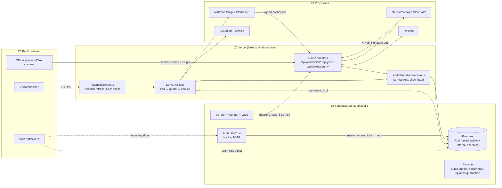
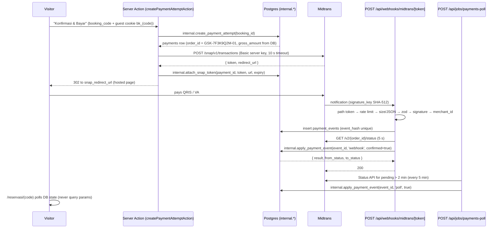

# Security Architecture & Hardening Guide

**Edu Center & Edu Wisata Kelurahan Gisikdrono (Semarang Barat)**

| Field | Value |
|---|---|
| Version | 1.0 |
| Date | 2026-10-15 |
| Status | Draft for review |
| Owner | Kelurahan Gisikdrono Edu Center project team |
| Related documents | `CLAUDE.md` (root), `docs/PRD.md`, `docs/Task.md`, `docs/StyleGuide.md` |
| Precedence | `supabase/migrations` > `docs/PRD.md` > `CLAUDE.md` > this document (security rules are additive, never relaxed) > `docs/StyleGuide.md` |

---

## 1. Purpose, scope and principles

### 1.1 Purpose

This document is the security system for the platform's two most valuable assets: **money** (Midtrans settlements, the revenue-share ledger, invoices) and **personal data** (group bookers and the names of visiting school children). It specifies, per layer, the exact controls, where they are implemented (file, route, database object), how they are tested, and the order in which they must ship. Every control carries an ID that `docs/Task.md` cites; every red-team finding against the design is closed by a named control (Appendix A).

### 1.2 Scope

| In scope | Out of scope |
|---|---|
| Next.js application on Vercel (`src/**`), Supabase project (Postgres, Auth, Storage, pg_cron, Vault), Midtrans Snap integration, Meta WhatsApp Cloud API, Resend email, Cloudflare Turnstile, the PWA scanner, exports and PDF documents, staff and vendor-console accounts, incident response, UU PDP No. 27/2022 compliance | Physical security of the kelurahan office, the kelurahan's bank account and treasury procedures after payout, the human WhatsApp chat on the floating button (outside this system), Midtrans' internal PCI scope |

Glossary of domain terms used throughout: **RW** (Rukun Warga, the neighbourhood unit; the tenants are the rows of `rw_units`: RW 05, RW 13 and RW 08 since Task P2.10.03), **kelurahan** (the urban village office that owns the platform), **UMKM** (micro and small enterprises selling souvenirs and snacks), **PKK** (the women's welfare group producing recycled crafts), **Bank Sampah** (community waste bank), **dolanan** (traditional Semarang children's games), **sanggar** (arts studio), **Ecowastreme** (RW 05's eco-tourism programme), **PIC** (person in charge of a group booking).

### 1.3 Security principles

1. **The server computes money.** Clients send identifiers and quantities only; prices, totals and `gross_amount` come from database rows, every time.
2. **Midtrans is the source of truth for "did money move"; our database is the source of truth for "what was sold".** The two are reconciled by webhook, polling and a daily job; no single path is trusted alone.
3. **Financial facts are written once.** Corrections are new rows: append-only tables, immutability triggers, a hash-chained ledger, dual-controlled adjustments.
4. **One function per state change.** Every booking, payment and ticket transition runs inside one `SECURITY DEFINER` function under a row lock in the `internal` schema.
5. **Deny by default in the database.** RLS is enabled and forced on every table; the `anon` role reads published content only; nothing mutating is callable with the public key.
6. **Identity before scarce resources.** No quota is reserved and no message is sent to a phone until that phone has passed a WhatsApp OTP.
7. **Collect less, keep less.** No national ID numbers, birth dates, addresses or photos of visitors; children's names only as name + class, purged 90 days after the visit, including the PDFs that contain them.
8. **Every privileged action is logged and alertable**, and critical alerts leave the system through a path that does not depend on the outbox they monitor.
9. **Clean code is a security control.** Pure, unit-tested functions for pricing, signing and state mapping; strict layering UI → action → service → data-access → DB; no `any`, no magic values, no dead code (see `CLAUDE.md`).

### 1.4 Shared-responsibility model

| Party | Responsible for | We rely on |
|---|---|---|
| **Vercel** | Edge/TLS termination, function isolation, Firewall managed rules, Deployment Protection, env-var encryption | Secrets stay server-side; previews behind Vercel Authentication; Attack Challenge Mode as a runbook switch; scheduled jobs are driven by pg_cron + pg_net, never by Vercel cron |
| **Supabase** | Managed Postgres (AES-256 at rest), Auth (GoTrue, MFA, hooks), Storage, pg_cron/pg_net, backups, Security Advisor | RLS enforcement, Auth hooks, leaked-password protection (Pro), SSL enforcement, daily backups |
| **Midtrans** | Hosting the payment page (Snap), card/QRIS/VA processing, PCI DSS, settlement to the merchant bank account, `signature_key` on notifications, Status API | We never see payment instruments; we verify every notification and re-confirm with the Status API |
| **Meta (WhatsApp Cloud API)** | Template approval, message delivery, webhook signing (`X-Hub-Signature-256`) | Templates only; OTP delivery; delivery statuses |
| **Resend** | Email delivery, DKIM signing, bounce/complaint handling | Links-only email; SPF/DKIM/DMARC on `mail.<domain>` |
| **Cloudflare (Turnstile, R2)** | Bot challenge, off-site encrypted backup storage | Turnstile fail-closed on public forms; R2 for weekly `age`-encrypted dumps |
| **Kelurahan Gisikdrono team** | Account ownership of every vendor console (institutional email + MFA), staff onboarding/offboarding, Midtrans dashboard governance, approving adjustments and refunds, privacy notice and DSR handling, breach notification decisions, quarterly reviews | The controls in this document are only as strong as the accounts that administer them (SEC-05, PAY-16) |
| **Development team** | Everything in `src/**` and `supabase/**`, CI gates, migrations, runbook execution, key rotation | Branch protection, required checks, no dashboard edits in production |

---

## 2. Threat model

### 2.1 Assets (ranked)

| # | Asset | Why it matters | Primary controls |
|---|---|---|---|
| A1 | Midtrans settlements and payouts (the merchant bank account) | Direct theft; the platform cannot see a changed payout account | PAY-16, REC-01, REC-02 |
| A2 | Children's names in `booking_participants` and participant-bearing PDFs | UU PDP "specific personal data"; reputational and legal harm | AZ-12, DATA-02, DATA-12, GUEST-06 |
| A3 | Booker PII (`bookings.pic_name`, `pic_phone`, `pic_email`, `institution_name`) | Phishing of schools, misdelivery, breach notification duty | AZ-12, GUEST-02, DATA-04, DATA-13 |
| A4 | Session quota (`visit_sessions.reserved_pax`) | The scarce good; blocking it stops the kelurahan from selling | BOOK-12, BOOK-13, BOOK-01 |
| A5 | Tickets (`tickets_qr`) | Entry rights worth money; forgery and reuse | WH-12, QR-01, QR-02 |
| A6 | Financial records (`payments`, `invoices`, `revenue_share_entries`, `audit_logs`) | Basis of the kelurahan's accountability | REC-03, REC-04, REC-05 |
| A7 | Staff accounts (`superadmin` > `admin_rw`) | A superadmin can do everything above | AUTH-03, AUTH-09, AUTH-10, AUTH-11 |
| A8 | Vendor console accounts (Supabase, Vercel, GitHub, Midtrans, Meta, Resend, Cloudflare) | One phished login bypasses every application control | SEC-05, PAY-16 |
| A9 | CMS integrity and availability on visit days | Defacement; gate cannot scan | APP-08, OPS-03, QR-06 |

### 2.2 Actors

| Actor | Capability | Goal |
|---|---|---|
| Internet scanner / bot | Public key from the JS bundle, direct PostgREST/GoTrue calls, Turnstile solvers | Spam, credential stuffing, scraping |
| Malicious visitor | Normal booking flow, a verified prepaid SIM, forwarded links | Pay less, hold quota for free, enter with a refunded or shared ticket, obtain another school's data |
| Rogue or compromised `admin_rw` | Own JWT, own RW's CMS, scanner phone, PostgREST with the JWT | Skim revenue via prices, read the other RW, dump children's names, falsify check-ins |
| Compromised `superadmin` | Everything in the dashboard | Money edits, exports, inviting accomplices |
| Insider at a vendor console / departing developer | SQL editor, env vars, Server Key, service-role key | Silent edits, key theft |
| Leaked secret | `MIDTRANS_SERVER_KEY`, `SUPABASE_SERVICE_ROLE_KEY`, `CRON_SECRET`, `QR_SIGNING_KEYS`, `BOOKING_LINK_SECRET` | Forged notifications, RLS bypass, forged tickets |
| Vendor misbehaviour / outage | Midtrans retries and out-of-order delivery, Meta throttling, Resend bounces | Lost tickets, double processing |

### 2.3 Trust boundaries



Boundary rules: Z1 is the only place secrets exist; Z2 assumes Z1 has bugs (RLS is the last line); Z0 can reach Z2 directly with the public key, so **no control may exist only in Z1** (sign-in abuse meets Auth's own captcha and per-IP limits, and the per-account lockout lives in an Auth hook where the plan has one, local only on Pro, §5.5; anti-abuse behind service-role-only functions, PII behind masked views and RPCs).

### 2.4 STRIDE per flow

| Flow | Spoofing | Tampering | Repudiation | Information disclosure | Denial of service | Elevation of privilege |
|---|---|---|---|---|---|---|
| Booking | Fake PIC phone → **BOOK-12** OTP before hold | Client-sent prices → **PAY-03** strict DTO | Unlogged holds → `booking_events`, **AUD-01** | Duplicate-hold code leak → **BOOK-15** | Free quota lockout → **BOOK-13**, **BOOK-16** | Direct `create_booking` RPC → **AZ-11** (`internal` schema) |
| Payment | Forged notification → **WH-01**, **WH-08**, **WH-14** | Amount mismatch → **WH-06**; post-settlement edits → **REC-03** | Replay → **WH-05**; no trail → **AUD-01** | PII to processor → **PAY-07** | Webhook flood → **WH-03**, **WH-15** | Leaked Server Key → **PAY-10**, **PAY-16** |
| Ticket | Forged QR → **QR-01**, **QR-05** | Ticket without money → **WH-12**; revive used → **QR-07** | Who scanned → `ticket_scans`, **AZ-14** | PII in QR → **QR-05** | Lockout via junk QR → **QR-06** | Cross-RW check-in → **QR-02** |
| Scanner | Stolen officer session → **AUTH-04**, **QR-04** | Actor passed as parameter → **AZ-14** | Manual check-in unlogged → **QR-07** | Cached PII in PWA → **HDR-03** | Offline → manifest contingency **QR-04** | Service role in scan path → **AZ-14** |
| CMS | Self-signup → **AUTH-01**; mailbox bootstrap → **AUTH-09** | Price skim → **REC-13**; session edits under bookings → **REC-15** | Audit diff missing → **DATA-11** | Cross-RW reads → **AZ-03**, **AZ-12** | Login lockout DoS → **AUTH-10** | Self role update → **AZ-04**, **AZ-10** |
| Exports | — | Report from editable rows → **REC-07** | Unlogged export → **AUD-04**, **DATA-06** | Bulk PII via PostgREST → **AZ-12** | Export DoS → **RL-01** caps | admin_rw export with contacts → **DATA-06** |
| Staff lifecycle | Invite link in a phished mailbox → **AUTH-09** | Extra TOTP factor → **AUTH-12** | Role change unlogged → **AZ-10** | Stale claims after deactivation → **AZ-09** | Lockout of officers on visit morning → **AUTH-10** | Sockpuppet approver → **REC-16**, **AUTH-11** |

### 2.5 Attack trees for the top risks

**T1 — Steal or divert money**
- Change the Midtrans payout account (phished dashboard login) → PAY-16 (owner = kelurahan head, 2FA, named operators, expected payout account in `site_settings`, weekly payout-vs-ledger)
- Pay less than the price
  - Send `total` in the form → PAY-03 (`.strict()` DTO, server pricing)
  - Set the package price to IDR 1, book, restore → REC-13 (price floor trigger, `package_price_history`, anomaly rules)
  - Lock a manipulated price via quotation → REC-13 + BOOK-17 (quotation re-priced against history)
- Forge a settlement
  - Craft `signature_key` without the key → WH-01
  - Replay a genuine notification → WH-05 (`event_hash`)
  - Use a leaked Server Key → WH-08 / WH-14 (Status API confirmation on every transition)
- Edit records after the fact → REC-03, REC-04, REC-05, REC-09, REC-16

**T2 — Block the quota for free**
- Hold with invented phones/emails → BOOK-12 (OTP before hold)
- Many holds from one verified SIM → BOOK-13 (≤ 2 concurrent unpaid per proven contact, ≤ 50 % of a session unpaid, 5/day)
- Bypass the Server Action via PostgREST → AZ-11 (`internal.create_booking` not exposed)
- Exhaust the limiter → BOOK-16 (Postgres `rate_limit_buckets`, fail-closed matrix)
- Hold forever via NULL `expires_at` → BOOK-14

**T3 — Enter without paying**
- Forge a QR → QR-01 (HMAC-SHA256, kid)
- Share a screenshot → QR-02 (atomic single use, `attempt_id`)
- Enter after a refund → QR-07 (refund revokes tickets; `check_in_ticket` re-checks `bookings.status`)
- Insert a ticket row directly → WH-12 (trigger: tickets require money)
- Bring 45 pupils on a 10-pax ticket → QR-08 (`unpaid_pax`, certificate gate)

**T4 — Read the other RW or dump children's names**
- PostgREST `select=*` on `bookings`/`booking_participants` → AZ-12 (no raw SELECT for admin_rw; `v_bookings_staff`, `rpc_reveal_booking_contact`, `rpc_get_participants`)
- Owner-privileged finance views → AZ-13 (`security_invoker`, superadmin-only recap views)
- Forwarded certificate links → GUEST-06, DOC-02
- Supabase SQL editor → SEC-05, DB-06

**T5 — Take over a staff account**
- Credential stuffing straight at GoTrue → AUTH-10 (Auth captcha, GoTrue per-IP limits and leaked-password protection on Pro; the Password Verification Attempt hook only where the plan has it, §5.5), AUTH-13 (TOTP for all staff)
- Phished invite mailbox → AUTH-09 (`invite_code` out of band; role only at onboarding completion)
- Walk-up to an unlocked AAL2 session → AUTH-11 (step-up ≤ 5 min), idle lock
- Self-update `profiles.role` → AZ-04, AZ-10
- Keep access after deactivation → AZ-09, AUTH-07

### 2.6 Risk register

| ID | Risk | Likelihood | Impact | Residual after controls | Owner |
|---|---|---|---|---|---|
| R1 | Midtrans dashboard compromise diverts payouts | Medium | Critical | Low (PAY-16, weekly payout check) | Kelurahan head |
| R2 | Zero-cost quota lockout | High | High | Low (BOOK-12/13/16) | Dev team |
| R3 | Rogue `admin_rw` dumps PII via PostgREST | Medium | Critical (UU PDP) | Low (AZ-12, AZ-13, MON-07 reveal-cap rule) | Dev team |
| R4 | Price skim through RW-managed prices | Medium | High | Low-medium (REC-13; approval queue is *should*) | Superadmin |
| R5 | Forged settlement with a leaked Server Key | Low | Critical | Low (WH-14, PAY-10) | Dev team |
| R6 | Staff account takeover via direct GoTrue stuffing, or, once a password is known, TOTP codes guessed straight at `/factors/{id}/verify` | Medium | High | Medium on the Pro plan (decision of 2026-10-20, RV-H1 of the independent review of PR #17): the Password and MFA Verification Attempt hooks that lock an account inside Auth are Team/Enterprise features and run only on the local stack. On Pro what stands in front of GoTrue is Auth's captcha (on `/token`, `/recover`, `/otp`, `/magiclink`, `/resend`, `/signup`), leaked-password protection, passwords ≥ 12 with all four classes, GoTrue's per-IP limits, TOTP for every staff role and sessions of at most 12 h / 2 h idle (§5.5, AUTH-10, AUTH-13). TOTP codes carry no captcha and meet only GoTrue's per-IP limit, so someone holding a password who rotates IPs can keep guessing; nothing in the database records a failed password or code (measured), so only the Auth logs show it, read by the P4.10.01 rule (§11.2) and, until then, by the weekly review (§13.2) | Dev team |
| R7 | Ticket reuse / entry after refund | Medium | Medium | Low (QR-02, QR-07) | RW officers |
| R8 | Children's names persist in PDFs after purge | High (without control) | High | Low (DATA-12) | Dev team |
| R9 | Alerts silenced by a stalled outbox | Medium | High | Low (OPS-06) | Dev team |
| R10 | Data residency (PP 71/2019) makes Singapore hosting non-compliant | Unknown | Blocker | Open decision A10 (§7.6, §13.3) | Kelurahan / Diskominfo |
| R11 | Single superadmin defeats dual control | Medium | High | Medium (REC-16 compensating 24 h delay + kelurahan-head email) | Kelurahan head |
| R12 | Vendor outage on a visit day | Medium | Medium | Low (RES-02, QR-04 manifest contingency) | RW officers |
| R13 | XSS on a public ISR page, which runs under the static CSP with `'unsafe-inline'` scripts (§8.2) | Low | Medium (no PII, payment or login on those pages) | Low (Tiptap JSON renderer, `react/no-danger`, Semgrep, APP-11; tightening tracked in Task P5.4.03) | Dev team |
| R14 | An RW admin reads a combo booking's total, which includes the other RW's share, straight from `bookings` through the column access the `security_invoker` views need: `v_bookings_staff` hides it on screen only, because superadmin and `admin_rw` share the `authenticated` role and column grants cannot tell them apart. Payments, invoices and quotations no longer repeat it: their amounts and snapshots are granted to no API role (review of 0005, M1, decision of 2026-10-17). Nor do the booking's add-on subtotal, discount and discount note, which are the other RW's sales and a negotiated price that no published price explains (security review of PR #4, decision of 2026-10-17); what the total itself still implies, add-ons minus discount once the published package price is taken off, stays inside this risk. The ledger entries of an RW admin's own keys do: `revenue_share_entries.base_amount` on a combo's `rw:<id>` or vendor entry is the whole line being split, the booking's own money that `bookings` already shows (the line bases add up to `total_amount`) | High (by design) | Low (package and tier prices are published, so the total reveals nothing a visitor cannot compute; ledger shares, adjustments and the kelurahan's keys stay behind RLS) | **Accepted** (decision of 2026-10-16; STAFF-02), `base_amount` with it for the same reason (decision of 2026-10-17); revisit if combo prices ever become negotiated per booking | Superadmin |
| R15 | A host that is exactly an Indonesian academic title plus a domain ending (`dr.id`, `s.si`, `univ.top`), written without a path, passes the form and outbox checks that set titles aside, and WhatsApp may show it as a link | Low (needs ownership of such a domain) | Medium (a link that reads as the kelurahan's own) | **Accepted** (decision of 2026-10-16): refusing it would refuse real titled names such as `S.Pd.` or `Univ.Diponegoro`; a path, a dot or a further label after the title is still refused | Superadmin |
| R16 | GoTrue accepts a `redirect_to` on the Site URL's host with any path or port, so an implicit-flow recovery or magic link could carry an AAL1 `#access_token` to a same-host page an attacker picks | Low | Low (AAL1 opens no staff route or RPC) | Low (PKCE / `token_hash` on every email flow, `safeRedirect`, no route forwards a fragment; APP-13) | Dev team |
| R17 | Magic-link and email-OTP sign-in stay open while the email provider is on, so whoever holds a staff mailbox reaches AAL1 without the password, past the password lockout hook (which runs only on the local stack on Pro, §5.5) and the rule that a not-yet-onboarded account cannot reset its password; what that session can still do straight through GoTrue is R28 and R30 | Low | Low (AAL2 is required everywhere and the `invite_code` still guards onboarding) | **Accepted** (no Supabase setting turns it off; security review of PR #5): mailbox security is part of staff onboarding | Superadmin |
| R18 | The `CRON_SECRET` bearer sits in clear in `net.http_request_queue` for the seconds before pg_net sends it, and Supabase grants the `net` schema to the API roles | Low | High (anyone holding it can trigger every job route) | Low: the `net` schema is not exposed through the API (`[api] schemas = ["public"]`, checked by `scripts/supabase-config.test.mjs` and go-live #20), no `net`, Vault or cron table is in the Realtime publication (`schema_cron.sql`), and the jobs are idempotent and batch-limited | Dev team |
| R19 | GoTrue accepts the same TOTP code twice within its 30-second window: on the local stack two separate sign-ins verified one code (found while writing `tests/integration/rls-http.test.ts`, P1.9.07), so whoever sees a staff member's code and already holds their password can reuse it at once | Low (needs the password and a code from the same half minute) | High (an AAL2 staff session) | **Accepted** (no Supabase setting refuses a reused code; security review of P1.9): invite-only accounts, the AAL2 alerts and, on Pro, Auth's captcha and per-IP limits stay the controls (the password lockout hook runs only on the local stack, §5.5). Re-check on `gisikdrono-staging` in Phase 0 (Task P0.1.17); if hosted Auth refuses the reuse, close this row | Dev team |
| R20 | A booklet whose page upload breaks off cannot be signed again: once a page is published `sign-pages` refuses it for good, and before that its claim in `booklet_page_claims` holds for two hours (security review of PR #14, L11 and N4). The files of the abandoned attempt stay in `public-media` without a booklet row | Medium | Low (availability only; nothing unchecked is published) | **Accepted** (2026-10-19): the officer starts a new booklet; the booklet form of P2.9.06 uploads each attempt under a fresh booklet id (`src/components/admin/cms/booklet-form.tsx`), so a broken attempt never blocks the next; the abandoned files are R34's | Superadmin |
| R21 | pdf-lib keeps every reference and name it creates in pools that live as long as the serverless instance, so booklet uploads can leave memory that is never freed (measured within the bounds of §8.4: about 158 MB for 900,000 references, 135 MB for a million names, per upload) until uploads on that instance fail | Low (needs an AAL2 staff account; finalize is limited to 300 an hour) | Medium (uploads on that instance fail until Vercel recycles it) | Medium until P2.9.09: object numbers above 200,000 and xref floods are refused and every reference counts toward the 2,000,000-object budget (§8.4, second re-review of PR #14), but generations and names can still fill the pools. P2.9.09 runs the scan in a worker thread with `resourceLimits`, terminated at the deadline, so the pools end with it; a go-live blocker (§13.1 #24) | Dev team |
| R22 | A signed upload URL cannot be bound to the size declared at sign, so a staff member can park up to 50 MB per URL in `uploads-quarantine`, 60 URLs an hour, until the hourly purge removes objects older than 24 h (independent review of PR #14, F7) | Low (needs an AAL2 staff account) | Low (storage cost; finalize refuses an oversized file before downloading it) | Low until P2.9.10 adds a per-officer quota of live quarantine bytes with an alert | Dev team |
| R23 | Newer Midtrans sandbox keys start with `Mid-server-` / `Mid-client-` like live keys (finding of 2026-10-20), so the boot check of `src/lib/env.ts` can no longer tell a sandbox key in production, or a live key on a preview, from the right one; only an `SB-` key in production is still refused at boot | Low (needs keys copied from the wrong dashboard) | Medium (a sandbox key in production: every payment call answers 401, so bookings cannot be paid. A live key on a preview is a leaked production secret: every branch's code deployed to Preview can read it, against the rule that developers hold no key access (§3.9), and whoever holds it can call Midtrans production APIs directly, such as cancel, expire or refund; forged notifications are still stopped by the Status API re-check, WH-14) | Low: `pnpm midtrans:check` asks the Status API before keys are saved for staging or production (§3.9, PAY-02) and go-live check #7 requires its output for both environments; a key that skips the check fails on the first Snap call, never moves money; a live key ever saved in the Preview scope counts as a suspected leak: remove it and rotate it at once (§3.9 Server Key rotation, key-leak runbook §11.4) | Dev team |
| R24 | Once `reset_staff_mfa` has deleted an officer's factors, the account is onboarded and has no verified factor, so `/mfa/enroll` lets it enrol a new one at AAL1 (P2.8.02, enrolment offered when no verified factor exists, §5.2): whoever holds the password, or only the mailbox through a magic link or email OTP (R17), can attach their own authenticator before the officer does and reach AAL2 with the officer's role (finding of PR #17, 2026-10-20) | Low (needs a completed reset, which takes 24 h to 7 days and raises critical alerts, and the password or the mailbox inside the window before the officer re-enrols) | High (an AAL2 staff session with the officer's role and RW) | Low since 20261029080200 and 20261029080400 (database part of P4.8.05; the actions and `/mfa/enroll` remain): a completed `reset_staff_mfa` sets `profiles.reenrolment_required`, under which `staff_token_claims` gives the account no role and a guard on `auth.mfa_factors` refuses to verify any new factor of it, through the app or straight through GoTrue; `consume_mfa_reenrolment_code` takes the superadmin's one-time code and opens a ten-minute window, the only time a factor of the account can be verified, and the first verified factor ends the wait; an abandoned window needs a new code; the window belongs to the account, not to the session that used the code, so whoever holds the password inside those ten minutes can enrol too (re-review of PR #58: accepted, since the window opens only after the officer typed the superadmin's code, and every verification is an `mfa_enrolled` alert); every verified factor is an `mfa_enrolled` event and alert. Before that, it was Medium until Task P4.8.05: re-enrolment after a reset will need a one-time code the superadmin hands over out of band, consumed with the first TOTP verification. Until then no UI calls `reset_staff_mfa` (its action is P4.8.02, which P4.8.05 must not trail), so a reset happens only through the RPC directly, with the officer re-enrolling at once. A recovery link no longer turns the gap into a permanent password: `/reset-password` shows an account without a verified factor `Hubungi superadmin untuk memulihkan akun.` instead of the form and `resetPasswordAction` refuses it (M2 of the PR #17 review, 2026-10-20) | Dev team |
| R25 | Supabase Auth answers a sign-in for an unknown address faster than for an existing account (measured on the local stack: 60–79 ms against 268–615 ms, bcrypt and the password hook), so timing tells which addresses are staff accounts, through `/login` and straight through GoTrue's `/token` alike (L1 of the PR #17 review) | Medium | Low (staff addresses are no secret: they are given out with the kelurahan's contacts; Turnstile, the per-IP limits and TOTP all still stand, and the password lockout where its hook runs, §5.5) | **Accepted** (2026-10-20): GoTrue's public endpoint leaks the same without the app, so a minimum delay in `signInAction` would not close it | Dev team |
| R26 | Turnstile on sign-in and on GoTrue's `/recover` is checked by Supabase Auth itself, so it is only as strong as the hosted captcha setting (Task P0.1.16): with that off, any string passes `/login`'s token field, and direct calls to GoTrue need none (L2 of the PR #17 review). `/forgot-password` checks its own token with `verifyTurnstile`, because its email goes out under the service role, which GoTrue lets past the captcha | Low | Medium (sign-in and reset abuse falls back on the per-IP limits; on Pro no per-account lockout stands behind them, R6) | Low: go-live check #4 runs a staging smoke test in which sign-in and `/recover` without a token or with a made-up one must answer `captcha_failed` | Dev team |
| R28 | Straight through GoTrue, an account without a verified factor (an R24 account after `reset_staff_mfa`, or later an invited one before onboarding, P4.8.02) can be given a password (`PUT /auth/v1/user`, which GoTrue lets through at AAL1 when the account has no factor) and a factor (`POST /auth/v1/factors`) by whoever holds an AAL1 session from its mailbox (R17) or from a recovery `token_hash`; M2 and the role check of `/mfa/enroll` hold in the app only (RV-L1 of the independent review of PR #17) | Low (needs the mailbox, or the 8-digit recovery code by guessing past GoTrue's per-IP limit on `/verify`) | High (with the factor, an AAL2 session with the account's role once it has one) | **Accepted** (2026-10-20), overlapping R24: P4.8.02 and P4.8.05 must not rely on the app-only checks, and give an account its role only after its factors and password are set through the guarded flow. For an invited account, since 20261103131000 (P4.8.01): a factor is verified only while the account holds a claim made with the invite code, whatever path asks; the password GoTrue still lets a mailbox set at AAL1 opens nothing, since the role comes only from `accept_staff_invite` from the claiming session at AAL2, and the account is deleted when its invite is revoked or lapses | Dev team |
| R29 | `POST /auth/v1/recover` straight to GoTrue skips `canResetPassword`, the daily ceiling of 10 per address and the uniform answer of F1: it mails an account without a role, is held only by GoTrue's `max_frequency` and the project's hourly `email_sent`, so it can use up the project's Auth email allowance (invites, resets), and an address that exists answers 429 `over_email_send_rate_limit` to a second request within `max_frequency` where an unknown one answers 200 (RV-L2 of the independent review of PR #17) | Medium | Low (enumeration of addresses that are no secret, R25; a day without reset or invite emails) | **Accepted** (2026-10-20): Auth's captcha guards `/recover` (R26, go-live #4); `email_sent` and `max_frequency` are chosen on purpose in P0.1.14–P0.1.18 | Dev team |
| R30 | Where the MFA hook runs (the local stack; a Team plan), five wrong codes lock the account for 15 minutes and Supabase Auth then ends every session of the account, so whoever holds the password or only the mailbox (R17) can sign the officer out everywhere, the gate scanner included, every 15 minutes (RV-L3 of the independent review of PR #17) | Low (on Pro the hook does not run, R6) | Medium (availability on a visit day) | **Accepted** (2026-10-20): the `mfa_locked` alert names the account; the response is the mailbox and password change of the account-takeover runbook (§11.4) | Superadmin |
| R31 | `signInAction` calls none of the guards CLAUDE.md §9.2 lists: its captcha is checked by Supabase Auth (R26), and the Semgrep rule `server-action-without-guard` passes it because it works per file and another export of `auth.ts` calls `verifyTurnstile` (I1 of the independent review of PR #17) | Low | Low (the sign-in limits and Auth's captcha still stand) | **Accepted** (2026-10-20): the captcha of sign-in belongs to Auth by design (§5.5) | Dev team |
| R32 | `login:ip` and `password_reset:ip` are counted before any captcha is checked and fail closed, so a neighbour behind the same CGNAT address as the kelurahan office can use them up without solving Turnstile and keep the office's sign-in out for 5 minutes, or its reset requests for an hour (I4 of the independent review of PR #17) | Low | Low | **Accepted** (2026-10-20): counting after the captcha would hand the siteverify calls to anyone; an IPv6 client counts by its /64 (L3) | Dev team |
| R34 | Files finalize published for a CMS form that was closed without saving (a photo, a booklet PDF and its pages) stay in `public-media` with no row pointing at them (Task P2.9.06). Since the decision of 2026-10-21 every file a row stops showing leaves in the same action: removing a gallery item, article, booklet, activity point, schedule or hero banner, and replacing or taking off a photo of an article, activity point, RW page, schedule or banner (§8.4, CMS paragraph); a removal that fails is logged and the officer is told | Medium | Low (uuid addresses no page links to and nothing lists; only what an officer chose to upload) | **Open until Task P2.9.11** (go-live blocker, §13.1 #25): the hourly `purge-storage` job removes `public-media` objects no row references once they are 24 hours old | Dev team |
| R33 | `auth/callback` opens a recovery session on a plain GET with nothing that ties the link to the browser, so a staff member can plant a recovery session of their own account in a colleague's browser (login CSRF) (I6 of the independent review of PR #17) | Low | Low (the planted session still needs the planter's own TOTP code at `/reset-password`; the colleague is merely signed out) | **Accepted** (2026-10-20) | Dev team |
| R27 | Two residuals of the reset flow (F1 and F2 of the PR #17 review): (a) the recovery link is a `token_hash` that works in any browser, so a mail filter that opens links before the reader does uses it up, and the staff member meets `link-expired` and asks again; (b) the daily ceiling of 10 reset emails per address, counted after the Turnstile check, can be used up by someone who solves Turnstile ten times a day from any IPs, after which that address gets no reset email until the next day while the page still answers the same | Low | Low (availability of a reset only; the staff member asks the superadmin for help) | **Accepted** (2026-10-20): (a) `/reset-password` still needs the TOTP code and refuses an account without one; (b) the ceiling is what stops an email flood to one address | Superadmin |

---

## 3. Payment security end-to-end

### 3.1 Flow overview



### 3.2 Snap redirect mode and server pricing (PAY-01…PAY-09, PAY-11…PAY-15)

- **Redirect mode only.** The hosted payment page is opened via the stored `payments.snap_redirect_url`; no `snap.js` on our origin, so no Midtrans origins appear in the CSP and `Cross-Origin-Opener-Policy: same-origin` holds. The redirect URL is also sent in `gsk_payment_reminder_v1` and the pending-payment email so a B2B treasurer can pay from another device.
- **Server computes money.** The booking DTO is `z.object({...}).strict()` carrying `packageId`, `visitSessionIds`, `pax`, `addons: [{productId, qty}]` (≤ 20 lines), participants and PIC fields; any `price`, `total`, `discount` key fails validation. `computeBookingQuote()` in `src/lib/pricing` is pure, takes DB rows only, returns integer IDR lines with the invariant `sum(lines) = total > 0`, is snapshotted into `bookings` and `booking_addons` at hold time, and is 100 % line-covered.
- **Snap payload** (`src/lib/midtrans/client.ts`, thin typed `fetch`, no SDK): `transaction_details.order_id = payments.order_id`, `gross_amount = bookings.total_amount`, `item_details` from `booking_addons` plus the package/discount lines (names ≤ 50 chars), `customer_details` = PIC `first_name`, `email`, `phone` only (no participants, no address), `enabled_payments = ['qris','bca_va','bni_va','bri_va','permata_va','cimb_va','other_va']` hard-coded (no cards), `expiry = {unit:'minute', duration: minutes until bookings.expires_at}`, `callbacks.finish = https://<site>/reservasi/<code>`. Snapshot tests lock the payload.
- **Attempts.** `payments.order_id = booking_code || '-' || lpad(attempt_no, 2, '0')` (`GSK-7F3K9Q2M-01`), unique; a partial unique index allows one open payment per booking (`initiated`, `pending` or `needs_review`; a `needs_review` payment blocks a new attempt until a superadmin resolves it); an unexpired Snap token is reused. **[RT]** A new attempt first calls `POST /v2/{previous order_id}/expire` and proceeds only when Midtrans confirms the previous order is expired or cancelled (WH-16). A new attempt is refused when fewer than 5 minutes of the hold remain (BOOK-14).
- **Finish page** `/reservasi/[bookingCode]` requires the `bk_<code>` httpOnly cookie minted at hold time (scope `manage`, by `createBookingAction` for a WhatsApp and an email proof alike, since an email proof sets `email_verified_at`; decision of 2026-10-22 on P3.5, Q1), never reads `transaction_status` from the query string, and polls `payments.status` via a Server Action (PAY-09, PAY-15).
- **Environment fail-fast** in `src/lib/env.ts` (rules in `src/lib/midtrans/environment.ts`): `VERCEL_ENV=production` ⇔ `MIDTRANS_IS_PRODUCTION=true`; in production `MIDTRANS_SERVER_KEY` (and `MIDTRANS_SERVER_KEY_PREVIOUS`) start with `Mid-server-` and `MIDTRANS_CLIENT_KEY` with `Mid-client-`, so a sandbox `SB-` key never boots there; any other environment takes sandbox keys in either format Midtrans issues, `SB-Mid-server-` / `SB-Mid-client-` (older accounts) or `Mid-server-` / `Mid-client-` (newer accounts); `MIDTRANS_MERCHANT_ID` is `G` or `M` followed by digits. A newer sandbox key looks exactly like a live one, so the prefix no longer proves the environment (finding of 2026-10-20: such keys are accepted by `api.sandbox.midtrans.com` and refused with 401 by `api.midtrans.com`); `pnpm midtrans:check` closes the gap by asking the Status API before keys enter an environment (§3.9). CI scans `.next/static` for `Mid-server-` (live keys and both sandbox formats), `SB-Mid-server-`, `service_role`, `MIDTRANS_SERVER_KEY` (`scripts/check-client-bundle-secrets.mjs`; PAY-01, PAY-02, SEC-01).

### 3.3 Webhook pipeline (WH-01…WH-11, WH-14, WH-15)

Route `src/app/api/webhooks/midtrans/[token]/route.ts`: `runtime = 'nodejs'`, `dynamic = 'force-dynamic'`, `maxDuration = 15`, outside the auth middleware matcher, `POST` only. Steps, in this order, each emitting one structured log event:

| # | Step | On failure | security_events |
|---|---|---|---|
| 1 | `params.token` must equal `MIDTRANS_WEBHOOK_PATH_TOKEN` (`timingSafeEqual`) | 404, no DB write | — |
| 2 | Rate limit **before any DB write**: `rate_limit_hit('webhook:midtrans:ip:<ip>', 30, 60)` and global 600/min | 429 | `rate_limited` |
| 3 | `Content-Length` and actual bytes ≤ 16 384; `Content-Type` contains `application/json`; body read once with `req.text()` | 413 / 415 | — |
| 4 | `JSON.parse` + zod `MidtransNotificationSchema` (`.passthrough()`; required `order_id, status_code, gross_amount, signature_key (128 hex), transaction_status, transaction_id, payment_type, currency`) | 400 | — |
| 5 | `signature_key === sha512(order_id + status_code + gross_amount + MIDTRANS_SERVER_KEY)` using `gross_amount` **exactly as received** (`"1250000.00"`), compared with `crypto.timingSafeEqual`; during rotation also tried with `MIDTRANS_SERVER_KEY_PREVIOUS` | 403, empty body; **metadata only** (`order_id`, `sig_prefix` 8 hex, `ip`, `body_sha256`, `received_at`) into `webhook_rejections` (30-day retention, cap 20 rows/IP/hour) **[RT]** | `webhook_signature_invalid` |
| 6 | `merchant_id`, when present, equals `MIDTRANS_MERCHANT_ID` | 403, `merchant_mismatch` in `webhook_rejections`, high alert (2026-10-24: `docs/PRD.md` §10.1 answers 403 and decides, `docs/Security.md` §1.2 precedence; this row said 200 before, and nothing is relaxed, since the event is still recorded and alerted) | `webhook_signature_invalid` |
| 7 | `INSERT INTO payment_events (… event_hash = sha256(raw body)) ON CONFLICT DO NOTHING RETURNING id`; no row = replay | 200 `{"status":"duplicate"}` | — |
| 8 | Lookup `payments` by exact `order_id` (never parsed) | 200, `unknown_order`, alert only if the `order_id` matches our grammar `^GSK-[0-9A-HJKMNP-TV-Z]{8}-[0-9]{2}$` **[RT]** | `webhook_amount_mismatch` |
| 9 | `currency = 'IDR'` and `Number(gross_amount)` integer and equal to `payments.gross_amount` | 200, payment → `needs_review`, high alert | `webhook_amount_mismatch` |
| 10 | **Status API confirmation for every status, `pending` included** (`settlement`, `capture`, `pending`, `deny`, `failure`, `refund`, `partial_refund`, `cancel`, `expire`, `chargeback`; 2026-10-24, review of PR #39, L1: a signature covers the order, status code and amount only, so the Virtual Account and payment type a pay page shows come from the Status API's body, never from the notification) **[RT]**: `GET /v2/{order_id}/status` through `src/lib/midtrans/client.ts` (Basic auth; default 10 s timeout, capped at 5 s inside the webhook so the route stays within `maxDuration = 15`), no retry; `transaction_status`, `fraud_status`, `gross_amount` and `order_id` must agree | unreachable → 503 (Midtrans retries, poll retries), event left `awaiting_status_check`; disagreement → `needs_review`, **critical** alert, webhook quarantine mode | `status_disagreement` |
| 11 | `internal.apply_payment_event(event_id, 'webhook', <Status API body>)` — one transaction | DB error → 503 | — |
| 12 | `after()` kicks `POST /api/jobs/process-notifications` | ignored (cron catches up) | — |
| 13 | 200 `{"status":"ok"}`; target < 3 s | — | — |

Response contract: `200` processed/duplicate/ignored/needs_review; `400/413/415` malformed; `403` signature; `404` path; `429` rate limited; `503` transient. No IP allow-list is used as authentication; the source IP is stored for forensics only (WH-10). The signature-failure alert rule counts only requests whose `order_id` matches an existing `payments` row (WH-15), so junk posts cannot page the team.

### 3.4 Status map and transitions (WH-07)

> **Rewritten in Task P3.8.02 (2026-10-24).** The booking effects follow docs/PRD.md §9.2 and `internal.bookings_status_transition` (decision of 2026-10-21, review of PR #19), and a refund seen at Midtrans is the decision of 2026-10-24 (Q1). The map is `src/lib/midtrans/map-status.ts`, mirrored by `internal.midtrans_payment_status`; every status, `pending` included, is confirmed with the Status API before it is applied (§3.3 step 10; review of PR #39, 2026-10-24).

| `transaction_status` × `fraud_status` | `payment_status` | Booking effect | Tickets |
|---|---|---|---|
| `settlement`; `capture`+`accept` | `settled` | `pending_payment`/`expired` → `paid` (`paid_at`, `amount_paid`); invoice `INV/GSK/YYYY/MM/NNNN` + receipt `KW/GSK/YYYY/MM/NNNN`; ledger posted (Task P3.9.01); outbox `payment_received_ticket` (WhatsApp + email), `admin_new_paid_booking` (email to the active superadmins and the RW admins of the booking's legs, Q2); the booking's other open attempts closed and their orders expired at Midtrans. A booking in any other state (`cancelled`, `refunded`) keeps its status with `needs_review` and a high alert: money is never silently kept | issued, one per `booking_legs` row (Task P3.10.02) |
| `capture`+`challenge` (or no verdict) | `needs_review` | `needs_review` = `PAYMENT_CHALLENGE`; the hold is frozen (`expire_stale_bookings` skips it); high alert; `admin_booking_needs_review` | none |
| `capture`+`deny`, `deny`, `failure` | `denied`, `failed` | stays `pending_payment`; the visitor may start a new attempt | none |
| `pending` | `pending` | unchanged; the VA/QRIS details of the Status API's body stored for the pay page | none |
| `cancel`, `expire` | `cancelled`, `expired` | the attempt closes; the booking stays `pending_payment` until `expire_stale_bookings` expires it at `expires_at + 5 min` and releases its seats | none |
| `refund`, `partial_refund` | stays `settled`, `refunded_amount` unchanged | unchanged; one high alert per order (`refund_seen:<order_id>`, "Refund terlihat di Midtrans; catat di Keuangan"); the booking becomes `refunded` only through `record_refund` (superadmin, AAL2), which reconciles with this stored event (Task P4.7) | unchanged until `record_refund` |
| `chargeback` | `disputed` | `needs_review` = `CHARGEBACK`; critical alert | `suspended` while the visit is ahead (Task P3.10.02) |
| a second settlement for a booking already paid **[RT]** | `duplicate` | no invoice, no ledger; high alert `duplicate_settlement:<order_id>` and `admin_booking_needs_review`; the superadmin refunds it (Task P4.7) | unchanged |
| an amount, currency or order that does not match ours; a settlement of another amount than the booking's own total (a discount given after the attempt, review of PR #39, L4); a settlement, refund or chargeback the Status API does not confirm | an open attempt → `needs_review` | `needs_review` (`AMOUNT_MISMATCH`, `STATUS_DISAGREEMENT`); high (amount) or critical (disagreement) alert; never `paid` | none |
| a chargeback on a payment already `refunded` or recorded as `duplicate` (review of PR #39, M1) | unchanged | `needs_review` = `CHARGEBACK`; critical alert, so the money is not given back twice | unchanged |

Allowed payment transitions (everything else answers `{ result: 'ignored' }` with 200, never raises): `initiated | pending → pending | settled | denied | failed | cancelled | expired | needs_review`; `needs_review → settled | denied | failed | cancelled | expired`; `denied | failed | cancelled | expired → settled` (a payment made on the order after all; `duplicate` when another attempt is already settled); `settled | partially_refunded → disputed`. `settled` never regresses: an `expire` after a settlement is ignored. A notification Midtrans does not confirm follows Midtrans' answer: a `deny` whose order was paid after all settles, while an `expire` of an order still `pending` changes nothing.

> **Review stays until staff resolve it (decision of 2026-10-24, review of PR #39, L3; docs/PRD.md §9.4).** An attempt held for `STATUS_DISAGREEMENT` or `PAYMENT_CHALLENGE` that later settles on a confirmed answer is settled and its booking paid, but the booking keeps `needs_review = true` and its `review_reason`, and stays in the review queue until a superadmin resolves it with `resolve_booking_review`; a settlement never clears a review by itself.

**Late settlement.** If the booking is already `expired`, `internal.apply_payment_event` calls `internal.reserve_session_quota` per leg under the same ordered locks; success → `paid` with `booking_events.reason = 'revived_late_settlement'`; no capacity → `paid` with `needs_review = true`, tickets **not** issued, `admin_booking_needs_review` notification, superadmin resolves via `resolve_booking_review('issue_tickets' | 'refund')`. Money is never silently kept.

### 3.5 `internal.apply_payment_event` (one transaction)

```sql
-- internal.apply_payment_event(p_event_id bigint, p_source text, p_confirmed jsonb, p_key_id text) returns jsonb
--   (20261024090100; p_key_id, the QR kid of new tickets, since 20261024100100)
-- owner postgres, security definer, set search_path = '', execute revoked from public/anon/authenticated
-- 1  select * from public.payment_events where id = p_event_id for update; already processed -> {result:'already_processed'}
-- 2  select * from public.bookings where id = <the order's booking> for update;   -- the booking first, as expire_stale_bookings
-- 3  select * from public.payments where order_id = e.order_id for update;        -- serialises webhook vs poll
-- 4  amount/currency/order vs the payment, else needs_review; target := status map of p_confirmed (the Status API
--    body); a webhook event other than pending with p_confirmed NULL -> {result:'needs_confirmation'}, unprocessed
-- 5  transition allowed? else mark event processed 'ignored_transition' and return
-- 6  perform set_config('app.in_rpc', '1', true);  -- status columns are writable only here
-- 7  if target = 'settled' and exists (select 1 from public.payments where booking_id = b.id and status = 'settled' and id <> p.id)
--      then update payments set status = 'duplicate' ...; insert notifications (refund task); insert security_alerts; return
-- 8  update payments (status, transaction_id, payment_type, bank, va_number, settled_at)
-- 9  booking transition (incl. late-settlement re-reservation), booking_events row
-- 10 settled: invoice + receipt via internal.next_document_number; internal.allocate_revenue_share (a refusal puts the
--    booking under review, the settlement stands); tickets_qr per leg holding seats, key_id = p_key_id
-- 11 refund notification: noted with a high alert; a refund of the whole amount also suspends the tickets of a
--    visit still ahead (refund_seen, review of PR #42, M6); record_refund revokes them, reverses the ledger and issues
--    the credit note (P4.7.03); chargeback: payment disputed, tickets of a visit still ahead suspended
-- 12 insert notifications (dedupe_key 'booking:<id>:<template>:<channel>') on conflict do nothing
-- 13 internal.log_audit(...); update payment_events set processed_at = now(), processing_result = 'applied'
```

The same function is called with `p_source = 'poll'` by `/api/jobs/payments-poll` and with `'manual'` by the superadmin "Sinkronkan dengan Midtrans" action; both insert a synthetic `payment_events` row holding the Status API body (`signature_valid = NULL`) and pass no separate confirmation, because the Status API response *is* the confirmation (`internal.judge_payment_event` reads the event itself for these sources). The webhook source passes the Status API body it fetched as `p_confirmed`; the `'manual'` source arrives with `recheckPaymentAction` (Task P4.3.02).

### 3.6 Immutability, append-only and "tickets require money" (REC-03, REC-04, WH-12)

| Trigger | Table | Behaviour |
|---|---|---|
| `payments_protect_settled` BEFORE UPDATE | `payments` | once `status in ('settled','refunded','partially_refunded','disputed','duplicate')`: `gross_amount, currency, order_id, booking_id, transaction_id, settled_at, payment_type` immutable (`raise exception … errcode 'P0001'`); DELETE always raises |
| `bookings_immutable_guard` BEFORE UPDATE | `bookings` | `rw_ids, package_id, booking_code, created_at` immutable after insert; `expires_at` writable only inside `extend_booking_hold` (`app.in_rpc`, ≤ 14 days, audited); `total_amount, pax_count, discount_*` frozen once `paid`; `status` writable only when `current_setting('app.in_rpc', true) = '1'` |
| `booking_addons_guard` | `booking_addons` | UPDATE/DELETE raise once the parent booking is `paid` |
| `invoices_immutable` | `invoices` | `invoice_no, amount, snapshot, issued_at` always immutable; DELETE raises; status only `issued → paid → void` |
| `append_only` BEFORE UPDATE OR DELETE | `payment_events` (except `processed_at`, `processing_result`), `revenue_share_entries`, `audit_logs`, `payment_adjustments` (after `applied`), `booking_events`, `security_events`, `ticket_scans`, `webhook_rejections` (purge job only, `set local app.purge = 'on'`) | raise; plus `REVOKE UPDATE, DELETE, TRUNCATE … FROM anon, authenticated` |
| `tickets_require_paid_booking` BEFORE INSERT | `tickets_qr` | raise unless `bookings.status = 'paid'` **and** a `payments` row with `status = 'settled'` exists for the booking (manual payments insert a `provider = 'manual'` settled row first) |
| `tickets_no_revive` BEFORE UPDATE | `tickets_qr` | `used → issued` only via `undo_check_in` within 15 min (`app.in_rpc` + `app.undo = '1'`); `ticket_code`, `booking_id`, `key_id` immutable; allowed: `issued → used | suspended | revoked | expired`, `suspended → issued | revoked` |

Triggers fire for the service role too (it bypasses RLS, not triggers); only the `postgres` owner can drop them, which is why vendor-console governance (SEC-05) and the nightly `pg_trigger` presence check in `reconcile-payments` exist.

### 3.7 Pull fallback and reconciliation (WH-13, REC-01, REC-02)

- `POST /api/jobs/payments-poll` every 5 min (pg_cron + pg_net, `Authorization: Bearer CRON_SECRET` from Vault): Status API for `pending` payments from 2 min old until 24 h past their hold's `expires_at`, so a hold extended up to 14 days stays covered; a `needs_review` payment waits for its superadmin (`recheckPaymentAction`, P4.3.02). Since Task P3.9.02 and the review of PR #42 (2026-10-24, M4, M5): batch 20 with a 5 s timeout per call and a 40 s budget per run (`maxDuration` 60 s), asked in the order the poll last asked them (`payments.last_polled_at`, never asked first), so no attempt waits behind others for more than a few runs; the paid bookings that lack a ticket or their ledger take turns the same way, in a batch of their own (re-review of PR #42), and a refused split leaves its SQLSTATE and message in the review's alert and a hold paid in its last minutes is asked before `expire_stale_bookings` sweeps it at `expires_at` + 5 min. A paid booking whose settlement is over 2 min old and still lacks a leg's ticket or its ledger is completed by `internal.complete_paid_order` without a new Midtrans event (the poll's own answer would be the event that settled it), with a medium alert `tickets_reissued:<booking>` when a ticket is written back. A booking under review only for `REVENUE_RULE_REFUSED` is retried each run without a second review, until a rule covering the settlement's Jakarta day exists; the review stays for staff to close (M3). Issued tickets of a booking no longer paid are suspended with a critical alert `tickets_without_payment:<booking>` (MON-04).
- `POST /api/jobs/reconcile-payments` daily 02:30 WIB: window A open items (72 h) → Status API → apply; window B every `settled`/`partially_refunded` payment of the last 7 days re-verified (`transaction_status`, `gross_amount`, `refunds[]`, `settlement_time`); SQL invariants: one invoice per settled payment, at most one settled payment per booking, ledger sum per payment = `gross_amount − refunded`, every `paid` booking has ≥ 1 ticket, no `issued` ticket on a non-paid booking, `sum(pax_count)` per session ≤ `capacity`, `internal.verify_ledger_chain()` and `internal.verify_audit_chain()` return `ok`, all protective triggers present in `pg_trigger`; discrepancies → `reconciliation_issues(run_id, kind, order_id, expected, actual, status)` (closed with a reason, never deleted) + digest to `SECURITY_ALERT_EMAIL`.
- Weekly (should): superadmin uploads the Midtrans dashboard transaction CSV; unknown `order_id`s (money taken outside the app), amount and status deltas become `reconciliation_issues`. Monthly: Midtrans payout report vs `v_revenue_recap_daily`; the expected delta is the Midtrans fee; the **payout bank account on the report must equal `site_settings.finance.expected_payout_account_masked`** **[RT]**.

### 3.8 Ledger hash chain, adjustments, refunds, numbering (REC-05…REC-11, REC-16)

- `revenue_share_entries` is append-only and hash-chained: the BEFORE INSERT trigger `ledger_chain` (function `internal.chain_append()`, shared with `audit_chain` on `audit_logs`) takes `pg_advisory_xact_lock(hashtext('chain:revenue_share_entries'))`, only then draws the row's `id` from the identity sequence (so id order is chain order even under concurrent inserts), sets `prev_hash` to the `entry_hash` of the highest id and `entry_hash = encode(digest(coalesce(prev_hash, '') || '|' || canonical_row, 'sha256'), 'hex')`, where `canonical_row` is `to_jsonb(row)` without `prev_hash`, `entry_hash` and `payout_batch_id` (the one column the payout run sets later, once), rendered with `timezone = 'UTC'`. Any hash a caller supplies is overwritten. `internal.verify_ledger_chain()` / `verify_audit_chain()` recompute the chain in id order and return `{ok, checked, first_broken_id}`; the first remaining row's `prev_hash` is accepted as the anchor, because retention prunes the oldest rows after a checkpoint. Reversal = negative row (`entry_type = 'reversal'`), never a status flip. `internal.allocate_revenue_share` (Task P3.9.01, `20261024100000`) resolves rules product > addon_default(rw) (`internal.resolve_addon_rule`) > package > package_default(rw), with no global fallback, splits the package line after its discount and each add-on line, splits with largest-remainder rounding so `sum = amount` exactly, snapshots `rule_version`, is idempotent on `(booking_id, line_ref, beneficiary_key)` (`revenue_entries_settlement_once`), and a refusal puts the paid booking under review with a high alert while the settlement stands, a rule paying one party twice in a line included, which `revenue_rule_shape_guard` also refuses when written (review of PR #42, H1); the rule day is the Jakarta day of `settlement_time`, else `transaction_time`, never the time the answer arrived; `internal.reverse_revenue_share` writes a refund's negative rows by largest remainder over what each settlement row still holds, under the booking's lock, once per refund reference (`revenue_entries_reversal_once`), refusing more than is left (M2); the purge bypass does not reach the ledger, and `verify_ledger_chain` also refuses a first row that points back to another, since the ledger is never pruned; combo packages split **per leg**: the combo's rule pays the kelurahan and splits the RWs' share over the booking's legs (REC-14). `revenue_share_rules`/`_lines` are immutable and versioned by `effective_from/to` (REC-10). Recap and exports read only `v_revenue_recap_daily/by_party/by_booking` (REC-07). Could: weekly anchor email of the latest `(id, entry_hash)` to the kelurahan head (AUD-05).
- **Revenue split** (Task P3.9.04, decision of 2026-10-21): a package's amount follows its own `package` rule, else its RW's `package_default` (the combo default for a combo), resolved by `internal.resolve_package_rule`; there is no global fallback, so no rule in force or two in force for the same package refuses the settlement's allocation rather than paying by a guess. `internal.revenue_split` splits in whole rupiah by largest remainder, the parts always summing to the amount; an `rw_treasury` line without an RW pays the booking's leg RWs in equal parts, and a named `rw_treasury` line for an RW the booking does not visit is refused. `revenue_rule_shape_guard` keeps an equal split to one line, with no named RW beside it, in package rules only. Two rules in force for one target on one day are refused when written (`revenue_share_rules_no_overlap`), `resolve_package_rule` refusing them as a backstop; a rule names each beneficiary once (`revenue_share_rule_lines_one_per_beneficiary`), so no tie rests on the order rows are read; the split is exact up to the bigint maximum; and the shape and sum guards lock the rule before they count, so two writers committing at once take turns.
- **Adjustments** (`payment_adjustments`, `adjustment_type` `manual_mark_paid | manual_refund | write_off | reclassify_share | pax_correction`, `adjustment_status` `proposed → approved | rejected → applied`, and `approved → rejected` as an audited withdrawal by any superadmin with a fresh code when an approval can no longer apply): trigger `approved_by IS DISTINCT FROM proposed_by`; approver must be `superadmin`, `aal2()`, with a fresh TOTP ≤ 5 min (AUTH-11), account ≥ 7 days old, MFA factor enrolled **before** the adjustment was proposed, and not created by the proposer within the last 30 days (`profiles.created_by`) **[RT]** (REC-16); evidence in `documents/bookings/<id>/adjustment-<uuid>.<pdf|jpg|jpeg|png|webp>` required, and present in the bucket when proposed (`PROOF_MISSING` otherwise); `apply_adjustment()` is the sole writer of settled money fields (sets `app.adjustment_id`, posts `entry_type = 'adjustment'` rows, audits before/after); `manual_mark_paid` re-queries the Status API and refuses when Midtrans does not show settlement. Single-superadmin compensating control: 24 h delay before `apply` plus email and `gsk_security_alert_v1` to the kelurahan head on proposal and on apply (`security_alerts` rules `adjustment_proposed_alone`, `adjustment_self_approved`, `adjustment_self_applied`, all high).
- **Refunds**: QRIS via `POST /v2/{order_id}/refund` with `refund_key = adjustment id`, state follows the resulting notification/Status API; VA refunds are bank transfers recorded as `manual_refund` adjustments with proof, approved by a second superadmin; `record_refund` (superadmin) records only a refund Midtrans itself reports for the payment (a Status API or poll answer, or the amount its `refund_seen` alert stored from the confirmed answer, never from a webhook body, which the notification signature does not cover; `REFUND_NOT_AT_MIDTRANS` otherwise); a proof or evidence file backs one refund or adjustment only (`PROOF_REUSED`), with its proof `documents/bookings/<id>/refund-<uuid>.<ext>`, and closes that alert once what is recorded under Midtrans' word covers it, a bank-transfer refund neither counting towards what Midtrans refunded nor closing its alert (N16); a `manual_refund` Midtrans executed under `refund_key` = the adjustment's id counts as reported once a confirmed Midtrans answer lists that key; it revokes every ticket of the booking, releases quota if the visit is in the future, reverses the ledger and issues the credit note in one transaction; `checked_in → refunded` is allowed for partial attendance. Refund policy windows are a product-owner decision (`docs/PRD.md` Open decisions); the mechanism supports any policy.
- **Numbering**: `document_sequences(kind, period, last_value)` with `INSERT … ON CONFLICT DO UPDATE … RETURNING` inside the settlement transaction (gapless, monotonic); invoice and receipt numbers only at settlement; quotation numbers `SP/GSK/YYYY/MM/NNNN` only after OTP-verified phone and at most 3 per booking **[RT]**; certificates `SERT/GSK/YYYY/NNNNN`; Postgres `SEQUENCE` rejected (gaps on rollback).

### 3.9 Midtrans dashboard governance and key rotation (PAY-10, PAY-16)

| Rule | Detail |
|---|---|
| Owner account | Kelurahan head's official email (A12), 2FA on, recovery codes in the Bitwarden organisation vault |
| Operators | Named sub-accounts with least privilege (finance read-only for the treasurer, no key access for developers); no shared logins; quarterly access review signed by the Lurah's office |
| Protected changes | Server Key regeneration, payout/settlement account change and notification URL change only by the owner with a written record in `audit_logs` (`key_rotated` / `settings.update`) |
| Detection | Anomaly rule: signature-failure burst with **zero valid notifications in 30 min** = incident "merchant account compromise" (not "env mix-up"); monthly payout-account check against `site_settings.finance.expected_payout_account_masked` |
| Keys into an environment (staging or production) | Done by the person who enters the keys (production: the owner, since developers hold no key access), on every first setup, rotation or change of merchant account: 1) put that environment's `MIDTRANS_SERVER_KEY`, `MIDTRANS_CLIENT_KEY`, `MIDTRANS_MERCHANT_ID` and `MIDTRANS_IS_PRODUCTION` (`false` for staging, `true` for production) in a file the repository ignores and Next.js never loads by itself, such as `.env.midtrans-staging` or `.env.midtrans-production` (not `.env.production.local`, which `next build` would read); 2) run `pnpm midtrans:check -- --file <that file>`: it checks the key formats and the merchant id, then asks the Status API of the environment `MIDTRANS_IS_PRODUCTION` names about a random order and must answer 404 `Transaction doesn't exist` ("is a sandbox key" for staging, "is a production key" for production); a 401 means that host does not know the key: it comes from the other Midtrans environment, `MIDTRANS_IS_PRODUCTION` is wrong, or it was mistyped or revoked, so stop, save nothing and copy it again from the right dashboard; 3) save the values in Vercel as Sensitive, scoped to Preview (staging) or Production only; 4) delete the file; 5) redeploy, where `src/lib/env.ts` still refuses an `SB-` key or a `MIDTRANS_IS_PRODUCTION` that does not follow `VERCEL_ENV`. The output names the file, the host and Midtrans' answer, never a key; for production it goes in the release PR (§13.1 #7) |
| Server Key rotation | 1) regenerate in the dashboard at 02:00 WIB; 2) run `pnpm midtrans:check` with the new key (row above), then set `MIDTRANS_SERVER_KEY`, move the old value to `MIDTRANS_SERVER_KEY_PREVIOUS`; 3) redeploy; 4) overlap ≤ 15 min, then remove the previous key; 5) `security_events.key_rotated`; 6) run `reconcile-payments`. Triggers for unplanned rotation: any `status_disagreement`, suspected leak, departure of anyone with dashboard access. `MIDTRANS_WEBHOOK_PATH_TOKEN` rotates with the key. |

---

## 4. Booking and quota abuse controls

### 4.1 Identity before quota (BOOK-12, GUEST-03, GUEST-08)

1. `requestPhoneOtpAction` (per-IP limit `otp_request:ip`, Turnstile, zod: Indonesian mobile numbers only, PRD §13.1 A13) → `internal.issue_phone_otp`. The server draws the six digits (`randomInt`) and sends the database only keyed hashes, since the pepper never leaves the server: `code_hash = HMAC-SHA256(OTP_PEPPER, 'gsk-otp-code-v1' || LF || browser id || ':' || code)` and the `browser_hash` of the browser that asked; `guest_otps(phone, code_hash, browser_hash, purpose 'booking_phone', attempts, expires_at = now() + 5 min)`. The browser is named by the httpOnly `gsk_otp_browser` cookie, a random id signed under its own label with `BOOKING_LINK_SECRET` (one day), set again on every request. The plain code waits in its one outbox message (`gsk_otp_v1`, AUTHENTICATION, copy-code) and is erased from it when the message is sent, given up, replaced by a newer code or five minutes old (20261021100200). Caps, counted from the `guest_otps` rows under a per-number and per-IP advisory lock: resend cooldown 60 s and 5 OTP a day per number and browser, 15 a day per number from all browsers together (which bounds the WhatsApp bill and the messages one phone receives), 20/IP/day, 5 verify attempts then invalidated. A new code replaces only its own browser's open code, so a stranger asking for a visitor's number can neither cancel the visitor's code nor use up the visitor's codes; the absolute 15 is the one cap a stranger can still exhaust, at the price of 15 Turnstile checks. The action answers `requested` alike for sent, cooldown and capped, and never sooner than 1.2 s (`OTP_REQUEST_MIN_RESPONSE_MS`), so neither its words nor its timing say that someone else is asking for a number (review of PR #20, M1 and L4; Task P3.2.01).
2. `verifyPhoneOtpAction` (per-IP limit `otp_verify:ip`) → `internal.verify_phone_otp(purpose 'booking_phone', channel, browser hash, code hash, phone or email)` finds this browser's latest code for that purpose and contact, compares the keyed hashes, marks the row verified and returns the number it proves; a browser without the cookie has no code, the right code typed in another browser opens nothing, and a code issued for another purpose (`dsr_identity`) is never found here and is refused by the action as well (review of PR #20, L3); the action sets the httpOnly `gsk_phone` cookie (channel, phone, OTP id, `exp` 30 min, the keyed hash of this browser's `gsk_otp_browser` id, HMAC with `BOOKING_LINK_SECRET` under its own label, `src/lib/links/phone-proof.ts`); the proof is read only beside the `gsk_otp_browser` cookie it was made under, so a copied `gsk_phone` proves nothing in another browser (independent review of PR #27, L8). `internal.create_booking` consumes the OTP row (Task P3.4.02): a `booking_phone` code verified within the last 10 minutes and not yet spent, for this PIC's number, or for this PIC's address only while WhatsApp codes are degraded; an email proof sets `email_verified_at`, never `phone_verified_at` (decision of 2026-10-22, Q7).
3. The booking DTO carries **no phone field**; `createBookingAction` derives `pic_phone` solely from the verified cookie (or the `guest_otps` row consumed within the last 10 min) and sets `bookings.phone_verified_at` in the same call. The wizard asks for a new code once the proof is eight minutes old, so the summary never sends a code the database would find stale (decision of 2026-10-22 on P3.5, Q2), and the cookie is dropped once a booking spends its code. Changing the number means a new OTP. A trigger refuses any `notifications` row with `channel = 'whatsapp'` whose booking has `phone_verified_at IS NULL`; the only exception is `template = 'phone_otp'`, which carries no `booking_id` and is keyed to the `guest_otps` row **[RT]**.
4. The global OTP breaker (500/day) **degrades** instead of stopping: above threshold, or while `site_settings.whatsapp_enabled` is off, `issue_phone_otp` answers `degraded` and the form asks for an email code behind its own Turnstile action (`otp_email`, widget shown; whether Cloudflare demands a click is the site key's mode, which should be Managed); an email code is refused while WhatsApp works. The breaker counts the WhatsApp codes issued in the last day (`guest_otps` rows with a phone), the same rows the caps count, so a burst cannot slip past it before the outbox worker catches up (review of PR #20, L1); the superadmin is alerted at 50 % (`otp_breaker`, high) and again when it trips (critical) **[RT]**. An email proof (`gsk_phone` with channel `email`) proves the address only: it never counts as a verified phone or WhatsApp number, and the booking action must not treat it as one (Task P3.5.04). The PIC's address of such a booking is the proof's, never the form's. `gsk_phone` is one cookie for every tab of the browser, so the booking request names the contact the summary shows (`shownContact`, which proves nothing itself), and a proof of any other contact answers "verify again" rather than booking for the contact another tab proved. `internal.create_booking` refuses an unproven contact with its own hint, `CONTACT_UNVERIFIED`, which the wizard answers the same way (independent review of PR #27, M1). While the breaker has codes going by email, a booking proves its address, not its number, so it gets no Surat Penawaran: `quotations_limit_guard` (0004) asks for `phone_verified_at` (decision of 2026-10-23 on PR #33, accepted for the degraded mode only). Such a school pays with a hold instead, or an officer issues its quotation from the dashboard later (Task P4.3.08).
5. Only on a developer's own `next dev` with the local Supabase (`src/lib/local-development.ts`: development, no `VERCEL_ENV`, site and Supabase on loopback) does the outbox deliver to the local Mailpit instead of Meta and Resend, and only there does `/dev/otp` (a `page.dev.tsx`, which no build contains) exist. No OTP ever reaches a log: the logger redacts `params` and `code_hash` (decision of 2026-10-21, Task P3.2.03).

### 4.2 Reservation, holds and expiry (BOOK-01, BOOK-02, BOOK-14)

- `internal.create_booking` (service role only, called from `src/server/services/booking-service.ts` after zod, Turnstile and limiter): validates package/legs/sessions/add-ons from DB rows, snapshots prices, then `internal.reserve_session_quota` per leg `ORDER BY id` — conditional `UPDATE visit_sessions SET reserved_pax = reserved_pax + p_pax WHERE … AND reserved_pax + p_pax <= capacity` under the row lock (READ COMMITTED re-check); zero rows → `QUOTA_UNAVAILABLE`; combo is both-or-nothing. `CHECK (reserved_pax <= capacity)` is the second line. Nightly `internal.reconcile_session_counters()` logs drift (`quota.drift`) and corrects downward only.
- `expires_at` is **NOT NULL for `pending_payment`**, set **once** inside `internal.create_booking` (`booker_type in ('school','university','government','company')` 24 h; any other booker 120 min, or 30 min for pax > 20; capped at the first session start − 1 h; decision of 2026-10-22, Q5) and immutable thereafter (`bookings_hold_deadline_guard`, 20261022120000; the staff RPCs that move it announce themselves with `app.hold_extension`), the sole exception being the staff RPC `extend_booking_hold` (≤ 14 days, audited). Snap `expiry.duration = ceil((expires_at − now())/60)`; new attempt refused if < 5 min remain. `internal.expire_stale_bookings()` every 5 min expires at `expires_at + 5 min` grace with `FOR UPDATE SKIP LOCKED`, releases quota idempotently via `booking_legs.quota_released_at`, expires open payments, enqueues `booking_expired`. pgTAP: a `pending_payment` row with NULL `expires_at` cannot exist; Snap expiry never exceeds the hold.
- **Quotation holds no quota** (`booking_legs.status = 'unreserved'`, `bookings.status = 'quoted'`); "Konfirmasi & Bayar" reserves and starts the TTL (BOOK-08).
- **One lock order: the audit chain first** (BOOK-01; independent review of PR #26, M1). Every audited write appends to the audit hash chain, whose advisory lock `internal.chain_append` holds until commit, so a writer that locked booking, leg or session rows before it audited could wait for the chain while the chain's holder waited for those rows (40P01). Every writer of `bookings`, `booking_legs` and `visit_sessions` now takes the chain's turn first: the `take_audit_turn` statement triggers take it before any write statement locks a row, and `create_booking`, `release_booking_quota`, `expire_stale_bookings`, `close_past_bookings` and `reconcile_session_counters` call `internal.take_audit_turn()` before their `SELECT … FOR UPDATE`. Bookings are therefore made one at a time; `booking-service.ts` still tries a booking once more on a 40P01, as a backstop. `tests/integration/booking-races.test.ts` runs holds, quotations and an expiry run on one session at once.
- **Repeats** (BOOK-06, BOOK-15). A repeated form key answers `existing` only to a request that brings the code that booking spent (L1), or a fresh code of that booking's own proven contact, for a form whose first answer never reached the browser (independent review of PR #27, M1); the key alone, or a code of a number an email-proved booking only typed, opens nothing; since the second request waits for the chain and then looks the key up, a form sent twice at once gets one booking and `existing` (L2). A repeat by the proven contact for the same session answers `duplicate`, and its link goes again to that contact.

### 4.3 Caps and limiter rules (BOOK-04, BOOK-11, BOOK-13, BOOK-16)

| Rule | Value | Where |
|---|---|---|
| Concurrent unpaid bookings | ≤ 2 per proven contact: the verified WhatsApp number, or while WhatsApp codes are degraded the verified address in its BOOK-11 spelling. The other contact is only what was typed: it finds no hold, caps nobody and gets no link, so an attacker who proves an address and types a victim's number neither learns of nor blocks the victim's holds (independent review of PR #26, M2). The contact's advisory lock is taken before the duplicate check (L4) | `internal.create_booking` (`lock_booking_contact`, `unpaid_hold_for`, `check_unpaid_caps`) |
| Bookings per day | ≤ 5 per proven contact; ≤ 10 per IP+UA bucket. A refusal the visitor could not have avoided gives its hits back (`internal.rate_limit_refund` through `svc_rate_limit_refund`): a session that filled (`QUOTA_UNAVAILABLE`), `pay_to_confirm`, a duplicate hold and a repeat of the same form. A new booking keeps its hits, and so does every refusal the visitor could have avoided or that looks like abuse: validation, `PRICE_MISMATCH`, `STATE_INVALID`, an unproven contact, the database's own `RATE_LIMITED`. A school booking again and again from one lab computer is therefore not locked out for the day (independent review of PR #27, L2; `tests/integration/booking.test.ts`) | `booking:phone` or `booking:email`, and `booking:ip+ua`, of `src/config/rate-limits.ts`, counted by `booking-service.ts` before `create_booking` (fail-open, BOOK-16) |
| Booking attempts per IP | ≤ 20 in 15 min, every "Konfirmasi & Bayar" or "Minta Surat Penawaran" sent, counted right after the form is read and before Turnstile, so a burst reaches neither siteverify nor the database (independent review of PR #27, L1) | `booking_create:ip`, fail-closed, in `createBookingAction` |
| Wizard reads per IP | seats left 30 a minute (`session_availability:ip`, raised from 12 for a school lab or a kampung behind one IP; a refused read leaves the seats on screen marked as perhaps out of date, L7); quote preview 30 a minute (`quote_preview:ip`) | fail-closed, in `src/server/actions/booking.ts` |
| Unpaid share of a session | ≤ 50 % of `capacity` in `pending_payment`; beyond that the UI says "bayar untuk konfirmasi" and the hold is created only when Snap reports `pending` with a VA/QRIS issued; until that flow lands with P3.7.03/04, `internal.create_booking` answers `pay_to_confirm` and writes nothing (decision of 2026-10-22, Q3) | `internal.create_booking` |
| Large groups | pax > 20 → hold 30 min, except for an institution, whose 24 h hold wins (decision of 2026-10-22, Q5); pax > 60 → one `security_alerts` info row `large_group`, not a block and not `needs_review` (Q4); `booking.max_pax 500`, `booking.min_lead_hours 12`, `booking.max_advance_days 180` from `site_settings` | DTO + DB CHECK |
| Quota pressure | `quota_pressure` event when a session's pending share > 60 %; RW admin "Batalkan hold" (void hold) action, audited | `anomaly-scan`, dashboard |
| Key normalisation | email lower-cased, gmail dots and `+tags` stripped; phone E.164 `+62` mobile only; applied before limits, dedupe and notifications | `src/lib/validations/normalize.ts`, and `internal.email_key` for the caps and locks of `create_booking` (L3) |
| Evaluation order | per-IP → Turnstile (fail-closed) → global window counting **only Turnstile-verified** requests | `src/server/actions/booking.ts` |
| Global breaker | **soft**: switch `site_settings.rate_limit_profile` to `strict`, enable Vercel Attack Challenge Mode, alert; never a hard reject | `anomaly-scan` + runbook DoS |
| Limiter backend | Postgres `rate_limit_buckets` via `internal.rate_limit_hit` (no external quota to exhaust; an external store such as Upstash is only an optional later upgrade and must keep this fail-closed matrix); **fails closed** for login, password reset, scanner, exports and link minting; fails open only for booking creation while Turnstile stays mandatory | `src/lib/rate-limit.ts`, every limit and its outage mode in `src/config/rate-limits.ts` |
| Turnstile | every public form (booking, OTP, lookup, quotation, review, DSR); server `siteverify` with `remoteip`, `hostname`, `challenge_ts < 5 min`, 5 s timeout | `src/lib/turnstile.ts` |

### 4.4 Duplicate handling and quotation misuse (BOOK-06, BOOK-08, BOOK-15, BOOK-17)

- A repeat submission for the same verified phone + session never returns another hold's code: the response is "Pemesanan dengan nomor ini sudah ada, tautan lanjutan telah dikirim ulang" and a signed `pay` link goes to the verified phone **[RT]**. `bookings.idempotency_key` (client UUID per form mount) returns the same booking on retry.
- Cancel of a hold requires the `manage` link or the `bk_<code>` cookie (never the code alone); lookup at `/reservasi/cari` takes code + phone/email, runs in constant time, and only re-sends a link.
- Quotation PDFs render whitelisted, length-limited fields only (`institution_name` ≤ 80 chars, letters/digits/space/`.,-`; no free-text notes), the fixed line "Pembayaran hanya melalui sistem (QRIS/VA); kelurahan tidak pernah meminta transfer ke rekening pribadi", the disclaimer that a quotation is not a reservation, and a verify URL `/verifikasi/<quotation_no>`; numbers are consumed only after OTP verification, max 3 per booking; generation runs through the outbox and PDF routes are rate-limited per booking and per IP **[RT]**.

---

## 5. Authentication and session

Supabase Auth is used **only by staff** (`superadmin`, `admin_rw`). Visitors never have accounts (§6.7 guest links).

### 5.1 Invite and onboarding (AUTH-01, AUTH-09)

| Setting / step | Value |
|---|---|
| Supabase Auth providers | Email + password only; "Allow new users to sign up" **off**; anonymous sign-ins off; OAuth off; "Confirm email" on; "Secure email change" on. Magic-link and email-OTP sign-in cannot be switched off while the email provider is on: GoTrue serves `/otp` and `/magiclink` to existing users, so a mailbox holder reaches AAL1 without the password and past the lockout hook; every staff route and RPC requires AAL2 (TOTP), so that session opens nothing (risk R17) |
| Invite | `inviteStaffAction` (superadmin, AAL2, step-up ≤ 5 min) inserts `staff_invites(email, role, rw_id, invite_code_hash, created_by, expires_at = now() + 72 h)` (an `admin_rw` invite; a superadmin invite goes through `invite_superadmin`, below) and calls `auth.admin.inviteUserByEmail(email)` (Task P4.8.01). The email is `supabase/templates/invite.html`, whose only link is `{{ .SiteURL }}/auth/callback?token_hash={{ .TokenHash }}&type=invite`; `auth/callback` maps `type=invite` to `verifyOtp({ type: 'invite' })` and then always to `/onboarding`, never to a page the link names (no `next`; the redirect allow-list stays `/auth/callback`). The link lives 10 minutes (the email OTP expiry) and opens a session for the mailbox only. `invite_code` is 20 random Crockford characters **shown only once in the UI** and handed over in person or by voice, never emailed **[RT]** |
| Onboarding (`/onboarding`, Task P4.8.01, 20261103131000 to 20261103131200) | The `profiles` row is created by the `auth.users` trigger with `role = 'none'`, `is_active = false`. The order is **code → factor → password at AAL2**, and a mailbox alone never yields a privileged account: (1) `claimInviteAction(code)` (`requireOnboardingUser()`; `requireUser()` stays closed to role `none`) calls `svc_claim_staff_invite(user, session_id of the verified JWT, hash)` **before any QR code is shown**: the invite of the account's own address, open, for an account that never was staff and a live session of it, is bound to that session for 30 minutes (`claimed_user_id`, `claimed_session_id`, `claimed_at`), and every other session of the account is deleted (an `invite_claimed` event, high and an anomaly when it ended one). Five tries an hour per account, counted in the database and failing closed; every refusal is the same answer and a `login_failed` event, and an outage reads as one (`STATE_INVALID` never reaches the page). (2) Only then is a TOTP factor enrolled; `mfa_factor_verification_guard` (one trigger, extended, which locks the profile and reads only `status`, `user_id` and `factor_type`) lets an account without a role hold one TOTP factor at most, never another type, and lets an account that never was staff verify it **only while it holds an open claim**, whichever path asks (the app or GoTrue directly, R28). (3) `completeOnboardingAction(code, totp, password)` verifies the code, which lifts the session to AAL2, then requires `aal2` with `totp` in `amr`, the JWT `session_id` equal to the claiming session and exactly one verified factor, sets the password **at AAL2** (never at AAL1), and calls `svc_accept_staff_invite(user, session, hash)`, which checks all of it again (the session at AAL2 in `auth.sessions`, exactly one factor), requires the inviter to be an active superadmin with exactly one factor and no pending re-enrolment, consumes the code, gives the role (`profiles_guard` bumps `claims_version`) and ends every session of the account in the same transaction; the action clears the cookies and sends the officer to `/login`. `public.onboarding_state()` (stable, security definer, no parameters, booleans only) tells the page whether an invite is open, whether this session holds the claim and whether a factor is verified. An invited account cannot change its address (`onboarding_address_lock`) |
| Revocation and lapse | Revoking an unaccepted invite deletes its Auth user through `auth.admin.deleteUser` (the id from `svc_unused_account_of_invite`), and `release_unused_profile` deletes the profile; `purge/retention` deletes the accounts whose invites all lapsed or were revoked (`purge_lapsed_invited_accounts`). Deactivating, demoting or completing the MFA reset of a superadmin revokes the invites they made that are still open and releases the accounts behind them (`revoke_invites_of_fallen_inviter`) |
| Superadmin invites | Only through `invite_superadmin` (superadmin, fresh TOTP), never a plain insert, not even by the database owner: the invite can be accepted no sooner than 24 h after the request, and the request, the acceptance and a revocation each raise the critical `superadmin_invite` alert that goes out of band to the kelurahan head, as a promotion to superadmin does (review L9; `staff_invites_guard`, decision of 2026-10-17). A revoked invite of any role is never revoked back or accepted; a new invite is made instead. The second-superadmin approval (`staff_invites.approved_by`) of an earlier draft is not built |
| Alerts | `mfa_enrolled` and `role_changed` are `high`; every superadmin is notified by email + `gsk_security_alert_v1` |
| Password reset | `/forgot-password` with Turnstile, checked by `verifyTurnstile` for the form's own action; disabled for accounts that never completed onboarding; reset link validity 10 min (the email OTP expiry, 600 s, Task P1.7.02). The answer is the same for every address in its headers, cookies and timing: the action checks only the visitor's own limits (§8.3) and the token, answers, and only then, in `after()`, counts the address's daily ceiling, checks that the account may reset and sends the email through the service-role client, which keeps no session and no PKCE verifier (F1 of the PR #17 review; measured on the production build: nine answers alternating a staff address with unknown ones had the same header names and values apart from the CSP nonce, the same body, no `Set-Cookie`, and medians of 154 and 157 ms, where the PKCE flow had set three verifier cookies for the staff address only). The email (`supabase/templates/recovery.html`; the hosted projects carry the same text, go-live #4) links to `auth/callback?token_hash=…&type=recovery`, which opens the recovery session with `verifyOtp` in whichever browser opens it (residual: R27); Supabase Auth names such a session `otp` in `amr` (measured), which `/reset-password` requires. Supabase Auth changes the password of an account with a factor only at AAL2 (`insufficient_aal` otherwise, measured on the local stack), so `/reset-password` asks for the TOTP code with the new password; an account without a verified factor gets no form, only `Hubungi superadmin untuk memulihkan akun.` (M2, R24): through the app a mailbox alone never sets a password (straight through GoTrue it still can for an account without a factor, R28). Every session of the account ends afterwards; when Supabase Auth cannot end them, sign-in says so and `session_revoke_failed` (high) is recorded (S1) |

### 5.2 Password policy and MFA (AUTH-02, AUTH-03, AUTH-12, AUTH-13)

- Minimum 12 characters, all four character classes, Supabase leaked-password protection on (Pro); the onboarding form additionally runs `zxcvbn-ts` and blocks score < 3 (UX only).
- **TOTP is mandatory for every staff account** (A2): `profiles.mfa_required` is `true` for both `superadmin` and `admin_rw`, no RPC sets it `false`, and the column exists only so the hook, middleware and guards enforce enrolment uniformly. Phone/SMS factors are not enabled.
- **Exactly one verified factor per user**: enrolment is offered only when `listFactors()` returns zero verified factors, or inside onboarding; a second factor needs an AAL2 session plus step-up; a nightly job (and the access-token hook) sets `app_role = 'none'` for any user with > 1 verified factor until a superadmin reviews; `reset_staff_mfa` (superadmin, step-up, never the caller's own MFA) works with a **24 h delay** rather than dual approval, because the kelurahan may have a single superadmin (decision of 2026-10-16): the first call records the request, the deletion of **all** factors (plus sessions and a `claims_version` bump) happens only on a call between 24 h and 7 days later (an older request has lapsed and the next call starts a new one), and every step writes a critical `security_events` `mfa_reset`, an audit row and a critical `security_alerts` row that the alert sender delivers out of band to `SECURITY_ALERT_EMAIL` / `SECURITY_ALERT_WA_PHONE`. `cancel_staff_mfa_reset` stops a pending reset; the superadmin may call it, and so may the targeted staff member with a fresh code from the authenticator the reset would remove, so the kelurahan head can have it stopped in time **[RT]**. Promoting someone to superadmin through `set_staff_role` follows the same pattern (request, 24 h – 7 days window, critical `role_changed` events and alert at each step, `cancel_superadmin_promotion`), because it hands over everything a stolen session could want **[RT]**.
- Two enrolments started before either is confirmed both pass the "no verified factor yet" check. Supabase Auth removes the other pending factors when one is confirmed, and with two confirmations at the same moment it kept one verified factor itself, though not always the one a given request confirmed (measured on the local stack, 6 of 6 runs). `confirmTotpEnrolment` therefore reads the factors again after confirming: a factor that is already gone, or that is not the first enrolled of two verified ones, is reported as `duplicate` (`CONFLICT`, `Akun ini sudah memasang aplikasi autentikator dari kode QR lain.`) and removed if it is still there, so the account keeps exactly one (M3 of the PR #17 review). Supabase Auth itself holds one factor per account, pending or verified (`max_enrolled_factors = 1`, I5 of the independent review), so a second factor enrolled straight through the API is refused as well (`tests/integration/auth-settings.test.ts`).
- `src/middleware.ts` calls `supabase.auth.mfa.getAuthenticatorAssuranceLevel()` on every `/dashboard/*` request: `nextLevel = 'aal2' && currentLevel !== 'aal2'` → `/mfa/verify`; `nextLevel !== 'aal2'` with `mfa_required` → `/mfa/enroll`. Before AAL2 the middleware cannot read `profiles.mfa_required` (the profile sits behind the AAL2 policy), so it treats every account as `mfa_required`, which the bullet above says every staff account is; `/mfa/verify` and `/mfa/enroll` show an account without a staff role that it has no access, so a mailbox that reached AAL1 before onboarding (R17) cannot attach a factor there (P2.8.02; straight through GoTrue it still can, R28). An onboarded account whose factors `reset_staff_mfa` deleted still can, until re-enrolment needs the superadmin's one-time code (R24, Task P4.8.05). Middleware is a redirect convenience; the authoritative gates are `requireRole()`/`requireRwAccess()` in `src/server/auth/guards.ts` and the restrictive `aal2()` RLS policies (§6.3).

### 5.3 Step-up for critical actions (AUTH-11)

Actions that require a fresh TOTP verification within the last **5 minutes** (`supabase.auth.mfa.challengeAndVerify`, then the RPC calls `internal.has_fresh_totp()`: `aal2()` and an `amr` entry with `method = 'totp'` whose `timestamp` is within the last 300 s, so neither a fresh password nor an old AAL2 session counts): `inviteStaffAction`, `set_staff_status` (deactivate/reactivate), `set_staff_role`, `reset_staff_mfa`, `cancel_staff_mfa_reset`, `cancel_superadmin_promotion`, `set_rw_unit_status` (an RW online or offline), `rpc_create_export` with contact columns, `site_settings` edits of financial keys, `revenue_share_rules` changes, `approve_adjustment` / `apply_adjustment`, `record_refund`, `undo_check_in`, `revoke_ticket`, `revoke_certificate`. The database enforces the same rule on the superadmin's direct writes, whatever the action layer does: restrictive policies `(select public.fresh_totp())` per command on `staff_invites`, `site_settings` (every key, not only the financial ones), `revenue_share_rules` and `revenue_share_rule_lines`, on inserting an `rw_units` row (20261021120000) and on acknowledging `security_alerts`, so an AAL2 session left open reads but writes none of them (0005, decision of 2026-10-17). The staff UI auto-locks after 10 min idle on the client in addition to the server inactivity timeout.

### 5.4 Sessions and cookies (AUTH-04, AUTH-05)

| Setting | Value |
|---|---|
| JWT expiry | 900 s (bounds claim staleness) |
| Refresh token | rotation on, reuse interval 10 s |
| Session time-box / inactivity | 12 h / 2 h (Pro) |
| Cookies | `@supabase/ssr` `createServerClient` only; `{ httpOnly: true, secure: true, sameSite: 'lax', path: '/' }`; **no `createBrowserClient` with a staff session** (ESLint bans it under `src/app/(admin)`); client components reach data only through Server Actions |
| Authorisation source | `supabase.auth.getUser()` always; `getSession()` never |
| Logout | `auth/signout` uses `signOut({ scope: 'global' })` by default; cookies cleared with `Max-Age=0`. When Supabase Auth cannot end the other sessions (auth-js clears this browser's cookies on any error), `/login` says the other devices may still be signed in and how to try again, and `session_revoke_failed` (high) is recorded; the same after a password change (S1 of the PR #17 review) |
| Guest cookie | `bk_<code>` httpOnly, `SameSite=Lax`, bound to the booking's `token_version`, 72 h; it keeps the widest manage, pay or view link of the current version, and a review or certificate link has its own `bk_<code>_review` / `bk_<code>_certificate` (review of PR #47) |

### 5.5 Auth hooks and lockout (AZ-01, AUTH-10)

**Plan (decision of 2026-10-20, RV-H1 of the independent review of PR #17).** The Password Verification Attempt and MFA Verification Attempt hooks are available on the Team and Enterprise plans only (Supabase Auth Hooks documentation, checked 2026-10-20); the project stays on Pro (PRD A3). Both run only on the local stack and in CI, where `supabase/config.toml` enables them and pgTAP and `tests/integration/{auth-hooks,mfa-hook}.test.ts` prove them; on `gisikdrono-staging` and `gisikdrono-prod` only `custom_access_token_hook` runs. The SQL below is what the hooks do where they run; the controls that stand in their place on Pro follow it.

```sql
-- public.custom_access_token_hook(event jsonb) returns jsonb  (plpgsql, security definer, set search_path = '')
-- grant execute to supabase_auth_admin only (revoked from service_role too); the body refuses any session_user but
-- supabase_auth_admin, because current_user inside a definer body is always the owner; reads public.profiles (policy profiles_auth_admin_read)
-- claims := claims || {'app_role': role or 'none' when not is_active, 'app_rw_id': rw_id, 'claims_version': claims_version}

-- public.hook_password_verification_attempt(event jsonb) returns jsonb   [RT]
-- 1 insert into public.login_attempts(user_id, email_hash, ip, success, reason, attempted_at)
--   email_hash = hex(hmac-sha256(lower(trim(email)), key = vault 'otp_pepper'))
-- 2 pg_advisory_xact_lock per user_id first, so parallel guesses take turns instead of all counting the same failures;
--   failures := count(*) where user_id = event.user_id and not success and attempted_at > now() - interval '15 min'
-- 3 failures >= 5  -> return {decision:'reject', message:'Terlalu banyak percobaan. Coba lagi dalam 15 menit.'} + security_events.login_locked
-- 4 failures 3..4 -> progressive delay (pg_sleep 0.5 s / 1 s: Auth cancels a hook after 2 s and a cancelled hook records nothing,
--   so a 2 s wait would keep the count from ever reaching the lockout) + security_events.login_failed
-- 5 otherwise     -> {decision:'continue'}

-- public.hook_mfa_verification_attempt(event jsonb) returns jsonb   (20261020080100; security review of PR #17, M1)
-- body = internal.record_mfa_attempt(user_id, factor_id, valid); grants and session_user check as for the hooks above
-- 1 pg_advisory_xact_lock per user_id; failures := count(security_events.mfa_failed) of the user in the last 15 min
-- 2 failures >= 5 -> {decision:'reject', message:'Terlalu banyak kode yang salah. Coba lagi dalam 15 menit.'}, even for
--   a valid code; nothing new is written, the open security_alerts row 'mfa_locked:<user>' counts the attempt
-- 3 valid        -> {decision:'continue'}
-- 4 wrong        -> security_events.mfa_failed (info, entity mfa_factor = factor id); the fifth also mfa_locked (high)
--   and the security_alerts row mfa_locked (high), then reject
```

- Where the hooks run, the lockout lives **inside Auth**, so direct `POST /auth/v1/token?grant_type=password` calls with the public key are covered; it is keyed per user, not per IP (Indonesian CGNAT), and never hard-locks an email permanently (progressive delay first, then 15 min). Superadmin has an "Buka kunci" (unlock) action; lockout spikes alert.
- Where the MFA hook runs, the TOTP lockout lives inside Auth as well: a code sent straight to `/factors/{id}/verify` with an AAL1 token, past the app and its Turnstile check, counts the same (proved through GoTrue by `tests/integration/mfa-hook.test.ts`). On a rejection Supabase Auth itself ends every session of the account (measured: `auth.sessions` empty afterwards), so the next try needs the password again, which the password lockout counts. The app reads the rejection (`mfa_verification_rejected`) as a lock and says so on `/mfa/verify`, at enrolment and on `/reset-password`; on Pro that answer never comes.
- **What stands in front of GoTrue on Pro** (each checked on staging, go-live #4): (1) Auth's captcha (Turnstile) is required, and GoTrue checks it itself on `/token`, `/signup`, `/recover`, `/resend`, `/magiclink`, `/otp` and `/sso`, so a direct call needs a token too; `/verify` and `/factors/{id}/verify` carry none (GoTrue source, `internal/api/api.go`); (2) leaked-password protection is on; (3) passwords have at least 12 characters with lower case, upper case, digits and symbols; (4) GoTrue's per-IP limits are set in the dashboard: sign-ups and sign-ins 10 per 5 minutes, token verifications 30 per 5 minutes, and the MFA verify limit as measured by Task P1.7.06, which also settles that Supabase sees the app's own calls arrive from Vercel's IP (RV-M1); (5) sessions are time-boxed at 12 h with 2 h inactivity; (6) TOTP is mandatory for every staff role, one factor per account. The app's own limits (§8.3) cover only the calls that go through the app.
- **Monitoring without the hooks.** GoTrue writes nothing to Postgres for a wrong password or a wrong TOTP code: `auth.audit_log_entries` gets `login` and `verification_attempted` on success only, and one MFA challenge takes several codes and still ends `verified` (measured on the local stack, 2026-10-20). On Pro, therefore, `login_attempts`, `login_failed`, `login_locked`, `mfa_failed` and `mfa_locked` stay empty. Failed attempts show only in the Auth logs, which the Management API serves to a fine-grained token holding nothing but `analytics_logs_read` (`GET /v1/projects/{ref}/analytics/endpoints/logs`, at most 24 h per query); the P4.10.01 anomaly scan reads them (§11.2). Log Drains, a Pro add-on of about USD 60 a month per project, are the fallback should that endpoint not serve. Until P4.10.01 is live, failed sign-ins and codes on staging and production are seen only in the weekly review of the Auth logs (§13.2): a limitation, not a control.
- Supabase Auth "Bot and Abuse Protection" = Turnstile with `signInWithPassword({ options: { captchaToken } })`, so GoTrue itself demands a token; Auth rate limits: sign-in 10 per 5 min per IP, token verifications 30 per 5 min.
- `login_attempts.email_hash` and `security_events.ip_hash` are keyed HMAC-SHA256 with `OTP_PEPPER`, never plain sha256: an unkeyed hash of an IPv4 address or an email can be reversed by trying every candidate. The email is lower-cased and trimmed before hashing so the lockout counts the same address once. Where it runs, the hook runs inside Auth and cannot read Vercel env vars, so the same key is stored in Supabase Vault as `otp_pepper` (Task P0.3.03).
- `login_attempts` rows older than 24 h are pruned daily. Login form, reset and MFA verify carry Turnstile (`@marsidev/react-turnstile`). Each widget names its form (`TURNSTILE_ACTIONS` in `src/config/auth.ts`), and `verifyTurnstile` refuses a token whose siteverify answer names another form or none, so a token solved on one page does not pass on another (I1 of the PR #17 review).

### 5.6 Deactivation and offboarding (AUTH-07, AZ-09, AZ-10)

`set_staff_status(user_id, false, reason)` (superadmin, step-up, never own row, cannot deactivate the last active superadmin) executes, each step audited: 1) `profiles.is_active = false`, `role = 'none'`, `rw_id = NULL`, pending promotion and MFA-reset requests dropped, `claims_version = claims_version + 1`; 2) `auth.admin.updateUserById(id, { ban_duration: '876600h' })`; 3) `delete from auth.sessions where user_id = $1` (service role, isolated in `src/server/services/staff-service.ts`); 4) delete all MFA factors. Helpers `app_role()`/`app_rw_id()` compare the JWT `claims_version` with `profiles.claims_version` and return `none`/NULL on mismatch or `is_active = false`, so even an unexpired token loses access immediately **[RT]**. Reactivation (`set_staff_status(user_id, true, reason)`) only reopens the account: the role comes back through `set_staff_role`, so a former superadmin goes through the 24 h promotion of §5.2 (review L9) **[RT]**. RW handover: invite the new officer, confirm MFA login, then deactivate the old one; accounts are never reused between people. Quarterly access review by the superadmin with the RW heads.

### 5.7 Vendor console accounts (SEC-05)

Institutional owner account per provider (Vercel, Supabase organisation, GitHub organisation, Midtrans, Meta Business, Cloudflare, Resend) on a kelurahan mailbox; MFA enforced at organisation level (Supabase "Require MFA", GitHub "Require 2FA", Vercel enforced 2FA); named least-privilege members only; recovery codes and the database password in a Bitwarden organisation vault; `SUPABASE_DB_URL` used by CI backups is a **read-only replication role**, not `postgres`; every key rotated when anyone with console access leaves; quarterly review signed by the Lurah's office.

---

## 6. Authorization and data isolation

### 6.1 Claims and helpers (AZ-01, AZ-09)

Claims `app_role`, `app_rw_id`, `claims_version` come only from `public.custom_access_token_hook`; `user_metadata` and `app_metadata` are never read by policies. Helpers in `public` (SQL, `stable`; all security invoker except `app_role()`, which must be `security definer` to read `profiles` without recursing through its own policies), always wrapped as `(select …)` in policies for initPlan caching. Grants: `today_jkt()` to `anon` and `authenticated` (anon policies call it); every other helper to `authenticated` only:

```sql
create or replace function public.app_role() returns text language sql stable as $$
  select case
    when p.is_active and p.claims_version = (auth.jwt() ->> 'claims_version')::int then p.role::text
    else 'none' end
  from public.profiles p where p.id = auth.uid() $$;      -- falls back to 'none' for anon / missing rows
-- app_rw_id(), is_superadmin(), is_admin_rw(), is_staff(), owns_rw(rw_id), owns_any_rw(rw_ids), aal2(), today_jkt(),
-- fresh_totp(): aal2() and a TOTP amr entry from the last 300 s (0005; internal.has_fresh_totp asks it)
create or replace function public.aal2() returns boolean language sql stable as $$
  select coalesce(auth.jwt() ->> 'aal', 'aal1') = 'aal2' $$;
```

### 6.2 Deny-by-default and the `internal` schema (AZ-02, AZ-11, DB-01, DB-02)

- Migration template for every table: `enable row level security; force row level security; revoke all on <table> from anon, authenticated;` then minimal explicit grants. `0001_extensions` through `0008_seed` include `alter default privileges in schema public revoke all on tables, sequences from anon, authenticated` and `alter default privileges in schema public, internal revoke execute on functions from public`.
- Two schemas: `public` (tables, views, staff RPCs listed in `CLAUDE.md`) and **`internal`** (all transition functions: `create_booking, reserve_session_quota, release_booking_quota, create_payment_attempt, attach_snap_token, apply_payment_event, record_payment_failure, create_quotation, next_document_number, allocate_revenue_share, reverse_revenue_share, issue_phone_otp, verify_phone_otp, submit_review, expire_stale_bookings, close_past_bookings, enqueue_visit_reminders, reconcile_session_counters, claim_notifications, complete_notification, fail_notification, rate_limit_hit, prune_operational_tables, verify_ledger_chain, verify_audit_chain, log_audit`). `internal` is **not** in PostgREST `exposed schemas` (`public` only; `graphql_public` removed); pg_cron runs it as `postgres`, and the server reaches it only through `public.svc_<name>` wrappers that are security definer and executable by `service_role` alone, so `service_role` holds no right on `internal` and no `svc_*` is callable by `anon` or `authenticated` **[RT]**. No RPC at all is executable by `anon`; booklet download counts are incremented by the server route that serves the file, under the service role.
- CI pgTAP enumerates `pg_proc` in exposed schemas and asserts that `anon`/`authenticated` hold EXECUTE on nothing outside the staff RPC allow-list, and that no `public` table lacks RLS.

### 6.3 Policy matrix (summary)

Every table `authenticated` holds a right on carries the restrictive `aal2()` policy (review of 0005, H1, decision of 2026-10-17): every staff read and write, on content, sessions and tickets as on money and PII, needs a verified authenticator, and an AAL1 session reads no row and writes none. Only `guest_otps`, `document_sequences` and `rate_limit_buckets`, which no API role touches, go without it.

| Table group | anon | admin_rw (own RW) | superadmin | Restrictive `aal2()` |
|---|---|---|---|---|
| Published content (`tour_packages`, `products_umkm`, `galleries`, `articles`, `booklets`, `activity_points`, `performance_schedules`, `hero_banners`) | S where published/active, without staff ids | S/I/U `owns_rw(rw_id)`, D on galleries, activity points and schedules only (packages, vendors, products, articles and booklets are archived, and deleted by the superadmin; decision of 2026-10-16); read-only on combos touching their RW; `articles` cannot be published by admin_rw; no hero banners; a new package names them as creator and last editor; a gallery item links only a booking that visited their RW and a schedule only a package of their RW (trigger guards, which answer a missing row and another RW's alike) | all; combos (`rw_id IS NULL`) superadmin only (REC-14) | yes |
| `visit_sessions`, `session_templates` | S via `v_session_availability` | CRUD `owns_rw`; UPDATE column grant excludes `reserved_pax`, `checked_in_pax`; guard trigger (REC-15); a session follows only a template of its own RW | all | yes |
| `site_settings` | S `is_public` | S `is_public` | S; I/U/D with a fresh TOTP; only the public keys of `docs/PRD.md` §8.6 may be made public (CHECK); the keys functions read are never removed | yes |
| `profiles` | — | S own + same RW; U own `full_name, phone, avatar_path` only (column grant) | S/U all via RPCs | yes |
| `bookings`, `booking_participants`, `booking_addons`, `payments`, `quotations`, `invoices` | — | Column SELECT without the contact, IP, device and idempotency key, for bookings visiting their RW from 7 days before to 30 days after today (RLS, decision of 2026-10-16), read through `v_bookings_staff`; their own RW's amounts (STAFF-02) and their own RW's add-on lines, a combo's included, but neither the add-on subtotal, the discount and its note (a combo's other RW sales and a negotiated price) nor an add-on's note; payments, quotations and invoices without their amounts and snapshots, which carry the whole booking's money (review of 0005, M1), and payments without the snap token, pay link, VA number or Midtrans reply; no grant at all on `booking_participants`; contacts only via `rpc_reveal_booking_contact`, names only via `rpc_get_participants` | Every row, same columns; contacts and names through the same RPCs; payment amounts and document snapshots through the finance RPC of P4.7.01 | yes |
| `payment_events`, `payment_adjustments`, `revenue_share_*`, `payout_batches`, `reconciliation_*`, `webhook_rejections` | — | The rules of their RW, packages and products, and the ledger entries and payouts of their own keys (`rw:<id>`, their RW's vendors) in every period; never the kelurahan's key, adjustments, events or reconciliation (STAFF-02) | S, payment events without their payload; rules and their lines written with a fresh TOTP; adjustments via RPCs | yes |
| `tickets_qr`, `ticket_scans` | — | S `owns_rw(rw_id)`; writes via `validate_ticket`/`check_in_ticket`; a scan keeps only the sha256 hex of what was scanned, read by no API role, so a scan log never lists working tokens; nor the officer's IP address and device | S all, same columns; `revoke_ticket`, `undo_check_in` | yes |
| `certificates` | — | S `owns_any_rw(rw_ids)` without the participant's name or the verify code whose public page shows it; `issue_certificates` RPC | all but the same two columns; `revoke_certificate` | yes |
| `reviews` | S via `v_public_reviews` | S own RW under `public_reviewer_name`, never the full `reviewer_name` | moderation via column grant `status, is_featured, moderation_note`; same columns | yes |
| `notifications`, `guest_otps`, `login_attempts`, `rate_limit_buckets`, `staff_invites`, `document_sequences` | — | `notifications` of bookings they see, status columns only (never `recipient`, `recipient_name`, `params`, `last_error`); `request_notification_resend` | S `notifications` (same columns), `staff_invites` (without the code hash; at most 72 h; written with a fresh TOTP), `login_attempts` (to unlock an account) | yes, but for `guest_otps`, `rate_limit_buckets` and `document_sequences` |
| `audit_logs`, `security_events`, `security_alerts`, `exports`, `dsr_requests` | — | Their own `exports` only | S; alerts acknowledged with a fresh TOTP, at the moment the database stamps, once, never a high or critical one before the alert sender set `notified_at`, and never by anyone the alert names as subject or actor, for any rule (`details.involved`, kept by trigger and only ever growing, 20261029080200), except the sole active superadmin through `acknowledge_alert_as_sole_superadmin` 24 h after delivery with a reason, which raises a high alert of its own (20261029080400); a high or critical alert seen again an hour or more after its delivery is sent again; `rpc_create_export` | yes |

### 6.4 Self-escalation prevention and privileged RPCs (AZ-04, AZ-10)

`revoke update on public.profiles from authenticated; grant update (full_name, phone, avatar_path) on public.profiles to authenticated;` so `role`, `rw_id`, `is_active`, `mfa_required`, `claims_version` and the pending-request columns (`mfa_reset_requested_at/_by`, `promotion_requested_at/_by`) are unreachable by any client query. Trigger `profiles_guard` raises `42501` on any change of those columns unless `current_setting('app.privileged_rpc', true) = 'on'`, which only `set_staff_role` and `set_staff_status` set (`set local`), both `SECURITY DEFINER`, owner `postgres`, superadmin + `aal2()` + fresh TOTP, never for `auth.uid()`'s own row. The pending-request columns are NULL on every new profile, whoever writes it, and change only under the same flag inside `set_staff_role`, `reset_staff_mfa`, `cancel_staff_mfa_reset` and `cancel_superadmin_promotion`, so a backdated request can never shorten the 24 h wait (review N1). There is **no** `current_user = 'postgres'`/`'service_role'` escape hatch **[RT]**; pgTAP asserts `set role service_role; update profiles set role = …` raises.

`profiles_guard` also fires on INSERT: outside the privileged and system paths (migrations, seed, the Auth trigger) a new profile starts with role `none` and no RW, so a service-role bug cannot mint staff. `claims_version` never goes back, and the "last active superadmin" check runs under `pg_advisory_xact_lock(hashtext('profiles:active_superadmins'))`, so two superadmins cannot remove each other at the same moment.

### 6.5 SECURITY DEFINER hygiene, views, actor attribution (AZ-05, AZ-13, AZ-14, AZ-15)

- Every `SECURITY DEFINER` function: owner `postgres`, `set search_path = ''` with fully-qualified names, explicit role check as the first statement, inputs typed and bounded, no dynamic SQL, `revoke execute from public` then explicit grant. pgTAP lints `prosecdef` ⇒ `proconfig @> array['search_path=']`; Supabase Advisor `function_search_path_mutable` must be zero.
- Every view is created `with (security_invoker = true)`; a migration lint fails on `create view` without it. Finance views (`v_revenue_recap_*`) show the superadmin every row and an RW admin their own keys only; `v_finance_daily` sums `payments.gross_amount`, which no API role reads, so it is granted to nobody and serves the finance RPC of P4.7.01; `v_bookings_staff` shows `phone_masked` (`+62812••••45`), `email_masked`, no participants, and amounts to admin_rw only for single-RW bookings of their own RW, never a combo's total (STAFF-02) **[RT]**. Because the view runs as the invoker, the masks are stored generated columns on `bookings` (`phone_masked`, `email_masked`, `pic_first_name`) and no API role holds SELECT on `pic_phone`, `pic_email` or `pic_name`; the raw values leave the database only through `rpc_reveal_booking_contact`.
- Staff RPCs derive the actor from `auth.uid()` and never accept actor or RW parameters; the scanner path uses the staff user's client, never the service role **[RT]**. Service-role writes always name their actor: through `p_actor_id` on the `svc_*` wrapper (a PostgREST call cannot carry a `set_config` into the next one), which sets `app.actor_id` and `app.actor_role` inside the call; `internal.log_audit` rejects a NULL actor on staff-initiated paths **[RT]**. `internal.log_audit` is not callable by clients; the only client-facing event writer is `rpc_log_ui_event(action text, entity_id uuid)` whose `action` is CHECKed against `('pii_revealed', 'scanner_opened')`, `actor_id := auth.uid()`, 1 KB meta, 600/h per user, `source = 'client'` **[RT]**.

### 6.6 Masked views and reveal RPCs (AZ-12, DATA-04)

```sql
-- rpc_reveal_booking_contact(p_booking_id uuid, p_reason text) returns jsonb   (staff, security definer)
--   requires owns_any_rw(rw_ids) and visit window (-7 / +30 days) or is_superadmin()
--   daily cap: 50 reveals per user (count of security_events.pii_revealed today) -> raise 'REVEAL_CAP' + high alert
--   writes security_events.pii_revealed {booking_id, reason}; returns pic_name, pic_phone, pic_email, institution_name
-- rpc_get_participants(p_booking_id uuid) returns setof (seq_no, full_name, group_label)
--   same scope and window; row cap 300; writes security_events.pii_revealed {booking_id, count:'participants'},
--   so it spends the same daily cap of 50 as a contact reveal and is seen by the anomaly scan (MON-07)
```

Masking happens server-side; the full value never reaches the client until the reveal RPC runs. Reveal counts per staff per day appear on `/dashboard/security-alerts`. PostgREST `max-rows` is set to 100 as a backstop.

### 6.7 Guest access model (GUEST-01, GUEST-02, GUEST-06, GUEST-07, GUEST-09, GUEST-10)

- `booking_code = 'GSK-' + 8 Crockford base32 chars` (40 bits), drawn in `internal.create_booking` from `gen_random_bytes(5)` (decision of 2026-10-21, Task P3.4.01); `bookings.id` is never exposed to guests.
- Stateless links: `base64url({s: scope, v: token_version, exp}) + '.' + base64url(HMAC-SHA256(BOOKING_LINK_SECRET, 'gsk-guest-link-v1' || LF || booking_code || '.' || payload))`: the payload names no booking and the signature binds it to the code in the address, so not even an encoded uuid travels (decision of 2026-10-21, Task P3.3.01). Verified only in `src/lib/links`, with Web Crypto (`crypto.subtle.verify`, constant time like `timingSafeEqual`) so the Edge middleware can check a link as well, before the database is asked; then `token_version` and scope are compared with the booking read by its code, and service-role repository functions are keyed by that booking's id. Scopes and TTLs: `pay` 24 h, `manage` 72 h (cancel, invoice, participants, revoke-links; re-issuable via lookup), `view` 72 h (ticket/status only), `review` 14 d, `certificate` 90 d. The OTP-verified WhatsApp number receives `manage`; email receives `view` until `email_verified_at` is set by a one-click confirmation **[RT]**. Links are `/reservasi/<booking_code>?t=<token>`: `src/middleware.ts` checks the token's signature and expiry for that booking and only then moves it into the httpOnly `bk_<code>` cookie (path `/reservasi/<code>`, life = the token's); any other value is dropped and leaves the cookie the browser holds untouched, so a crafted link cannot push out a visitor's own (review of PR #20, L2). Either way it redirects (303) to the clean path, so the token never remains in the address bar or history; `requireGuestToken` then checks the cookie on every page and action (per-IP limit `link_verify:ip`, one `NOT_FOUND` for every failure); the logger redacts `t`, and guest pages send `Referrer-Policy: no-referrer`. `revokeGuestLinksAction` (`manage` scope, service role keyed by the verified `booking_id`) bumps `bookings.token_version`.
- Participant-bearing PDFs (attendance, certificates) require the link **plus** the last 4 digits of the verified phone, limited to 5 attempts per booking per 24 h (`rate_limit_hit('last4:<booking_id>', 5, 86400)`), then locked with an alert; participant names are never rendered on any page reachable by code alone **[RT]**.
- Reviews: `internal.submit_review` accepts only a single-use `review` link issued after `completed`, requires a used ticket, unique per booking, rating 1–5, body ≤ 2000 chars sanitised, `pending` until moderation.
- DSR identity (`/privasi/permintaan`): the form sends a `dsr_identity` OTP/link to the booking's verified channel; the request exists only once that link is opened (GUEST-10). The QR carries `ticket_id`, never `booking_code`.

### 6.8 Storage policies (AZ-07, UPL-03, UPL-04)

| Bucket | Policies |
|---|---|
| `public-media` | **no** policy for any API role (0006, security review of PR #5): `api/uploads/finalize`, with the service role, is the only writer, so nothing reaches the public bucket without the re-encode or PDF scan of §8.4 and no staff member can rename, overwrite or delete a published file through the API; the bucket is public, so the site downloads files by URL, while without a SELECT policy nobody can list it and a draft's files cannot be browsed; the RW prefix is bound by `api/uploads/sign` and re-checked by finalize |
| `uploads-quarantine` | 50 MB, JPEG/PNG/WebP/PDF; no client policies (0006, decision of 2026-10-17); `createSignedUploadUrl` (5 min) with the path bound to `rw-XX/<uuid>` server-side; hourly purge > 24 h |
| `documents` | 20 MB, PDF/JPEG/PNG/WebP/CSV/XLSX only (no SVG or HTML even from a server bug); **no** anon/authenticated policies; server-issued signed URLs only after authorisation, each kind only from its own folder (`createDocumentSignedUrl` refuses any other path and any `.` or `..` segment): tickets/certificates 600 s, invoices 900 s, exports 300 s, WhatsApp document header 60 min; URLs never persisted or placed in messages; every issuance for invoices/certificates/exports logs `document.signed_url` |

### 6.9 Isolation tests (AZ-08)

The pgTAP suites `supabase/tests/rls_*.sql` set `request.jwt.claims` for anon, admin_rw 05, admin_rw 08, admin_rw 13, superadmin (aal1 and aal2) and `none`, asserting: RW 05 sees zero RW 08 rows across every scoped table and view (including combo amounts), and each of the three RW admins sees and writes none of the other two RWs' rows (`rls_three_rws.sql`, with RW 13's uploads bound to `rw-13/`); an AAL1 session, superadmin included, reads zero rows from every table and writes none; `authenticated` SELECT on `bookings`/`booking_participants` returns zero rows; `profiles.role` update raises `42501`; `check_in_ticket` on an RW 08 ticket by RW 05 raises; `audit_logs` delete raises; a banned-but-unexpired JWT gets `none`. The Vitest HTTP suite `tests/integration/rls-http.test.ts` (`pnpm test:rls`) takes four real JWTs, the anon key and the AAL2 tokens GoTrue mints for the three development staff accounts through the real access-token hook, against PostgREST and Storage; around them it tries the superadmin at AAL1, a signed-in user without a profile who writes a role into their own `user_metadata`, a token signed with the local JWT secret but carrying stale claims, one signed with a wrong secret, and `../` traversal on signed and public Storage URLs. `rls_enumeration.sql` walks the whole catalogue (RLS on every table, `security_invoker` views, pinned `search_path`, the one execute allow-list, no policy or function reading `user_metadata`), and `scripts/check-table-tests.mjs` (`pnpm check:table-tests`, in `pnpm check` and the CI `check` job) fails when a migration creates a table that no pgTAP file names. The suites `supabase/tests/rls_matrix_<group>.sql` (config, sessions, catalogue, booking, payments, tickets, content, finance, ops) run every check as `anon` or `authenticated`, never as `postgres`, through `supabase/tests/helpers/rls_personas.psql`, which builds GoTrue-shaped claims with the real hook body (`internal.staff_token_claims`), and count only their own fixture rows; `rls_hygiene.sql` lints every policy, the AAL2 policy on every table `authenticated` may touch and the withheld columns.

---

## 7. Data protection and privacy

### 7.1 PII inventory

| Data | Subject | Columns / location | Purpose | UU PDP basis | Retention (A7) |
|---|---|---|---|---|---|
| PIC name, phone, email | Booker (adult) | `bookings.pic_name`, `pic_phone`, `pic_email` | Booking, tickets, invoice | Contract performance | Anonymised 24 months after visit/expiry; unpaid-expired after 7 days |
| Institution name, city | Organisation | `bookings.institution_name`, `institution_city` (city only, never a street address) | Invoice, quotation | Contract | 10 years with financial records |
| Participant names, class | Visitors, many children | `booking_participants.full_name`, `group_label` | Certificates, attendance | Guardian consent via the institution; legitimate interest | Purged 90 days after visit, including PDFs |
| Attendance counts | Group | `tickets_qr.checked_in_pax`, `unpaid_pax`, `visit_sessions.checked_in_pax` | Reporting | Legitimate interest | 10 years (non-personal) |
| OTP hash | Booker | `guest_otps.code_hash` | Verification | Contract | 24 h |
| Payment data (order id, amount, VA number, QRIS acquirer) | Booker | `payments`, `payment_events.payload` (both minimised on write, §7.2: no names, emails, phones or addresses) | Payment, reconciliation | Contract, legal obligation | `payments` 10 years; `payment_events` 24 months |
| Consent record | Booker | `bookings.consent_version`, `consented_at`, `guardian_consented_at`, consent IP hash | Proof of consent | Legal obligation | With the booking |
| Review | Visitor | `reviews.body`, display name | Public feedback | Consent | Until withdrawn |
| Staff identity | Staff | `profiles`, `auth.users`, MFA factors | Administration | Employment contract | 24 months after deactivation |
| IP, user agent | All | `audit_logs`, `security_events.ip_hash`, `login_attempts`, `ticket_scans.ip` / `device_info` | Security | Legitimate interest | 24 months (`ticket_scans` pruned monthly) / 24 h (login attempts) |

### 7.2 Minimisation (DATA-01, PAY-07)

No NIK/KTP, dates of birth, home addresses, photos, ID uploads, participant phones or emails, gender, religion or health data; the participant list is optional and holds name + class only; the public form's free text is capped at 300 characters with a warning not to enter personal data; Midtrans receives PIC `first_name`, `email`, `phone` only, and what it echoes back about the booker is never stored: the BEFORE INSERT/UPDATE trigger `midtrans_payload_minimise` (`internal.minimise_midtrans_payload`) keeps only an allow-list of the keys reconciliation reads (order, amount, status, times, payment type, VA, acquirer, refunds, item lines; nested objects keep only their own known keys) and drops everything else before any writer (webhook, Status API re-check, poll, manual entry) stores a reply in `payments.last_payload` or `payment_events.payload`, so `customer_details`, addresses, custom fields, `signature_key` and any key a future Midtrans version adds are never stored and settled payments, whose columns are frozen, never hold a contact that retention could not erase; order, amount, status, VA and acquirer fields stay; pgTAP asserts no name, email, phone or address survives (decision of 2026-10-16); quotation and invoice snapshots never hold a contact either (trigger `snapshot_without_contact` holds them to one allow-listed document shape, `docs/PRD.md` §8.4.5, and refuses any value that looks like an email address or an Indonesian phone number at any depth), because a paid invoice's snapshot is frozen for 10 years and anonymisation could not reach it; WhatsApp templates carry booking code, date, pax, amount and a link, never participant names; email carries links only.

### 7.3 Retention schedule and purge jobs (DATA-02, DATA-12)

pg_cron 02:00 WIB daily as `postgres` with `set local app.purge = 'on'` and `set local app.audit_mode = 'names_only'` (so the audit trigger logs column names, not the erased values **[RT]**):

| Job | Rule |
|---|---|
| `purge_guest_otps` | delete where `expires_at < now() - 1 day` |
| `purge_expired_unpaid_bookings` (part of `internal.anonymise_booker_pii`) | `expired`/`cancelled` unpaid and older than 7 days: `pic_name = 'anon'`, `pic_phone`/`pic_email` NULL, the free text that may name someone NULL (booking notes and reasons, `booking_addons.notes`), `pii_purged_at` set, delete participants, keep aggregate row |
| `purge_participants` | visit date < today − 90 days: delete `booking_participants` rows **and** `documents/certificates/<booking_id>/participant-*.pdf`, attendance PDFs and the multi-page certificate bundle; `/reservasi/[code]/sertifikat` refuses after `visit_date + 90 d` **[RT]** |
| `anonymise_bookings` (part of `internal.anonymise_booker_pii`) | visit date < today − `pii_retention_months` (24): `pic_name = 'anon'`, `pic_phone`/`pic_email` NULL, `phone_verified_at` NULL, the same free text NULL (`booking_addons.notes` included since the review of 0005), `pii_purged_at` set, `token_version + 1`; invoices keep institution and amounts. Without `pii_retention_months` the whole run stops with an error instead of keeping every contact, and the setting cannot be removed (0005). The audit allow-list never copies contact columns, so there is no `audit_logs` diff to null |
| `purge_notification_payloads` | null `notifications.params` older than 30 days |
| `purge_documents` | tickets 12 months; exports 24 h; quotations/invoices 10 years |
| `purge_payment_event_pii` | not needed: `payment_events.payload` and `payments.last_payload` are minimised on write (§7.2), and `payment_events` rows go whole at 24 months |
| `prune_operational_tables` (monthly) | `audit_logs`, `payment_events` > 24 months (hash chain anchors retained), `webhook_rejections` > 30 days, `rate_limit_buckets` > 1 day, `login_attempts` > 24 h, `ticket_scans` > 24 months (they keep the officer's IP and device; attendance stays in `tickets_qr`); also empties `notifications.params` > 30 days; `payment_events` go whole at 24 months (they never held customer details, §7.2); `audit_logs` are pruned only while `verify_audit_chain()` passes, keeping the last pruned row's id and hash in the `purge_run` row as the anchor, and a broken chain raises `cron_failed` instead. Runs under `app.purge = 'on'`, the only setting the append-only triggers honour |
| `purge-storage` (`api/jobs/purge-storage`, hourly at :15, so 02:15 WIB follows the retention run; pg_net + `CRON_SECRET`) | Deletes through the Storage API what SQL cannot (`delete from storage.objects` is blocked by Supabase): participant PDFs and attendance exports of purged bookings, exports past `expires_at`, ticket PDFs > 12 months, `uploads-quarantine` objects > 24 h. It reads the marked files from `svc_purgeable_files`, deletes them, then clears only still-marked paths with `svc_forget_purged_files`; a failed deletion stays marked and is retried, so the job is idempotent; a run that left any file behind is recorded as failed (`files_not_deleted`), so a file that keeps refusing raises `cron_failed` instead of outliving its retention unnoticed |

Each run writes `audit_logs.purge_run` with counts; pgTAP seeds back-dated rows and asserts the result; `cron.job` must contain every job. Backups retain data for their window (7 days daily; PITR when enabled), which the privacy notice states.

### 7.4 Hashing, encryption and masking (DATA-03, DATA-04, DATA-09)

At rest Supabase AES-256; in transit TLS 1.2+ with HSTS; `sslmode=require` for any direct connection. Hashed: OTP codes and the browser they belong to (keyed HMAC-SHA256 with `OTP_PEPPER`, §4.1); every keyed hash under `OTP_PEPPER` names its use first (`src/lib/pepper.ts`: `gsk-rate-limit-v1`, `gsk-otp-code-v1`, `gsk-otp-browser-v1`, `gsk-log-email-v1`; `internal.hash_email`: `gsk-login-email-v1`), so a hash made for one purpose never equals one made for another (review of PR #20); `login_attempts.email_hash` (email lower-cased and trimmed first) and `security_events.ip_hash` (`host(ip)`) as keyed HMAC-SHA256 with `OTP_PEPPER`, never plain sha256, because unkeyed hashes of IPv4 addresses and email addresses can be brute-forced back; the database reads the same key from Vault (`otp_pepper`); QR and links are HMAC-signed pointers (no stored secrets); revocation via `token_version`. Column encryption is **not** adopted at launch (pgsodium deprecated by Supabase; the key would still live in Vercel); *should*: AES-256-GCM in `src/lib/utils/pii-crypto.ts` with `PARTICIPANT_PII_KEYS` / `PARTICIPANT_PII_ACTIVE_KID` for `booking_participants.full_name` only (never searched). Admin UI masks by default (`+62812••••45`, `h•••@domain.id`, participants collapsed) and reveals only through the audited RPCs of §6.6.

### 7.5 Exports (DATA-06, AUD-04)

`rpc_create_export(kind export_kind, filters jsonb, purpose text)`: superadmin at `aal2()` with step-up for contact columns; `admin_rw` only `attendance` of their own RW without contact columns; writes `exports(profile_id, kind, filters, row_count, purpose, file_path, expires_at = now() + 24 h)` and `security_events.export_downloaded`; files built server-side (`exceljs` XLSX, UTF-8-BOM CSV, `@react-pdf/renderer`) with the footer "Diekspor oleh {nama} {timestamp WIB} - Dokumen rahasia Kelurahan Gisikdrono" on every sheet/page; participant names only in the attendance sheet; cap 50 000 rows / 12 months (422 beyond); 10 exports/h per user; signed URL 300 s; auto-deleted after 24 h; synchronous Node route `GET /api/export/[kind]`. Since Task P4.6.01 (20261027080100) `rpc_create_export(p_kind, p_format, p_filters, p_reason)` is the only exporter: it answers `{export_id, watermark, row_count, rows}` to the route, since `v_booking_export`, the ledger and the logs have no other bulk reader; filters are `{from, to[, rw_id]}` only and an RW admin's RW is always their own; `audit` is CSV only; the hourly cap raises `RATE_LIMITED`; past the row cap, counted before any row is built, the export is answered `{refused: 'EXPORT_TOO_LARGE'}` and its hit on the hourly cap stays counted, so an oversized scan is never free (review of PR #56); a vendor's ledger share belongs to its vendor's RW, the kelurahan's to no RW; the audit export never carries an IP, its hash, a user agent or a request id.

### 7.6 UU PDP No. 27/2022 mapping (PDP-01…PDP-03)

| Obligation | Implementation |
|---|---|
| Lawful basis, explicit consent (Art. 20–22) | PIC data on contract performance; separate unticked checkbox "Saya telah memperoleh persetujuan orang tua/wali peserta anak untuk mencantumkan nama mereka" required when a participant list is supplied; no marketing consent is asked for until a marketing channel and a column for it exist, since a consent nothing uses is worse than none (decision of 2026-10-22 on P3.5, Q4); `bookings.consent_version`, `consented_at`, consent IP hash stored with the exact text version, which the server sets and the browser never names; the guardians' consent is required by `internal.create_booking` with any participant list and kept as `guardian_consented_at` (independent review of PR #27, M2, L4) |
| Privacy notice (Art. 21) | `/privasi` in Indonesian with English summary (decision of 2026-10-18: one section titled `Summary in English` with `lang="en"`, restating the Indonesian text with no new content and stating that the Indonesian version applies; the recorded exception to CLAUDE.md §12.1 no. 18): controller (Kelurahan Gisikdrono), Pejabat Pelindungan Data contact (`privasi@<domain>` + WhatsApp number), data, purposes, bases, retention table (§7.3 incl. 90-day certificate window), processors and locations, cross-border notice, backup caveat, children's statement; linked from the booking form, emails and template footers |
| Children's data (Art. 25) | Name + class only, collected through the responsible institution with guardian attestation; never public; AAL2 and audited RPC to read; purged after 90 days with artifacts; certificates delivered only via the verified channel with last-4 step-up |
| Data-subject rights (Art. 5–13) | Self-service via `manage` link (view, correct participant names, delete the list, withdraw marketing consent); `/privasi/permintaan` with identity proven through the verified channel (GUEST-10); `dsr_requests(kind, booking_id, channel, status, outcome)` log; acknowledge within 3 working days, fulfil within 14 days; deletion inside the 10-year financial retention = anonymisation, explained in the notice |
| Minimisation and retention (Art. 16) | §7.2, §7.3 with automated purge and tests |
| Security of processing (Art. 35–36) | This document; yearly review (§13.2) |
| Breach notification 3 × 24 h (Art. 46) | Runbook §11.4 "Suspected breach": contain within 4 h, assess with `audit_logs`/`exports`/`security_events`, notify the Lurah and the Pejabat Pelindungan Data within 24 h, written notification to data subjects (`gsk_security_alert_v1` + email) and to the authority (Kementerian Komunikasi dan Digital / PDP authority) within 3 × 24 h with data categories, time, cause, mitigation, contact; the Indonesian template letter is kept with the printed runbooks at the kelurahan office |
| Processors and location (Art. 51, 56) | Supabase `ap-southeast-1` Singapore (DPA), Vercel functions `sin1` (DPA), Midtrans (Indonesia, PCI DSS), Meta WhatsApp (phone + template params), Resend (US; links only, no PDF attachments), Cloudflare Turnstile (IP); contractual safeguards plus notice; see A10 below. Third party, not a processor (decision of 2026-10-18): YouTube (Google) for gallery videos, which receives the visitor's IP address when a video still loads from `i.ytimg.com` (galleries without an uploaded `thumbnail_path`) and when the visitor presses play and the player loads from `youtube-nocookie.com`; named on `/privasi` and in its English summary (§8.2) |
| Record of processing | §7.1 is the record; reviewed every 12 months |

**Residency note (A10, open decision).** Hosting in Singapore assumes the platform operates as a private-scope PSE (via Pokdarwis/BUMKel or with Diskominfo approval). If PP 71/2019 public-scope rules apply, hosting must move to an Indonesian region before launch; this is a launch blocker to resolve, not a design change (`docs/PRD.md` Open decisions).

### 7.7 Logging redaction (DATA-05, DATA-13)

`src/lib/logger.ts` (pino JSON) redacts the concrete paths `booking.pic_phone`, `booking.pic_email`, `booking.pic_name`, `customer_details.*`, `participants[*].full_name`, `req.headers.authorization`, `req.headers.cookie`, `*.token`, `*.signature_key`, `*.snap_token`; a lint rule bans logging whole `bookings`/`booking_participants` objects (ids and hashes only); emails appear as the first 12 hex characters of HMAC-SHA256 keyed with `OTP_PEPPER` over the lower-cased, trimmed address (`hashEmailForLog`), never a plain sha256, for the same reason as §7.4; link tokens are taken out of every string field of a log line (`/v/[token]`, `t=[token]`, `redactLinkTokens` in the root logger's `formatters.log`); the redactor is unit-tested against a real booking fixture **[RT]**. Sentry: `sendDefaultPii: false`, `beforeSend` strips cookies/headers/bodies and, with `beforeBreadcrumb`, runs `redactLinkTokens` over every URL and message (Task P0.1.11; Sentry is not installed yet), `tunnelRoute: '/monitoring'`.

### 7.8 Backups and resilience (RES-01, RES-02)

Supabase Pro daily backups (7 days); PITR add-on *should*; weekly `supabase db dump` from CI encrypted with `age` (`BACKUP_AGE_PUBLIC_KEY`) to a private Cloudflare R2 bucket (`R2_*`, 8-week retention); `public-media` mirrored monthly with `rclone`; `documents` are regenerable from rows. Quarterly restore drill into the staging project with pgTAP and a Playwright smoke; targets RPO 24 h (1 h with PITR), RTO 4 h; results recorded in the quarterly review minutes (§13.2). Vendor outage behaviour: public pages keep serving from ISR; `/api/health` 503 disables the booking form; webhooks answer 503 so Midtrans retries; the outbox resumes idempotently; a Snap failure keeps the hold and sends a `pay` link.

---

## 8. Application security

### 8.1 OWASP Top 10 (2021) mapping

| Risk | Concrete mitigation | Verified by |
|---|---|---|
| A01 Broken access control | RLS forced everywhere; claims from the Auth hook; `requireUser()`/`requireRole()`/`requireRwAccess()` at the top of every Server Action with the target row's `rw_id` read server-side; uuid PKs, 40-bit booking codes, HMAC guest links; `documents` bucket without policies; column grants on `profiles` (APP-04, APP-05, APP-06, APP-15, AZ-*) | pgTAP cross-RW suite; Playwright 403 tests; semgrep "action without `requireUser|requireRole|requireRwAccess|requireGuestToken|verifyTurnstile`" |
| A02 Cryptographic failures | TLS + HSTS; secrets never `NEXT_PUBLIC_`; `crypto.randomBytes`/`randomUUID` only; HMAC-SHA256 with `kid` for QR and links; constant-time comparison everywhere (`timingSafeEqual`, `crypto.subtle.verify` for guest links); a label per use of `OTP_PEPPER`; no card data; VA numbers superadmin-only (SEC-01, QR-01, GUEST-02) | unit tests on sign/verify helpers; bundle secret scan |
| A03 Injection | supabase-js builder with zod-validated values only; `.or()`/`.filter()`/`.match()`/`.textSearch()` with non-literal input banned by semgrep; `escapeLike()` for `ilike`; typed RPC args; React escaping; Tiptap JSON + allow-listed `RichText` renderer, `react/no-danger: error`; links `https?:`/`mailto:` only with `rel="noopener noreferrer nofollow"`; SVG uploads rejected; WhatsApp params sanitised; pino JSON (no log injection) (APP-10, APP-11, EP-04) | unit tests `escapeLike`, renderer allow-list; Playwright XSS canary article |
| A04 Insecure design | Server pricing and snapshots; atomic quota; state machine in `internal.*`; `event_hash` idempotency; OTP before hold; unpaid caps; moderated reviews bound to check-in (PAY-03, BOOK-01, WH-05, BOOK-12, BOOK-13, GUEST-09) | pgTAP concurrency and transition tests; webhook replay test |
| A05 Security misconfiguration | Headers §8.2; `poweredByHeader: false`; `productionBrowserSourceMaps: false` with Sentry `hideSourceMaps`; generic `error.tsx`/`not-found.tsx`; `images.remotePatterns` pinned to `https://<ref>.supabase.co/storage/v1/object/public/public-media/**`; no CORS headers; previews behind Vercel Authentication (except the one staging domain, §8.8) with `X-Robots-Tag: noindex`; Supabase Security Advisor zero errors per release (HDR-*, RL-06, DB-01, DB-03) | Playwright header test; release checklist |
| A06 Vulnerable components | pnpm frozen lockfile, `ignore-scripts=true`, `onlyBuiltDependencies: [sharp]`, release-age gate of 7 days set twice (`pnpm-workspace.yaml` `minimumReleaseAge: 10080` in minutes for pnpm, `.npmrc` `min-release-age=7` in days for npm), Renovate weekly grouped, `pnpm audit --prod --audit-level=high` (SC-01, SC-02) | CI |
| A07 Identification & auth failures | Invite-only with out-of-band `invite_code`; password ≥ 12 + leaked-password protection; TOTP for all staff; lockout in the Auth hook where the plan has it (local only on Pro, §5.5); Auth-level Turnstile; JWT 900 s with rotation; global sign-out and session deletion on deactivation (AUTH-*) | Playwright lockout test against GoTrue directly; pgTAP aal2 tests |
| A08 Software & data integrity | Webhook signatures + Status API; append-only and hash-chained tables; migrations only via PR; nonce CSP; Vercel builds only from `main`; gitleaks; signed commits *should* (WH-*, REC-04, REC-05, SC-03, SC-05) | CI gates; pgTAP append-only tests |
| A09 Logging & monitoring failures | `security_events` taxonomy, 5-min anomaly scan, out-of-band critical alerts, `/api/health` 503 semantics, Sentry (OPS-*, MON-*) | synthetic critical event in the go-live checklist |
| A10 SSRF | No user-supplied URLs are fetched; outbound `fetch` only in `src/lib/{midtrans,notifications,email,turnstile}` with env base URLs (semgrep flags `fetch(` elsewhere); `remotePatterns` pinned; `safeRedirect()` accepts only `^/(?![/\\])`; Supabase redirect allow-list = `/auth/callback` only, which keeps other hosts out but not other paths or ports of the Site URL's host, which GoTrue always accepts; every email flow therefore uses PKCE or `token_hash` with the code exchanged at `/auth/callback`, never the implicit `#access_token` fragment, and no route forwards a fragment (APP-13, APP-14, risk R16) | semgrep; unit tests for `safeRedirect` |
| CSRF | Server Actions enforce Origin = Host (`serverActions.allowedOrigins` empty), and `src/middleware.ts` answers 403 to any non-GET page request (a Server Action) whose Origin is missing or not ours, rather than leaving the refusal to Next.js, which checks only when an Origin is sent (Task P5.4.01); cookies `HttpOnly; Secure; SameSite=Lax`; no state-changing GET; mutating route handlers accept only signature/bearer-authenticated machine callers or session + `Origin` check (`/api/tickets/verify`, `/api/uploads/{sign,sign-pages,finalize}`, `auth/signout`); the Origin's host is compared with the request's host header, `x-forwarded-host` first, as Next.js does for Server Actions, because a route handler's `request.url` names the address the server listens on (`src/lib/utils/same-origin.ts`) (APP-12) | Playwright cross-origin POST → 403 |
| Mass assignment | `z.object({...}).strict()` on every input; inserts/updates map explicit column objects (semgrep bans spread into `.insert/.update`); column grants as backstop (APP-09) | unit tests with extra fields; semgrep |

### 8.2 Security headers and CSP (HDR-01…HDR-03)

Static headers in `next.config.ts` `headers()`; the CSP and the per-route `Permissions-Policy` in `src/middleware.ts` (policy builder `src/lib/csp.ts`). Two CSPs exist (decision of 2026-10-15, risk R13): **private routes** (`src/config/routes.ts`: `/dashboard`, `/pesan`, `/reservasi`, `/login`, `/forgot-password`, `/reset-password`, `/mfa`, `/onboarding`, `/auth`, `/v`) get a per-request nonce (16 random bytes, base64) with `'strict-dynamic'`; **public ISR pages** get a static policy without a nonce, because they are rendered before any request exists and could never carry one.

```
Strict-Transport-Security: max-age=63072000; includeSubDomains      (+ preload after the domain decision A11)
X-Content-Type-Options: nosniff
X-Frame-Options: DENY
Referrer-Policy: strict-origin-when-cross-origin                     (no-referrer on /reservasi/*, /v/*)
Cross-Origin-Opener-Policy: same-origin
Cross-Origin-Resource-Policy: same-origin
X-DNS-Prefetch-Control: off
Permissions-Policy: camera=(), microphone=(), geolocation=(), payment=(), usb=(), bluetooth=(), display-capture=(), interest-cohort=()
   on /dashboard/scanner:  camera=(self), microphone=(), geolocation=(), payment=(), usb=(), bluetooth=(), display-capture=()
Cache-Control: private, no-store                                      on /dashboard/*, /pesan/*, /reservasi/*, /login, /forgot-password, /reset-password, /mfa/*, /onboarding, /auth/*, /v/*, /api/*
X-Robots-Tag: noindex, nofollow                                       on the same routes, and on every response of a non-production deployment
```

Production CSP on private routes (one line in practice):

```
default-src 'self';
script-src 'self' 'nonce-{NONCE}' 'strict-dynamic' https://challenges.cloudflare.com;   # + 'wasm-unsafe-eval' on /dashboard/scanner only
style-src 'self' 'unsafe-inline';
img-src 'self' blob: https://{SUPABASE_REF}.supabase.co https://tile.openstreetmap.org;
font-src 'self';
connect-src 'self' https://{SUPABASE_REF}.supabase.co wss://{SUPABASE_REF}.supabase.co https://challenges.cloudflare.com;
frame-src https://challenges.cloudflare.com https://www.google.com/maps/embed;
worker-src 'self' blob:;
media-src 'self' blob:;
manifest-src 'self';
object-src 'none';
base-uri 'self';
form-action 'self';
frame-ancestors 'none';
upgrade-insecure-requests
```

Public pages (the ISR pages, and `/galeri`, which is rendered per request from cached reads because it follows `?filter=` and `?halaman=`) use the same policy except for three directives:

```
script-src 'self' 'unsafe-inline' https://challenges.cloudflare.com;
img-src   (as above) https://i.ytimg.com/vi/;
frame-src (as above) https://www.youtube-nocookie.com/embed/;
```

Why this is acceptable: public pages hold no PII, no payment form and no login; CMS content is Tiptap/ProseMirror JSON rendered by an allowlisted React renderer, never raw HTML (`react/no-danger`, Semgrep `no-dangerously-set-inner-html`, APP-11), so the remaining XSS surface is small. Every other directive (`connect-src`, `frame-ancestors`, `object-src`, `form-action`, ...) is identical on both policies. Anything that needs a nonce, such as an inline `next/script`, belongs on a private route. P5.4.03 tries Next.js `experimental.sri` (hash-based CSP) to remove `'unsafe-inline'` from public pages later.

YouTube in the gallery (decision of 2026-10-18; `docs/StyleGuide.md` §5.11): a `media_type = video` item shows a still and loads nothing from YouTube until the visitor presses play (click-to-load). Only then does `src/components/gallery/video-tile.tsx` mount the player from the privacy-enhanced domain `https://www.youtube-nocookie.com/embed/<id>`, in an iframe with `sandbox="allow-scripts allow-same-origin allow-presentation allow-popups"` and `referrerPolicy="strict-origin-when-cross-origin"`. The still is the uploaded `thumbnail_path` when one exists, otherwise `https://i.ytimg.com/vi/<id>/hqdefault.jpg`. The stored `video_url` never reaches the browser: `src/lib/utils/youtube.ts` takes the 11-character id from a URL that parses as `https://youtube.com` or `https://www.youtube.com` (no port, no credentials; the column CHECK already demands the prefix) and matches `^[A-Za-z0-9_-]{11}$`; the player and still addresses are built from that id alone, and a video without a usable id is left out of the gallery. Both sources are added on public pages only and held to those two paths; private routes allow no YouTube host (`src/lib/csp.test.ts`). Google receives the visitor's IP address at both moments, so `/privasi` names YouTube as a third party (§7.6).

Notes: `'wasm-unsafe-eval'` is required by the ZXing WASM fallback of `barcode-detector` and is sent on `/dashboard/scanner` alone (Task P4.4.03), where the reader is served from this site (`public/vendor/zxing/zxing_reader.wasm`, never jsDelivr), so `connect-src` needs no CDN; fonts are self-hosted via `next/font`; Sentry uses `tunnelRoute: '/monitoring'`; QR codes are inline SVG so `data:` is unnecessary; no Midtrans origins thanks to redirect mode. Development adds `'unsafe-eval'` to `script-src` only when `NODE_ENV !== 'production'`, and no host.

**Style sources (decision of 2026-10-24, Task P5.4.01).** `style-src 'self' 'unsafe-inline'` on both policies, for styles only. React writes `style` attributes (Leaflet's tile and marker positions in `src/components/map/*`, the map hotspots, motion), and a nonce or hash can never cover an attribute (`style-src-attr` has no nonce form); Radix and Sonner also insert `<style>` elements without one. A nonce for `<style>` elements alone would still need `'unsafe-inline'` for the attributes, so it buys nothing. The risk accepted is CSS injection, which runs no script; `script-src` stays nonce-locked with `'strict-dynamic'` on private routes. The JSON-LD component (`src/components/seo/json-ld.tsx`) renders `type="application/ld+json"`, a data block CSP never executes, so it needs no nonce; `next-themes`' inline script receives the nonce from the `(admin)`, `(auth)` and `(booking)` layouts.

**Enforcement (Task P5.4.01).** `cspHeaderNameFor()` in `src/lib/csp.ts` sends the enforced `Content-Security-Policy` on production and on every non-Vercel build (local, CI, so Playwright fails on a violation as production would), and `Content-Security-Policy-Report-Only` only on preview deployments, i.e. the staging domain. Staging keeps reporting while new pages land; a violation there shows in the browser console (P5.4.01's seven-day console review). There is no report endpoint: `report-uri` / `report-to` would need either a new external host or a new public write route, and neither is added; `report-to` Sentry stays *could*.

**Allowed hosts (complete list, checked by `src/lib/csp.test.ts`).** The Supabase project (`https` and `wss`), `https://challenges.cloudflare.com` (Turnstile), `https://tile.openstreetmap.org` (map tiles), `https://www.google.com/maps/embed` (the contact map), and on public pages only `https://www.youtube-nocookie.com/embed/` and `https://i.ytimg.com/vi/`. `@vercel/analytics` is not installed, so no analytics host is allowed (its development host was removed on 2026-10-24); adding it later needs no production origin (it serves from `/_vercel/insights/*`) but its development host would go back into the development policy only.

### 8.3 Body limits, rate limiting, bot protection (RL-01…RL-07)

`experimental.serverActions.bodySizeLimit: '512kb'`; route handlers reject `content-length > 65536` with 413 before reading (webhook 16 KB), and read a body sent without a length only up to the cap (security review of PR #14, L5). Limits (Postgres `rate_limit_buckets`, fail-closed/open per BOOK-16). A per-IP key counts an IPv6 client by its /64 and an IPv4-mapped address as its IPv4 form before the keyed hash (`rateLimitIpBucket` in `src/lib/utils/client-ip.ts`, L3 of the PR #17 review), because one subscriber usually holds a whole /64:

| Surface | Key | Limit |
|---|---|---|
| `createBookingAction` | ip+ua / phone / email | 10/day; 5/day; ≤ 2 concurrent unpaid |
| `requestPhoneOtpAction` | phone / ip / global | 5/day; 20/day; 500/day soft |
| `/login` (plus the Auth hook where it runs) | ip; ip+email; user | 10 per 5 min and 5 per 15 min, both fail-closed and counted before Supabase Auth is asked (`src/config/rate-limits.ts`); 5 failures / 15 min (Auth hook, local stack only on Pro, §5.5) |
| `auth/callback` (recovery links) | ip | 10 per 15 min, fail-closed, counted before Supabase Auth verifies the link, because Auth sees every verification arrive from this server's IP (RV-M1 of the independent review of PR #17) |
| `/forgot-password` | ip; ip+email; email | 10/h and 3/h, both fail-closed and counted before the answer; 10 a day per address, counted after the answer for the requests that passed Turnstile, against an email flood from many IPs; silent success throughout (F2 of the PR #17 review: a count by address alone let anyone use up a staff member's resets) |
| `/reservasi/cari` | ip / code | 10 per 15 min; 5 per hour |
| link verification `/reservasi/[bookingCode]?t=` | ip | 30/min, constant 404 |
| booking documents `/api/documents/{quotation,invoice,receipt}/[id]` | ip / booking | 30/min before the row is read (`document:ip`); 20 per 10 min per booking (`document:booking`); every refusal one 404 (Task P3.6.04). Decision of 2026-10-23 on PR #33: 30/min, the Task's value, replaces the 60/min this row named before, the stricter of the two |
| `/verifikasi/[code]` | ip | 30/min (`verify:code`), a plain notice past it |
| `/v/[token]` | ip | 60/min (`qr_landing:ip`), counted after the token's grammar passes, a plain notice past it (Task P3.10.03) |
| `/api/health` | ip | 30/min (`health:ip`), 429 past it, fail-closed so an unreachable database still answers 503 (Task P3.11.07) |
| `requestQuotationAction` | ip | 3/h (`quotation:create`) on top of the booking's own limits |
| `startPaymentAction` ("Bayar sekarang") | booking | 10/h (`payment_start:booking`); an open Snap page is reused without counting against Midtrans (Task P3.7.04) |
| last-4 step-up | booking | 5 per 24 h then lock + alert |
| `/api/webhooks/midtrans/[token]` | ip / global | 30/min (`webhook_midtrans:ip`); 600/min (`webhook_midtrans:all`), both before any other write; refused notifications recorded at most 20/h per IP (`webhook_rejection:ip`) |
| `/api/webhooks/whatsapp` | ip; all senders | 600/min per IP and 600/min for all of Meta together, then 429 so Meta retries (reviews of PR #66, L4, L-C) |
| `/api/webhooks/resend` | ip | 300/min, then 429 so Resend retries |
| `/api/tickets/verify` | user | 60/min; bad payloads 30 per 5 min → slow-down |
| manual check-in | user | 10/min |
| review submit | ip / booking | 3/h; unique per booking |
| quotation, DSR, contact | ip | 3/h |
| `/api/uploads/sign`, `/api/uploads/sign-pages` | user | 60/h together; all pages of one booklet count as one, and a booklet gets one `sign-pages` (§8.4) |
| `/api/uploads/finalize` | user | 300/h (a 100-page booklet with its retries fits) |
| refused upload attempts (`forbidden`) | user | 10 recorded per hour, then one `rate_limited` row (`high`) for the rest of the hour |
| booklet scans (`finalize` of a booklet PDF, `sign-pages`) | process | 2 at once; past that `RATE_LIMITED` before anything is read (§8.4, F2) |
| `rpc_create_export` | user | 10/h |
| PDF routes | booking / ip | 10/h; 30/h |
| booklet download `/api/documents/booklet/[id]` | ip (keyed hash) | 30/min, checked before the booklet is looked up |

Vercel: Firewall managed rulesets on; Deployment Protection (Vercel Authentication) on every preview; Attack Challenge Mode is a runbook switch; custom challenge rules for `/reservasi/*` and `/pesan/*` during an attack (*should*).

### 8.4 Upload pipeline (UPL-01, UPL-02, UPL-05)

1. `POST /api/uploads/sign` → Origin check (APP-12), staff session at AAL2 with access to the RW (`hasUploadAccess`: the service role skips the AAL2 policy of the tables, so the route asks for it); 60 per staff member per hour (§8.3); allow-list `image/jpeg|png|webp` ≤ 10 MB or `application/pdf` ≤ 50 MB (booklets), checked on the declared type **and** the file's first 64 bytes; server-generated object path `rw-XX/<uuid v7>`; `createSignedUploadUrl` on `uploads-quarantine`, 5 min (see the note below).
2. Client uploads directly; the quarantine bucket allows 50 MB and `image/jpeg|png|webp`, `application/pdf` (one size limit per bucket, so the 10 MB image limit lives in step 1); `public-media` takes only what step 3 writes, WebP and PDF (0006).
3. `POST /api/uploads/finalize` → Origin check, re-check prefix ownership and AAL2 (a refused staff member is recorded as `upload_rejected`, severity `high`); refuse a file stored more than 300 s after its signature; download with the service role, which is also the only writer of `public-media` (no Storage policy for any API role, 0006); verify magic bytes with `file-type` (declared MIME is untrusted); images re-encoded with `sharp` (`rotate()`, strip EXIF/GPS, max 1600 px, WebP + thumbnail) into `public-media`; PDFs parsed with `pdf-lib` and every object walked against an allowlist (security review of PR #14 below) **[RT]**, pages rasterised to `pages/0001.webp` for the flipbook, PDF served as attachment; quarantine object emptied, so its URL works once (below); failures emit `upload_rejected`.
4. `image/svg+xml` is rejected everywhere; users never upload PDFs other than booklets (admin only). No AV at launch (admin-only sources, re-encoding destroys payloads); *could*: VirusTotal hash lookup.

Decisions of 2026-10-18 (Task P2.9.01–02, `src/server/services/upload-service.ts`, `src/lib/uploads/*`):

- **Five-minute window.** Supabase Storage signs every upload URL for two hours and `supabase-js` offers no shorter lifetime, so the object name is a UUID v7 that carries the time `sign` issued it, and `finalize` refuses (`late`) a file whose Storage `created_at` is more than 300 s after that time. The effect is the five-minute URL of step 1, enforced where the file is read.
- **HEIC/HEIF.** sharp's prebuilt libvips cannot decode iPhone photos. A file whose `ftyp` box names a HEIF brand (`heic`, `heix`, `mif1`, `msf1`, …; not AVIF) is refused at `sign` (declared type or first bytes) and at `finalize` (whole file) with its own Indonesian message on how to save a JPG; the browser says it first (`checkImageBytes`). Test fixture: a genuine HEVC-coded HEIC, `tests/fixtures/uploads/iphone-photo.heic`.
- **`/URI` allow-list** for booklets: `https:`, `mailto:`, `tel:` without credentials, read with the WHATWG URL parser (so a tab or line break inside `javascript:` does not hide it), looked up through references; anything else, a relative link included, is refused. Also refused besides the documented list: `/EmbeddedFiles`, `/XFA`, `/SubmitForm`, `/ImportData`, `/GoToE`, `/GoToR`, `/Rendition`. Every indirect object is walked, objects after `%%EOF` included; names are compared after decoding their `#xx` escapes in either case, because `pdf-lib` decodes only upper-case ones; an encrypted PDF or an object stream `pdf-lib` cannot unpack is refused.
- **What is published** is the re-serialisation by `pdf-lib` of the objects it checked, so no byte outside them (a polyglot's second file) reaches `public-media`; images are always sharp's output, with an input limit of 100 megapixels against decompression bombs.
- **No overwrite.** `finalize` writes `public-media` with `upsert: false`; a name already taken (a booklet's `booklet.pdf`, its pages) answers `CONFLICT`.
- **Booklet pages: one signature, bound pages.** The hourly limit of §8.3 is not raised. A booklet holds at most 100 pages: `finalize` refuses a longer PDF (`pdf_too_many_pages`). After `finalize` has published the PDF, `POST /api/uploads/sign-pages` (`{ rwId, bookletId }`, the same Origin, AAL2 and prefix checks as `sign`) counts as **one** signature and reads the page count from that published file, never from the browser. It answers with one signed URL per page, from 1 to that count. Each object name binds its page: `<owner>/<uuid v7>.<booklet id>.<page>.<page count>`, four digits each, still one level deep where the hourly purge looks. `finalize` reads the booklet and the page from that name. It refuses a page outside its count or over 100, a `booklet-page` from an object that `sign` signed, a signed page sent as anything else, and any page number or booklet id the browser sends (all before anything is read). The browser draws every page with pdf.js **before** it asks for the URLs, so drawing does not eat into the five-minute window. No booklet PDF in that owner's prefix answers `booklet_missing`.
- **Page-only `/OpenAction`.** LibreOffice and InDesign often write an `/OpenAction` that only opens a page. When every `/OpenAction` of the catalog is exactly an explicit destination array (`[page /Fit…]` with numbers or `null` after it) or a `/GoTo` action holding nothing but `/Type /Action`, `/S /GoTo` and `/D` with such an array or a named destination, it is removed from the catalog before the walk, left out of the published copy, and recorded as `upload_sanitized` (severity `info`, details `removed`, `kind` `destination|goto`, purpose). Any other `/OpenAction` is still refused as `upload_rejected`: JavaScript, a `/Next` chain, an extra key, a remote `/GoToR`, an escaped spelling `pdf-lib` left undecoded, or one page-only next to another under a second spelling (`src/lib/uploads/pdf-open-action.ts`). `/OpenAction` anywhere outside the document catalog stays forbidden. `upload_sanitized` joined the `security_events` types in `20261018133045_upload_sanitized_event.sql`.
- **Booklet metadata.** The published copy carries no document metadata (`src/lib/uploads/pdf-metadata.ts`):
  - the trailer's document information dictionary (Title, Author, Creator, Producer, dates, keywords and anything else a writer put there) is removed;
  - every XMP packet is removed, meaning each `/Metadata` entry on the catalog, a page, an image or a font, the stream it points at, and any XMP stream left without a reference.
- **Accepted risk: EXIF inside photos embedded in a booklet.** Images inside the PDF are not re-encoded, so a JPEG placed in the booklet keeps its own EXIF block, a GPS position included. Re-encoding every embedded image would change the designer's file and is not worth it for admin-only uploads. Instead, the booklet form (`BookletUploader`) tells the officer under the file picker: *"Pastikan foto di booklet tidak memuat lokasi (GPS). Ekspor PDF dari Canva/Word biasanya sudah aman."* Accepted by the product owner on 2026-10-18; revisit if booklets start to come from sources other than RW officers.
- **Event severity**: `svg`, `pdf_active_content`, `pdf_link` are `medium` (only a doctored file or a hand-made request gets there); a refused staff member is `high`; honest mistakes (HEIC, size, type, late, too many pages) and `upload_sanitized` are `info`. Details hold the reason, purpose and detected type or name, never a file name or a link.

Security review of PR #14 (2026-10-19). An independent review of the pipeline found two medium (M1, M2) and eleven low (L1 to L11) issues. Each is closed in the same PR, with a test that runs the attack and shows it now fails:

- **M1, an allowlist instead of a list of forbidden names** (`src/lib/uploads/pdf-rules.ts`, `pdf-annotations.ts`). Every object is walked against an allowlist.
  - An action, wherever an `/A` or `/PA` points, is only `/GoTo` to a destination or `/URI` on the scheme allow-list. It holds no key besides `/Type`, `/S`, `/D` (GoTo) or `/Type`, `/S`, `/URI`, `/IsMap` (URI), so a `/Next` chain is refused, and `/S` must be spelled exactly.
  - A page annotation is only `/Link`. Comments (notes, highlights, stamps, ink, popups) are left out of the copy (L4). Anything else refuses the file, with or without `/Type /Annot`: `/FileAttachment`, `/3D`, `/RichMedia`, `/Sound`, `/Movie`, `/Screen`, `/Widget`, a type the list does not know, or no subtype.
  - These names are refused as a key or a value anywhere, in every spelling: `/OpenAction` (except the page-only one above), `/AA`, `/JavaScript`, `/JS`, `/Launch`, `/EmbeddedFile`, `/EmbeddedFiles`, `/EF`, `/AF`, `/RF`, `/FS`, `/FileAttachment`, `/3D`, `/3DD`, `/RichMedia`, `/Sound`, `/Movie`, `/Screen`, `/Rendition`, `/XFA`, `/Thread`, `/GoToR`, `/GoToE`, `/SubmitForm`, `/ImportData`. So an embedded file without `/Type /EmbeddedFile` is still found by the `/EF` that points at it.
  - Fixtures, one per case: `src/lib/uploads/pdf-rules.test.ts`.
- **M2, booklet pages go to quarantine first.** The browser puts every page into quarantine, four at a time and each tried twice, before it finalizes any; then it finalizes them one by one (`upload-client.ts`). The five-minute window therefore covers the uploads alone, not the server's work on each page, and it is measured at the object's Storage `created_at`, when the upload finished, not when finalize runs. A page whose public file exists answers `CONFLICT` before anything is read; the browser counts that as done when it retries after a lost reply. Any other refusal stops the upload without a retry. Tests: `upload-client.test.ts`, `upload-service.test.ts`.
- **L1, HEIC brand and size.** `isHeifSignature` reads only the first 64 bytes, whatever size the `ftyp` box claims. `finalize` reads the object's size from Storage and refuses an oversized file (`image_size`, `pdf_size`) before downloading it, and `checkUploadedFile` checks the size before it looks at the bytes. An AVIF whose brand sits past byte 64 now gets the HEIC message instead of the general one; both are refused.
- **L2, a cap on inflated streams** (`src/lib/uploads/pdf-load-guard.ts`; resource limits answer `pdf_too_complex` since N3). pdf-lib inflates object and cross-reference streams while it loads, with no limit. During a scan both of its entry points are wrapped: each such stream is first inflated by zlib under `maxOutputLength`, all of them together at most 64 MB (`MAX_PDF_INFLATED_BYTES`). A stream past that, packed with anything but a single `/FlateDecode`, or unreadable by zlib is refused (`unreadable`, detail `packed:*`) before pdf-lib decodes it. A booklet whose packed streams really exceed 64 MB would be refused; exports from Canva, Word or InDesign come nowhere near.
- **L3, the page tree** (`src/lib/uploads/pdf-pages.ts`). Pages are counted by a walk that visits each node once. A node met twice (a loop or a shared kid), a kid that is not a reference, a node that is neither `/Pages` nor `/Page`, or more kids waiting than a booklet has pages refuses the file. `countPublishedPages` (sign-pages) uses the same walk, never pdf-lib's `getPageCount`.
- **L4, the copy holds only what a reader needs.** Besides Info and XMP, the copy leaves out every `/PieceInfo` and `/Thumb` (any spelling), the removed comments, and every object the catalog no longer reaches (`pdf-metadata.ts`). Removed comments are recorded in `upload_sanitized` (`removed` holds `annotations`, `annotations` their count). Comments go whole since N1.
- **L5, a capped body.** `readJsonBody` refuses a declared length over the cap, and reads a body sent without one (chunked) only up to the cap; then it cancels the stream and answers 413.
- **L6, a signed upload is used once.** Supabase cannot revoke a signed upload URL. So after every answer `finalize` gives a file (published, refused, or `CONFLICT`), it overwrites the quarantine object with an empty one; `upsert: true` keeps its `created_at`. The bytes are gone, and the two-hour token cannot fill the path again, because a signed upload never overwrites. A second finalize of the same name finds the empty object and answers `already_used`, a validation refusal, so the browser never mistakes it for a published page. After a failure on our side the file stays as it was, for a retry. The hourly purge removes the empty objects after 24 h, long after the token has expired. `finalize` is limited to 300 per staff member per hour (§8.3). Tests: `upload-service.test.ts`, and `tests/integration/uploads.test.ts`, where the real Storage refuses the reused token.
- **L7, an unreadable time is late.** A Storage `created_at` that does not parse counts as past the window.
- **L8, refused attempts are limited too.** `checkUploadAccess` records at most ten `upload_rejected` (`forbidden`) per staff member per hour. The first refusal past that writes one `rate_limited` row (severity `high`, `limit: upload_forbidden`) and the rest of the hour writes nothing, so a flood leaves eleven rows. Every limit of the pipeline records itself this way (`withinUploadLimit`, `src/server/services/upload-events.ts`).
- **L9, the profile decides, not the claims.** The service role skips RLS, so `checkUploadAccess` reads `profiles` (`role`, `rw_id`, `is_active`, `claims_version`). It refuses an inactive profile and a token whose `claims_version` differs from the profile's (AZ-09), and decides the scope on the profile's role and RW.
- **L10, one spelling of an id.** The zod schemas lower-case `entityId` and `bookletId`, the only spelling `paths.ts` accepts, so one booklet never has two paths.
- **L11, one sign-pages per booklet.** `sign-pages` refuses a booklet that has a page published (`booklet_pages_exist`, before a signature is counted) and one whose earlier URLs may still be alive (`booklet_pages_in_progress`). For the second it claims the booklet in the database (N4); a claim older than the two-hour token lifetime is taken over. Both answer 409. A booklet whose page upload breaks off is started again as a new booklet (R20).

Follow-up review of PR #14 (2026-10-19). A re-review of the fixes above found L4 only partly closed and four more issues (N1 to N5); each is closed in the same PR with a test that runs the attack:

- **N1, comments go whole** (`src/lib/uploads/pdf-annotations.ts`). Taking a comment off the page's `/Annots` left the object itself in the copy whenever something still referred to it, so a reviewer's name and remark survived in tagged PDFs from Word or Acrobat (the structure tree points at each annotation through an `OBJR`) and behind a link's `/Popup`. Now every comment is deleted wherever it sits, whether listed on a page or found anywhere else in the file looking like an annotation (`/Type /Annot`, or a `/Subtype` beside a `/Rect`), along with replies that reach it by `/IRT` and every reference to it (a link's `/Popup`, a structure tree's `OBJR`), and whatever only it referred to (its popup, its appearance stream) goes with the orphans. `upload_sanitized` reports the number of comments actually deleted. The rules treat an annotation without `/Type` like any other, so one that is neither a link nor a comment refuses the file wherever it sits.
- **N2, the tests read the copy as a reader would.** The copy is written with compressed object streams, so a search of its raw bytes could not see text held in an ordinary object, and several L4 tests could not fail. Every such check now reads the copy back through pdf-lib with its streams inflated (`readableCopy` in `tests/fixtures/pdf.ts`), over shared fixtures (`tests/fixtures/pdf-private-data.ts`: metadata, private data, thumbnails, orphans and comments wherever they hide). `src/lib/uploads/pdf-cleanup-control.test.ts` runs the same fixtures with the cleanup switched off and finds every needle, so the tests in `pdf-metadata.test.ts` fail without it; switching the cleanup off in the code made 26 of their 34 cases fail (the other 8 count zero comments).
- **N3, the cost of a scan is bounded** (`src/lib/uploads/pdf-load-guard.ts`). The 64 MB inflate budget is shared by every object and cross-reference stream of the document. pdf-lib also turns each object it parses, down to every number in an array, into a JavaScript object, about 65 bytes of heap each: a file of a few kilobytes that unpacked into one large array cost about 35 MB of heap and 0.7 s per megabyte. Every parser's `parseObject` is now counted, and the load stops past 2,000,000 objects (`MAX_PDF_PARSED_OBJECTS`, about 150 MB) or past a 20-second deadline (`MAX_PDF_SCAN_SECONDS`), which also holds for the steps after the load. A file over any of the three limits is refused as `pdf_too_complex` (severity `medium`, detail `limit:too_large|too_many_objects|too_slow`) with its own Indonesian message; `sign-pages` reads a published booklet back under the same limits.
- **N4, the page claim is one write in the database** (`supabase/migrations/20261019080000_booklet_page_claims.sql`). The Storage lock of L11 replaced a stale lock in two steps, remove then place, so two requests could both pass. `internal.claim_booklet_pages`, through `svc_claim_booklet_pages`, now does a single `INSERT ... ON CONFLICT DO UPDATE ... WHERE claimed_at` is older than the two-hour token lifetime into `booklet_page_claims`, which holds one row per booklet and owner (unique index on `booklet_id, coalesce(rw_id, 0)`). Simultaneous requests serialise on that row and the later ones see the fresh claim. No API role holds any right on the table or the function. Tests: pgTAP `booklet_page_claims.sql`, and eight simultaneous requests in `tests/integration/uploads.test.ts`, for a fresh booklet and for one whose claim had expired, each letting exactly one through.
- **N5, the token cannot ask to overwrite.** Storage fixes `upsert` in the signed upload token when the server signs it (the server asks for none) and ignores the browser's `x-upsert` header. The integration test now tries `upsert: true` with a reused token, after finalize and before it, and Storage refuses both, so the empty object of L6 stays and a file cannot be swapped after its time was recorded.

Second re-review of PR #14 (2026-10-19). It found the fixes above sound and three more points, closed or recorded here:

- **Info A, positions in number and name trees.** Removing a reference to a deleted comment from an array shifted what followed, so in a number tree (`/Nums`, a tagged PDF's parent tree) or a name tree (`/Names`) a key could end up on the wrong value, and a page's parent-tree entry, indexed by marked-content id, could move every later id. Below `/Nums` and `/Names` (in any spelling) a removed reference now becomes `null` in its place (`src/lib/uploads/pdf-annotations.ts`). Test: a tagged PDF whose parent tree, page entry and destination name tree point at a note keeps every key on its value (`pdf-metadata.test.ts`); the earlier sweep fails it.
- **Info B, a refusal cannot be lost.** pdf-lib loading without `throwOnInvalidObject` swallows the guard's error and carries on, and a file pdf-lib wrote has a cross-reference stream and no classic trailer whose parsing would throw again, so `countPublishedPages` answered `ok` for a booklet over the limits. It now loads with `throwOnInvalidObject: true`, and `withLoadLimits` reads the refusal from the budget whether the load threw or not. Tests: `pdf-load-limits.test.ts` on a booklet pdf-lib wrote (no classic trailer) and a load that hides the error and finishes; on the previous code they fail.
- **Pools that outlive the scan (interim; R21).** pdf-lib keeps every `PDFRef` and `PDFName` it creates in maps that live as long as the process, and a classic cross-reference table creates a `PDFRef` per entry without a single `parseObject` call, so neither the object count nor the deadline saw it. Measured before this change: about 135 MB per million distinct references and 105 MB per million names stayed on the heap after the scan, and a 28.6 MB booklet whose table listed 1.5 million entries was published. Now every `PDFRef.of` during a load counts toward the 2,000,000-object budget (table entries, cross-reference stream entries, object headers, references), and an object number above 200,000 (`MAX_PDF_OBJECT_NUMBER`) or a generation above 65,535 is refused as `pdf_too_complex` (`limit:object_number_too_high`) before the object it names is parsed. Both earlier attacks are refused now. What remains, measured: 900,000 references within the bounds (numbers up to 200,000, generations 0 to 4) still pin about 158 MB, and a million distinct names about 135 MB, per upload. Running the scan in a worker thread with `resourceLimits`, terminated at the deadline, ends both pools with the worker and caps memory and time for real; it is Task P2.9.09 and go-live check #24.

Independent review of PR #14 (2026-10-20). A review by a separate agent, with every claim checked by a probe or in the code, found no way past the checks and no access across RWs, and the issues below, each closed here with a test that fails on the code before it:

- **F1, names cannot make the scan expensive (Medium).** `nameSpellings` decoded a name's escapes until nothing changed and kept every step, so one name of nested escapes (`/#2323…2341`) cost time and memory by the square of its length: an 80 KB name took 5.8 s, and a 117 KB file killed the process with an out-of-memory error no code can catch. Now the load refuses any name longer than 127 bytes once its escapes are decoded (`MAX_PDF_NAME_BYTES`, the format's own limit), through a wrapper of `PDFName.of` like the one of `PDFRef.of` (`pdf_too_complex`, `limit:name_too_long`); `nameSpellings` gives pdf-lib's spelling and one decoding of it, keeping no other string; and the walks after the load step on the scan's deadline (`ScanDeadline`, `src/lib/uploads/pdf-deadline.ts`), so the allowlist walk and the comment sweep stop at 20 seconds like the load. Tests: `pdf-names.test.ts`, `pdf-load-guard.test.ts` (127 bytes accepted, 128 refused, a nested name refused at once), `pdf-walk-deadline.test.ts`.
- **F2, sign-pages does the cheap checks first.** The signature is counted before anything else, then whether pages are published (a list call), then whether the booklet PDF exists (a HEAD request); the claim, the download and the parse come last, inside one of the process's scan slots. A process runs at most two booklet scans at once (`MAX_CONCURRENT_PDF_SCANS`, `src/lib/uploads/scan-slots.ts`); past that, sign-pages and the finalize of a booklet PDF answer `RATE_LIMITED` before reading anything, and sign-pages before taking the claim, so the booklet stays free and the quarantine object stays for a retry. Tests: `sign-pages-service.test.ts`, `upload-publish.test.ts`.
- **F3, the flipbook pages show what the published PDF shows.** The browser drew the pages from the officer's own file, with pdf.js drawing annotations by default, so comments the PDF copy dropped were baked into the page images. Pages are now drawn from the copy finalize published, by its public-media address (`getPublicUrl`, no request of our own; pdf.js fetches it from the Supabase origin the dashboard's CSP allows), with `annotationMode: AnnotationMode.DISABLE`. Tests: `upload-client-pages.test.ts`, `rasterise-pdf.test.ts`.
- **F4, the comment sweep is one pass.** Removing each element where it sat shifted the rest of the array, so an array of 100,000 references took 4 seconds and the object budget fitted about ten. What stays now moves forward over what goes and the leftover tail is dropped from its end; the sweep steps on the deadline. Test: every removal is at the end of the array (`pdf-walk-deadline.test.ts`).
- **F5, less that the copy carries unseen.** The copy drops the trailer's `/ID` (the authoring tool's fingerprint of the source file) and every `/LastModified`. A form field holding a value or a default value, a `/Perms` dictionary (a signature with the signer's name and certificate) and a layer the document opens hidden (`/OFF`, a `/BaseState` other than `/ON`, auto states, or no default configuration) are refused as `pdf_unsupported_content` with their own Indonesian message. Tests: `pdf-metadata.test.ts`, `pdf-rules.test.ts`.
- **F6, the photo is the commit point.** A gallery photo's thumbnail is written first and the photo last, so a failure between them leaves nothing published and the retry goes on; a retry that finds the photo and its thumbnail already there answers their data instead of `CONFLICT`. Code in `src/server/services/upload-publish.ts`; tests in `upload-publish.test.ts` with a write that fails once.
- **F7, quarantine bytes per officer.** A signed URL cannot be bound to the size declared at sign, so a staff member could park up to 50 MB per URL, 60 an hour, until the 24-hour purge. Recorded as R22; a per-officer quota with an alert is Task P2.9.10.
- **F8, an unreadable published PDF is an answer.** `countPublishedPages` answers `unreadable` (400 with its message) for a file pdf-lib cannot read or reads without a catalog, instead of a 500. Tests: `sign-pages-service.test.ts`, the sign-pages route test.
- **F9, codecs a viewer parses with libraries of its own.** `JBIG2Decode`, `JBIG2Globals`, `JPXDecode` and `/Subtype /PS` are refused as `pdf_unsupported_content`. The `isEvalSupported: false` the review asked for cannot be set: the bundled pdf.js (6.4) has no such option and no eval path left, and `rasterise-pdf.test.ts` fails if a later pdfjs-dist compiles code at run time again.

CMS (Task P2.9.04–P2.9.06). What the content screens do with the files finalize published:

- **A row points only at its own files.** A gallery item, RW page, activity point, schedule, article (cover and every image of its body), hero banner, booklet, package, product, vendor logo or staff avatar is saved only with paths finalize published for that owner, purpose and, where the purpose keeps one folder per row, that row: the CMS checks it first (`isPublishedImagePathFor` in `src/lib/uploads/paths.ts`), and since the review of PR #18 the database holds it for every writer, a direct PostgREST call with a staff token included (`supabase/migrations/20261021090100_content_media_paths.sql`: one trigger per table over `internal.is_owned_media_path`; a path is `<owner>/<folder>/...` of safe segments, never `..`, no scheme; a booklet keeps exactly `<owner>/booklets/<id>/booklet.pdf` and `pages/`; tests `supabase/tests/content_media_paths.sql`, `tests/integration/rls-content-http.test.ts`). An officer cannot hang another RW's photo on their own content, nor a file of another kind. Articles, booklets and activity points take their id from the form so their files can go up before the row exists (`supabase/migrations/20261021080000_content_row_ids.sql`, insert on `id` only); the id never changes afterwards (no update grant on it).
- **Counts come from Storage.** A booklet row keeps the page count and size `upload-service.ts` reads back from `public-media`, not what the form reported.
- **A file the row stops showing leaves in the same action** (decision of 2026-10-21, R34), right after the row is written, through `upload-service.ts` with the service role, for an officer whose profile still allows that owner: a removed gallery item's photo and thumbnail, and the photo an RW page or a schedule stops showing, once no gallery item, RW page or schedule shows them; a removed booklet's PDF and pages; an article's or activity point's own folder, which keeps exactly the cover and body photos, or the photo, the row shows now (`keepOnlyRowPhotos`), and nothing once the row is removed; a hero photo once no banner shows it. Every path removed follows from the owner and the row's id, or is checked to lie in the owner's own folder for its purpose, never taken from the row as it is. A removal that fails is logged by row id and the officer is told (`okUnlessFilesLeft`); the files stay for the clean-up of P2.9.11.
- **A published article belongs to the review** (finding 1 below): `articles_moderation_guard` (`supabase/migrations/20261021090000_article_published_guard.sql`) lets an RW admin change a published article's content only, which takes it back to `pending_review`; taking it off the site, archiving it, sending it back without a change or moving its slug is the superadmin's (`supabase/tests/articles_published_guard.sql`).

Independent review of PR #18 (2026-10-21). A read-only review by a separate agent, without the session's context, focused on authorization across RWs, mass assignment and XSS in content, found no critical or high issue and nothing an RW admin can reach through the CMS actions. Its findings, each closed with a test that failed on the code before it, or recorded:

- **1, an RW admin could take a published article off the site (Low).** The guard of 0004 looked only at the moment an article became published, and its comparison left out `slug`. Fixed in the database and the action (above); the form offers an RW admin no draft step and no address field on a published article.
- **2, file paths were the application's alone (Low).** Through PostgREST with their own token an RW admin could point their content at another RW's files, at another row's, or at a path climbing out with `..`. Fixed by the triggers above.
- **3, a recurrence rule that names no real day (Low).** A rule such as `BYMONTH=2;BYMONTHDAY=30` passed, so the schedule page would walk it to no occurrence. The schemas now refuse a date the calendar does not have (30 February, 29 February of a common year, month 13, 24:00) and a rule whose month and day pairs never exist (`isCalendarMoment`, `src/lib/validations/{content,gallery,schedule}.ts`). The database already refuses an impossible date in its `date` and `timestamptz` columns; it holds no rule check of its own, since only RW 08's admin and the superadmin write schedules and the page expands a rule only up to 90 days ahead.
- **4, a taken slug can be told apart (Info).** `slugConflictOr` answers "already used" for a slug another RW holds in a draft, so slugs can be probed one by one. Recorded; slugs are unique across the site by design.
- **5, which rows count as showing a gallery photo (Info).** Answered by finding 2: articles, activity points, packages and products can no longer hold a gallery file, so the galleries, RW pages and schedules the count reads are all the rows that can.
- **6, `rw_units.name`, `theme_label` and `sort_order` are granted to staff (Info).** An RW admin can rename their own RW straight through PostgREST (0005, before this PR); the CMS never writes them. Recorded for P4.3.
- **7, the superadmin's RwSwitcher between upload and save (Info).** Switching RW in another tab makes the save fail closed on the path checks; nothing is written to the wrong owner. Recorded.

### 8.5 Secrets registry (SEC-01…SEC-04)

| Variable | Side | Scope | Rotation |
|---|---|---|---|
| `NEXT_PUBLIC_SITE_URL`, `NEXT_PUBLIC_SUPABASE_URL`, `NEXT_PUBLIC_SUPABASE_ANON_KEY`, `NEXT_PUBLIC_TURNSTILE_SITE_KEY`, `NEXT_PUBLIC_WHATSAPP_CONTACT_NUMBER`, `NEXT_PUBLIC_SENTRY_DSN`, `NEXT_PUBLIC_FLAG_*` | P | all | with project key rotation / n/a |
| `SUPABASE_SERVICE_ROLE_KEY` | S | per project | 6 months; immediately on incident (two live keys for zero-downtime) |
| `SUPABASE_DB_URL`, `SUPABASE_ACCESS_TOKEN`, `SENTRY_AUTH_TOKEN`, `VERCEL_AUTOMATION_BYPASS_SECRET`, `BACKUP_AGE_PUBLIC_KEY`, `R2_*` | CI | GitHub environment secrets with required reviewers | 6 months |
| `MIDTRANS_SERVER_KEY`, `MIDTRANS_SERVER_KEY_PREVIOUS`, `MIDTRANS_CLIENT_KEY`, `MIDTRANS_IS_PRODUCTION`, `MIDTRANS_MERCHANT_ID`, `MIDTRANS_WEBHOOK_PATH_TOKEN` | S | prod = live, others = sandbox | 12 months; §3.9 procedure |
| `WHATSAPP_ACCESS_TOKEN`, `WHATSAPP_PHONE_NUMBER_ID`, `WHATSAPP_BUSINESS_ACCOUNT_ID`, `WHATSAPP_APP_SECRET`, `WHATSAPP_VERIFY_TOKEN` | S | prod only (preview uses a stub adapter) | 6 months |
| `RESEND_API_KEY`, `RESEND_WEBHOOK_SECRET`, `EMAIL_FROM` | S | prod + preview | 12 months |
| `QR_SIGNING_KEYS` (JSON by kid), `QR_SIGNING_ACTIVE_KID` | S | all | 12 months, versioned; old kid retired 30 days after its last `valid_on` |
| `BOOKING_LINK_SECRET`, `OTP_PEPPER` | S; `OTP_PEPPER` also in Supabase Vault (`otp_pepper`) | all | 12 months (links are short-lived; rotating `OTP_PEPPER` voids open OTPs and restarts lockout counting and IP correlation) |
| `PARTICIPANT_PII_KEYS`, `PARTICIPANT_PII_ACTIVE_KID` | S (should) | all | 12 months, versioned |
| `CRON_SECRET` | S + Supabase Vault | prod, preview | 12 months; atomic. Also rotates the scanner's attestation key K = HMAC-SHA256(`CRON_SECRET`, `gsk-scanner-attest-v1`) (§9.2): rotate the Vercel value and Vault's `cron_secret` together, outside gate hours, since between the two updates every scan fails as `invalid_signature` and counts toward the slow-down; afterwards unlock the officers who scanned in between (`unlock_scanner_officer`) (re-review of PR #54, L(c)) |
| Vault only: `environment` (`staging` / `production`), `jobs_base_url` (`https://` only outside a local database) | Supabase Vault | per project | on change of domain; not secret but environment-specific, so never in a migration; `environment` is read through an allow-list (`local`, `staging`, `production`, case and spaces ignored; anything else is `unrecognised` and counts as hosted), and only `pnpm db:seed`, which reaches 127.0.0.1 alone, writes `local` |
| `TURNSTILE_SECRET_KEY` | S | all | 12 months (Cloudflare grace period) |
| `SECURITY_ALERT_EMAIL`, `SECURITY_ALERT_WA_PHONE` | S | all | n/a |

Rules: every value is "Sensitive" in Vercel per environment; `src/lib/env.ts` validates server and client schemas with zod at boot and `experimental_taintUniqueValue` taints the service key and `CRON_SECRET`; CI fails on any `NEXT_PUBLIC_` name containing `SECRET|KEY|TOKEN` outside the known public keys; `.env*` git-ignored, `.env.example` placeholders only; gitleaks in the Husky pre-commit hook (alongside lint-staged and commitlint), in CI, plus GitHub push protection and a one-time full-history scan before launch; every rotation writes `security_events.key_rotated` (key name, kid, operator; never material).

### 8.6 Supply chain and CI (SC-01…SC-05)

pnpm 10 `--frozen-lockfile`; `.npmrc` `ignore-scripts=true` and `min-release-age=7` (days, read by npm and checked by Semgrep `npm-missing-minimum-release-age`); `pnpm-workspace.yaml` `onlyBuiltDependencies: [sharp]`, `minimumReleaseAge: 10080` (7 days in minutes, read by pnpm). Both gates are kept on purpose: pnpm ignores `min-release-age`, npm ignores `minimumReleaseAge`, so whichever tool resolves a package waits the same week; Renovate weekly grouped with 7-day release age, majors never auto-merged; `pnpm audit --prod --audit-level=high`; semgrep `p/nextjs p/typescript p/react p/owasp-top-ten p/secrets` plus custom rules (`dangerouslySetInnerHTML`; `admin.ts` import outside the allow-list `src/app/api/webhooks/**`, `src/app/api/jobs/**`, `src/server/services/{booking,payment,ticket,notification,document,export,staff,upload}-service.ts` (`upload` added 2026-10-18 for the upload pipeline); `fetch(` outside adapters (browser code may call this site's own routes by a literal `/api/...` path); `.or(`/`.filter(` with non-literal input; Server Action without a guard; spread into `.insert/.update`); ESLint `react/no-danger: error`, `@typescript-eslint/no-explicit-any: error`, `import/order`; TypeScript `strict` + `noUncheckedIndexedAccess`; branch protection on `main` (PR, required checks lint/typecheck/unit/pgTAP/semgrep/gitleaks/build/Playwright-on-preview, no force push); Vercel deploys only from `main`; SBOM *could*. Clean-code rules from `CLAUDE.md` apply to every security module: pure functions for pricing/signing/state maps with 100 % line coverage on `src/lib/{pricing,qr,links}` and `src/server/services/booking-state.ts`.

### 8.7 Supabase hardening checklist (DB-01…DB-07)

| # | Item | Priority |
|---|---|---|
| 1 | RLS enabled + forced on every `public` table; CI query for `rowsecurity = false` returns nothing | must |
| 2 | Deny-by-default grants and default privileges (§6.2); internal tables (`payment_events`, `notifications`, `security_events`, `audit_logs`, `revenue_share_entries`, `login_attempts`, `rate_limit_buckets`, `guest_otps`) have no `anon`/`authenticated` grants | must |
| 3 | Views `security_invoker = true`; `v_session_availability` exposes `remaining` from aggregates, never booking rows | must |
| 4 | `SECURITY DEFINER` hygiene (§6.5); `internal` schema not exposed; exposed schemas = `public` only, `graphql_public` removed | must |
| 5 | Auth settings: sign-ups off, email provider only, password ≥ 12 + leaked-password protection, OTP expiry 600 s / length 8, JWT 900 s, refresh rotation, TOTP enabled with one factor per account, hook `custom_access_token` enabled (the attempt hooks are Team/Enterprise features, §5.5), Turnstile bot protection, custom SMTP via Resend, Site URL = `https://<domain>`, Redirect URLs = `https://<domain>/auth/callback` only (GoTrue still accepts any path on the Site URL's host, see APP-13) | must |
| 6 | SSL enforcement on; network restrictions to the office IP and the migration path (`supabase db push` from an allow-listed machine or self-hosted runner) | must / should |
| 7 | pg_cron jobs defined only in migrations, calling `internal.*` functions with no dynamic SQL; `cron`, `vault`, `auth`, `storage` never exposed; pg_net jobs read `CRON_SECRET` from `vault.decrypted_secrets` | must |
| 8 | Append-only and audit triggers (§3.6, §11.1) with PII-redacting allow-list diffs | must |
| 9 | Security Advisor zero errors (`rls_disabled_in_public`, `function_search_path_mutable`, `security_definer_view`, `auth_users_exposed`, `extension_in_public`, `rls_references_user_metadata`, `auth_leaked_password_protection`, `auth_otp_long_expiry`) at every release | must |
| 10 | Separate `gisikdrono-prod` / `gisikdrono-staging` projects; no dashboard edits in production; weekly `supabase db diff` drift check | must / could |
| 11 | Backups daily (7 days), PITR, weekly encrypted dump to R2, quarterly restore drill | must / should |
| 12 | Log drain (Vercel Pro) to Axiom or Better Stack with 30-day retention | should |

### 8.8 Vercel hardening

Production deploys only from `main`; fork deploys disabled; Deployment Protection (Vercel Authentication) on previews; Firewall managed rulesets; env vars Sensitive and scoped per environment (Preview → staging Supabase + Midtrans sandbox), with Midtrans keys entered only after `pnpm midtrans:check` passed with them (§3.9); functions region `sin1`; Observability 5xx alert (Pro); `vercel.json` has no public rewrites to internal routes and defines no crons; `/api/jobs/*` are driven only by the pg_cron + pg_net schedules of the Supabase project bound to that environment (staging → Preview, production → Production), each presenting its own `CRON_SECRET`, so a preview can never trigger production jobs.

**Exception to RL-06 (2026-10-23, owner decision).** Every preview deployment answers 401 behind Vercel Authentication except the one staging domain, which is listed under Deployment Protection Exceptions so that kelurahan staff can open it without a Vercel account. That domain is protected by obscurity (an unguessable `*.vercel.app` name that is never written into the public repository) and `noindex` only; it carries Midtrans sandbox keys, demo content only, booking, WhatsApp and email off, and no visitor data. Production is unaffected. Only the `staging` branch of this repository builds (Ignored Build Step), its variables are scoped to Preview on branch `staging`, and Git Fork Protection stays on, so a fork cannot reach them (`docs/runbooks/staging-setup.md`, part B).

---

## 9. QR ticket and scanner security

### 9.1 Ticket format and keys (QR-01, QR-05)

- QR content: `https://<site>/v/<token>`, `token = 'GSK.' + kid + '.' + base64url(ticket_id) + '.' + base64url(HMAC-SHA256(QR_SIGNING_KEYS[kid], 'GSK.' + kid + '.' + ticket_id + '|' + rw_id + '|' + valid_on))[0..22]` (about 85 characters, QR version 6, inline SVG on the PDF via `qrcode`). No PII and no `booking_code` in the QR; `/v/[token]` shows valid/invalid only. One ticket per `booking_legs` row (`ticket_code = booking_code + '-' + lpad(rw, 2)`, e.g. `GSK-7F3K9Q2M-05`), `valid_on = session_date`, `valid_from/valid_until` = session window ± grace.
- Keys: `QR_SIGNING_KEYS = {"1":"<base64 32 bytes>"}`, `QR_SIGNING_ACTIVE_KID`, `tickets_qr.key_id`; rotation = add kid 2, switch active, redeploy, retire kid 1 30 days after the last `valid_on` it signed. Since Task P3.10.01 (2026-10-24): a kid is lowercase letters and digits (`src/lib/env.ts` refuses any other `QR_SIGNING_ACTIVE_KID` at boot, and `internal.issue_booking_tickets` any other kid); the 22-character signature is compared with `timingSafeEqual`; a ticket of a kid that has left the ring is not valid at `/v/[token]`, and its ticket page shows no QR. The ticket page draws the QR as an inline SVG path (`qrSvgPath`), never a `data:` image. `/v/[token]` says "Tiket valid" or "Tiket tidak valid" and nothing else (docs/PRD.md FR-PUB-21; decision of 2026-10-24, review of PR #42): valid only for an `issued` or `used` ticket, so it never tells the RW, the day or whether a group has checked in. A token outside the grammar is refused before it counts against `qr_landing:ip` or reaches the database. A kid is looked up among the ring's own keys only (`Object.hasOwn`). Signing and verification live only in `src/lib/qr` (`CLAUDE.md` NEVER list). HMAC chosen over Ed25519 because only our server verifies; over an opaque token because the HMAC rejects junk before any DB round-trip and a DB read leak cannot be turned into usable tickets.

### 9.2 Scanner flow (QR-02, QR-03, QR-04, AZ-14)

PWA (`@serwist/next`, `start_url /dashboard/scanner`, shell-only cache, `NetworkOnly` for `/api/*`, no PII cached), camera via `@yudiel/react-qr-scanner` on a user tap, `Permissions-Policy: camera=(self)` on this route only, staff session at AAL2 required. Route handler `POST /api/tickets/verify { token, attemptId, mode: 'preview' | 'commit', attendeeCount? }` (session cookie + `Origin` check, stable JSON contract for the PWA):

1. Parse grammar `GSK.<kid>.<id>.<sig>`; verify HMAC in Node (`timingSafeEqual`); invalid → `validate_ticket(null, raw)` logs `ticket_scans.result = 'invalid_signature'`.
2. `preview` → `validate_ticket(ticket_id, attempt_id, raw, device, source)` (read-only + `ticket_scans` row): results from the `scan_result` enum `ok | invalid_signature | not_found | already_used | suspended | revoked | wrong_rw | wrong_date | outside_window | booking_not_paid | ticket_expired | forbidden`; returns institution, PIC first name, package, session, `pax_count` so the officer confirms "identitas sesuai". Since Task P4.4.01 (20261025080100) the checks run in this order: `not_found`; `wrong_rw` before anything else is said, so an officer learns nothing of another RW's groups (AZ-14) and the route never needs a row it cannot read under RLS to check a signature (it passes the id of a ticket it cannot see unverified, which can only read `wrong_rw` or `not_found`); the ticket's own state `revoked`, `suspended`, `already_used`, `ticket_expired`, so a refunded group reads `revoked` (step 4) and an expired ticket is never offered an override it could not use; `booking_not_paid`, also when the booking has no `settled` or `partially_refunded` payment behind it (20261026080000, re-review of PR #53, L2); then `wrong_date` and `outside_window` against the day and window the ticket was issued with. The card is null for `invalid_signature`, `not_found` and `wrong_rw`. The QR nobody can read goes through `find_manual_ticket(booking_code, last4)`, which answers `{ticket_id, rate_limited}`: today's ticket of the officer's RW whose verified phone ends in those digits, or null, which `validate_ticket(null, …, 'manual')` records as `not_found`. A QR preview or commit must pass its payload (`p_source = 'qr'` needs `p_raw`), and two racing requests of one attempt get the stored answer rather than 23505 (20261025080300, review of PR #53, L1 and L4).
3. `commit` → `check_in_ticket(p_ticket_id, p_attempt_id, p_attendee_count, p_note, p_device, p_override, p_override_reason, p_source, p_raw)`: `SECURITY DEFINER`, derives officer and RW from `auth.uid()` (no actor parameters), `FOR UPDATE` on ticket, booking and session, re-checks `bookings.status in ('paid','checked_in')` **[RT]**, atomic `issued → used`, grace `checkin.grace_before_minutes 60` / `checkin.grace_after_minutes 120`, superadmin override for `wrong_date`/`outside_window` with a reason of 3 to 300 characters, audited as `check_in_override` (an officer's override is ignored); `ticket_scans` unique on `(attempt_id, phase)`, since the commit reuses its preview's attempt, so an 8-second-timeout retry returns the stored result, and an attempt belongs to one officer and one ticket (reused otherwise: 23505); `checked_in_pax` may exceed `pax_count` up to 2× with `unpaid_pax = checked_in_pax − pax_count` recorded and flagged (QR-08); `bookings.status = 'checked_in'` on the first leg; `issue_certificates` runs when all legs are checked in; `checked_in_thanks` enqueued.
4. Refund or cancel revokes every ticket of the booking in the same transaction (QR-07), so a refunded group is rejected at the gate with `revoked`.

Server attestation (independent review of PR #54, M1; 20261026090000): the signing keys live in Node only, so the database cannot check a QR's HMAC itself, and a ticket id is readable through `tickets_qr_staff_read`. `scan_ticket` is therefore the gate's one entry point for `authenticated` (`validate_ticket`, `check_in_ticket` and the turn are its own), and it scans a ticket only under the route's attestation: after the route checked the QR's HMAC in Node, or after `find_manual_ticket` found the ticket, it sends `HMAC-SHA256(K, officer | ticket | attempt | mode | source | expires_at)` in hex with `expires_at` = now + 60 s, K = HMAC-SHA256(`CRON_SECRET`, `gsk-scanner-attest-v1`) (`src/lib/scanner/attest.ts`; `internal.scanner_attestation` reads `cron_secret` from Vault and never logs it). `scan_ticket` recomputes it for `auth.uid()` and compares in constant time; one missing, expired (or claiming more than 120 s), bound to another officer, ticket, attempt, mode or source, or made without a key in Vault scans as a QR whose signature failed: `invalid_signature`, recorded in `ticket_scans`, counted toward the slow-down, and a `high` `scanner_invalid_signature` event naming the reason. A manual commit attests the ticket its own preview recorded, so a manual check-in costs one lookup. Rotating `CRON_SECRET` rotates K (§12). Residual: a ticket of another RW, whose row the route cannot read, is attested unchecked and reads `wrong_rw`; `p_source` is what the route says. Every check-in names its officer in `ticket_scans`, `tickets_qr.checked_in_by` and `audit_logs`, a manual one writes `manual_checkin` for the anomaly scan, and `undo_check_in` is the superadmin's within 15 minutes.

### 9.3 Scanner abuse and contingency (QR-06, QR-07)

- Only payloads matching the `GSK.<kid>.<id>.<sig>` grammar count toward abuse (anything else is "bukan tiket"); 30 distinct bad payloads in 5 min → progressive slow-down 1 s / 2 s / 5 s and `scanner_lockout` event, never a hard 15-minute lock; superadmin "buka kunci petugas" (unlock officer); since Task P4.4.02 (20261026080000) the route asks `claim_scanner_turn` before every scan, on the officer's own session: 120 requests a minute (fail-closed) and, past 30 distinct bad QR payloads (`ticket_scans` rows of source `qr` that read `invalid_signature` or `not_found`, distinct by payload hash) in 5 minutes, a 429 with `Retry-After` until 1, 2, then 5 s after the last bad one, one `high` `scanner_lockout` event per window, and `unlock_scanner_officer` for the superadmin (since 20261026090000 `scan_ticket` takes the turn itself). Accepted residual (review of PR #54, L1): requests an officer sends in parallel can each take a turn before any of their bad payloads is recorded, so a burst may pass the slow-down once; the 120-a-minute cap still holds; the officer taps "Scan" per ticket (no continuous auto-scan); same payload repeats ignored for 3 s **[RT]**.
- Manual check-in (QR unreadable): `booking_code` + last 4 digits of the verified phone, today only, logged `manual_checkin` and alerted. `find_manual_ticket` is a staff RPC an officer's session can call through PostgREST without the route, so it holds its own controls in the database (20261025080300, review of PR #53, M1): it is volatile, every call is a `manual_lookup` security event (outcome and booking id, never the digits tried), and `internal.rate_limit_hit` caps it fail-closed at 30 lookups per officer per hour and 5 wrong last-four per booking per day. The booking's cap counts only officers of one of its RWs, the only ones the lookup could answer with a ticket, so an officer of another RW can neither lock it nor learn from it that the code exists, and it never holds the superadmin (20261026080000). Past a cap it answers `rate_limited` without looking, even to the right digits, so guessing a PIC's last four stops at five tries, and the first refusal of each window is a `high` `rate_limited` event. `undo_check_in` (superadmin, within 15 min, audited; `tickets_no_revive` blocks any other revive) **[RT]**.
- Online-only validation with a clear offline error; each morning `admin_rw` can print the day's manifest (`v_attendance_today`: code, institution, PIC, pax, session; no children's names) for paper check-in, back-filled by superadmin as `manual_backfill`. Officer phones: one named account per volunteer, device lock required, PWA idle lock, session time-box 12 h.

---

## 10. Notification and document security

### 10.1 WhatsApp (EP-01, EP-04, GUEST-03)

- Adapter `src/lib/notifications/whatsapp-meta.ts` behind the `NotificationProvider` interface; Graph API v21+, System User token with `whatsapp_business_messaging` only; `to` = OTP-verified E.164 number; templates `gsk_*_v1` (UTILITY/AUTHENTICATION, `id`) map 1:1 to `notification_template`; bodies are static apart from parameters.
- Parameter sanitisation: names restricted to letters, spaces, dots, ≤ 40 chars; no URLs, no digit runs of 6+ (phone-like) in free text; newlines/tabs stripped; the only link is the button URL on our domain **[RT]**. Per-destination caps: 3 messages/phone/day before payment, global daily send budget with alert; Meta quality rating monitored.
- Webhook `GET/POST /api/webhooks/whatsapp`: GET requires `hub.mode=subscribe` and `hub.verify_token` timing-safe equal to `WHATSAPP_VERIFY_TOKEN`; POST verifies `X-Hub-Signature-256 = 'sha256=' + HMAC-SHA256(raw body, WHATSAPP_APP_SECRET)` with `timingSafeEqual` (else 403 + event; CLAUDE.md §5.4 decides over the 401 this line said before, review of PR #66, L2); body ≤ 64 KB; only `statuses` are processed into `notifications.provider_status` by `wamid`; inbound messages are discarded; never triggers money or booking changes; 200 within 20 s. Since 20261101120000 a status only moves a sent message forward (`sent` → `delivered` → `read`) and a `failed` one is dead-lettered; a status for a message the outbox does not know is answered 503 while its own time is under five minutes old, so Meta sends it again in case the outbox has not recorded the send yet (re-review of PR #66, L-D), and 200 after that; this holds for every status of a message the outbox never sent, `pnpm wa:send-test`'s included, which Meta therefore retries for five minutes before it is let go; a forged body is a `webhook_signature_invalid` event, at most 20 an hour per IP; the per-IP limit is counted before the signature is checked and the limit for all of Meta only after it verified, so no unsigned sender can use up Meta's share (re-review of PR #70, M-2).
- Webhook `POST /api/webhooks/resend` (P3.11.09, OD-4): Svix headers verified with `RESEND_WEBHOOK_SECRET` over `id.timestamp.raw body` with `timingSafeEqual`, a timestamp more than 5 min away refused (403, as any bad signature), body ≤ 64 KB; only `email.bounced` and `email.complained` are processed, dead-lettering the email by its Resend id; informational only. A replay inside the five minutes changes nothing because the update only moves forward, so `svix-id` is not stored; an unknown email id answers 503 for the first five minutes of the report's own time, so Resend sends it again, and 200 after that.
- Permanent errors (131026 not a WhatsApp user, 131047, 132xxx template errors) → `dead` immediately; email always queued in parallel so a WhatsApp failure never loses a ticket link.

### 10.2 Email (EP-03, GUEST-07)

Resend + React Email in `src/lib/email/*`; sending subdomain `mail.<domain>` (A11) with **SPF, DKIM and DMARC `p=reject`** (rua reports) on both the root domain and the subdomain; MTA-STS *could*. Emails carry **links only** (manage page), never ticket or certificate attachments; `email_verified_at` is set by a one-click confirmation before the address receives anything beyond the confirmation; 3 messages per address per day pre-payment; since the first P3.11 PR (2026-10-24) the cap is counted in `internal.enqueue_notification`, the OTP aside, and a paid booking's messages are never held back; an address not yet confirmed receives view links only, the worker downgrading manage and pay; `whatsapp_enabled` / `email_enabled` off queue nothing and cancel what waits (`channel_disabled`) before the claim, so that channel's provider is never called for the site's own messages; the out-of-band security alerts of §11.3 are the one exception, sent whatever `email_enabled` says, because nothing may silence them (decision of 2026-10-24, review of PR #50); and whatever the switches say, only a Vercel preview or production deployment reaches Meta and Resend: a server anywhere else delivers to the local Mailpit when its Supabase is on this machine and to nothing otherwise (`messageDelivery`, review of PR #50, M1); every email states "Jika Anda tidak membuat pemesanan ini, abaikan pesan ini" and never contains VA numbers or payment instructions (all payment happens on the Snap page reached through our domain). Resend bounce/complaint webhook `POST /api/webhooks/resend` (*should*): same route conventions as `/api/webhooks/whatsapp` (outside the auth middleware, raw body read first, body ≤ 64 KB); the Svix signature headers `svix-id`, `svix-timestamp`, `svix-signature` are verified with `RESEND_WEBHOOK_SECRET` (HMAC-SHA256 over `id.timestamp.body`, `timingSafeEqual`, timestamp tolerance 5 min; failure → 403 + `webhook_signature_invalid`); only `email.bounced` and `email.complained` events are processed, marking the matching `notifications` row `failed` (permanent) by `provider_message_id`; a replay inside the five-minute window changes nothing, since the update only moves forward and `svix-id` is not stored; an unknown id answers 503 for the first five minutes of the report's own time and 200 after that; the endpoint is informational and never changes bookings or money.

### 10.3 Documents and signed URLs (DOC-01, DOC-02)

| Document class | Where | Access path | TTL |
|---|---|---|---|
| Ticket PDF (QR, PIC-level data) | `documents/bookings/<id>/ticket-<code>.pdf` | `view`/`manage` link, or the superadmin at AAL2 whom `v_bookings_staff` shows the booking → `/api/documents/ticket/<booking id>` streams the PDF inline, `private, no-store`, no signed URL, under the document limits (P3.11.05); the kept file carries the fingerprint of the tickets it shows (`bookings.ticket_pdf_fingerprint`) and is rendered again when they change; the WhatsApp document header of `gsk_ticket_issued_v1` is a 60 min signed URL minted as the message is sent and handed to Meta only, the one signed URL that leaves the server, never stored or logged | link 72 h |
| Invoice / receipt / quotation / credit note | `documents/bookings/<id>/<kind>-<number>.pdf` | `view`/`manage` link, or the superadmin at AAL2 whose RLS returns the row → `/api/documents/<kind>/<id>` streams the PDF inline, `private, no-store`, no signed URL handed to the browser (Task P3.6.04); a final document is rendered once and kept, its path recorded by `svc_record_document_pdf` under the reader's name, any other state rendered as it stands. Decision of 2026-10-23 on PR #33: an RW admin gets the same 404 for now, because the document prints the whole snapshot (a combo's other RW, the add-ons, a discount) and the migrations' column policy withholds those from them (0005, STAFF-02), which wins over any page; their redacted view comes with the booking detail of Task P4.3.02 | link 72 h |
| Attendance / certificates (participant names) | `documents/certificates/<booking_id>/…` | `certificate` link **plus** last-4 step-up → 600 s signed URL; refused after `visit_date + 90 d` | link 90 d, 5 attempts/24 h |
| Exports | `documents/exports/<profile_id>/…` | superadmin AAL2 → 300 s signed URL; deleted after 24 h | — |
| Payment / payout proofs | `documents/bookings/<id>/payment-proof-*.jpg`, `documents/payouts/<batch>/…` | superadmin AAL2 only | — |

Signed URLs are never persisted, logged or placed in messages; `document.signed_url` is audited for invoices, certificates and exports; `document.downloaded` events feed the anomaly rule "participant-bearing document fetched from > 5 distinct IPs → auto-revoke links (`token_version + 1`) and re-send" (*could*).

### 10.4 PDF generation safety

`@react-pdf/renderer` on Node route handlers (`src/lib/pdf/{quotation,invoice,receipt,ticket,certificate}.tsx`, `maxDuration = 60`), built only from DB rows and react-pdf primitives (no HTML, no headless browser); fonts bundled via `outputFileTracingIncludes`; hyphenation disabled; QR via `qrcode` → inline SVG; rendered lazily on first request with idempotent upsert; guest-triggered generation goes through the outbox; per-participant certificates are one multi-page document (rows and numbers created at check-in, PDF on first download, pages extracted with `pdf-lib`); participant names limited to 2–120 chars of letters, spaces, `.'-`; certificates released only when `unpaid_pax = 0` or a superadmin waiver (audited); the public verify page `/verifikasi/[code]` shows name, institution, date and status only, never the PDF.

---

## 11. Logging, monitoring, alerting and incident response

### 11.1 Audit and security event taxonomy (AUD-01…AUD-03, OPS-01, OPS-02, DATA-11)

- `audit_logs` (append-only, hash-chained by `audit_chain`, written only through `internal.log_audit`): row-level before/after for the 25 tables of `docs/PRD.md` §8.5.3 (`bookings, booking_legs, booking_participants, payments, payment_adjustments, tickets_qr, certificates, quotations, invoices, tour_packages, products_umkm, umkm_vendors, visit_sessions, session_templates, profiles, staff_invites, rw_units, revenue_share_rules, revenue_share_rule_lines, revenue_share_entries, payout_batches, site_settings, reviews, articles, hero_banners`), with an **allow-list of columns per table** (`internal.audit_columns`): an update copies only the changed allow-listed values, and every changed column is named in `metadata.changed_columns`, so contacts, names, free text, tokens, bank numbers and snapshots appear by name only; `site_settings` `contact.*` values are never copied; a column added later stays private until it is listed; under `app.audit_mode = 'names_only'` no value is copied at all **[RT]**; application events `export.*`, `document.signed_url`, `staff.*`, `booking.access_link_resent`, `scanner.override`, `settings.update`, `purge_run`, `quota.drift`, `key_rotated`, `incident.closed`. `actor_id = coalesce(auth.uid(), current_setting('app.actor_id', true)::uuid)`; `actor_role` comes from the session (staff token, `service` or the declared `app.actor_role` for service-role code, `cron` for jobs); a NULL actor is rejected for staff and service actions and allowed only for `cron`, `visitor` and `anon`, matching the table's CHECK constraint. Retention 24 months; superadmin reads at `/dashboard/audit-logs`.
- `security_events` (append-only, typed, no PII, `ip_hash` = keyed HMAC per §7.4): `webhook_signature_invalid, webhook_amount_mismatch, status_disagreement, login_failed, login_locked, mfa_failed, mfa_enrolled, scanner_invalid_signature, scanner_lockout, rate_limited, turnstile_failed, upload_rejected, upload_sanitized, role_changed, staff_disabled, key_rotated, export_downloaded, pii_revealed, manual_checkin, manual_backfill, undo_check_in, cron_failed, notification_dead, price_changed, session_changed_with_bookings, quota_pressure, mfa_reset, notification_blocked, mfa_locked, session_revoke_failed, manual_lookup`. Severity `alert_severity: info | medium | high | critical`.
- `security_alerts(fingerprint, severity, last_seen_at, notified_at, …)` keeps one open alert per fingerprint (the anomaly scan's is its rule and subject, 20261029080200), so an open alert gathers its sightings until acknowledged; `/dashboard/security-alerts` lists the last 30 days with reveal counts per staff.

### 11.2 Alert rules (MON-02, MON-03, MON-04, MON-07)

`POST /api/jobs/anomaly-scan` every 5 min (inline for the first three):

| Rule | Threshold | Severity |
|---|---|---|
| Signature-failure burst (known `order_id`s only) | ≥ 3 in 10 min | high |
| Zero valid notifications in 30 min during a signature burst | any | critical ("merchant account compromise") |
| Amount/currency mismatch; Status API disagreement; unknown order with our grammar | any | high / critical |
| Paid booking with 0 tickets | > 2 min | high + self-heal |
| `issued` ticket on a non-paid booking | any | critical + auto-suspend |
| Pending beyond `expires_at + 15 min` with no expire/settle | any | medium |
| Session ≥ 80 % held by unpaid bookings; `quota_pressure` > 60 % | any | medium |
| `session_changed_with_bookings`; `price_changed` within 48 h of a booking from the same PIC; unit price < 50 % of the 30-day median; price changed → booking → restored within 7 d; add-on value > 60 % of total | any | medium |
| Manual check-ins; check-ins before the session date; > 20 check-ins per officer per hour; `unpaid_pax > 0` on > 2 bookings/week per RW | any | medium |
| `pii_revealed` > 50/day per user; participants read for past sessions | any | high |
| Exports; new superadmin; `mfa_enrolled`; `role_changed` | any | high |
| `staff_factor_count`: an active staff profile without exactly one verified TOTP factor (AUTH-12; 20261029080200), except an officer waiting for their re-enrolment code with no factor at all (20261103130000) | any | high |
| `staff_reenrolment_overdue`: an officer still waiting for their re-enrolment code, with no factor, 7 days after the reset completed or break-glass ran, or with neither on record (R24; 20261103130000) | any | medium |
| Login lockout spike (where the password hook runs, §5.5) | ≥ 10 `login_locked` in 15 min | medium |
| Failed sign-ins and TOTP codes read from the Auth logs, because Pro runs no attempt hook (§5.5; P4.10.01) | ≥ 5 failed password grants for one address or ≥ 5 failed `/factors/{id}/verify` for one account within 15 min; ≥ 30 failures project-wide within 15 min | high; medium |
| TOTP lockout, where the MFA hook runs: `mfa_locked` (the MFA hook writes its own `security_alerts` row `mfa_locked:<user>`, no scan needed; attempts during the lock raise its `occurrences`) | any | high |
| `session_revoke_failed`: a global sign-out after a password change or `Keluar` that Supabase Auth could not finish | any | high |
| Refund volume | > 3 refunds or > IDR 5 000 000 per day | medium |
| `adjustment_proposed_alone`: an adjustment proposed while its proposer is the only active superadmin (raised by `propose_adjustment`, §3.8) | any | high |
| `adjustment_self_approved`: the sole active superadmin approved their own adjustment, which applies 24 h later (raised by `approve_adjustment`, REC-16) | any | high |
| `adjustment_self_applied`: a self-approved adjustment was applied (raised by `apply_adjustment`, §3.8) | any | high |
| `adjustment_withdrawn`: an approved adjustment was withdrawn because it could no longer apply (raised by `reject_adjustment`) | any | medium |
| Ledger or audit chain verification failed; protective trigger missing | any | critical |
| Reconciliation issues open > 48 h; outbox `dead` rows; `notification_blocked` (a message held for a link, host or IP address in its text); `cron_failed` | any | medium |
| Webhook 503/5xx | ≥ 5 in 10 min | high |
| Large booking (`total_amount > 20 000 000` or `pax > 150`) | any | info |

### 11.3 Delivery, health and heartbeat (OPS-03, OPS-06)

Critical and high alerts are sent **out-of-band** (Task P3.11.08, 2026-10-24: the process-notifications job sends them side by side with its outbox batch, so an outbox fault never holds them back; it leases each open, unsent one for five minutes with `svc_claim_security_alerts`, emails its rule, severity and time to `SECURITY_ALERT_EMAIL` whatever `email_enabled` says, and marks it sent only after the email went out, and only if it was not raised again meanwhile, so a run killed in between leaves it to the next run; a failed email waits out a fresh five-minute lease rather than being queued: an email provider refusing the server's own key refuses the alert about it too, so trying every minute would only add noise, and `/api/health` answering 503 for the dead messages is the signal then; a provider refusing the server's credentials raises a high `notification_credentials` alert at its first refusal; review of PR #50, M2, M3): a direct Resend call with a 5 s timeout from the job/route (and an optional Telegram bot HTTP call from the function and from `pg_net`), falling back to the outbox only on failure, so a stalled outbox cannot silence its own alarm **[RT]**. `/api/health` (Task P3.11.07; its body is `{status}` only, `ok`, `degraded` or `down`, the counts going to the server's log; 30 requests a minute per IP, `health:ip`; review of PR #50) returns **503** when a message is overdue or failing past its send time, when one was given up on within the hour for a fault of the server's own (`meta_190`, `http_401`, `compose_failed`, `stuck_sending`; never a recipient's, which any visitor could cause at will), and when any scheduled job has gone longer than its `max_age` without a success (`svc_job_health().is_stalled`), the outbox backlog exceeds the threshold, or `select 1` fails; Better Stack/UptimeRobot checks it every 5 min with email + Telegram. Hourly synthetic WhatsApp/email to a kelurahan-owned test number (*should*). Sentry alerts: new issue under `api/webhooks/*` or `api/jobs/*`, error rate > 2 % for 5 min, any `fatal` from the security-event writer. pg_cron failures surface as `cron_failed` events: every job has a heartbeat in `job_heartbeats` with its `max_age` (a database job records its run when it returns, an application job's route through `svc_record_job_run`, which accepts application jobs only and is the service role's only way to write a heartbeat), and `check_job_responses` reads each application request's answer in `net._http_response`, so a route that answers 400 or worse without reporting (a wrong `CRON_SECRET` gives 401), times out or never answers is a failure too; a failed run, and an application job whose Vault secrets are missing or whose `jobs_base_url` is not HTTPS, is a failure and a `cron_failed` event; only a database whose Vault secret `environment` reads `local` skips application jobs quietly without secrets, and a database without that secret or with an unrecognised value counts as hosted (0007, decisions of 2026-10-17 and of the security review of PR #5; `docs/runbooks/cron.md`). Supabase resource alerts on.

### 11.4 Runbooks (this section is the authoritative text; each runbook is also printed as a one-page card for the kelurahan office; MON-06, OPS-04)

The step-by-step versions, with dashboard paths and SQL, are in `docs/runbooks/` (Task P5.5.05): `r1-money-no-ticket.md`, `r2-ticket-no-money.md`, `key-leak.md` with `rotate-keys.md`, `breach.md`, `account-takeover.md`, `defacement.md`, `dos.md`, `payment-discrepancy.md`. They follow the order below; where a page and this section disagree, this section wins and the page is fixed.

**R1 — Money received but no ticket.** 1) Identify `order_id` (`GSK-<code>-NN`). 2) Superadmin → Reservasi → search: `payments.status`, `payment_events`, latest `processing_result`. 3) No event rows → "Sinkronkan dengan Midtrans" (Status API → `apply_payment_event('manual')`); verify the notification URL in the Midtrans dashboard; check Vercel logs for 404 on the path token. 4) `webhook_rejections` hits → key/environment mismatch: the key prefix cannot tell (newer sandbox keys start with `Mid-server-` too), so run `pnpm midtrans:check` with the environment's keys (§3.9); fix env, redeploy, sync. 5) `amount_mismatch` → Midtrans amount is what was paid; never edit rows: underpaid → refund and re-book; our bug → `payment_adjustments` with evidence and dual control, then fix the bug. 6) `paid` without tickets → "Terbitkan ulang tiket" (`ensureTicketsIssued`); retry failed outbox rows. 7) `needs_review` (late settlement, no capacity) → call the PIC; `resolve_booking_review('issue_tickets')` after moving the session, or `'refund'`. 8) Group at the gate now: `admin_rw` manual check-in only if `bookings.status = 'paid'`. 9) `audit_logs.incident.closed`; regression test if a bug.

**R2 — Ticket issued but no money.** 1) `revoke_ticket`/suspend all tickets of the booking. 2) A `settlement` followed by `refund`/`chargeback` is the expected explanation → §3.8. 3) No settlement → the trigger should have blocked it: read `audit_logs` for `ticket.issued` (actor, `request_id`, IP); check `pg_trigger` for `tickets_require_paid_booking`, the Supabase activity log for SQL-editor use, and whether a Status-API-confirmed forged notification exists (impossible unless Midtrans shows settlement). 4) Secret suspected → rotate `MIDTRANS_SERVER_KEY` and/or `SUPABASE_SERVICE_ROLE_KEY` within the hour; revoke dashboard sessions. 5) Visit already happened → `write_off` adjustment with dual approval; otherwise keep suspended until payment is confirmed. 6) PII exposure plausible → breach runbook. 7) Restore the trigger, add the presence test, record in the change log.

**Key leak.** Identify key and exposure window → rotate per §8.5/§3.9 → revoke → search `security_events`/`audit_logs`/Vercel logs for misuse in the window → if PII touched, breach runbook → post-mortem within 5 working days.

**Suspected breach (UU PDP).** Contain within 4 h (`site_settings.maintenance_mode = true`, Vercel Attack Challenge Mode, `set_staff_status` on suspect accounts, rotate keys, `delete from auth.sessions`) → preserve (export logs, DB snapshot) → assess scope via `audit_logs`, `exports`, `security_events`, Supabase logs → notify the Lurah and the Pejabat Pelindungan Data within 24 h → written notification to affected data subjects (`gsk_security_alert_v1` + email) and to the authority within 3 × 24 h (template letter: what happened, data affected, actions, contact) → recover → post-mortem; yearly tabletop.

**Account takeover.** `set_staff_status(false)` (ban + session delete + factor delete) → review that account's `audit_logs` and `security_events` in the window and revert content/check-ins → rotate keys the user could see → re-invite with a new `invite_code` and mandatory MFA.

**Sole superadmin lost their authenticator (break-glass).** Production keeps at least two active superadmins (Task P5.7.07), so the other one runs `reset_staff_mfa` and issues the re-enrolment code (§5.2, P4.8.05). Only when there is no other active superadmin: (1) the kelurahan head confirms the request in person or by voice, and the superadmin's identity is checked against the staff file; (2) the Supabase project owner opens the SQL editor of the project (the `postgres` role) and runs `select internal.break_glass_reset_mfa('<profile id>', '<reason, 10 to 500 characters, naming who confirmed it>');`, which refuses any call through the API, any account that is not the only active superadmin and a missing reason; (3) it deletes the account's factors and sessions, bumps `claims_version` and opens a 30-minute window in which the superadmin signs in with their password and enrols one new authenticator at `/mfa/enroll` (the first verified factor closes the window); like the re-enrolment window, it is bound to the account and not to a session, so the project owner runs it only while the superadmin is ready to enrol at once, and checks the `mfa_enrolled` alert that follows names the factor they enrolled; (4) every call is a critical `mfa_reset` event and alert sent out of band to `SECURITY_ALERT_EMAIL` and an audit row `staff.mfa_break_glass`, so the kelurahan head sees it; (5) if the window passes unused, run it again; (6) afterwards review the account's `audit_logs` and `security_events` since the authenticator was lost, and if a second superadmin is still missing, put P5.7.07 back on the agenda. **The factor guard blocks every enrolment (break-glass).** `internal.mfa_factor_verification_guard` on `auth.mfa_factors` carries both the re-enrolment rule (R24) and the onboarding rules (§5.1). Should a Supabase Auth upgrade write factors in a way the guard refuses for everyone (staff re-enrolling and new officers alike, seen as `42501` in the Auth logs), the response is a forward migration, reviewed like any other, never an edit in the SQL editor: (1) revoke every open invite on `/dashboard/users` first, so no account that never was staff can enrol while the guard is off; (2) ship `supabase/migrations/<YYYYMMDDHHMMSS>_break_glass_factor_guard.sql` holding only `drop trigger mfa_factor_verification_guard on auth.mfa_factors;` with a header naming the incident; (3) while it is off, `max_enrolled_factors = 1` and the access-token hook (more than one verified factor carries no role) are what remains, no MFA reset is completed and no re-enrolment code is issued; (4) the fix lands as the next migration, recreating the trigger with the corrected function, and the anomaly scan's `mfa_enrolled` alerts for the gap are reviewed one by one. A sole superadmin may acknowledge an alert that names them only through `acknowledge_alert_as_sole_superadmin` (fresh TOTP, the only active superadmin, 24 h after the alert went out of band, a reason), which raises a high `alert_self_ack_sole_superadmin` alert of its own (20261029080400).

**Defacement.** Revert CMS rows from `audit_logs` diffs (or backup) → treat as account takeover → check `public-media` for new objects and purge → `revalidateTag`.

**DoS.** Attack Challenge Mode on → `site_settings.rate_limit_profile = 'strict'` → block IP/ASN in the Vercel Firewall → temporarily disable exports and guest PDF generation → status message on the home page; scanner remains available (fail-closed limiter keys are per user).

**Payment discrepancy.** Run `/api/jobs/reconcile-payments` → open `reconciliation_issues` → compare with the Midtrans dashboard transaction export → resolve via sync, adjustment or acknowledgement with reason (never deletion) → verify the payout account against `site_settings.finance.expected_payout_account_masked`.

---

## 12. Controls matrix

**Numbering notes.** The matrix merges three control families that were specified separately (payment, data/auth/privacy, application/infrastructure) and keeps every ID stable so `docs/Task.md` can cite it. Where two families used the same prefix, the application/infrastructure controls were renumbered within the family: `APP-01…12` became **`APP-04…15`** (the data/privacy family keeps `APP-01…03`, each merged into the control it duplicates), `PAY-01…05` became **`PAY-11…15`** (the payment family keeps `PAY-01…10`), and `DATA-01…04` became **`DATA-07…10`** (the data/privacy family keeps `DATA-01…06`). Controls added to close red-team findings take the next free number in their family (`BOOK-12…17`, `PAY-16`, `WH-14…16`, `REC-13…16`, `AUTH-09…13`, `AZ-09…15`, `GUEST-06…10`, `DATA-11…13`, `QR-05…08`, `UPL-05`, `EP-03…04`, `DOC-02`, `MON-07`, `OPS-06`). Priority: **must** = launch gate, **should** = within 90 days, **could** = backlog. The last column lists the `docs/Task.md` task ids (`P<phase>.<module>.<nn>`) that implement or verify the control; it mirrors `docs/Task.md` Appendix D, which maps every ID back to its tasks, and `could` controls that exist only as backlog entries carry `(backlog)`.

| ID | Priority | Control | Threat | Where implemented | How tested | Task.md phase/module |
|---|---|---|---|---|---|---|
| PAY-01 | must | Server Key server-only; `server-only` imports; bundle scan | Key leak via client bundle | `src/lib/env.ts`, `src/lib/midtrans/*`, CI script | env schema unit tests; CI grep of `.next/static` | P1 - Environment Setup |
| PAY-02 | must | Env fail-fast prod ⇔ `MIDTRANS_IS_PRODUCTION=true` with `Mid-` keys and never `SB-`, else sandbox keys in either format; `pnpm midtrans:check` against the Status API before keys enter staging or production; separate projects/accounts | Sandbox/prod mix-up | `src/lib/env.ts`, `src/lib/midtrans/environment.ts`, `scripts/midtrans-check.ts`, Vercel env scopes | env matrix unit test; `midtrans:check` output in the release PR | P1 - Environment Setup |
| PAY-03 | must | Server pricing, `.strict()` DTO, integer IDR, snapshots | Price tampering | `src/lib/pricing`, `booking-service.ts`, `internal.create_booking` | golden tests; tampered-field integration test | P3 - Booking Engine & Quota |
| PAY-04 | must | `order_id = code-NN`, unique; one pending attempt; token reuse | Cross-booking confusion, duplicate orders | `payments`, partial unique index, `internal.create_payment_attempt`, `payment-service.ts` `startPayment` (an open Snap page is reused) | pgTAP `payment_attempts.sql`; `payment-service.test.ts` | P3 - Payment Gateway & Webhook |
| PAY-05 | must | Snap expiry derived from `expires_at`; sweeper at +5 min | Quota held past window | `snap.ts`, `internal.expire_stale_bookings` | payload snapshot; pgTAP time-shift | P3 - Payment Gateway & Webhook |
| PAY-06 | must | `enabled_payments` fixed QRIS + VA | Card fraud/chargebacks | `src/lib/midtrans/snap.ts` | snapshot test | P3 - Payment Gateway & Webhook |
| PAY-07 | must | PIC-only `customer_details` | PII to processor | `snap.ts` | snapshot test with participants | P3 - Payment Gateway & Webhook |
| PAY-08 | must | Basic auth, 10 s timeout (5 s in the webhook), one retry on a network error only, zod responses, Snap redirect on Snap's own host only, redacted logs | Hangs, log leakage, open redirect | `src/lib/midtrans/client.ts`, `logger.ts` | `client.test.ts` with a stubbed `fetch` (no msw, decision of 2026-10-24): success, 4xx, network error, timeout | P3 - Payment Gateway & Webhook |
| PAY-09 | must | Finish page polls DB; callbacks untrusted | Fake success | `/reservasi/[bookingCode]` | Playwright with webhook blocked | P3 - Payment Gateway & Webhook |
| PAY-10 | should | Key rotation with `MIDTRANS_SERVER_KEY_PREVIOUS` overlap | Leaked key persists | signature verifier, Vercel env | staging rotation drill | P5 - Production Deployment |
| PAY-11 | must | = PAY-03 (server pricing, Snap from DB rows) | Client price tampering | see PAY-03 | see PAY-03 | P3 - Booking Engine & Quota |
| PAY-12 | must | = WH-01/05/06/08 (signature, re-fetch, amount, idempotent events) | Forged/replayed notifications | see WH-* | see WH-* | P3 - Payment Gateway & Webhook |
| PAY-13 | must | = WH-07 + BOOK-14 (state machine, aligned expiry) | Inconsistent state | see WH-07 | see WH-07 | P3 - Payment Gateway & Webhook |
| PAY-14 | must | = REC-01 (daily reconciliation) | Missed notifications | see REC-01 | see REC-01 | P3 - Payment Gateway & Webhook |
| PAY-15 | must | = PAY-09 (finish page never trusts query params) | Fake paid screens | see PAY-09 | see PAY-09 | P3 - Payment Gateway & Webhook |
| PAY-16 | must | Midtrans dashboard governance; expected payout account in `site_settings`; merchant-compromise alert | Payout diversion, key regeneration by attacker | Midtrans console, `site_settings.finance.expected_payout_account_masked`, `anomaly-scan` | quarterly access review; monthly payout check; seeded burst test | P0 - Accounts |
| WH-01 | must | SHA-512 `signature_key`, `timingSafeEqual`, 403 | Forged notification | webhook route step 5, `src/lib/midtrans/verify-signature.ts` | unit (doc example, tampered) | P3 - Payment Gateway & Webhook |
| WH-02 | must | 16 KB body, JSON content type, zod | DoS/malformed input | webhook steps 3–4 | 413/415/400 tests | P3 - Payment Gateway & Webhook |
| WH-03 | must | Rate limit 30/min/IP, 600/min global before DB writes (`webhook_midtrans:ip`, `webhook_midtrans:all`) | Flooding | `rate_limit_hit` in route | `route.test.ts` | P3 - Payment Gateway & Webhook |
| WH-04 | should | Unguessable path token, 404 | Scanner noise | `[token]` segment | 404 test | P3 - Payment Gateway & Webhook |
| WH-05 | must | Persist every event; `event_hash` unique; replay = 200 no-op | Replay | `payment_events` | replay integration test | P3 - Payment Gateway & Webhook |
| WH-06 | must | IDR + integer amount vs DB; mismatch → `needs_review` + alert | Amount tampering | webhook step 9 | mismatch test | P3 - Payment Gateway & Webhook |
| WH-07 | must | Guarded transitions in `internal.apply_payment_event` under row locks; structured results | Races, out-of-order | `internal.apply_payment_event` | pgTAP transition matrix | P3 - Payment Gateway & Webhook |
| WH-08 | must | Status API re-check before `settled` | Forged-but-valid signature | webhook step 10, `internal.judge_payment_event` | pgTAP `payment_event_review.sql` (disagreement); `payment-service.test.ts` | P3 - Payment Gateway & Webhook |
| WH-09 | must | Response contract; 5 s status timeout; `maxDuration 15`; 503 transient | Lost events, hangs | webhook route | status-code tests | P3 - Payment Gateway & Webhook |
| WH-10 | must | No IP allow-list as auth; IP for forensics only | False security | route, review checklist | review rule | P3 - Payment Gateway & Webhook |
| WH-11 | should | `merchant_id` check; a mismatch answers 403, is recorded in `webhook_rejections` and alerts (decision of 2026-10-24) | Cross-merchant notifications | webhook step 6 | `route.test.ts` | P3 - Payment Gateway & Webhook |
| WH-12 | must | `tickets_require_paid_booking` trigger; idempotent issuance | Ticket without money | trigger on `tickets_qr`, `ticket-service.ts` | pgTAP; re-run idempotency | P1 - DB & RLS |
| WH-13 | must | 5-min poll; self-heal missing tickets | Lost webhooks | `/api/jobs/payments-poll` | blocked-webhook integration test | P3 - Payment Gateway & Webhook |
| WH-14 | must | Status API confirmation for refund/cancel/expire/chargeback too; quarantine mode | Destructive forged notifications with a leaked key | webhook step 10, `internal.apply_payment_event` | pgTAP `payment_event_review.sql` (unconfirmed expire, refund, chargeback) | P3 - Payment Gateway & Webhook |
| WH-15 | must | Invalid-signature bodies not persisted; `webhook_rejections` metadata, 30 d, per-IP cap; burst alert for known `order_id`s only | Storage exhaustion, alert fatigue | webhook step 5, `webhook_rejections` | junk-post test; disk growth test | P3 - Payment Gateway & Webhook |
| WH-16 | must | Expire previous order before a new attempt (`create_payment_attempt(p_replaces)` takes only the attempt just ended at Midtrans); a paid booking's other open orders closed and expired; second settlement → `duplicate` + high alert, refunded by the superadmin (Task P4.7) | Double payment, double ledger | `payment-service.ts`, `internal.settle_payment` | pgTAP `apply_payment_event.sql`; `payment-service.test.ts`; e2e `booking-payment.spec.ts` | P3 - Payment Gateway & Webhook |
| REC-01 | must | Daily reconciliation, invariants, issues table, digest | Silent drift | `/api/jobs/reconcile-payments` | seeded mismatch test | P3 - Payment Gateway & Webhook |
| REC-02 | should | Weekly Midtrans CSV import; monthly payout vs ledger | Transactions outside the app | superadmin import action | fixture CSV test | P4 - Dashboards & CRUD |
| REC-03 | must | Financial-column immutability triggers | Post-settlement edits | `payments_protect_settled`, `bookings_immutable_guard`, `invoices_immutable` | pgTAP expects exception | P1 - DB & RLS |
| REC-04 | must | Append-only tables + REVOKE | Evidence deletion | `append_only` triggers | pgTAP as service role and authenticated | P1 - DB & RLS |
| REC-05 | must | Hash-chained ledger + nightly verify | DB-owner tampering | `fn_ledger_chain`, `internal.verify_ledger_chain` | pgTAP tamper test | P1 - DB & RLS |
| REC-06 | must | Largest-remainder split in whole rupiah that always sums to the base, ties to the kelurahan, then the RW treasuries in leg order, then vendors; rule snapshot, idempotent | Wrong splits, double posting | `internal.revenue_split`, `internal.largest_remainder_split`, `internal.allocate_revenue_share` | pgTAP golden cases (`revenue_split.sql`): odd amounts, one rupiah, three and four legs; second call no-op | P3 - Payment Gateway & Webhook |
| REC-07 | must | Recap/exports from ledger views only; exports audited | Reports from editable rows | `v_revenue_recap_*`, `export-service.ts` | type-level + audit row test | P4 - Data Export |
| REC-08 | must | Refund paths (API for QRIS, evidence-backed manual for VA); credit notes; tickets revoked; a booking becomes `refunded` only inside `record_refund` (superadmin, AAL2) while a settled payment exists | Unrecorded refunds | `record_refund`, `apply_adjustment` | sandbox refund e2e; pgTAP | P3 - Payment Gateway & Webhook |
| REC-09 | must | Dual-control adjustments (proposer ≠ approver, AAL2, evidence) | Insider money edits | `payment_adjustments`, RLS, `apply_adjustment` | pgTAP + integration | P4 - Dashboards & CRUD |
| REC-10 | must | Versioned immutable revenue-share rules; one rule in force per target and day, refused when written | Retroactive split changes; a settlement stopped by two rules in force | `revenue_share_rules`, `revenue_share_rules_no_overlap` | pgTAP (`revenue_split.sql`: a second rule in force for a package or an RW default is refused; version boundaries) | P1 - DB & RLS |
| REC-11 | must | Gapless numbering at settlement | Audit findings | `document_sequences`, `internal.next_document_number` | concurrency script | P3 - B2B Invoice PDF |
| REC-12 | should | Dispute mapping, ticket suspension, alert | Chargeback abuse | `internal.apply_payment_event` | mapping unit test | P3 - Payment Gateway & Webhook |
| REC-13 | must | Price governance: `pricing.min_price_per_pax` floor trigger (`price_per_pax` and tier prices >= floor; a `flat_group` `flat_price` >= floor × `max_pax`, the largest group, because the same admin sets `min_pax`; checked whenever price, basis or largest group changes, so switching basis cannot dodge it), `package_price_history` (a change of basis, `min_pax` or `max_pax` is a price change and raises `price_changed`), anomaly rules, UMKM payee superadmin-only; approval queue (should) | Price skim by RW admin | triggers on `tour_packages`/`products_umkm`, `umkm_vendors` column grants, `anomaly-scan` | pgTAP floor test; seeded anomaly | P1 - DB & RLS |
| REC-14 | must | Combo packages superadmin-only; per-leg ledger lines; a combo's RW share split equally over the booking's legs (two to four RWs); an `rw_treasury` line pays only an RW in `booking.rw_ids`; no global fallback, and an ambiguous rule refuses the allocation | Cross-RW revenue capture, paying an RW the visitor never visited | `tour_packages` policies, `internal.resolve_package_rule`, `internal.revenue_split`, `revenue_rule_shape_guard` | pgTAP: RW 05 cannot create combo; a line for an RW outside the booking, no rule and two rules are refused (`revenue_split.sql`, `combo_revenue_share.sql`) | P1 - DB & RLS |
| REC-15 | must | `visit_sessions_guard`: no date/time/rw change or delete with reservations; capacity ≥ reserved | Session mutation under paid bookings | trigger on `visit_sessions` | pgTAP | P1 - DB & RLS |
| REC-16 | must | Approver age ≥ 7 d, pre-existing MFA, fresh TOTP, not created by proposer < 30 d; single-superadmin 24 h delay | Sockpuppet dual control | `approve_adjustment`, `profiles.created_by` | pgTAP | P4 - Dashboards & CRUD |
| BOOK-01 | must | Atomic quota reservation, ordered locks, CHECK | Overselling | `internal.reserve_session_quota` | 50-parallel test | P3 - Booking Engine & Quota |
| BOOK-02 | must | Hold TTL + 5-min sweeper | Blocked quota | `internal.expire_stale_bookings` | pgTAP | P3 - Booking Engine & Quota |
| BOOK-03 | must | Turnstile on every public form, fail-closed; Cloudflare's test keys only on a local or CI server (`src/lib/env.ts` and `src/lib/public-env.ts` refuse them on preview and production) | Bots | `src/lib/turnstile.ts` | Cloudflare test keys; env tests | P3 - Booking Engine & Quota |
| BOOK-04 | must | Limits per IP+UA/phone/email; concurrent caps | Mass holds | `src/lib/rate-limit.ts`, `internal.rate_limit_hit` | mocked limiter tests | P3 - Booking Engine & Quota |
| BOOK-05 | must | zod `.strict()` + DB CHECKs | Malformed inputs | `src/lib/validations`, migrations | boundary tests; pgTAP | P3 - Booking Engine & Quota |
| BOOK-06 | should | Idempotent duplicate handling (`idempotency_key`) | Accidental duplicates | `bookings.idempotency_key` | integration | P3 - Booking Engine & Quota |
| BOOK-07 | could | Coupons (deferred) with atomic redemption | Coupon abuse | future `coupons` table redeemed inside `internal.create_booking` | defined when implemented | — (backlog) |
| BOOK-08 | must | Quotation ≠ reservation: no hold, disclaimer, validity, numbering | Quotation misuse | `internal.create_quotation`, PDF template | snapshot; capacity unchanged test | P3 - B2B Invoice PDF |
| BOOK-09 | should | Large-booking review flag | Fraud/mistakes | `anomaly-scan` | seeded test | P4 - Dashboards & CRUD |
| BOOK-10 | should | 40-bit codes; masked status page; last-4 step-up | Enumeration | `src/lib/links`, `/reservasi/*` | entropy test; e2e masking | P3 - Booking Engine & Quota |
| BOOK-11 | must | Phone/email normalisation before limits | Limit bypass | `src/lib/validations/normalize.ts`, `internal.email_key` | unit tests, pgTAP | P3 - Booking Engine & Quota |
| BOOK-12 | must | WhatsApp OTP before any quota hold; phone from cookie only | Zero-cost quota lockout; misdelivery | `internal.issue_phone_otp`/`verify_phone_otp`, `booking-service.ts` | integration: hold refused without OTP | P3 - Booking Engine & Quota |
| BOOK-13 | must | ≤ 2 concurrent unpaid and 5/day per proven contact, 10/day/IP+UA, ≤ 50 % unpaid per session, pax > 20 short hold, `quota_pressure` + void hold | Quota hoarding from one verified SIM | `internal.create_booking`, `anomaly-scan`, dashboard | pgTAP pending-share rule; Playwright | P3 - Booking Engine & Quota |
| BOOK-14 | must | `expires_at` NOT NULL, set once, immutable; Snap expiry derived; refuse < 5 min | Infinite/extended holds; paid-no-seat | `internal.create_booking`, `bookings_hold_deadline_guard`, `payment-service.ts` | pgTAP NULL/immutability; unit expiry bound | P3 - Booking Engine & Quota |
| BOOK-15 | must | Duplicate hold never reveals another code; resume link to verified channel; cancel requires link/cookie | Hold hijack/cancel by phone number | `booking-service.ts`, `/reservasi/cari` | integration | P3 - Booking Engine & Quota |
| BOOK-16 | must | Limiter evaluation order; soft global breaker; Postgres buckets; fail-closed matrix | Limiter exhaustion/kill switch | `src/lib/rate-limit.ts`, `src/server/actions/booking.ts` | unit order test; outage simulation | P3 - Booking Engine & Quota |
| BOOK-17 | must | Quotation PDF whitelisted fields, fixed payment line, verify URL, numbers after OTP, max 3, outbox, PDF rate limits | Letterhead-as-a-service; PDF DoS | `src/lib/pdf/quotation.tsx`, `internal.create_quotation` | snapshot; limit tests | P3 - B2B Invoice PDF |
| AUD-01 | must | Financial events via `internal.log_audit` with before/after | Untraceable changes | `internal.log_audit`, triggers | pgTAP; integration | P1 - DB & RLS |
| AUD-02 | must | `audit_logs` superadmin AAL2 only | Cross-RW/PII leakage | RLS on `audit_logs` | pgTAP | P1 - DB & RLS |
| AUD-03 | should | Hash chain on `audit_logs` + nightly verify | Log tampering | `fn_audit_chain`, `internal.verify_audit_chain` | pgTAP tamper test | P1 - DB & RLS |
| AUD-04 | must | Every export logged (actor, filters, rows) | Untracked extraction | `rpc_create_export`, `exports` | integration | P4 - Data Export |
| AUD-05 | could | Weekly chain anchoring outside the DB | Full-chain rewrite | weekly job emailing the latest `(id, entry_hash)` to the kelurahan head | manual recomputation against the anchored hash | — (backlog) |
| MON-01 | must | Structured logs, closed taxonomy, redaction | Blind spots, leakage | `src/lib/logger.ts` | redaction unit test | P1 - Environment Setup |
| MON-02 | must | 5-min anomaly scan with dedupe | Slow detection | `/api/jobs/anomaly-scan`, `security_alerts` | seeded anomalies | P4 - Dashboards & CRUD |
| MON-03 | must | Inline alerts: signature burst, mismatch, disagreement | Active attack | webhook route | integration | P3 - Payment Gateway & Webhook |
| MON-04 | must | Invariant checks with self-heal | Visitor harm, revenue loss | poll + scan jobs | seeded violations | P3 - Payment Gateway & Webhook |
| MON-05 | should | Sentry with PII scrubbing, tunnel route | Unnoticed exceptions | `sentry.*.config.ts` | smoke event | P5 - Production Deployment |
| MON-06 | should | Runbooks R1/R2 + quarterly tabletop | Slow incident handling | §11.4 of this document | drill record | P5 - Security Testing |
| MON-07 | must | Full alert rule set of §11.2 incl. price, session, reveal, check-in and lockout rules | Insider and abuse patterns undetected | `/api/jobs/anomaly-scan` | one seeded case per rule | P4 - Dashboards & CRUD |
| STAFF-01 | must | Superadmin TOTP; finance routes and RLS require `aal2()` | Account takeover | middleware, restrictive policies | pgTAP aal1/aal2; e2e | P1 - DB & RLS |
| STAFF-02 | must | admin_rw sees the amounts of their own RW's bookings (accepted, because they set those prices) but never the kelurahan ledger, adjustments or another RW's money; a combo's total, which holds the other RW's share, is superadmin-only (`v_bookings_staff.shows_amounts`), and RLS keeps the ledger to their own keys (decision of 2026-10-16) | Cross-RW financial leakage | `v_bookings_staff`, `v_booking_export`, ledger views, RLS on `revenue_share_entries` / `payment_adjustments` | pgTAP RW 05 vs 08 | P1 - DB & RLS |
| STAFF-03 | must | Supabase org hygiene; migrations only | Dashboard tampering | org settings, process | quarterly checklist | P0 - Accounts |
| STAFF-04 | must | Service-role client confined to the allow-list | RLS bypass spread | `src/lib/supabase/admin.ts`, ESLint, CI grep | lint in CI | P1 - Environment Setup |
| STAFF-05 | should | Password/session policy | Weak credentials | Supabase Auth settings | checklist | P0 - Accounts |
| DOC-01 | must | Private `documents` bucket; short signed URLs; scoped links | Document leakage | storage policies, `/api/documents/[kind]/[id]` | expired/revoked token tests | P3 - QR Ticket & WhatsApp Trigger |
| DOC-02 | must | Document classes: participant PDFs need link + last-4 (5/24 h), 90-day cut-off; URLs never persisted | Forwarded links expose children's names | `/api/documents/*`, `src/lib/links` | integration | P4 - E-Certificate Generator |
| AUTH-01 | must | Sign-ups off; invite-only; trigger creates `role = 'none'` | Self-registration | Auth settings, `handle_new_auth_user` | e2e signUp fails; pgTAP | P1 - DB & RLS |
| AUTH-02 | must | Password ≥ 12, classes, leaked-password protection | Weak passwords | Auth settings, onboarding form | rejected-password test | P0 - Accounts |
| AUTH-03 | must | TOTP mandatory; middleware redirects; restrictive AAL2 RLS | Credential phishing | `src/middleware.ts`, `aal2()` policies | pgTAP; Playwright | P1 - DB & RLS |
| AUTH-04 | must | JWT 900 s, rotation, 12 h time-box, 2 h idle | Stale/stolen tokens | Auth sessions settings | refresh-reuse rejected test | P0 - Accounts |
| AUTH-05 | must | httpOnly/secure/lax cookies; no browser client for staff; `getUser()` | XSS steals sessions | `src/lib/supabase/server.ts`, ESLint | Playwright `document.cookie` check | P1 - Environment Setup |
| AUTH-06 | must | Turnstile on login/reset/MFA; Auth rate limits; generic errors | Credential stuffing | `src/server/actions/auth.ts` | missing-token rejected | P4 - Dashboards & CRUD |
| AUTH-07 | must | Deactivation = inactive + role and RW removed + ban + session delete + factor delete; hook returns `none`; reactivation restores no role | Departed officer keeps access | `set_staff_status`, `staff-service.ts` | integration | P4 - Dashboards & CRUD |
| AUTH-08 | must | Append-only `audit_logs` with triggers and app events; 24-month retention | No forensic trail | `internal.log_audit`, triggers | pgTAP | P1 - DB & RLS |
| AUTH-09 | must | `invite_code` out of band; role only at onboarding completion; superadmin invites only through `invite_superadmin`, accepted no sooner than 24 h after the request, with out-of-band alerts; reset disabled pre-onboarding | Mailbox-only bootstrap | `staff_invites.invite_code`, `completeOnboardingAction`, `set_staff_role` | e2e: invite link alone yields no role | P4 - Dashboards & CRUD |
| AUTH-10 | must | On the Pro plan (decision of 2026-10-20): Auth captcha required, direct GoTrue calls included; leaked-password protection; passwords ≥ 12; GoTrue per-IP limits set in the dashboard (sign-in, token verifications, MFA verify); TOTP for every staff role; sessions 12 h / 2 h; failed attempts read from the Auth logs (P4.10.01). Locally and on a Team plan also the lockout inside Auth via `hook_password_verification_attempt` and `hook_mfa_verification_attempt` (5 failures / 15 min), progressive delay, unlock action | Direct GoTrue stuffing; TOTP guessing straight to GoTrue; lockout DoS | Auth settings, `src/config/rate-limits.ts`; locally the hook functions, `login_attempts`, `security_events.mfa_failed` | go-live #4 staging checks; locally pgTAP and `tests/integration/{auth-hooks,mfa-hook}.test.ts` | P1 - DB & RLS |
| AUTH-11 | must | Step-up ≤ 5 min for critical actions; 10-min client idle lock | Walk-up/XSS on live session | RPC `amr` check, `src/server/auth/guards.ts` | pgTAP stale amr rejected | P4 - Dashboards & CRUD |
| AUTH-12 | must | One verified TOTP factor; enrol only at onboarding/AAL2; `reset_staff_mfa` deletes all; alerts | Persistence via extra factor | hook, nightly job, `reset_staff_mfa` | integration | P4 - Dashboards & CRUD |
| AUTH-13 | must | MFA mandatory for `admin_rw` as well (`profiles.mfa_required`) | admin_rw takeover | `profiles.mfa_required`, middleware | Playwright | P4 - Dashboards & CRUD |
| AZ-01 | must | Claims via `custom_access_token_hook`; never `user_metadata` | Role forgery | hook, helpers | pgTAP forged metadata | P1 - DB & RLS |
| AZ-02 | must | RLS forced everywhere; revoke-then-grant; default privileges | Forgotten table exposed | migration template | pgTAP no-RLS count = 0 | P1 - DB & RLS |
| AZ-03 | must | `rw_id`/`rw_ids` on every scoped row; `owns_rw` policies | Cross-RW access | policies | pgTAP + Vitest HTTP | P1 - DB & RLS |
| AZ-04 | must | Column grants exclude privileged `profiles` columns; guard trigger | Self-escalation | grants, `profiles_guard` | pgTAP 42501 | P1 - DB & RLS |
| AZ-05 | must | SECURITY DEFINER hygiene; `security_invoker` views | search_path escalation | all functions/views | pgTAP lint; Advisor | P1 - DB & RLS |
| AZ-06 | must | Service-role key server-only; single factory; allow-list | Key misuse | `admin.ts`, ESLint, CI | CI fails on misuse | P1 - Environment Setup |
| AZ-07 | must | Bucket policies; signed URL TTLs; re-encoded uploads | PDF IDOR, EXIF leaks | `storage.objects` policies | Vitest cross-prefix denied | P1 - DB & RLS |
| AZ-08 | must | pgTAP + HTTP isolation suites; migration-without-test fails | Isolation regressions | `supabase/tests`, CI | required check | P5 - Security Testing |
| AZ-09 | must | `claims_version` + `is_active` folded into helpers; bump on change | Stale claims after deactivation | `app_role()`, `app_rw_id()` | pgTAP banned-but-unexpired JWT | P1 - DB & RLS |
| AZ-10 | must | `set_staff_role`/`set_staff_status` with `app.privileged_rpc`; no `current_user` escape | Self role update; broken offboarding | privileged RPCs, `profiles_guard` | pgTAP service_role update raises | P1 - DB & RLS |
| AZ-11 | must | `internal` schema not exposed; default EXECUTE revoked; exposed-function enumeration test | Direct RPC bypass of Turnstile/limits/numbering | migrations, Supabase API settings | pgTAP `pg_proc` enumeration | P1 - DB & RLS |
| AZ-12 | must | No raw PII SELECT for admin_rw; `v_bookings_staff`, `rpc_reveal_booking_contact` (cap 50/day), `rpc_get_participants` (window, cap) | Bulk PII dump via PostgREST | views + RPCs | pgTAP zero rows; Playwright reveal audit | P1 - DB & RLS |
| AZ-13 | must | `security_invoker` lint; finance views superadmin-only; amount-free admin_rw status | Owner-privileged view leak | migrations, lint | pgTAP RW 05 vs 08 on every view | P1 - DB & RLS |
| AZ-14 | must | Staff RPCs derive actor from `auth.uid()`; no actor params; scanner without service role | Framing, cross-RW check-in | `check_in_ticket`, `/api/tickets/verify` | pgTAP forged actor impossible | P4 - PWA Camera Scanner |
| AZ-15 | must | `internal.log_audit` not client-callable; `rpc_log_ui_event` enum-limited; `app.actor_id` on service writes | Audit pollution; NULL actors | `internal.log_audit`, `rpc_log_ui_event`, audit trigger | pgTAP | P1 - DB & RLS |
| GUEST-01 | must | 40-bit codes; lookup = code + contact → resend only; constant time | Enumeration/IDOR | `/reservasi/cari`, `booking-service.ts` | timing-class test | P3 - Booking Engine & Quota |
| GUEST-02 | must | HMAC scoped links with `token_version`; constant-time check (`crypto.subtle.verify`); the middleware stores only a link whose signature passes | Forged/reused links; a crafted link pushing out a visitor's own | `src/lib/links`, `src/middleware.ts` | tampered/expired/revoked tests; forged `?t=` leaves the cookie | P3 - Booking Engine & Quota |
| GUEST-03 | must | OTP hashed with `OTP_PEPPER` and bound to the browser that asked (`gsk_otp_browser`); caps per number and browser, per number and per IP; one answer for sent, cooldown and capped; Meta webhook signature | Spam, misdelivery, a stranger cancelling or using up a visitor's codes | `guest_otps`, `src/server/actions/otp.ts`, `/api/webhooks/whatsapp` | 6th attempt invalidates; another browser's code replaces nothing | P3 - QR Ticket & WhatsApp Trigger |
| GUEST-04 | must | Signed QR; atomic check-in bound to RW and date | Forged/replayed tickets | `src/lib/qr`, `check_in_ticket` | pgTAP second check-in | P3 - QR Ticket & WhatsApp Trigger |
| GUEST-05 | must | Reviews via `internal.submit_review`, check-in required, unique, moderated | Fake reviews, stored XSS | `internal.submit_review`, `v_public_reviews` | pgTAP | P4 - Dashboards & CRUD |
| GUEST-06 | must | `manage` to verified phone, `view` to email until verified; participant PDFs need last-4 (5/24 h); names never on code-only pages | Forwarded link exposes rosters | `src/lib/links`, `/api/documents/*` | integration | P3 - QR Ticket & WhatsApp Trigger |
| GUEST-07 | must | One-click email verification; links-only email; 3/day cap | Typo/shared mailbox misdelivery | `email_verified_at`, `src/lib/email` | Playwright | P3 - QR Ticket & WhatsApp Trigger |
| GUEST-08 | must | Phone derived from verified cookie only; WhatsApp rows (except `phone_otp`) require `phone_verified_at`; OTP breaker degrades | Cookie/phone decoupling; OTP kill switch | `booking-service.ts`, trigger on `notifications` | pgTAP; integration | P3 - Booking Engine & Quota |
| GUEST-09 | must | Single-use `review` link after `completed` | Reviews from leaked codes | `internal.submit_review`, `close_past_bookings` | pgTAP | P4 - Dashboards & CRUD |
| GUEST-10 | must | DSR identity via verified channel; no `booking_code` in QR | DSR abuse from a photographed ticket | `/privasi/permintaan`, `src/lib/qr` | Playwright | P4 - Dashboards & CRUD |
| DATA-01 | must | Minimisation (no NIK/DOB/address/photos; name + class) | Over-collection | booking zod schema; DB columns | strict() test; schema check | P3 - Booking Engine & Quota |
| DATA-02 | must | pg_cron purge/anonymise jobs per A7 | Over-retention | purge functions (migration `0004`), `cron.schedule` entries (migration `0007`) | pgTAP back-dated rows | P1 - DB & RLS |
| DATA-03 | must | Hashed OTP; signed pointers; rotation calendar; no column encryption at launch (documented) | DB read exposure | `guest_otps.code_hash`, §8.5 | pgTAP no plaintext column | P1 - DB & RLS |
| DATA-04 | must | Server-side masking; reveal logged; daily counts | Insider browsing | `v_bookings_staff`, `rpc_reveal_booking_contact` | Playwright | P4 - Dashboards & CRUD |
| DATA-05 | must | pino redaction; no full webhook bodies; Sentry no PII | PII in logs | `src/lib/logger.ts` | unit | P1 - Environment Setup |
| DATA-06 | must | Exports superadmin AAL2 via `rpc_create_export`; watermark; 24 h delete | Bulk exfiltration | `rpc_create_export`, `export-service.ts` | 403 for admin_rw; footer test | P4 - Data Export |
| DATA-07 | must | = PDP-01 + DATA-01 (consent capture, minimisation) | Unlawful processing | see PDP-01 | see PDP-01 | P3 - Booking Engine & Quota |
| DATA-08 | must | = DATA-02 (retention jobs) | Indefinite retention | see DATA-02 | see DATA-02 | P1 - DB & RLS |
| DATA-09 | should | AES-256-GCM for `booking_participants.full_name` with `PARTICIPANT_PII_KEYS` | DB leak of children's names | `src/lib/utils/pii-crypto.ts` | dump shows no plaintext | P4 - E-Certificate Generator |
| DATA-10 | must | = DATA-06 + AZ-12 (export scope, visit-window reads) | Staff exfiltration | see DATA-06 | see DATA-06 | P4 - Data Export |
| DATA-11 | must | Audit diff column allow-list; `names_only` mode for purge; null diffs on anonymise | Audit log becomes a PII store | `internal.log_audit`, purge jobs | pgTAP diff not like `%+62%` | P1 - DB & RLS |
| DATA-12 | must | Retention reaches PDFs; certificate route refuses after 90 d | Children's names persist in artifacts | `purge_participants`, `/reservasi/[code]/sertifikat` | pgTAP + storage listing | P4 - E-Certificate Generator |
| DATA-13 | must | Concrete redaction paths; lint against logging PII objects; fixture test | Wildcard redaction misses columns | `src/lib/logger.ts`, ESLint | unit with booking fixture | P1 - Environment Setup |
| PDP-01 | must | Guardian-consent checkbox, no marketing opt-in until a marketing channel and a column exist (decision of 2026-10-22 on P3.5, Q4), `consent_version/consented_at`, `/privasi` | Unlawful processing of children's data | booking form, `bookings` | Playwright | P3 - Booking Engine & Quota |
| PDP-02 | must | Breach runbook with 3 × 24 h workflow; containment; yearly tabletop | Late notification | §11.4 of this document, `site_settings.maintenance_mode` | tabletop record | P5 - Security Testing |
| PDP-03 | should | DSR self-service + `/privasi/permintaan` + `dsr_requests`; 3-day ack / 14-day fulfil | Rights not honoured | manage page, `dsr_requests` | Playwright | P4 - Dashboards & CRUD |
| RES-01 | must | Daily backups; weekly encrypted dump to R2; quarterly restore drill; PITR (should) | Data loss | Supabase, `.github/workflows/backup.yml` | drill passes pgTAP | P5 - Production Deployment |
| RES-02 | should | Health 503 semantics; maintenance banner; idempotent outbox; hold kept on Snap failure | Vendor outage | `/api/health`, outbox | mocked outage tests | P5 - Production Deployment |
| APP-01 | must | = HDR-01/02 (headers, CSP) | XSS, clickjacking | see HDR-* | see HDR-* | P2 - CMS & Public Pages |
| APP-02 | must | = APP-09 + APP-12 + EP-02 + RL-05 (validation, origin, cron bearer, body limits) | Injection, CSRF, unauthenticated jobs | see those | see those | P1 - Environment Setup |
| APP-03 | must | = SC-01/02 + APP-11 (supply chain, CMS XSS) | Supply chain, stored XSS | see those | see those | P1 - Environment Setup |
| APP-04 | must | anon reads published views only; no anon mutating RPC; public writes via service role after validation | Direct PostgREST bypass of Turnstile/limits | `0005_policies_grants.sql`, `src/server/actions/booking.ts` | pgTAP anon INSERT/EXECUTE denied | P1 - DB & RLS |
| APP-05 | must | `requireRole()`/`requireRwAccess()` first in every action; target `rw_id` read server-side | Middleware bypass, crafted form data | `src/server/auth/guards.ts`, semgrep | Playwright 403; semgrep | P4 - Dashboards & CRUD |
| APP-06 | must | RLS reads claims via helpers; AAL2 for superadmin writes on finance/config | IDOR if app code has bugs | migration `0005` (RLS policies and grants) | pgTAP | P1 - DB & RLS |
| APP-07 | must | Role claims only via the hook and privileged RPCs; `rls_references_user_metadata` = 0 | Self-assigned role | hook, `set_staff_role` | integration | P1 - DB & RLS |
| APP-08 | must | = AZ-04 (profiles column grants) | Mass assignment of role | see AZ-04 | see AZ-04 | P1 - DB & RLS |
| APP-09 | must | zod `.strict()`; explicit column objects (no spread) | Mass assignment | `src/lib/validations`, semgrep | unit; semgrep | P3 - Booking Engine & Quota |
| APP-10 | must | Builder methods only; `.or/.filter` banned with input; `escapeLike()` | PostgREST filter injection | `src/lib/utils/escape-like.ts`, semgrep | unit; semgrep | P1 - Environment Setup |
| APP-11 | must | Tiptap JSON + allow-listed renderer; `react/no-danger`; SVG rejected | Stored XSS | `src/components/articles/rich-text.tsx`, ESLint | XSS canary article | P2 - CMS & Public Pages |
| APP-12 | must | CSRF: origin check, SameSite=Lax httpOnly, no state-changing GET, bearer-only mutating handlers | CSRF | `next.config.ts`, `@supabase/ssr` | cross-origin POST → 403 | P1 - Environment Setup |
| APP-13 | must | `safeRedirect()`; Supabase redirect allow-list `/auth/callback` | Open redirect | `src/lib/utils/safe-redirect.ts`, Auth settings | unit (`//evil.com`) | P1 - Environment Setup |
| APP-14 | must | Outbound `fetch` only in adapters; `remotePatterns` pinned | SSRF | `src/lib/{midtrans,notifications,email,turnstile}`, `next.config.ts` | semgrep; `/_next/image?url=evil` → 400 | P1 - Environment Setup |
| APP-15 | must | Guest pages: constant 404 on bad link; rate limited; no uuids in URLs | Guest page enumeration | `/reservasi/[bookingCode]` | Playwright random token → 404 | P3 - Booking Engine & Quota |
| HDR-01 | must | Nonce CSP with `strict-dynamic`, `wasm-unsafe-eval` on the scanner only, minimal allow-list | XSS impact, injected scripts | `src/middleware.ts`, `app/layout.tsx` | Playwright header + zero violations | P2 - CMS & Public Pages |
| HDR-02 | must | HSTS, nosniff, frame DENY, Referrer-Policy, COOP/CORP, `poweredByHeader false` | Downgrade, framing, referrer leaks | `next.config.ts` | securityheaders.com grade A | P2 - CMS & Public Pages |
| HDR-03 | must | `camera=()` globally, `camera=(self)` on scanner; `no-store` + `noindex` on private routes | Camera misuse; cached PII | `src/middleware.ts` matcher | header differs by route | P4 - PWA Camera Scanner |
| RL-01 | must | Booking limits + concurrent unpaid caps (= BOOK-04/13) | Quota hoarding | see BOOK-13 | see BOOK-13 | P3 - Booking Engine & Quota |
| RL-02 | must | Login limits (= AUTH-06/10) | Credential stuffing | see AUTH-10 | see AUTH-10 | P1 - DB & RLS |
| RL-03 | must | Scanner limits with grammar-only counting (= QR-06) | Scanner abuse | see QR-06 | see QR-06 | P4 - PWA Camera Scanner |
| RL-04 | must | Turnstile fail-closed on public forms (= BOOK-03) | Bots | see BOOK-03 | see BOOK-03 | P3 - Booking Engine & Quota |
| RL-05 | must | Body caps 512 KB actions / 64 KB handlers / 16 KB webhook | Memory exhaustion | `next.config.ts`, handlers | 100 KB body → 413 | P1 - Environment Setup |
| RL-06 | must | Vercel Authentication on previews, except the one staging domain (exception of 2026-10-23, §8.8); `noindex` off-production | Staging exposure | Vercel settings | curl preview → 401, except the staging domain, which answers 200 with `X-Robots-Tag: noindex, nofollow` | P5 - Production Deployment |
| RL-07 | should | Firewall managed rules; Attack Challenge Mode runbook; custom challenge rules | L7 DoS | Vercel Firewall, §11.4 DoS runbook | staging tabletop | P5 - Production Deployment |
| UPL-01 | must | Signed upload URLs (5 min, used once) to quarantine; server paths; MIME/size allow-list | Path traversal, wrong types, token reuse | `/api/uploads/sign`, bucket config | `.svg`, oversize, custom path rejected; reused token refused | P2 - CMS & Public Pages |
| UPL-02 | must | Magic bytes; sharp re-encode; PDF scan | Polyglots, EXIF, malicious PDFs | `/api/uploads/finalize` | polyglot and JS-PDF fixtures | P2 - CMS & Public Pages |
| UPL-03 | must | `documents` bucket without policies; signed URLs only | Unauthorised document access | storage policies, `/api/documents/*` | direct URL → 400/403 | P1 - DB & RLS |
| UPL-04 | must | Staff uploads bound to their own `rw-XX/` prefix; no Storage policy for any API role, so finalize is the only writer of `public-media` | Cross-RW media overwrite; unscanned files on the public site | `/api/uploads/sign`, `/api/uploads/finalize`, 0006 | pgTAP `rls_storage.sql` (no persona writes, renames, deletes or lists); route tests in P2.9.01 | P1 - DB & RLS |
| UPL-05 | must | `pdf-lib` allowlist walk of every object (decoded names, object streams under an inflate cap, a parsed-object count with every reference counted, object numbers up to 200,000 and a deadline, page tree visited once per node; a worker-thread scan before go-live, R21), rasterised pages, attachment delivery | Encoded-name PDF bypass, active content outside a list of names, decompression, parse and page-tree bombs | `/api/uploads/finalize` | hex-escaped `/Open#41ction` fixture; one fixture per refused annotation and action (`pdf-rules.test.ts`) | P2 - CMS & Public Pages |
| SEC-01 | must | Env registry with zod server/client split; `NEXT_PUBLIC_` secret-name check | Secret in bundle | `src/lib/env.ts`, CI | CI script; bundle grep | P1 - Environment Setup |
| SEC-02 | must | Service-role client quarantined with `server-only` + taint; lint/semgrep | Key leaked via props | `src/lib/supabase/admin.ts` | lint/semgrep CI | P1 - Environment Setup |
| SEC-03 | must | gitleaks pre-commit + CI; push protection; history scan | Committed secrets | `.husky/pre-commit`, CI | fake-key fixture blocked | P1 - Environment Setup |
| SEC-04 | must | Rotation schedule per key; `key_rotated` events | Long-lived leaked credentials | §8.5, §3.9 and the key-leak runbook in §11.4 | quarterly status; staging rehearsal | P5 - Production Deployment |
| SEC-05 | must | Institutional console accounts, org-level MFA, Bitwarden vault, read-only backup role, quarterly review | Console takeover | all provider consoles | signed checklist | P0 - Accounts |
| DB-01 | must | Exposed schemas `public` only; `graphql_public` removed; internal tables unreachable | Unexpected API surface | Supabase API settings, grants | anon select → denied | P1 - DB & RLS |
| DB-02 | must | SECURITY DEFINER `search_path=''`; EXECUTE revoked unless staff-facing | RPC escalation | migrations | Advisor = 0; pgTAP | P1 - DB & RLS |
| DB-03 | must | Auth settings (§8.7 item 5) | Rogue accounts, weak sessions | Supabase Auth | Advisor lints; manual sign-up fails | P0 - Accounts |
| DB-04 | must | Append-only + audit triggers with redaction (= REC-04, DATA-11) | Record tampering | see REC-04 | see REC-04 | P1 - DB & RLS |
| DB-05 | must | pg_cron jobs from migrations only; `cron` not exposed | Stale holds; job tampering | migration `0007` (`cron.schedule` entries) | pgTAP expiry test; `cron.job` listing | P1 - DB & RLS |
| DB-06 | should | SSL enforcement; network restrictions; separate projects | Direct DB access | Supabase settings | psql without SSL refused | P5 - Production Deployment |
| DB-07 | should | PITR, off-site dumps, restore drill (= RES-01) | Data loss | see RES-01 | see RES-01 | P5 - Production Deployment |
| EP-01 | must | Meta webhook verify token + `X-Hub-Signature-256`; statuses only | Spoofed WhatsApp statuses | `/api/webhooks/whatsapp` | wrong token 403; wrong signature 403 | P3 - QR Ticket & WhatsApp Trigger |
| EP-02 | must | Jobs require `Bearer CRON_SECRET` (timing-safe) of their own environment; lease-based idempotent outbox with dead-letter alert | Unauthorised jobs; duplicate sends | `/api/jobs/*`, `internal.claim_notifications` | no bearer → 401; double run sends once | P3 - QR Ticket & WhatsApp Trigger |
| EP-03 | must | SPF, DKIM, DMARC `p=reject` on root and `mail.<domain>`; no VA numbers in messages | Spoofed kelurahan email; social engineering | DNS, `src/lib/email` | DMARC report; template snapshot | P0 - Accounts |
| EP-04 | must | Template param sanitisation; per-destination caps; static bodies | Phishing relay via official sender | `src/lib/notifications/templates.ts` | unit: URL/digit-run stripped | P3 - QR Ticket & WhatsApp Trigger |
| QR-01 | must | HMAC-SHA256 with `kid`; `GSK.<kid>.<id>.<sig>`; no PII | Forgery; DB-leak to tickets | `src/lib/qr`, `tickets_qr.key_id` | sign/verify, wrong kid, tampered id | P3 - QR Ticket & WhatsApp Trigger |
| QR-02 | must | Atomic single-use check-in bound to officer RW and date; `attempt_id` idempotent; revive forbidden | Screenshot sharing, double entry | `check_in_ticket`, `tickets_no_revive`, `ticket_scans` | pgTAP | P4 - PWA Camera Scanner |
| QR-03 | must | Preview shows institution/PIC/pax; officer confirms identity and count | Bearer mismatch; pax inflation | `/dashboard/scanner` | Playwright scanner flow | P4 - PWA Camera Scanner |
| QR-04 | must | Staff AAL2 session; camera on tap; online-only with retry; daily manifest fallback | Stolen phone; offline double use | scanner route, RLS | unauthenticated → login; field test | P4 - PWA Camera Scanner |
| QR-05 | must | Key id in format; 30-day retirement; `booking_code` not in QR | Unrotatable secret; code leak via QR | `src/lib/qr`, env | rotation unit test | P3 - QR Ticket & WhatsApp Trigger |
| QR-06 | must | Grammar-only abuse counting; progressive slow-down; unlock officer; tap-to-scan | Scanner lockout DoS | `/api/tickets/verify`, PWA | 31 bad payloads → slow-down, no lock | P4 - PWA Camera Scanner |
| QR-07 | must | Manual check-in needs last-4, today only, alerted; `undo_check_in` 15 min; refund revokes tickets; `check_in_ticket` re-checks booking status | Pre-emptive "used" marking; entry after refund | `check_in_ticket`, `record_refund`, `undo_check_in` | pgTAP refunded booking cannot check in | P4 - PWA Camera Scanner |
| QR-08 | must | `checked_in_pax` ≤ 2× with `unpaid_pax` recorded; certificates gated on `unpaid_pax = 0` or waiver | Pay for 10, bring 45 | `check_in_ticket`, `issue_certificates` | pgTAP; anomaly rule | P4 - E-Certificate Generator |
| SC-01 | must | pnpm frozen lockfile, ignore-scripts, release-age gating (pnpm `minimumReleaseAge` and npm `min-release-age`, both 7 days), audit | Malicious packages | `.npmrc`, `pnpm-workspace.yaml`, CI | CI fails on drift/advisory | P1 - Environment Setup |
| SC-02 | must | Renovate weekly grouped, 7-day release age | Outdated dependencies | `renovate.json` | weekly PRs observed | P1 - Environment Setup |
| SC-03 | must | semgrep rulesets + custom rules; ESLint security rules | Reintroduced insecure patterns | `.semgrep/rules.yml`, `eslint.config.js` | CI fails on seeded violations | P1 - Environment Setup |
| SC-04 | must | pgTAP + Playwright security smoke as required checks | Authorisation regressions | `supabase/tests`, `tests/e2e/security.spec.ts` | required status checks | P5 - Security Testing |
| SC-05 | must | Branch protection, prod from `main` only; signed commits (should) | Unreviewed code in production | GitHub rules, Vercel git settings | direct push rejected | P1 - Environment Setup |
| OPS-01 | must | pino redaction; token paths masked; Sentry no PII | PII in logs | `src/lib/logger.ts`, Sentry config | unit; log review | P1 - Environment Setup |
| OPS-02 | must | `security_events` + 5-min summariser; `/dashboard/security-alerts` | Undetected attacks | `security_events`, `anomaly-scan` | synthetic critical event | P4 - Dashboards & CRUD |
| OPS-03 | must | Uptime monitor on `/api/health`; Vercel/Sentry/Supabase alerts | Silent outage | Better Stack, Vercel, Sentry | forced failure alerts | P5 - Production Deployment |
| OPS-04 | must | Runbooks (key leak, breach, takeover, defacement, DoS, discrepancy, R1, R2) | Slow/non-compliant response | §11.4 of this document | yearly tabletop | P5 - Security Testing |
| OPS-05 | must | Go-live checklist and review cadence (§13) | Launching with gaps | this document | checklist sign-off | P5 - Production Deployment |
| OPS-06 | must | Out-of-band critical alerts; `/api/health` 503 semantics; heartbeat; synthetic message (should) | Alerts silenced by a stalled outbox | jobs/routes direct Resend/Telegram, `/api/health` | stalled-outbox test triggers monitor | P5 - Production Deployment |

---

## 13. Go-live security checklist and review cadence

### 13.1 Go-live checklist (all items must pass; signed off by the product owner)

| # | Check | Evidence |
|---|---|---|
| 1 | Supabase Security Advisor shows zero errors on `gisikdrono-prod` | screenshot in the release PR |
| 2 | Every `public` table has RLS forced; pgTAP enumeration tests green; `internal` schema not exposed; `graphql_public` removed | CI run link |
| 3 | securityheaders.com grade A; CSP enforced with zero console violations on `/`, `/paket-wisata/[slug]`, `/pesan/[packageSlug]`, `/reservasi/[bookingCode]`, `/dashboard`, `/dashboard/scanner` | Playwright report |
| 4 | Sign-ups disabled; the custom access token hook enabled (the Password and MFA Verification Attempt hooks are not on Pro, §5.5); Turnstile bot protection on; the invite email template set to the subject and text of `supabase/templates/invite.html`, whose only link is `{{ .SiteURL }}/auth/callback?token_hash={{ .TokenHash }}&type=invite` (Task P4.8.01; the default template links elsewhere and `/onboarding` would never open); the recovery email template set to the subject and text of `supabase/templates/recovery.html`, whose only link is `{{ .SiteURL }}/auth/callback?token_hash={{ .TokenHash }}&type=recovery` (with the default template the link would carry the implicit-flow fragment of R16 and the reset would not work); redirect allow-list = `/auth/callback` (other hosts refused; same-host paths are covered by `token_hash`, APP-13). On staging, each control that stands in for the attempt hooks on Pro (§5.5, R6), checked by a call or read back from the Management API: (a) captcha (L2, R26): `POST /auth/v1/token?grant_type=password`, `POST /auth/v1/recover` and `POST /auth/v1/otp` with the anon key, once without `gotrue_meta_security.captcha_token` and once with a made-up one, each answer `captcha_failed`; (b) leaked-password protection: setting a test account's password to a known leaked one is refused as `weak_password`; (c) password policy: an 11-character password and one without a symbol are refused; (d) rate limits: sign-ups and sign-ins 10 per 5 minutes per IP, token verifications 30 per 5 minutes, and the values Task P1.7.06 measured and chose for MFA verify; (e) sessions: time-box 12 h, inactivity 2 h; (f) MFA: TOTP enroll and verify on, phone off, at most one factor per account (`max_enrolled_factors = 1`), and a second factor enrolled through the API refused as `too_many_enrolled_mfa_factors`; these two are the outer layer of the onboarding rules of `mfa_factor_verification_guard` (§5.1), which hold on their own if a setting drifts; (g) the Management API logs endpoint answers the anomaly scan's fine-grained token (`analytics_logs_read` only) with the failed password grants and `/factors/{id}/verify` calls of a test account | Auth settings and template screenshots; `GET /v1/projects/{ref}/config/auth` output (secrets redacted); smoke-test output (status and error code of each call) |
| 5 | Every staff account has exactly one verified TOTP factor; at least two superadmin accounts exist (or the single-superadmin compensating control is acknowledged in writing) | `profiles`/factors listing |
| 6 | Midtrans production: owner account on the kelurahan head's email with 2FA; notification URL = `https://<domain>/api/webhooks/midtrans/<token>`; one real IDR 10 000 QRIS payment settled, tickets issued, then refunded with a credit note; `site_settings.finance.expected_payout_account_masked` set | reconciliation run + screenshots |
| 7 | Env matrix: production keys `Mid-server-`/`Mid-client-`, never `SB-`, `MIDTRANS_IS_PRODUCTION=true`; preview on sandbox and the staging project; `pnpm midtrans:check` passed with the production keys ("is a production key", 404 `Transaction doesn't exist` from `api.midtrans.com`) and with the staging keys ("is a sandbox key"), because a newer sandbox key has the same prefix as a live one (§3.9); bundle secret scan clean | CI log; `midtrans:check` output for both environments |
| 8 | WhatsApp templates `gsk_*_v1` approved; OTP, ticket and security-alert templates delivered to a kelurahan-owned test number; `X-Hub-Signature-256` verified | outbox rows |
| 9 | SPF, DKIM, DMARC `p=reject` live on the root domain and `mail.<domain>`; DMARC report received | DNS records |
| 10 | Rate limits exercised on staging (booking, OTP, login via direct GoTrue, scanner, exports); fail-closed behaviour confirmed for login/scanner/exports | test report |
| 11 | pgTAP, Vitest, Playwright security smoke green on the production build; gitleaks full-history scan clean; `pnpm audit` no high/critical | CI run link |
| 12 | Backups on; first restore drill into `gisikdrono-staging` completed; weekly R2 dump job ran once | drill record in the quarterly review minutes (§13.2) |
| 13 | Synthetic `critical` security event delivered out-of-band to `SECURITY_ALERT_EMAIL` and `SECURITY_ALERT_WA_PHONE`; every unnotified `high` / `critical` `security_alerts` row is delivered the same way (proved with a staging `reset_staff_mfa` request and a reveal-cap alert, with the outbox stalled too), so the 24-hour MFA reset and the PII cap actually reach the kelurahan head; `/api/health` returns 503 when the outbox is stalled; uptime monitor configured | monitor screenshot, alert delivery log |
| 14 | `/privasi` live with Pejabat Pelindungan Data contact (`site_settings` `privacy.dpo_name` and `privacy.dpo_email` filled in; while either is still its placeholder the page leaves the officer out and #19 fails); consent checkbox enforced; retention jobs listed in `cron.job`; `/privasi/permintaan` works end-to-end | Playwright report |
| 15 | Runbooks printed and handed to the kelurahan office; on-call owner for R1/R2 named | signed handover |
| 16 | OWASP ZAP baseline against staging plus manual IDOR/role tests from §6.9 (external penetration test if budget allows) | findings closed or accepted |
| 17 | Data residency (A10) confirmed in writing by the kelurahan/Diskominfo, or hosting moved to an Indonesian region | written confirmation |
| 18 | Vendor consoles: institutional owner accounts, org-level MFA, Bitwarden vault populated, quarterly review scheduled | SEC-05 checklist |
| 19 | No seeded placeholder left in `site_settings` on `gisikdrono-prod`: `select * from internal.placeholder_site_settings()` returns no row (production's `/api/health` answers 503 otherwise), and the Vault secret `environment` is `production` | query result in the release PR |
| 20 | Hosted-only Auth settings on `gisikdrono-prod`, which `supabase/config.toml` cannot carry: sign-up and sign-in limit 10 per 5 minutes per IP, Turnstile captcha with the Auth widget key, custom SMTP through Resend on `mail.<domain>`, TOTP enroll and verify on with phone MFA off, leaked-password protection on, and the rest of `config.toml` mirrored (sign-ups off, 12-character passwords, JWT 900 s, sessions 12 h / 2 h, redirect allow-list `/auth/callback`, the custom access token hook, the recovery email template, one MFA factor per account, `max_rows` 100) (Task P0.1.14–P0.1.18) | Management API output in the release PR, secrets redacted: `GET /v1/projects/{ref}/config/auth` (rate limits, captcha, SMTP, MFA, password rules, JWT and session lifetimes, redirect URLs, hooks) and `GET /v1/projects/{ref}/postgrest` (`db_schema` = `public`, `max_rows` = 100); `GET /auth/v1/settings` shows almost none of these |
| 21 | `NEXT_PUBLIC_WHATSAPP_CONTACT_NUMBER` in Vercel Production is the kelurahan's official WhatsApp number, confirmed in writing by the kelurahan, and equals `site_settings.contact.whatsapp_number`; the floating button on `/` opens a chat with that number. The sample numbers of `.env.local` and CI (six zeros in a row) are refused by the production build (`findPublicEnvProblems` in `src/lib/public-env.ts`), but a wrong real number is not, hence this check | written confirmation + screenshot of the `wa.me` chat it opens |
| 22 | Every active RW has its public profile on `gisikdrono-prod`: `select id, name from public.rw_units where is_active and (description_md is null or vision_md is null or hero_image_path is null)` returns no row. The public pages leave an empty section out rather than announce it (`docs/StyleGuide.md` §6.9, decision of 2026-10-18), so a missing profile would go unnoticed on the site; it is checked here rather than by `/api/health`, whose 503 closes the booking form | query result in the release PR |
| 23 | The data-subject request form `/privasi/permintaan` is live (Task P3.12.03): a request is recorded in `dsr_requests` only after the `dsr_identity` OTP to the booking's verified channel (GUEST-10), the footer and `Hak Anda` on `/privasi` link to it, and the interim text that sends requests by email to `privacy.dpo_email` (decision of 2026-10-18) is replaced by the form | Playwright report of a request from submission to the `dsr_requests` row, screenshot of `/privasi` |
| 24 | The booklet scan of `api/uploads/finalize` and `api/uploads/sign-pages` runs in a `worker_threads` worker with `resourceLimits` and is terminated at its deadline (Task P2.9.09, R21), so pdf-lib's reference and name pools end with each scan | integration test showing the worker's heap ends with the scan and a scan past the deadline is terminated |
| 25 | Orphaned `public-media` files are cleaned up (Task P2.9.11, R34): the hourly `purge-storage` job removes every object no row references once it is 24 hours old, and a photo uploaded to staging and left unsaved for a day is gone after the next run | Job run log and the staging object listing before and after |
| 26 | The release that carries Task P2.10.03 migrated before it deployed (`docs/runbooks/release-checklist.md`): `20261022080000_rw_13_and_rw_08_programme.sql` ran on `gisikdrono-prod` without stopping, `internal.rw_programme_ties(8::smallint)` lists no blocking tie, and `/rw-08-kampung-seni-budaya` answers 308 to `/rw-13-kampung-budaya-seni`, which answers 200 | release job log and the two `curl -I` answers |
| 27 | The kelurahan's visit terms (Syarat & Ketentuan kunjungan: cancellation, reschedule, refund) are written by the kelurahan, shown in the wizard's summary beside the privacy notice, and versioned like it (decision of 2026-10-22 on P3.5, Q3); no term is invented meanwhile | the text in `docs/content/konten-situs-kelurahan.md` and on the summary step |

### 13.2 Review cadence

| Cadence | Activities |
|---|---|
| Weekly | Renovate PRs reviewed and merged; `reconciliation_issues` and `security_alerts` triaged; Midtrans CSV import (should); until the P4.10.01 rule reads them, the Auth logs of both projects checked in the Logs Explorer for failed password grants and `/factors/{id}/verify` calls (§5.5) |
| Monthly | `security_events` review; staff account review; Security Advisor check; payout report vs `v_revenue_recap_daily` and payout-account check; price/capacity diff digest reviewed by superadmin |
| Quarterly | Restore drill; vendor-console access review; key-rotation status; tabletop of R1/R2; chaos checklist on staging (block webhook URL, wrong key, dropped trigger) |
| Yearly | Full key rotation; incident tabletop incl. UU PDP breach notification; privacy-notice and PII-inventory review; re-test (ZAP baseline + manual IDOR/role tests); this document reviewed and re-versioned |

### 13.3 Open decisions

| # | Decision | Default assumed in this document |
|---|---|---|
| A10 | Data residency under PP 71/2019 | Singapore acceptable as private-scope PSE; launch blocker if not |
| A11 | Own domain vs `*.semarangkota.go.id` subdomain (affects DNS/DKIM/DMARC ownership and HSTS preload) | Own domain managed by the project team |
| A12 | Legal entity holding the Midtrans merchant and settlement account | Kelurahan-designated entity; owner login = kelurahan head |
| — | Refund policy windows and who bears the Midtrans fee | Mechanism supports any policy (§3.8) |
| — | Second superadmin account for dual control | Compensating 24 h delay + kelurahan-head notice until a second account exists |
| — | External penetration test budget | ZAP baseline + manual tests as the minimum |

---

## Appendix A. Red-team findings register

Each finding against the security design is listed with the controls that close it. Severity and attacker persona are as assessed; "both" = external and insider.

### A.1 Payment and financial security, first review

| Finding | Severity | Persona | Closing controls |
|---|---|---|---|
| Zero-cost quota lockout with unverified holds | Critical | external | BOOK-12, BOOK-13, BOOK-16, MON-07 |
| Midtrans merchant dashboard is the real wallet, ungoverned | Critical | external | PAY-16, REC-02, SEC-05 |
| Hold expiry defined twice (never-expiring hold or paid-no-seat) | High | external | BOOK-14, PAY-05 |
| Resume path leaks a victim's booking code; hold hijack/cancel | High | external | BOOK-15, BOOK-12, GUEST-06 |
| `profiles.role/rw_id` unpinned; self-enrolled TOTP defeats AAL2 and dual control | High | rogue admin_rw | AZ-04, AZ-10, AZ-01, AUTH-12, REC-16, AUTH-09 |
| RW admin self-dealing through prices and UMKM payees | High | rogue admin_rw | REC-13, MON-07 |
| Bulk unlogged exfiltration of children's data via PostgREST | High | rogue admin_rw | AZ-12, DATA-02, MON-07 |
| `visit_sessions` mutable after paid bookings | Medium | rogue admin_rw | REC-15, MON-07 |
| Combo packages owned by one RW | Medium | rogue admin_rw | REC-14 |
| Pay for minimum pax, arrive with the whole school | Medium | external | QR-08, MON-07 |
| Last-4 step-up brute-forceable | Medium | external | GUEST-06, DOC-02 |
| Documents delivered to unverified contacts on 30-day links | Medium | both | BOOK-12, GUEST-06, GUEST-07, DOC-02 |
| Manual check-in by code with a stolen admin session | Medium | rogue admin_rw | QR-07, MON-07, QR-04 |
| Alert fatigue from junk webhook posts | Low | external | WH-15, MON-03 |
| Review submission without authentication | Low | external | GUEST-09, GUEST-05 |
| QR and link secrets without rotation design | Low | both | QR-05, SEC-04 |
| Quotation PDFs with attacker-controlled text | Low | external | BOOK-17 |

### A.2 Payment and financial security, second review

| Finding | Severity | Persona | Closing controls |
|---|---|---|---|
| Direct PostgREST RPC calls bypass Turnstile, limits and numbering | Critical | external | AZ-11, APP-04, DB-02 |
| Hold TTL reset or undefined at first attempt | High | external | BOOK-14 |
| Quota denial with fake contacts and max-pax holds | High | external | BOOK-12, BOOK-13 |
| Self-registration yields an `authenticated` JWT | High | external | AUTH-01, AZ-02, AZ-09 |
| Role/RW escalation through a self-updatable profiles row | High | rogue admin_rw | AZ-04, AZ-10, AUTH-09, REC-16 |
| Owner-privileged finance views leak the other RW | High | rogue admin_rw | AZ-13, STAFF-02 |
| Price-floor skim (IDR 1 window, quotation lock-in) | High | rogue admin_rw | REC-13, BOOK-17, MON-07 |
| Public phone number yields code, roster and cancel | High | external | BOOK-15, GUEST-06, BOOK-12 |
| Storage exhaustion by persisting invalid-signature bodies | Medium | external | WH-15, WH-03 |
| Two open VAs: double payment and double ledger posting | Medium | external | WH-16, REC-01 |
| Combo packages without owner or split rule | Medium | rogue admin_rw | REC-14 |
| Check-in route under service role; shared gate phones | Medium | rogue admin_rw | AZ-14, HDR-03, QR-04 |
| Bulk PII exfiltration via pagination unrecorded | Medium | rogue admin_rw | AZ-12, MON-07 |
| Official WhatsApp/email used as a phishing relay | Medium | external | BOOK-12, GUEST-07, EP-04, BOOK-17 |
| Non-paid transitions applied on signature alone | Medium | external | WH-14 |
| Certificate and review stages without an authorisation model | Medium | both | GUEST-09, QR-08, MON-07, DOC-02 |
| Deactivated staff keep sessions; `log_audit` callable to plant evidence | Medium | rogue admin_rw | AUTH-07, AZ-09, AZ-15 |
| 30-day document tokens expose children's names when forwarded | Medium | external | DOC-02, GUEST-06, DATA-12 |
| Critical alerts depend on the outbox they monitor | Low | external | OPS-06 |

### A.3 Data, authentication and privacy design

| Finding | Severity | Persona | Closing controls |
|---|---|---|---|
| Silent bulk PII dump of own RW with the staff JWT | Critical | rogue admin_rw | AZ-12, AZ-13, DATA-04, MON-07 |
| Mailbox possession yields a privileged account | High | external | AUTH-09, AUTH-12 |
| Vendor consoles outside the design | High | both | SEC-05, PAY-16, DB-06 |
| One verified phone holds every session's capacity | High | external | BOOK-13, BOOK-12 |
| No step-up for superadmin-critical actions | High | both | AUTH-11, AUTH-09 |
| Account-lockout DoS and CGNAT IP lockouts | Medium | external | AUTH-10, BOOK-16 |
| OTP global breaker is a kill switch | Medium | external | GUEST-08 |
| Price manipulation on own RW packages | Medium | rogue admin_rw | REC-13 |
| `rpc_log_event` open to any authenticated user | Medium | rogue admin_rw | AZ-15 |
| Audit diff denylist misses real columns; re-leaks erased values | Medium | both | DATA-11 |
| Unverified email receives bearer links and certificates | Medium | external | GUEST-07, GUEST-06, EP-03 |
| Guest RPCs cannot verify HMAC tokens (secret only in Vercel) | Medium | external | AZ-11, GUEST-02 |
| OTP not bound to the stored phone | Medium | external | GUEST-08 |
| Signed upload URL puts raw EXIF images in the public bucket | Low | rogue admin_rw | UPL-01, UPL-02 |
| `current_user = 'postgres'` escape breaks deactivation | Low | rogue admin_rw | AZ-10 |
| No email authentication / anti-phishing posture | Low | external | EP-03, EP-04 |
| Persistence via an extra TOTP factor | Low | both | AUTH-12 |
| DSR identity by booking code alone | Low | external | GUEST-10, QR-05 |
| Letterhead quotation PDFs pre-OTP from free text | Low | external | BOOK-17 |

### A.4 Application, infrastructure and operations design

| Finding | Severity | Persona | Closing controls |
|---|---|---|---|
| Login lockout only in the Server Action; GoTrue reachable | High | external | AUTH-10, AUTH-13 (the lockout hook of AUTH-10 runs only locally on Pro; R6, §5.5) |
| Free unverified holds plus unnormalised limiter keys | High | external | BOOK-12, BOOK-11, BOOK-13 |
| Bulk PII via direct PostgREST reads | High | rogue admin_rw | AZ-12, DATA-09 |
| External limiter (Upstash) quota exhaustion switches limits to fail-open | High | external | BOOK-16 |
| RW admin rewrites prices to divert revenue | Medium | rogue admin_rw | REC-13 |
| `check_in_ticket(p_officer)` accepts the officer as a parameter | Medium | rogue admin_rw | AZ-14 |
| Refund leaves the QR ticket valid | Medium | external | QR-07, REC-08 |
| Booking state machine incomplete (late settlement, combo, refund after check-in) | Medium | both | WH-07, REC-08, QR-02 |
| Invalid-signature lockout turns the scanner into a DoS lever | Medium | external | QR-06 |
| Global breaker evaluated first becomes a kill switch | Medium | external | BOOK-16 |
| Participant purge does not reach PDFs or links | Medium | both | DATA-12, DOC-02 |
| Attacker-chosen contacts turn senders into a spam cannon | Medium | external | BOOK-12, GUEST-07, EP-04 |
| Public quotation generator is letterhead-as-a-service | Low | external | BOOK-17 |
| PDF keyword scan bypassed by name encoding and object streams | Low | rogue admin_rw | UPL-05 |
| Alerting depends on the outbox; `/api/health` 200 while degraded | Low | both | OPS-06 |
| Disabled admin keeps access while claims are stale | Low | rogue admin_rw | AZ-09, AUTH-07 |
| pino redaction paths do not match PII column names | Low | both | DATA-13 |
| Finish page keyed on `order_id` alone | Low | external | PAY-09, APP-15 |
| Service-role staff actions produce NULL audit actors | Low | rogue admin_rw | AZ-15 |
| One capability token grants every guest action | Low | external | GUEST-02, GUEST-06 |

### A.5 Upload pipeline, security review of PR #14

Closed in PR #14 itself; §8.4 describes each control and names its test.

| Finding | Severity | Persona | Closing controls |
|---|---|---|---|
| M1: the PDF scan was a list of forbidden names, so an embedded file without `/Type`, 3D, sound, movie, screen, thread or another action passed | Medium | rogue admin_rw | UPL-05 (allowlist) |
| M2: finalizing each page between uploads ate the five-minute window; a retry of a published page failed | Medium | rogue admin_rw | UPL-01 (quarantine first, window at upload, CONFLICT as done) |
| L1: the HEIC brand scan followed the box size; a file was read whole before its size was checked | Low | rogue admin_rw | UPL-01, UPL-02 |
| L2: pdf-lib inflated object and cross-reference streams without limit | Low | rogue admin_rw | UPL-05 (64 MB budget) |
| L3: pdf-lib's page count walks a shared page-tree node again and again | Low | rogue admin_rw | UPL-05 (once-per-node walk) |
| L4: `/PieceInfo`, `/Thumb`, comments and orphan objects reached the published copy | Low | rogue admin_rw | UPL-02 |
| L5: a chunked body was read whole before its size was checked | Low | external | RL-01 |
| L6: a signed upload URL could be used again for two hours; finalize had no limit | Low | rogue admin_rw | UPL-01 |
| L7: an unreadable upload time did not count as late | Low | rogue admin_rw | UPL-01 |
| L8: refused attempts were recorded without limit | Low | rogue admin_rw | UPL-04, MON-07 |
| L9: upload access trusted the JWT claims while the service role skips RLS | Low | rogue admin_rw | AZ-09, UPL-04 |
| L10: an upper-case id gave one booklet a second spelling | Low | rogue admin_rw | UPL-04 |
| L11: sign-pages could be called again for a booklet whose pages were published or being uploaded | Low | rogue admin_rw | UPL-01 |
| N1: a comment taken off the page stayed in the copy when a tagged PDF's structure tree or a link's `/Popup` referred to it | Low | rogue admin_rw | UPL-02 |
| N2: the L4 tests searched compressed bytes and could not fail | Low | both | UPL-02 (tests) |
| N3: under the inflate cap, a few kilobytes could still parse into gigabytes of heap and run past the route's time | Low | rogue admin_rw | UPL-05 (object count, deadline) |
| N4: replacing a stale sign-pages lock took two steps, so two requests could both pass | Info | rogue admin_rw | UPL-01 (`booklet_page_claims`) |
| N5: no test showed that a reused token cannot ask Storage to overwrite | Info | rogue admin_rw | UPL-01 (test) |
| pdf-lib's reference and name pools outlive the scan, and a classic xref table's entries escaped the object count | Low | rogue admin_rw | UPL-05 (object-number bound, references counted); R21 until P2.9.09 |
| Info A: removing a reference shifted the pairs of a number or name tree | Info | rogue admin_rw | UPL-02 (null in place) |
| Info B: `countPublishedPages` answered `ok` when pdf-lib swallowed a refusal | Info | rogue admin_rw | UPL-05 (`throwOnInvalidObject`, refusal read after the load) |
| F1: one name of nested escapes cost time and memory by the square of its length and could kill the process | Medium | rogue admin_rw | UPL-05 (names up to 127 bytes, one decoding, deadline in the walks) |
| F2: sign-pages downloaded and parsed the published PDF before any limit; scans had no concurrency limit | Low | rogue admin_rw | UPL-01, RL (signature first, two scans per process) |
| F3: the flipbook pages were drawn from the officer's file with annotations | Low | rogue admin_rw | UPL-02 (pages drawn from the published copy, annotations off) |
| F4: the comment sweep shifted an array's tail for every element it removed | Low | rogue admin_rw | UPL-05 (one-pass sweep, deadline) |
| F5: `/ID`, `/LastModified`, form values, `/Perms` and hidden layers reached the copy | Low | rogue admin_rw | UPL-02 |
| F6: a failure between the photo and its thumbnail left a photo without its thumbnail or its data | Low | rogue admin_rw | UPL-02 (thumbnail first, data answered on a retry) |
| F7: signed URLs are not bound to the declared size | Info | rogue admin_rw | R22, Task P2.9.10 |
| F8: an unreadable published PDF made sign-pages answer 500 | Info | rogue admin_rw | UPL-05 |
| F9: JBIG2, JPEG 2000 and PostScript XObjects reached the copy | Info | rogue admin_rw | UPL-05 |

### A.6 Staff sign-in, security review of PR #17

Closed in PR #17 itself (2026-10-20); each fix came with a test that failed first. §5 and §8.3 describe the controls.

| Finding | Severity | Persona | Closing controls |
|---|---|---|---|
| F1: `/forgot-password` set a PKCE verifier cookie only for an active staff address, so one request per address told which were staff | Medium | external | AUTH-06, AUTH-09 (`after()`, service-role email, `token_hash` link); R27 (a) |
| M1: TOTP codes sent straight to GoTrue with an AAL1 token met no per-account limit and reached no security event | Medium | external with a password | Local stack only: AUTH-10 (`hook_mfa_verification_attempt`), MON-02 (`mfa_locked` alert). **Open on the Pro plan**, where the hook is not available (A.7 RV-H1): R6 and the compensating controls of §5.5 |
| F2: the reset limit counted the address alone, so anyone could use up a staff member's resets silently | Low | external | RL-02 (ip+email, daily ceiling per address); R27 (b) |
| L1: sign-in timing tells existing addresses from unknown ones | Low | external | R25 (accepted) |
| L2: Turnstile on sign-in is only as strong as the hosted captcha setting | Low | external | R26, go-live #4 smoke test |
| L3: per-IP limits counted each IPv6 address of a /64 apart | Low | external | RL-02 (`rateLimitIpBucket`) |
| M2: an account without a factor could set a permanent password with its mailbox alone | Low | external with the mailbox | AUTH-09, R24 (`NoFactorNotice`, FORBIDDEN) |
| M3: two enrolments racing each other could leave two verified factors | Low | staff | AUTH-12 (`settleEnrolmentRace`) |
| S1: a global sign-out that failed was ignored, so other devices stayed signed in unannounced | Low | stolen session | AUTH-04 (`session_revoke_failed`, notice at sign-in) |
| I1: siteverify's `action` was not checked | Info | external | AUTH-06 (`TURNSTILE_ACTIONS`) |
| I2: the CSP nonce is serialised into the RSC payload | Info | — | none needed: the nonce is per request |

### A.7 Staff sign-in, independent review of PR #17

A second, independent review of PR #17 (2026-10-20), by a reviewer without the context of the first; decisions of the same day.

| Finding | Severity | Persona | Closing controls |
|---|---|---|---|
| RV-H1: the Password and MFA Verification Attempt hooks are Team/Enterprise features, so on the planned Pro plan neither lockout can be switched on | High | external with a password | **Accepted with compensating controls** (decision: stay on Pro): R6, §5.5, AUTH-10, go-live #4 staging checks, Auth-log rule of P4.10.01 |
| RV-M1: Supabase Auth sees the app's calls from Vercel's IP, so its per-IP limits are shared by all staff, and `auth/callback` asked it for any link without a limit | Medium | external | RL-02 (`auth_callback:ip`); Task P1.7.06 measures and sets the hosted limits |
| RV-L1: straight through GoTrue an account without a factor can get a password and a factor from its mailbox | Low | external with the mailbox | R28 (accepted), R24, P4.8.02, P4.8.05 |
| RV-L2: `/recover` straight to GoTrue skips the app's reset controls | Low | external | R29 (accepted), R26 |
| RV-L3: the MFA lockout plus Auth's global sign-out is a denial of service where the hook runs | Low | external with the mailbox | R30 (accepted) |
| RV-L4: the e2e "same answer" test passed when the second sign-in never reached the server | Low | — | the test compares both server answers (`tests/e2e/staff-sign-in.spec.ts`) |
| I1: `signInAction` calls no guard of CLAUDE.md §9.2 | Info | — | R31 (accepted) |
| I2: `canResetPassword` reads `profiles` under the service role by a typed address | Info | — | CLAUDE.md §6.1 records the exception and its reason |
| I3: `record_mfa_attempt` had no caller check as its first statement | Info | — | AZ-05 (`20261020090000_record_mfa_attempt_caller_check.sql`, pgTAP) |
| I4: the per-IP sign-in and reset limits are counted before any captcha | Info | external | R32 (accepted) |
| I5: Supabase Auth accepted up to ten factors per account | Info | — | AUTH-12 (`max_enrolled_factors = 1`, integration test) |
| I6: `auth/callback` allows login CSRF with the planter's own recovery session | Info | staff | R33 (accepted) |

*End of document.*
