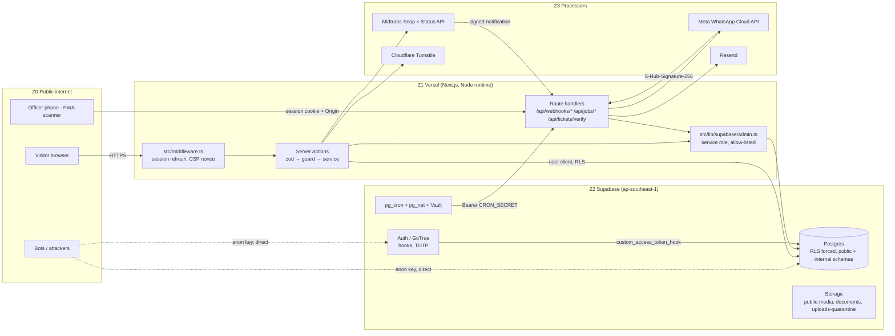
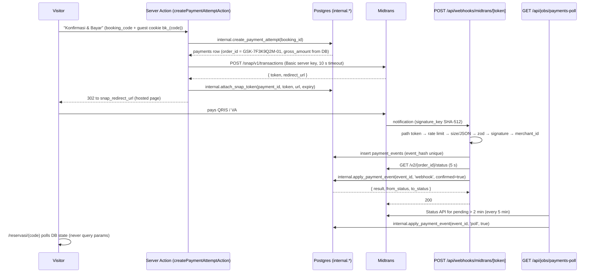

# Security Architecture & Hardening Guide

**Edu Center & Edu Wisata Kelurahan Gisikdrono (Semarang Barat)**

| Field | Value |
|---|---|
| Version | 1.0 |
| Date | 2026-10-15 |
| Status | Draft for review |
| Owner | Kelurahan Gisikdrono Edu Center project team |
| Related documents | `CLAUDE.md` (root), `docs/PRD.md`, `docs/Task.md`, `docs/StyleGuide.md` |
| Precedence | `supabase/migrations` > `docs/PRD.md` > `CLAUDE.md` > this document (security rules are additive, never relaxed) > `docs/StyleGuide.md` |

---

## 1. Purpose, scope and principles

### 1.1 Purpose

This document is the security system for the platform's two most valuable assets: **money** (Midtrans settlements, the revenue-share ledger, invoices) and **personal data** (group bookers and the names of visiting school children). It specifies, per layer, the exact controls, where they are implemented (file, route, database object), how they are tested, and the order in which they must ship. Every control carries an ID that `docs/Task.md` cites; every red-team finding against the design is closed by a named control (Appendix A).

### 1.2 Scope

| In scope | Out of scope |
|---|---|
| Next.js application on Vercel (`src/**`), Supabase project (Postgres, Auth, Storage, pg_cron, Vault), Midtrans Snap integration, Meta WhatsApp Cloud API, Resend email, Cloudflare Turnstile, the PWA scanner, exports and PDF documents, staff and vendor-console accounts, incident response, UU PDP No. 27/2022 compliance | Physical security of the kelurahan office, the kelurahan's bank account and treasury procedures after payout, the human WhatsApp chat on the floating button (outside this system), Midtrans' internal PCI scope |

Glossary of domain terms used throughout: **RW** (Rukun Warga, the neighbourhood unit; RW 05 and RW 08 are the two tenants), **kelurahan** (the urban village office that owns the platform), **UMKM** (micro and small enterprises selling souvenirs and snacks), **PKK** (the women's welfare group producing recycled crafts), **Bank Sampah** (community waste bank), **dolanan** (traditional Semarang children's games), **sanggar** (arts studio), **Ecowastreme** (RW 05's eco-tourism programme), **PIC** (person in charge of a group booking).

### 1.3 Security principles

1. **The server computes money.** Clients send identifiers and quantities only; prices, totals and `gross_amount` come from database rows, every time.
2. **Midtrans is the source of truth for "did money move"; our database is the source of truth for "what was sold".** The two are reconciled by webhook, polling and a daily job; no single path is trusted alone.
3. **Financial facts are written once.** Corrections are new rows: append-only tables, immutability triggers, a hash-chained ledger, dual-controlled adjustments.
4. **One function per state change.** Every booking, payment and ticket transition runs inside one `SECURITY DEFINER` function under a row lock in the `internal` schema.
5. **Deny by default in the database.** RLS is enabled and forced on every table; the `anon` role reads published content only; nothing mutating is callable with the public key.
6. **Identity before scarce resources.** No quota is reserved and no message is sent to a phone until that phone has passed a WhatsApp OTP.
7. **Collect less, keep less.** No national ID numbers, birth dates, addresses or photos of visitors; children's names only as name + class, purged 90 days after the visit, including the PDFs that contain them.
8. **Every privileged action is logged and alertable**, and critical alerts leave the system through a path that does not depend on the outbox they monitor.
9. **Clean code is a security control.** Pure, unit-tested functions for pricing, signing and state mapping; strict layering UI → action → service → data-access → DB; no `any`, no magic values, no dead code (see `CLAUDE.md`).

### 1.4 Shared-responsibility model

| Party | Responsible for | We rely on |
|---|---|---|
| **Vercel** | Edge/TLS termination, function isolation, Firewall managed rules, Deployment Protection, env-var encryption | Secrets stay server-side; previews behind Vercel Authentication; Attack Challenge Mode as a runbook switch; scheduled jobs are driven by pg_cron + pg_net, never by Vercel cron |
| **Supabase** | Managed Postgres (AES-256 at rest), Auth (GoTrue, MFA, hooks), Storage, pg_cron/pg_net, backups, Security Advisor | RLS enforcement, Auth hooks, leaked-password protection (Pro), SSL enforcement, daily backups |
| **Midtrans** | Hosting the payment page (Snap), card/QRIS/VA processing, PCI DSS, settlement to the merchant bank account, `signature_key` on notifications, Status API | We never see payment instruments; we verify every notification and re-confirm with the Status API |
| **Meta (WhatsApp Cloud API)** | Template approval, message delivery, webhook signing (`X-Hub-Signature-256`) | Templates only; OTP delivery; delivery statuses |
| **Resend** | Email delivery, DKIM signing, bounce/complaint handling | Links-only email; SPF/DKIM/DMARC on `mail.<domain>` |
| **Cloudflare (Turnstile, R2)** | Bot challenge, off-site encrypted backup storage | Turnstile fail-closed on public forms; R2 for weekly `age`-encrypted dumps |
| **Kelurahan Gisikdrono team** | Account ownership of every vendor console (institutional email + MFA), staff onboarding/offboarding, Midtrans dashboard governance, approving adjustments and refunds, privacy notice and DSR handling, breach notification decisions, quarterly reviews | The controls in this document are only as strong as the accounts that administer them (SEC-05, PAY-16) |
| **Development team** | Everything in `src/**` and `supabase/**`, CI gates, migrations, runbook execution, key rotation | Branch protection, required checks, no dashboard edits in production |

---

## 2. Threat model

### 2.1 Assets (ranked)

| # | Asset | Why it matters | Primary controls |
|---|---|---|---|
| A1 | Midtrans settlements and payouts (the merchant bank account) | Direct theft; the platform cannot see a changed payout account | PAY-16, REC-01, REC-02 |
| A2 | Children's names in `booking_participants` and participant-bearing PDFs | UU PDP "specific personal data"; reputational and legal harm | AZ-12, DATA-02, DATA-12, GUEST-06 |
| A3 | Booker PII (`bookings.pic_name`, `pic_phone`, `pic_email`, `institution_name`) | Phishing of schools, misdelivery, breach notification duty | AZ-12, GUEST-02, DATA-04, DATA-13 |
| A4 | Session quota (`visit_sessions.reserved_pax`) | The scarce good; blocking it stops the kelurahan from selling | BOOK-12, BOOK-13, BOOK-01 |
| A5 | Tickets (`tickets_qr`) | Entry rights worth money; forgery and reuse | WH-12, QR-01, QR-02 |
| A6 | Financial records (`payments`, `invoices`, `revenue_share_entries`, `audit_logs`) | Basis of the kelurahan's accountability | REC-03, REC-04, REC-05 |
| A7 | Staff accounts (`superadmin` > `admin_rw`) | A superadmin can do everything above | AUTH-03, AUTH-09, AUTH-10, AUTH-11 |
| A8 | Vendor console accounts (Supabase, Vercel, GitHub, Midtrans, Meta, Resend, Cloudflare) | One phished login bypasses every application control | SEC-05, PAY-16 |
| A9 | CMS integrity and availability on visit days | Defacement; gate cannot scan | APP-08, OPS-03, QR-06 |

### 2.2 Actors

| Actor | Capability | Goal |
|---|---|---|
| Internet scanner / bot | Public key from the JS bundle, direct PostgREST/GoTrue calls, Turnstile solvers | Spam, credential stuffing, scraping |
| Malicious visitor | Normal booking flow, a verified prepaid SIM, forwarded links | Pay less, hold quota for free, enter with a refunded or shared ticket, obtain another school's data |
| Rogue or compromised `admin_rw` | Own JWT, own RW's CMS, scanner phone, PostgREST with the JWT | Skim revenue via prices, read the other RW, dump children's names, falsify check-ins |
| Compromised `superadmin` | Everything in the dashboard | Money edits, exports, inviting accomplices |
| Insider at a vendor console / departing developer | SQL editor, env vars, Server Key, service-role key | Silent edits, key theft |
| Leaked secret | `MIDTRANS_SERVER_KEY`, `SUPABASE_SERVICE_ROLE_KEY`, `CRON_SECRET`, `QR_SIGNING_KEYS`, `BOOKING_LINK_SECRET` | Forged notifications, RLS bypass, forged tickets |
| Vendor misbehaviour / outage | Midtrans retries and out-of-order delivery, Meta throttling, Resend bounces | Lost tickets, double processing |

### 2.3 Trust boundaries



Boundary rules: Z1 is the only place secrets exist; Z2 assumes Z1 has bugs (RLS is the last line); Z0 can reach Z2 directly with the public key, so **no control may exist only in Z1** (lockout lives in an Auth hook, anti-abuse behind service-role-only functions, PII behind masked views and RPCs).

### 2.4 STRIDE per flow

| Flow | Spoofing | Tampering | Repudiation | Information disclosure | Denial of service | Elevation of privilege |
|---|---|---|---|---|---|---|
| Booking | Fake PIC phone → **BOOK-12** OTP before hold | Client-sent prices → **PAY-03** strict DTO | Unlogged holds → `booking_events`, **AUD-01** | Duplicate-hold code leak → **BOOK-15** | Free quota lockout → **BOOK-13**, **BOOK-16** | Direct `create_booking` RPC → **AZ-11** (`internal` schema) |
| Payment | Forged notification → **WH-01**, **WH-08**, **WH-14** | Amount mismatch → **WH-06**; post-settlement edits → **REC-03** | Replay → **WH-05**; no trail → **AUD-01** | PII to processor → **PAY-07** | Webhook flood → **WH-03**, **WH-15** | Leaked Server Key → **PAY-10**, **PAY-16** |
| Ticket | Forged QR → **QR-01**, **QR-05** | Ticket without money → **WH-12**; revive used → **QR-07** | Who scanned → `ticket_scans`, **AZ-14** | PII in QR → **QR-05** | Lockout via junk QR → **QR-06** | Cross-RW check-in → **QR-02** |
| Scanner | Stolen officer session → **AUTH-04**, **QR-04** | Actor passed as parameter → **AZ-14** | Manual check-in unlogged → **QR-07** | Cached PII in PWA → **HDR-03** | Offline → manifest contingency **QR-04** | Service role in scan path → **AZ-14** |
| CMS | Self-signup → **AUTH-01**; mailbox bootstrap → **AUTH-09** | Price skim → **REC-13**; session edits under bookings → **REC-15** | Audit diff missing → **DATA-11** | Cross-RW reads → **AZ-03**, **AZ-12** | Login lockout DoS → **AUTH-10** | Self role update → **AZ-04**, **AZ-10** |
| Exports | — | Report from editable rows → **REC-07** | Unlogged export → **AUD-04**, **DATA-06** | Bulk PII via PostgREST → **AZ-12** | Export DoS → **RL-01** caps | admin_rw export with contacts → **DATA-06** |
| Staff lifecycle | Invite link in a phished mailbox → **AUTH-09** | Extra TOTP factor → **AUTH-12** | Role change unlogged → **AZ-10** | Stale claims after deactivation → **AZ-09** | Lockout of officers on visit morning → **AUTH-10** | Sockpuppet approver → **REC-16**, **AUTH-11** |

### 2.5 Attack trees for the top risks

**T1 — Steal or divert money**
- Change the Midtrans payout account (phished dashboard login) → PAY-16 (owner = kelurahan head, 2FA, named operators, expected payout account in `site_settings`, weekly payout-vs-ledger)
- Pay less than the price
  - Send `total` in the form → PAY-03 (`.strict()` DTO, server pricing)
  - Set the package price to IDR 1, book, restore → REC-13 (price floor trigger, `package_price_history`, anomaly rules)
  - Lock a manipulated price via quotation → REC-13 + BOOK-17 (quotation re-priced against history)
- Forge a settlement
  - Craft `signature_key` without the key → WH-01
  - Replay a genuine notification → WH-05 (`event_hash`)
  - Use a leaked Server Key → WH-08 / WH-14 (Status API confirmation on every transition)
- Edit records after the fact → REC-03, REC-04, REC-05, REC-09, REC-16

**T2 — Block the quota for free**
- Hold with invented phones/emails → BOOK-12 (OTP before hold)
- Many holds from one verified SIM → BOOK-13 (≤ 2 concurrent unpaid per phone, ≤ 50 % of a session unpaid, 5/day)
- Bypass the Server Action via PostgREST → AZ-11 (`internal.create_booking` not exposed)
- Exhaust the limiter → BOOK-16 (Postgres `rate_limit_buckets`, fail-closed matrix)
- Hold forever via NULL `expires_at` → BOOK-14

**T3 — Enter without paying**
- Forge a QR → QR-01 (HMAC-SHA256, kid)
- Share a screenshot → QR-02 (atomic single use, `attempt_id`)
- Enter after a refund → QR-07 (refund revokes tickets; `check_in_ticket` re-checks `bookings.status`)
- Insert a ticket row directly → WH-12 (trigger: tickets require money)
- Bring 45 pupils on a 10-pax ticket → QR-08 (`unpaid_pax`, certificate gate)

**T4 — Read the other RW or dump children's names**
- PostgREST `select=*` on `bookings`/`booking_participants` → AZ-12 (no raw SELECT for admin_rw; `v_bookings_staff`, `rpc_reveal_booking_contact`, `rpc_get_participants`)
- Owner-privileged finance views → AZ-13 (`security_invoker`, superadmin-only recap views)
- Forwarded certificate links → GUEST-06, DOC-02
- Supabase SQL editor → SEC-05, DB-06

**T5 — Take over a staff account**
- Credential stuffing straight at GoTrue → AUTH-10 (Password Verification Attempt hook), AUTH-13 (TOTP for all staff)
- Phished invite mailbox → AUTH-09 (`invite_code` out of band; role only at onboarding completion)
- Walk-up to an unlocked AAL2 session → AUTH-11 (step-up ≤ 5 min), idle lock
- Self-update `profiles.role` → AZ-04, AZ-10
- Keep access after deactivation → AZ-09, AUTH-07

### 2.6 Risk register

| ID | Risk | Likelihood | Impact | Residual after controls | Owner |
|---|---|---|---|---|---|
| R1 | Midtrans dashboard compromise diverts payouts | Medium | Critical | Low (PAY-16, weekly payout check) | Kelurahan head |
| R2 | Zero-cost quota lockout | High | High | Low (BOOK-12/13/16) | Dev team |
| R3 | Rogue `admin_rw` dumps PII via PostgREST | Medium | Critical (UU PDP) | Low (AZ-12, AZ-13, MON-07 reveal-cap rule) | Dev team |
| R4 | Price skim through RW-managed prices | Medium | High | Low-medium (REC-13; approval queue is *should*) | Superadmin |
| R5 | Forged settlement with a leaked Server Key | Low | Critical | Low (WH-14, PAY-10) | Dev team |
| R6 | Staff account takeover via direct GoTrue stuffing | Medium | High | Low (AUTH-10, AUTH-13) | Dev team |
| R7 | Ticket reuse / entry after refund | Medium | Medium | Low (QR-02, QR-07) | RW officers |
| R8 | Children's names persist in PDFs after purge | High (without control) | High | Low (DATA-12) | Dev team |
| R9 | Alerts silenced by a stalled outbox | Medium | High | Low (OPS-06) | Dev team |
| R10 | Data residency (PP 71/2019) makes Singapore hosting non-compliant | Unknown | Blocker | Open decision A10 (§7.6, §13.3) | Kelurahan / Diskominfo |
| R11 | Single superadmin defeats dual control | Medium | High | Medium (REC-16 compensating 24 h delay + kelurahan-head email) | Kelurahan head |
| R12 | Vendor outage on a visit day | Medium | Medium | Low (RES-02, QR-04 manifest contingency) | RW officers |
| R13 | XSS on a public ISR page, which runs under the static CSP with `'unsafe-inline'` scripts (§8.2) | Low | Medium (no PII, payment or login on those pages) | Low (Tiptap JSON renderer, `react/no-danger`, Semgrep, APP-11; tightening tracked in Task P5.4.03) | Dev team |

---

## 3. Payment security end-to-end

### 3.1 Flow overview



### 3.2 Snap redirect mode and server pricing (PAY-01…PAY-09, PAY-11…PAY-15)

- **Redirect mode only.** The hosted payment page is opened via the stored `payments.snap_redirect_url`; no `snap.js` on our origin, so no Midtrans origins appear in the CSP and `Cross-Origin-Opener-Policy: same-origin` holds. The redirect URL is also sent in `gsk_payment_reminder_v1` and the pending-payment email so a B2B treasurer can pay from another device.
- **Server computes money.** The booking DTO is `z.object({...}).strict()` carrying `packageId`, `visitSessionIds`, `pax`, `addons: [{productId, qty}]` (≤ 20 lines), participants and PIC fields; any `price`, `total`, `discount` key fails validation. `computeBookingQuote()` in `src/lib/pricing` is pure, takes DB rows only, returns integer IDR lines with the invariant `sum(lines) = total > 0`, is snapshotted into `bookings` and `booking_addons` at hold time, and is 100 % line-covered.
- **Snap payload** (`src/lib/midtrans/client.ts`, thin typed `fetch`, no SDK): `transaction_details.order_id = payments.order_id`, `gross_amount = bookings.total_amount`, `item_details` from `booking_addons` plus the package/discount lines (names ≤ 50 chars), `customer_details` = PIC `first_name`, `email`, `phone` only (no participants, no address), `enabled_payments = ['qris','bca_va','bni_va','bri_va','permata_va','cimb_va','other_va']` hard-coded (no cards), `expiry = {unit:'minute', duration: minutes until bookings.expires_at}`, `callbacks.finish = https://<site>/reservasi/<code>`. Snapshot tests lock the payload.
- **Attempts.** `payments.order_id = booking_code || '-' || lpad(attempt_no, 2, '0')` (`GSK-7F3K9Q2M-01`), unique; a partial unique index allows one open payment per booking (`initiated`, `pending` or `needs_review`; a `needs_review` payment blocks a new attempt until a superadmin resolves it); an unexpired Snap token is reused. **[RT]** A new attempt first calls `POST /v2/{previous order_id}/expire` and proceeds only when Midtrans confirms the previous order is expired or cancelled (WH-16). A new attempt is refused when fewer than 5 minutes of the hold remain (BOOK-14).
- **Finish page** `/reservasi/[bookingCode]` requires the `bk_<code>` httpOnly cookie minted at hold time, never reads `transaction_status` from the query string, and polls `payments.status` via a Server Action (PAY-09, PAY-15).
- **Environment fail-fast** in `src/lib/env.ts`: `VERCEL_ENV=production` ⇔ `MIDTRANS_IS_PRODUCTION=true` ⇔ `MIDTRANS_SERVER_KEY` starts with `Mid-server-` and `MIDTRANS_CLIENT_KEY` with `Mid-client-`; any other environment requires `SB-` prefixes. CI scans `.next/static` for `Mid-server-`, `SB-Mid-server-`, `service_role`, `sb_secret_` (PAY-01, PAY-02, SEC-01).

### 3.3 Webhook pipeline (WH-01…WH-11, WH-14, WH-15)

Route `src/app/api/webhooks/midtrans/[token]/route.ts`: `runtime = 'nodejs'`, `dynamic = 'force-dynamic'`, `maxDuration = 15`, outside the auth middleware matcher, `POST` only. Steps, in this order, each emitting one structured log event:

| # | Step | On failure | security_events |
|---|---|---|---|
| 1 | `params.token` must equal `MIDTRANS_WEBHOOK_PATH_TOKEN` (`timingSafeEqual`) | 404, no DB write | — |
| 2 | Rate limit **before any DB write**: `rate_limit_hit('webhook:midtrans:ip:<ip>', 30, 60)` and global 600/min | 429 | `rate_limited` |
| 3 | `Content-Length` and actual bytes ≤ 16 384; `Content-Type` contains `application/json`; body read once with `req.text()` | 413 / 415 | — |
| 4 | `JSON.parse` + zod `MidtransNotificationSchema` (`.passthrough()`; required `order_id, status_code, gross_amount, signature_key (128 hex), transaction_status, transaction_id, payment_type, currency`) | 400 | — |
| 5 | `signature_key === sha512(order_id + status_code + gross_amount + MIDTRANS_SERVER_KEY)` using `gross_amount` **exactly as received** (`"1250000.00"`), compared with `crypto.timingSafeEqual`; during rotation also tried with `MIDTRANS_SERVER_KEY_PREVIOUS` | 403, empty body; **metadata only** (`order_id`, `sig_prefix` 8 hex, `ip`, `body_sha256`, `received_at`) into `webhook_rejections` (30-day retention, cap 20 rows/IP/hour) **[RT]** | `webhook_signature_invalid` |
| 6 | `merchant_id`, when present, equals `MIDTRANS_MERCHANT_ID` | 200, `merchant_mismatch`, alert | `webhook_amount_mismatch` |
| 7 | `INSERT INTO payment_events (… event_hash = sha256(raw body)) ON CONFLICT DO NOTHING RETURNING id`; no row = replay | 200 `{"status":"duplicate"}` | — |
| 8 | Lookup `payments` by exact `order_id` (never parsed) | 200, `unknown_order`, alert only if the `order_id` matches our grammar `^GSK-[0-9A-HJKMNP-TV-Z]{8}-[0-9]{2}$` **[RT]** | `webhook_amount_mismatch` |
| 9 | `currency = 'IDR'` and `Number(gross_amount)` integer and equal to `payments.gross_amount` | 200, payment → `needs_review`, high alert | `webhook_amount_mismatch` |
| 10 | **Status API confirmation for every state-changing transition** (`settlement`, `capture`, `refund`, `partial_refund`, `cancel`, `expire`, `chargeback`) **[RT]**: `GET /v2/{order_id}/status` through `src/lib/midtrans/client.ts` (Basic auth; default 10 s timeout, capped at 5 s inside the webhook so the route stays within `maxDuration = 15`), no retry; `transaction_status`, `fraud_status`, `gross_amount` and `order_id` must agree | unreachable → 503 (Midtrans retries, poll retries), event left `awaiting_status_check`; disagreement → `needs_review`, **critical** alert, webhook quarantine mode | `status_disagreement` |
| 11 | `internal.apply_payment_event(event_id, 'webhook', confirmed := true)` — one transaction | DB error → 503 | — |
| 12 | `after()` kicks `POST /api/jobs/process-notifications` | ignored (cron catches up) | — |
| 13 | 200 `{"status":"ok"}`; target < 3 s | — | — |

Response contract: `200` processed/duplicate/ignored/needs_review; `400/413/415` malformed; `403` signature; `404` path; `429` rate limited; `503` transient. No IP allow-list is used as authentication; the source IP is stored for forensics only (WH-10). The signature-failure alert rule counts only requests whose `order_id` matches an existing `payments` row (WH-15), so junk posts cannot page the team.

### 3.4 Status map and transitions (WH-07)

| `transaction_status` × `fraud_status` | `payment_status` | Booking effect | Tickets |
|---|---|---|---|
| `settlement`; `capture`+`accept` | `settled` | `pending_payment`/`expired` → `paid`; invoice `INV/GSK/YYYY/MM/NNNN` + receipt `KW/GSK/YYYY/MM/NNNN`; ledger posted; outbox `payment_received_ticket`, `admin_new_paid_booking` | issued (one per `booking_legs` row) |
| `capture`+`challenge` | `needs_review` | hold frozen (sweeper skips) | none |
| `pending` | `pending` | unchanged; VA/QR details stored for the status page | none |
| `deny`, `failure` | `denied`, `failed` | stays `pending_payment`; visitor may retry (new attempt) | none |
| `cancel`, `expire` | `cancelled`, `expired` | booking `expired` if no other open attempt; quota released | none |
| `refund` | `refunded` | booking `refunded`; `internal.reverse_revenue_share`; credit note `CN/GSK/YYYY/NNNN`; invoice `void` | **revoked** in the same transaction |
| `partial_refund` | `partially_refunded` | booking stays `paid`; partial reversal | kept |
| `chargeback` | `disputed` | flagged, high alert | `suspended` if the visit is in the future |
| second settlement for an already-paid booking **[RT]** | `duplicate` | no invoice, no ledger; auto-refund task; high alert | unchanged |

Allowed payment transitions (everything else returns `{result:'ignored_transition'}` with 200, never raises): `initiated → pending`; `pending → settled | denied | failed | cancelled | expired | needs_review`; `needs_review → settled | failed | cancelled | expired`; `failed → settled` (bank-side retry, only if no other settled attempt, else `duplicate`); `expired → settled` (late settlement); `settled → refunded | partially_refunded | disputed`; `partially_refunded → refunded | disputed`. `settled` never regresses; an `expire` after `settlement` is ignored.

**Late settlement.** If the booking is already `expired`, `internal.apply_payment_event` calls `internal.reserve_session_quota` per leg under the same ordered locks; success → `paid` with `booking_events.reason = 'revived_late_settlement'`; no capacity → `paid` with `needs_review = true`, tickets **not** issued, `admin_booking_needs_review` notification, superadmin resolves via `resolve_booking_review('issue_tickets' | 'refund')`. Money is never silently kept.

### 3.5 `internal.apply_payment_event` (one transaction)

```sql
-- internal.apply_payment_event(p_event_id bigint, p_source text, p_confirmed boolean) returns jsonb
-- owner postgres, security definer, set search_path = '', execute revoked from public/anon/authenticated
-- 1  select * from public.payment_events where id = p_event_id for update; already processed -> {result:'already_processed'}
-- 2  select * from public.payments where order_id = e.order_id for update;   -- serialises webhook vs poll
-- 3  select * from public.bookings where id = p.booking_id for update;
-- 4  target := status map; if target changes money state and not p_confirmed -> {result:'needs_confirmation'}
-- 5  transition allowed? else mark event processed 'ignored_transition' and return
-- 6  perform set_config('app.in_rpc', '1', true);  -- status columns are writable only here
-- 7  if target = 'settled' and exists (select 1 from public.payments where booking_id = b.id and status = 'settled' and id <> p.id)
--      then update payments set status = 'duplicate' ...; insert notifications (refund task); insert security_alerts; return
-- 8  update payments (status, transaction_id, payment_type, bank, va_number, settled_at)
-- 9  booking transition (incl. late-settlement re-reservation), booking_events row
-- 10 settled: invoice + receipt via internal.next_document_number; insert tickets_qr per leg; internal.allocate_revenue_share
-- 11 refund/cancel: revoke tickets_qr of the booking; internal.reverse_revenue_share; credit note
-- 12 insert notifications (dedupe_key 'booking:<id>:<template>:<channel>') on conflict do nothing
-- 13 internal.log_audit(...); update payment_events set processed_at = now(), processing_result = 'applied'
```

The same function is called with `p_source = 'poll'` by `/api/jobs/payments-poll` and with `'manual'` by the superadmin "Sinkronkan dengan Midtrans" action; both insert a synthetic `payment_events` row holding the Status API body (`signature_valid = NULL`) and pass `confirmed := true` because the Status API response *is* the confirmation.

### 3.6 Immutability, append-only and "tickets require money" (REC-03, REC-04, WH-12)

| Trigger | Table | Behaviour |
|---|---|---|
| `payments_protect_settled` BEFORE UPDATE | `payments` | once `status in ('settled','refunded','partially_refunded','disputed','duplicate')`: `gross_amount, currency, order_id, booking_id, transaction_id, settled_at, payment_type` immutable (`raise exception … errcode 'P0001'`); DELETE always raises |
| `bookings_immutable_guard` BEFORE UPDATE | `bookings` | `rw_ids, package_id, booking_code, created_at` immutable after insert; `expires_at` writable only inside `extend_booking_hold` (`app.in_rpc`, ≤ 14 days, audited); `total_amount, pax_count, discount_*` frozen once `paid`; `status` writable only when `current_setting('app.in_rpc', true) = '1'` |
| `booking_addons_guard` | `booking_addons` | UPDATE/DELETE raise once the parent booking is `paid` |
| `invoices_immutable` | `invoices` | `invoice_no, amount, snapshot, issued_at` always immutable; DELETE raises; status only `issued → paid → void` |
| `append_only` BEFORE UPDATE OR DELETE | `payment_events` (except `processed_at`, `processing_result`), `revenue_share_entries`, `audit_logs`, `payment_adjustments` (after `applied`), `booking_events`, `security_events`, `ticket_scans`, `webhook_rejections` (purge job only, `set local app.purge = 'on'`) | raise; plus `REVOKE UPDATE, DELETE, TRUNCATE … FROM anon, authenticated` |
| `tickets_require_paid_booking` BEFORE INSERT | `tickets_qr` | raise unless `bookings.status = 'paid'` **and** a `payments` row with `status = 'settled'` exists for the booking (manual payments insert a `provider = 'manual'` settled row first) |
| `tickets_no_revive` BEFORE UPDATE | `tickets_qr` | `used → issued` only via `undo_check_in` within 15 min (`app.in_rpc` + `app.undo = '1'`); `ticket_code`, `booking_id`, `key_id` immutable; allowed: `issued → used | suspended | revoked | expired`, `suspended → issued | revoked` |

Triggers fire for the service role too (it bypasses RLS, not triggers); only the `postgres` owner can drop them, which is why vendor-console governance (SEC-05) and the nightly `pg_trigger` presence check in `reconcile-payments` exist.

### 3.7 Pull fallback and reconciliation (WH-13, REC-01, REC-02)

- `GET /api/jobs/payments-poll` every 5 min (pg_cron + pg_net, `Authorization: Bearer CRON_SECRET` from Vault): Status API for `payments` in `pending`/`needs_review` created 2 min – 48 h ago, batch 200, 10 s budget; also re-issues tickets for `paid` bookings with zero `tickets_qr` rows older than 2 min (`tickets.reissued_by_job`), and checks holds within 5 min of expiry so a just-paid VA is caught before the sweeper.
- `GET /api/jobs/reconcile-payments` daily 02:30 WIB: window A open items (72 h) → Status API → apply; window B every `settled`/`partially_refunded` payment of the last 7 days re-verified (`transaction_status`, `gross_amount`, `refunds[]`, `settlement_time`); SQL invariants: one invoice per settled payment, at most one settled payment per booking, ledger sum per payment = `gross_amount − refunded`, every `paid` booking has ≥ 1 ticket, no `issued` ticket on a non-paid booking, `sum(pax_count)` per session ≤ `capacity`, `internal.verify_ledger_chain()` and `internal.verify_audit_chain()` return `ok`, all protective triggers present in `pg_trigger`; discrepancies → `reconciliation_issues(run_id, kind, order_id, expected, actual, status)` (closed with a reason, never deleted) + digest to `SECURITY_ALERT_EMAIL`.
- Weekly (should): superadmin uploads the Midtrans dashboard transaction CSV; unknown `order_id`s (money taken outside the app), amount and status deltas become `reconciliation_issues`. Monthly: Midtrans payout report vs `v_revenue_recap_daily`; the expected delta is the Midtrans fee; the **payout bank account on the report must equal `site_settings.finance.expected_payout_account_masked`** **[RT]**.

### 3.8 Ledger hash chain, adjustments, refunds, numbering (REC-05…REC-11, REC-16)

- `revenue_share_entries` is append-only and hash-chained: the BEFORE INSERT trigger `ledger_chain` (function `internal.chain_append()`, shared with `audit_chain` on `audit_logs`) takes `pg_advisory_xact_lock(hashtext('chain:revenue_share_entries'))`, only then draws the row's `id` from the identity sequence (so id order is chain order even under concurrent inserts), sets `prev_hash` to the `entry_hash` of the highest id and `entry_hash = encode(digest(coalesce(prev_hash, '') || '|' || canonical_row, 'sha256'), 'hex')`, where `canonical_row` is `to_jsonb(row)` without `prev_hash`, `entry_hash` and `payout_batch_id` (the one column the payout run sets later, once), rendered with `timezone = 'UTC'`. Any hash a caller supplies is overwritten. `internal.verify_ledger_chain()` / `verify_audit_chain()` recompute the chain in id order and return `{ok, checked, first_broken_id}`; the first remaining row's `prev_hash` is accepted as the anchor, because retention prunes the oldest rows after a checkpoint. Reversal = negative row (`entry_type = 'reversal'`), never a status flip. `internal.allocate_revenue_share` resolves rules product > addon_default(rw) > package > package_default(rw) > global, splits with largest-remainder rounding so `sum = amount` exactly, snapshots `rule_version`, is idempotent on `(booking_id, line_ref, beneficiary_key)`; combo packages split **per leg** with each leg's RW rule (REC-14). `revenue_share_rules`/`_lines` are immutable and versioned by `effective_from/to` (REC-10). Recap and exports read only `v_revenue_recap_daily/by_party/by_booking` (REC-07). Could: weekly anchor email of the latest `(id, entry_hash)` to the kelurahan head (AUD-05).
- **Adjustments** (`payment_adjustments`, `adjustment_type` `manual_mark_paid | manual_refund | write_off | reclassify_share | pax_correction`, `adjustment_status` `proposed → approved | rejected → applied`): trigger `approved_by IS DISTINCT FROM proposed_by`; approver must be `superadmin`, `aal2()`, with a fresh TOTP ≤ 5 min (AUTH-11), account ≥ 7 days old, MFA factor enrolled **before** the adjustment was proposed, and not created by the proposer within the last 30 days (`profiles.created_by`) **[RT]** (REC-16); evidence in `documents/bookings/<id>/payment-proof-<uuid>.jpg` required; `apply_adjustment()` is the sole writer of settled money fields (sets `app.adjustment_id`, posts `entry_type = 'adjustment'` rows, audits before/after); `manual_mark_paid` re-queries the Status API and refuses when Midtrans does not show settlement. Single-superadmin compensating control: 24 h delay before `apply` plus email and `gsk_security_alert_v1` to the kelurahan head on proposal and on apply.
- **Refunds**: QRIS via `POST /v2/{order_id}/refund` with `refund_key = adjustment id`, state follows the resulting notification/Status API; VA refunds are bank transfers recorded as `manual_refund` adjustments with proof; `record_refund` (superadmin) revokes every ticket of the booking, releases quota if the visit is in the future, reverses the ledger and issues the credit note in one transaction; `checked_in → refunded` is allowed for partial attendance. Refund policy windows are a product-owner decision (`docs/PRD.md` Open decisions); the mechanism supports any policy.
- **Numbering**: `document_sequences(kind, period, last_value)` with `INSERT … ON CONFLICT DO UPDATE … RETURNING` inside the settlement transaction (gapless, monotonic); invoice and receipt numbers only at settlement; quotation numbers `SP/GSK/YYYY/MM/NNNN` only after OTP-verified phone and at most 3 per booking **[RT]**; certificates `SERT/GSK/YYYY/NNNNN`; Postgres `SEQUENCE` rejected (gaps on rollback).

### 3.9 Midtrans dashboard governance and key rotation (PAY-10, PAY-16)

| Rule | Detail |
|---|---|
| Owner account | Kelurahan head's official email (A12), 2FA on, recovery codes in the Bitwarden organisation vault |
| Operators | Named sub-accounts with least privilege (finance read-only for the treasurer, no key access for developers); no shared logins; quarterly access review signed by the Lurah's office |
| Protected changes | Server Key regeneration, payout/settlement account change and notification URL change only by the owner with a written record in `audit_logs` (`key_rotated` / `settings.update`) |
| Detection | Anomaly rule: signature-failure burst with **zero valid notifications in 30 min** = incident "merchant account compromise" (not "env mix-up"); monthly payout-account check against `site_settings.finance.expected_payout_account_masked` |
| Server Key rotation | 1) regenerate in the dashboard at 02:00 WIB; 2) set `MIDTRANS_SERVER_KEY`, move the old value to `MIDTRANS_SERVER_KEY_PREVIOUS`; 3) redeploy; 4) overlap ≤ 15 min, then remove the previous key; 5) `security_events.key_rotated`; 6) run `reconcile-payments`. Triggers for unplanned rotation: any `status_disagreement`, suspected leak, departure of anyone with dashboard access. `MIDTRANS_WEBHOOK_PATH_TOKEN` rotates with the key. |

---

## 4. Booking and quota abuse controls

### 4.1 Identity before quota (BOOK-12, GUEST-03, GUEST-08)

1. `requestPhoneOtpAction` (Turnstile, zod E.164 `^\+62[0-9]{8,13}$`) → `internal.issue_phone_otp`: `guest_otps(phone, code_hash = sha256(code || OTP_PEPPER), purpose 'booking_phone', attempts, expires_at = now() + 10 min)`; template `gsk_otp_v1` (AUTHENTICATION, copy-code). Caps: 5 OTP/phone/day, 20/IP/day, resend cooldown 60 s, 5 verify attempts then invalidated.
2. `verifyPhoneOtpAction` → `internal.verify_phone_otp` marks the row consumed and returns a signed, httpOnly `phone_verified` cookie (phone + `exp` 30 d, HMAC with `BOOKING_LINK_SECRET`).
3. The booking DTO carries **no phone field**; `createBookingAction` derives `pic_phone` solely from the verified cookie (or the `guest_otps` row consumed within the last 10 min) and sets `bookings.phone_verified_at` in the same call. Changing the number means a new OTP. A trigger refuses any `notifications` row with `channel = 'whatsapp'` whose booking has `phone_verified_at IS NULL`; the only exception is `template = 'phone_otp'`, which carries no `booking_id` and is keyed to the `guest_otps` row **[RT]**.
4. The global OTP breaker (500/day) **degrades** instead of stopping: above threshold the form switches to interactive Turnstile and email OTP; only OTPs that Meta accepted count; superadmin alerted at 50 % **[RT]**.

### 4.2 Reservation, holds and expiry (BOOK-01, BOOK-02, BOOK-14)

- `internal.create_booking` (service role only, called from `src/server/services/booking-service.ts` after zod, Turnstile and limiter): validates package/legs/sessions/add-ons from DB rows, snapshots prices, then `internal.reserve_session_quota` per leg `ORDER BY id` — conditional `UPDATE visit_sessions SET reserved_pax = reserved_pax + p_pax WHERE … AND reserved_pax + p_pax <= capacity` under the row lock (READ COMMITTED re-check); zero rows → `QUOTA_UNAVAILABLE`; combo is both-or-nothing. `CHECK (reserved_pax <= capacity)` is the second line. Nightly `internal.reconcile_session_counters()` logs drift (`quota.drift`) and corrects downward only.
- `expires_at` is **NOT NULL for `pending_payment`**, set **once** inside `internal.create_booking` (web individual 120 min; `booker_type in ('school','university','government','company')` 24 h; pax > 20 → 30 min) and immutable thereafter (`bookings_immutable_guard`), the sole exception being the staff RPC `extend_booking_hold` (≤ 14 days, audited). Snap `expiry.duration = ceil((expires_at − now())/60)`; new attempt refused if < 5 min remain. `internal.expire_stale_bookings()` every 5 min expires at `expires_at + 5 min` grace with `FOR UPDATE SKIP LOCKED`, releases quota idempotently via `booking_legs.quota_released_at`, expires open payments, enqueues `booking_expired`. pgTAP: a `pending_payment` row with NULL `expires_at` cannot exist; Snap expiry never exceeds the hold.
- **Quotation holds no quota** (`booking_legs.status = 'unreserved'`, `bookings.status = 'quoted'`); "Konfirmasi & Bayar" reserves and starts the TTL (BOOK-08).

### 4.3 Caps and limiter rules (BOOK-04, BOOK-11, BOOK-13, BOOK-16)

| Rule | Value | Where |
|---|---|---|
| Concurrent unpaid bookings | ≤ 2 per verified phone and per email | `internal.create_booking` (count of `pending_payment` for the contact) |
| Bookings per day | ≤ 5 per phone; ≤ 10 per IP+UA bucket | `rate_limit_hit('booking:phone:<sha>', 5, 86400)`, `('booking:ipua:<sha>', 10, 86400)` |
| Unpaid share of a session | ≤ 50 % of `capacity` in `pending_payment`; beyond that the UI says "bayar untuk konfirmasi" and the hold is created only when Snap reports `pending` with a VA/QRIS issued | `internal.create_booking` |
| Large groups | pax > 20 → hold 30 min; pax > 60 → `security_alerts` info flag, not block; `booking.max_pax 500`, `booking.min_lead_hours 12`, `booking.max_advance_days 180` from `site_settings` | DTO + DB CHECK |
| Quota pressure | `quota_pressure` event when a session's pending share > 60 %; RW admin "Batalkan hold" (void hold) action, audited | `anomaly-scan`, dashboard |
| Key normalisation | email lower-cased, gmail dots and `+tags` stripped; phone E.164 `+62` mobile only; applied before limits, dedupe and notifications | `src/lib/validations/normalize.ts` |
| Evaluation order | per-IP → Turnstile (fail-closed) → global window counting **only Turnstile-verified** requests | `src/server/actions/booking.ts` |
| Global breaker | **soft**: switch `site_settings.rate_limit_profile` to `strict`, enable Vercel Attack Challenge Mode, alert; never a hard reject | `anomaly-scan` + runbook DoS |
| Limiter backend | Postgres `rate_limit_buckets` via `internal.rate_limit_hit` (no external quota to exhaust; an external store such as Upstash is only an optional later upgrade and must keep this fail-closed matrix); **fails closed** for login, password reset, scanner, exports and link minting; fails open only for booking creation while Turnstile stays mandatory | `src/lib/rate-limit.ts` |
| Turnstile | every public form (booking, OTP, lookup, quotation, review, DSR); server `siteverify` with `remoteip`, `hostname`, `challenge_ts < 5 min`, 5 s timeout | `src/lib/turnstile.ts` |

### 4.4 Duplicate handling and quotation misuse (BOOK-06, BOOK-08, BOOK-15, BOOK-17)

- A repeat submission for the same verified phone + session never returns another hold's code: the response is "Pemesanan dengan nomor ini sudah ada, tautan lanjutan telah dikirim ulang" and a signed `pay` link goes to the verified phone **[RT]**. `bookings.idempotency_key` (client UUID per form mount) returns the same booking on retry.
- Cancel of a hold requires the `manage` link or the `bk_<code>` cookie (never the code alone); lookup at `/reservasi/cari` takes code + phone/email, runs in constant time, and only re-sends a link.
- Quotation PDFs render whitelisted, length-limited fields only (`institution_name` ≤ 80 chars, letters/digits/space/`.,-`; no free-text notes), the fixed line "Pembayaran hanya melalui sistem (QRIS/VA); kelurahan tidak pernah meminta transfer ke rekening pribadi", the disclaimer that a quotation is not a reservation, and a verify URL `/verifikasi/<quotation_no>`; numbers are consumed only after OTP verification, max 3 per booking; generation runs through the outbox and PDF routes are rate-limited per booking and per IP **[RT]**.

---

## 5. Authentication and session

Supabase Auth is used **only by staff** (`superadmin`, `admin_rw`). Visitors never have accounts (§6.7 guest links).

### 5.1 Invite and onboarding (AUTH-01, AUTH-09)

| Setting / step | Value |
|---|---|
| Supabase Auth providers | Email + password only; "Allow new users to sign up" **off**; anonymous sign-ins off; OAuth off; magic-link login off; "Confirm email" on; "Secure email change" on |
| Invite | `inviteStaffAction` (superadmin, AAL2, step-up ≤ 5 min) inserts `staff_invites(email, role, rw_id, invite_code, invited_by, expires_at = now() + 72 h)` and calls `auth.admin.inviteUserByEmail(email, { redirectTo: <site>/onboarding })`. `invite_code` is 20 random Crockford characters **shown only once in the UI** and handed over in person or by voice, never emailed **[RT]** |
| Role assignment | `profiles` row is created by the `auth.users` trigger with `role = 'none'`, `is_active = false`. **Only** `completeOnboardingAction(invite_code, password, totp_code)` assigns `role`/`rw_id`, and it does so in the same request as the first successful TOTP verify, via `set_staff_role` (`app.privileged_rpc = 'on'`). A mailbox alone therefore never yields a privileged account |
| Superadmin invites | Require a second superadmin's approval (`staff_invites.approved_by`), or, with a single superadmin, 24 h delay plus notice to the kelurahan head |
| Alerts | `mfa_enrolled` and `role_changed` are `high`; every superadmin is notified by email + `gsk_security_alert_v1` |
| Password reset | `/forgot-password` with Turnstile; disabled for accounts that never completed onboarding; reset link validity 30 min; same generic response for unknown emails |

### 5.2 Password policy and MFA (AUTH-02, AUTH-03, AUTH-12, AUTH-13)

- Minimum 12 characters, all four character classes, Supabase leaked-password protection on (Pro); the onboarding form additionally runs `zxcvbn-ts` and blocks score < 3 (UX only).
- **TOTP is mandatory for every staff account** (A2): `profiles.mfa_required` is `true` for both `superadmin` and `admin_rw`, no RPC sets it `false`, and the column exists only so the hook, middleware and guards enforce enrolment uniformly. Phone/SMS factors are not enabled.
- **Exactly one verified factor per user**: enrolment is offered only when `listFactors()` returns zero verified factors, or inside onboarding; a second factor needs an AAL2 session plus step-up; a nightly job (and the access-token hook) sets `app_role = 'none'` for any user with > 1 verified factor until a superadmin reviews; `reset_staff_mfa` (superadmin, step-up, never the caller's own MFA) works with a **24 h delay** rather than dual approval, because the kelurahan may have a single superadmin (decision of 2026-10-16): the first call records the request, the deletion of **all** factors (plus sessions and a `claims_version` bump) happens only on a call ≥ 24 h later, and both steps write a critical `security_events` `mfa_reset`, an audit row and a critical `security_alerts` row that the alert sender delivers out of band to `SECURITY_ALERT_EMAIL` / `SECURITY_ALERT_WA_PHONE`, so the kelurahan head can intervene before the reset completes **[RT]**.
- `src/middleware.ts` calls `supabase.auth.mfa.getAuthenticatorAssuranceLevel()` on every `/dashboard/*` request: `nextLevel = 'aal2' && currentLevel !== 'aal2'` → `/mfa/verify`; `nextLevel !== 'aal2'` with `mfa_required` → `/mfa/enroll`. Middleware is a redirect convenience; the authoritative gates are `requireRole()`/`requireRwAccess()` in `src/server/auth/guards.ts` and the restrictive `aal2()` RLS policies (§6.3).

### 5.3 Step-up for critical actions (AUTH-11)

Actions that require a fresh TOTP verification within the last **5 minutes** (`supabase.auth.mfa.challengeAndVerify`, then the RPC calls `internal.has_fresh_totp()`: `aal2()` and an `amr` entry with `method = 'totp'` whose `timestamp` is within the last 300 s, so neither a fresh password nor an old AAL2 session counts): `inviteStaffAction`, `set_staff_status` (deactivate/reactivate), `set_staff_role`, `reset_staff_mfa`, `rpc_create_export` with contact columns, `site_settings` edits of financial keys, `revenue_share_rules` changes, `approve_adjustment` / `apply_adjustment`, `record_refund`, `undo_check_in`, `revoke_ticket`, `revoke_certificate`. The staff UI auto-locks after 10 min idle on the client in addition to the server inactivity timeout.

### 5.4 Sessions and cookies (AUTH-04, AUTH-05)

| Setting | Value |
|---|---|
| JWT expiry | 900 s (bounds claim staleness) |
| Refresh token | rotation on, reuse interval 10 s |
| Session time-box / inactivity | 12 h / 2 h (Pro) |
| Cookies | `@supabase/ssr` `createServerClient` only; `{ httpOnly: true, secure: true, sameSite: 'lax', path: '/' }`; **no `createBrowserClient` with a staff session** (ESLint bans it under `src/app/(admin)`); client components reach data only through Server Actions |
| Authorisation source | `supabase.auth.getUser()` always; `getSession()` never |
| Logout | `auth/signout` uses `signOut({ scope: 'global' })` by default; cookies cleared with `Max-Age=0` |
| Guest cookie | `bk_<code>` httpOnly, `SameSite=Lax`, bound to the booking's `token_version`, 72 h |

### 5.5 Auth hooks and lockout (AZ-01, AUTH-10)

```sql
-- public.custom_access_token_hook(event jsonb) returns jsonb  (plpgsql, security definer, set search_path = '')
-- grant execute to supabase_auth_admin only; reads public.profiles (policy profiles_auth_admin_read)
-- claims := claims || {'app_role': role or 'none' when not is_active, 'app_rw_id': rw_id, 'claims_version': claims_version}

-- public.hook_password_verification_attempt(event jsonb) returns jsonb   [RT]
-- 1 insert into public.login_attempts(user_id, email_hash, ip, success, reason, attempted_at)
--   email_hash = hex(hmac-sha256(lower(trim(email)), key = vault 'otp_pepper'))
-- 2 failures := count(*) where user_id = event.user_id and not success and attempted_at > now() - interval '15 min'
-- 3 failures >= 5  -> return {decision:'reject', message:'Terlalu banyak percobaan. Coba lagi dalam 15 menit.'} + security_events.login_locked
-- 4 failures 3..4 -> progressive delay (pg_sleep 1 s / 2 s, bounded so the hook stays within its timeout) + security_events.login_failed
-- 5 otherwise     -> {decision:'continue'}
```

- The lockout lives **inside Auth**, so direct `POST /auth/v1/token?grant_type=password` calls with the public key are covered; it is keyed per user, not per IP (Indonesian CGNAT), and never hard-locks an email permanently (progressive delay first, then 15 min). Superadmin has an "Buka kunci" (unlock) action; lockout spikes alert.
- Supabase Auth "Bot and Abuse Protection" = Turnstile with `signInWithPassword({ options: { captchaToken } })`, so GoTrue itself demands a token; Auth rate limits: sign-in 10 per 5 min per IP, token verifications 30 per 5 min.
- `login_attempts.email_hash` and `security_events.ip_hash` are keyed HMAC-SHA256 with `OTP_PEPPER`, never plain sha256: an unkeyed hash of an IPv4 address or an email can be reversed by trying every candidate. The email is lower-cased and trimmed before hashing so the lockout counts the same address once. The hook runs inside Auth and cannot read Vercel env vars, so the same key is stored in Supabase Vault as `otp_pepper` (Task P0.3.03).
- `login_attempts` rows older than 24 h are pruned daily. Login form, reset and MFA verify carry Turnstile (`@marsidev/react-turnstile`).

### 5.6 Deactivation and offboarding (AUTH-07, AZ-09, AZ-10)

`set_staff_status(user_id, false, reason)` (superadmin, step-up, never own row, cannot deactivate the last active superadmin) executes, each step audited: 1) `profiles.is_active = false`, `claims_version = claims_version + 1`; 2) `auth.admin.updateUserById(id, { ban_duration: '876600h' })`; 3) `delete from auth.sessions where user_id = $1` (service role, isolated in `src/server/services/staff-service.ts`); 4) delete all MFA factors. Helpers `app_role()`/`app_rw_id()` compare the JWT `claims_version` with `profiles.claims_version` and return `none`/NULL on mismatch or `is_active = false`, so even an unexpired token loses access immediately **[RT]**. RW handover: invite the new officer, confirm MFA login, then deactivate the old one; accounts are never reused between people. Quarterly access review by the superadmin with the RW heads.

### 5.7 Vendor console accounts (SEC-05)

Institutional owner account per provider (Vercel, Supabase organisation, GitHub organisation, Midtrans, Meta Business, Cloudflare, Resend) on a kelurahan mailbox; MFA enforced at organisation level (Supabase "Require MFA", GitHub "Require 2FA", Vercel enforced 2FA); named least-privilege members only; recovery codes and the database password in a Bitwarden organisation vault; `SUPABASE_DB_URL` used by CI backups is a **read-only replication role**, not `postgres`; every key rotated when anyone with console access leaves; quarterly review signed by the Lurah's office.

---

## 6. Authorization and data isolation

### 6.1 Claims and helpers (AZ-01, AZ-09)

Claims `app_role`, `app_rw_id`, `claims_version` come only from `public.custom_access_token_hook`; `user_metadata` and `app_metadata` are never read by policies. Helpers in `public` (SQL, `stable`; all security invoker except `app_role()`, which must be `security definer` to read `profiles` without recursing through its own policies), always wrapped as `(select …)` in policies for initPlan caching. Grants: `today_jkt()` to `anon` and `authenticated` (anon policies call it); every other helper to `authenticated` only:

```sql
create or replace function public.app_role() returns text language sql stable as $$
  select case
    when p.is_active and p.claims_version = (auth.jwt() ->> 'claims_version')::int then p.role::text
    else 'none' end
  from public.profiles p where p.id = auth.uid() $$;      -- falls back to 'none' for anon / missing rows
-- app_rw_id(), is_superadmin(), is_admin_rw(), is_staff(), owns_rw(rw_id), owns_any_rw(rw_ids), aal2(), today_jkt()
create or replace function public.aal2() returns boolean language sql stable as $$
  select coalesce(auth.jwt() ->> 'aal', 'aal1') = 'aal2' $$;
```

### 6.2 Deny-by-default and the `internal` schema (AZ-02, AZ-11, DB-01, DB-02)

- Migration template for every table: `enable row level security; force row level security; revoke all on <table> from anon, authenticated;` then minimal explicit grants. `0001_extensions` through `0008_seed` include `alter default privileges in schema public revoke all on tables, sequences from anon, authenticated` and `alter default privileges in schema public, internal revoke execute on functions from public`.
- Two schemas: `public` (tables, views, staff RPCs listed in `CLAUDE.md`) and **`internal`** (all transition functions: `create_booking, reserve_session_quota, release_booking_quota, create_payment_attempt, attach_snap_token, apply_payment_event, record_payment_failure, create_quotation, next_document_number, allocate_revenue_share, reverse_revenue_share, issue_phone_otp, verify_phone_otp, submit_review, expire_stale_bookings, close_past_bookings, enqueue_visit_reminders, reconcile_session_counters, claim_notifications, complete_notification, fail_notification, rate_limit_hit, prune_operational_tables, verify_ledger_chain, verify_audit_chain, log_audit`). `internal` is **not** in PostgREST `exposed schemas` (`public` only; `graphql_public` removed); pg_cron runs it as `postgres`, and the server reaches it only through `public.svc_<name>` wrappers that are security definer and executable by `service_role` alone, so `service_role` holds no right on `internal` and no `svc_*` is callable by `anon` or `authenticated` **[RT]**. No RPC at all is executable by `anon`; booklet download counts are incremented by the server route that serves the file, under the service role.
- CI pgTAP enumerates `pg_proc` in exposed schemas and asserts that `anon`/`authenticated` hold EXECUTE on nothing outside the staff RPC allow-list, and that no `public` table lacks RLS.

### 6.3 Policy matrix (summary)

| Table group | anon | admin_rw (own RW) | superadmin | Restrictive `aal2()` |
|---|---|---|---|---|
| Published content (`tour_packages`, `products_umkm`, `galleries`, `articles`, `booklets`, `activity_points`, `performance_schedules`, `hero_banners`) | S where published/active | CRUD `owns_rw(rw_id)`; read-only on combos touching their RW; `articles` cannot be published by admin_rw | all; combos (`rw_id IS NULL`) superadmin only (REC-14) | — |
| `visit_sessions`, `session_templates` | S via `v_session_availability` | CRUD `owns_rw`; UPDATE column grant excludes `reserved_pax`, `checked_in_pax`; guard trigger (REC-15) | all | — |
| `site_settings` | S `is_public` | S `is_public` | CRUD | yes |
| `profiles` | — | S own + same RW; U own `full_name, phone, avatar_path` only (column grant) | S/U all via RPCs | yes |
| `bookings`, `booking_participants`, `payments`, `quotations`, `invoices` | — | **no raw SELECT**; `v_bookings_staff` (masked, visit window −7/+30 d), `rpc_reveal_booking_contact`, `rpc_get_participants`; payment status amount-free | S all | yes (`payments`, `booking_participants`) |
| `payment_events`, `payment_adjustments`, `revenue_share_*`, `payout_batches`, `reconciliation_*`, `webhook_rejections` | — | — | S; adjustments via RPCs | yes |
| `tickets_qr`, `ticket_scans` | — | S `owns_rw(rw_id)`; writes via `validate_ticket`/`check_in_ticket` | S all; `revoke_ticket`, `undo_check_in` | — |
| `certificates` | — | S `owns_any_rw(rw_ids)`; `issue_certificates` RPC | all; `revoke_certificate` | — |
| `reviews` | S via `v_public_reviews` | S own RW | moderation via column grant `status, is_featured, moderation_note` | — |
| `notifications`, `guest_otps`, `login_attempts`, `rate_limit_buckets`, `staff_invites`, `document_sequences` | — | `request_notification_resend` only | S (`notifications`, `staff_invites`) | yes |
| `audit_logs`, `security_events`, `security_alerts`, `exports`, `dsr_requests` | — | — | S; `rpc_create_export` | yes |

### 6.4 Self-escalation prevention and privileged RPCs (AZ-04, AZ-10)

`revoke update on public.profiles from authenticated; grant update (full_name, phone, avatar_path) on public.profiles to authenticated;` so `role`, `rw_id`, `is_active`, `mfa_required`, `claims_version` are unreachable by any client query. Trigger `profiles_guard` raises `42501` on any change of those columns unless `current_setting('app.privileged_rpc', true) = 'on'`, which only `set_staff_role` and `set_staff_status` set (`set local`), both `SECURITY DEFINER`, owner `postgres`, superadmin + `aal2()` + fresh TOTP, never for `auth.uid()`'s own row. There is **no** `current_user = 'postgres'`/`'service_role'` escape hatch **[RT]**; pgTAP asserts `set role service_role; update profiles set role = …` raises.

### 6.5 SECURITY DEFINER hygiene, views, actor attribution (AZ-05, AZ-13, AZ-14, AZ-15)

- Every `SECURITY DEFINER` function: owner `postgres`, `set search_path = ''` with fully-qualified names, explicit role check as the first statement, inputs typed and bounded, no dynamic SQL, `revoke execute from public` then explicit grant. pgTAP lints `prosecdef` ⇒ `proconfig @> array['search_path=']`; Supabase Advisor `function_search_path_mutable` must be zero.
- Every view is created `with (security_invoker = true)`; a migration lint fails on `create view` without it. Finance views (`v_revenue_recap_*`, `v_finance_daily`) are granted to superadmin only; `v_bookings_staff` shows `phone_masked` (`+62812••••45`), `email_masked`, no participants, and `paid`/`unpaid` without amounts for admin_rw **[RT]**. Because the view runs as the invoker, the masks are stored generated columns on `bookings` (`phone_masked`, `email_masked`, `pic_first_name`) and no API role holds SELECT on `pic_phone`, `pic_email` or `pic_name`; the raw values leave the database only through `rpc_reveal_booking_contact`.
- Staff RPCs derive the actor from `auth.uid()` and never accept actor or RW parameters; the scanner path uses the staff user's client, never the service role **[RT]**. Service-role writes always name their actor: through `p_actor_id` on the `svc_*` wrapper (a PostgREST call cannot carry a `set_config` into the next one), which sets `app.actor_id` and `app.actor_role` inside the call; `internal.log_audit` rejects a NULL actor on staff-initiated paths **[RT]**. `internal.log_audit` is not callable by clients; the only client-facing event writer is `rpc_log_ui_event(action text, entity_id uuid)` whose `action` is CHECKed against `('pii_revealed', 'scanner_opened')`, `actor_id := auth.uid()`, 1 KB meta, 600/h per user, `source = 'client'` **[RT]**.

### 6.6 Masked views and reveal RPCs (AZ-12, DATA-04)

```sql
-- rpc_reveal_booking_contact(p_booking_id uuid, p_reason text) returns jsonb   (staff, security definer)
--   requires owns_any_rw(rw_ids) and visit window (-7 / +30 days) or is_superadmin()
--   daily cap: 50 reveals per user (count of security_events.pii_revealed today) -> raise 'REVEAL_CAP' + high alert
--   writes security_events.pii_revealed {booking_id, reason}; returns pic_name, pic_phone, pic_email, institution_name
-- rpc_get_participants(p_booking_id uuid) returns setof (seq_no, full_name, group_label)
--   same scope and window; row cap 300; writes security_events.pii_revealed {booking_id, count:'participants'}
```

Masking happens server-side; the full value never reaches the client until the reveal RPC runs. Reveal counts per staff per day appear on `/dashboard/security-alerts`. PostgREST `max-rows` is set to 100 as a backstop.

### 6.7 Guest access model (GUEST-01, GUEST-02, GUEST-06, GUEST-07, GUEST-09, GUEST-10)

- `booking_code = 'GSK-' + 8 Crockford base32 chars` (40 bits) from `crypto.randomBytes`; `bookings.id` is never exposed to guests.
- Stateless links: `base64url({b: booking_id, s: scope, v: token_version, exp}) + '.' + base64url(HMAC-SHA256(BOOKING_LINK_SECRET))`, verified only in `src/lib/links` with `timingSafeEqual`, then service-role repository functions keyed by `booking_id`. Scopes and TTLs: `pay` 24 h, `manage` 72 h (cancel, invoice, participants, revoke-links; re-issuable via lookup), `view` 72 h (ticket/status only), `review` 14 d, `certificate` 90 d. The OTP-verified WhatsApp number receives `manage`; email receives `view` until `email_verified_at` is set by a one-click confirmation **[RT]**. Links are `/reservasi/<booking_code>?t=<token>`: the server verifies the token, sets the `bk_<code>` cookie and redirects to the clean path, so the token never remains in the address bar or history; the logger redacts `t`, and guest pages send `Referrer-Policy: no-referrer`. `revokeGuestLinksAction` (`manage` scope, service role keyed by the verified `booking_id`) bumps `bookings.token_version`.
- Participant-bearing PDFs (attendance, certificates) require the link **plus** the last 4 digits of the verified phone, limited to 5 attempts per booking per 24 h (`rate_limit_hit('last4:<booking_id>', 5, 86400)`), then locked with an alert; participant names are never rendered on any page reachable by code alone **[RT]**.
- Reviews: `internal.submit_review` accepts only a single-use `review` link issued after `completed`, requires a used ticket, unique per booking, rating 1–5, body ≤ 2000 chars sanitised, `pending` until moderation.
- DSR identity (`/privasi/permintaan`): the form sends a `dsr_identity` OTP/link to the booking's verified channel; the request exists only once that link is opened (GUEST-10). The QR carries `ticket_id`, never `booking_code`.

### 6.8 Storage policies (AZ-07, UPL-03, UPL-04)

| Bucket | Policies |
|---|---|
| `public-media` | `select` to anon/authenticated; insert/update/delete to authenticated only where `storage_owner_prefix_ok(name)` (first path segment `rw-05/`, `rw-08/`, or superadmin for `kelurahan/`) |
| `uploads-quarantine` | no client policies; `createSignedUploadUrl` (5 min) with the path bound to `rw-XX/<uuid>` server-side; hourly purge > 24 h |
| `documents` | **no** anon/authenticated policies; server-issued signed URLs only after authorisation: tickets/certificates 600 s, invoices 900 s, exports 300 s, WhatsApp document header 60 min; URLs never persisted or placed in messages; every issuance for invoices/certificates/exports logs `document.signed_url` |

### 6.9 Isolation tests (AZ-08)

pgTAP suite `supabase/tests/rls/*.sql` sets `request.jwt.claims` for anon, admin_rw 05, admin_rw 08, superadmin (aal1 and aal2) and `none`, asserting: RW 05 sees zero RW 08 rows across every scoped table and view (including combo amounts); aal1 superadmin reads zero rows from `payments`, `booking_participants`, `exports`, `audit_logs`; `authenticated` SELECT on `bookings`/`booking_participants` returns zero rows; `profiles.role` update raises `42501`; `check_in_ticket` on an RW 08 ticket by RW 05 raises; `audit_logs` delete raises; a banned-but-unexpired JWT gets `none`. The Vitest HTTP suite mints the same four JWTs with the local JWT secret against PostgREST and Storage (incl. `../` traversal on signed URLs). A migration that adds a table without a test fails CI.

---

## 7. Data protection and privacy

### 7.1 PII inventory

| Data | Subject | Columns / location | Purpose | UU PDP basis | Retention (A7) |
|---|---|---|---|---|---|
| PIC name, phone, email | Booker (adult) | `bookings.pic_name`, `pic_phone`, `pic_email` | Booking, tickets, invoice | Contract performance | Anonymised 24 months after visit/expiry; unpaid-expired after 7 days |
| Institution name, city | Organisation | `bookings.institution_name`, `institution_city` (city only, never a street address) | Invoice, quotation | Contract | 10 years with financial records |
| Participant names, class | Visitors, many children | `booking_participants.full_name`, `group_label` | Certificates, attendance | Guardian consent via the institution; legitimate interest | Purged 90 days after visit, including PDFs |
| Attendance counts | Group | `tickets_qr.checked_in_pax`, `unpaid_pax`, `visit_sessions.checked_in_pax` | Reporting | Legitimate interest | 10 years (non-personal) |
| OTP hash | Booker | `guest_otps.code_hash` | Verification | Contract | 24 h |
| Payment data (order id, amount, VA number, QRIS acquirer) | Booker | `payments`, `payment_events.payload` (both minimised on write, §7.2: no names, emails, phones or addresses) | Payment, reconciliation | Contract, legal obligation | `payments` 10 years; `payment_events` 24 months |
| Consent record | Booker | `bookings.consent_version`, `consented_at`, consent IP hash | Proof of consent | Legal obligation | With the booking |
| Review | Visitor | `reviews.body`, display name | Public feedback | Consent | Until withdrawn |
| Staff identity | Staff | `profiles`, `auth.users`, MFA factors | Administration | Employment contract | 24 months after deactivation |
| IP, user agent | All | `audit_logs`, `security_events.ip_hash`, `login_attempts`, `ticket_scans.device_info` | Security | Legitimate interest | 24 months / 24 h (login attempts) |

### 7.2 Minimisation (DATA-01, PAY-07)

No NIK/KTP, dates of birth, home addresses, photos, ID uploads, participant phones or emails, gender, religion or health data; the participant list is optional and holds name + class only; the public form's free text is capped at 300 characters with a warning not to enter personal data; Midtrans receives PIC `first_name`, `email`, `phone` only, and what it echoes back about the booker is never stored: the BEFORE INSERT/UPDATE trigger `midtrans_payload_minimise` (`internal.minimise_midtrans_payload`) drops `customer_details`, `billing_address`, `shipping_address`, `first_name`, `last_name`, `full_name`, `customer_name`, `email`, `customer_email`, `phone`, `customer_phone`, `address`, `custom_field1..3`, `masked_card` at any depth from `payments.last_payload` and `payment_events.payload` before any writer (webhook, Status API re-check, poll, manual entry) stores a reply, so settled payments, whose columns are frozen, never hold a contact that retention could not erase; order, amount, status, VA and acquirer fields stay; pgTAP asserts no name, email, phone or address survives (decision of 2026-10-16); WhatsApp templates carry booking code, date, pax, amount and a link, never participant names; email carries links only.

### 7.3 Retention schedule and purge jobs (DATA-02, DATA-12)

pg_cron 02:00 WIB daily as `postgres` with `set local app.purge = 'on'` and `set local app.audit_mode = 'names_only'` (so the audit trigger logs column names, not the erased values **[RT]**):

| Job | Rule |
|---|---|
| `purge_guest_otps` | delete where `expires_at < now() - 1 day` |
| `purge_expired_unpaid_bookings` (part of `internal.anonymise_booker_pii`) | `expired`/`cancelled` unpaid and older than 7 days: `pic_name = 'anon'`, `pic_phone`/`pic_email` NULL, `pii_purged_at` set, delete participants, keep aggregate row |
| `purge_participants` | visit date < today − 90 days: delete `booking_participants` rows **and** `documents/certificates/<booking_id>/participant-*.pdf`, attendance PDFs and the multi-page certificate bundle; `/reservasi/[code]/sertifikat` refuses after `visit_date + 90 d` **[RT]** |
| `anonymise_bookings` (part of `internal.anonymise_booker_pii`) | visit date < today − `pii_retention_months` (24): `pic_name = 'anon'`, `pic_phone`/`pic_email` NULL, `phone_verified_at` NULL, `pii_purged_at` set, `token_version + 1`; invoices keep institution and amounts. The audit allow-list never copies contact columns, so there is no `audit_logs` diff to null |
| `purge_notification_payloads` | null `notifications.params` older than 30 days |
| `purge_documents` | tickets 12 months; exports 24 h; quotations/invoices 10 years |
| `purge_payment_event_pii` | not needed: `payment_events.payload` and `payments.last_payload` are minimised on write (§7.2), and `payment_events` rows go whole at 24 months |
| `prune_operational_tables` (monthly) | `audit_logs`, `payment_events` > 24 months (hash chain anchors retained), `webhook_rejections` > 30 days, `rate_limit_buckets` > 1 day, `login_attempts` > 24 h; also empties `notifications.params` > 30 days; `payment_events` go whole at 24 months (they never held customer details, §7.2); `audit_logs` are pruned only while `verify_audit_chain()` passes, keeping the last pruned row's id and hash in the `purge_run` row as the anchor, and a broken chain raises `cron_failed` instead. Runs under `app.purge = 'on'`, the only setting the append-only triggers honour |
| `purge-storage` (`api/jobs/purge-storage`, 02:15 WIB, pg_net + `CRON_SECRET`) | Deletes through the Storage API what SQL cannot (`delete from storage.objects` is blocked by Supabase): participant PDFs and attendance exports of purged bookings, exports past `expires_at`, ticket PDFs > 12 months, `uploads-quarantine` objects > 24 h |

Each run writes `audit_logs.purge_run` with counts; pgTAP seeds back-dated rows and asserts the result; `cron.job` must contain every job. Backups retain data for their window (7 days daily; PITR when enabled), which the privacy notice states.

### 7.4 Hashing, encryption and masking (DATA-03, DATA-04, DATA-09)

At rest Supabase AES-256; in transit TLS 1.2+ with HSTS; `sslmode=require` for any direct connection. Hashed: OTP codes (`sha256(code || OTP_PEPPER)`); `login_attempts.email_hash` (email lower-cased and trimmed first) and `security_events.ip_hash` (`host(ip)`) as keyed HMAC-SHA256 with `OTP_PEPPER`, never plain sha256, because unkeyed hashes of IPv4 addresses and email addresses can be brute-forced back; the database reads the same key from Vault (`otp_pepper`); QR and links are HMAC-signed pointers (no stored secrets); revocation via `token_version`. Column encryption is **not** adopted at launch (pgsodium deprecated by Supabase; the key would still live in Vercel); *should*: AES-256-GCM in `src/lib/utils/pii-crypto.ts` with `PARTICIPANT_PII_KEYS` / `PARTICIPANT_PII_ACTIVE_KID` for `booking_participants.full_name` only (never searched). Admin UI masks by default (`+62812••••45`, `h•••@domain.id`, participants collapsed) and reveals only through the audited RPCs of §6.6.

### 7.5 Exports (DATA-06, AUD-04)

`rpc_create_export(kind export_kind, filters jsonb, purpose text)`: superadmin at `aal2()` with step-up for contact columns; `admin_rw` only `attendance` of their own RW without contact columns; writes `exports(profile_id, kind, filters, row_count, purpose, file_path, expires_at = now() + 24 h)` and `security_events.export_downloaded`; files built server-side (`exceljs` XLSX, UTF-8-BOM CSV, `@react-pdf/renderer`) with the footer "Diekspor oleh {nama} {timestamp WIB} - Dokumen rahasia Kelurahan Gisikdrono" on every sheet/page; participant names only in the attendance sheet; cap 50 000 rows / 12 months (422 beyond); 10 exports/h per user; signed URL 300 s; auto-deleted after 24 h; synchronous Node route `GET /api/export/[kind]`.

### 7.6 UU PDP No. 27/2022 mapping (PDP-01…PDP-03)

| Obligation | Implementation |
|---|---|
| Lawful basis, explicit consent (Art. 20–22) | PIC data on contract performance; separate unticked checkbox "Saya telah memperoleh persetujuan orang tua/wali peserta anak untuk mencantumkan nama mereka" required when a participant list is supplied; marketing opt-in default off; `bookings.consent_version`, `consented_at`, consent IP hash stored with the exact text version |
| Privacy notice (Art. 21) | `/privasi` in Indonesian with English summary: controller (Kelurahan Gisikdrono), Pejabat Pelindungan Data contact (`privasi@<domain>` + WhatsApp number), data, purposes, bases, retention table (§7.3 incl. 90-day certificate window), processors and locations, cross-border notice, backup caveat, children's statement; linked from the booking form, emails and template footers |
| Children's data (Art. 25) | Name + class only, collected through the responsible institution with guardian attestation; never public; AAL2 and audited RPC to read; purged after 90 days with artifacts; certificates delivered only via the verified channel with last-4 step-up |
| Data-subject rights (Art. 5–13) | Self-service via `manage` link (view, correct participant names, delete the list, withdraw marketing consent); `/privasi/permintaan` with identity proven through the verified channel (GUEST-10); `dsr_requests(kind, booking_id, channel, status, outcome)` log; acknowledge within 3 working days, fulfil within 14 days; deletion inside the 10-year financial retention = anonymisation, explained in the notice |
| Minimisation and retention (Art. 16) | §7.2, §7.3 with automated purge and tests |
| Security of processing (Art. 35–36) | This document; yearly review (§13.2) |
| Breach notification 3 × 24 h (Art. 46) | Runbook §11.4 "Suspected breach": contain within 4 h, assess with `audit_logs`/`exports`/`security_events`, notify the Lurah and the Pejabat Pelindungan Data within 24 h, written notification to data subjects (`gsk_security_alert_v1` + email) and to the authority (Kementerian Komunikasi dan Digital / PDP authority) within 3 × 24 h with data categories, time, cause, mitigation, contact; the Indonesian template letter is kept with the printed runbooks at the kelurahan office |
| Processors and location (Art. 51, 56) | Supabase `ap-southeast-1` Singapore (DPA), Vercel functions `sin1` (DPA), Midtrans (Indonesia, PCI DSS), Meta WhatsApp (phone + template params), Resend (US; links only, no PDF attachments), Cloudflare Turnstile (IP); contractual safeguards plus notice; see A10 below |
| Record of processing | §7.1 is the record; reviewed every 12 months |

**Residency note (A10, open decision).** Hosting in Singapore assumes the platform operates as a private-scope PSE (via Pokdarwis/BUMKel or with Diskominfo approval). If PP 71/2019 public-scope rules apply, hosting must move to an Indonesian region before launch; this is a launch blocker to resolve, not a design change (`docs/PRD.md` Open decisions).

### 7.7 Logging redaction (DATA-05, DATA-13)

`src/lib/logger.ts` (pino JSON) redacts the concrete paths `booking.pic_phone`, `booking.pic_email`, `booking.pic_name`, `customer_details.*`, `participants[*].full_name`, `req.headers.authorization`, `req.headers.cookie`, `*.token`, `*.signature_key`, `*.snap_token`; a lint rule bans logging whole `bookings`/`booking_participants` objects (ids and hashes only); emails appear as the first 12 hex characters of HMAC-SHA256 keyed with `OTP_PEPPER` over the lower-cased, trimmed address (`hashEmailForLog`), never a plain sha256, for the same reason as §7.4; link tokens are redacted in logs (`/v/[token]`, `t=[token]`); the redactor is unit-tested against a real booking fixture **[RT]**. Sentry: `sendDefaultPii: false`, `beforeSend` strips cookies/headers/bodies, `tunnelRoute: '/monitoring'`.

### 7.8 Backups and resilience (RES-01, RES-02)

Supabase Pro daily backups (7 days); PITR add-on *should*; weekly `supabase db dump` from CI encrypted with `age` (`BACKUP_AGE_PUBLIC_KEY`) to a private Cloudflare R2 bucket (`R2_*`, 8-week retention); `public-media` mirrored monthly with `rclone`; `documents` are regenerable from rows. Quarterly restore drill into the staging project with pgTAP and a Playwright smoke; targets RPO 24 h (1 h with PITR), RTO 4 h; results recorded in the quarterly review minutes (§13.2). Vendor outage behaviour: public pages keep serving from ISR; `/api/health` 503 disables the booking form; webhooks answer 503 so Midtrans retries; the outbox resumes idempotently; a Snap failure keeps the hold and sends a `pay` link.

---

## 8. Application security

### 8.1 OWASP Top 10 (2021) mapping

| Risk | Concrete mitigation | Verified by |
|---|---|---|
| A01 Broken access control | RLS forced everywhere; claims from the Auth hook; `requireUser()`/`requireRole()`/`requireRwAccess()` at the top of every Server Action with the target row's `rw_id` read server-side; uuid PKs, 40-bit booking codes, HMAC guest links; `documents` bucket without policies; column grants on `profiles` (APP-04, APP-05, APP-06, APP-15, AZ-*) | pgTAP cross-RW suite; Playwright 403 tests; semgrep "action without `requireUser|requireRole|requireRwAccess|requireGuestToken|verifyTurnstile`" |
| A02 Cryptographic failures | TLS + HSTS; secrets never `NEXT_PUBLIC_`; `crypto.randomBytes`/`randomUUID` only; HMAC-SHA256 with `kid` for QR and links; `timingSafeEqual` everywhere; no card data; VA numbers superadmin-only (SEC-01, QR-01, GUEST-02) | unit tests on sign/verify helpers; bundle secret scan |
| A03 Injection | supabase-js builder with zod-validated values only; `.or()`/`.filter()`/`.match()`/`.textSearch()` with non-literal input banned by semgrep; `escapeLike()` for `ilike`; typed RPC args; React escaping; Tiptap JSON + allow-listed `RichText` renderer, `react/no-danger: error`; links `https?:`/`mailto:` only with `rel="noopener noreferrer nofollow"`; SVG uploads rejected; WhatsApp params sanitised; pino JSON (no log injection) (APP-10, APP-11, EP-04) | unit tests `escapeLike`, renderer allow-list; Playwright XSS canary article |
| A04 Insecure design | Server pricing and snapshots; atomic quota; state machine in `internal.*`; `event_hash` idempotency; OTP before hold; unpaid caps; moderated reviews bound to check-in (PAY-03, BOOK-01, WH-05, BOOK-12, BOOK-13, GUEST-09) | pgTAP concurrency and transition tests; webhook replay test |
| A05 Security misconfiguration | Headers §8.2; `poweredByHeader: false`; `productionBrowserSourceMaps: false` with Sentry `hideSourceMaps`; generic `error.tsx`/`not-found.tsx`; `images.remotePatterns` pinned to `https://<ref>.supabase.co/storage/v1/object/public/public-media/**`; no CORS headers; previews behind Vercel Authentication with `X-Robots-Tag: noindex`; Supabase Security Advisor zero errors per release (HDR-*, RL-06, DB-01, DB-03) | Playwright header test; release checklist |
| A06 Vulnerable components | pnpm frozen lockfile, `ignore-scripts=true`, `onlyBuiltDependencies: [sharp]`, release-age gate of 7 days set twice (`pnpm-workspace.yaml` `minimumReleaseAge: 10080` in minutes for pnpm, `.npmrc` `min-release-age=7` in days for npm), Renovate weekly grouped, `pnpm audit --prod --audit-level=high` (SC-01, SC-02) | CI |
| A07 Identification & auth failures | Invite-only with out-of-band `invite_code`; password ≥ 12 + leaked-password protection; TOTP for all staff; lockout in the Auth hook; Auth-level Turnstile; JWT 900 s with rotation; global sign-out and session deletion on deactivation (AUTH-*) | Playwright lockout test against GoTrue directly; pgTAP aal2 tests |
| A08 Software & data integrity | Webhook signatures + Status API; append-only and hash-chained tables; migrations only via PR; nonce CSP; Vercel builds only from `main`; gitleaks; signed commits *should* (WH-*, REC-04, REC-05, SC-03, SC-05) | CI gates; pgTAP append-only tests |
| A09 Logging & monitoring failures | `security_events` taxonomy, 5-min anomaly scan, out-of-band critical alerts, `/api/health` 503 semantics, Sentry (OPS-*, MON-*) | synthetic critical event in the go-live checklist |
| A10 SSRF | No user-supplied URLs are fetched; outbound `fetch` only in `src/lib/{midtrans,notifications,email,turnstile}` with env base URLs (semgrep flags `fetch(` elsewhere); `remotePatterns` pinned; `safeRedirect()` accepts only `^/(?![/\\])`; Supabase redirect allow-list = `/auth/callback` only (APP-13, APP-14) | semgrep; unit tests for `safeRedirect` |
| CSRF | Server Actions enforce Origin = Host (`serverActions.allowedOrigins` empty); cookies `HttpOnly; Secure; SameSite=Lax`; no state-changing GET; mutating route handlers accept only signature/bearer-authenticated machine callers or session + `Origin` check (`/api/tickets/verify`) (APP-12) | Playwright cross-origin POST → 403 |
| Mass assignment | `z.object({...}).strict()` on every input; inserts/updates map explicit column objects (semgrep bans spread into `.insert/.update`); column grants as backstop (APP-09) | unit tests with extra fields; semgrep |

### 8.2 Security headers and CSP (HDR-01…HDR-03)

Static headers in `next.config.ts` `headers()`; the CSP and the per-route `Permissions-Policy` in `src/middleware.ts` (policy builder `src/lib/csp.ts`). Two CSPs exist (decision of 2026-10-15, risk R13): **private routes** (`src/config/routes.ts`: `/dashboard`, `/pesan`, `/reservasi`, `/login`, `/forgot-password`, `/reset-password`, `/mfa`, `/onboarding`, `/auth`, `/v`) get a per-request nonce (16 random bytes, base64) with `'strict-dynamic'`; **public ISR pages** get a static policy without a nonce, because they are rendered before any request exists and could never carry one.

```
Strict-Transport-Security: max-age=63072000; includeSubDomains      (+ preload after the domain decision A11)
X-Content-Type-Options: nosniff
X-Frame-Options: DENY
Referrer-Policy: strict-origin-when-cross-origin                     (no-referrer on /reservasi/*, /v/*)
Cross-Origin-Opener-Policy: same-origin
Cross-Origin-Resource-Policy: same-origin
X-DNS-Prefetch-Control: off
Permissions-Policy: camera=(), microphone=(), geolocation=(), payment=(), usb=(), bluetooth=(), display-capture=(), interest-cohort=()
   on /dashboard/scanner:  camera=(self), microphone=(), geolocation=(), payment=(), usb=(), bluetooth=(), display-capture=()
Cache-Control: private, no-store                                      on /dashboard/*, /pesan/*, /reservasi/*, /login, /forgot-password, /reset-password, /mfa/*, /onboarding, /auth/*, /v/*, /api/*
X-Robots-Tag: noindex, nofollow                                       on the same routes, and on every response of a non-production deployment
```

Production CSP on private routes (one line in practice):

```
default-src 'self';
script-src 'self' 'nonce-{NONCE}' 'strict-dynamic' 'wasm-unsafe-eval' https://challenges.cloudflare.com;
style-src 'self' 'unsafe-inline';
img-src 'self' blob: https://{SUPABASE_REF}.supabase.co https://tile.openstreetmap.org https://*.tile.openstreetmap.org;
font-src 'self';
connect-src 'self' https://{SUPABASE_REF}.supabase.co wss://{SUPABASE_REF}.supabase.co https://challenges.cloudflare.com;
frame-src https://challenges.cloudflare.com https://www.google.com/maps/embed;
worker-src 'self' blob:;
media-src 'self' blob:;
manifest-src 'self';
object-src 'none';
base-uri 'self';
form-action 'self';
frame-ancestors 'none';
upgrade-insecure-requests
```

Public ISR pages use the same policy except for one directive:

```
script-src 'self' 'unsafe-inline' https://challenges.cloudflare.com;
```

Why this is acceptable: public pages hold no PII, no payment form and no login; CMS content is Tiptap/ProseMirror JSON rendered by an allowlisted React renderer, never raw HTML (`react/no-danger`, Semgrep `no-dangerously-set-inner-html`, APP-11), so the remaining XSS surface is small. Every other directive (`connect-src`, `frame-ancestors`, `object-src`, `form-action`, ...) is identical on both policies. Anything that needs a nonce, such as an inline `next/script`, belongs on a private route. P5.4.03 tries Next.js `experimental.sri` (hash-based CSP) to remove `'unsafe-inline'` from public pages later.

Notes: `'wasm-unsafe-eval'` is required by the ZXing WASM fallback of `barcode-detector`; `'unsafe-inline'` for styles is accepted because React SSR and Framer Motion emit `style` attributes; fonts are self-hosted via `next/font`; Sentry uses `tunnelRoute: '/monitoring'`; QR codes are inline SVG so `data:` is unnecessary; no Midtrans origins thanks to redirect mode. Development adds `'unsafe-eval'` to `script-src` only when `NODE_ENV !== 'production'`. Roll-out: `Content-Security-Policy-Report-Only` for one week on staging, then enforce; `report-to` Sentry *could*. `@vercel/analytics` loads `/_vercel/insights/script.js` and beacons to `/_vercel/insights/*` on our own origin, so production needs no extra origin; its development build loads `https://va.vercel-scripts.com`, which is added to `script-src` only when `NODE_ENV !== 'production'`.

### 8.3 Body limits, rate limiting, bot protection (RL-01…RL-07)

`experimental.serverActions.bodySizeLimit: '512kb'`; route handlers reject `content-length > 65536` with 413 before reading (webhook 16 KB). Limits (Postgres `rate_limit_buckets`, fail-closed/open per BOOK-16):

| Surface | Key | Limit |
|---|---|---|
| `createBookingAction` | ip+ua / phone / email | 10/day; 5/day; ≤ 2 concurrent unpaid |
| `requestPhoneOtpAction` | phone / ip / global | 5/day; 20/day; 500/day soft |
| `/login` (plus Auth hook) | user | 5 failures / 15 min |
| `/forgot-password` | ip, email | 3/h, silent success |
| `/reservasi/cari` | ip / code | 10 per 15 min; 5 per hour |
| link verification `/reservasi/[bookingCode]?t=` | ip | 30/min, constant 404 |
| signed-URL minting `/api/documents/[kind]/[id]` | booking / ip | 20 per 10 min; 60/min |
| last-4 step-up | booking | 5 per 24 h then lock + alert |
| `/api/webhooks/midtrans/[token]` | ip / global | 30/min; 600/min |
| `/api/webhooks/whatsapp` | ip | 300/min, drop with 200 |
| `/api/webhooks/resend` | ip | 300/min, drop with 200 |
| `/api/tickets/verify` | user | 60/min; bad payloads 30 per 5 min → slow-down |
| manual check-in | user | 10/min |
| review submit | ip / booking | 3/h; unique per booking |
| quotation, DSR, contact | ip | 3/h |
| `/api/uploads/sign` | user | 60/h |
| `rpc_create_export` | user | 10/h |
| PDF routes | booking / ip | 10/h; 30/h |

Vercel: Firewall managed rulesets on; Deployment Protection (Vercel Authentication) on every preview; Attack Challenge Mode is a runbook switch; custom challenge rules for `/reservasi/*` and `/pesan/*` during an attack (*should*).

### 8.4 Upload pipeline (UPL-01, UPL-02, UPL-05)

1. `POST /api/uploads/sign` → `requireRwAccess(rwId)`; allow-list `image/jpeg|png|webp` ≤ 10 MB or `application/pdf` ≤ 50 MB (booklets); server-generated object path `rw-XX/<uuid>`; `createSignedUploadUrl` on `uploads-quarantine`, 5 min.
2. Client uploads directly; bucket `file_size_limit` and `allowed_mime_types` mirror the allow-list.
3. `POST /api/uploads/finalize` → re-check prefix ownership; download with the service role; verify magic bytes with `file-type` (declared MIME is untrusted); images re-encoded with `sharp` (`rotate()`, strip EXIF/GPS, max 1600 px, WebP + thumbnail) into `public-media`; PDFs parsed with `pdf-lib` (catalog walk after object-stream decoding: reject `/OpenAction`, `/AA`, `/JavaScript`, `/JS`, `/Launch`, `/EmbeddedFile`, `/RichMedia`, and any `/URI` not on the allow-list) **[RT]**, pages rasterised to `pages/0001.webp` for the flipbook, PDF served as attachment; quarantine object deleted; failures emit `upload_rejected`.
4. `image/svg+xml` is rejected everywhere; users never upload PDFs other than booklets (admin only). No AV at launch (admin-only sources, re-encoding destroys payloads); *could*: VirusTotal hash lookup.

### 8.5 Secrets registry (SEC-01…SEC-04)

| Variable | Side | Scope | Rotation |
|---|---|---|---|
| `NEXT_PUBLIC_SITE_URL`, `NEXT_PUBLIC_SUPABASE_URL`, `NEXT_PUBLIC_SUPABASE_ANON_KEY`, `NEXT_PUBLIC_TURNSTILE_SITE_KEY`, `NEXT_PUBLIC_WHATSAPP_CONTACT_NUMBER`, `NEXT_PUBLIC_SENTRY_DSN`, `NEXT_PUBLIC_FLAG_*` | P | all | with project key rotation / n/a |
| `SUPABASE_SERVICE_ROLE_KEY` | S | per project | 6 months; immediately on incident (two live keys for zero-downtime) |
| `SUPABASE_DB_URL`, `SUPABASE_ACCESS_TOKEN`, `SENTRY_AUTH_TOKEN`, `VERCEL_AUTOMATION_BYPASS_SECRET`, `BACKUP_AGE_PUBLIC_KEY`, `R2_*` | CI | GitHub environment secrets with required reviewers | 6 months |
| `MIDTRANS_SERVER_KEY`, `MIDTRANS_SERVER_KEY_PREVIOUS`, `MIDTRANS_CLIENT_KEY`, `MIDTRANS_IS_PRODUCTION`, `MIDTRANS_MERCHANT_ID`, `MIDTRANS_WEBHOOK_PATH_TOKEN` | S | prod = live, others = sandbox | 12 months; §3.9 procedure |
| `WHATSAPP_ACCESS_TOKEN`, `WHATSAPP_PHONE_NUMBER_ID`, `WHATSAPP_BUSINESS_ACCOUNT_ID`, `WHATSAPP_APP_SECRET`, `WHATSAPP_VERIFY_TOKEN` | S | prod only (preview uses a stub adapter) | 6 months |
| `RESEND_API_KEY`, `RESEND_WEBHOOK_SECRET`, `EMAIL_FROM` | S | prod + preview | 12 months |
| `QR_SIGNING_KEYS` (JSON by kid), `QR_SIGNING_ACTIVE_KID` | S | all | 12 months, versioned; old kid retired 30 days after its last `valid_on` |
| `BOOKING_LINK_SECRET`, `OTP_PEPPER` | S; `OTP_PEPPER` also in Supabase Vault (`otp_pepper`) | all | 12 months (links are short-lived; rotating `OTP_PEPPER` voids open OTPs and restarts lockout counting and IP correlation) |
| `PARTICIPANT_PII_KEYS`, `PARTICIPANT_PII_ACTIVE_KID` | S (should) | all | 12 months, versioned |
| `CRON_SECRET` | S + Supabase Vault | prod, preview | 12 months; atomic |
| `TURNSTILE_SECRET_KEY` | S | all | 12 months (Cloudflare grace period) |
| `SECURITY_ALERT_EMAIL`, `SECURITY_ALERT_WA_PHONE` | S | all | n/a |

Rules: every value is "Sensitive" in Vercel per environment; `src/lib/env.ts` validates server and client schemas with zod at boot and `experimental_taintUniqueValue` taints the service key and `CRON_SECRET`; CI fails on any `NEXT_PUBLIC_` name containing `SECRET|KEY|TOKEN` outside the known public keys; `.env*` git-ignored, `.env.example` placeholders only; gitleaks in the Husky pre-commit hook (alongside lint-staged and commitlint), in CI, plus GitHub push protection and a one-time full-history scan before launch; every rotation writes `security_events.key_rotated` (key name, kid, operator; never material).

### 8.6 Supply chain and CI (SC-01…SC-05)

pnpm 10 `--frozen-lockfile`; `.npmrc` `ignore-scripts=true` and `min-release-age=7` (days, read by npm and checked by Semgrep `npm-missing-minimum-release-age`); `pnpm-workspace.yaml` `onlyBuiltDependencies: [sharp]`, `minimumReleaseAge: 10080` (7 days in minutes, read by pnpm). Both gates are kept on purpose: pnpm ignores `min-release-age`, npm ignores `minimumReleaseAge`, so whichever tool resolves a package waits the same week; Renovate weekly grouped with 7-day release age, majors never auto-merged; `pnpm audit --prod --audit-level=high`; semgrep `p/nextjs p/typescript p/react p/owasp-top-ten p/secrets` plus custom rules (`dangerouslySetInnerHTML`; `admin.ts` import outside the allow-list `src/app/api/webhooks/**`, `src/app/api/jobs/**`, `src/server/services/{booking,payment,ticket,notification,document,export,staff}-service.ts`; `fetch(` outside adapters; `.or(`/`.filter(` with non-literal input; Server Action without a guard; spread into `.insert/.update`); ESLint `react/no-danger: error`, `@typescript-eslint/no-explicit-any: error`, `import/order`; TypeScript `strict` + `noUncheckedIndexedAccess`; branch protection on `main` (PR, required checks lint/typecheck/unit/pgTAP/semgrep/gitleaks/build/Playwright-on-preview, no force push); Vercel deploys only from `main`; SBOM *could*. Clean-code rules from `CLAUDE.md` apply to every security module: pure functions for pricing/signing/state maps with 100 % line coverage on `src/lib/{pricing,qr,links}` and `src/server/services/booking-state.ts`.

### 8.7 Supabase hardening checklist (DB-01…DB-07)

| # | Item | Priority |
|---|---|---|
| 1 | RLS enabled + forced on every `public` table; CI query for `rowsecurity = false` returns nothing | must |
| 2 | Deny-by-default grants and default privileges (§6.2); internal tables (`payment_events`, `notifications`, `security_events`, `audit_logs`, `revenue_share_entries`, `login_attempts`, `rate_limit_buckets`, `guest_otps`) have no `anon`/`authenticated` grants | must |
| 3 | Views `security_invoker = true`; `v_session_availability` exposes `remaining` from aggregates, never booking rows | must |
| 4 | `SECURITY DEFINER` hygiene (§6.5); `internal` schema not exposed; exposed schemas = `public` only, `graphql_public` removed | must |
| 5 | Auth settings: sign-ups off, email provider only, password ≥ 12 + leaked-password protection, OTP expiry 600 s / length 8, JWT 900 s, refresh rotation, TOTP enabled, hooks `custom_access_token` and `password_verification_attempt` enabled, Turnstile bot protection, custom SMTP via Resend, Site URL = `https://<domain>`, Redirect URLs = `https://<domain>/auth/callback` only | must |
| 6 | SSL enforcement on; network restrictions to the office IP and the migration path (`supabase db push` from an allow-listed machine or self-hosted runner) | must / should |
| 7 | pg_cron jobs defined only in migrations, calling `internal.*` functions with no dynamic SQL; `cron`, `vault`, `auth`, `storage` never exposed; pg_net jobs read `CRON_SECRET` from `vault.decrypted_secrets` | must |
| 8 | Append-only and audit triggers (§3.6, §11.1) with PII-redacting allow-list diffs | must |
| 9 | Security Advisor zero errors (`rls_disabled_in_public`, `function_search_path_mutable`, `security_definer_view`, `auth_users_exposed`, `extension_in_public`, `rls_references_user_metadata`, `auth_leaked_password_protection`, `auth_otp_long_expiry`) at every release | must |
| 10 | Separate `gisikdrono-prod` / `gisikdrono-staging` projects; no dashboard edits in production; weekly `supabase db diff` drift check | must / could |
| 11 | Backups daily (7 days), PITR, weekly encrypted dump to R2, quarterly restore drill | must / should |
| 12 | Log drain (Vercel Pro) to Axiom or Better Stack with 30-day retention | should |

### 8.8 Vercel hardening

Production deploys only from `main`; fork deploys disabled; Deployment Protection (Vercel Authentication) on previews; Firewall managed rulesets; env vars Sensitive and scoped per environment (Preview → staging Supabase + Midtrans sandbox); functions region `sin1`; Observability 5xx alert (Pro); `vercel.json` has no public rewrites to internal routes and defines no crons; `/api/jobs/*` are driven only by the pg_cron + pg_net schedules of the Supabase project bound to that environment (staging → Preview, production → Production), each presenting its own `CRON_SECRET`, so a preview can never trigger production jobs.

---

## 9. QR ticket and scanner security

### 9.1 Ticket format and keys (QR-01, QR-05)

- QR content: `https://<site>/v/<token>`, `token = 'GSK.' + kid + '.' + base64url(ticket_id) + '.' + base64url(HMAC-SHA256(QR_SIGNING_KEYS[kid], 'GSK.' + kid + '.' + ticket_id + '|' + rw_id + '|' + valid_on))[0..22]` (about 85 characters, QR version 6, inline SVG on the PDF via `qrcode`). No PII and no `booking_code` in the QR; `/v/[token]` shows valid/invalid only. One ticket per `booking_legs` row (`ticket_code = booking_code + '-' + lpad(rw, 2)`, e.g. `GSK-7F3K9Q2M-05`), `valid_on = session_date`, `valid_from/valid_until` = session window ± grace.
- Keys: `QR_SIGNING_KEYS = {"1":"<base64 32 bytes>"}`, `QR_SIGNING_ACTIVE_KID`, `tickets_qr.key_id`; rotation = add kid 2, switch active, redeploy, retire kid 1 30 days after the last `valid_on` it signed. Signing and verification live only in `src/lib/qr` (`CLAUDE.md` NEVER list). HMAC chosen over Ed25519 because only our server verifies; over an opaque token because the HMAC rejects junk before any DB round-trip and a DB read leak cannot be turned into usable tickets.

### 9.2 Scanner flow (QR-02, QR-03, QR-04, AZ-14)

PWA (`@serwist/next`, `start_url /dashboard/scanner`, shell-only cache, `NetworkOnly` for `/api/*`, no PII cached), camera via `@yudiel/react-qr-scanner` on a user tap, `Permissions-Policy: camera=(self)` on this route only, staff session at AAL2 required. Route handler `POST /api/tickets/verify { token, attemptId, mode: 'preview' | 'commit', attendeeCount? }` (session cookie + `Origin` check, stable JSON contract for the PWA):

1. Parse grammar `GSK.<kid>.<id>.<sig>`; verify HMAC in Node (`timingSafeEqual`); invalid → `validate_ticket(null, raw)` logs `ticket_scans.result = 'invalid_signature'`.
2. `preview` → `validate_ticket(ticket_id, raw, device)` (read-only + `ticket_scans` row): results from the `scan_result` enum `ok | invalid_signature | not_found | already_used | suspended | revoked | wrong_rw | wrong_date | outside_window | booking_not_paid | ticket_expired | forbidden`; returns institution, PIC first name, package, session, `pax_count` so the officer confirms "identitas sesuai".
3. `commit` → `check_in_ticket(p_ticket_id, p_attendee_count, p_note, p_device, p_override)`: `SECURITY DEFINER`, derives officer and RW from `auth.uid()` (no actor parameters), `FOR UPDATE` on ticket, booking and session, re-checks `bookings.status in ('paid','checked_in')` **[RT]**, atomic `issued → used`, grace `checkin.grace_before_minutes 60` / `checkin.grace_after_minutes 120`, superadmin override for `wrong_date`/`outside_window`; `ticket_scans.attempt_id` unique so an 8-second-timeout retry returns the stored result; `checked_in_pax` may exceed `pax_count` up to 2× with `unpaid_pax = checked_in_pax − pax_count` recorded and flagged (QR-08); `bookings.status = 'checked_in'` on the first leg; `issue_certificates` runs when all legs are checked in; `checked_in_thanks` enqueued.
4. Refund or cancel revokes every ticket of the booking in the same transaction (QR-07), so a refunded group is rejected at the gate with `revoked`.

### 9.3 Scanner abuse and contingency (QR-06, QR-07)

- Only payloads matching the `GSK.<kid>.<id>.<sig>` grammar count toward abuse (anything else is "bukan tiket"); 30 distinct bad payloads in 5 min → progressive slow-down 1 s / 2 s / 5 s and `scanner_lockout` event, never a hard 15-minute lock; superadmin "buka kunci petugas" (unlock officer); the officer taps "Scan" per ticket (no continuous auto-scan); same payload repeats ignored for 3 s **[RT]**.
- Manual check-in (QR unreadable): `booking_code` + last 4 digits of the verified phone, today only, logged `manual_checkin` and alerted; `undo_check_in` (superadmin, within 15 min, audited; `tickets_no_revive` blocks any other revive) **[RT]**.
- Online-only validation with a clear offline error; each morning `admin_rw` can print the day's manifest (`v_attendance_today`: code, institution, PIC, pax, session; no children's names) for paper check-in, back-filled by superadmin as `manual_backfill`. Officer phones: one named account per volunteer, device lock required, PWA idle lock, session time-box 12 h.

---

## 10. Notification and document security

### 10.1 WhatsApp (EP-01, EP-04, GUEST-03)

- Adapter `src/lib/notifications/whatsapp-meta.ts` behind the `NotificationProvider` interface; Graph API v21+, System User token with `whatsapp_business_messaging` only; `to` = OTP-verified E.164 number; templates `gsk_*_v1` (UTILITY/AUTHENTICATION, `id`) map 1:1 to `notification_template`; bodies are static apart from parameters.
- Parameter sanitisation: names restricted to letters, spaces, dots, ≤ 40 chars; no URLs, no digit runs of 6+ (phone-like) in free text; newlines/tabs stripped; the only link is the button URL on our domain **[RT]**. Per-destination caps: 3 messages/phone/day before payment, global daily send budget with alert; Meta quality rating monitored.
- Webhook `GET/POST /api/webhooks/whatsapp`: GET requires `hub.mode=subscribe` and `hub.verify_token` timing-safe equal to `WHATSAPP_VERIFY_TOKEN`; POST verifies `X-Hub-Signature-256 = 'sha256=' + HMAC-SHA256(raw body, WHATSAPP_APP_SECRET)` with `timingSafeEqual` (else 401 + event); body ≤ 64 KB; only `statuses` are processed into `notifications.provider_status` by `wamid`; inbound messages are discarded; never triggers money or booking changes; 200 within 20 s.
- Permanent errors (131026 not a WhatsApp user, 131047, 132xxx template errors) → `dead` immediately; email always queued in parallel so a WhatsApp failure never loses a ticket link.

### 10.2 Email (EP-03, GUEST-07)

Resend + React Email in `src/lib/email/*`; sending subdomain `mail.<domain>` (A11) with **SPF, DKIM and DMARC `p=reject`** (rua reports) on both the root domain and the subdomain; MTA-STS *could*. Emails carry **links only** (manage page), never ticket or certificate attachments; `email_verified_at` is set by a one-click confirmation before the address receives anything beyond the confirmation; 3 messages per address per day pre-payment; every email states "Jika Anda tidak membuat pemesanan ini, abaikan pesan ini" and never contains VA numbers or payment instructions (all payment happens on the Snap page reached through our domain). Resend bounce/complaint webhook `POST /api/webhooks/resend` (*should*): same route conventions as `/api/webhooks/whatsapp` (outside the auth middleware, raw body read first, body ≤ 64 KB); the Svix signature headers `svix-id`, `svix-timestamp`, `svix-signature` are verified with `RESEND_WEBHOOK_SECRET` (HMAC-SHA256 over `id.timestamp.body`, `timingSafeEqual`, timestamp tolerance 5 min; failure → 401 + `webhook_signature_invalid`); only `email.bounced` and `email.complained` events are processed, marking the matching `notifications` row `failed` (permanent) by `provider_message_id`; replays (`svix-id` already seen) and unknown ids answer 200; the endpoint is informational and never changes bookings or money.

### 10.3 Documents and signed URLs (DOC-01, DOC-02)

| Document class | Where | Access path | TTL |
|---|---|---|---|
| Ticket PDF (QR, PIC-level data) | `documents/bookings/<id>/ticket-<code>.pdf` | `view`/`manage` link → `/api/documents/ticket/<id>` → 302 to a 600 s signed URL; WhatsApp document header 60 min | link 72 h |
| Invoice / receipt / quotation / credit note | `documents/bookings/<id>/…` | `manage` link → 900 s signed URL; staff via RLS-scoped parent row | link 72 h |
| Attendance / certificates (participant names) | `documents/certificates/<booking_id>/…` | `certificate` link **plus** last-4 step-up → 600 s signed URL; refused after `visit_date + 90 d` | link 90 d, 5 attempts/24 h |
| Exports | `documents/exports/<profile_id>/…` | superadmin AAL2 → 300 s signed URL; deleted after 24 h | — |
| Payment / payout proofs | `documents/bookings/<id>/payment-proof-*.jpg`, `documents/payouts/<batch>/…` | superadmin AAL2 only | — |

Signed URLs are never persisted, logged or placed in messages; `document.signed_url` is audited for invoices, certificates and exports; `document.downloaded` events feed the anomaly rule "participant-bearing document fetched from > 5 distinct IPs → auto-revoke links (`token_version + 1`) and re-send" (*could*).

### 10.4 PDF generation safety

`@react-pdf/renderer` on Node route handlers (`src/lib/pdf/{quotation,invoice,receipt,ticket,certificate}.tsx`, `maxDuration = 60`), built only from DB rows and react-pdf primitives (no HTML, no headless browser); fonts bundled via `outputFileTracingIncludes`; hyphenation disabled; QR via `qrcode` → inline SVG; rendered lazily on first request with idempotent upsert; guest-triggered generation goes through the outbox; per-participant certificates are one multi-page document (rows and numbers created at check-in, PDF on first download, pages extracted with `pdf-lib`); participant names limited to 2–120 chars of letters, spaces, `.'-`; certificates released only when `unpaid_pax = 0` or a superadmin waiver (audited); the public verify page `/verifikasi/[code]` shows name, institution, date and status only, never the PDF.

---

## 11. Logging, monitoring, alerting and incident response

### 11.1 Audit and security event taxonomy (AUD-01…AUD-03, OPS-01, OPS-02, DATA-11)

- `audit_logs` (append-only, hash-chained by `audit_chain`, written only through `internal.log_audit`): row-level before/after for the 25 tables of `docs/PRD.md` §8.5.3 (`bookings, booking_legs, booking_participants, payments, payment_adjustments, tickets_qr, certificates, quotations, invoices, tour_packages, products_umkm, umkm_vendors, visit_sessions, session_templates, profiles, staff_invites, rw_units, revenue_share_rules, revenue_share_rule_lines, revenue_share_entries, payout_batches, site_settings, reviews, articles, hero_banners`), with an **allow-list of columns per table** (`internal.audit_columns`): an update copies only the changed allow-listed values, and every changed column is named in `metadata.changed_columns`, so contacts, names, free text, tokens, bank numbers and snapshots appear by name only; `site_settings` `contact.*` values are never copied; a column added later stays private until it is listed; under `app.audit_mode = 'names_only'` no value is copied at all **[RT]**; application events `export.*`, `document.signed_url`, `staff.*`, `booking.access_link_resent`, `scanner.override`, `settings.update`, `purge_run`, `quota.drift`, `key_rotated`, `incident.closed`. `actor_id = coalesce(auth.uid(), current_setting('app.actor_id', true)::uuid)`; `actor_role` comes from the session (staff token, `service` or the declared `app.actor_role` for service-role code, `cron` for jobs); a NULL actor is rejected for staff and service actions and allowed only for `cron`, `visitor` and `anon`, matching the table's CHECK constraint. Retention 24 months; superadmin reads at `/dashboard/audit-logs`.
- `security_events` (append-only, typed, no PII, `ip_hash` = keyed HMAC per §7.4): `webhook_signature_invalid, webhook_amount_mismatch, status_disagreement, login_failed, login_locked, mfa_failed, mfa_enrolled, scanner_invalid_signature, scanner_lockout, rate_limited, turnstile_failed, upload_rejected, role_changed, staff_disabled, key_rotated, export_downloaded, pii_revealed, manual_checkin, manual_backfill, undo_check_in, cron_failed, notification_dead, price_changed, session_changed_with_bookings, quota_pressure, mfa_reset`. Severity `alert_severity: info | medium | high | critical`.
- `security_alerts(fingerprint, severity, last_seen_at, notified_at, …)` dedupes alerts within 60 min; `/dashboard/security-alerts` lists the last 30 days with reveal counts per staff.

### 11.2 Alert rules (MON-02, MON-03, MON-04, MON-07)

`GET /api/jobs/anomaly-scan` every 5 min (inline for the first three):

| Rule | Threshold | Severity |
|---|---|---|
| Signature-failure burst (known `order_id`s only) | ≥ 3 in 10 min | high |
| Zero valid notifications in 30 min during a signature burst | any | critical ("merchant account compromise") |
| Amount/currency mismatch; Status API disagreement; unknown order with our grammar | any | high / critical |
| Paid booking with 0 tickets | > 2 min | high + self-heal |
| `issued` ticket on a non-paid booking | any | critical + auto-suspend |
| Pending beyond `expires_at + 15 min` with no expire/settle | any | medium |
| Session ≥ 80 % held by unpaid bookings; `quota_pressure` > 60 % | any | medium |
| `session_changed_with_bookings`; `price_changed` within 48 h of a booking from the same PIC; unit price < 50 % of the 30-day median; price changed → booking → restored within 7 d; add-on value > 60 % of total | any | medium |
| Manual check-ins; check-ins before the session date; > 20 check-ins per officer per hour; `unpaid_pax > 0` on > 2 bookings/week per RW | any | medium |
| `pii_revealed` > 50/day per user; participants read for past sessions | any | high |
| Exports; new superadmin; `mfa_enrolled`; `role_changed` | any | high |
| Login lockout spike | ≥ 10 `login_locked` in 15 min | medium |
| Refund volume | > 3 refunds or > IDR 5 000 000 per day | medium |
| Ledger or audit chain verification failed; protective trigger missing | any | critical |
| Reconciliation issues open > 48 h; outbox `dead` rows; `cron_failed` | any | medium |
| Webhook 503/5xx | ≥ 5 in 10 min | high |
| Large booking (`total_amount > 20 000 000` or `pax > 150`) | any | info |

### 11.3 Delivery, health and heartbeat (OPS-03, OPS-06)

Critical and high alerts are sent **out-of-band**: a direct Resend call with a 5 s timeout from the job/route (and an optional Telegram bot HTTP call from the function and from `pg_net`), falling back to the outbox only on failure, so a stalled outbox cannot silence its own alarm **[RT]**. `/api/health` returns **503** when the last successful cron run is older than 15 min, the outbox backlog exceeds the threshold, or `select 1` fails; Better Stack/UptimeRobot checks it every 5 min with email + Telegram. Hourly synthetic WhatsApp/email to a kelurahan-owned test number (*should*). Sentry alerts: new issue under `api/webhooks/*` or `api/jobs/*`, error rate > 2 % for 5 min, any `fatal` from the security-event writer. pg_cron failures (`cron.job_run_details`) surface as `cron_failed` events; Supabase resource alerts on.

### 11.4 Runbooks (this section is the authoritative text; each runbook is also printed as a one-page card for the kelurahan office; MON-06, OPS-04)

**R1 — Money received but no ticket.** 1) Identify `order_id` (`GSK-<code>-NN`). 2) Superadmin → Reservasi → search: `payments.status`, `payment_events`, latest `processing_result`. 3) No event rows → "Sinkronkan dengan Midtrans" (Status API → `apply_payment_event('manual')`); verify the notification URL in the Midtrans dashboard; check Vercel logs for 404 on the path token. 4) `webhook_rejections` hits → key/environment mismatch: compare `MIDTRANS_IS_PRODUCTION` and key prefix; fix env, redeploy, sync. 5) `amount_mismatch` → Midtrans amount is what was paid; never edit rows: underpaid → refund and re-book; our bug → `payment_adjustments` with evidence and dual control, then fix the bug. 6) `paid` without tickets → "Terbitkan ulang tiket" (`ensureTicketsIssued`); retry failed outbox rows. 7) `needs_review` (late settlement, no capacity) → call the PIC; `resolve_booking_review('issue_tickets')` after moving the session, or `'refund'`. 8) Group at the gate now: `admin_rw` manual check-in only if `bookings.status = 'paid'`. 9) `audit_logs.incident.closed`; regression test if a bug.

**R2 — Ticket issued but no money.** 1) `revoke_ticket`/suspend all tickets of the booking. 2) A `settlement` followed by `refund`/`chargeback` is the expected explanation → §3.8. 3) No settlement → the trigger should have blocked it: read `audit_logs` for `ticket.issued` (actor, `request_id`, IP); check `pg_trigger` for `tickets_require_paid_booking`, the Supabase activity log for SQL-editor use, and whether a Status-API-confirmed forged notification exists (impossible unless Midtrans shows settlement). 4) Secret suspected → rotate `MIDTRANS_SERVER_KEY` and/or `SUPABASE_SERVICE_ROLE_KEY` within the hour; revoke dashboard sessions. 5) Visit already happened → `write_off` adjustment with dual approval; otherwise keep suspended until payment is confirmed. 6) PII exposure plausible → breach runbook. 7) Restore the trigger, add the presence test, record in the change log.

**Key leak.** Identify key and exposure window → rotate per §8.5/§3.9 → revoke → search `security_events`/`audit_logs`/Vercel logs for misuse in the window → if PII touched, breach runbook → post-mortem within 5 working days.

**Suspected breach (UU PDP).** Contain within 4 h (`site_settings.maintenance_mode = true`, Vercel Attack Challenge Mode, `set_staff_status` on suspect accounts, rotate keys, `delete from auth.sessions`) → preserve (export logs, DB snapshot) → assess scope via `audit_logs`, `exports`, `security_events`, Supabase logs → notify the Lurah and the Pejabat Pelindungan Data within 24 h → written notification to affected data subjects (`gsk_security_alert_v1` + email) and to the authority within 3 × 24 h (template letter: what happened, data affected, actions, contact) → recover → post-mortem; yearly tabletop.

**Account takeover.** `set_staff_status(false)` (ban + session delete + factor delete) → review that account's `audit_logs` and `security_events` in the window and revert content/check-ins → rotate keys the user could see → re-invite with a new `invite_code` and mandatory MFA.

**Defacement.** Revert CMS rows from `audit_logs` diffs (or backup) → treat as account takeover → check `public-media` for new objects and purge → `revalidateTag`.

**DoS.** Attack Challenge Mode on → `site_settings.rate_limit_profile = 'strict'` → block IP/ASN in the Vercel Firewall → temporarily disable exports and guest PDF generation → status message on the home page; scanner remains available (fail-closed limiter keys are per user).

**Payment discrepancy.** Run `/api/jobs/reconcile-payments` → open `reconciliation_issues` → compare with the Midtrans dashboard transaction export → resolve via sync, adjustment or acknowledgement with reason (never deletion) → verify the payout account against `site_settings.finance.expected_payout_account_masked`.

---

## 12. Controls matrix

**Numbering notes.** The matrix merges three control families that were specified separately (payment, data/auth/privacy, application/infrastructure) and keeps every ID stable so `docs/Task.md` can cite it. Where two families used the same prefix, the application/infrastructure controls were renumbered within the family: `APP-01…12` became **`APP-04…15`** (the data/privacy family keeps `APP-01…03`, each merged into the control it duplicates), `PAY-01…05` became **`PAY-11…15`** (the payment family keeps `PAY-01…10`), and `DATA-01…04` became **`DATA-07…10`** (the data/privacy family keeps `DATA-01…06`). Controls added to close red-team findings take the next free number in their family (`BOOK-12…17`, `PAY-16`, `WH-14…16`, `REC-13…16`, `AUTH-09…13`, `AZ-09…15`, `GUEST-06…10`, `DATA-11…13`, `QR-05…08`, `UPL-05`, `EP-03…04`, `DOC-02`, `MON-07`, `OPS-06`). Priority: **must** = launch gate, **should** = within 90 days, **could** = backlog. The last column lists the `docs/Task.md` task ids (`P<phase>.<module>.<nn>`) that implement or verify the control; it mirrors `docs/Task.md` Appendix D, which maps every ID back to its tasks, and `could` controls that exist only as backlog entries carry `(backlog)`.

| ID | Priority | Control | Threat | Where implemented | How tested | Task.md phase/module |
|---|---|---|---|---|---|---|
| PAY-01 | must | Server Key server-only; `server-only` imports; bundle scan | Key leak via client bundle | `src/lib/env.ts`, `src/lib/midtrans/*`, CI script | env schema unit tests; CI grep of `.next/static` | P1 - Environment Setup |
| PAY-02 | must | Env fail-fast prod ⇔ `Mid-server-`, else `SB-`; separate projects/accounts | Sandbox/prod mix-up | `src/lib/env.ts`, Vercel env scopes | env matrix unit test | P1 - Environment Setup |
| PAY-03 | must | Server pricing, `.strict()` DTO, integer IDR, snapshots | Price tampering | `src/lib/pricing`, `booking-service.ts`, `internal.create_booking` | golden tests; tampered-field integration test | P3 - Booking Engine & Quota |
| PAY-04 | must | `order_id = code-NN`, unique; one pending attempt; token reuse | Cross-booking confusion, duplicate orders | `payments`, partial unique index, `internal.create_payment_attempt` | pgTAP; double-attempt test | P3 - Payment Gateway & Webhook |
| PAY-05 | must | Snap expiry derived from `expires_at`; sweeper at +5 min | Quota held past window | `snap.ts`, `internal.expire_stale_bookings` | payload snapshot; pgTAP time-shift | P3 - Payment Gateway & Webhook |
| PAY-06 | must | `enabled_payments` fixed QRIS + VA | Card fraud/chargebacks | `src/lib/midtrans/snap.ts` | snapshot test | P3 - Payment Gateway & Webhook |
| PAY-07 | must | PIC-only `customer_details` | PII to processor | `snap.ts` | snapshot test with participants | P3 - Payment Gateway & Webhook |
| PAY-08 | must | Basic auth, 10 s timeout, zod responses, redacted logs | Hangs, log leakage | `src/lib/midtrans/client.ts`, `logger.ts` | msw tests incl. timeout | P3 - Payment Gateway & Webhook |
| PAY-09 | must | Finish page polls DB; callbacks untrusted | Fake success | `/reservasi/[bookingCode]` | Playwright with webhook blocked | P3 - Payment Gateway & Webhook |
| PAY-10 | should | Key rotation with `MIDTRANS_SERVER_KEY_PREVIOUS` overlap | Leaked key persists | signature verifier, Vercel env | staging rotation drill | P5 - Production Deployment |
| PAY-11 | must | = PAY-03 (server pricing, Snap from DB rows) | Client price tampering | see PAY-03 | see PAY-03 | P3 - Booking Engine & Quota |
| PAY-12 | must | = WH-01/05/06/08 (signature, re-fetch, amount, idempotent events) | Forged/replayed notifications | see WH-* | see WH-* | P3 - Payment Gateway & Webhook |
| PAY-13 | must | = WH-07 + BOOK-14 (state machine, aligned expiry) | Inconsistent state | see WH-07 | see WH-07 | P3 - Payment Gateway & Webhook |
| PAY-14 | must | = REC-01 (daily reconciliation) | Missed notifications | see REC-01 | see REC-01 | P3 - Payment Gateway & Webhook |
| PAY-15 | must | = PAY-09 (finish page never trusts query params) | Fake paid screens | see PAY-09 | see PAY-09 | P3 - Payment Gateway & Webhook |
| PAY-16 | must | Midtrans dashboard governance; expected payout account in `site_settings`; merchant-compromise alert | Payout diversion, key regeneration by attacker | Midtrans console, `site_settings.finance.expected_payout_account_masked`, `anomaly-scan` | quarterly access review; monthly payout check; seeded burst test | P0 - Accounts |
| WH-01 | must | SHA-512 `signature_key`, `timingSafeEqual`, 403 | Forged notification | webhook route step 5, `src/lib/midtrans/verify-signature.ts` | unit (doc example, tampered) | P3 - Payment Gateway & Webhook |
| WH-02 | must | 16 KB body, JSON content type, zod | DoS/malformed input | webhook steps 3–4 | 413/415/400 tests | P3 - Payment Gateway & Webhook |
| WH-03 | must | Rate limit 30/min/IP, 600/min global before DB writes | Flooding | `rate_limit_hit` in route | mocked limiter test | P3 - Payment Gateway & Webhook |
| WH-04 | should | Unguessable path token, 404 | Scanner noise | `[token]` segment | 404 test | P3 - Payment Gateway & Webhook |
| WH-05 | must | Persist every event; `event_hash` unique; replay = 200 no-op | Replay | `payment_events` | replay integration test | P3 - Payment Gateway & Webhook |
| WH-06 | must | IDR + integer amount vs DB; mismatch → `needs_review` + alert | Amount tampering | webhook step 9 | mismatch test | P3 - Payment Gateway & Webhook |
| WH-07 | must | Guarded transitions in `internal.apply_payment_event` under row locks; structured results | Races, out-of-order | `internal.apply_payment_event` | pgTAP transition matrix | P3 - Payment Gateway & Webhook |
| WH-08 | must | Status API re-check before `settled` | Forged-but-valid signature | webhook step 10 | msw disagreement test | P3 - Payment Gateway & Webhook |
| WH-09 | must | Response contract; 5 s status timeout; `maxDuration 15`; 503 transient | Lost events, hangs | webhook route | status-code tests | P3 - Payment Gateway & Webhook |
| WH-10 | must | No IP allow-list as auth; IP for forensics only | False security | route, review checklist | review rule | P3 - Payment Gateway & Webhook |
| WH-11 | should | `merchant_id` check | Cross-merchant notifications | webhook step 6 | unit test | P3 - Payment Gateway & Webhook |
| WH-12 | must | `tickets_require_paid_booking` trigger; idempotent issuance | Ticket without money | trigger on `tickets_qr`, `ticket-service.ts` | pgTAP; re-run idempotency | P1 - DB & RLS |
| WH-13 | must | 5-min poll; self-heal missing tickets | Lost webhooks | `/api/jobs/payments-poll` | blocked-webhook integration test | P3 - Payment Gateway & Webhook |
| WH-14 | must | Status API confirmation for refund/cancel/expire/chargeback too; quarantine mode | Destructive forged notifications with a leaked key | webhook step 10, `internal.apply_payment_event` | msw forged refund test | P3 - Payment Gateway & Webhook |
| WH-15 | must | Invalid-signature bodies not persisted; `webhook_rejections` metadata, 30 d, per-IP cap; burst alert for known `order_id`s only | Storage exhaustion, alert fatigue | webhook step 5, `webhook_rejections` | junk-post test; disk growth test | P3 - Payment Gateway & Webhook |
| WH-16 | must | Expire previous order before a new attempt; second settlement → `duplicate` + auto-refund + alert | Double payment, double ledger | `payment-service.ts`, `internal.apply_payment_event` step 7 | pgTAP duplicate test; sandbox e2e | P3 - Payment Gateway & Webhook |
| REC-01 | must | Daily reconciliation, invariants, issues table, digest | Silent drift | `/api/jobs/reconcile-payments` | seeded mismatch test | P3 - Payment Gateway & Webhook |
| REC-02 | should | Weekly Midtrans CSV import; monthly payout vs ledger | Transactions outside the app | superadmin import action | fixture CSV test | P4 - Dashboards & CRUD |
| REC-03 | must | Financial-column immutability triggers | Post-settlement edits | `payments_protect_settled`, `bookings_immutable_guard`, `invoices_immutable` | pgTAP expects exception | P1 - DB & RLS |
| REC-04 | must | Append-only tables + REVOKE | Evidence deletion | `append_only` triggers | pgTAP as service role and authenticated | P1 - DB & RLS |
| REC-05 | must | Hash-chained ledger + nightly verify | DB-owner tampering | `fn_ledger_chain`, `internal.verify_ledger_chain` | pgTAP tamper test | P1 - DB & RLS |
| REC-06 | must | Largest-remainder split, rule snapshot, idempotent | Wrong splits, double posting | `internal.allocate_revenue_share` | pgTAP odd amounts; second call no-op | P3 - Payment Gateway & Webhook |
| REC-07 | must | Recap/exports from ledger views only; exports audited | Reports from editable rows | `v_revenue_recap_*`, `export-service.ts` | type-level + audit row test | P4 - Data Export |
| REC-08 | must | Refund paths (API for QRIS, evidence-backed manual for VA); credit notes; tickets revoked | Unrecorded refunds | `record_refund`, `apply_adjustment` | sandbox refund e2e; pgTAP | P3 - Payment Gateway & Webhook |
| REC-09 | must | Dual-control adjustments (proposer ≠ approver, AAL2, evidence) | Insider money edits | `payment_adjustments`, RLS, `apply_adjustment` | pgTAP + integration | P4 - Dashboards & CRUD |
| REC-10 | must | Versioned immutable revenue-share rules | Retroactive split changes | `revenue_share_rules` | pgTAP | P1 - DB & RLS |
| REC-11 | must | Gapless numbering at settlement | Audit findings | `document_sequences`, `internal.next_document_number` | concurrency script | P3 - B2B Invoice PDF |
| REC-12 | should | Dispute mapping, ticket suspension, alert | Chargeback abuse | `internal.apply_payment_event` | mapping unit test | P3 - Payment Gateway & Webhook |
| REC-13 | must | Price governance: `pricing.min_price_per_pax` floor trigger, `package_price_history`, anomaly rules, UMKM payee superadmin-only; approval queue (should) | Price skim by RW admin | triggers on `tour_packages`/`products_umkm`, `umkm_vendors` column grants, `anomaly-scan` | pgTAP floor test; seeded anomaly | P1 - DB & RLS |
| REC-14 | must | Combo packages superadmin-only; per-leg ledger lines | Cross-RW revenue capture | `tour_packages` policies, `internal.allocate_revenue_share` | pgTAP: RW 05 cannot create combo | P1 - DB & RLS |
| REC-15 | must | `visit_sessions_guard`: no date/time/rw change or delete with reservations; capacity ≥ reserved | Session mutation under paid bookings | trigger on `visit_sessions` | pgTAP | P1 - DB & RLS |
| REC-16 | must | Approver age ≥ 7 d, pre-existing MFA, fresh TOTP, not created by proposer < 30 d; single-superadmin 24 h delay | Sockpuppet dual control | `approve_adjustment`, `profiles.created_by` | pgTAP | P4 - Dashboards & CRUD |
| BOOK-01 | must | Atomic quota reservation, ordered locks, CHECK | Overselling | `internal.reserve_session_quota` | 50-parallel test | P3 - Booking Engine & Quota |
| BOOK-02 | must | Hold TTL + 5-min sweeper | Blocked quota | `internal.expire_stale_bookings` | pgTAP | P3 - Booking Engine & Quota |
| BOOK-03 | must | Turnstile on every public form, fail-closed | Bots | `src/lib/turnstile.ts` | Cloudflare test keys | P3 - Booking Engine & Quota |
| BOOK-04 | must | Limits per IP+UA/phone/email; concurrent caps | Mass holds | `src/lib/rate-limit.ts`, `internal.rate_limit_hit` | mocked limiter tests | P3 - Booking Engine & Quota |
| BOOK-05 | must | zod `.strict()` + DB CHECKs | Malformed inputs | `src/lib/validations`, migrations | boundary tests; pgTAP | P3 - Booking Engine & Quota |
| BOOK-06 | should | Idempotent duplicate handling (`idempotency_key`) | Accidental duplicates | `bookings.idempotency_key` | integration | P3 - Booking Engine & Quota |
| BOOK-07 | could | Coupons (deferred) with atomic redemption | Coupon abuse | future `coupons` table redeemed inside `internal.create_booking` | defined when implemented | — (backlog) |
| BOOK-08 | must | Quotation ≠ reservation: no hold, disclaimer, validity, numbering | Quotation misuse | `internal.create_quotation`, PDF template | snapshot; capacity unchanged test | P3 - B2B Invoice PDF |
| BOOK-09 | should | Large-booking review flag | Fraud/mistakes | `anomaly-scan` | seeded test | P4 - Dashboards & CRUD |
| BOOK-10 | should | 40-bit codes; masked status page; last-4 step-up | Enumeration | `src/lib/links`, `/reservasi/*` | entropy test; e2e masking | P3 - Booking Engine & Quota |
| BOOK-11 | must | Phone/email normalisation before limits | Limit bypass | `src/lib/validations/normalize.ts` | unit tests | P3 - Booking Engine & Quota |
| BOOK-12 | must | WhatsApp OTP before any quota hold; phone from cookie only | Zero-cost quota lockout; misdelivery | `internal.issue_phone_otp`/`verify_phone_otp`, `booking-service.ts` | integration: hold refused without OTP | P3 - Booking Engine & Quota |
| BOOK-13 | must | ≤ 2 concurrent unpaid, 5/day/phone, 10/day/IP+UA, ≤ 50 % unpaid per session, pax > 20 short hold, `quota_pressure` + void hold | Quota hoarding from one verified SIM | `internal.create_booking`, `anomaly-scan`, dashboard | pgTAP pending-share rule; Playwright | P3 - Booking Engine & Quota |
| BOOK-14 | must | `expires_at` NOT NULL, set once, immutable; Snap expiry derived; refuse < 5 min | Infinite/extended holds; paid-no-seat | `internal.create_booking`, `bookings_immutable_guard`, `payment-service.ts` | pgTAP NULL/immutability; unit expiry bound | P3 - Booking Engine & Quota |
| BOOK-15 | must | Duplicate hold never reveals another code; resume link to verified channel; cancel requires link/cookie | Hold hijack/cancel by phone number | `booking-service.ts`, `/reservasi/cari` | integration | P3 - Booking Engine & Quota |
| BOOK-16 | must | Limiter evaluation order; soft global breaker; Postgres buckets; fail-closed matrix | Limiter exhaustion/kill switch | `src/lib/rate-limit.ts`, `src/server/actions/booking.ts` | unit order test; outage simulation | P3 - Booking Engine & Quota |
| BOOK-17 | must | Quotation PDF whitelisted fields, fixed payment line, verify URL, numbers after OTP, max 3, outbox, PDF rate limits | Letterhead-as-a-service; PDF DoS | `src/lib/pdf/quotation.tsx`, `internal.create_quotation` | snapshot; limit tests | P3 - B2B Invoice PDF |
| AUD-01 | must | Financial events via `internal.log_audit` with before/after | Untraceable changes | `internal.log_audit`, triggers | pgTAP; integration | P1 - DB & RLS |
| AUD-02 | must | `audit_logs` superadmin AAL2 only | Cross-RW/PII leakage | RLS on `audit_logs` | pgTAP | P1 - DB & RLS |
| AUD-03 | should | Hash chain on `audit_logs` + nightly verify | Log tampering | `fn_audit_chain`, `internal.verify_audit_chain` | pgTAP tamper test | P1 - DB & RLS |
| AUD-04 | must | Every export logged (actor, filters, rows) | Untracked extraction | `rpc_create_export`, `exports` | integration | P4 - Data Export |
| AUD-05 | could | Weekly chain anchoring outside the DB | Full-chain rewrite | weekly job emailing the latest `(id, entry_hash)` to the kelurahan head | manual recomputation against the anchored hash | — (backlog) |
| MON-01 | must | Structured logs, closed taxonomy, redaction | Blind spots, leakage | `src/lib/logger.ts` | redaction unit test | P1 - Environment Setup |
| MON-02 | must | 5-min anomaly scan with dedupe | Slow detection | `/api/jobs/anomaly-scan`, `security_alerts` | seeded anomalies | P4 - Dashboards & CRUD |
| MON-03 | must | Inline alerts: signature burst, mismatch, disagreement | Active attack | webhook route | integration | P3 - Payment Gateway & Webhook |
| MON-04 | must | Invariant checks with self-heal | Visitor harm, revenue loss | poll + scan jobs | seeded violations | P3 - Payment Gateway & Webhook |
| MON-05 | should | Sentry with PII scrubbing, tunnel route | Unnoticed exceptions | `sentry.*.config.ts` | smoke event | P5 - Production Deployment |
| MON-06 | should | Runbooks R1/R2 + quarterly tabletop | Slow incident handling | §11.4 of this document | drill record | P5 - Security Testing |
| MON-07 | must | Full alert rule set of §11.2 incl. price, session, reveal, check-in and lockout rules | Insider and abuse patterns undetected | `/api/jobs/anomaly-scan` | one seeded case per rule | P4 - Dashboards & CRUD |
| STAFF-01 | must | Superadmin TOTP; finance routes and RLS require `aal2()` | Account takeover | middleware, restrictive policies | pgTAP aal1/aal2; e2e | P1 - DB & RLS |
| STAFF-02 | must | admin_rw sees the amounts of their own RW's bookings (accepted, because they set those prices) but never the kelurahan ledger, adjustments or another RW's money; a combo's total, which holds the other RW's share, is superadmin-only (`v_bookings_staff.shows_amounts`), and RLS keeps the ledger to their own keys (decision of 2026-10-16) | Cross-RW financial leakage | `v_bookings_staff`, `v_booking_export`, ledger views, RLS on `revenue_share_entries` / `payment_adjustments` | pgTAP RW 05 vs 08 | P1 - DB & RLS |
| STAFF-03 | must | Supabase org hygiene; migrations only | Dashboard tampering | org settings, process | quarterly checklist | P0 - Accounts |
| STAFF-04 | must | Service-role client confined to the allow-list | RLS bypass spread | `src/lib/supabase/admin.ts`, ESLint, CI grep | lint in CI | P1 - Environment Setup |
| STAFF-05 | should | Password/session policy | Weak credentials | Supabase Auth settings | checklist | P0 - Accounts |
| DOC-01 | must | Private `documents` bucket; short signed URLs; scoped links | Document leakage | storage policies, `/api/documents/[kind]/[id]` | expired/revoked token tests | P3 - QR Ticket & WhatsApp Trigger |
| DOC-02 | must | Document classes: participant PDFs need link + last-4 (5/24 h), 90-day cut-off; URLs never persisted | Forwarded links expose children's names | `/api/documents/*`, `src/lib/links` | integration | P4 - E-Certificate Generator |
| AUTH-01 | must | Sign-ups off; invite-only; trigger creates `role = 'none'` | Self-registration | Auth settings, `handle_new_auth_user` | e2e signUp fails; pgTAP | P1 - DB & RLS |
| AUTH-02 | must | Password ≥ 12, classes, leaked-password protection | Weak passwords | Auth settings, onboarding form | rejected-password test | P0 - Accounts |
| AUTH-03 | must | TOTP mandatory; middleware redirects; restrictive AAL2 RLS | Credential phishing | `src/middleware.ts`, `aal2()` policies | pgTAP; Playwright | P1 - DB & RLS |
| AUTH-04 | must | JWT 900 s, rotation, 12 h time-box, 2 h idle | Stale/stolen tokens | Auth sessions settings | refresh-reuse rejected test | P0 - Accounts |
| AUTH-05 | must | httpOnly/secure/lax cookies; no browser client for staff; `getUser()` | XSS steals sessions | `src/lib/supabase/server.ts`, ESLint | Playwright `document.cookie` check | P1 - Environment Setup |
| AUTH-06 | must | Turnstile on login/reset/MFA; Auth rate limits; generic errors | Credential stuffing | `src/server/actions/auth.ts` | missing-token rejected | P4 - Dashboards & CRUD |
| AUTH-07 | must | Deactivation = inactive + ban + session delete + factor delete; hook returns `none` | Departed officer keeps access | `set_staff_status`, `staff-service.ts` | integration | P4 - Dashboards & CRUD |
| AUTH-08 | must | Append-only `audit_logs` with triggers and app events; 24-month retention | No forensic trail | `internal.log_audit`, triggers | pgTAP | P1 - DB & RLS |
| AUTH-09 | must | `invite_code` out of band; role only at onboarding completion; superadmin invites dual-approved; reset disabled pre-onboarding | Mailbox-only bootstrap | `staff_invites.invite_code`, `completeOnboardingAction`, `set_staff_role` | e2e: invite link alone yields no role | P4 - Dashboards & CRUD |
| AUTH-10 | must | Lockout inside Auth via `hook_password_verification_attempt`; Auth-level Turnstile; progressive delay; unlock action | Direct GoTrue stuffing; lockout DoS | hook function, `login_attempts` | Playwright against `/auth/v1/token` | P1 - DB & RLS |
| AUTH-11 | must | Step-up ≤ 5 min for critical actions; 10-min client idle lock | Walk-up/XSS on live session | RPC `amr` check, `src/server/auth/guards.ts` | pgTAP stale amr rejected | P4 - Dashboards & CRUD |
| AUTH-12 | must | One verified TOTP factor; enrol only at onboarding/AAL2; `reset_staff_mfa` deletes all; alerts | Persistence via extra factor | hook, nightly job, `reset_staff_mfa` | integration | P4 - Dashboards & CRUD |
| AUTH-13 | must | MFA mandatory for `admin_rw` as well (`profiles.mfa_required`) | admin_rw takeover | `profiles.mfa_required`, middleware | Playwright | P4 - Dashboards & CRUD |
| AZ-01 | must | Claims via `custom_access_token_hook`; never `user_metadata` | Role forgery | hook, helpers | pgTAP forged metadata | P1 - DB & RLS |
| AZ-02 | must | RLS forced everywhere; revoke-then-grant; default privileges | Forgotten table exposed | migration template | pgTAP no-RLS count = 0 | P1 - DB & RLS |
| AZ-03 | must | `rw_id`/`rw_ids` on every scoped row; `owns_rw` policies | Cross-RW access | policies | pgTAP + Vitest HTTP | P1 - DB & RLS |
| AZ-04 | must | Column grants exclude privileged `profiles` columns; guard trigger | Self-escalation | grants, `profiles_guard` | pgTAP 42501 | P1 - DB & RLS |
| AZ-05 | must | SECURITY DEFINER hygiene; `security_invoker` views | search_path escalation | all functions/views | pgTAP lint; Advisor | P1 - DB & RLS |
| AZ-06 | must | Service-role key server-only; single factory; allow-list | Key misuse | `admin.ts`, ESLint, CI | CI fails on misuse | P1 - Environment Setup |
| AZ-07 | must | Bucket policies; signed URL TTLs; re-encoded uploads | PDF IDOR, EXIF leaks | `storage.objects` policies | Vitest cross-prefix denied | P1 - DB & RLS |
| AZ-08 | must | pgTAP + HTTP isolation suites; migration-without-test fails | Isolation regressions | `supabase/tests`, CI | required check | P5 - Security Testing |
| AZ-09 | must | `claims_version` + `is_active` folded into helpers; bump on change | Stale claims after deactivation | `app_role()`, `app_rw_id()` | pgTAP banned-but-unexpired JWT | P1 - DB & RLS |
| AZ-10 | must | `set_staff_role`/`set_staff_status` with `app.privileged_rpc`; no `current_user` escape | Self role update; broken offboarding | privileged RPCs, `profiles_guard` | pgTAP service_role update raises | P1 - DB & RLS |
| AZ-11 | must | `internal` schema not exposed; default EXECUTE revoked; exposed-function enumeration test | Direct RPC bypass of Turnstile/limits/numbering | migrations, Supabase API settings | pgTAP `pg_proc` enumeration | P1 - DB & RLS |
| AZ-12 | must | No raw PII SELECT for admin_rw; `v_bookings_staff`, `rpc_reveal_booking_contact` (cap 50/day), `rpc_get_participants` (window, cap) | Bulk PII dump via PostgREST | views + RPCs | pgTAP zero rows; Playwright reveal audit | P1 - DB & RLS |
| AZ-13 | must | `security_invoker` lint; finance views superadmin-only; amount-free admin_rw status | Owner-privileged view leak | migrations, lint | pgTAP RW 05 vs 08 on every view | P1 - DB & RLS |
| AZ-14 | must | Staff RPCs derive actor from `auth.uid()`; no actor params; scanner without service role | Framing, cross-RW check-in | `check_in_ticket`, `/api/tickets/verify` | pgTAP forged actor impossible | P4 - PWA Camera Scanner |
| AZ-15 | must | `internal.log_audit` not client-callable; `rpc_log_ui_event` enum-limited; `app.actor_id` on service writes | Audit pollution; NULL actors | `internal.log_audit`, `rpc_log_ui_event`, audit trigger | pgTAP | P1 - DB & RLS |
| GUEST-01 | must | 40-bit codes; lookup = code + contact → resend only; constant time | Enumeration/IDOR | `/reservasi/cari`, `booking-service.ts` | timing-class test | P3 - Booking Engine & Quota |
| GUEST-02 | must | HMAC scoped links with `token_version`; `timingSafeEqual` | Forged/reused links | `src/lib/links` | tampered/expired/revoked tests | P3 - Booking Engine & Quota |
| GUEST-03 | must | OTP hashed with `OTP_PEPPER`, caps, Meta webhook signature | Spam, misdelivery | `guest_otps`, `/api/webhooks/whatsapp` | 6th attempt invalidates | P3 - QR Ticket & WhatsApp Trigger |
| GUEST-04 | must | Signed QR; atomic check-in bound to RW and date | Forged/replayed tickets | `src/lib/qr`, `check_in_ticket` | pgTAP second check-in | P3 - QR Ticket & WhatsApp Trigger |
| GUEST-05 | must | Reviews via `internal.submit_review`, check-in required, unique, moderated | Fake reviews, stored XSS | `internal.submit_review`, `v_public_reviews` | pgTAP | P4 - Dashboards & CRUD |
| GUEST-06 | must | `manage` to verified phone, `view` to email until verified; participant PDFs need last-4 (5/24 h); names never on code-only pages | Forwarded link exposes rosters | `src/lib/links`, `/api/documents/*` | integration | P3 - QR Ticket & WhatsApp Trigger |
| GUEST-07 | must | One-click email verification; links-only email; 3/day cap | Typo/shared mailbox misdelivery | `email_verified_at`, `src/lib/email` | Playwright | P3 - QR Ticket & WhatsApp Trigger |
| GUEST-08 | must | Phone derived from verified cookie only; WhatsApp rows (except `phone_otp`) require `phone_verified_at`; OTP breaker degrades | Cookie/phone decoupling; OTP kill switch | `booking-service.ts`, trigger on `notifications` | pgTAP; integration | P3 - Booking Engine & Quota |
| GUEST-09 | must | Single-use `review` link after `completed` | Reviews from leaked codes | `internal.submit_review`, `close_past_bookings` | pgTAP | P4 - Dashboards & CRUD |
| GUEST-10 | must | DSR identity via verified channel; no `booking_code` in QR | DSR abuse from a photographed ticket | `/privasi/permintaan`, `src/lib/qr` | Playwright | P4 - Dashboards & CRUD |
| DATA-01 | must | Minimisation (no NIK/DOB/address/photos; name + class) | Over-collection | booking zod schema; DB columns | strict() test; schema check | P3 - Booking Engine & Quota |
| DATA-02 | must | pg_cron purge/anonymise jobs per A7 | Over-retention | purge functions (migration `0004`), `cron.schedule` entries (migration `0007`) | pgTAP back-dated rows | P1 - DB & RLS |
| DATA-03 | must | Hashed OTP; signed pointers; rotation calendar; no column encryption at launch (documented) | DB read exposure | `guest_otps.code_hash`, §8.5 | pgTAP no plaintext column | P1 - DB & RLS |
| DATA-04 | must | Server-side masking; reveal logged; daily counts | Insider browsing | `v_bookings_staff`, `rpc_reveal_booking_contact` | Playwright | P4 - Dashboards & CRUD |
| DATA-05 | must | pino redaction; no full webhook bodies; Sentry no PII | PII in logs | `src/lib/logger.ts` | unit | P1 - Environment Setup |
| DATA-06 | must | Exports superadmin AAL2 via `rpc_create_export`; watermark; 24 h delete | Bulk exfiltration | `rpc_create_export`, `export-service.ts` | 403 for admin_rw; footer test | P4 - Data Export |
| DATA-07 | must | = PDP-01 + DATA-01 (consent capture, minimisation) | Unlawful processing | see PDP-01 | see PDP-01 | P3 - Booking Engine & Quota |
| DATA-08 | must | = DATA-02 (retention jobs) | Indefinite retention | see DATA-02 | see DATA-02 | P1 - DB & RLS |
| DATA-09 | should | AES-256-GCM for `booking_participants.full_name` with `PARTICIPANT_PII_KEYS` | DB leak of children's names | `src/lib/utils/pii-crypto.ts` | dump shows no plaintext | P4 - E-Certificate Generator |
| DATA-10 | must | = DATA-06 + AZ-12 (export scope, visit-window reads) | Staff exfiltration | see DATA-06 | see DATA-06 | P4 - Data Export |
| DATA-11 | must | Audit diff column allow-list; `names_only` mode for purge; null diffs on anonymise | Audit log becomes a PII store | `internal.log_audit`, purge jobs | pgTAP diff not like `%+62%` | P1 - DB & RLS |
| DATA-12 | must | Retention reaches PDFs; certificate route refuses after 90 d | Children's names persist in artifacts | `purge_participants`, `/reservasi/[code]/sertifikat` | pgTAP + storage listing | P4 - E-Certificate Generator |
| DATA-13 | must | Concrete redaction paths; lint against logging PII objects; fixture test | Wildcard redaction misses columns | `src/lib/logger.ts`, ESLint | unit with booking fixture | P1 - Environment Setup |
| PDP-01 | must | Guardian-consent checkbox, marketing opt-in off, `consent_version/consented_at`, `/privasi` | Unlawful processing of children's data | booking form, `bookings` | Playwright | P3 - Booking Engine & Quota |
| PDP-02 | must | Breach runbook with 3 × 24 h workflow; containment; yearly tabletop | Late notification | §11.4 of this document, `site_settings.maintenance_mode` | tabletop record | P5 - Security Testing |
| PDP-03 | should | DSR self-service + `/privasi/permintaan` + `dsr_requests`; 3-day ack / 14-day fulfil | Rights not honoured | manage page, `dsr_requests` | Playwright | P4 - Dashboards & CRUD |
| RES-01 | must | Daily backups; weekly encrypted dump to R2; quarterly restore drill; PITR (should) | Data loss | Supabase, `.github/workflows/backup.yml` | drill passes pgTAP | P5 - Production Deployment |
| RES-02 | should | Health 503 semantics; maintenance banner; idempotent outbox; hold kept on Snap failure | Vendor outage | `/api/health`, outbox | mocked outage tests | P5 - Production Deployment |
| APP-01 | must | = HDR-01/02 (headers, CSP) | XSS, clickjacking | see HDR-* | see HDR-* | P2 - CMS & Public Pages |
| APP-02 | must | = APP-09 + APP-12 + EP-02 + RL-05 (validation, origin, cron bearer, body limits) | Injection, CSRF, unauthenticated jobs | see those | see those | P1 - Environment Setup |
| APP-03 | must | = SC-01/02 + APP-11 (supply chain, CMS XSS) | Supply chain, stored XSS | see those | see those | P1 - Environment Setup |
| APP-04 | must | anon reads published views only; no anon mutating RPC; public writes via service role after validation | Direct PostgREST bypass of Turnstile/limits | `0005_policies_grants.sql`, `src/server/actions/booking.ts` | pgTAP anon INSERT/EXECUTE denied | P1 - DB & RLS |
| APP-05 | must | `requireRole()`/`requireRwAccess()` first in every action; target `rw_id` read server-side | Middleware bypass, crafted form data | `src/server/auth/guards.ts`, semgrep | Playwright 403; semgrep | P4 - Dashboards & CRUD |
| APP-06 | must | RLS reads claims via helpers; AAL2 for superadmin writes on finance/config | IDOR if app code has bugs | migration `0005` (RLS policies and grants) | pgTAP | P1 - DB & RLS |
| APP-07 | must | Role claims only via the hook and privileged RPCs; `rls_references_user_metadata` = 0 | Self-assigned role | hook, `set_staff_role` | integration | P1 - DB & RLS |
| APP-08 | must | = AZ-04 (profiles column grants) | Mass assignment of role | see AZ-04 | see AZ-04 | P1 - DB & RLS |
| APP-09 | must | zod `.strict()`; explicit column objects (no spread) | Mass assignment | `src/lib/validations`, semgrep | unit; semgrep | P3 - Booking Engine & Quota |
| APP-10 | must | Builder methods only; `.or/.filter` banned with input; `escapeLike()` | PostgREST filter injection | `src/lib/utils/escape-like.ts`, semgrep | unit; semgrep | P1 - Environment Setup |
| APP-11 | must | Tiptap JSON + allow-listed renderer; `react/no-danger`; SVG rejected | Stored XSS | `src/components/articles/rich-text.tsx`, ESLint | XSS canary article | P2 - CMS & Public Pages |
| APP-12 | must | CSRF: origin check, SameSite=Lax httpOnly, no state-changing GET, bearer-only mutating handlers | CSRF | `next.config.ts`, `@supabase/ssr` | cross-origin POST → 403 | P1 - Environment Setup |
| APP-13 | must | `safeRedirect()`; Supabase redirect allow-list `/auth/callback` | Open redirect | `src/lib/utils/safe-redirect.ts`, Auth settings | unit (`//evil.com`) | P1 - Environment Setup |
| APP-14 | must | Outbound `fetch` only in adapters; `remotePatterns` pinned | SSRF | `src/lib/{midtrans,notifications,email,turnstile}`, `next.config.ts` | semgrep; `/_next/image?url=evil` → 400 | P1 - Environment Setup |
| APP-15 | must | Guest pages: constant 404 on bad link; rate limited; no uuids in URLs | Guest page enumeration | `/reservasi/[bookingCode]` | Playwright random token → 404 | P3 - Booking Engine & Quota |
| HDR-01 | must | Nonce CSP with `strict-dynamic`, `wasm-unsafe-eval`, minimal allow-list | XSS impact, injected scripts | `src/middleware.ts`, `app/layout.tsx` | Playwright header + zero violations | P2 - CMS & Public Pages |
| HDR-02 | must | HSTS, nosniff, frame DENY, Referrer-Policy, COOP/CORP, `poweredByHeader false` | Downgrade, framing, referrer leaks | `next.config.ts` | securityheaders.com grade A | P2 - CMS & Public Pages |
| HDR-03 | must | `camera=()` globally, `camera=(self)` on scanner; `no-store` + `noindex` on private routes | Camera misuse; cached PII | `src/middleware.ts` matcher | header differs by route | P4 - PWA Camera Scanner |
| RL-01 | must | Booking limits + concurrent unpaid caps (= BOOK-04/13) | Quota hoarding | see BOOK-13 | see BOOK-13 | P3 - Booking Engine & Quota |
| RL-02 | must | Login limits (= AUTH-06/10) | Credential stuffing | see AUTH-10 | see AUTH-10 | P1 - DB & RLS |
| RL-03 | must | Scanner limits with grammar-only counting (= QR-06) | Scanner abuse | see QR-06 | see QR-06 | P4 - PWA Camera Scanner |
| RL-04 | must | Turnstile fail-closed on public forms (= BOOK-03) | Bots | see BOOK-03 | see BOOK-03 | P3 - Booking Engine & Quota |
| RL-05 | must | Body caps 512 KB actions / 64 KB handlers / 16 KB webhook | Memory exhaustion | `next.config.ts`, handlers | 100 KB body → 413 | P1 - Environment Setup |
| RL-06 | must | Vercel Authentication on previews; `noindex` off-production | Staging exposure | Vercel settings | curl preview → 401 | P5 - Production Deployment |
| RL-07 | should | Firewall managed rules; Attack Challenge Mode runbook; custom challenge rules | L7 DoS | Vercel Firewall, §11.4 DoS runbook | staging tabletop | P5 - Production Deployment |
| UPL-01 | must | Signed upload URLs (5 min) to quarantine; server paths; MIME/size allow-list | Path traversal, wrong types | `/api/uploads/sign`, bucket config | `.svg`, oversize, custom path rejected | P2 - CMS & Public Pages |
| UPL-02 | must | Magic bytes; sharp re-encode; PDF scan | Polyglots, EXIF, malicious PDFs | `/api/uploads/finalize` | polyglot and JS-PDF fixtures | P2 - CMS & Public Pages |
| UPL-03 | must | `documents` bucket without policies; signed URLs only | Unauthorised document access | storage policies, `/api/documents/*` | direct URL → 400/403 | P1 - DB & RLS |
| UPL-04 | must | Staff writes limited to own `rw-XX/` prefix | Cross-RW media overwrite | `storage_owner_prefix_ok` | pgTAP | P1 - DB & RLS |
| UPL-05 | must | `pdf-lib` catalog walk (decoded names/object streams), rasterised pages, attachment delivery | Encoded-name PDF bypass | `/api/uploads/finalize` | hex-escaped `/Open#41ction` fixture | P2 - CMS & Public Pages |
| SEC-01 | must | Env registry with zod server/client split; `NEXT_PUBLIC_` secret-name check | Secret in bundle | `src/lib/env.ts`, CI | CI script; bundle grep | P1 - Environment Setup |
| SEC-02 | must | Service-role client quarantined with `server-only` + taint; lint/semgrep | Key leaked via props | `src/lib/supabase/admin.ts` | lint/semgrep CI | P1 - Environment Setup |
| SEC-03 | must | gitleaks pre-commit + CI; push protection; history scan | Committed secrets | `.husky/pre-commit`, CI | fake-key fixture blocked | P1 - Environment Setup |
| SEC-04 | must | Rotation schedule per key; `key_rotated` events | Long-lived leaked credentials | §8.5, §3.9 and the key-leak runbook in §11.4 | quarterly status; staging rehearsal | P5 - Production Deployment |
| SEC-05 | must | Institutional console accounts, org-level MFA, Bitwarden vault, read-only backup role, quarterly review | Console takeover | all provider consoles | signed checklist | P0 - Accounts |
| DB-01 | must | Exposed schemas `public` only; `graphql_public` removed; internal tables unreachable | Unexpected API surface | Supabase API settings, grants | anon select → denied | P1 - DB & RLS |
| DB-02 | must | SECURITY DEFINER `search_path=''`; EXECUTE revoked unless staff-facing | RPC escalation | migrations | Advisor = 0; pgTAP | P1 - DB & RLS |
| DB-03 | must | Auth settings (§8.7 item 5) | Rogue accounts, weak sessions | Supabase Auth | Advisor lints; manual sign-up fails | P0 - Accounts |
| DB-04 | must | Append-only + audit triggers with redaction (= REC-04, DATA-11) | Record tampering | see REC-04 | see REC-04 | P1 - DB & RLS |
| DB-05 | must | pg_cron jobs from migrations only; `cron` not exposed | Stale holds; job tampering | migration `0007` (`cron.schedule` entries) | pgTAP expiry test; `cron.job` listing | P1 - DB & RLS |
| DB-06 | should | SSL enforcement; network restrictions; separate projects | Direct DB access | Supabase settings | psql without SSL refused | P5 - Production Deployment |
| DB-07 | should | PITR, off-site dumps, restore drill (= RES-01) | Data loss | see RES-01 | see RES-01 | P5 - Production Deployment |
| EP-01 | must | Meta webhook verify token + `X-Hub-Signature-256`; statuses only | Spoofed WhatsApp statuses | `/api/webhooks/whatsapp` | wrong token 403; wrong signature 401 | P3 - QR Ticket & WhatsApp Trigger |
| EP-02 | must | Jobs require `Bearer CRON_SECRET` (timing-safe) of their own environment; lease-based idempotent outbox with dead-letter alert | Unauthorised jobs; duplicate sends | `/api/jobs/*`, `internal.claim_notifications` | no bearer → 401; double run sends once | P3 - QR Ticket & WhatsApp Trigger |
| EP-03 | must | SPF, DKIM, DMARC `p=reject` on root and `mail.<domain>`; no VA numbers in messages | Spoofed kelurahan email; social engineering | DNS, `src/lib/email` | DMARC report; template snapshot | P0 - Accounts |
| EP-04 | must | Template param sanitisation; per-destination caps; static bodies | Phishing relay via official sender | `src/lib/notifications/templates.ts` | unit: URL/digit-run stripped | P3 - QR Ticket & WhatsApp Trigger |
| QR-01 | must | HMAC-SHA256 with `kid`; `GSK.<kid>.<id>.<sig>`; no PII | Forgery; DB-leak to tickets | `src/lib/qr`, `tickets_qr.key_id` | sign/verify, wrong kid, tampered id | P3 - QR Ticket & WhatsApp Trigger |
| QR-02 | must | Atomic single-use check-in bound to officer RW and date; `attempt_id` idempotent; revive forbidden | Screenshot sharing, double entry | `check_in_ticket`, `tickets_no_revive`, `ticket_scans` | pgTAP | P4 - PWA Camera Scanner |
| QR-03 | must | Preview shows institution/PIC/pax; officer confirms identity and count | Bearer mismatch; pax inflation | `/dashboard/scanner` | Playwright scanner flow | P4 - PWA Camera Scanner |
| QR-04 | must | Staff AAL2 session; camera on tap; online-only with retry; daily manifest fallback | Stolen phone; offline double use | scanner route, RLS | unauthenticated → login; field test | P4 - PWA Camera Scanner |
| QR-05 | must | Key id in format; 30-day retirement; `booking_code` not in QR | Unrotatable secret; code leak via QR | `src/lib/qr`, env | rotation unit test | P3 - QR Ticket & WhatsApp Trigger |
| QR-06 | must | Grammar-only abuse counting; progressive slow-down; unlock officer; tap-to-scan | Scanner lockout DoS | `/api/tickets/verify`, PWA | 31 bad payloads → slow-down, no lock | P4 - PWA Camera Scanner |
| QR-07 | must | Manual check-in needs last-4, today only, alerted; `undo_check_in` 15 min; refund revokes tickets; `check_in_ticket` re-checks booking status | Pre-emptive "used" marking; entry after refund | `check_in_ticket`, `record_refund`, `undo_check_in` | pgTAP refunded booking cannot check in | P4 - PWA Camera Scanner |
| QR-08 | must | `checked_in_pax` ≤ 2× with `unpaid_pax` recorded; certificates gated on `unpaid_pax = 0` or waiver | Pay for 10, bring 45 | `check_in_ticket`, `issue_certificates` | pgTAP; anomaly rule | P4 - E-Certificate Generator |
| SC-01 | must | pnpm frozen lockfile, ignore-scripts, release-age gating (pnpm `minimumReleaseAge` and npm `min-release-age`, both 7 days), audit | Malicious packages | `.npmrc`, `pnpm-workspace.yaml`, CI | CI fails on drift/advisory | P1 - Environment Setup |
| SC-02 | must | Renovate weekly grouped, 7-day release age | Outdated dependencies | `renovate.json` | weekly PRs observed | P1 - Environment Setup |
| SC-03 | must | semgrep rulesets + custom rules; ESLint security rules | Reintroduced insecure patterns | `.semgrep/rules.yml`, `eslint.config.js` | CI fails on seeded violations | P1 - Environment Setup |
| SC-04 | must | pgTAP + Playwright security smoke as required checks | Authorisation regressions | `supabase/tests`, `tests/e2e/security.spec.ts` | required status checks | P5 - Security Testing |
| SC-05 | must | Branch protection, prod from `main` only; signed commits (should) | Unreviewed code in production | GitHub rules, Vercel git settings | direct push rejected | P1 - Environment Setup |
| OPS-01 | must | pino redaction; token paths masked; Sentry no PII | PII in logs | `src/lib/logger.ts`, Sentry config | unit; log review | P1 - Environment Setup |
| OPS-02 | must | `security_events` + 5-min summariser; `/dashboard/security-alerts` | Undetected attacks | `security_events`, `anomaly-scan` | synthetic critical event | P4 - Dashboards & CRUD |
| OPS-03 | must | Uptime monitor on `/api/health`; Vercel/Sentry/Supabase alerts | Silent outage | Better Stack, Vercel, Sentry | forced failure alerts | P5 - Production Deployment |
| OPS-04 | must | Runbooks (key leak, breach, takeover, defacement, DoS, discrepancy, R1, R2) | Slow/non-compliant response | §11.4 of this document | yearly tabletop | P5 - Security Testing |
| OPS-05 | must | Go-live checklist and review cadence (§13) | Launching with gaps | this document | checklist sign-off | P5 - Production Deployment |
| OPS-06 | must | Out-of-band critical alerts; `/api/health` 503 semantics; heartbeat; synthetic message (should) | Alerts silenced by a stalled outbox | jobs/routes direct Resend/Telegram, `/api/health` | stalled-outbox test triggers monitor | P5 - Production Deployment |

---

## 13. Go-live security checklist and review cadence

### 13.1 Go-live checklist (all items must pass; signed off by the product owner)

| # | Check | Evidence |
|---|---|---|
| 1 | Supabase Security Advisor shows zero errors on `gisikdrono-prod` | screenshot in the release PR |
| 2 | Every `public` table has RLS forced; pgTAP enumeration tests green; `internal` schema not exposed; `graphql_public` removed | CI run link |
| 3 | securityheaders.com grade A; CSP enforced with zero console violations on `/`, `/paket-wisata/[slug]`, `/pesan/[packageSlug]`, `/reservasi/[bookingCode]`, `/dashboard`, `/dashboard/scanner` | Playwright report |
| 4 | Sign-ups disabled; both Auth hooks enabled; Turnstile bot protection on; redirect allow-list = `/auth/callback` | Auth settings screenshot |
| 5 | Every staff account has exactly one verified TOTP factor; at least two superadmin accounts exist (or the single-superadmin compensating control is acknowledged in writing) | `profiles`/factors listing |
| 6 | Midtrans production: owner account on the kelurahan head's email with 2FA; notification URL = `https://<domain>/api/webhooks/midtrans/<token>`; one real IDR 10 000 QRIS payment settled, tickets issued, then refunded with a credit note; `site_settings.finance.expected_payout_account_masked` set | reconciliation run + screenshots |
| 7 | Env matrix: production keys `Mid-server-`/`Mid-client-`, `MIDTRANS_IS_PRODUCTION=true`; preview on sandbox and the staging project; bundle secret scan clean | CI log |
| 8 | WhatsApp templates `gsk_*_v1` approved; OTP, ticket and security-alert templates delivered to a kelurahan-owned test number; `X-Hub-Signature-256` verified | outbox rows |
| 9 | SPF, DKIM, DMARC `p=reject` live on the root domain and `mail.<domain>`; DMARC report received | DNS records |
| 10 | Rate limits exercised on staging (booking, OTP, login via direct GoTrue, scanner, exports); fail-closed behaviour confirmed for login/scanner/exports | test report |
| 11 | pgTAP, Vitest, Playwright security smoke green on the production build; gitleaks full-history scan clean; `pnpm audit` no high/critical | CI run link |
| 12 | Backups on; first restore drill into `gisikdrono-staging` completed; weekly R2 dump job ran once | drill record in the quarterly review minutes (§13.2) |
| 13 | Synthetic `critical` security event delivered out-of-band to `SECURITY_ALERT_EMAIL` and `SECURITY_ALERT_WA_PHONE`; `/api/health` returns 503 when the outbox is stalled; uptime monitor configured | monitor screenshot |
| 14 | `/privasi` live with Pejabat Pelindungan Data contact; consent checkbox enforced; retention jobs listed in `cron.job`; `/privasi/permintaan` works end-to-end | Playwright report |
| 15 | Runbooks printed and handed to the kelurahan office; on-call owner for R1/R2 named | signed handover |
| 16 | OWASP ZAP baseline against staging plus manual IDOR/role tests from §6.9 (external penetration test if budget allows) | findings closed or accepted |
| 17 | Data residency (A10) confirmed in writing by the kelurahan/Diskominfo, or hosting moved to an Indonesian region | written confirmation |
| 18 | Vendor consoles: institutional owner accounts, org-level MFA, Bitwarden vault populated, quarterly review scheduled | SEC-05 checklist |

### 13.2 Review cadence

| Cadence | Activities |
|---|---|
| Weekly | Renovate PRs reviewed and merged; `reconciliation_issues` and `security_alerts` triaged; Midtrans CSV import (should) |
| Monthly | `security_events` review; staff account review; Security Advisor check; payout report vs `v_revenue_recap_daily` and payout-account check; price/capacity diff digest reviewed by superadmin |
| Quarterly | Restore drill; vendor-console access review; key-rotation status; tabletop of R1/R2; chaos checklist on staging (block webhook URL, wrong key, dropped trigger) |
| Yearly | Full key rotation; incident tabletop incl. UU PDP breach notification; privacy-notice and PII-inventory review; re-test (ZAP baseline + manual IDOR/role tests); this document reviewed and re-versioned |

### 13.3 Open decisions

| # | Decision | Default assumed in this document |
|---|---|---|
| A10 | Data residency under PP 71/2019 | Singapore acceptable as private-scope PSE; launch blocker if not |
| A11 | Own domain vs `*.semarangkota.go.id` subdomain (affects DNS/DKIM/DMARC ownership and HSTS preload) | Own domain managed by the project team |
| A12 | Legal entity holding the Midtrans merchant and settlement account | Kelurahan-designated entity; owner login = kelurahan head |
| — | Refund policy windows and who bears the Midtrans fee | Mechanism supports any policy (§3.8) |
| — | Second superadmin account for dual control | Compensating 24 h delay + kelurahan-head notice until a second account exists |
| — | External penetration test budget | ZAP baseline + manual tests as the minimum |

---

## Appendix A. Red-team findings register

Each finding against the security design is listed with the controls that close it. Severity and attacker persona are as assessed; "both" = external and insider.

### A.1 Payment and financial security, first review

| Finding | Severity | Persona | Closing controls |
|---|---|---|---|
| Zero-cost quota lockout with unverified holds | Critical | external | BOOK-12, BOOK-13, BOOK-16, MON-07 |
| Midtrans merchant dashboard is the real wallet, ungoverned | Critical | external | PAY-16, REC-02, SEC-05 |
| Hold expiry defined twice (never-expiring hold or paid-no-seat) | High | external | BOOK-14, PAY-05 |
| Resume path leaks a victim's booking code; hold hijack/cancel | High | external | BOOK-15, BOOK-12, GUEST-06 |
| `profiles.role/rw_id` unpinned; self-enrolled TOTP defeats AAL2 and dual control | High | rogue admin_rw | AZ-04, AZ-10, AZ-01, AUTH-12, REC-16, AUTH-09 |
| RW admin self-dealing through prices and UMKM payees | High | rogue admin_rw | REC-13, MON-07 |
| Bulk unlogged exfiltration of children's data via PostgREST | High | rogue admin_rw | AZ-12, DATA-02, MON-07 |
| `visit_sessions` mutable after paid bookings | Medium | rogue admin_rw | REC-15, MON-07 |
| Combo packages owned by one RW | Medium | rogue admin_rw | REC-14 |
| Pay for minimum pax, arrive with the whole school | Medium | external | QR-08, MON-07 |
| Last-4 step-up brute-forceable | Medium | external | GUEST-06, DOC-02 |
| Documents delivered to unverified contacts on 30-day links | Medium | both | BOOK-12, GUEST-06, GUEST-07, DOC-02 |
| Manual check-in by code with a stolen admin session | Medium | rogue admin_rw | QR-07, MON-07, QR-04 |
| Alert fatigue from junk webhook posts | Low | external | WH-15, MON-03 |
| Review submission without authentication | Low | external | GUEST-09, GUEST-05 |
| QR and link secrets without rotation design | Low | both | QR-05, SEC-04 |
| Quotation PDFs with attacker-controlled text | Low | external | BOOK-17 |

### A.2 Payment and financial security, second review

| Finding | Severity | Persona | Closing controls |
|---|---|---|---|
| Direct PostgREST RPC calls bypass Turnstile, limits and numbering | Critical | external | AZ-11, APP-04, DB-02 |
| Hold TTL reset or undefined at first attempt | High | external | BOOK-14 |
| Quota denial with fake contacts and max-pax holds | High | external | BOOK-12, BOOK-13 |
| Self-registration yields an `authenticated` JWT | High | external | AUTH-01, AZ-02, AZ-09 |
| Role/RW escalation through a self-updatable profiles row | High | rogue admin_rw | AZ-04, AZ-10, AUTH-09, REC-16 |
| Owner-privileged finance views leak the other RW | High | rogue admin_rw | AZ-13, STAFF-02 |
| Price-floor skim (IDR 1 window, quotation lock-in) | High | rogue admin_rw | REC-13, BOOK-17, MON-07 |
| Public phone number yields code, roster and cancel | High | external | BOOK-15, GUEST-06, BOOK-12 |
| Storage exhaustion by persisting invalid-signature bodies | Medium | external | WH-15, WH-03 |
| Two open VAs: double payment and double ledger posting | Medium | external | WH-16, REC-01 |
| Combo packages without owner or split rule | Medium | rogue admin_rw | REC-14 |
| Check-in route under service role; shared gate phones | Medium | rogue admin_rw | AZ-14, HDR-03, QR-04 |
| Bulk PII exfiltration via pagination unrecorded | Medium | rogue admin_rw | AZ-12, MON-07 |
| Official WhatsApp/email used as a phishing relay | Medium | external | BOOK-12, GUEST-07, EP-04, BOOK-17 |
| Non-paid transitions applied on signature alone | Medium | external | WH-14 |
| Certificate and review stages without an authorisation model | Medium | both | GUEST-09, QR-08, MON-07, DOC-02 |
| Deactivated staff keep sessions; `log_audit` callable to plant evidence | Medium | rogue admin_rw | AUTH-07, AZ-09, AZ-15 |
| 30-day document tokens expose children's names when forwarded | Medium | external | DOC-02, GUEST-06, DATA-12 |
| Critical alerts depend on the outbox they monitor | Low | external | OPS-06 |

### A.3 Data, authentication and privacy design

| Finding | Severity | Persona | Closing controls |
|---|---|---|---|
| Silent bulk PII dump of own RW with the staff JWT | Critical | rogue admin_rw | AZ-12, AZ-13, DATA-04, MON-07 |
| Mailbox possession yields a privileged account | High | external | AUTH-09, AUTH-12 |
| Vendor consoles outside the design | High | both | SEC-05, PAY-16, DB-06 |
| One verified phone holds every session's capacity | High | external | BOOK-13, BOOK-12 |
| No step-up for superadmin-critical actions | High | both | AUTH-11, AUTH-09 |
| Account-lockout DoS and CGNAT IP lockouts | Medium | external | AUTH-10, BOOK-16 |
| OTP global breaker is a kill switch | Medium | external | GUEST-08 |
| Price manipulation on own RW packages | Medium | rogue admin_rw | REC-13 |
| `rpc_log_event` open to any authenticated user | Medium | rogue admin_rw | AZ-15 |
| Audit diff denylist misses real columns; re-leaks erased values | Medium | both | DATA-11 |
| Unverified email receives bearer links and certificates | Medium | external | GUEST-07, GUEST-06, EP-03 |
| Guest RPCs cannot verify HMAC tokens (secret only in Vercel) | Medium | external | AZ-11, GUEST-02 |
| OTP not bound to the stored phone | Medium | external | GUEST-08 |
| Signed upload URL puts raw EXIF images in the public bucket | Low | rogue admin_rw | UPL-01, UPL-02 |
| `current_user = 'postgres'` escape breaks deactivation | Low | rogue admin_rw | AZ-10 |
| No email authentication / anti-phishing posture | Low | external | EP-03, EP-04 |
| Persistence via an extra TOTP factor | Low | both | AUTH-12 |
| DSR identity by booking code alone | Low | external | GUEST-10, QR-05 |
| Letterhead quotation PDFs pre-OTP from free text | Low | external | BOOK-17 |

### A.4 Application, infrastructure and operations design

| Finding | Severity | Persona | Closing controls |
|---|---|---|---|
| Login lockout only in the Server Action; GoTrue reachable | High | external | AUTH-10, AUTH-13 |
| Free unverified holds plus unnormalised limiter keys | High | external | BOOK-12, BOOK-11, BOOK-13 |
| Bulk PII via direct PostgREST reads | High | rogue admin_rw | AZ-12, DATA-09 |
| External limiter (Upstash) quota exhaustion switches limits to fail-open | High | external | BOOK-16 |
| RW admin rewrites prices to divert revenue | Medium | rogue admin_rw | REC-13 |
| `check_in_ticket(p_officer)` accepts the officer as a parameter | Medium | rogue admin_rw | AZ-14 |
| Refund leaves the QR ticket valid | Medium | external | QR-07, REC-08 |
| Booking state machine incomplete (late settlement, combo, refund after check-in) | Medium | both | WH-07, REC-08, QR-02 |
| Invalid-signature lockout turns the scanner into a DoS lever | Medium | external | QR-06 |
| Global breaker evaluated first becomes a kill switch | Medium | external | BOOK-16 |
| Participant purge does not reach PDFs or links | Medium | both | DATA-12, DOC-02 |
| Attacker-chosen contacts turn senders into a spam cannon | Medium | external | BOOK-12, GUEST-07, EP-04 |
| Public quotation generator is letterhead-as-a-service | Low | external | BOOK-17 |
| PDF keyword scan bypassed by name encoding and object streams | Low | rogue admin_rw | UPL-05 |
| Alerting depends on the outbox; `/api/health` 200 while degraded | Low | both | OPS-06 |
| Disabled admin keeps access while claims are stale | Low | rogue admin_rw | AZ-09, AUTH-07 |
| pino redaction paths do not match PII column names | Low | both | DATA-13 |
| Finish page keyed on `order_id` alone | Low | external | PAY-09, APP-15 |
| Service-role staff actions produce NULL audit actors | Low | rogue admin_rw | AZ-15 |
| One capability token grants every guest action | Low | external | GUEST-02, GUEST-06 |

*End of document.*
