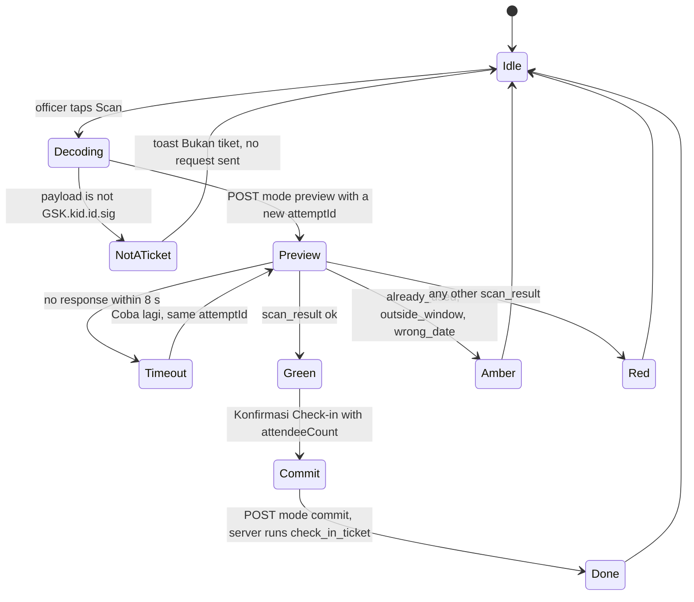

# Design System & UI/UX Guidelines

Edu Center & Edu Wisata Kelurahan Gisikdrono (Semarang Barat)

| Field | Value |
|---|---|
| Version | 1.1 |
| Date | 2026-10-24 (redesign foundation, pen.dev) |
| Status | Draft for review |
| Owner | Kelurahan Gisikdrono Edu Center project team |
| Related documents | `CLAUDE.md` (root), `docs/PRD.md`, `docs/Task.md`, `docs/Security.md` |

This document is the single reference for how the platform looks, moves and speaks. It covers the public site (Indonesian-language marketing and booking pages), the booking wizard and the role-based admin dashboard. Every value here is a token, not a suggestion: components consume CSS variables and Tailwind utilities defined in section 2, never raw hex values. The visual design is the pen.dev redesign approved on 2026-10-24 (handoff `DESIGN-SPEC.md`, "Edu Wisata Gisikdrono, public site"); this document records how it is built. Naming of tables, columns and enums follows `docs/PRD.md` §8.3 (enums) and §8.4 (DDL); routes and folders follow `CLAUDE.md` §3 and Appendix A.3; where this document and the database schema disagree, the schema wins and the conflict is raised, not silently resolved.

Domain terms used throughout: **RW** (Rukun Warga, the neighbourhood unit that owns a tourism programme), **kelurahan** (urban-village administration, the platform owner), **UMKM** (micro and small enterprises selling souvenirs and snacks), **PKK** (family-welfare movement whose members produce recycled crafts), **Bank Sampah** (community waste bank), **dolanan** (traditional Javanese children's games), **sanggar** (arts studio), **Ecowastreme** (RW 05's zero-waste eco-tourism brand), **PIC** (person in charge of a group booking).

## Table of contents

1. Design principles and inspiration
2. Design tokens
3. Typography
4. Layout
5. Public components
6. Admin dashboard
7. Motion
8. Iconography, imagery and assets
9. Accessibility and content rules
10. Performance budget and responsive rules
11. Open decisions

## 1. Design principles and inspiration

### 1.1 Principles

| # | Principle | What it means in practice |
|---|---|---|
| P1 | Trust before delight | Government-grade clarity: warm paper and the batik brick (§2), visible prices in integer rupiah, honest status states, no countdown tricks, no dark patterns. The quotation PDF and every payment screen repeat that payment is only through the system (QRIS/VA). |
| P2 | Calm density | Public pages breathe (`py-16 md:py-24`, one idea per section). Admin pages are dense but each row exposes one primary action; secondary actions live in a row menu. |
| P3 | Designed for the gate | Officers scan tickets on mid-range Android phones in daylight with one hand: 44 px targets, full-screen colour results, large numerals, no hover-only affordances. Everything is verified at 360 px width. |
| P4 | One truth per status | Every enum value maps to exactly one badge tone and one Indonesian label in `src/config/status.ts`. Colour never carries meaning alone: label plus icon always accompany it. |
| P5 | Motion confirms, never decorates | Animation exists to acknowledge an action (sheet opens, result appears, count settles). Tables, forms, sidebar and charts do not animate. |
| P6 | Tokens over values | No hex, px shadow or ad-hoc easing inside a component. Add a token first, then use it. This is a clean-code rule enforced in review. |
| P7 | Indonesian for people, English for code | UI copy, labels, errors and notifications are Indonesian (`lang="id"`), except the `Summary in English` section of `/privasi`, which carries `lang="en"` (CLAUDE.md §12.1 no. 18, decision of 2026-10-18); identifiers, files, commits and documentation are English. |
| P8 | Accessible by default | WCAG 2.1 AA is a release gate, not a backlog item: contrast verified per token, focus ring on every interactive element, live regions for countdowns and scan results. |

### 1.2 Inspiration references

| Source | What we adopt | What we deliberately leave out |
|---|---|---|
| shadcn/ui (`new-york` style) | Component anatomy, `cva` variants, CSS-variable theming, Radix accessibility, Sidebar/Chart/Form primitives | Inverted light primary in dark mode (breaks brand recognition on CTAs) |
| 21st.dev | Minimal marketing sections, `rounded-xl` surfaces, soft `border-border`, backdrop-blur cards, restrained micro-interactions; layout patterns only (each component carries its author's licence, so no source is copied) | Decorative gradients, text shimmer, parallax beyond the two kinds of §7.3, anything animating the LCP element |
| dusunbambu.id (home page redesign, decision of 2026-10-23, at the user's request of that day) | The pinned hero photo, the wave under the hero and between sections, slide-in section reveals, the full-bleed photo slideshow, scroll-linked photo bands | Autoplay of the slideshow (WCAG 2.2.2), background-attachment parallax (breaks on iOS), its fonts and colours |
| reactbits.dev (MIT + Commons Clause v1.0: use inside this site is allowed, reselling the components is not) | The idea of CountUp, re-implemented with our tokens and no library; no source copied (a SplitText-style headline was tried and dropped for the first-load budget, decision of 2026-10-24) | GSAP-based components, blur animations, glow and spotlight cards, canvas or WebGL backgrounds; a marquee only as the CSS one of §7.2, with its pause control |
| UI8.net dashboards | Collapsible icon-rail sidebar, KPI cards with sparkline and trend chip, faceted data tables, high whitespace ratio, floating action bars (patterns only; no UI8 asset is ever copied) | Glassmorphism on data surfaces, animated charts, more than three blurred layers |

### 1.3 Anti-generic rules (no AI slop)

The site has to look like Gisikdrono, not like a template. These rules hold for every public page, every admin screen and every document, and they win over a component default or a tool's suggestion.

| # | Rule | In practice |
|---|---|---|
| G1 | No stock or AI-generated images of people or places | Only real Gisikdrono photos from `public-media`. Until a photo exists the slot shows a placeholder (`PhotoPlaceholder`, decision of 2026-10-18, redrawn 2026-10-24): the RW's soft accent as background with the ink kawung at 8 % (`softClassesFor` in `src/config/rw.ts`, from the RW's `accent_key`; a combo, a kelurahan item or anything without one RW uses the neutral soft pair) and the lucide icon of what the slot is about, at 36 px in the accent, with an optional short note such as `Foto menyusul` on a product card (package category, product category, the RW's own icon, `Newspaper` for an article, `Images` for the hero), never a stand-in image. It is `role="img"` with an `aria-label` that says what the photo will show, so screen readers still hear it. |
| G2 | No gradient text, no purple or indigo gradients, no decorative blobs or orbs, no glow effects | The only decorative elements are the kawung motif at 6–16 % opacity, the brand-ice page-head gradient, the arc and wave dividers (§8.5). The photo grades behind text (§8.2) are functional, not decoration. |
| G3 | Glass cards only over the hero photo, at most one per screen | `Card variant="glass"` sits on the hero image and nowhere else (§5.2). Blurred sticky bars (§4.3) are not cards and keep their own budget. |
| G4 | No emoji as UI icons | Icons are `lucide-react` only (§8.1). Emoji may appear inside content people wrote themselves, such as a review. |
| G5 | Never invent facts | No made-up numbers, years, names, testimonials, statistics or partner logos. Every fact comes from the CMS. Demo content exists only in the development seed (`pnpm db:seed`, local and CI, CLAUDE.md §6.4), which never reaches staging or production. |
| G6 | No generic marketing phrases | Avoid lines such as "temukan keajaiban", "pengalaman tak terlupakan", "solusi terbaik" or "jelajahi dunia". Copy names the place, the activity, the people and the numbers, with the numbers taken from the CMS: `Pilah sampah di Bank Sampah RW 05, {durasi} menit, untuk {min}–{maks} siswa`. |
| G7 | No three identical cards as the default layout | Marketing sections follow their content: photo and text alternating, a mosaic, a timeline. Collections (package, product and article lists) keep the card grid of §4.2. |
| G8 | Every activity photo says where or what | A caption (`galleries.caption`, or the activity or place name) sits under or over every photo of an activity; `alt_text` alone is not enough. |
| G9 | At most one primary call to action per screen | One `Button variant="default"` in a page's own content at a time (§5.1); everything else is `secondary`, `outline`, `onPhoto` or a link. The header's `Pesan Kunjungan` is the one standing exception: the approved redesign makes it primary on every page (2026-10-24, replacing the `secondary` of 2026-10-17). |

## 2. Design tokens

Tokens live in `src/styles/globals.css` as full colours (hex) on `:root` and `.dark`, with a third block of aliases that point at them, and are exposed to Tailwind CSS v4 through `@theme inline` (`--color-x: var(--x)`). Components use utilities (`bg-primary`, `text-ink-2`, `shadow-md`), or `var(--token)` inside `globals.css`, never a literal colour. The values are those of the pen.dev redesign approved on 2026-10-24 (handoff `DESIGN-SPEC.md` §1, "warm paper, batik brick"); `src/styles/globals.test.ts` re-checks every contrast pair of §2.5 against the real values.

### 2.1 Core palette (shadcn variables, sidebar, charts, brand)

The design's own names are on the right; the CSS variable is the shadcn name where one exists, so every shadcn primitive and every dashboard screen picks the palette up unchanged.

| CSS variable (Tailwind) | Light | Dark | Design name and role |
|---|---|---|---|
| `--background` (`bg-background`) | #F6EFE3 | #14110D | `bg`, the warm paper of every page |
| `--muted` (`bg-muted`, alias `bg-sunken`) | #EDE3D1 | #0F0D0A | `bg-sunken`: alternating sections, fills, skeletons |
| `--card` / `--popover` (`bg-card`, alias `bg-surface`) | #FFFAF2 | #1E1A15 | `surface`: inputs, the review card, panels, menus |
| `--foreground` | #1D1813 | #F4ECDF | `ink`, primary text |
| `--ink-2` (`text-ink-2`) | #4A4036 | #CFC2AE | `ink-2`, secondary text and body copy |
| `--muted-foreground` | #6E6152 | #A59680 | `ink-3`, meta, captions, placeholders |
| `--border` | #E2D5C0 | #3A3229 | `line`, hairlines and card edges |
| `--border-strong` | #CBB99C | #54493C | `line-strong`, chip edges, stronger dividers (decorative) |
| `--input` | #8C7A62 | #7A6B57 | `border-input`, form control edges (≥ 3:1) |
| `--ring` | #A93814 | #F49D76 | focus ring (`primary-ink`) |
| `--primary` | #C4431B | #F0875A | `primary`, "Bata", the batik brick: the main action colour |
| `--primary-foreground` | #FFFFFF | #1A0E08 | text on the primary |
| `--primary-hover` / `--primary-pressed` | #A93814 / #8E2F10 | #F49D76 / #E06E40 | hover and pressed fills |
| `--primary-tint` | #F8DCCD | #3A1E12 | selected states, the combo badge, icon tiles |
| `--primary-ink` (`--primary-text` is its alias) | #A93814 | #F49D76 | the primary as text: links, eyebrows. Never `text-primary` for text |
| `--secondary` / `--secondary-foreground` | #1D1813 / #F6EFE3 | #F4ECDF / #14110D | `inverse`: the secondary button, the selected chip |
| `--secondary-hover` / `--secondary-pressed` | #352C23 / #15120E | #FFFFFF / #CFC2AE | its hover and pressed fills |
| `--accent` / `--accent-foreground` | #EDE3D1 / #1D1813 | #0F0D0A / #F4ECDF | shadcn hover fill (menus, ghost rows) |
| `--destructive` / `--destructive-foreground` | #A32015 / #FFFFFF | #F28B7E / #1A0E08 | `danger` |
| `--gold` / `--gold-ink` / `--gold-tint` | #E0A63A / #8A5A0B / #F6E3B8 | #E9B85A / #E9B85A / #3A2C10 | stars, eyebrows on dark bands, footer titles; gold as text on paper; the award tile |
| `--night` | #15120E | #0B0907 | the footer, typographic covers, info panels, overlays (`bg-night/70`) |
| `--forest-night` | #0F2A1D | #0A1C13 | the figures band, CTA bands |
| `--on-dark` / `--on-dark-2` / `--on-dark-3` | #FFFFFF / #D9CCB8 / #A59680 | same | text on night |
| `--on-forest` / `--on-forest-2` | #C9D6CC / #A9BFB0 | same | text on forest-night |
| `--on-indigo` | #E3E6F5 | same | text on the RW 08 field |
| `--whatsapp` / `--whatsapp-hover` | #0F7A3F / #0B6532 | same | the WhatsApp button, darkened from the brand green to 5.42:1 with white |
| `--brand-deep` / `--brand-royal` / `--brand-ice` | #15120E / #0F2A1D / #EDE3D1 | #0B0907 / #0A1C13 / #1E1A15 | the brand names of CLAUDE.md §8, now night, forest and the sunken paper; `from-brand-ice to-background` is the page-head gradient in both themes |
| `--sidebar-*` | surface #FFFAF2, text #4A4036, accent #EDE3D1, primary #C4431B | surface #1E1A15, text #CFC2AE, accent #2A241D, primary #F0875A | shadcn `Sidebar` |
| `--chart-1` … `--chart-5` | #C4431B, #1F5C3A, #33427F, #E0A63A, #8E4A1F | #F0875A, #6CC08E, #9CAAF0, #E9B85A, #E39E68 | Recharts: brick, the three RW accents, gold |
| `--radius` | 0.625rem (10 px) | same | the control radius |

The surface on paper (`bg-card` on `bg-background`) is a lighter sheet, not a white card: content cards are editorial (§5.8–5.9) and only the review card, inputs and panels are surfaces. The public site is always light (decision D3); the dark set serves the dashboard and keeps every pair at AA.

### 2.2 Semantic status colours

Each family has a strong fill (`--x`), a text colour for that fill (`--x-foreground`), a tint (`--x-soft`, the design's `-tint`) and a text colour for the tint (`--x-soft-foreground`, the design's strong colour). `danger` aliases `--destructive`.

| Family | `--x` / `--x-foreground` light | `--x-soft` / `--x-soft-foreground` light | dark (fill / tint / tint text) | Booking states (DESIGN-SPEC §2.3) |
|---|---|---|---|---|
| success | #1E6B40 / #FFFFFF | #DCEFE2 / #1E6B40 | #5CC98A / #12291B / #5CC98A | Lunas, Sudah hadir, Selesai |
| warning | #8A5200 / #FFFFFF | #FBEBC8 / #8A5200 | #F2BE5C / #2E220C / #F2BE5C | Menunggu pembayaran, Perlu ditinjau, sample tags |
| info | #2C5AA0 / #FFFFFF | #DEE8F7 / #2C5AA0 | #8DB4F2 / #14213A / #8DB4F2 | Penawaran dikirim |
| danger | #A32015 / #FFFFFF | #FBE0DC / #A32015 | #F28B7E / #331512 / #F28B7E | Dibatalkan, Penuh, errors |
| neutral | #6E6152 / #FFFFFF | #EDE3D1 / #4A4036 | #A59680 / #2A241D / #CFC2AE | Kedaluwarsa |

Rule: badges, chips and table status cells use the **soft** pair with a dot (§5.4). Every strong fill now carries its foreground at AA as well, so the strong fills may hold normal-size text.

### 2.3 `src/styles/globals.css` token blocks (copied)

These are the three custom-property blocks of `globals.css`, verbatim. `@theme inline` maps each to a Tailwind colour (`--color-ink-2: var(--ink-2)` and so on, plus `--color-rw`, `--color-header-fg` and the palette keys); the rest of the file holds the radii and shadows (§4.3), the easing curves (§7.2), the denah and Leaflet rules (§8.3) and the header (§5.17). It imports the utilities: `type.css` (§3.2), `utilities.css` (RW scopes, photo grades, kawung, layout helpers) and `motion.css` (§7).

```css
:root {
  /* Paper, ink and lines */
  --background: #f6efe3;
  --foreground: #1d1813;
  --card: #fffaf2;
  --card-foreground: #1d1813;
  --popover: #fffaf2;
  --popover-foreground: #1d1813;
  --muted: #ede3d1;
  --muted-foreground: #6e6152;
  --accent: #ede3d1;
  --accent-foreground: #1d1813;
  --ink-2: #4a4036;
  --border: #e2d5c0;
  --border-strong: #cbb99c;
  --input: #8c7a62;
  --ring: #a93814;
  /* Bata, the batik brick: the main action colour. As text it is always primary-ink (§2.5). */
  --primary: #c4431b;
  --primary-foreground: #ffffff;
  --primary-hover: #a93814;
  --primary-pressed: #8e2f10;
  --primary-tint: #f8dccd;
  --primary-ink: #a93814;
  /* Inverse: the secondary button and the selected chip. */
  --secondary: #1d1813;
  --secondary-foreground: #f6efe3;
  --secondary-hover: #352c23;
  --secondary-pressed: #15120e;
  --destructive: #a32015;
  --destructive-foreground: #ffffff;
  /* Dark bands and their text: these stay dark in both themes. */
  --gold: #e0a63a;
  --gold-ink: #8a5a0b;
  --gold-tint: #f6e3b8;
  --night: #15120e;
  --forest-night: #0f2a1d;
  --on-dark: #ffffff;
  --on-dark-2: #d9ccb8;
  --on-dark-3: #a59680;
  --on-forest: #c9d6cc;
  --on-forest-2: #a9bfb0;
  --on-indigo: #e3e6f5;
  --whatsapp: #0f7a3f;
  --whatsapp-hover: #0b6532;
  --whatsapp-foreground: #ffffff;
  /* The brand names of CLAUDE.md §8, now the night band, the forest band and the sunken paper. */
  --brand-deep: #15120e;
  --brand-royal: #0f2a1d;
  --brand-ice: #ede3d1;
  /* Status pairs: the solid fill with its text, and the tint (-soft) with its text. */
  --success: #1e6b40;
  --success-foreground: #ffffff;
  --success-soft: #dcefe2;
  --success-soft-foreground: #1e6b40;
  --warning: #8a5200;
  --warning-foreground: #ffffff;
  --warning-soft: #fbebc8;
  --warning-soft-foreground: #8a5200;
  --info: #2c5aa0;
  --info-foreground: #ffffff;
  --info-soft: #dee8f7;
  --info-soft-foreground: #2c5aa0;
  --danger-soft: #fbe0dc;
  --danger-soft-foreground: #a32015;
  --neutral: #6e6152;
  --neutral-foreground: #ffffff;
  --neutral-soft: #ede3d1;
  --neutral-soft-foreground: #4a4036;
  /* RW accent sets (§2.7), named after the RW that wears them in rw_units: accent, strong, tint, and the highlight
     used on photos and dark bands. */
  --rw05: #1f5c3a;
  --rw05-strong: #154229;
  --rw05-tint: #ddebdc;
  --rw05-hi: #8cbf4f;
  --rw13: #8e4a1f;
  --rw13-strong: #6b3412;
  --rw13-tint: #f3e1cb;
  --rw13-hi: #d39b3a;
  --rw08: #33427f;
  --rw08-strong: #243063;
  --rw08-tint: #dfe3f3;
  --rw08-hi: #9caaf0;
  /* The two spare palettes an RW may still be given (rw_accent 'teal', 'violet'). */
  --rw-spare-teal: #1d5c59;
  --rw-spare-teal-strong: #13403e;
  --rw-spare-teal-tint: #d6eae7;
  --rw-spare-violet: #6b3462;
  --rw-spare-violet-strong: #4d2346;
  --rw-spare-violet-tint: #f0ddeb;
  --on-accent: #ffffff;
  /* Dashboard: sidebar and charts. */
  --sidebar-background: #fffaf2;
  --sidebar-foreground: #4a4036;
  --sidebar-primary: #c4431b;
  --sidebar-primary-foreground: #ffffff;
  --sidebar-accent: #ede3d1;
  --sidebar-accent-foreground: #1d1813;
  --sidebar-border: #e2d5c0;
  --sidebar-ring: #a93814;
  --chart-1: #c4431b;
  --chart-2: #1f5c3a;
  --chart-3: #33427f;
  --chart-4: #e0a63a;
  --chart-5: #8e4a1f;
  --radius: 0.625rem;
  /* Header heights (DESIGN-SPEC §2.7): 64 on phones; 72 solid and 88 over the home photo from lg. */
  --header-h: 4rem;
  --header-h-overlay: 4rem;
  /* Home page sizes (docs/StyleGuide.md §4.4). */
  --hero-max-h: 56.25rem;
  --hero-min-h-mobile: 32rem;
  --parallax-overscan: 116%;
  /* Motion tokens (docs/StyleGuide.md §7.2). Springs are approximated by the linear() curves of @theme. */
  --duration-press: 100ms;
  --duration-micro: 150ms;
  --duration-short: 200ms;
  --duration-header: 220ms;
  --duration-base: 300ms;
  --duration-long: 500ms;
  --duration-reveal: 600ms;
  --duration-max: 700ms;
  --duration-count: 1400ms;
  --duration-spring-soft: 610ms;
  --duration-spring-snappy: 470ms;
  --duration-spring-sheet: 440ms;
  --duration-spring-pin: 590ms;
}

@media (width >= 64rem) {
  :root {
    --header-h: 4.5rem;
    --header-h-overlay: 5.5rem;
  }
}

.dark {
  --background: #14110d;
  --foreground: #f4ecdf;
  --card: #1e1a15;
  --card-foreground: #f4ecdf;
  --popover: #1e1a15;
  --popover-foreground: #f4ecdf;
  --muted: #0f0d0a;
  --muted-foreground: #a59680;
  --accent: #2a241d;
  --accent-foreground: #f4ecdf;
  --ink-2: #cfc2ae;
  --border: #3a3229;
  --border-strong: #54493c;
  --input: #7a6b57;
  --ring: #f49d76;
  --primary: #f0875a;
  --primary-foreground: #1a0e08;
  --primary-hover: #f49d76;
  --primary-pressed: #e06e40;
  --primary-tint: #3a1e12;
  --primary-ink: #f49d76;
  --secondary: #f4ecdf;
  --secondary-foreground: #14110d;
  --secondary-hover: #ffffff;
  --secondary-pressed: #cfc2ae;
  --destructive: #f28b7e;
  --destructive-foreground: #1a0e08;
  --gold: #e9b85a;
  --gold-ink: #e9b85a;
  --gold-tint: #3a2c10;
  --night: #0b0907;
  --forest-night: #0a1c13;
  --brand-deep: #0b0907;
  --brand-royal: #0a1c13;
  --brand-ice: #1e1a15;
  --success: #5cc98a;
  --success-foreground: #0b1f13;
  --success-soft: #12291b;
  --success-soft-foreground: #5cc98a;
  --warning: #f2be5c;
  --warning-foreground: #1f1405;
  --warning-soft: #2e220c;
  --warning-soft-foreground: #f2be5c;
  --info: #8db4f2;
  --info-foreground: #0c1628;
  --info-soft: #14213a;
  --info-soft-foreground: #8db4f2;
  --danger-soft: #331512;
  --danger-soft-foreground: #f28b7e;
  --neutral: #a59680;
  --neutral-foreground: #14110d;
  --neutral-soft: #2a241d;
  --neutral-soft-foreground: #cfc2ae;
  --rw05: #6cc08e;
  --rw05-strong: #8fd3aa;
  --rw05-tint: #15291e;
  --rw13: #e39e68;
  --rw13-strong: #f0b88a;
  --rw13-tint: #2e1d12;
  --rw13-hi: #e2b05a;
  --rw08: #9caaf0;
  --rw08-strong: #b9c3f5;
  --rw08-tint: #1b2140;
  --rw-spare-teal: #6cc2ba;
  --rw-spare-teal-strong: #95d6cf;
  --rw-spare-teal-tint: #132a28;
  --rw-spare-violet: #d9a6cf;
  --rw-spare-violet-strong: #e8c3e0;
  --rw-spare-violet-tint: #2c1729;
  --on-accent: #14110d;
  --sidebar-background: #1e1a15;
  --sidebar-foreground: #cfc2ae;
  --sidebar-primary: #f0875a;
  --sidebar-primary-foreground: #1a0e08;
  --sidebar-accent: #2a241d;
  --sidebar-accent-foreground: #f4ecdf;
  --sidebar-border: #3a3229;
  --sidebar-ring: #f49d76;
  --chart-1: #f0875a;
  --chart-2: #6cc08e;
  --chart-3: #9caaf0;
  --chart-4: #e9b85a;
  --chart-5: #e39e68;
}

/* Aliases that follow the blocks above in either theme. The rw_accent palette keys of rw_units (leaf, terracotta,
   mulberry, teal, violet) point at the RW sets; src/config/rw.ts spells the classes. */
:root {
  --danger: var(--destructive);
  --danger-foreground: var(--destructive-foreground);
  --primary-text: var(--primary-ink);
  --rw-leaf: var(--rw05);
  --rw-leaf-strong: var(--rw05-strong);
  --rw-leaf-soft: var(--rw05-tint);
  --rw-leaf-hi: var(--rw05-hi);
  --rw-terracotta: var(--rw13);
  --rw-terracotta-strong: var(--rw13-strong);
  --rw-terracotta-soft: var(--rw13-tint);
  --rw-terracotta-hi: var(--rw13-hi);
  --rw-mulberry: var(--rw08);
  --rw-mulberry-strong: var(--rw08-strong);
  --rw-mulberry-soft: var(--rw08-tint);
  --rw-mulberry-hi: var(--rw08-hi);
  --rw-teal: var(--rw-spare-teal);
  --rw-teal-strong: var(--rw-spare-teal-strong);
  --rw-teal-soft: var(--rw-spare-teal-tint);
  --rw-teal-hi: var(--rw-spare-teal);
  --rw-violet: var(--rw-spare-violet);
  --rw-violet-strong: var(--rw-spare-violet-strong);
  --rw-violet-soft: var(--rw-spare-violet-tint);
  --rw-violet-hi: var(--rw-spare-violet);
  /* The current RW of a subtree (rw-scope-* below); outside any RW it is the combo set, the primary. */
  --rw: var(--primary-ink);
  --rw-strong: var(--primary-ink);
  --rw-soft: var(--primary-tint);
  --rw-hi: var(--gold);
  --rw-fill: var(--primary);
  /* The header's colours, solid by default; the overlay state over a hero photo swaps them (.site-header). */
  --header-fg: var(--foreground);
  --header-fg-2: var(--ink-2);
  --header-fg-3: var(--muted-foreground);
  --header-line: var(--border-strong);
}
```

### 2.4 Tailwind and shadcn mapping

| Utility | Resolves to | Used for |
|---|---|---|
| `bg-background` / `text-foreground` | `--background` / `--foreground` | page canvas |
| `bg-muted` (`bg-sunken`) | `--muted` | alternating sections, icon wells, skeletons |
| `bg-card` (`bg-surface`) `border-border` | `--card`, `--border` | inputs, panels, the review card |
| `text-ink-2` / `text-muted-foreground` | `--ink-2` / `--muted-foreground` | body copy / meta |
| `bg-primary text-primary-foreground hover:bg-primary-hover active:bg-primary-pressed` | `--primary*` | the primary button |
| `text-primary-ink` (or the older `text-primary-text`) | `--primary-ink` | links, eyebrows, the `link` button |
| `bg-primary-tint text-primary-ink` | `--primary-tint` | selected states, icon tiles (dashboard KPI, contact rows) |
| `bg-secondary text-secondary-foreground` | `--secondary*` (inverse) | the secondary button, selected chip, avatars |
| `border-border-strong` / `border-input` | `--border-strong` / `--input` | chips / form controls |
| `bg-night`, `bg-forest-night`, `text-on-dark-2`, `text-on-forest` | dark band tokens | footer, figures band, CTA band |
| `text-gold` / `text-gold-ink` / `bg-gold-tint` | `--gold*` | stars, dark-band eyebrows / gold text on paper / award tile |
| `bg-whatsapp text-whatsapp-foreground` | `--whatsapp*` | every WhatsApp button |
| `bg-success-soft text-success-soft-foreground` (and warning/info/danger/neutral) | semantic soft pair | badges, status cells |
| `text-rw`, `bg-rw-fill`, `bg-rw-soft`, `text-rw-strong`, `bg-rw-hi` | the current RW (`--rw*`, set by `rw-scope-*`) | every RW-coloured touch (§2.7) |
| `text-rw05`, `bg-rw13-tint`, `bg-rw08`, … | the RW sets by number | where the design names one RW's colour on purpose (the kawung row in soga, the news category in forest) |
| `text-header-fg`, `text-header-fg-2`, `text-header-fg-3`, `border-header-line` | `--header-*` | the site header's two states (§5.17) |
| `bg-sidebar text-sidebar-foreground` | `--sidebar-*` | shadcn `Sidebar` |
| `fill-chart-1` … `stroke-chart-5` | `--chart-n` | Recharts via `ChartContainer` `config.color` |
| `rounded-md` / `rounded-lg` / `rounded-xl` / `rounded-2xl` / `rounded-3xl` / `rounded-full` | 10 / 14 / 16 / 20 / 24 px / pill | controls / photos and cards / tiles / form panels / large panels / badges and chips |
| `font-display` / `font-sans` | `--font-display` / `--font-sans` | headings / body |

shadcn `components.json`: `"style": "new-york"`, `"tailwind": { "css": "src/styles/globals.css", "baseColor": "slate", "cssVariables": true }`, aliases `@/components`, `@/components/ui`, `@/lib/utils/cn` (utils), `@/lib`, `@/hooks`. `cn()` lives in `src/lib/utils/cn.ts` and knows the custom type steps and `border-control`, so tailwind-merge never drops them next to a colour. Generated primitives in `src/components/ui` receive theme-level edits only; thin compositions of them without domain logic, such as `ResponsiveDialog`, live there too (CLAUDE.md §3.2); product behaviour is composed in domain folders.

### 2.5 Contrast notes (WCAG 2.1 AA)

The pairs below are those DESIGN-SPEC §1.2 checked; `src/styles/globals.test.ts` recomputes them from `globals.css` in both themes and fails the build when one drops under 4.5:1 (3:1 for the edge of a form control).

| Pair (light) | Ratio | | Pair (light) | Ratio |
|---|---|---|---|---|
| ink / paper | 15.41 | | white / primary | 5.04 |
| ink-2 / paper | 8.84 | | white / primary-hover | 6.44 |
| ink-3 / paper | 5.26 | | primary-ink / paper (links) | 5.63 |
| ink-3 / sunken | 4.72 | | primary-ink / primary-tint | 4.94 |
| ink-3 / surface | 5.78 | | white / whatsapp | 5.42 |
| ink-2 / sunken | 7.95 | | inverse-fg / inverse | 15.41 |
| rw05 / paper · / rw05-tint | 6.93 · 6.41 | | white / rw05 | 7.92 |
| rw13 / paper · / rw13-tint | 5.83 · 5.22 | | white / rw13 | 6.67 |
| rw08 / paper · / rw08-tint | 8.25 · 7.37 | | on-indigo / rw08 | 7.59 |
| success / success-tint | 5.41 | | warning / warning-tint | 5.42 |
| danger / danger-tint | 6.05 | | info / info-tint | 5.52 |
| on-dark-2 / night | 11.81 | | on-dark-3 / night | 6.47 |
| gold / night | 8.61 | | on-forest / forest-night | 10.21 |
| on-forest-2 / forest-night | 7.86 | | rw05-hi / forest-night | 7.07 |
| border-input / paper (UI, 3:1) | 3.62 | | gold-ink / paper | 5.18 |

`--primary` on the paper is 4.41:1, so the brick is never text: links and eyebrows are `primary-ink`. Text on a photo always sits on one of the photo grades of §8.2, which keep the local background darker than #6E6B68 (≥ 5.3:1 for white). In dark mode ink on paper is 16.05:1, ink-3 6.52:1 and the primary's foreground on the primary 7.49:1; the test covers every dark pair too.

### 2.6 Theme behaviour

`next-themes` with `attribute="class"`, provided once by `src/components/providers/theme-provider.tsx`; the `<html>` element carries `suppressHydrationWarning`. The `(public)`, `(booking)` and `(auth)` route groups render with `forcedTheme="light"` (open decision D3), so a staff member's dark preference never leaks into the public site through the shared `localStorage` key. The `(admin)` group uses `defaultTheme="system"`, `enableSystem` and `storageKey="gsk-admin-theme"`; the toggle lives only in the sidebar footer. Dark mode never uses drop shadows: cards get `dark:border-white/5` as a highlight instead. The dark bands (night, forest) stay dark in both themes and only deepen a little.

### 2.7 RW accent colours

Each RW wears one accent set so a visitor can tell the RWs apart at a glance, and every card, badge, eyebrow, pill, icon tile and arrow circle that belongs to an RW uses that RW's set (DESIGN-SPEC §1.1). A set is an accent (text and fills), a strong shade, a tint, and a highlight for photos and dark bands:

| Set | Accent | Strong | Tint | Highlight | Dark accent / strong / tint |
|---|---|---|---|---|---|
| `rw05`, "Hutan" (RW 05 Ecowastreme) | #1F5C3A | #154229 | #DDEBDC | #8CBF4F (design `rw05-leaf`) | #6CC08E / #8FD3AA / #15291E |
| `rw13`, "Soga" (RW 13 Kampung Budaya & Seni) | #8E4A1F | #6B3412 | #F3E1CB | #D39B3A (design `rw13-gold`) | #E39E68 / #F0B88A / #2E1D12 |
| `rw08`, "Nila" (RW 08 Inklusif & Ramah Anak) | #33427F | #243063 | #DFE3F3 | #9CAAF0 | #9CAAF0 / #B9C3F5 / #1B2140 |
| spare `teal` | #1D5C59 | #13403E | #D6EAE7 | = accent | #6CC2BA / #95D6CF / #132A28 |
| spare `violet` | #6B3462 | #4D2346 | #F0DDEB | = accent | #D9A6CF / #E8C3E0 / #2C1729 |
| combination package | `primary` | `primary-ink` | `primary-tint` | gold | — |

The RWs are rows of `rw_units` (decision of 2026-10-21), and each names its accent by a palette key, `rw_units.accent_key` (enum `rw_accent`: `leaf`, `terracotta`, `mulberry`, `teal`, `violet`); the database never holds a colour. The keys point at the sets: `leaf` → `rw05`, `terracotta` → `rw13`, `mulberry` → `rw08` (the indigo now worn by the key still called mulberry, which keeps the enum unchanged; renaming the key is a migration for later), `teal` and `violet` → the spares, so the next RW gets a colour without a release. The `--rw-<key>`, `--rw-<key>-strong`, `--rw-<key>-soft` and `--rw-<key>-hi` aliases follow the theme.

**One component set for every RW.** A subtree takes its RW from one class, `rw-scope-<key>` (from `rwAccentClasses(accentKey).scope` in `src/config/rw.ts`; `rw-scope-neutral` for an RW that is offline, `rw-scope-combo` for a combination package), which sets `--rw`, `--rw-strong`, `--rw-soft`, `--rw-hi`, `--rw-fill` and the RW photo grade (§8.2). Inside it, components use `text-rw`, `bg-rw-fill`, `bg-rw-soft`, `text-rw-strong`, `bg-rw-hi`; outside any RW those resolve to the primary set, so a section heading's eyebrow is brick on the home page and forest on RW 05's page with the same code. The older per-palette classes (`text-rw-leaf`, `bg-rw-terracotta-soft text-rw-terracotta-soft-foreground`, …) stay in `RW_ACCENT_CLASSES` for the map and the dashboard.

Colour is never the only sign of an RW: its number (`RW 05`) is always written next to the accent, on badges, map hotspots and tiles. Never use an RW accent for a call to action (those stay `--primary`), for statuses (§2.2) or as paragraph text.

## 3. Typography

### 3.1 Font pairing and loading

| Role | Family | Weights permitted | CSS variable | Where |
|---|---|---|---|---|
| Display / headings | Plus Jakarta Sans | 600, 700, 800 | `--font-plus-jakarta` → `--font-display` | h1–h4, hero, KPI values, PDF headings |
| Body / UI | Inter | 400, 500, 600 | `--font-inter` → `--font-sans` | everything else, all admin UI except page titles |

Both are variable fonts, loaded once each through `next/font/google` (one file per family, two preloads total), `display: 'swap'`, `subsets: ['latin']`. Inter uses `font-feature-settings: "cv11", "ss01"`; every numeric cell, price, countdown and KPI value uses `tabular-nums` (tabular figures). PDF documents register the same families from TTF files in `src/lib/pdf/fonts/`; Open Graph images load them from `public/fonts/`.

```ts
// src/config/fonts.ts
import { Inter, Plus_Jakarta_Sans } from 'next/font/google';

export const fontSans = Inter({ subsets: ['latin'], display: 'swap', variable: '--font-inter' });
export const fontDisplay = Plus_Jakarta_Sans({ subsets: ['latin'], display: 'swap', variable: '--font-plus-jakarta' });
export const fontClassNames = `${fontSans.variable} ${fontDisplay.variable}`;
```

```tsx
// src/app/layout.tsx (excerpt)
<html lang="id" suppressHydrationWarning className={fontClassNames}>
```

### 3.2 Type scale

Every step is an `@utility` in `src/styles/globals.css` and is registered with `cn()` (`TYPE_SCALE_STEPS` in `src/lib/utils/cn.ts`). The large public steps grow fluidly between 390 and 1280 px (`clamp()`), so no breakpoint jumps; the UI steps change once at `md`. Sizes are px (desktop / phone).

**Public, editorial (DESIGN-SPEC §1.3)**

| Class | Desktop / line-height / tracking | Phone | Weight | Family | Usage |
|---|---|---|---|---|---|
| `text-hero-statement` | 76 / 1.05 / +0.22em, uppercase | 40 / 1.15 / +0.16em | 300 | sans | the home hero h1, `KAMPUNG GISIKDRONO` (the one place weight 300 is used) |
| `text-hero-lead` | 22 / 1.3 / +0.02em | 17 | 400 | sans | `Pengalaman belajar di` |
| `text-display-rw` | 96 / 1.0 / −0.031em | 52 | 800 | display | RW page hero h1 |
| `text-display` | 64 / 1.04 / −0.025em | 38 / 1.06 | 800 | display | list page h1 |
| `text-intro` | 52 / 1.06 / −0.027em | 34 / 1.1 | 800 | display | the home introduction heading |
| `text-section-title` | 46 / 1.08 / −0.02em | 30 / 1.12 | 700 | display | a public section's h2 (`SectionHeading`) |
| `text-section-title-compact` | 40 / 1.1 | 30 | 700 | display | a compact section's h2 |
| `text-card-title` | 24 / 1.2 / −0.0125em | 21 | 700 | display | package card title |
| `text-figure` | 80 / 1.0 / −0.0275em, tabular | 52 | 800 | display | figures band (`FigureStat`) |
| `text-price` | 22 / 1.1, tabular | 20 | 700 | display | prices, totals |
| `text-eyebrow` | 13 / 1.2 / +0.16em, uppercase | 12 | 600 | sans | section eyebrows, drawer group titles |
| `text-meta-caps` | 12 / 1.2 / +0.12em, uppercase | 12 | 600 | sans | `PELAJAR · 120 MENIT`, footer titles, table heads |
| `text-body-lg` | 19 / 1.65 | 17 / 1.6 | 400 | sans | leads, section descriptions |
| `text-article` | 19 / 1.75 | 17 / 1.72 | 400 | sans | RichText paragraphs, 720 px column |
| `text-quote` | 17 / 1.6 | 16 | 400 | sans | the review quote |
| `text-body-md` | 15 / 1.6 | same | 400 | sans | small-card copy, the footer, bylines |
| `text-label-sm` / `text-label` / `text-label-lg` / `text-label-xl` | 14 / 15 / 16 / 17, line-height 1 | same | caller's (buttons 600, nav 500) | sans | button and link labels per size |
| `text-wordmark-eyebrow` / `text-wordmark` | 10 / +0.24em, uppercase · 21 / −0.02em | 10 · 19 | 600 · 800 | sans · display | the wordmark |

**Shared UI scale (dashboard, forms, booking)**

| Class | Desktop | Phone | Weight | Usage |
|---|---|---|---|---|
| `text-display-lg` | 48 / 1.1 / −0.02em | 36 / 1.15 | 700 | large page heroes kept from before the redesign |
| `text-h1` | 36 / 1.2 / −0.02em | 30 | 700 | page titles (dashboard, booking, status pages) |
| `text-h2` | 30 / 1.25 / −0.015em | 24 | 700 | panel titles, KPI values, totals |
| `text-h3` | 28 / 1.2 / −0.011em | 22 / 1.25 | 700 | sub-sections, card titles in a detail page |
| `text-h4` | 20 / 1.35 | 18 | 600 | list item and dialog titles |
| `text-body` | 16 / 1.6 | same | 400 | default copy |
| `text-body-sm` | 14 / 1.55 | same | 400 / 500 | UI, tables, helper text |
| `text-caption` | 13 / 1.4 | same | caller's (500 in the design) | captions, dates, meta; never below 12 px (11 only for uppercase micro labels) |
| `text-overline` | 12 / 1 / +0.08em, uppercase | same | 600 | dashboard labels; public sections use `text-eyebrow` |

The weights of the label and caption steps are left to the caller, so a `font-*` class never fights the size. A new size is a token change in `globals.css` (and `TYPE_SCALE_STEPS`), never an inline `text-[13px]`. Prices, countdowns, seats and figures are `tabular-nums` (built into `text-figure` and `text-price`).

### 3.3 Prose and formatting rules

- Articles render Tiptap/ProseMirror JSON (`articles.body_json`) through the allow-listed `RichText` renderer inside `prose prose-slate dark:prose-invert max-w-prose` (65ch); headings inherit `font-display`; images get `rounded-xl` and a required caption. Package, product, vendor and RW descriptions are Markdown columns (`description_md`, `vision_md`) rendered by `Prose` (`src/components/articles/prose.tsx`) with the same `prose` styles; neither path stores or injects HTML.
- Currency: `formatIDR(2500000)` from `src/lib/utils/currency.ts` → `Rp 2.500.000` (`Intl.NumberFormat('id-ID')`, no decimals, non-breaking space after `Rp`). Per-person prices read `Rp 25.000 /orang`.
- Dates: `Sabtu, 18 Oktober 2026` (`date-fns` `EEEE, d MMMM yyyy`, locale `id`, zone `Asia/Jakarta`); times `08.00–10.00 WIB`; short form in tables `18 Okt 2026`.
- Codes (`GSK-7F3K9Q2M`, `GSK-7F3K9Q2M-05`, `INV/GSK/2026/10/0001`) render in `font-mono tabular-nums text-body-sm` and are selectable with a copy button.
- Phone numbers display as `+62 812-3456-7890`; in masked staff views as `+62 812-••••-7890`.
- Headings use sentence case (`Paket wisata untuk sekolah`), never title case; overlines are the only uppercase text.

## 4. Layout

### 4.1 Breakpoints and containers

| Name | Min width | Public container (`Container`) | Admin content | Notes |
|---|---|---|---|---|
| base | 0 | `px-5` (20 px gutters) | `p-4` | the 390 px design; verified at 360 px |
| `sm` | 640 px | `px-5` | `p-4` | 2-column card grids |
| `md` | 768 px | `px-10` (40 px gutters) | `p-6` | desktop structure starts; Dialog replaces Drawer; tables replace card lists |
| `lg` | 1024 px | `px-10` | `p-8` | desktop header and nav, 12-column grid |
| `xl` | 1280 px | `max-w-7xl` (1280 incl. gutters = a 1200 px column; 120 px margins appear naturally at 1440) | `max-w-(--breakpoint-2xl)` | the 1440 frames |
| `2xl` | 1536 px | still 1200 px of content | 1536 px | public never grows past it |

Between 768 and 1279 the desktop structure applies with one column fewer (packages 2-up, products 3-up, masonry 3 columns; the RW bento stacks). The reading column (`Container width="reading"`) is 720 px of text; forms `max-w-2xl`; booking wizard `max-w-3xl`. The header spans 1440 px with 56 px padding from lg.

### 4.2 Grid and spacing

- Base unit 4 px (4, 8, 12, 16, 20, 24, 32, 40, 48, 64, 80, 96, 128). Grid: 12 columns of 78 px with 24 px gutters at 1200; 4 columns with 16 px gutters on phones.
- Card rows at 1200: 3 × 384 (packages, articles), 4 × 282 (products), bento 708 + 24 + 468.
- Section rhythm (`Section`): `py-14 md:py-20 lg:py-28` (56 / 80 / 112 px), the CTA band 128 / 152 from lg; 48–56 px between a heading row and its content (`space-y-12 lg:space-y-14`).
- Carousels on phones bleed off the right edge: the first card on the 20 px gutter, the next one peeking.
- Sticky elements under the header use `top: var(--header-h)` (64 px, 72 from lg); anchored sections clear it with `scroll-mt-header`.

### 4.3 Radius, borders, shadows, blur

| Token | Value | Applied to |
|---|---|---|
| `rounded-sm` | 6 px | checkboxes, small swatches |
| `rounded-md` | 10 px | buttons, inputs, steppers, menu rows (`--radius`) |
| `rounded-lg` | 14 px | photos, cards, product media, banners |
| `rounded-xl` | 16 px | RW tiles, the review card, tooltips and menus in the dashboard |
| `rounded-2xl` | 20 px | form panels, the wizard summary, sticky booking panel |
| `rounded-3xl` | 24 px | large panels: the figures band, the ticket, the drawer sheet |
| `rounded-full` | pill | badges, chips, the FAB, avatars, the lookup pill |
| `border border-border` | 1 px `line` | card edges, dividers |
| `border-control` | 1.5 px | outline buttons, checkboxes, an error or verified field |
| `shadow-sm` | `0 1px 2px rgb(29 24 19 / .06)` | a segmented control's thumb (`shadow-card` is the same) |
| `shadow-md` | `0 10px 24px -12px rgb(29 24 19 / .24)` | hover lift on boxed cards, map pins (`shadow-card-hover`) |
| `shadow-lg` | `0 24px 48px -20px rgb(29 24 19 / .32)` | ticket, map popup, dialogs (`shadow-modal`) |
| `shadow-panel` | `0 24px 48px rgb(29 24 19 / .15)` | the sticky booking panel |
| `shadow-fab` | `0 12px 28px rgb(15 42 29 / .30)` | the WhatsApp FAB |
| `shadow-drawer` | `-16px 0 48px rgb(21 18 14 / .4)` | the menu drawer |
| `shadow-bar` | `0 -8px 24px rgb(29 24 19 / .12)` | mobile bottom action bars |
| backdrop blur | 16 px (solid header, filter bars), 12 px (`onPhoto` button, `backdrop-blur-md`), 4–10 px (badges on photos) | |

Shadows are warm ink, never grey. Blur budget: at most three blurred layers in any viewport. Dark mode replaces shadows with `dark:border-white/5`. The focus ring is one rule in the base layer: `outline: 2px solid var(--ring); outline-offset: 2px` on every `:focus-visible`; fields replace it with their own 2 px ring-coloured edge. On night, forest, an RW accent field or a photo the brick would fall under 3:1, so those surfaces carry `ring-on-dark` (gold, 8.6:1 on night; `Section` dark tones, the footer, the figures panel, RW tiles, hero slides) and the header over a hero photo turns it white; `globals.test.ts` checks both.

### 4.4 Page sizes (`:root`)

Layout sizes as variables (theme-independent), used through Tailwind's variable shorthand (`max-h-(--hero-max-h)`), so no component writes an arbitrary value.

| Variable | Value | Used for |
|---|---|---|
| `--header-h` | 64 px, 72 px from lg | the solid header; `scroll-mt-header`; sticky offsets |
| `--header-h-overlay` | 64 px, 88 px from lg | the transparent header over a hero photo; the hero's top padding |
| `--hero-max-h` | 56.25rem (900 px) | the home hero is `h-svh`, never taller than this |
| `--hero-min-h-mobile` | 32rem | the hero's stable minimum on short screens |
| `--parallax-overscan` | 116 % | the height of a parallax photo layer inside its frame (§7.3) |

## 5. Public components

### 5.0 Component conventions (clean code)

- One component per kebab-case file, PascalCase export, props typed with an exported `interface`; files ≤ ~300 lines, functions ≤ ~40 lines.
- Variants through `cva` with `cn()` from `src/lib/utils/cn.ts`; no boolean soup (`isBig`, `isBlue`) when a `variant`/`size` prop expresses it.
- Server Components by default; `'use client'` only on leaf islands (forms, scanner, maps, flipbook, charts, tables, motion, theme). Client components receive serialisable props only.
- Copy comes from `src/lib/copy/id.ts`; status labels from `src/config/status.ts`; no Indonesian strings hard-coded in JSX except static marketing content.
- Every interactive element has a visible `:focus-visible` ring, a 44 × 44 px touch target below `md`, and `aria-label` when icon-only.

### 5.1 Button (`src/components/ui/button.tsx`)

DESIGN-SPEC §2.1. Anatomy: the label, then an optional trailing icon (usually `ArrowRight` with `data-icon="trailing"`, which steps 3 px forward on hover); a back link puts `ArrowLeft` before the label. Gap 10, radius 10 (`rounded-md`), label 600.

| Variant | Rest | Hover | Pressed | Use |
|---|---|---|---|---|
| `default` | `bg-primary text-primary-foreground` | `primary-hover`, rises 1 px | `primary-pressed`, scale .98 | `Pesan Kunjungan`, `Konfirmasi & Bayar`, `Simpan` |
| `secondary` | inverse (`bg-secondary`) | `secondary-hover`, rises 1 px | `secondary-pressed` | `Coba lagi`, `Baca cara memesan`, a strong second action |
| `outline` | transparent, 1.5 px ink edge (`border-control`) | `bg-muted` | `bg-border` | `Lihat Paket`, `Semua paket wisata` |
| `ghost` | transparent, ink | `bg-muted` | `bg-border` | row actions, toolbars, `Bagikan` |
| `link` | `text-primary-ink`, underline on hover | | | inline navigation |
| `destructive` | `bg-destructive` | 90 % | | `Batalkan reservasi`, always behind AlertDialog |
| `success` | `bg-success` | 90 % | | `Konfirmasi Check-in` |
| `whatsapp` | `bg-whatsapp text-whatsapp-foreground` | `whatsapp-hover`, rises 1 px | | every `Chat WhatsApp` button (with `WhatsAppIcon`) |
| `onPhoto` | white 8 %, 1.5 px white 70 % edge, 12 px blur, white text | white 16 % | white 24 % | the second action on a photo or a dark band (`Lihat Paket` on the CTA band) |

| Size | Height | Padding-x | Label | Icon |
|---|---|---|---|---|
| `sm` | 36 (44 below md) | 14 | 14 (`text-label-sm`) | 16 |
| `default` | 44 | 20 | 15 (`text-label`) | 18 |
| `lg` | 52 | 26 | 16 (`text-label-lg`) | 18 |
| `xl` | 60 | 32 | 17 (`text-label-xl`) | 20 |
| `icon` | 44 × 44 | | | 18 |

States: hover and press as above (`press-scale`, 100 ms; the lift only under `motion-safe`), focus-visible the global 2 px ring 2 px off, disabled `opacity-40 cursor-not-allowed` with no hover, `loading` (a `Loader2` in place of the label, which keeps the width; `aria-busy`; screen readers hear `Sedang diproses`). Do: verb-first labels (`Unduh PDF`); full width only on phones. Don't: icon-only without `aria-label`; `destructive` outside a confirmation.

```tsx
<Button size="lg" asChild>
  <Link href="/paket-wisata">Pesan Kunjungan<ArrowRight aria-hidden data-icon="trailing" /></Link>
</Button>
<Button variant="onPhoto" size="xl" asChild><Link href="/paket-wisata">Lihat Paket</Link></Button>
```

### 5.2 Card (`src/components/ui/card.tsx`)

The shadcn `Card` is the dashboard and form panel: `rounded-xl border border-border bg-card shadow-card dark:border-white/5` → `CardHeader` → `CardTitle` (`text-h4`) → `CardDescription` → `CardContent` → `CardFooter`. Public content cards are **editorial, not boxes** (DESIGN-SPEC §2.5): the photo (radius 14) and the text sit straight on the paper, and only the review card is a surface (§5.8–5.10, §5.19).

| Variant | Behaviour |
|---|---|
| `base` | static container |
| `interactive` | whole card is a link; `hover-lift` (rises 4 px on the soft spring, `shadow-md`) |
| `glass` | `bg-card/70 backdrop-blur-md`, over the hero photo only, at most one per screen (§1.3 G3) |
| `feature` | 40 px icon tile `rounded-lg bg-primary-tint text-primary-ink` + title + description |

Don't nest cards; don't put more than one primary action in a card; don't use `glass` on data-bearing surfaces.

### 5.3 ResponsiveDialog, Drawer, AlertDialog

`ResponsiveDialog` (`src/components/ui/responsive-dialog.tsx`) renders shadcn `Dialog` at `md+` and `Drawer` (vaul) below `md` with one API: `open`, `onOpenChange`, `title`, `description`, `footer`. Width `sm:max-w-lg` (forms `sm:max-w-xl`), `rounded-2xl shadow-modal`, body scrolls internally, focus trapped and restored, Esc and backdrop close. `AlertDialog` is mandatory for destructive or financial confirmations and names the consequence (`Batalkan reservasi GSK-7F3K9Q2M? Kuota sesi akan dilepas.`). Drawers add `pb-[env(safe-area-inset-bottom)]`.

```tsx
<ResponsiveDialog open={open} onOpenChange={setOpen} title="Pilih sesi kunjungan">
  <SessionPicker sessions={sessions} value={value} onChange={setValue} />
</ResponsiveDialog>
```

### 5.4 Badge, status chip and filter chip

`Badge` (`src/components/ui/badge.tsx`, DESIGN-SPEC §2.3): a 28 px pill (`size="default"`; `size="sm"` is the dense 22 px form for tables), padding 12, gap 8, 13/600, never a button. `dot` adds the 7 px leading dot. Variants:

| Variant | Look | Use |
|---|---|---|
| `success` / `warning` / `info` / `danger` / `neutral` | the soft pair of §2.2 | status chips: always with `dot` or an icon, so a state never rests on colour |
| `tag` | `bg-muted text-ink-2` | `Pelajar`, `120 menit`, `Kombinasi`, bank chips |
| `rw` | the current RW's tint, dot and text (`rw-scope-*`) | Badge/RW: `RW 05 · Ecowastreme` |
| `rwSurface` | the same on the surface | the RW badge on a product photo |
| `onPhoto` | night 60 % with blur, white text, the RW highlight as dot | `RW 05 · 6 titik aktivitas` on a tile |
| `default` / `secondary` / `outline` | primary / inverse / line-strong edge | counts, neutral labels |

`appearance="outline"` renders the soft foreground with a border and no fill, for terminal states (`completed`, `expired`, `refunded`). Booking states map through `src/config/status.ts` and `StatusBadge` (§6.5): quoted info, pending_payment warning, paid / checked_in / completed success, expired neutral, cancelled danger, needs_review warning.

`RwTag` (`src/components/layout/rw-tag.tsx`) is Badge/RW for one RW: `<RwTag rw={rw} detail="Ecowastreme" tone="tint|surface|onPhoto" />`, which sets the RW scope itself. `RwComboTag` names a combination package's RWs in the primary set (`RW 05 + RW 13`).

Chip/Filter (`FilterChips`, `FilterChipLink` in `src/components/marketing/filter-chips.tsx`): 40 px (44 on phones), padding 16, `bg-card` with a `border-border-strong` edge, 14/500. Hover: `bg-muted` and an ink-3 edge; press .97; selected: the inverse fill with a leading `Check` that springs in (`aria-pressed` or `aria-current`). An RW option (`accentKey`) leads with a 10 px dot in its accent.

```tsx
<Badge variant="warning" dot>Menunggu pembayaran</Badge>
<RwTag rw={rw} detail={rw.shortName} />
<FilterChips label="Kampung" options={[{ value: '05', label: 'RW 05 · Ecowastreme', accentKey: 'leaf' }]} value={rw} onChange={setRw} />
```

### 5.5 Tabs

Public: underline style, `TabsList` transparent with `border-b border-border`, trigger `text-body-sm text-muted-foreground data-[state=active]:text-foreground`, indicator a 2 px `bg-primary` underline on the active trigger (an `after:` pseudo-element) that fades in with CSS over 200 ms (`after:transition-opacity after:duration-200`). It does not slide: a sliding `layoutId` indicator needs Motion's `domMax` features, and §7.1 loads only `domAnimation` (decision of 2026-10-17). Admin filters: pill style, `bg-muted rounded-xl p-1`, active `bg-background shadow-sm`. Tabs reflect URL state through `nuqs` (`?tab=`) so they are shareable; keyboard arrow navigation comes from Radix. Sizes: one height (`h-10` trigger, `min-h-11` below `md` for the touch target); states: `active`, `hover`, `focus-visible`, `disabled`. Do: ≤ 5 triggers, label every tab with a noun (`Deskripsi`, `Jadwal`, `Ulasan`). Don't: use tabs for sequential steps (that is `BookingStepper`), hide the primary action inside a non-default tab, animate content height.

```tsx
const [tab, setTab] = useQueryState('tab', parseAsStringLiteral(['deskripsi', 'jadwal', 'ulasan']).withDefault('deskripsi'));
<Tabs value={tab} onValueChange={(v) => setTab(v as typeof tab)}>
  <TabsList><TabsTrigger value="deskripsi">Deskripsi</TabsTrigger><TabsTrigger value="jadwal">Jadwal</TabsTrigger></TabsList>
  <TabsContent value="deskripsi"><Prose markdown={pkg.description_md} /></TabsContent>
</Tabs>
```

### 5.6 Inputs (`src/components/forms/*`)

Base (DESIGN-SPEC §2.4): 48 px high (textarea from 112), radius 10, `bg-card`, 1 px `border-input` (3.6:1 on paper), padding 14, value 16 px in ink (iOS Safari zooms into any smaller field), placeholder ink-3. Focus turns the edge into a 2 px ring-coloured edge in place of the outer ring; an error is a 1.5 px danger edge (`aria-invalid`) with the message under it in danger, linked by `aria-describedby`; disabled `bg-muted` with a `line` edge and ink-3 text; a verified value a 1.5 px success edge (`data-verified="true"`). Fields animate their colours only, over 120 ms. Labels 14/600 ink, 8 px above the box; helper 13 ink-3. `Select` trails `ChevronsUpDown` in ink-2; `Checkbox` is 22 px, radius 6, 1.5 px edge, checked primary with a 15 px check; `RadioGroupItem` 18 px, its dot springs in; `NumberStepper` is one 44 px box with 44 × 44 − / + buttons around a 48 px tabular value. All forms use shadcn `Form` + react-hook-form + zod schemas from `src/lib/validations`; every public form includes an invisible Turnstile widget before the submit button.

### 5.7 Section, Section Heading, Hero and CTA band (`src/components/layout`, `src/components/marketing`)

`<Section id eyebrow title description align="left|center" size="default|compact" tone="default|muted|night|forest|brand" wave headerAction bleed isLinkTarget>` wraps every marketing block (DESIGN-SPEC §1.4, §2.6): `default` the paper, `muted` the sunken paper, `night` and `forest` the dark bands with the light kawung at 6 / 7 % and white text, `brand` the closing CTA band (forest, 128 / 152 px from lg). Rhythm `py-14 md:py-20 lg:py-28`. `wave` puts a `WaveDivider` on top, painted in the section's own tone over the section above, only where the tone changes. `headerAction` sets the `Semua …` button beside the heading from lg, aligned to its last line (under it below). `bleed` is content that runs edge to edge after the container. `SectionShell` is the same wrapper without the heading.

`SectionHeading` (`src/components/layout/section-heading.tsx`), used by `Section` and available alone: at most 640 px wide; the eyebrow row (a 28 × 2 rule and the eyebrow in `text-eyebrow`), 16 px, the title (`text-section-title`, or `-compact`), the description (`text-body-lg text-ink-2`). The rule and the eyebrow read the current RW (`text-rw`, `bg-rw-fill`: the brick outside an RW, the RW's accent inside `rw-scope-*`), gold on a dark tone; `align="center"` centres everything. Its parts reveal 70 ms apart as they come into view.

Hero (`src/components/marketing/hero.tsx`, DESIGN-SPEC §3.1): a photo hero carries `data-header-overlay`, so the header lies over it, transparent and white, until the visitor scrolls (§5.17). The photo fills `h-svh` up to 900 px, cropped at 45 % / 42 % (`object-hero`), toned with `photo-tone-hero` under the `photo-grade-hero` layer (§8.2), pinned from md (§7.3); centred, the lead (`text-hero-lead`, white 90 %) and the h1 (`text-hero-statement`), with the photo text shadows; the scroll cue (`GULIR`, a dot on a 44 px track) above the arc. Nothing in the hero animates on load: the photo and the h1 are the LCP. Without a banner the hero keeps the `from-brand-ice to-background` gradient beside the photo placeholder and the header stays solid. The page sections themselves (introduction, RW bento, packages, reasons, figures, parallax band, gallery marquee, reviews, products, articles, map, CTA) follow DESIGN-SPEC §3.1 and are built on these components.

```tsx
<Section id="paket-pilihan" tone="muted" eyebrow="Paket pilihan" title="Paket untuk rombongan yang ingin belajar"
  description="Durasi, isi kegiatan, dan harga per orang jelas sejak awal."
  headerAction={<Button variant="outline" asChild><Link href="/paket-wisata">Semua paket wisata<ArrowRight aria-hidden data-icon="trailing" /></Link></Button>}>
  <PackageGrid packages={packages} />
</Section>
```

### 5.8 PackageCard (`src/components/packages/package-card.tsx`)

Card/Package of DESIGN-SPEC §2.5, about 384 × 480 at 1200: the 4:3 photo (radius 14, `IMAGE_SIZES.card`) with one badge at 16/16 (`RwTag`, or `RwComboTag` for a package that visits several RWs), then 20 px, the meta line in `text-meta-caps` ink-3 (`PELAJAR · 120 MENIT`), the title in `text-card-title`, the tagline (`tour_packages.tagline`, 16/1.55 ink-2) held to two lines at a fixed two-line height so the footers of a row align, and the footer under a hairline: `PackagePrice` (`text-price`, `mulai` when tiers exist, `/orang` or `/rombongan` in ink-3) and `Lihat paket` in primary-ink with an arrow. The whole card is one link to `/paket-wisata/[slug]` (the title link stretches over it). Hover: the card rises 4 px on the soft spring (`hover-rise`), the photo zooms to 1.04 over 700 ms (`hover-zoom`), the title turns primary-ink, the arrow steps 4 px. The price is never computed on the client. `PackageMeta` (duration, pax range) stays for the booking panel.

### 5.9 ProductCard (`src/components/products/product-card.tsx`)

Card/Product of DESIGN-SPEC §2.5, 282 wide at 1200: the square photo (radius 14) with the RW badge at 14/14 on the surface; without a photo, `PhotoPlaceholder` in the RW's tint with the ink kawung at 8 %, the category icon (36 px) in the RW's accent and `Foto menyusul`, the icon growing to 1.08 on hover. Then 16 px: the vendor (13/500 ink-3), the name (Jakarta 18/600), the price (Jakarta 18/700, tabular) with its unit in ink-3, and, only when `is_addon_eligible`, the hint `PackagePlus` + `Bisa dipesan sebagai tambahan` (`Bisa jadi tambahan` on phones). An unavailable product fades to 60 % with a neutral `Tidak Tersedia` badge. No cart. Hover as the package card.

### 5.10 ReviewCard (`src/components/reviews/review-card.tsx`)

Card/Review of DESIGN-SPEC §2.5, the one content card on a surface: padding 32 (24 on phones), radius 16, `bg-card` with a `line` edge; `RatingStars` (18 px lucide stars filled in gold, an unearned one in line-strong, the number in `aria-label`); the quote (`text-quote`, ink; clamped to six lines in the `quote` variant); the byline under a hairline: a 40 px avatar in the first RW's accent (`bg-rw-fill`, the primary when it names none) with the initial, the first name or `Pengunjung` (15/600) and the institution with the date (13 ink-3). The `card` variant (`/ulasan`) adds the RW tags. Data comes only from `v_public_reviews` (FR-PUB-05).

### 5.11 MasonryGallery and lightbox (`src/components/gallery`)

CSS columns `columns-2 md:columns-3 lg:columns-4 gap-4`, items `break-inside-avoid mb-4 rounded-xl overflow-hidden`; images keep native ratio with `width`/`height` from `galleries` to avoid CLS and show the average colour of the stored `galleries.blurhash`, read server-side by `src/lib/images/blur.ts`, as the tile background while the photo loads (§8.2). `GalleryFilter` is a row of pill links (`FilterChipLink`, `aria-current="page"` on the chosen one) to `?filter=rw05`, `rw08` and so on, one for every RW online in the RWs' order, then `umkm` and `kunjungan` (`docs/PRD.md` FR-PUB-14: `rwNN` filters on `rw_id`, `umkm` and `kunjungan` on `gallery_category` `umkm` / `visit`; each RW page links to its own `/galeri?filter=rwNN`; a filter of an RW that is not online goes back to the whole gallery). Lightbox: `yet-another-react-lightbox` (`next/dynamic`, `ssr:false`), captions from `caption` with `alt_text` as the image alt, swipe and arrow keys, `Esc` closes, focus returns to the thumbnail. `Muat lagi` is a `Link` to `?halaman=<n+1>#foto-<first new>`: the page renders every page up to `n` (24 items each, each a cached read), so it works without script, and the link jumps to the first new tile; never infinite scroll. `?halaman=` stops at 20 pages (`GALLERY_MAX_PAGES`) and at the last page that exists; any other value (not an integer, zero, negative, too large, `1`) and any unknown `?filter=` redirect to the nearest valid address (`src/lib/utils/gallery-search.ts`, decision of 2026-10-18; this replaces the public Server Action Task P2.6.01 named). `media_type = video` items show a play glyph and `Video YouTube` over the 16:9 still (`thumbnail_path`, or YouTube's own from `i.ytimg.com` without one) and load nothing from YouTube until the visitor presses play; the player from `youtube-nocookie.com` then replaces the still and takes the focus (click-to-load, decision of 2026-10-18; CSP and id handling in `docs/Security.md` §8.2). The RW pages use the same grid for their gallery section. States: loading (skeleton tiles with the stored ratio), filter-empty (`Belum ada foto untuk filter ini`), lightbox open. Do: 24 items per page, lazy-load everything below the fold. Don't: crop gallery photos to a fixed ratio (a video still is 16:9, the player's frame), autoplay video before the visitor presses play, or render items whose `status` is not `published`.

```tsx
<GalleryFilter active={search.filter} />
<MasonryGrid items={gallery.items} />  // GalleryItem[] from listGalleryPages() in src/lib/queries/galleries.ts
```

### 5.12 FlipbookViewer (`src/components/booklet/flipbook-viewer.tsx`)

`page-flip` (StPageFlip) over the pre-rendered page images under `booklets.page_images_prefix` (`0001.webp` … `page_count`, max 1600 px long edge), mounted by `useFlipBook` (`src/hooks/use-flip-book.ts`) on page elements it builds itself and destroyed on unmount; the `react-pageflip` wrapper is not used because it never destroys the book and pins `page-flip@latest` (decision of 2026-10-20). The cover stands alone on the right, then spreads; double-page at `md+`, single page below; the book is never taller than the screen. Toolbar: previous/next, page indicator `3 / 24` (`2–3 / 24` for a spread, spoken through `aria-live`), fullscreen where the browser offers it. `Unduh PDF` sits in the page header, outside the island, so it works before the flipbook loads: it opens `GET /api/documents/booklet/[id]`, which counts the download and redirects to the `public-media` URL of `pdf_path` with `?download=<slug>.pdf` (Supabase Storage then answers `Content-Disposition: attachment`, so the PDF is never rendered inline), next to the page count and file size. Zoom disabled (use the PDF). Loaded with `next/dynamic` (`ssr:false`) behind a 3:2 skeleton; keyboard arrows flip pages; pages have `alt="Halaman 3"`. The `booklets.kind` (`booklet_kind`) label appears as overline (`E-Booklet | Proposal Kunjungan | Daftar Harga`). States: skeleton, ready, fullscreen, `page_count` null or 0 (pages not yet rasterised: `cover_path` image + download button only). Do: preload the two neighbouring pages. Don't: load the PDF in the browser for reading, animate the first paint, show unpublished booklets.

```tsx
// src/components/booklet/flipbook.tsx ('use client')
export const Flipbook = dynamic(() => import('@/components/booklet/flipbook-viewer').then((module) => module.FlipbookViewer), { ssr: false, loading: () => <Skeleton className="aspect-3/2 w-full rounded-xl" /> });
// src/app/(public)/(rows)/e-booklet/[slug]/page.tsx
<Flipbook title={booklet.title} pagePaths={booklet.pagePaths} />  // Unduh PDF: <a href={bookletDownloadPath(booklet.id)}> in the header
```

### 5.13 SiteMapSvg hotspots (`src/components/map`)

Inline `public/map/denah.svg` (imported through SVGR) inside `react-zoom-pan-pinch` (`minScale 1`, `maxScale 4`, pinch and wheel, `+`/`−`/reset controls at 44 px). Hotspots are real `<button>` overlays positioned from `activity_points.map_x` / `map_y` (percent of the plan's width and height, 0–100, so they survive any resize of the SVG), 32 px circle `bg-primary text-primary-foreground ring-4 ring-background`, icon per `point_type` (section 8.1), `aria-label="{name}, RW {rw_id}"`, keyboard order top-left to bottom-right. When `svg_hotspot_id` is set, the matching `<path>` in the plan is highlighted (`.denah-active`) while its hotspot is active. Activating a hotspot opens `HotspotPopover` (name, type chip, `short_description`, `Lihat di galeri` link, `Rute` deep link when `lat/lng` exist). Active hotspot scales 1.15 over 300 ms (`spring.snappy`). A list view (`Daftar titik aktivitas`) below the map exposes the same content for screen readers and small screens. Geography is a separate island on `/peta-kontak`, the RW area map `RwAreaExplorer` (`src/components/map/rw-area-explorer.tsx`; its Leaflet part `rw-area-leaflet.tsx` is `react-leaflet` with OpenStreetMap tiles behind `next/dynamic` `ssr:false`): the 13 RW areas of the kelurahan's own "Peta RW Wilayah Gisikdrono 2024" (`public/map/gisikdrono-rw.geojson`, from `scripts/convert-rw-kml.ts`), the edu-tourism RWs of `rw_units` in their accent (`.denah-rw-*` + `.rw-area`) and the others neutral, the boundary as a dashed outline, the office marker, a legend, and the same points by `lat`/`lng`. Hover and the open RW highlight the area; the list beside the map (`RwAreaList`, disclosure buttons) is the keyboard and screen-reader path, since Leaflet shapes take no focus; an RW opened there is framed on the map (no flight under reduced motion); `/peta-kontak` adds the Google Maps iframe embed and the `Rute di Google Maps` deep link, both already in the CSP allow-list (`docs/Security.md` §8.2). States: idle, hover (tooltip with name), active (scaled, popover open), filtered (hotspots of the other RW at 40 % opacity on RW pages). Do: cap hotspots per plan at 24, keep `map_x`/`map_y` editable only in `/dashboard/activity-points`. Don't: rely on hover alone, position hotspots in pixels, or ship the plan with inline `<script>` or raster images (section 8.3).

```tsx
<SiteMapSvg points={points} activeId={activeId} onSelect={setActiveId} />  // points: PublicActivityPoint[] (id, name, point_type, map_x, map_y, svg_hotspot_id, lat, lng)
```

### 5.14 BookingStepper and wizard (`src/components/booking`)

The wizard lives at `/pesan/[packageSlug]`; steps are bound to `?step=jadwal|data|tambahan|ringkasan` with labels `Jadwal`, `Data Rombongan`, `Tambahan`, `Ringkasan`; at `md+` a horizontal stepper (numbered circles, completed = `Check` in `bg-primary`, current = ring, upcoming = `bg-muted`), below `md` collapsed to `Langkah 2/4 · Data Rombongan` with a progress bar. Back navigation is always allowed; forward only when the current step's zod schema passes. Draft persists in `sessionStorage` keyed by package slug (no PII beyond what the user typed, cleared on success). Step `ringkasan` shows `BookingSummary` (lines from server-computed quote, total `text-h2 tabular-nums`), the unticked checkbox `Saya telah membaca Pemberitahuan Privasi` carrying `consent_version` (the kelurahan's visit terms join it before go-live), then `Konfirmasi & Bayar` (`default lg`) and, for `booker_type` school/university/government/company, `Minta Surat Penawaran` (`outline`, the name of `docs/PRD.md` FR-BOOK-05), which creates a `quoted` booking without holding quota (decision of 2026-10-22 on P3.5). The guardian attestation (`Saya menyatakan telah memperoleh persetujuan orang tua/wali untuk mencantumkan nama peserta`, `docs/Security.md` §7.6) sits in step `data` beside the participant list it is about, shown once a name is listed. A WhatsApp proof older than eight minutes is asked for again on the summary, number fixed, before the CTA. `BookingStatusCard` on `/reservasi/[bookingCode]` shows the `booking_status` badge, `CountdownExpiry` (`mm:ss`, `aria-live="polite"`, turns `warning` under 10 min, reads `expires_at` from the server) while `pending_payment`, and one primary action per state (`Bayar Sekarang`, `Lihat Tiket`, `Unduh Sertifikat`, `Beri Ulasan`). Stepper states per step: `completed`, `current`, `upcoming`, `error` (schema failed on a visited step: `danger` ring + `AlertTriangle`). Do: keep every step submit-able with the keyboard, show the running total in a sticky footer below `md`. Don't: let the visitor skip ahead by URL, compute any price client-side, or store the OTP code in `sessionStorage`. The draft lives in the browser, so the wizard itself sends an address that skips ahead back to the first step whose check fails.

```tsx
<BookingStepper steps={BOOKING_STEPS} current={step} invalid={invalidSteps} />  // BOOKING_STEPS from src/config/site.ts: jadwal | data | tambahan | ringkasan
```

### 5.15 TicketCard and QrDisplay (`src/components/ticket`)

One `TicketCard` per `tickets_qr` row: header `Tiket RW 05 · Ecowastreme`, `QrDisplay` (an inline SVG path the server draws with `qrSvgPath` from `qrcode`, Task P3.10.02; 240 px, `bg-white p-4 rounded-xl`, encodes `https://<site>/v/<token>` only — no PII), `ticket_code` in mono with copy button, `valid_on` date, session time, `pax_count`, `ticket_status` badge, hint `Naikkan kecerahan layar saat pemindaian`. Actions: `Unduh PDF` (short-lived signed URL fetched on click, never embedded in the page HTML) and `Bagikan ke WhatsApp` (share sheet with the manage link). Print stylesheet hides navigation and renders one ticket per page. States: `issued` (default), `used` (success badge, QR kept for reference), `suspended` and `revoked` (no QR: a notice says why, next to the badge, so the ticket cannot be shown at a gate; re-review of PR #42), `expired` (neutral, QR hidden). Variants: `full` (status hub) and `compact` (list inside a combo booking, one per leg). Do: keep the QR on a white surface in both themes; show the session time next to the date. Don't: embed a signed PDF URL in the HTML, print participant names on the ticket, or render the token anywhere except inside the QR.

```tsx
<TicketCard ticket={ticket} rwName={rwNames[ticket.rw_id]} manageUrl={manageUrl} variant="full" />  // ticket: GuestTicket (ticket_code, valid_on, pax_count, ticket_status, qr_url, session)
```

### 5.16 WhatsAppFab (`src/components/layout/whatsapp-fab.tsx`)

DESIGN-SPEC §2.2: from md a 52 px pill (padding 16 / 20) with `WhatsAppIcon` (24 px) and `Chat WhatsApp`, fixed `right-6 bottom-6`; on phones a 56 px circle (icon 28, the label for screen readers only) at 16 px from the right and from the home indicator (`fab-offset`, or `fab-offset-bar` above an 80 px bottom bar). `bg-whatsapp` (#0F7A3F, 5.42:1 with white), `shadow-fab`; `aria-label="Chat WhatsApp kelurahan"`; it opens `wa.me/{NEXT_PUBLIC_WHATSAPP_CONTACT_NUMBER}` with a greeting naming the current page. It joins the page 1.5 s after load (`enter-late`: opacity, 16 px and scale .96 on the soft spring, CSS only; at once with reduced motion), lifts 2 px on hover and scales to .98 when pressed. Hidden in the booking wizard and on the reservation pages, which are task pages, and in the whole admin area. The WhatsApp number itself is never printed on the site. `WhatsAppIcon` (`src/components/layout/whatsapp-icon.tsx`) is the glyph for every WhatsApp button: lucide's speech bubble with a handset inside it, on the 24 px grid.

### 5.17 SiteHeader and the menu drawer (`src/components/layout/site-header.tsx`, `mobile-menu.tsx`)

DESIGN-SPEC §2.7. One header, two states, decided by CSS (`.site-header` in `globals.css`):

- **Solid** (every page, and a hero page after 24 px of scroll): sticky, 72 px from lg (64 below), the paper at 92 % with a 16 px blur and a `line` hairline; the wordmark in ink; the links 15/500 ink-2, the current one ink and underlined 2 px, 6 px under the words; the lookup pill (`Cari reservasi`, `Ticket`: an icon button at lg, labelled from xl) with a line-strong edge; `Pesan Kunjungan` as the primary button.
- **Transparent** (over a hero that carries `data-header-overlay`, before 24 px of scroll): fixed over the photo, 88 px from lg, no background, white text, the pill edge white 35 %.

The state is one attribute: `HeaderScrollObserver` (a client island of a dozen lines) watches a 24 px sentinel at the top of the document with an IntersectionObserver and toggles `data-scrolled` on the header; there is no scroll listener and nothing renders while scrolling. Colours, height and the backdrop transition over 220 ms on `ease-out-soft`. Without script a `<noscript>` style keeps the header solid. Everything inside reads the header tokens (`text-header-fg`, `-fg-2`, `-fg-3`, `border-header-line`), so no child knows the state. Link underlines draw from the left on hover. The desktop links appear from lg (`gap-6`, `gap-9` from xl); below lg: the wordmark (34 px mark), a primary `Pesan` (44 px high) and a 44 px round menu button, which loads the drawer on first use (pointing at or focusing it starts the download), so Radix Dialog is not part of a page's first load.

The menu drawer (`MobileMenu`, shadcn `Sheet side="right"`): 354 px (`w-drawer`, leaving at least 36 px of the page), radius 24 on the left, the paper, `shadow-drawer`, over `bg-night/70`. Top: the wordmark and a 44 px round close button. Then `Pesan Kunjungan` (lg, full width); the RWs as 54 px rows with a 6 × 30 accent bar, `RW 05 · Ecowastreme`, the theme (`rw_units.theme_label`) and a chevron, then the schedule links; `Kunjungan` and `Informasi` side by side in 44 px rows; at the foot a full-width WhatsApp button and the short payment promise with `ShieldCheck`. It opens on the sheet spring (`ease-spring-sheet`, 360 ms) and closes on the exit curve in 220 ms; its rows follow 30 ms apart (`enter-stagger`). Radix traps the focus, closes on Esc, locks the page and returns the focus to the menu button. Every link shows the pending dot while its page loads (`NavLinkLabel`).

### 5.18 SiteFooter (`src/components/layout/site-footer.tsx`)

DESIGN-SPEC §2.8: the night band with the light kawung at 6 %, under a `night` wave. The brand column (the light wordmark, what the platform is, the address with a gold `MapPin`, and the email once the kelurahan has given one), then the link columns with gold `text-meta-caps` titles: Edu wisata (the RWs as `RW 05 · Ecowastreme`, their schedules), Kunjungan, Informasi; on phones Edu wisata takes the whole row and the other two share the next. The payment promise sits in a panel of white 5 % with a white 10 % edge and a `ShieldCheck` in the RW 05 highlight. The bottom row: `© {year} Kelurahan Gisikdrono · Situs resmi edu wisata kelurahan`, `Kebijakan privasi` (underlined) and `QRIS · Virtual Account · Midtrans`. The WhatsApp number is not printed; `pb-24` on phones keeps the FAB off the last line.

### 5.19 RwTile, FigureStat, dividers (`src/components/marketing`, `src/components/layout`)

- `RwTile` (Card/RW Tile, DESIGN-SPEC §2.5): radius 16, content at the foot; the RW's photo under `photo-grade-tile`, or, for an RW without a photo, its accent field with the light kawung at 16 %; `RwTag tone="onPhoto"`, the RW's short name (large 60 / base 48 / medium 36 / small 30 px, phones 36 / 36 / 30 / 24), the tagline in on-dark-2 (on-indigo on the field), and a 44–48 px circle in the RW's accent with `ArrowUpRight` beside `Jelajahi RW 05`. Props: `unit`, `size`, `detail` (the badge text after the number), `linkLabel` (`Kenali RW 08` for a profile-only RW), `sizes`. It rises 24 px into view; hover zooms the photo to 1.04 and moves the arrow (3, −3) px at 1.06 on the snappy spring; a press scales it to .99. `RwBento` lays three of them out 708 + 468 (640 / 380 / 236 px high).
- `FigureStat` and `FiguresPanel` (`figure-stat.tsx`, DESIGN-SPEC §2.6): a `<dt>`/`<dd>` pair, the number in `text-figure` over its 15 px label, on the paper (`tone="paper"`, a hairline above) or in the forest band (`tone="forest"`, cells divided by white 14 % rules). `FiguresPanel` is the inset forest panel (radius 24, kawung 7 %) with the gold title and the source note; numbers are `CountUp`s with `delayMs={index * 120}`.
- `WaveDivider` (`variant="gentle" | "arc"`, `tone="background" | "muted" | "night" | "forest"`), `KawungDivider` and `KawungRow` (§8.5).

## 6. Admin dashboard

### 6.1 Shell (`src/components/admin/shell`)

| Part | Specification |
|---|---|
| `AppSidebar` | shadcn `Sidebar` (sidebar-07 pattern): 264 px expanded, 72 px icon rail collapsed (tooltips on rail), state persisted in cookie `sidebar_state`, toggle `Ctrl+B`; below `md` becomes a `Sheet` from the left. Header: logo + RW context chip (the officer's `RW 05`, `RW 08` and so on in the RW's accent, or `Kelurahan`). Footer: user card (avatar, name, `app_role` badge), theme toggle, `Keluar`. Nav items CSS-only hover/active (`bg-sidebar-accent text-sidebar-accent-foreground`), active item has a 3 px `bg-sidebar-primary` left bar. |
| `Topbar` | `h-16 sticky top-0 z-40` with backdrop blur; left: sidebar trigger + breadcrumb (`Dashboard / Reservasi / GSK-7F3K9Q2M`); right: `RwSwitcher`, `Scan Tiket` button (`default sm`, `ScanLine`; opens `ScannerModal`, whose header offers `Buka scanner penuh` → `/dashboard/scanner?return=<path>`, see 6.6), notification bell (badge count of `security_alerts` unread for superadmin, `needs_review` bookings for admin_rw), avatar menu (`Profil`, `Keluar`). |
| `RwSwitcher` | superadmin only; segmented control `Semua · RW 05 · RW 13 · RW 08 · …`, one segment for every RW in `rw_units` (offline ones included, so an RW can be prepared before it goes online), persisted in cookie `rw_scope`, applied as a filter on every list query and KPI; admin_rw never sees it (their scope is fixed by `app_rw_id`). |
| `CommandMenu` | `cmdk` palette on `Ctrl+K` / `⌘K`: navigation items for the current role, `Cari reservasi GSK-…`, quick actions (`Buka scanner`, `Sesi hari ini`). Results grouped by nav group; `shadow-modal rounded-2xl`. |
| Page frame | `PageHeader` (title `text-h1` in display font, description, right-aligned primary action), content `max-w-(--breakpoint-2xl) p-4 md:p-6 lg:p-8 space-y-6`. |

### 6.2 Navigation groups per role (`src/config/nav.ts`)

| Group | Items (label → route) | superadmin | admin_rw |
|---|---|---|---|
| Overview | Dashboard → `/dashboard` | yes | yes |
| Operasional | Reservasi → `/dashboard/bookings`; Sesi Kunjungan → `/dashboard/sessions`; Scanner → `/dashboard/scanner`; Kehadiran → `/dashboard/attendance`; Sertifikat → `/dashboard/certificates` | yes | yes (own RW) |
| Konten | Halaman RW → `/dashboard/pages`; Artikel → `/dashboard/articles`; Galeri → `/dashboard/galleries`; E-Booklet → `/dashboard/booklets`; Jadwal Pertunjukan → `/dashboard/schedules` (superadmin, and the admin of an RW with `rw_units.schedule_enabled`); Titik Aktivitas → `/dashboard/activity-points` | yes | yes (own RW) |
| Katalog | Paket Wisata → `/dashboard/packages`; Produk UMKM → `/dashboard/products` | yes | yes (own RW; combos read-only) |
| Moderasi | Ulasan → `/dashboard/reviews` | yes | no |
| Keuangan | Rekap → `/dashboard/finance`; Bagi Hasil → `/dashboard/finance/revenue-share`; Rekonsiliasi → `/dashboard/finance/reconciliation`; Penyesuaian → `/dashboard/finance/adjustments`; Ekspor → `/dashboard/exports` | yes | no |
| Administrasi | Pengguna → `/dashboard/users`; Hero Banner → `/dashboard/settings/hero-banners`; Pengaturan → `/dashboard/settings`; Log Aktivitas → `/dashboard/audit-logs`; Peringatan Keamanan → `/dashboard/security-alerts` | yes | no |

Items are filtered by `app_role` in the Server Component; hidden items are also unreachable because `requireRole()` and RLS guard the routes.

### 6.3 KpiCard, Sparkline, TrendChip (`src/components/admin/kpi`)

`KpiCard`: `rounded-xl border bg-card p-5` → label (`text-caption text-muted-foreground`), value (`text-h2 tabular-nums`, count-up once on mount over 600 ms, disabled under reduced motion), `TrendChip` (`+12,5 %` with `ArrowUpRight` in `success-soft`, negative in `danger-soft`, flat in `neutral-soft`, compares with the previous period and names it in `title`), icon tile top-right (`rounded-lg bg-secondary` 40 px), `Sparkline` (Recharts `AreaChart` 96 × 32, no axes, no tooltip, gradient fill `--chart-1` 25 % → 0 %, `isAnimationActive={false}`). Grid `grid-cols-1 sm:grid-cols-2 xl:grid-cols-4 gap-4`.

| Role | KPI set (source) |
|---|---|
| superadmin | Pendapatan bulan ini (`v_revenue_recap_daily`), Reservasi lunas, Pengunjung check-in, Rating rata-rata (`visit_stats`, `revenue_recap`) |
| admin_rw | Kuota hari ini terpakai (`v_attendance_today`), Reservasi mendatang, Check-in hari ini, Produk terjual (`visit_stats`) |

Money KPIs are always ledger-derived; a KPI never sums `bookings` directly.

### 6.4 DataTable (`src/components/admin/data-table`)

Server-rendered rows from `searchParams` (typed by `nuqs`: `q`, `status[]`, `rw`, `from`, `to`, `sort=created_at.desc`, `page`, `per=25|50|100`) with TanStack Table v8 for column state.

| Part | Behaviour |
|---|---|
| `Toolbar` | search (debounced 300 ms, `escapeLike` server-side), `FacetedFilter` multi-selects (status, RW, `package_category`, `booker_type`, date range), `Reset`, column visibility, `Ekspor` (superadmin on every table; admin_rw only on Kehadiran for their own RW and without contact columns; opens the export dialog with a mandatory reason and calls `rpc_create_export`) |
| `ColumnHeader` | click cycles asc → desc → none, announces `aria-sort`; sortable columns show `ArrowUpDown` |
| Rows | `text-body-sm h-12`, zebra off, hover `bg-muted/50`, sticky header, first column is the entity link, status column uses `StatusBadge`, money right-aligned `tabular-nums`, dates short form with full value in `title` |
| `RowActions` | `ghost icon` `MoreHorizontal` dropdown; destructive items last and red; every action re-checks scope in its Server Action |
| Selection + `BulkBar` | checkbox column; floating bar bottom-centre (`backdrop-blur rounded-2xl shadow-modal`) with count and ≤ 3 actions; disappears on clear |
| `Pagination` | `Menampilkan 1–25 dari 312`, page size select, prev/next, first/last at `lg+` |
| Mobile (< `md`) | `CardList` renderer reuses the same column definitions: title cell, badge, two meta lines, action menu |
| Loading | 8 skeleton rows matching column widths; sorting and filtering are instant, never animated |

```tsx
// src/app/(admin)/dashboard/bookings/page.tsx (excerpt)
const params = bookingsSearchParams.parse(await searchParams);
const { rows, total } = await listBookingsForStaff(params); // reads v_bookings_staff
return <DataTable columns={bookingColumns} data={rows} total={total} />;
```

### 6.5 StatusBadge mapping (`src/config/status.ts`, `src/components/admin/status/status-badge.tsx`)

`StatusBadge` takes `{ kind, value }`, looks up `STATUS_META[kind][value]` and renders a soft `Badge` with icon and Indonesian label. Enum values are the exact Postgres values mirrored in `src/db/enums.ts`; an unmapped value fails the TypeScript build (`Record<Enum, StatusMeta>`).

```ts
// src/config/status.ts (shape)
import type { LucideIcon } from 'lucide-react';
import { CheckCircle2, Clock, FileText } from 'lucide-react';
import type { Enums } from '@/db/types';

export type BadgeTone = 'success' | 'warning' | 'info' | 'danger' | 'neutral';
export interface StatusMeta { tone: BadgeTone; outline?: true; label: string; icon: LucideIcon }
export const BOOKING_STATUS: Record<Enums<'booking_status'>, StatusMeta> = {
  quoted: { tone: 'neutral', label: 'Penawaran', icon: FileText },
  pending_payment: { tone: 'warning', label: 'Menunggu Pembayaran', icon: Clock },
  paid: { tone: 'success', label: 'Lunas', icon: CheckCircle2 },
  // … every value of the enum, see table below
};
```

`booking_status`

| Value | Tone | Label | Note |
|---|---|---|---|
| `quoted` | neutral | Penawaran | no quota held |
| `pending_payment` | warning | Menunggu Pembayaran | row shows `CountdownExpiry` |
| `paid` | success | Lunas | tickets issued |
| `checked_in` | info | Check-in | first leg scanned |
| `completed` | success, outline | Selesai | all leg dates passed |
| `no_show` | neutral, outline | Tidak Hadir | set by cron |
| `expired` | neutral, outline | Kedaluwarsa | reactivation action for staff |
| `cancelled` | danger | Dibatalkan | |
| `refunded` | danger, outline | Dikembalikan | superadmin only |

`payment_status`

| Value | Tone | Label | Value | Tone | Label |
|---|---|---|---|---|---|
| `initiated` | neutral | Dibuat | `expired` | neutral, outline | Kedaluwarsa |
| `pending` | warning | Menunggu | `refunded` | danger, outline | Dikembalikan |
| `needs_review` | warning | Perlu Tinjauan | `partially_refunded` | warning, outline | Dikembalikan Sebagian |
| `settled` | success | Lunas | `disputed` | danger | Sengketa |
| `denied` | danger | Ditolak | `duplicate` | danger | Duplikat |
| `failed` | danger | Gagal | `cancelled` | neutral | Dibatalkan |

`ticket_status`: `issued` info Terbit · `used` success Terpakai · `suspended` warning Ditangguhkan · `revoked` danger Dicabut · `expired` neutral Kedaluwarsa.

`review_status`: `pending` warning Menunggu Moderasi · `published` success Tayang · `rejected` danger Ditolak.

`notification_status`: `queued` neutral Antre · `sending` info Mengirim · `sent` info Terkirim · `delivered` success Diterima · `read` success (outline) Dibaca · `failed` danger Gagal (row action `Kirim ulang` → `request_notification_resend`) · `cancelled` neutral (outline) Dibatalkan.

`session_status`: `open` success Buka · `closed` neutral Tutup · `cancelled` danger Dibatalkan. Occupancy is a separate derived chip, not an enum: `reserved_pax / capacity` < 80 % none, ≥ 80 % warning `Hampir Penuh`, = 100 % danger `Penuh`.

`content_status`: `draft` neutral Draf · `pending_review` warning Menunggu Tinjauan · `published` success Tayang · `archived` neutral (outline) Arsip. `booking_leg_status`: `unreserved` neutral Belum Dipesan · `reserved` info Dipesan · `checked_in` success Check-in · `released` neutral (outline) Dilepas. `addon_fulfillment_status`: `pending` warning Menunggu · `prepared` info Disiapkan · `handed_over` success Diserahkan · `cancelled` neutral Dibatalkan. `quotation_status`: `issued` info Terbit · `accepted` success Diterima · `expired` neutral Kedaluwarsa · `superseded` neutral (outline) Digantikan · `void` danger Batal. `invoice_status`: `issued` info Terbit · `paid` success Lunas · `void` danger Batal. `certificate_status`: `issued` success Terbit · `revoked` danger Dicabut. `adjustment_status`: `proposed` warning Diusulkan · `approved` info Disetujui · `rejected` danger Ditolak · `applied` success Diterapkan. `alert_severity`: `info` info · `medium` warning · `high` danger · `critical` danger (strong fill, `ShieldAlert`).

`scan_result` (also drives the scanner sheet, section 6.6)

| Value | Tone | Officer copy (title / body) |
|---|---|---|
| `ok` | success | Tiket valid / Konfirmasi jumlah pengunjung (preview); Check-in berhasil / `{institution} · {checked_in_pax} orang` (commit) |
| `already_used` | warning | Tiket sudah dipakai / Dipakai `{time}` oleh `{officer}`, `{pax}` orang |
| `outside_window` | warning | Di luar jam sesi / Sesi `{start}–{end}`; boleh check-in 60 menit sebelum dan 120 menit sesudah |
| `wrong_date` | warning | Tanggal kunjungan berbeda / Tiket berlaku `{valid_on}` |
| `invalid_signature` | danger | Bukan tiket resmi / Kode QR tidak dikenali sistem |
| `not_found` | danger | Tiket tidak ditemukan / Periksa kode pemesanan |
| `suspended` | danger | Tiket ditangguhkan / Pembayaran sedang ditinjau, hubungi superadmin |
| `revoked` | danger | Tiket dicabut / Reservasi dibatalkan atau dikembalikan |
| `wrong_rw` | danger | Tiket untuk RW lain / Tiket ini untuk RW `{rw}` |
| `booking_not_paid` | danger | Reservasi belum lunas / Minta pengunjung menyelesaikan pembayaran |
| `ticket_expired` | danger | Tiket kedaluwarsa / Masa berlaku tiket sudah lewat |
| `forbidden` | danger | Tidak berwenang / Akun Anda tidak berhak memindai tiket ini |

### 6.6 ScannerModal, ScannerView, ScanResultSheet (`src/components/admin/scanner`)

`ScannerView` is the full-screen page at `/dashboard/scanner` (PWA `start_url`, `display: standalone`) and the only surface with a live camera stream: `Permissions-Policy: camera=(self)` is sent for that route alone and `camera=()` everywhere else (`docs/Security.md`), so no other dashboard page can call `getUserMedia`. `ScannerModal` is the floating variant opened from the Topbar button or the `QuickScannerBar` on any dashboard page; it keeps the officer on their list by capturing one photo per ticket through `<input type="file" accept="image/*" capture="environment">` (the native camera app, not a stream, so the header policy is untouched) and decoding it with `barcode-detector`, and it carries the manual-code tab. Both are `next/dynamic` client islands (`@yudiel/react-qr-scanner` for the stream, `barcode-detector` for still images), share `ScanResultSheet` and call the same API contract. The live stream is the fast path: the modal header always offers `Buka scanner penuh` → `/dashboard/scanner?return=<path>`, which navigates back after the result sheet closes.

Anatomy: camera viewport (`aspect-[3/4]` below `md`, `aspect-video` above) with corner guides, torch toggle (`Flashlight`, only when the track supports it), camera flip (stream controls exist in `ScannerView` only; `ScannerModal` shows the captured photo in the same frame), `Scan` button (officer taps once per ticket; there is no continuous auto-scan), `ManualCodeInput` (`booking_code` + last-4 digits of the verified phone, today only, logged as `manual_checkin`), recent-scans list (last 10, badge + time + institution). Camera starts on tap (`facingMode: environment`, `playsInline muted`); in-app browsers that block the camera show `Buka di Chrome/Safari`.

Flow and API contract (`POST /api/tickets/verify { token, attemptId, mode: 'preview' | 'commit', attendeeCount?, overrideReason? }`; `overrideReason` is the only optional field beyond the base contract and is honoured by the server for `superadmin` only):



`ScanResultSheet` (Drawer below `md`, Dialog above): full-width header in the tone colour (`bg-success`, `bg-warning`, `bg-danger` with the matching `-foreground`), 48 px icon (`CheckCircle2`, `AlertTriangle`, `XCircle`), `text-h2` title, body line, then for `ok`: institution, PIC first name only, package, session, `pax_count`, `AttendeeStepper` (default `pax_count`, max `2 × pax_count`; values above `pax_count` show `Kelebihan {n} orang dicatat sebagai belum dibayar`), `Konfirmasi Check-in` (`success lg`). Amber results: `already_used` has only `Tutup`; `outside_window` and `wrong_date` show `Override` for superadmin (reason required, sent as `overrideReason` with the `commit` call, audited by `check_in_ticket`) and the hint `Hubungi superadmin untuk override` for admin_rw; red results have a single `Tutup`. Haptics: one short vibration on green, two on amber, one long on red; a beep per tone (`<audio preload>`), muted when the device is silent. The sheet has `role="alertdialog"`, `aria-live="assertive"`; scanning pauses while it is open and resumes on close. Network timeout shows `Tidak ada sinyal — coba lagi` with the retry reusing `attemptId` so a late response never double-checks-in. After 30 distinct bad payloads in 5 minutes the UI shows the server's slow-down (`Tunggu {n} detik`) and a `scanner_lockout` notice.

### 6.7 QuickScannerBar (`src/components/admin/shell/quick-scanner-bar.tsx`)

Below `md`: fixed bottom bar `h-16` with backdrop blur and `pb-[env(safe-area-inset-bottom)]`, primary `Scan` button (`ScanLine`, 48 px) opening `ScannerModal` in photo-capture mode, a manual code field opening it on the manual tab, and a `Maximize2` icon button linking to `/dashboard/scanner?return=<path>` for the live stream. At `md+` the Topbar button plays this role. Hidden on `/dashboard/scanner` and while any sheet is open. Content gets `pb-20` below `md` so the bar never covers the last row.

### 6.8 SessionCalendar and SessionEditor (`src/components/admin/calendar`)

Month grid (react-day-picker custom day cell): each day shows up to three session rows as thin quota bars (`reserved_pax / capacity`, fill `chart-1`, ≥ 80 % `warning`, full `danger`), a `session_status` dot, and a count `3 sesi`. Click opens `SessionEditor` (Sheet, right side, `sm:max-w-md`): list of sessions for the day with `start_time`/`end_time`, `capacity` (`NumberStepper`, min = `reserved_pax`), status select, `Tutup sesi` toggle. Date, time and RW fields are disabled with helper text `Tidak dapat diubah karena sudah ada reservasi` whenever `reserved_pax > 0` (the database trigger refuses such changes; the UI simply never offers them). `Buat dari pola mingguan` runs `generate_visit_sessions` for the selected month after an AlertDialog preview of the count.

### 6.9 Empty, loading, error and skeleton states

| State | Pattern |
|---|---|
| Empty, public pages | A section, card group or contact line whose data is empty is left out whole, heading included; the public site never prints `belum diisi`, `belum ada … yang dicatat`, `menyusul` or anything that reads as unfinished (decision of 2026-10-18). Three things stay: the page's own header (an RW page keeps its title and photo slot), the wordless photo placeholder of §1.3 G1 for a photo slot that belongs to something shown, and the answer to a visitor's own filter or search (`Belum ada foto untuk filter ini`, §5.11), which reports on their choice rather than on the CMS. Content the site cannot launch without, such as each RW's profile, is a go-live check (`docs/Security.md` §13.1), not a note on the page. |
| Empty, dashboard (`EmptyState`) | Staff see why a list is empty and what to do: 48 px icon in `bg-muted rounded-full p-3`, `text-h4` title, `text-body-sm text-muted-foreground` description, one primary action. Copy names the next step: `Belum ada reservasi. Bagikan tautan paket untuk mulai menerima pemesanan.` Filter-empty variant offers `Hapus filter`. |
| Loading | `loading.tsx` per segment; skeletons `animate-pulse bg-muted rounded-md` with the final dimensions (KPI, table 8 rows, form, calendar variants). No spinners on page load; spinners only inside buttons. Exception (Task P5.6.05): the public segments that look a row up, `(public)/(rows)` (every `[slug]` page, the RW pages, `/galeri`), carry no `loading.tsx`, because a Suspense boundary above a page streams a 200 shell before `notFound()` or `redirect()` can answer; `/galeri` instead fetches its items inside its own `<Suspense>` behind `GallerySkeleton` after its redirects, and every public nav link shows `LinkPending` (a pulsing `bg-primary` dot from `useLinkStatus`, still under reduced motion) while the next page is fetched. |
| Error | `error.tsx` card with `AlertTriangle`, `Terjadi kesalahan`, the Sentry `requestId` in mono (`Kode: 8f3a…`) for support, `Coba lagi` (`reset()`) and `Kembali ke Dashboard`. Never shows stack traces or raw exception text. |
| Inline action errors | `ActionResult` `error.message` (Indonesian, from `src/lib/copy/id.ts`) in a `danger-soft` callout above the form; field errors under their inputs. |
| Toasts (sonner) | bottom-right at `md+`, top-centre below; success 4 s, error persistent until dismissed; always includes a noun (`Paket "Jelajah Ecowastreme" dipublikasikan`). |
| Offline (scanner) | banner `Tidak ada koneksi` over the viewport; `Scan` and manual check-in disabled (verification is online-only: `/api/*` is `NetworkOnly` in the service worker and nothing containing PII is cached on the device); the officer falls back to the printed morning manifest, back-filled later by superadmin as `manual_backfill`. |

### 6.10 Displaying personal data

Lists read the masked view `v_bookings_staff` (PIC phone `+62 812-••••-7890`, email `h•••@sekolah.sch.id`). The booking detail page shows a `Tampilkan kontak` button that opens a dialog requiring a reason, calls `rpc_reveal_booking_contact(booking_id, reason)` and reveals the value for that page view only (daily cap 50, counter shown as `Sisa 43 hari ini`). Participant lists come from `rpc_get_participants(booking_id)` inside its window, a visit at most 30 days ahead and at most 7 days past (`internal.require_booking_pii_access`); outside it the panel explains `Daftar peserta hanya tersedia sejak 30 hari sebelum hingga 7 hari setelah kunjungan` (corrected 2026-10-26: the earlier sentence had the two ends the wrong way round). No admin screen ever renders children's names in a table that can be sorted or exported by admin_rw.

## 7. Motion

### 7.1 Setup

Framer Motion is consumed through the `motion` package, and only by islands that load lazily: `MotionProvider` wraps the plan's hotspots (`HotspotLayer`, inside the lazy `SiteMapSvg` chunk) and is not in the root layout, so no page ships motion in its first load (it took about 10 kB from every page; decision of 2026-10-24). The provider enables `LazyMotion` in strict mode, so components import `m` (not `motion`); the lint rule `no-restricted-imports` blocks `motion` from `motion/react` outside `src/lib/motion`.

```tsx
// src/components/providers/motion-provider.tsx
'use client';
import { LazyMotion, MotionConfig, domAnimation } from 'motion/react';
import { duration, ease } from '@/lib/motion/transitions';

export function MotionProvider({ children }: { children: React.ReactNode }) {
  return (
    <LazyMotion features={domAnimation} strict>
      <MotionConfig reducedMotion="user" transition={{ duration: duration.base, ease: ease.outExpo }}>{children}</MotionConfig>
    </LazyMotion>
  );
}
```

### 7.2 Tokens

The redesign moves the public site's motion into CSS (DESIGN-SPEC §4): transitions, scroll-driven animations (`animation-timeline: view()`), `@starting-style`-free keyframes and `linear()` springs, so no animation library reaches a public page (first-load budget, §10.1). `motion` stays for the dashboard and the few JS-driven pieces (sheets through Radix, the lightbox).

**CSS tokens** (`src/styles/globals.css`; `--ease-*` in `@theme`, so each is also an `ease-*` utility; durations on `:root`):

| Token | Value | Use |
|---|---|---|
| `--ease-out-soft` (`ease-out-soft`) | `cubic-bezier(0.22, 1, 0.36, 1)` | the default for entrances, colour and hover |
| `--ease-out-expo` (`ease-out-expo`) | `cubic-bezier(0.16, 1, 0.3, 1)` | the count-up |
| `--ease-in-out` (`ease-in-out`) | `cubic-bezier(0.65, 0, 0.35, 1)` | moves that start and stop in view (the scroll cue) |
| `--ease-exit` (`ease-exit`) | `cubic-bezier(0.4, 0, 1, 1)` | closing sheets and drawers |
| `--ease-spring-soft` + `--duration-spring-soft` | `linear()` of a 170 / 26 spring, 610 ms | card lift, the FAB entrance, reasons |
| `--ease-spring-snappy` + `--duration-spring-snappy` | 300 / 24 (a 4.7 % overshoot), 470 ms | arrow circles, checks and radio dots |
| `--ease-spring-sheet` + `--duration-spring-sheet` | 260 / 30, 360 ms (the design's timing; the curve is compressed to it) | the drawer and bottom sheets |
| `--ease-spring-pin` + `--duration-spring-pin` | 320 / 20 (11.8 % overshoot), 590 ms | map pins |
| `--duration-press` / `-micro` / `-short` / `-header` / `-base` / `-long` / `-reveal` / `-max` / `-count` | 100 / 150 / 200 / 220 / 300 / 500 / 600 / 700 / 1400 ms | press, colour, nav underline, header, … , the count-up |

Distances stay within 8–24 px, staggers 30–120 ms. **Motion tokens** for the `motion` package (`src/lib/motion/transitions.ts`) keep their names for the dashboard: `duration.{micro, short, base, long, max}`, `ease.outExpo`, `ease.inOut`, `spring.soft`, `spring.snappy`, `stagger`.

**Utilities** (`src/styles/motion.css`; all gated on `prefers-reduced-motion: no-preference`; the scroll-driven ones also on `@supports (animation-timeline: view())`; content is visible by default, so nothing is ever hidden from a browser without them):

| Utility | What it does |
|---|---|
| `reveal` | fades up 16 px as the element enters (range `entry 0 % – 40 %`, `ease-out-soft`); `reveal-lg` makes it 24 px |
| `reveal-scale` | opacity and scale .92 → 1 on the soft spring; `reveal-scale-subtle` from .96 |
| `reveal-clip` | `clip-path: inset(8 % round 16px)` → `inset(0)` and opacity (gallery mosaics) |
| `reveal-rule` | a rule draws itself (`scale-x` 0 → 1); pair with `origin-left`, `origin-right` or `origin-center` |
| `stagger-1` … `stagger-n` | sets `--i`, which moves the item's reveal window 6 % later per step |
| `reveal-stagger` | numbers its direct children (`--i` 0–7) for the reveals above and for `enter-stagger` |
| `hover-lift` | a boxed card rises 4 px on the soft spring and takes `shadow-md` on hover and focus-within |
| `hover-rise` | an editorial card rises 4 px (no shadow) |
| `hover-zoom` | an image inside the nearest `.group` zooms to 1.04 over 700 ms |
| `hover-nudge` / `hover-nudge-diagonal` | a trailing arrow steps 4 px forward / an arrow circle moves (3, −3) px at 1.06 on the snappy spring |
| `nudge-trailing-icon` | (on `Button`) its `data-icon="trailing"` icon steps 3 px on hover |
| `press-scale` | scales to .98 while pressed (100 ms) |
| `marquee` + `marquee-track` | the gallery strip: the track (photos twice, the copy `aria-hidden`) slides by half its width, 60 s a lap (45 s on phones), paused on hover, on focus-within and while the `.marquee` has `data-paused` (the Jeda toggle); with reduced motion it is a row you scroll |
| `scroll-cue` | the hero's dot runs down its track and fades, 1.6 s, from 1.2 s, looping |
| `enter-late` | joins 1.5 s after load: opacity, 16 px, scale .96 on the soft spring (the FAB) |
| `enter-stagger` | the children of an opening drawer slide 12 px in, 30 ms apart after 80 ms |
| `skeleton-shimmer` | the sunken fill with a shimmer that starts only after 300 ms (`Skeleton`) |
| `parallax-frame` + `parallax-drift` | the scroll-linked photo drift (§7.3) |
| `clip-inset` | clips a fixed descendant (the pinned hero photo) |

**JS islands** (each small, no library): `HeaderScrollObserver` (one IntersectionObserver, §5.17) and `CountUp` (`src/components/marketing/count-up.tsx`: once 40 % in view, 1400 ms on the expo ease-out, `delayMs` for a 120 ms stagger; it writes the digits straight into the text node, so counting renders nothing; the server renders the final figure and an invisible copy of it holds the width; `onMount` for the dashboard KPIs).

```tsx
<ul className="grid gap-6 lg:grid-cols-3 reveal-stagger">
  {packages.map((pkg) => (
    <li key={pkg.id} className="reveal"><PackageCard pkg={pkg} /></li>
  ))}
</ul>
```

### 7.3 Allowed and banned

| Allowed | Banned |
|---|---|
| The entrances and hovers of §7.2 and of DESIGN-SPEC §4; the header's state change; the drawer and sheets (Radix); the count-up; the marquee with its pause control; the two kinds of parallax below; dialog and sheet enter–exit; toasts; the dashboard KPI count-up and `ScanResultSheet` | Anything on the LCP element on load (the home hero photo and h1, an RW hero, a package page's main photo, an article title); tables and forms (fields, the tier table, quote tables, timelines: colour transitions of 120 ms only, no shake on errors); the QR code; Recharts in admin (`isAnimationActive={false}`); scroll-jacking (wheel handlers, smooth-scroll libraries); blur animations; any animation library on a public page |

**The booking wizard's steps do not animate (decision of 2026-10-25, review of PR #61).** DESIGN-SPEC §4 asks for the step container to slide in on a step change, but the container holds a form and, on a phone, the fixed action bar, which a moving parent would carry off-screen. This guide and CLAUDE.md §8 come before the spec, so the step appears in its place at once. Motion in the booking flow is limited to the progress indicator (the step lines fill and the bars change colour, 300 ms out-soft), colour changes on the day cells and session cards (150 ms), and non-form elements: the ticket page's success banner fades in (300 ms) and the countdown changes colour (300 ms). The ticket card and its QR never move.

Parallax, two kinds:

- **The pinned hero photo**, CSS only. With exactly one banner, from md and only under `motion-safe`, the photo is `fixed` at the top of the viewport and its slide carries `clip-inset`, so the page scrolls over a still photo. The image never moves or scales, so the LCP is untouched. Off below md, with reduced motion and for a multi-banner hero. Nothing that holds the photo may carry `transform`, `filter` (the tone filter sits on the image itself), `contain: paint` or `will-change: transform`.
- **Scroll-linked decorative photos** (`ParallaxPhoto`: the parallax band, RW profile photos): the frame names a view timeline (`parallax-frame`) and a layer 116 % tall runs `parallax-drift` on it, 6.5 % of its height each way (4.5 % on phones), so the drift never shows an edge. Never the LCP image, never UI.

### 7.4 Reduced motion

Every entrance, hover movement, marquee, parallax and scroll cue is wrapped in `prefers-reduced-motion: no-preference`; with `reduce`, content shows at once in its final state, colours still change (≤ 150 ms), the header changes state in 150 ms without moving its height, the count-ups render their final value, the marquee becomes a scrollable row and the hero photo is no longer pinned. `MotionConfig reducedMotion="user"` does the same for the dashboard's `motion` components; `useReducedMotion()` gates the scanner vibration and sounds.

## 8. Iconography, imagery and assets

### 8.1 Icons (lucide-react)

| Context | Size | `strokeWidth` | Rules |
|---|---|---|---|
| Buttons, badges, table cells, inline text | 16 px | 2 | `aria-hidden` unless the icon is the only label |
| Nav items, inputs, toolbar, topbar | 20 px | 1.75 | collapsed rail shows icon + tooltip |
| Icon tiles (KPI, feature cards) | 20 px inside a 40 px tile | 1.75 | tile `rounded-lg bg-primary-tint text-primary-ink` (or the RW tint inside an RW scope) |
| Empty states, result sheets | 48 px | 1.5 | inside `bg-muted rounded-full p-3` |
| Map hotspots | 16 px inside a 32 px circle | 2 | white on primary |

Icons are imported individually (`import { ScanLine } from 'lucide-react'`), never through a dynamic icon-by-name map in client bundles. Icon map per module (`src/config/nav.ts` and `src/config/status.ts`):

| Module / item | Icon | Module / item | Icon |
|---|---|---|---|
| Dashboard | `LayoutDashboard` | Reservasi | `CalendarCheck` |
| Sesi Kunjungan | `CalendarDays` | Scanner / Scan Tiket | `ScanLine` |
| Kehadiran | `UserCheck` | Sertifikat | `Award` |
| Halaman RW | `FileText` | Artikel | `Newspaper` |
| Galeri | `Images` | E-Booklet | `BookOpen` |
| Jadwal Pertunjukan | `Drama` | Titik Aktivitas | `MapPin` |
| Paket Wisata | `Ticket` | Produk UMKM | `ShoppingBag` |
| Ulasan | `Star` | Rekap | `PieChart` |
| Bagi Hasil | `Scale` | Rekonsiliasi | `GitCompareArrows` |
| Penyesuaian | `SlidersHorizontal` | Ekspor | `Download` |
| Pengguna | `Users` | Hero Banner | `Image` |
| Pengaturan | `Settings` | Log Aktivitas | `ScrollText` |
| Peringatan Keamanan | `ShieldAlert` | Profil / Keluar | `User` / `LogOut` |
| WhatsApp | `WhatsAppIcon` (lucide bubble + handset, §5.16) | Telepon / Email | `Phone` / `Mail` |
| Search / Command | `Search` / `Command` | Theme | `Sun` / `Moon` |

`activity_point_type` icons: `bank_sampah` `Recycle` · `composter` `Leaf` · `maggot` `Bug` · `urban_farming` `Sprout` · `pkk_craft` `Scissors` · `sanggar` `Music` · `culture_house` `Landmark` · `stage` `Drama` · `dolanan_area` `Gamepad2` · `inclusion_center` `HeartHandshake` · `child_friendly_space` `Baby` · `umkm_stall` `Store` · `meeting_point` `Flag` · `other` `MapPin`. `package_category`: `regular` `Ticket`, `student` `GraduationCap`, `institutional` `Building2`, `combo` `Layers`. `product_category`: `compost` `Leaf`, `seedling` `Sprout`, `recycled_craft` `Recycle`, `snack` `Cookie`, `souvenir` `Gift`, `other` `ShoppingBag`. RW photo slots: by `rw_units.icon_key` (`RW_ICONS` in `src/config/rw-icons.ts`): `recycle` `Recycle`, `drama` `Drama`, `heart_handshake` `HeartHandshake`, spares `landmark` `Landmark` and `users` `Users`; article `Newspaper`; home hero without a banner `Images`. Status icons: success `CheckCircle2`, warning `AlertTriangle`, info `Info`, danger `XCircle`, neutral `Circle`.

### 8.2 Imagery rules

| Asset | Ratio | Rendered widths | Source and format |
|---|---|---|---|
| Hero banner (`hero_banners`) | 16:9 | 1280 (desktop), 768 (mobile) | `public-media/kelurahan/…`, WebP ≤ 1600 px |
| Package cover (`tour_packages`) | 4:3 | 640 card, 1280 detail | `public-media/rw-NN/…` (the package's RW: `rw-05`, `rw-13`, `rw-08`) |
| Product (`products_umkm`) | 1:1 | 640 card, 960 detail | same |
| Gallery (`galleries`) | native, stored `width`/`height` | 480 thumb, 1600 lightbox | same; `alt_text` required |
| Article cover (`articles`) | 16:9 | 960 | same |
| Booklet pages (`booklets`) | native | 1600 long edge | `booklets.page_images_prefix` (`<rw-NN or kelurahan>/booklets/<id>/pages/`) + `0001.webp` … `page_count`; PDF at `pdf_path` |
| Staff avatar (`profiles`) | 1:1 | 96 | `public-media/<prefix>/avatars/` |
| Open Graph | 1200 × 630 | fixed | generated, see 8.4 |

- Every upload passes the quarantine pipeline: magic-byte check, EXIF stripped, re-encoded to WebP at ≤ 1600 px by `finalizeUpload`; SVG is never accepted from users. The `blurhash` string (4 × 3 components, `blurhash` package) is computed at the same step and stored on the row; `src/lib/images/blur.ts` reads its average colour (the DC component) on the server, and the photo slot shows that colour as its background while the photo loads. A blurred `blurDataURL` would need `data:` in the CSP's `img-src`, which `docs/Security.md` §8.2 does not allow, so the placeholder is a colour, not a picture (decision of 2026-10-18). No base64 image ever lives in the database.
- `next/image` with the custom loader `src/lib/images/supabase-loader.ts` → `/storage/v1/render/image/public/public-media/<path>?width={w}&quality=75&resize=contain` (`contain` because the transformer's default `cover` keeps the original height when only a width is given, so the photo comes back cropped instead of scaled; found on the local stack, decision of 2026-10-18); `sizes` presets in `src/config/images.ts`; `images.remotePatterns` is pinned to the project host and bucket path; device widths `[320, 480, 640, 960, 1280, 1600]`.
- `sizes` is mandatory on every image; `width`/`height` or `aspect-[4/3]` prevents CLS; `priority` + `fetchPriority="high"` only on the first hero image; ≤ 12 images above the fold.
- Photography style: real people and places in Gisikdrono, daylight, candid; no stock imagery; photos of children never as a hero, tile, card or large feature (DESIGN-SPEC §0).
- Photo grades (DESIGN-SPEC §1.7), utilities in `src/styles/utilities.css`: the tone filter on the `` and the grade as an absolutely placed layer over it (its `::before` multiplies a warm colour, its `::after` lays the scrims). Home hero: `photo-tone-hero` (saturate .6) + `photo-grade-hero` (multiply #A27C58, a vertical scrim, a central calm and a vignette). RW hero: `photo-tone-rw` (saturate .75) + `photo-grade-rw`, whose multiply and shade come from the RW scope (forest for leaf, #2A160B for terracotta). Parallax band: `photo-grade-band`. RW tile: `photo-grade-tile`. White text on any grade keeps a local background darker than #6E6B68 (≥ 5.3:1); text on photos also takes `text-shadow-photo` / `text-shadow-photo-lg`.

### 8.3 Site plan (denah) SVG rules

`public/map/denah.svg`: fixed `viewBox="0 0 1600 1000"`, no `width`/`height` attributes, layers `#base`, one `#rw-NN` per RW (`#rw-05`, `#rw-13`, `#rw-08`), `#paths`, `#labels` with stable `id`s; strokes and fills through `currentColor` and CSS classes (`.denah-water`, `.denah-building`) so dark mode re-tints it; text as `<text>` in `var(--font-sans)`; no embedded raster, no `<script>`, no external references; optimised with SVGO (`removeDimensions`, keep ids). `activity_points.map_x` / `map_y` are percentages of the plan's width and height (0–100, two decimals); admins place hotspots by clicking the plan in `/dashboard/activity-points` and may bind a hotspot to a plan element through `svg_hotspot_id`, the stable `id` of a `<path>` inside the `#rw-05` or `#rw-08` layer.

### 8.4 Open Graph images

`src/app/opengraph-image.tsx` plus per-entity files for `paket-wisata/[slug]`, `produk/[slug]`, `artikel/[slug]`: `ImageResponse` 1200 × 630, `bg-brand-deep` (night), a sunken-paper accent bar, eyebrow (RW or category), title in Plus Jakarta Sans 700 at 64 px (max two lines, ellipsis), cover image at the right third with a dark gradient, logo bottom-left, site URL bottom-right. Fonts are read from `public/fonts/*.ttf`.

### 8.5 Dividers, the kawung motif and empty states

No character illustrations or 3D renders. Empty states use a single lucide icon in a round tinted emblem (DESIGN-SPEC §3.14). The decorative vocabulary is exactly this:

- **Divider/Arc and Divider/Wave** (`src/components/layout/wave-divider.tsx`, DESIGN-SPEC §2.9): server-rendered SVG, no script, `aria-hidden`, absolutely placed at the top of the section it belongs to and painted in that section's opaque tone over the section above. `arc` sits under the home hero: `M0 0 C360 128 1080 128 1440 0 V96 H0 Z` on 1440 × 96 (64 px at md, 96 from lg), and its own phone drawing `M0 0 C97.5 53.3 292.5 53.3 390 0 V40 H0 Z` on 390 × 40 below md, so the curve keeps its shape. `gentle` steps into another tone, into a dark band or the night of the footer: `M0 34 C240 4 480 4 720 30 C960 56 1200 60 1440 26 V64 H0 Z` (24 / 40 / 56 px). `flip` mirrors it. Tones: `background`, `muted`, `night`, `forest`.
- **Kawung** (DESIGN-SPEC §1.8): generated in pen.dev, never hand-drawn, flattened into paths. The tile `public/motifs/kawung.svg` (240 × 240, a 3 × 3 lattice of 1 px strokes) is never shown as an image: the `kawung` utility paints it as a CSS mask on a `::before` behind the content, in `--kawung-colour` (white by default, ink with `kawung-ink`) at the opacity of `kawung-6` … `kawung-16` (per cent), so it costs no DOM node and follows the theme. Light on dark bands (footer 6 %, CTA and figures bands 7 %, typographic covers 10 %, the RW 08 field 16 %), ink on tints (product placeholders 8 %, banners 7 %). The utility makes its element a stacking context and keeps it positioned.
- **Divider/Batik Kawung** (`KawungDivider` in `src/components/layout/kawung-divider.tsx`): a line-strong hairline, 24 px, `KawungRow` (one row of five flowers, 160 × 32, inline SVG in the soga accent), 24 px, a hairline. At most once per page (home, under the introduction; an RW page may reuse it at the end of its profile). As it comes into view the hairlines draw outward from the flowers and the flowers settle in.
- **Photo grades** (§8.2) are functional scrims, not decoration.

Never gradient text, glow, blobs or orbs; never Balinese or generic "tribal" patterns; never AI-generated motifs. Certificates and PDF documents (`src/lib/pdf/theme.ts`) still carry the slate and royal palette of the first design and the registered TTF fonts; moving them to the night header and brick accent rule is part of the document redesign, not of this foundation.

## 9. Accessibility and content rules

### 9.1 Accessibility checklist (WCAG 2.1 AA, release gate)

| # | Check | Where verified |
|---|---|---|
| A1 | Text contrast ≥ 4.5:1, UI components ≥ 3:1, per section 2.5 | token review, axe in Playwright |
| A2 | `:focus-visible` ring on every interactive element; skip link `Lewati ke konten` as the first focusable | layout tests |
| A3 | Landmarks `header / nav / main / footer`; one `h1` per page; heading order never skips | lint (`jsx-a11y`), manual |
| A4 | Touch targets ≥ 44 × 44 px below `md` | 360 px review |
| A5 | Form fields: visible label, `aria-describedby` for help/error, `aria-invalid`, errors announced on submit, focus moves to the first error | Form wrapper |
| A6 | Dialogs/drawers trap and restore focus, close on Esc, have `aria-labelledby` | Radix / vaul |
| A7 | Live regions: `CountdownExpiry` `polite`, `ScanResultSheet` `assertive`, toasts `status` | component tests |
| A8 | Images: `alt_text` `NOT NULL` in `galleries` and required in `ImageUploader`; decorative icons `aria-hidden` | DB + uploader |
| A9 | Map hotspots are `<button>`s with labels and a list alternative; carousels pause on hover/focus and expose prev/next | SiteMapSvg, Hero |
| A10 | Tables: sr-only `<caption>`, `scope="col"`, `aria-sort`; selection checkboxes labelled by row | DataTable |
| A11 | Reduced motion honoured (section 7.4); no content flashes > 3 Hz | MotionProvider |
| A12 | `lang="id"` on `<html>`; English product names (`QRIS`, `Virtual Account`) left as proper nouns | layout |
| A13 | Keyboard: wizard, stepper, tabs, command palette, scanner manual input fully operable without a pointer | Playwright |
| A14 | Zoom to 200 % and 360 px width without horizontal scroll | responsive review |

### 9.2 Content and tone

- Audience voice: formal but warm Indonesian (`Anda`, never `kamu`); sentence case; no exclamation marks except success toasts; numbers with Indonesian separators (`1.250`, `4,9`).
- Buttons start with a verb (`Pesan Sekarang`, `Unduh PDF`, `Konfirmasi Check-in`); links name the destination (`Lihat semua paket`); never `Klik di sini`, `OK` or `Submit`.
- Errors say what happened and what to do next; they never expose internals. `ActionErrorCode` → copy in `src/lib/copy/id.ts`:

| Code | UI text |
|---|---|
| `UNAUTHENTICATED` | Silakan masuk terlebih dahulu. |
| `FORBIDDEN` | Anda tidak memiliki akses untuk tindakan ini. |
| `VALIDATION` | Periksa kembali isian Anda. |
| `NOT_FOUND` | Data tidak ditemukan. |
| `CONFLICT` | Data sudah ada atau telah berubah. Muat ulang halaman. |
| `QUOTA_EXCEEDED` | Kuota sesi tidak mencukupi. Pilih sesi lain. |
| `STATE_INVALID` | Status reservasi tidak memungkinkan tindakan ini. |
| `PRICE_MISMATCH` | Harga telah berubah. Periksa kembali ringkasan pesanan. |
| `RATE_LIMITED` | Terlalu banyak percobaan. Coba lagi beberapa saat. |
| `PAYMENT` | Pembayaran tidak dapat diproses. Coba lagi. |
| `INTERNAL` | Terjadi kesalahan. Coba lagi nanti. |

- Payment and trust copy is fixed and reused verbatim on the summary step, the status hub, the quotation PDF and the invoice: `Pembayaran hanya melalui sistem (QRIS/VA); kelurahan tidak pernah meminta transfer ke rekening pribadi.`
- Duplicate-hold response never reveals another booking's code: `Reservasi dengan nomor ini sudah ada. Kami mengirim ulang tautannya ke WhatsApp Anda.`
- Code, identifiers, commits, comments and documentation are English; Postgres enum values are never translated in code, only in `src/config/status.ts` labels (section 6.5 is the status dictionary).
- Notification templates (WhatsApp `gsk_*_v1`, React Email) reuse these labels and formats; free-text parameters never contain URLs or phone-like digit runs.

## 10. Performance budget and responsive rules

### 10.1 Budget (Lighthouse CI in GitHub Actions, `budgets.json`, mid-range Android on 4G)

| Metric | Budget | Target |
|---|---|---|
| LCP | ≤ 2.5 s | 1.8 s on `/` and `/paket-wisata/[slug]` |
| CLS | ≤ 0.05 | 0 on ISR pages (explicit media dimensions, no late-loading fonts) |
| INP | ≤ 200 ms | DataTable interactions, wizard step changes |
| TTFB (ISR pages) | ≤ 600 ms | — |
| First-load JS (gzipped) | public ≤ 170 KB · booking wizard ≤ 250 KB · admin ≤ 350 KB. Decision of 2026-10-23 (review of PR #32): the auth and MFA forms (`/login`, `/forgot-password`, `/reset-password`, `/mfa/*`, `/onboarding`) and the guest status hub (`/reservasi/*`) share the 250 KB forms budget; they carry zod + react-hook-form + Turnstile like the wizard | the `next build` route table, gated by `scripts/check-first-load-budget.mjs` in the `security` job; `pnpm analyze` for the breakdown |
| Fonts | 2 variable files, `display: swap`, preloaded | — |
| Images above the fold | ≤ 12, hero `priority` | — |
| Blurred layers | ≤ 3 per viewport | — |

Code-split with `next/dynamic` (`ssr: false` where DOM-only): Leaflet map, `page-flip`, scanner, Tiptap editor, Recharts, lightbox, `react-zoom-pan-pinch`. Snap checkout is a hosted redirect, so no payment script ships in any bundle. Public reads are ISR (`revalidate = 3600`) with tag revalidation; booking and admin routes are `force-dynamic` with `Cache-Control: private, no-store`. Recharts in admin renders without animation; tables never mount more than `per` rows.

### 10.2 Responsive rules

| Surface | Below `md` | `md` and above |
|---|---|---|
| Site header | below `lg`: the 64 px header, wordmark (34 px mark) + primary `Pesan` + 44 px round menu button opening the drawer (§5.17) | from `lg`: the five links (`Kampung Wisata` to the home page's RW section `/#kampung`, then `Paket wisata`, `Produk UMKM`, `Galeri`, `Peta & kontak`), `Pesan Kunjungan`; the `Cari reservasi` lookup (an icon at `lg`, the labelled pill from `xl`). Transparent over a hero photo until 24 px of scroll. The RWs are not named one by one in the header (decision of 2026-10-22); `Kampung Wisata` is the current section (`aria-current="true"`) on every RW page, and each RW keeps its direct link in the drawer, the footer, the home section, the breadcrumbs and the sitemap |
| Hero | `h-svh` with a 32 rem minimum; the statement on two lines; the phone arc (390 × 40); carousel controls under the photo; no pinned photo | `h-svh` up to 900 px under the transparent header; pinned photo for one banner; the wide arc; carousel controls on the overlay from lg |
| Package detail | sticky bottom CTA bar (`Pesan Sekarang` + price) above `WhatsAppFab` | sidebar card with price and CTA |
| Booking wizard | stepper collapsed to `Langkah 2/4`, full-width fields, inline DatePicker | horizontal stepper, Popover DatePicker |
| Dialogs | Drawer with safe-area padding | Dialog `sm:max-w-lg` |
| Admin sidebar | Sheet | 264 / 72 px rail |
| DataTable | `CardList` renderer | table with sticky header |
| Scanner | full-screen, `aspect-[3/4]`, `QuickScannerBar` | modal from Topbar |
| Flipbook | single page | double page |
| Gallery | 2 columns | 3 / 4 columns |
| Toasts | top-centre | bottom-right |

Definition of done for any UI change: layout verified at 360 px and 1280 px, light and dark, keyboard-only pass, axe clean, budget unchanged, Indonesian copy reviewed.

## 11. Open decisions

| # | Item | Default in this document | Owner |
|---|---|---|---|
| D1 | Final logo and favicon set for the kelurahan brand (affects `public/icons`, OG template and PDF header) | text wordmark `Edu Wisata Gisikdrono` in Plus Jakarta Sans 800 until artwork is supplied | Kelurahan Gisikdrono |
| D2 | Source drawing for `public/map/denah.svg` (existing plan to vectorise or a commissioned illustration) | commissioned flat-style plan following section 8.3 | project team |
| D3 | Whether the public site offers a dark-mode toggle (currently admin only) | public fixed to light | product owner |
