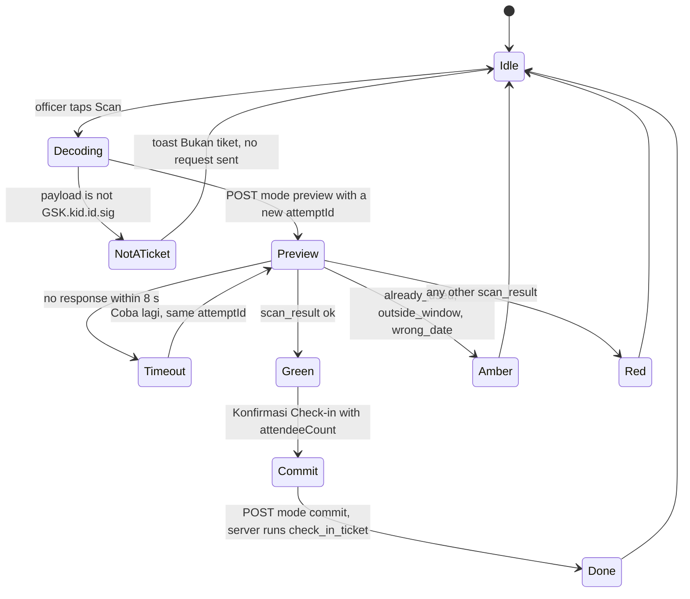

# Design System & UI/UX Guidelines

Edu Center & Edu Wisata Kelurahan Gisikdrono (Semarang Barat)

| Field | Value |
|---|---|
| Version | 1.0 |
| Date | 2026-10-15 |
| Status | Draft for review |
| Owner | Kelurahan Gisikdrono Edu Center project team |
| Related documents | `CLAUDE.md` (root), `docs/PRD.md`, `docs/Task.md`, `docs/Security.md` |

This document is the single reference for how the platform looks, moves and speaks. It covers the public site (Indonesian-language marketing and booking pages), the booking wizard and the role-based admin dashboard. Every value here is a token, not a suggestion: components consume CSS variables and Tailwind utilities defined in section 2, never raw hex values. Naming of tables, columns and enums follows `docs/PRD.md` §8.3 (enums) and §8.4 (DDL); routes and folders follow `CLAUDE.md` §3 and Appendix A.3; where this document and the database schema disagree, the schema wins and the conflict is raised, not silently resolved.

Domain terms used throughout: **RW** (Rukun Warga, the neighbourhood unit that owns a tourism programme), **kelurahan** (urban-village administration, the platform owner), **UMKM** (micro and small enterprises selling souvenirs and snacks), **PKK** (family-welfare movement whose members produce recycled crafts), **Bank Sampah** (community waste bank), **dolanan** (traditional Javanese children's games), **sanggar** (arts studio), **Ecowastreme** (RW 05's zero-waste eco-tourism brand), **PIC** (person in charge of a group booking).

## Table of contents

1. Design principles and inspiration
2. Design tokens
3. Typography
4. Layout
5. Public components
6. Admin dashboard
7. Motion
8. Iconography, imagery and assets
9. Accessibility and content rules
10. Performance budget and responsive rules
11. Open decisions

## 1. Design principles and inspiration

### 1.1 Principles

| # | Principle | What it means in practice |
|---|---|---|
| P1 | Trust before delight | Government-grade clarity: blue palette, visible prices in integer rupiah, honest status states, no countdown tricks, no dark patterns. The quotation PDF and every payment screen repeat that payment is only through the system (QRIS/VA). |
| P2 | Calm density | Public pages breathe (`py-16 md:py-24`, one idea per section). Admin pages are dense but each row exposes one primary action; secondary actions live in a row menu. |
| P3 | Designed for the gate | Officers scan tickets on mid-range Android phones in daylight with one hand: 44 px targets, full-screen colour results, large numerals, no hover-only affordances. Everything is verified at 360 px width. |
| P4 | One truth per status | Every enum value maps to exactly one badge tone and one Indonesian label in `src/config/status.ts`. Colour never carries meaning alone: label plus icon always accompany it. |
| P5 | Motion confirms, never decorates | Animation exists to acknowledge an action (sheet opens, result appears, count settles). Tables, forms, sidebar and charts do not animate. |
| P6 | Tokens over values | No hex, px shadow or ad-hoc easing inside a component. Add a token first, then use it. This is a clean-code rule enforced in review. |
| P7 | Indonesian for people, English for code | UI copy, labels, errors and notifications are Indonesian (`lang="id"`), except the `Summary in English` section of `/privasi`, which carries `lang="en"` (CLAUDE.md §12.1 no. 18, decision of 2026-10-18); identifiers, files, commits and documentation are English. |
| P8 | Accessible by default | WCAG 2.1 AA is a release gate, not a backlog item: contrast verified per token, focus ring on every interactive element, live regions for countdowns and scan results. |

### 1.2 Inspiration references

| Source | What we adopt | What we deliberately leave out |
|---|---|---|
| shadcn/ui (`new-york` style) | Component anatomy, `cva` variants, CSS-variable theming, Radix accessibility, Sidebar/Chart/Form primitives | Inverted light primary in dark mode (breaks brand recognition on CTAs) |
| 21st.dev | Minimal marketing sections, `rounded-xl` surfaces, soft `border-border`, backdrop-blur cards, restrained micro-interactions; layout patterns only (each component carries its author's licence, so no source is copied) | Decorative gradients, text shimmer, parallax beyond the two kinds of §7.3, anything animating the LCP element |
| dusunbambu.id (home page redesign, decision of 2026-10-23, at the user's request of that day) | The pinned hero photo, the wave under the hero and between sections, slide-in section reveals, the full-bleed photo slideshow, scroll-linked photo bands | Autoplay of the slideshow (WCAG 2.2.2), background-attachment parallax (breaks on iOS), its fonts and colours |
| reactbits.dev (MIT + Commons Clause v1.0: use inside this site is allowed, reselling the components is not) | The idea of CountUp, re-implemented with our tokens and no library; no source copied (a SplitText-style headline was tried and dropped for the first-load budget, decision of 2026-10-24) | GSAP-based components, blur animations, glow and spotlight cards, canvas or WebGL backgrounds, marquees |
| UI8.net dashboards | Collapsible icon-rail sidebar, KPI cards with sparkline and trend chip, faceted data tables, high whitespace ratio, floating action bars (patterns only; no UI8 asset is ever copied) | Glassmorphism on data surfaces, animated charts, more than three blurred layers |

### 1.3 Anti-generic rules (no AI slop)

The site has to look like Gisikdrono, not like a template. These rules hold for every public page, every admin screen and every document, and they win over a component default or a tool's suggestion.

| # | Rule | In practice |
|---|---|---|
| G1 | No stock or AI-generated images of people or places | Only real Gisikdrono photos from `public-media`. Until a photo exists the slot shows a placeholder without words (`PhotoPlaceholder`, decision of 2026-10-18): the RW's soft accent as background (`softClassesFor` in `src/config/rw.ts`, from the RW's `accent_key`; a combo, a kelurahan item or anything without one RW uses the neutral soft pair) and the lucide icon of what the slot is about, at 40 px with 1.5 stroke (package category, product category, the RW's own icon, `Newspaper` for an article, `Images` for the hero), never a stand-in image. It is `role="img"` with an `aria-label` that says what the photo will show, so screen readers still hear it. |
| G2 | No gradient text, no purple or indigo gradients, no decorative blobs or orbs, no glow effects | The only decorative backgrounds are the dot-grid SVG, the ice-to-background gradient, the wave divider SVG and a hand-drawn line-art motif at ≤ 8 % opacity (§8.5; the last two added on 2026-10-23 for the home page redesign the user asked for that day). Functional photo scrims behind text are not decoration. |
| G3 | Glass cards only over the hero photo, at most one per screen | `Card variant="glass"` sits on the hero image and nowhere else (§5.2). Blurred sticky bars (§4.3) are not cards and keep their own budget. |
| G4 | No emoji as UI icons | Icons are `lucide-react` only (§8.1). Emoji may appear inside content people wrote themselves, such as a review. |
| G5 | Never invent facts | No made-up numbers, years, names, testimonials, statistics or partner logos. Every fact comes from the CMS. Demo content exists only in the development seed (`pnpm db:seed`, local and CI, CLAUDE.md §6.4), which never reaches staging or production. |
| G6 | No generic marketing phrases | Avoid lines such as "temukan keajaiban", "pengalaman tak terlupakan", "solusi terbaik" or "jelajahi dunia". Copy names the place, the activity, the people and the numbers, with the numbers taken from the CMS: `Pilah sampah di Bank Sampah RW 05, {durasi} menit, untuk {min}–{maks} siswa`. |
| G7 | No three identical cards as the default layout | Marketing sections follow their content: photo and text alternating, a mosaic, a timeline. Collections (package, product and article lists) keep the card grid of §4.2. |
| G8 | Every activity photo says where or what | A caption (`galleries.caption`, or the activity or place name) sits under or over every photo of an activity; `alt_text` alone is not enough. |
| G9 | At most one primary call to action per screen | One `Button variant="default"` in view at a time (§5.1); everything else is `secondary`, `outline` or a link. The header's `Pesan Kunjungan` is therefore `secondary`, so the page's own CTA stays the only primary (decision of 2026-10-17). |

## 2. Design tokens

Tokens live in `src/styles/globals.css` as HSL triplets on `:root` and `.dark`, and are exposed to Tailwind CSS v4 through `@theme inline`. Components use utilities (`bg-primary`, `text-muted-foreground`, `shadow-card`) or `hsl(var(--token))`, never a literal colour.

### 2.1 Core palette (shadcn variables, sidebar, charts, brand)

| CSS variable | Light HEX | Light HSL | Dark HEX | Dark HSL |
|---|---|---|---|---|
| `--background` | #FFFFFF | `0 0% 100%` | #09090B | `240 10% 3.9%` |
| `--foreground` | #0F172A | `222.2 47.4% 11.2%` | #F8FAFC | `210 40% 98%` |
| `--card` | #FFFFFF | `0 0% 100%` | #0F172A | `222.2 47.4% 11.2%` |
| `--card-foreground` | #0F172A | `222.2 47.4% 11.2%` | #F8FAFC | `210 40% 98%` |
| `--popover` | #FFFFFF | `0 0% 100%` | #0F172A | `222.2 47.4% 11.2%` |
| `--popover-foreground` | #0F172A | `222.2 47.4% 11.2%` | #F8FAFC | `210 40% 98%` |
| `--primary` | #2563EB | `221.2 83.2% 53.3%` | #2563EB | `221.2 83.2% 53.3%` |
| `--primary-foreground` | #FFFFFF | `0 0% 100%` | #FFFFFF | `0 0% 100%` |
| `--primary-hover` (custom) | #1D4ED8 | `224.3 76.3% 48%` | #3B82F6 | `217.2 91.2% 59.8%` |
| `--primary-text` (custom) | #2563EB | `221.2 83.2% 53.3%` | #60A5FA | `213.1 93.9% 67.8%` |
| `--secondary` | #EFF6FF | `213.8 100% 96.9%` | #1E293B | `217.2 32.6% 17.5%` |
| `--secondary-foreground` | #1E40AF | `226.2 70.7% 40.2%` | #F8FAFC | `210 40% 98%` |
| `--muted` | #F1F5F9 | `210 40% 96.1%` | #1E293B | `217.2 32.6% 17.5%` |
| `--muted-foreground` | #71717A | `240 3.8% 46.1%` | #94A3B8 | `215 20.2% 65.1%` |
| `--accent` | #EFF6FF | `213.8 100% 96.9%` | #1E293B | `217.2 32.6% 17.5%` |
| `--accent-foreground` | #0F172A | `222.2 47.4% 11.2%` | #F8FAFC | `210 40% 98%` |
| `--destructive` | #DC2626 | `0 72.2% 50.6%` | #EF4444 | `0 84.2% 60.2%` |
| `--destructive-foreground` | #FFFFFF | `0 0% 100%` | #FFFFFF | `0 0% 100%` |
| `--border` | #E2E8F0 | `214.3 31.8% 91.4%` | #1E293B | `217.2 32.6% 17.5%` |
| `--input` | #E2E8F0 | `214.3 31.8% 91.4%` | #1E293B | `217.2 32.6% 17.5%` |
| `--ring` | #2563EB | `221.2 83.2% 53.3%` | #3B82F6 | `217.2 91.2% 59.8%` |
| `--chart-1` | #2563EB | `221.2 83.2% 53.3%` | #3B82F6 | `217.2 91.2% 59.8%` |
| `--chart-2` | #1E40AF | `226.2 70.7% 40.2%` | #60A5FA | `213.1 93.9% 67.8%` |
| `--chart-3` | #0EA5E9 | `198.6 88.7% 48.4%` | #38BDF8 | `198.4 93.2% 59.6%` |
| `--chart-4` | #10B981 | `160.1 84.1% 39.4%` | #34D399 | `158.1 64.4% 51.6%` |
| `--chart-5` | #F59E0B | `37.7 92.1% 50.2%` | #FBBF24 | `43.3 96.4% 56.3%` |
| `--sidebar-background` | #FFFFFF | `0 0% 100%` | #09090B | `240 10% 3.9%` |
| `--sidebar-foreground` | #334155 | `215.3 25% 26.7%` | #94A3B8 | `215 20.2% 65.1%` |
| `--sidebar-primary` | #2563EB | `221.2 83.2% 53.3%` | #2563EB | `221.2 83.2% 53.3%` |
| `--sidebar-primary-foreground` | #FFFFFF | `0 0% 100%` | #FFFFFF | `0 0% 100%` |
| `--sidebar-accent` | #EFF6FF | `213.8 100% 96.9%` | #1E293B | `217.2 32.6% 17.5%` |
| `--sidebar-accent-foreground` | #1E40AF | `226.2 70.7% 40.2%` | #F8FAFC | `210 40% 98%` |
| `--sidebar-border` | #E2E8F0 | `214.3 31.8% 91.4%` | #1E293B | `217.2 32.6% 17.5%` |
| `--sidebar-ring` | #2563EB | `221.2 83.2% 53.3%` | #3B82F6 | `217.2 91.2% 59.8%` |
| `--brand-deep` (custom) | #0F172A | `222.2 47.4% 11.2%` | #0F172A | `222.2 47.4% 11.2%` |
| `--brand-royal` (custom) | #1E40AF | `226.2 70.7% 40.2%` | #1E40AF | `226.2 70.7% 40.2%` |
| `--brand-ice` (custom) | #EFF6FF | `213.8 100% 96.9%` | #EFF6FF | `213.8 100% 96.9%` |
| `--surface-warm` (custom) | #FAF7F2 | `37.5 44.4% 96.5%` | #161412 | `30 10% 8%` |
| `--surface-warm-foreground` (custom) | #0F172A | `222.2 47.4% 11.2%` | #F8FAFC | `210 40% 98%` |
| `--radius` | 0.75rem | — | 0.75rem | — |

`--primary` is identical in both modes so that brand CTAs look the same everywhere (white on #2563EB = 5.17:1). Surfaces move instead: dark pages use #09090B, dark cards #0F172A.

`--surface-warm` (decision of 2026-10-23, home page redesign at the user's request of that day) is the opaque warm tone the home page alternates with `--background` and the footer sits on: opaque, so a wave divider in the same colour joins its section without a seam (`bg-muted/40` is translucent and cannot). The warmth stays out of the CTA system, which remains blue. Its text is `--foreground`; `--muted-foreground` on it measures 4.52:1 in light mode, so muted text stays allowed at AA (re-checked against the real token values by `src/styles/globals.test.ts`; were it below 4.5:1, text on it would use the foreground token). The inner pages keep `muted` (§5.7).

### 2.2 Semantic status colours

Each family has a strong fill (`--x`), a text colour for that fill (`--x-foreground`), a tinted background (`--x-soft`) and a text colour for the tint (`--x-soft-foreground`). `danger` aliases `--destructive`.

| Family | Variable | Light HEX | Light HSL | Dark HEX | Dark HSL |
|---|---|---|---|---|---|
| success | `--success` | #16A34A | `142.1 76.2% 36.3%` | #22C55E | `142.1 70.6% 45.3%` |
| | `--success-foreground` | #FFFFFF | `0 0% 100%` | #0F172A | `222.2 47.4% 11.2%` |
| | `--success-soft` | #DCFCE7 | `140.6 84.2% 92.5%` | #22C55E @ 15 % | `142 70% 45% / 0.15` |
| | `--success-soft-foreground` | #15803D | `142.4 71.8% 29.2%` | #4ADE80 | `141.9 69.2% 58%` |
| warning | `--warning` | #D97706 | `32.1 94.6% 43.7%` | #F59E0B | `37.7 92.1% 50.2%` |
| | `--warning-foreground` | #0F172A | `222.2 47.4% 11.2%` | #0F172A | `222.2 47.4% 11.2%` |
| | `--warning-soft` | #FEF3C7 | `48 96.5% 88.8%` | #F59E0B @ 15 % | `38 92% 50% / 0.15` |
| | `--warning-soft-foreground` | #B45309 | `26 90.5% 37.1%` | #FBBF24 | `43.3 96.4% 56.3%` |
| info | `--info` | #0284C7 | `200.4 98% 39.4%` | #38BDF8 | `198.4 93.2% 59.6%` |
| | `--info-foreground` | #FFFFFF | `0 0% 100%` | #0F172A | `222.2 47.4% 11.2%` |
| | `--info-soft` | #E0F2FE | `204 93.8% 93.7%` | #38BDF8 @ 15 % | `198 93% 60% / 0.15` |
| | `--info-soft-foreground` | #0369A1 | `201.3 96.3% 32.2%` | #7DD3FC | `199.4 95.5% 73.9%` |
| danger | `--danger` | = `--destructive` | `0 72.2% 50.6%` | = `--destructive` | `0 84.2% 60.2%` |
| | `--danger-foreground` | #FFFFFF | `0 0% 100%` | #FFFFFF | `0 0% 100%` |
| | `--danger-soft` | #FEE2E2 | `0 93.3% 94.1%` | #EF4444 @ 15 % | `0 84% 60% / 0.15` |
| | `--danger-soft-foreground` | #B91C1C | `0 73.7% 41.8%` | #FCA5A5 | `0 93.5% 81.8%` |
| neutral | `--neutral` | #71717A | `240 3.8% 46.1%` | #94A3B8 | `215 20.2% 65.1%` |
| | `--neutral-foreground` | #FFFFFF | `0 0% 100%` | #0F172A | `222.2 47.4% 11.2%` |
| | `--neutral-soft` | #F1F5F9 | `210 40% 96.1%` | #1E293B | `217.2 32.6% 17.5%` |
| | `--neutral-soft-foreground` | #3F3F46 | `240 5.3% 26.1%` | #CBD5E1 | `212.7 26.8% 83.9%` |

Rule: badges, chips and table status cells always use the **soft** pair (every soft pair is ≥ 4.5:1). Strong fills are reserved for large-text surfaces (scanner result headers, banners, toasts, `success` buttons) where the 3:1 large-text threshold applies.

### 2.3 `src/styles/globals.css` (ready to paste)

```css
@import "tailwindcss";
@import "tw-animate-css";
@plugin "@tailwindcss/typography";

@custom-variant dark (&:is(.dark *));

:root {
  --background: 0 0% 100%;
  --foreground: 222.2 47.4% 11.2%;
  --card: 0 0% 100%;
  --card-foreground: 222.2 47.4% 11.2%;
  --popover: 0 0% 100%;
  --popover-foreground: 222.2 47.4% 11.2%;
  --primary: 221.2 83.2% 53.3%;
  --primary-foreground: 0 0% 100%;
  --primary-hover: 224.3 76.3% 48%;
  --primary-text: 221.2 83.2% 53.3%;
  --secondary: 213.8 100% 96.9%;
  --secondary-foreground: 226.2 70.7% 40.2%;
  --muted: 210 40% 96.1%;
  --muted-foreground: 240 3.8% 46.1%;
  --accent: 213.8 100% 96.9%;
  --accent-foreground: 222.2 47.4% 11.2%;
  --destructive: 0 72.2% 50.6%;
  --destructive-foreground: 0 0% 100%;
  --border: 214.3 31.8% 91.4%;
  --input: 214.3 31.8% 91.4%;
  --ring: 221.2 83.2% 53.3%;
  --chart-1: 221.2 83.2% 53.3%;
  --chart-2: 226.2 70.7% 40.2%;
  --chart-3: 198.6 88.7% 48.4%;
  --chart-4: 160.1 84.1% 39.4%;
  --chart-5: 37.7 92.1% 50.2%;
  --sidebar-background: 0 0% 100%;
  --sidebar-foreground: 215.3 25% 26.7%;
  --sidebar-primary: 221.2 83.2% 53.3%;
  --sidebar-primary-foreground: 0 0% 100%;
  --sidebar-accent: 213.8 100% 96.9%;
  --sidebar-accent-foreground: 226.2 70.7% 40.2%;
  --sidebar-border: 214.3 31.8% 91.4%;
  --sidebar-ring: 221.2 83.2% 53.3%;
  --brand-deep: 222.2 47.4% 11.2%;
  --brand-royal: 226.2 70.7% 40.2%;
  --brand-ice: 213.8 100% 96.9%;
  --rw-leaf: 89.2 55.1% 27.1%;
  --rw-leaf-foreground: 0 0% 100%;
  --rw-leaf-soft: 88 42.9% 93.1%;
  --rw-leaf-soft-foreground: 89.2 55.1% 27.1%;
  --rw-terracotta: 22.9 58.6% 34.1%;
  --rw-terracotta-foreground: 0 0% 100%;
  --rw-terracotta-soft: 28.6 60% 93.1%;
  --rw-terracotta-soft-foreground: 22.9 58.6% 34.1%;
  --rw-mulberry: 321 32.6% 36.1%;
  --rw-mulberry-foreground: 0 0% 100%;
  --rw-mulberry-soft: 324 35.7% 94.5%;
  --rw-mulberry-soft-foreground: 321 32.6% 36.1%;
  --rw-teal: 160 30% 25%;
  --rw-teal-foreground: 0 0% 100%;
  --rw-teal-soft: 158 32% 93.5%;
  --rw-teal-soft-foreground: 160 30% 25%;
  --rw-violet: 270 40% 32%;
  --rw-violet-foreground: 0 0% 100%;
  --rw-violet-soft: 270 45% 95%;
  --rw-violet-soft-foreground: 270 40% 32%;
  --success: 142.1 76.2% 36.3%;
  --success-foreground: 0 0% 100%;
  --success-soft: 140.6 84.2% 92.5%;
  --success-soft-foreground: 142.4 71.8% 29.2%;
  --warning: 32.1 94.6% 43.7%;
  --warning-foreground: 222.2 47.4% 11.2%;
  --warning-soft: 48 96.5% 88.8%;
  --warning-soft-foreground: 26 90.5% 37.1%;
  --info: 200.4 98% 39.4%;
  --info-foreground: 0 0% 100%;
  --info-soft: 204 93.8% 93.7%;
  --info-soft-foreground: 201.3 96.3% 32.2%;
  --danger: var(--destructive);
  --danger-foreground: var(--destructive-foreground);
  --danger-soft: 0 93.3% 94.1%;
  --danger-soft-foreground: 0 73.7% 41.8%;
  --neutral: 240 3.8% 46.1%;
  --neutral-foreground: 0 0% 100%;
  --neutral-soft: 210 40% 96.1%;
  --neutral-soft-foreground: 240 5.3% 26.1%;
  --surface-warm: 37.5 44.4% 96.5%;
  --surface-warm-foreground: 222.2 47.4% 11.2%;
  --radius: 0.75rem;
  /* Home page sizes (§4.4). */
  --hero-h: calc(100svh - 4rem);
  --hero-min-h-mobile: 32rem;
  --parallax-overscan: 112%;
}

.dark {
  --background: 240 10% 3.9%;
  --foreground: 210 40% 98%;
  --card: 222.2 47.4% 11.2%;
  --card-foreground: 210 40% 98%;
  --popover: 222.2 47.4% 11.2%;
  --popover-foreground: 210 40% 98%;
  --primary: 221.2 83.2% 53.3%;
  --primary-foreground: 0 0% 100%;
  --primary-hover: 217.2 91.2% 59.8%;
  --primary-text: 213.1 93.9% 67.8%;
  --secondary: 217.2 32.6% 17.5%;
  --secondary-foreground: 210 40% 98%;
  --muted: 217.2 32.6% 17.5%;
  --muted-foreground: 215 20.2% 65.1%;
  --accent: 217.2 32.6% 17.5%;
  --accent-foreground: 210 40% 98%;
  --destructive: 0 84.2% 60.2%;
  --destructive-foreground: 0 0% 100%;
  --border: 217.2 32.6% 17.5%;
  --input: 217.2 32.6% 17.5%;
  --ring: 217.2 91.2% 59.8%;
  --danger: var(--destructive);
  --danger-foreground: var(--destructive-foreground);
  --chart-1: 217.2 91.2% 59.8%;
  --chart-2: 213.1 93.9% 67.8%;
  --chart-3: 198.4 93.2% 59.6%;
  --chart-4: 158.1 64.4% 51.6%;
  --chart-5: 43.3 96.4% 56.3%;
  --sidebar-background: 240 10% 3.9%;
  --sidebar-foreground: 215 20.2% 65.1%;
  --sidebar-primary: 221.2 83.2% 53.3%;
  --sidebar-primary-foreground: 0 0% 100%;
  --sidebar-accent: 217.2 32.6% 17.5%;
  --sidebar-accent-foreground: 210 40% 98%;
  --sidebar-border: 217.2 32.6% 17.5%;
  --sidebar-ring: 217.2 91.2% 59.8%;
  --rw-leaf: 87.3 43.3% 59.2%;
  --rw-leaf-foreground: 240 10% 3.9%;
  --rw-leaf-soft: 97.5 28.6% 11%;
  --rw-leaf-soft-foreground: 87.3 43.3% 59.2%;
  --rw-terracotta: 27.3 64.4% 65.9%;
  --rw-terracotta-foreground: 240 10% 3.9%;
  --rw-terracotta-soft: 24.5 35.5% 12.2%;
  --rw-terracotta-soft-foreground: 27.3 64.4% 65.9%;
  --rw-mulberry: 322.6 43.3% 72.4%;
  --rw-mulberry-foreground: 240 10% 3.9%;
  --rw-mulberry-soft: 321.2 29.8% 11.2%;
  --rw-mulberry-soft-foreground: 322.6 43.3% 72.4%;
  --rw-teal: 160 40% 69%;
  --rw-teal-foreground: 240 10% 3.9%;
  --rw-teal-soft: 160 30% 11%;
  --rw-teal-soft-foreground: 160 40% 69%;
  --rw-violet: 270 60% 82%;
  --rw-violet-foreground: 240 10% 3.9%;
  --rw-violet-soft: 270 30% 13%;
  --rw-violet-soft-foreground: 270 60% 82%;
  --success: 142.1 70.6% 45.3%;
  --success-foreground: 222.2 47.4% 11.2%;
  --success-soft: 142 70% 45% / 0.15;
  --success-soft-foreground: 141.9 69.2% 58%;
  --warning: 37.7 92.1% 50.2%;
  --warning-foreground: 222.2 47.4% 11.2%;
  --warning-soft: 38 92% 50% / 0.15;
  --warning-soft-foreground: 43.3 96.4% 56.3%;
  --info: 198.4 93.2% 59.6%;
  --info-foreground: 222.2 47.4% 11.2%;
  --info-soft: 198 93% 60% / 0.15;
  --info-soft-foreground: 199.4 95.5% 73.9%;
  --danger-soft: 0 84% 60% / 0.15;
  --danger-soft-foreground: 0 93.5% 81.8%;
  --neutral: 215 20.2% 65.1%;
  --neutral-foreground: 222.2 47.4% 11.2%;
  --neutral-soft: 217.2 32.6% 17.5%;
  --neutral-soft-foreground: 212.7 26.8% 83.9%;
  --surface-warm: 30 10% 8%;
  --surface-warm-foreground: 210 40% 98%;
}

@theme inline {
  --color-background: hsl(var(--background));
  --color-foreground: hsl(var(--foreground));
  --color-card: hsl(var(--card));
  --color-card-foreground: hsl(var(--card-foreground));
  --color-popover: hsl(var(--popover));
  --color-popover-foreground: hsl(var(--popover-foreground));
  --color-primary: hsl(var(--primary));
  --color-primary-foreground: hsl(var(--primary-foreground));
  --color-primary-hover: hsl(var(--primary-hover));
  --color-primary-text: hsl(var(--primary-text));
  --color-secondary: hsl(var(--secondary));
  --color-secondary-foreground: hsl(var(--secondary-foreground));
  --color-muted: hsl(var(--muted));
  --color-muted-foreground: hsl(var(--muted-foreground));
  --color-accent: hsl(var(--accent));
  --color-accent-foreground: hsl(var(--accent-foreground));
  --color-destructive: hsl(var(--destructive));
  --color-destructive-foreground: hsl(var(--destructive-foreground));
  --color-border: hsl(var(--border));
  --color-input: hsl(var(--input));
  --color-ring: hsl(var(--ring));
  --color-chart-1: hsl(var(--chart-1));
  --color-chart-2: hsl(var(--chart-2));
  --color-chart-3: hsl(var(--chart-3));
  --color-chart-4: hsl(var(--chart-4));
  --color-chart-5: hsl(var(--chart-5));
  --color-sidebar: hsl(var(--sidebar-background));
  --color-sidebar-foreground: hsl(var(--sidebar-foreground));
  --color-sidebar-primary: hsl(var(--sidebar-primary));
  --color-sidebar-primary-foreground: hsl(var(--sidebar-primary-foreground));
  --color-sidebar-accent: hsl(var(--sidebar-accent));
  --color-sidebar-accent-foreground: hsl(var(--sidebar-accent-foreground));
  --color-sidebar-border: hsl(var(--sidebar-border));
  --color-sidebar-ring: hsl(var(--sidebar-ring));
  --color-brand-deep: hsl(var(--brand-deep));
  --color-brand-royal: hsl(var(--brand-royal));
  --color-brand-ice: hsl(var(--brand-ice));
  --color-rw-leaf: hsl(var(--rw-leaf));
  --color-rw-leaf-foreground: hsl(var(--rw-leaf-foreground));
  --color-rw-leaf-soft: hsl(var(--rw-leaf-soft));
  --color-rw-leaf-soft-foreground: hsl(var(--rw-leaf-soft-foreground));
  --color-rw-terracotta: hsl(var(--rw-terracotta));
  --color-rw-terracotta-foreground: hsl(var(--rw-terracotta-foreground));
  --color-rw-terracotta-soft: hsl(var(--rw-terracotta-soft));
  --color-rw-terracotta-soft-foreground: hsl(var(--rw-terracotta-soft-foreground));
  --color-rw-mulberry: hsl(var(--rw-mulberry));
  --color-rw-mulberry-foreground: hsl(var(--rw-mulberry-foreground));
  --color-rw-mulberry-soft: hsl(var(--rw-mulberry-soft));
  --color-rw-mulberry-soft-foreground: hsl(var(--rw-mulberry-soft-foreground));
  --color-rw-teal: hsl(var(--rw-teal));
  --color-rw-teal-foreground: hsl(var(--rw-teal-foreground));
  --color-rw-teal-soft: hsl(var(--rw-teal-soft));
  --color-rw-teal-soft-foreground: hsl(var(--rw-teal-soft-foreground));
  --color-rw-violet: hsl(var(--rw-violet));
  --color-rw-violet-foreground: hsl(var(--rw-violet-foreground));
  --color-rw-violet-soft: hsl(var(--rw-violet-soft));
  --color-rw-violet-soft-foreground: hsl(var(--rw-violet-soft-foreground));
  --color-success: hsl(var(--success));
  --color-success-foreground: hsl(var(--success-foreground));
  --color-success-soft: hsl(var(--success-soft));
  --color-success-soft-foreground: hsl(var(--success-soft-foreground));
  --color-warning: hsl(var(--warning));
  --color-warning-foreground: hsl(var(--warning-foreground));
  --color-warning-soft: hsl(var(--warning-soft));
  --color-warning-soft-foreground: hsl(var(--warning-soft-foreground));
  --color-info: hsl(var(--info));
  --color-info-foreground: hsl(var(--info-foreground));
  --color-info-soft: hsl(var(--info-soft));
  --color-info-soft-foreground: hsl(var(--info-soft-foreground));
  --color-danger: hsl(var(--danger));
  --color-danger-foreground: hsl(var(--danger-foreground));
  --color-danger-soft: hsl(var(--danger-soft));
  --color-danger-soft-foreground: hsl(var(--danger-soft-foreground));
  --color-neutral: hsl(var(--neutral));
  --color-neutral-foreground: hsl(var(--neutral-foreground));
  --color-neutral-soft: hsl(var(--neutral-soft));
  --color-neutral-soft-foreground: hsl(var(--neutral-soft-foreground));
  --color-surface-warm: hsl(var(--surface-warm));
  --color-surface-warm-foreground: hsl(var(--surface-warm-foreground));

  --radius-sm: calc(var(--radius) - 0.5rem);    /* 0.25rem */
  --radius-md: calc(var(--radius) - 0.375rem);  /* 0.375rem */
  --radius-lg: calc(var(--radius) - 0.25rem);   /* 0.5rem  */
  --radius-xl: var(--radius);                   /* 0.75rem */
  --radius-2xl: calc(var(--radius) + 0.25rem);  /* 1rem    */

  --font-sans: var(--font-inter), ui-sans-serif, system-ui, sans-serif;
  --font-display: var(--font-plus-jakarta), var(--font-inter), ui-sans-serif, sans-serif;

  --shadow-card: 0 1px 2px rgb(15 23 42 / 0.04), 0 1px 3px rgb(15 23 42 / 0.06);
  --shadow-card-hover: 0 8px 24px rgb(15 23 42 / 0.08);
  --shadow-modal: 0 24px 48px rgb(15 23 42 / 0.18);
}

@layer base {
  * { @apply border-border outline-ring/50; }
  html { @apply scroll-smooth motion-reduce:scroll-auto; }
  body { @apply bg-background font-sans text-foreground antialiased; font-feature-settings: "cv11", "ss01"; }
  h1, h2, h3, h4 { @apply font-display; }
  :focus-visible { @apply outline-none ring-2 ring-ring ring-offset-2 ring-offset-background; }
}

/* Type scale: one class per step, mobile value first, desktop from md (48rem). */
@utility text-display-xl { font-family: var(--font-display); font-weight: 800; font-size: 2.5rem; line-height: 1.1; letter-spacing: -0.025em; @media (width >= 48rem) { font-size: 3.75rem; line-height: 1.05; } }
@utility text-display-lg { font-family: var(--font-display); font-weight: 700; font-size: 2.25rem; line-height: 1.15; letter-spacing: -0.02em; @media (width >= 48rem) { font-size: 3rem; line-height: 1.1; } }
@utility text-h1 { font-family: var(--font-display); font-weight: 700; font-size: 1.875rem; line-height: 1.2; letter-spacing: -0.02em; @media (width >= 48rem) { font-size: 2.25rem; } }
@utility text-h2 { font-family: var(--font-display); font-weight: 700; font-size: 1.5rem; line-height: 1.25; letter-spacing: -0.015em; @media (width >= 48rem) { font-size: 1.875rem; } }
@utility text-h3 { font-family: var(--font-display); font-weight: 600; font-size: 1.25rem; line-height: 1.33; letter-spacing: -0.01em; @media (width >= 48rem) { font-size: 1.5rem; } }
@utility text-h4 { font-family: var(--font-display); font-weight: 600; font-size: 1.125rem; line-height: 1.4; @media (width >= 48rem) { font-size: 1.25rem; } }
@utility text-body-lg { font-size: 1.0625rem; line-height: 1.65; @media (width >= 48rem) { font-size: 1.125rem; } }
@utility text-body { font-size: 1rem; line-height: 1.6; }
@utility text-body-sm { font-size: 0.875rem; line-height: 1.5; }
@utility text-caption { font-size: 0.75rem; line-height: 1.4; letter-spacing: 0.01em; }
@utility text-overline { font-size: 0.75rem; line-height: 1; letter-spacing: 0.08em; text-transform: uppercase; font-weight: 600; }
/* Tabular figures use the built-in `tabular-nums` utility; no custom alias. */

/* Home page helpers (§7.3, §5.7). */
@utility clip-inset { clip-path: inset(0); }
@utility scrollbar-none { scrollbar-width: none; &::-webkit-scrollbar { display: none; } }
```

### 2.4 Tailwind and shadcn mapping

| Utility | Resolves to | Used for |
|---|---|---|
| `bg-background` / `text-foreground` | `--background` / `--foreground` | page canvas |
| `bg-card border-border shadow-card` | `--card`, `--border`, `--shadow-card` | every card |
| `bg-primary text-primary-foreground hover:bg-primary-hover` | `--primary*` | primary buttons, active nav |
| `bg-secondary text-secondary-foreground` | `--secondary*` | secondary buttons, icon tiles |
| `text-muted-foreground` | `--muted-foreground` | helper text, meta rows |
| `text-primary-text` | `--primary-text` | blue text: overlines, eyebrows, inline links, the `link` button (never `text-primary`, which fails on dark surfaces) |
| `ring-ring ring-offset-background` | `--ring` | focus ring |
| `bg-success-soft text-success-soft-foreground` (and warning/info/danger/neutral) | semantic soft pair | badges, status cells |
| `bg-sidebar text-sidebar-foreground` | `--sidebar-*` | shadcn `Sidebar` |
| `fill-chart-1` … `stroke-chart-5` | `--chart-n` | Recharts via `ChartContainer` `config.color` |
| `bg-brand-deep text-white` / `from-brand-ice` | brand customs | CTA band, hero gradient |
| `bg-surface-warm` / `text-surface-warm` | `--surface-warm` | warm home sections and the footer; the wave divider of a warm section |
| `text-rw-leaf` / `bg-rw-terracotta-soft text-rw-terracotta-soft-foreground` (through `RW_ACCENT_CLASSES` in `src/config/rw.ts`) | `--rw-<palette>*` (`leaf`, `terracotta`, `mulberry`, `teal`, `violet`) | RW eyebrow, RW tag, map hotspot (§2.7) |
| `rounded-xl` / `rounded-2xl` / `rounded-full` | `--radius-xl` / `--radius-2xl` | surfaces / modals / badges |
| `font-display` / `font-sans` | `--font-display` / `--font-sans` | headings / body |

shadcn `components.json`: `"style": "new-york"`, `"tailwind": { "css": "src/styles/globals.css", "baseColor": "slate", "cssVariables": true }`, aliases `@/components`, `@/components/ui`, `@/lib/utils/cn` (utils), `@/lib`, `@/hooks`. `cn()` lives in `src/lib/utils/cn.ts` and is imported from that path; there is no barrel `src/lib/utils/index.ts`. Generated primitives in `src/components/ui` receive theme-level edits only; thin compositions of them without domain logic, such as `ResponsiveDialog`, live there too (CLAUDE.md §3.2); product behaviour is composed in domain folders.

### 2.5 Contrast notes (WCAG 2.1)

| Pair | Ratio | Verdict |
|---|---|---|
| `--foreground` #0F172A on #FFFFFF | 16.9:1 | AAA body text |
| `--primary-foreground` #FFFFFF on `--primary` #2563EB | 5.17:1 | AA text, both modes |
| `--primary` #2563EB on `--background` #09090B (dark) | 3.85:1 | AA for UI components and large text only; never body text, so blue text uses `--primary-text` |
| `--primary-text` on `--background` / `--card` / `--muted` (light: #2563EB) | 5.17 / 5.17 / 4.72 (4.75 on `--brand-ice`) | AA text; same blue as `--primary` |
| `--primary-text` on `--background` / `--card` / `--muted` (dark: #60A5FA) | 7.83 / 7.02 / 5.75 | AA text (decision of 2026-10-17: overlines and links in dark mode) |
| `--primary-hover` #3B82F6 with white (dark) | 3.7:1 | transient hover state only |
| `--muted-foreground` #71717A on #FFFFFF | 4.8:1 | AA; keep ≥ 12 px |
| `--muted-foreground` #94A3B8 on #09090B (dark) | 7.8:1 | AA |
| `--foreground` / `--muted-foreground` / `--primary-text` on `--surface-warm` (light: #FAF7F2) | 16.7 / 4.52 / 4.84 | AA; muted text stays allowed, keep ≥ 12 px (decision of 2026-10-23) |
| `--foreground` / `--muted-foreground` / `--primary-text` on `--surface-warm` (dark: #161412) | 17.5 / 7.1 / 7.2 | AA |
| RW accents as text on `--surface-warm` (light: leaf / terracotta / mulberry) | 5.8 / 6.3 / 7.3 | AA, eyebrow-safe |
| `--secondary-foreground` #1E40AF on `--secondary` #EFF6FF | 8.0:1 | AA |
| `--destructive` #DC2626 with white | 4.8:1 | AA (light); 3.8:1 in dark, so destructive buttons carry an icon and ≥ 14 px semibold text |
| success / warning / info / danger / neutral soft pairs (light) | 4.6 / 4.5 / 5.2 / 5.3 / 9.6 | AA, badge-safe |
| success / warning / info / danger / neutral soft pairs (dark; 15 % tint composited over `--card` #0F172A, neutral over #1E293B) | 8.0 / 8.3 / 8.1 / 8.2 / 9.8 | AA, badge-safe |
| `--warning-foreground` #0F172A on `--warning` #D97706 (light) | 5.6:1 | AA text; the only strong fill with dark text in light mode |
| strong `--success` #16A34A / `--info` #0284C7 with white | 3.3 / 4.1 | large text (≥ 24 px, or ≥ 18.66 px bold) only |
| RW fill pairs, white on the accent (light: leaf / terracotta / mulberry / teal / violet) | 6.2 / 6.8 / 7.8 / 8.6 / 10.3 | AA text |
| RW soft pairs, accent on its soft tint (light) | 5.6 / 5.9 / 6.7 / 7.7 / 8.9 | AA, tag-safe |
| RW accents as text on `--background` / `--card` / `--muted` (light) | leaf 6.2 / 6.2 / 5.7 · terracotta 6.8 / 6.8 / 6.2 · mulberry 7.8 / 7.8 / 7.1 · teal 8.6 / 8.6 / 7.9 · violet 10.3 / 10.3 / 9.4 | AA |
| RW fill pairs, #09090B on the accent (dark) | 10.0 / 9.1 / 8.8 / 11.3 / 11.0 | AA text |
| RW soft pairs, accent on its soft tint (dark) | 8.0 / 7.5 / 7.7 / 9.1 / 9.5 | AA, tag-safe |
| RW accents as text on `--background` / `--card` / `--muted` (dark) | leaf 10.0 / 8.9 / 7.3 · terracotta 9.1 / 8.2 / 6.7 · mulberry 8.8 / 7.9 / 6.5 · teal 11.3 / 10.1 / 8.3 · violet 11.0 / 9.9 / 8.1 | AA |

### 2.6 Theme behaviour

`next-themes` with `attribute="class"`, provided once by `src/components/providers/theme-provider.tsx`; the `<html>` element carries `suppressHydrationWarning`. The `(public)`, `(booking)` and `(auth)` route groups render with `forcedTheme="light"` (open decision D3), so a staff member's dark preference never leaks into the public site through the shared `localStorage` key. The `(admin)` group uses `defaultTheme="system"`, `enableSystem` and `storageKey="gsk-admin-theme"`; the toggle lives only in the sidebar footer. Dark mode never uses drop shadows: cards get `dark:border-white/5` as a highlight instead.

### 2.7 RW accent colours

Each RW has an accent so a visitor can tell the RWs apart at a glance: RW 05 Ecowastreme in green (`leaf`), RW 13 Kampung Budaya & Seni, the arts programme, in terracotta, and RW 08 Kampung Inklusif & Ramah Anak in mulberry (Task P2.10.03). The accents follow the same shape as the semantic families: a fill, the text on that fill, a tinted background and the text on that tint. The RWs are rows of `rw_units` (decision of 2026-10-21), and each names its accent by a palette key, `rw_units.accent_key` (enum `rw_accent`); the database never holds a colour, because the build only knows the palettes below. `leaf`, `terracotta` and `mulberry` are in use, and `teal` and `violet` are spares, so the next RW gets a colour of its own without a release.

| Palette | Variable | Light HEX | Light HSL | Dark HEX | Dark HSL |
|---|---|---|---|---|---|
| leaf | `--rw-leaf` | #466B1F | `89.2 55.1% 27.1%` | #9BC46A | `87.3 43.3% 59.2%` |
| | `--rw-leaf-foreground` | #FFFFFF | `0 0% 100%` | #09090B | `240 10% 3.9%` |
| | `--rw-leaf-soft` | #EEF5E6 | `88 42.9% 93.1%` | #1A2414 | `97.5 28.6% 11%` |
| | `--rw-leaf-soft-foreground` | #466B1F | `89.2 55.1% 27.1%` | #9BC46A | `87.3 43.3% 59.2%` |
| terracotta | `--rw-terracotta` | #8A4B24 | `22.9 58.6% 34.1%` | #E0A370 | `27.3 64.4% 65.9%` |
| | `--rw-terracotta-foreground` | #FFFFFF | `0 0% 100%` | #09090B | `240 10% 3.9%` |
| | `--rw-terracotta-soft` | #F8EDE3 | `28.6 60% 93.1%` | #2A1D14 | `24.5 35.5% 12.2%` |
| | `--rw-terracotta-soft-foreground` | #8A4B24 | `22.9 58.6% 34.1%` | #E0A370 | `27.3 64.4% 65.9%` |
| mulberry | `--rw-mulberry` | #7A3E65 | `321 32.6% 36.1%` | #D79AC0 | `322.6 43.3% 72.4%` |
| | `--rw-mulberry-foreground` | #FFFFFF | `0 0% 100%` | #09090B | `240 10% 3.9%` |
| | `--rw-mulberry-soft` | #F6ECF2 | `324 35.7% 94.5%` | #25141F | `321.2 29.8% 11.2%` |
| | `--rw-mulberry-soft-foreground` | #7A3E65 | `321 32.6% 36.1%` | #D79AC0 | `322.6 43.3% 72.4%` |
| teal (spare) | `--rw-teal` | #2D5346 | `160 30% 25%` | #90D0BA | `160 40% 69%` |
| | `--rw-teal-foreground` | #FFFFFF | `0 0% 100%` | #09090B | `240 10% 3.9%` |
| | `--rw-teal-soft` | #E9F4F0 | `158 32% 93.5%` | #14241F | `160 30% 11%` |
| | `--rw-teal-soft-foreground` | #2D5346 | `160 30% 25%` | #90D0BA | `160 40% 69%` |
| violet (spare) | `--rw-violet` | #523172 | `270 40% 32%` | #D1B6ED | `270 60% 82%` |
| | `--rw-violet-foreground` | #FFFFFF | `0 0% 100%` | #09090B | `240 10% 3.9%` |
| | `--rw-violet-soft` | #F2EDF8 | `270 45% 95%` | #21172B | `270 30% 13%` |
| | `--rw-violet-soft-foreground` | #523172 | `270 40% 32%` | #D1B6ED | `270 60% 82%` |

Every pair passes AA in both modes (§2.5). The spares were also chosen against colour blindness: simulated for protanopia, deuteranopia and tritanopia, each stays at least 5.3 OKLab units (×100) from every other palette, mulberry and teal under deuteranopia being the closest pair. The palettes already in use are closer than that: leaf and terracotta all but merge under deuteranopia (0.5), and terracotta and mulberry come to 3.5 under tritanopia. Colour is therefore never the only sign of an RW: its label (`RW 05`) is always written next to the accent, on map hotspots too.

Use them only where the RW itself is the point:

- the RW eyebrow or label (`RW 05 · Ecowastreme`) and the title accent on an RW page;
- map hotspots of that RW (fill pair);
- the RW tag on a package card (soft pair);
- the 4 px rule along the top of the RW's tile in the home page's RW mosaic (fill pair; decision of 2026-10-23);
- a combo package shows the accent of every RW it visits, in leg order.

Never use them for call-to-action buttons (those stay `--primary`), for statuses (those use the semantic families of §2.2 through `src/config/status.ts`), or as paragraph text colour.

Components never write these classes by hand. `RW_ACCENT_CLASSES` in `src/config/rw.ts` spells each palette's classes out in full (Tailwind only generates classes it finds written, so a class is never built from a key at runtime), and `rwAccentClasses(accentKey)` hands them out. An RW that is offline has no accent on the public site and is shown in the neutral pair. A new palette needs its four variables here and in `globals.css`, a value of the `rw_accent` enum, and its classes in `src/config/rw.ts`.

## 3. Typography

### 3.1 Font pairing and loading

| Role | Family | Weights permitted | CSS variable | Where |
|---|---|---|---|---|
| Display / headings | Plus Jakarta Sans | 600, 700, 800 | `--font-plus-jakarta` → `--font-display` | h1–h4, hero, KPI values, PDF headings |
| Body / UI | Inter | 400, 500, 600 | `--font-inter` → `--font-sans` | everything else, all admin UI except page titles |

Both are variable fonts, loaded once each through `next/font/google` (one file per family, two preloads total), `display: 'swap'`, `subsets: ['latin']`. Inter uses `font-feature-settings: "cv11", "ss01"`; every numeric cell, price, countdown and KPI value uses `tabular-nums` (tabular figures). PDF documents register the same families from TTF files in `src/lib/pdf/fonts/`; Open Graph images load them from `public/fonts/`.

```ts
// src/config/fonts.ts
import { Inter, Plus_Jakarta_Sans } from 'next/font/google';

export const fontSans = Inter({ subsets: ['latin'], display: 'swap', variable: '--font-inter' });
export const fontDisplay = Plus_Jakarta_Sans({ subsets: ['latin'], display: 'swap', variable: '--font-plus-jakarta' });
export const fontClassNames = `${fontSans.variable} ${fontDisplay.variable}`;
```

```tsx
// src/app/layout.tsx (excerpt)
<html lang="id" suppressHydrationWarning className={fontClassNames}>
```

### 3.2 Type scale

| Class | Desktop (rem / line-height / tracking) | Mobile (< md) | Weight | Family | Usage |
|---|---|---|---|---|---|
| `text-display-xl` | 3.75 / 1.05 / −0.025em | 2.5 / 1.1 | 800 | display | Home hero H1 |
| `text-display-lg` | 3 / 1.1 / −0.02em | 2.25 / 1.15 | 700 | display | RW page hero |
| `text-h1` | 2.25 / 1.2 / −0.02em | 1.875 | 700 | display | Page titles |
| `text-h2` | 1.875 / 1.25 / −0.015em | 1.5 | 700 | display | Section titles, KPI values |
| `text-h3` | 1.5 / 1.33 / −0.01em | 1.25 | 600 | display | Card-group titles |
| `text-h4` | 1.25 / 1.4 | 1.125 | 600 | display | Card titles, dialog titles |
| `text-body-lg` | 1.125 / 1.65 | 1.0625 | 400 | sans | Lead paragraphs |
| `text-body` | 1 / 1.6 | 1 | 400 | sans | Default copy |
| `text-body-sm` | 0.875 / 1.5 | same | 400 / 500 | sans | UI, tables, forms, buttons |
| `text-caption` | 0.75 / 1.4 / +0.01em | same | 400 / 500 | sans | Meta, helper and error text |
| `text-overline` | 0.75 / 1 / +0.08em, uppercase | same | 600 | sans | Eyebrows (`RW 05 · Ecowastreme`) |

Only these eleven steps exist. A new size is a token change in `globals.css`, never an inline `text-[13px]`.

### 3.3 Prose and formatting rules

- Articles render Tiptap/ProseMirror JSON (`articles.body_json`) through the allow-listed `RichText` renderer inside `prose prose-slate dark:prose-invert max-w-prose` (65ch); headings inherit `font-display`; images get `rounded-xl` and a required caption. Package, product, vendor and RW descriptions are Markdown columns (`description_md`, `vision_md`) rendered by `Prose` (`src/components/articles/prose.tsx`) with the same `prose` styles; neither path stores or injects HTML.
- Currency: `formatIDR(2500000)` from `src/lib/utils/currency.ts` → `Rp 2.500.000` (`Intl.NumberFormat('id-ID')`, no decimals, non-breaking space after `Rp`). Per-person prices read `Rp 25.000 /orang`.
- Dates: `Sabtu, 18 Oktober 2026` (`date-fns` `EEEE, d MMMM yyyy`, locale `id`, zone `Asia/Jakarta`); times `08.00–10.00 WIB`; short form in tables `18 Okt 2026`.
- Codes (`GSK-7F3K9Q2M`, `GSK-7F3K9Q2M-05`, `INV/GSK/2026/10/0001`) render in `font-mono tabular-nums text-body-sm` and are selectable with a copy button.
- Phone numbers display as `+62 812-3456-7890`; in masked staff views as `+62 812-••••-7890`.
- Headings use sentence case (`Paket wisata untuk sekolah`), never title case; overlines are the only uppercase text.

## 4. Layout

### 4.1 Breakpoints and containers

| Name | Min width | Public container | Admin content | Notes |
|---|---|---|---|---|
| base | 0 | `px-4` | `p-4` | design verified at 360 px |
| `sm` | 640 px | `px-6` | `p-4` | 2-column card grids |
| `md` | 768 px | `px-6` | `p-6` | Dialog replaces Drawer; sidebar replaces Sheet; tables replace card lists |
| `lg` | 1024 px | `px-8` | `p-8` | 12-column grid, hero two columns |
| `xl` | 1280 px | `max-w-7xl` (1280 px) | `max-w-(--breakpoint-2xl)` (Tailwind v4 syntax; `max-w-screen-*` no longer exists) | 4-column card grids, KPI grid 4-up |
| `2xl` | 1536 px | still 1280 px | 1536 px | public never grows past 1280 |

Narrow reading column `max-w-3xl`; forms `max-w-2xl`; booking wizard `max-w-3xl`.

### 4.2 Grid and spacing

- Base unit 4 px. Grid: 12 columns from `lg`, 4 columns below `md`; gaps `gap-6` public, `gap-4` admin.
- Card grids: `grid-cols-1 sm:grid-cols-2 lg:grid-cols-3 xl:grid-cols-4`.
- Vertical rhythm: sections `py-16 md:py-24`; sub-sections `space-y-10`; stacked form fields `space-y-5`; card padding `p-5 md:p-6`; admin page padding `p-4 md:p-6 lg:p-8`; dialog padding `p-6`.

| Step | px | Typical use |
|---|---|---|
| 1 | 4 | icon–label gap in badges |
| 2 | 8 | gap inside buttons, chip rows |
| 3 | 12 | input horizontal padding (`sm`), table cell padding |
| 4 | 16 | default gap, mobile gutter, card inner gap |
| 5 | 20 | card padding mobile |
| 6 | 24 | card padding desktop, dialog padding, grid gap |
| 8 | 32 | between form groups |
| 10 | 40 | sub-section spacing |
| 16 / 24 | 64 / 96 | section padding mobile / desktop |

### 4.3 Radius, borders, shadows, blur

| Token | Value | Applied to |
|---|---|---|
| `rounded-xl` | 0.75 rem | buttons, inputs, cards, images, popovers |
| `rounded-2xl` | 1 rem | dialogs, drawers, hero cards, CTA band |
| `rounded-lg` | 0.5 rem | elements inside table containers, icon tiles |
| `rounded-full` | 9999 px | badges, avatars, chips, FAB |
| `border border-border` | 1 px, #E2E8F0 / #1E293B | every surface edge; dividers use `divide-border` |
| `shadow-card` | `0 1px 2px rgb(15 23 42 / .04), 0 1px 3px rgb(15 23 42 / .06)` | resting cards (light only) |
| `shadow-card-hover` | `0 8px 24px rgb(15 23 42 / .08)` | interactive card hover |
| `shadow-modal` | `0 24px 48px rgb(15 23 42 / .18)` | dialogs, drawers, command palette |
| backdrop blur | `bg-white/70 dark:bg-slate-950/60 backdrop-blur-md supports-[backdrop-filter]:bg-white/60` | sticky header, hero floating card, scanner overlay, bulk-action bar |

Blur budget: at most three blurred layers in any viewport. Dark mode replaces shadows with `dark:border-white/5`.

### 4.4 Home page sizes (decision of 2026-10-23)

Layout sizes the home page redesign needs, as variables on `:root` (theme-independent) and used through Tailwind's variable shorthand (`h-(--hero-h)`), so no component writes an arbitrary value.

| Variable | Value | Used for |
|---|---|---|
| `--hero-h` | `calc(100svh - 4rem)` | the hero from md, the screen under the h-16 header (`md:min-h-(--hero-h)`) |
| `--hero-min-h-mobile` | `32rem` | the hero's stable minimum below md; it grows with a long title, so nothing shifts (`min-h-(--hero-min-h-mobile)`) |
| `--parallax-overscan` | `112%` | the height of a parallax photo layer inside its frame (§7.3), so the drift never shows an edge |

## 5. Public components

### 5.0 Component conventions (clean code)

- One component per kebab-case file, PascalCase export, props typed with an exported `interface`; files ≤ ~300 lines, functions ≤ ~40 lines.
- Variants through `cva` with `cn()` from `src/lib/utils/cn.ts`; no boolean soup (`isBig`, `isBlue`) when a `variant`/`size` prop expresses it.
- Server Components by default; `'use client'` only on leaf islands (forms, scanner, maps, flipbook, charts, tables, motion, theme). Client components receive serialisable props only.
- Copy comes from `src/lib/copy/id.ts`; status labels from `src/config/status.ts`; no Indonesian strings hard-coded in JSX except static marketing content.
- Every interactive element has a visible `:focus-visible` ring, a 44 × 44 px touch target below `md`, and `aria-label` when icon-only.

### 5.1 Button (`src/components/ui/button.tsx`)

| Variant | Style | Use |
|---|---|---|
| `default` | `bg-primary text-primary-foreground hover:bg-primary-hover` | one per view: Pesan Sekarang, Lanjut Bayar, Simpan |
| `secondary` | `bg-secondary text-secondary-foreground hover:bg-secondary/80` | Detail, Lihat Paket (next to a primary) |
| `outline` | `border border-border bg-background hover:bg-accent` | filters, Batal, secondary hero CTA |
| `ghost` | `hover:bg-accent` | row actions, toolbar |
| `link` | `text-primary-text underline-offset-4 hover:underline` | inline navigation |
| `destructive` | `bg-destructive text-destructive-foreground` | Batalkan reservasi, Hapus (always behind AlertDialog) |
| `success` | `bg-success text-success-foreground` | WhatsApp CTA (`Chat WhatsApp`), Konfirmasi Check-in |

Sizes: `sm` h-9 px-3 text-sm · `default` h-10 px-4 (`min-h-11` below `md`) · `lg` h-12 px-6 text-base · `xl` h-14 px-8 text-base font-semibold (hero only) · `icon` h-10 w-10. Always `rounded-xl font-medium gap-2`; icons 16 px (20 px at `lg`/`xl`). States: hover, focus-visible ring, `disabled:opacity-50 disabled:pointer-events-none`, `loading` (renders `Loader2` spinning, sets `aria-busy`, keeps width).

Do: verb-first labels (`Unduh PDF`), one `default` per view. Don't: full-width buttons on desktop; icon-only without `aria-label`; `destructive` outside a confirmation.

```tsx
<Button size="lg" loading={isPending} type="submit">
  <CalendarCheck aria-hidden /> Pesan Sekarang
</Button>
```

### 5.2 Card (`src/components/ui/card.tsx`)

Anatomy: `Card` (`rounded-xl border border-border bg-card shadow-card dark:border-white/5`) → `CardHeader` → `CardTitle` (`text-h4`) → `CardDescription` (`text-body-sm text-muted-foreground`) → `CardContent` → `CardFooter`.

| Variant | Behaviour |
|---|---|
| `base` | static container |
| `interactive` | whole card is a link; hover `-translate-y-0.5 shadow-card-hover` over 200 ms; focus ring on the card |
| `glass` | `bg-white/70 backdrop-blur-md` over the hero photo only, at most one per screen (§1.3 G3) |
| `feature` | 40 px icon tile `rounded-lg bg-secondary text-secondary-foreground` + title + description |

Don't nest cards; don't put more than one primary action in a card; don't use `glass` on data-bearing surfaces. States: resting, hover (`interactive` only), focus-visible (`interactive` only), disabled (`opacity-60`, used by `sold-out` package cards).

```tsx
<Card variant="feature">
  <CardHeader><Recycle aria-hidden className="size-5" /><CardTitle>Bank Sampah</CardTitle></CardHeader>
  <CardContent><CardDescription>Pilah, timbang, tabung: sampah jadi saldo warga.</CardDescription></CardContent>
</Card>
```

### 5.3 ResponsiveDialog, Drawer, AlertDialog

`ResponsiveDialog` (`src/components/ui/responsive-dialog.tsx`) renders shadcn `Dialog` at `md+` and `Drawer` (vaul) below `md` with one API: `open`, `onOpenChange`, `title`, `description`, `footer`. Width `sm:max-w-lg` (forms `sm:max-w-xl`), `rounded-2xl shadow-modal`, body scrolls internally, focus trapped and restored, Esc and backdrop close. `AlertDialog` is mandatory for destructive or financial confirmations and names the consequence (`Batalkan reservasi GSK-7F3K9Q2M? Kuota sesi akan dilepas.`). Drawers add `pb-[env(safe-area-inset-bottom)]`.

```tsx
<ResponsiveDialog open={open} onOpenChange={setOpen} title="Pilih sesi kunjungan">
  <SessionPicker sessions={sessions} value={value} onChange={setValue} />
</ResponsiveDialog>
```

### 5.4 Badge (`src/components/ui/badge.tsx`)

`rounded-full px-2.5 py-0.5 text-xs font-medium inline-flex items-center gap-1`; optional leading 6 px dot (`before:` pseudo) or 12 px icon. Variants: `default` (primary), `secondary`, `outline`, and the semantic soft set `success | warning | info | danger | neutral` (soft background + soft foreground, ≥ 4.5:1). Prop `appearance="outline"` renders the soft foreground colour with a 1 px border and transparent fill, used for terminal/historic states (`completed`, `expired`, `refunded`). One size only (`h-5`); a badge is never a button (use `Button size="sm" variant="secondary"` for clickable chips). States: static only, no hover. Do: keep labels to two words. Don't: truncate a badge label, rely on colour alone (label is always present), stack more than two badges in a table cell.

```tsx
<Badge variant="warning"><Clock aria-hidden /> Menunggu Pembayaran</Badge>
<Badge variant="neutral" appearance="outline">Selesai</Badge>
```

### 5.5 Tabs

Public: underline style, `TabsList` transparent with `border-b border-border`, trigger `text-body-sm text-muted-foreground data-[state=active]:text-foreground`, indicator a 2 px `bg-primary` underline on the active trigger (an `after:` pseudo-element) that fades in with CSS over 200 ms (`after:transition-opacity after:duration-200`). It does not slide: a sliding `layoutId` indicator needs Motion's `domMax` features, and §7.1 loads only `domAnimation` (decision of 2026-10-17). Admin filters: pill style, `bg-muted rounded-xl p-1`, active `bg-background shadow-sm`. Tabs reflect URL state through `nuqs` (`?tab=`) so they are shareable; keyboard arrow navigation comes from Radix. Sizes: one height (`h-10` trigger, `min-h-11` below `md` for the touch target); states: `active`, `hover`, `focus-visible`, `disabled`. Do: ≤ 5 triggers, label every tab with a noun (`Deskripsi`, `Jadwal`, `Ulasan`). Don't: use tabs for sequential steps (that is `BookingStepper`), hide the primary action inside a non-default tab, animate content height.

```tsx
const [tab, setTab] = useQueryState('tab', parseAsStringLiteral(['deskripsi', 'jadwal', 'ulasan']).withDefault('deskripsi'));
<Tabs value={tab} onValueChange={(v) => setTab(v as typeof tab)}>
  <TabsList><TabsTrigger value="deskripsi">Deskripsi</TabsTrigger><TabsTrigger value="jadwal">Jadwal</TabsTrigger></TabsList>
  <TabsContent value="deskripsi"><Prose markdown={pkg.description_md} /></TabsContent>
</Tabs>
```

### 5.6 Inputs (`src/components/forms/*`)

Base: h-10 (h-11 below `md`) `rounded-xl border border-input bg-background px-3`, text `text-base` (16 px) below `md` and `text-body-sm` from `md`, because iOS Safari zooms the page into any field set below 16 px (decision of 2026-10-17); placeholder `text-muted-foreground`, focus ring, `aria-invalid` + `border-destructive` on error, helper `text-caption text-muted-foreground`, error `text-caption text-destructive` linked with `aria-describedby`. Labels `text-body-sm font-medium`, required marker `*` with sr-only `wajib`. All forms use shadcn `Form` + react-hook-form + zod schemas from `src/lib/validations`; every public form includes an invisible Turnstile widget before the submit button.

| Component | Anatomy and rules |
|---|---|
| `Input` / `Textarea` | text; `Textarea` auto-grows to 6 rows, shows `n/2000` counter when `maxLength` set |
| `Select` | shadcn Select; ≤ 8 options; above that use `Combobox` (cmdk) with search |
| `PhoneInput` | `+62` fixed prefix chip, `inputMode="tel"`, normalises `08…`/`8…` to `+628…`, validates `^\+62[0-9]{8,13}$`; paired with `OtpDialog` (6-digit `InputOTP`, "Kirim kode" → "Kirim ulang" after 60 s, 5 attempts) which must succeed before the wizard leaves step `data` |
| `MoneyInput` | `Rp` prefix, `inputMode="numeric"`, thousands dots while typing, emits integer rupiah; admin only |
| `NumberStepper` | `−` / value / `+` with 44 px buttons, `min`/`max`/`step`, direct typing allowed, `aria-valuenow`; used for pax and add-on quantities |
| `DatePicker` | shadcn Calendar in Popover at `md+`, inline full-width below `md`; locale `id`, `Asia/Jakarta`; disabled before `booking.min_lead_hours` and after `booking.max_advance_days`; days with no open session disabled; days ≥ 80 % reserved show an amber dot |
| `SessionPicker` | radio cards from `v_session_availability` (`start_time`–`end_time`, `label`, `Sisa {remaining} dari {capacity}`, progress bar); re-read through the server every 15 s (`router.refresh()`, never the browser client, `docs/PRD.md` FR-BOOK-02); cards with `remaining < pax` are disabled with `aria-disabled`, `remaining = 0` reads `Penuh`; combo packages render one picker per RW leg (RW 05 first) with the same date |
| `ParticipantsEditor` | editable rows `Nama` + `Kelas/Kelompok` (`group_label`); paste from spreadsheet (tab/CSV) fills rows; row count ≤ pax; rows > 100 virtualised; duplicates highlighted, never blocked; names only (no NIK, DOB or address fields exist) |
| `ImageUploader` | dropzone + file picker, accepts `image/jpeg, image/png, image/webp` ≤ 10 MB (booklet PDFs ≤ 50 MB, admin only; both limits are re-enforced by the bucket and by `api/uploads/sign`, `docs/Security.md` §8.4), client resize to 1600 px, signed upload to `uploads-quarantine` (`api/uploads/sign`), then `api/uploads/finalize` returns the `public-media` path, `width`/`height`, the `blurhash` string and, for a gallery photo, the 480 px `thumbnailPath`; required `alt_text` field; SVG rejected with `Format SVG tidak didukung`. HEIC/HEIF (iPhone photos; sharp cannot decode them) is rejected with its own message, `Foto format HEIC (iPhone) belum didukung. Simpan sebagai JPG dulu, atau ubah iPhone: Pengaturan → Kamera → Format → Paling Kompatibel.`: first by the type or name the browser reports, then by the file's first bytes (`ftypheic`, `ftypmif1`, … via `checkImageBytes`) before the photo is shrunk, because Safari can decode HEIC and would otherwise turn it into a WebP unnoticed; `api/uploads/sign` and `finalize` refuse it again by its bytes with the same words. Any other refusal from the server is shown word for word (`UploadRejectedError`); `upload` is usually `createImageUpload({ rwId, purpose, entityId })` from `src/lib/uploads/upload-client.ts` (decision of 2026-10-18) |
| `BookletUploader` | admin only; dashed picker zone like `ImageUploader` taking one PDF (`accept="application/pdf"`, at most 50 MB and 100 pages, checked again by the server); under it, tied to the input with `aria-describedby`, the GPS reminder *"Pastikan foto di booklet tidak memuat lokasi (GPS). Ekspor PDF dari Canva/Word biasanya sudah aman."* (embedded photos keep their EXIF, an accepted risk in `docs/Security.md` §8.4); progress `Halaman 3 dari 24 sudah terunggah` in an `aria-live="polite"` line; the server's own message on refusal; once published it shows `PDF dan 24 halamannya sudah terunggah.` and no second picker. `upload` is usually `uploadBooklet` from `src/lib/uploads/upload-client.ts` (decision of 2026-10-18) |
| `RichTextEditor` | Tiptap (StarterKit + Image), admin only, loaded with `next/dynamic`; toolbar `role="toolbar"` of 44 px ghost icon buttons with `aria-label` and `aria-pressed` (bold, italic, headings 2–4, bulleted and numbered lists, quote, link, photo, undo, redo); the link panel accepts `https://`, `http://` or `mailto:` only; the photo panel is an `ImageUploader` (purpose `article`) plus a required caption, insert disabled until alt text (3–200) and caption are filled; content area uses the article `prose` styles; stores ProseMirror JSON, and the public `RichText` renderer re-checks it against the same allowlist (`src/lib/rich-text/document.ts`) |

```tsx
<FormField control={form.control} name="pic_phone" render={({ field }) => (
  <FormItem>
    <FormLabel>Nomor WhatsApp PIC</FormLabel>
    <FormControl><PhoneInput {...field} /></FormControl>
    <FormDescription>Kode OTP dikirim ke nomor ini.</FormDescription>
    <FormMessage />
  </FormItem>
)} />
```

### 5.7 Section, Hero and CTA band (`src/components/layout`, `src/components/marketing`)

`<Section id eyebrow title description align="left|center" tone="default|muted|warm|brand" wave headerAction bleed>` wraps every marketing block: `tone="default"` `bg-background`, `muted` `bg-muted/40`, `warm` `bg-surface-warm`, `brand` renders the CTA band (`bg-brand-deep text-white rounded-2xl` inside the container, dot-grid SVG at 6 % opacity, primary `xl` button + outline-white secondary). Inner pages alternate default/muted. The home page alternates default/warm and never uses `muted`, so two near-identical greys never meet (decision of 2026-10-23). `wave` puts a `WaveDivider` (§8.5) on top of the section, painted in its own opaque tone over the bottom of the section above; it goes only where the tone changes, and `muted` takes none. `headerAction` sets the `Lihat semua …` link beside the heading from lg (under it below). `bleed` is content that runs edge to edge after the container (a photo band, a scroll strip). `SectionShell` is the same wrapper without the heading, for a block that lays out its own (Why visit).

Home page order (redesign of 2026-10-23, at the user's request of that day, after dusunbambu.id): hero, RW mosaic, featured packages (warm), Why visit with its figures and a full-bleed photo band, gallery strip, reviews (warm), UMKM products, the three latest articles as a compact list, map & contact with the booklets (warm), CTA band, footer (warm, on every public page). Every section is left out while its data is empty (G5, §6.9).

Hero (`src/components/marketing/hero.tsx`, `docs/PRD.md` FR-PUB-01): `hero_banners` slides (`is_active`, within `starts_at`/`ends_at`, ordered by `sort_order`); more than one banner loads the embla carousel (autoplay 6 s, pauses on hover/focus, prev/next buttons and dots at 44 px, under the photo below lg and on its overlay bottom right from lg, white on `brand-deep/40`). The photo runs edge to edge (`IMAGE_SIZES.bleed`), `md:min-h-(--hero-h)` from md and `min-h-(--hero-min-h-mobile)` below, growing with its text, under a `bg-brand-deep/60` duotone overlay and a bottom scrim `from-brand-deep/80` behind the text. Text bottom-left inside the container: overline `Edu Wisata Gisikdrono`, `title` in `text-display-xl` (the first slide renders it as the page `h1`; later slides use a `p` with the same class so the page keeps one `h1`), `subtitle` in `text-body-lg text-brand-ice`, CTA pair `cta_label` → `cta_href` (`default xl`, internal paths only) + `Lihat Paket` (`outline xl`, white outline on the overlay; both full width below md), and, when `product_id` is set, that product inside the one `glass` card, top right from `lg`. A single banner is pinned (§7.3). The rating no longer sits under the hero: it is one of the Why-visit figures, so it is not shown twice. Without a banner the hero keeps the `from-brand-ice to-background` gradient beside the photo placeholder. The first slide's image is the LCP element (`priority`) and never animates or transforms; slides move only through embla's own transform. The RW mosaic that follows (`RwBento`, FR-PUB-02 as amended on 2026-10-23) reads `rw_units` (`name`, `theme_label`, tagline, hero image) in `sort_order`: from lg the first RW is the large tile (`col-span-7`, 4:5 when there are three RWs, beside the other two at `col-span-5`, 16:10), one RW fills the row, two share it 7/5, four or more put the first over a three-column grid; below lg one 4:3 column. Each tile is a whole-card link to its RW page with its accent rule on top (§2.7), the RW eyebrow, `theme_label` in `text-h3` and the tagline; tiles differ in size, accent and photo, so G7 holds. Its eyebrow counts the RWs online in words (`Tiga kampung, tiga program`).

Why visit (`why-visit.tsx`): eyebrow `Mengapa Gisikdrono`, a `text-h1` headline built from the RW count, three reasons (lucide icon in the 40 px tile of §8.1, `text-h4`, one line) and, beside them from lg, the figures from `buildHomeStats()` (`src/lib/utils/home-stats.ts`): RWs online, published packages, activity points, UMKM vendors with a published product, each counted from rows the page already reads, plus the average rating with its review count (static, never counted). A figure of zero is hidden, and with fewer than two the grid is. Below it, the first captioned gallery photo as a full-bleed band (21:9 from md, 4:3 below) with its caption on a scrim (G8). The gallery strip (`gallery-strip.tsx`) shows the next captioned photos in a full-bleed scroll-snap row (a third from lg, half from sm, 5/6 below), each linking to its tile on `/galeri`, with previous/next buttons from md and no autoplay. UMKM products keep the card grid from sm and become a scroll-snap row below it.

Variants: `Section` `tone` as above, `align="center"` only for the CTA band. States: none (static). Do: one `Section` per idea, eyebrow in `text-overline`, title in `text-h2`. Don't: nest sections, put two CTA bands on one page, place the slide's product card above its title on mobile.

```tsx
<Section id="paket" eyebrow="Paket wisata" title="Pilih paket sesuai rombongan Anda" tone="muted">
  <PackageGrid packages={packages} />
</Section>
<Section tone="brand" align="center" title="Siap berkunjung?" description="Kuota harian terbatas. Pesan sesi Anda sekarang.">
  <Button size="xl" asChild><Link href="/paket-wisata">Pesan Kunjungan</Link></Button>
</Section>
```

### 5.8 PackageCard (`src/components/packages/package-card.tsx`)

Anatomy: 4:3 cover (`next/image`, `sizes="(min-width:1280px) 25vw, (min-width:640px) 50vw, 100vw"`), RW badge overlay top-left (`RW 05` / `RW 13`), `package_category` badge top-right (`Reguler | Pelajar | Institusi`); a combo shows both RW badges in their accents instead, RW 05 first, and names `Kombinasi` in the meta row, so the cover never carries more than two badges (decision of 2026-10-18), `text-h4` title, meta row (`Clock` `duration_minutes`, `Users` `{min_pax}–{max_pax} orang`), price line from `pricing_basis`: `price_per_pax` as `Rp 25.000 /orang` or `flat_price` as `Rp 1.500.000 /rombongan` (`flat_group`), prefixed `mulai` when `tour_package_price_tiers` rows exist and showing the lowest tier (`docs/PRD.md` FR-PUB-04), footer `Pesan Sekarang` (`secondary`, because a grid shows several cards and §1.3 G9 keeps one primary per screen; decision of 2026-10-18) + `Detail` (`ghost`). Variant `compact` (list view, 96 px thumbnail). Interactive whole-card link; the two buttons stop propagation. States: `interactive` hover lift, focus ring, `sold-out` (no open session in the next 30 days: neutral `Kuota penuh` badge, `Pesan Sekarang` replaced by `Lihat Jadwal`). Price is never computed on the client; it is rendered from server data. Do: show the lowest tier with its basis (`/orang`, `/rombongan`); keep titles to two lines (`line-clamp-2`). Don't: show more than two badges on the cover, render strike-through "discount" prices, fetch prices client-side.

```tsx
<PackageCard pkg={pkg} variant="compact" />  // pkg: PublicPackageCard from src/lib/queries/packages.ts
```

### 5.9 ProductCard (`src/components/products/product-card.tsx`)

1:1 image (first of `image_paths`), `umkm_vendors.name` as overline, `text-h4` name, `product_category` chip (`Kompos | Bibit | Kerajinan Daur Ulang | Camilan | Suvenir | Lainnya`), `price` with `unit_label` (`Rp 15.000 /pcs`), `Bisa jadi tambahan` info badge when `is_addon_eligible`, `Unggulan` secondary badge when `is_featured`. CTA `Lihat Produk`; the detail page offers `Tambahkan saat pesan paket` (links to `/paket-wisata?rw=`) and `Tanya via WhatsApp` (`success`). States: default, hover lift, unavailable (`is_available = false`: image at 60 % opacity with a neutral `Tidak Tersedia` badge, CTA stays enabled so the visitor can still read the page; there is no stock count, products are made to order). Variants: `grid` (default) and `compact` (hero slide product card, 1:1 at 160 px). Do: name the vendor on every card; show `unit_label` (`/pcs`, `/bungkus`). Don't: add a cart or quantity control (products are ordered only as booking add-ons or via WhatsApp), show vendor contact or bank details anywhere.

```tsx
<ProductCard product={product} variant="compact" />  // product: PublicProductCard from src/lib/queries/products.ts
```

### 5.10 ReviewCard (`src/components/reviews/review-card.tsx`)

Avatar initial in `bg-secondary text-secondary-foreground`, `reviewer_name` (the view returns `Pengunjung` when anonymous, otherwise the first name), `institution_name`, `RatingStars` (`Star` filled `fill-warning text-warning`, `aria-label="Rating 5 dari 5"`), review date (`created_at`, short form), optional `title`, `body` ≤ 2000 chars with `Baca selengkapnya` after 4 lines, one RW chip per `rw_ids` entry. Data comes only from `v_public_reviews` (`review_status = published`); the home `quote` variant takes rows where `is_featured`. The `ReviewForm` on `/reservasi/[bookingCode]/ulasan` (reached only through the signed `review` link) uses `RatingStars` as a radio group, a Textarea with counter, a `Tampilkan nama saya` switch and the Turnstile widget. Variants: `card` (grid on `/ulasan`), `quote` (home testimonial band, `text-body-lg`, max 3). States: default, expanded (`Baca selengkapnya`), skeleton. Do: show the RW chip so visitors know which programme is reviewed. Don't: show the booking code, the institution's phone or email, or any review that is not `published`; never allow the visitor to edit after submission.

```tsx
<ReviewCard review={review} variant="card" />  // review: PublicReview from src/lib/queries/reviews.ts
```

### 5.11 MasonryGallery and lightbox (`src/components/gallery`)

CSS columns `columns-2 md:columns-3 lg:columns-4 gap-4`, items `break-inside-avoid mb-4 rounded-xl overflow-hidden`; images keep native ratio with `width`/`height` from `galleries` to avoid CLS and show the average colour of the stored `galleries.blurhash`, read server-side by `src/lib/images/blur.ts`, as the tile background while the photo loads (§8.2). `GalleryFilter` is a row of pill links (`FilterChipLink`, `aria-current="page"` on the chosen one) to `?filter=rw05`, `rw08` and so on, one for every RW online in the RWs' order, then `umkm` and `kunjungan` (`docs/PRD.md` FR-PUB-14: `rwNN` filters on `rw_id`, `umkm` and `kunjungan` on `gallery_category` `umkm` / `visit`; each RW page links to its own `/galeri?filter=rwNN`; a filter of an RW that is not online goes back to the whole gallery). Lightbox: `yet-another-react-lightbox` (`next/dynamic`, `ssr:false`), captions from `caption` with `alt_text` as the image alt, swipe and arrow keys, `Esc` closes, focus returns to the thumbnail. `Muat lagi` is a `Link` to `?halaman=<n+1>#foto-<first new>`: the page renders every page up to `n` (24 items each, each a cached read), so it works without script, and the link jumps to the first new tile; never infinite scroll. `?halaman=` stops at 20 pages (`GALLERY_MAX_PAGES`) and at the last page that exists; any other value (not an integer, zero, negative, too large, `1`) and any unknown `?filter=` redirect to the nearest valid address (`src/lib/utils/gallery-search.ts`, decision of 2026-10-18; this replaces the public Server Action Task P2.6.01 named). `media_type = video` items show a play glyph and `Video YouTube` over the 16:9 still (`thumbnail_path`, or YouTube's own from `i.ytimg.com` without one) and load nothing from YouTube until the visitor presses play; the player from `youtube-nocookie.com` then replaces the still and takes the focus (click-to-load, decision of 2026-10-18; CSP and id handling in `docs/Security.md` §8.2). The RW pages use the same grid for their gallery section. States: loading (skeleton tiles with the stored ratio), filter-empty (`Belum ada foto untuk filter ini`), lightbox open. Do: 24 items per page, lazy-load everything below the fold. Don't: crop gallery photos to a fixed ratio (a video still is 16:9, the player's frame), autoplay video before the visitor presses play, or render items whose `status` is not `published`.

```tsx
<GalleryFilter active={search.filter} />
<MasonryGrid items={gallery.items} />  // GalleryItem[] from listGalleryPages() in src/lib/queries/galleries.ts
```

### 5.12 FlipbookViewer (`src/components/booklet/flipbook-viewer.tsx`)

`page-flip` (StPageFlip) over the pre-rendered page images under `booklets.page_images_prefix` (`0001.webp` … `page_count`, max 1600 px long edge), mounted by `useFlipBook` (`src/hooks/use-flip-book.ts`) on page elements it builds itself and destroyed on unmount; the `react-pageflip` wrapper is not used because it never destroys the book and pins `page-flip@latest` (decision of 2026-10-20). The cover stands alone on the right, then spreads; double-page at `md+`, single page below; the book is never taller than the screen. Toolbar: previous/next, page indicator `3 / 24` (`2–3 / 24` for a spread, spoken through `aria-live`), fullscreen where the browser offers it. `Unduh PDF` sits in the page header, outside the island, so it works before the flipbook loads: it opens `GET /api/documents/booklet/[id]`, which counts the download and redirects to the `public-media` URL of `pdf_path` with `?download=<slug>.pdf` (Supabase Storage then answers `Content-Disposition: attachment`, so the PDF is never rendered inline), next to the page count and file size. Zoom disabled (use the PDF). Loaded with `next/dynamic` (`ssr:false`) behind a 3:2 skeleton; keyboard arrows flip pages; pages have `alt="Halaman 3"`. The `booklets.kind` (`booklet_kind`) label appears as overline (`E-Booklet | Proposal Kunjungan | Daftar Harga`). States: skeleton, ready, fullscreen, `page_count` null or 0 (pages not yet rasterised: `cover_path` image + download button only). Do: preload the two neighbouring pages. Don't: load the PDF in the browser for reading, animate the first paint, show unpublished booklets.

```tsx
// src/components/booklet/flipbook.tsx ('use client')
export const Flipbook = dynamic(() => import('@/components/booklet/flipbook-viewer').then((module) => module.FlipbookViewer), { ssr: false, loading: () => <Skeleton className="aspect-3/2 w-full rounded-xl" /> });
// src/app/(public)/(rows)/e-booklet/[slug]/page.tsx
<Flipbook title={booklet.title} pagePaths={booklet.pagePaths} />  // Unduh PDF: <a href={bookletDownloadPath(booklet.id)}> in the header
```

### 5.13 SiteMapSvg hotspots (`src/components/map`)

Inline `public/map/denah.svg` (imported through SVGR) inside `react-zoom-pan-pinch` (`minScale 1`, `maxScale 4`, pinch and wheel, `+`/`−`/reset controls at 44 px). Hotspots are real `<button>` overlays positioned from `activity_points.map_x` / `map_y` (percent of the plan's width and height, 0–100, so they survive any resize of the SVG), 32 px circle `bg-primary text-primary-foreground ring-4 ring-background`, icon per `point_type` (section 8.1), `aria-label="{name}, RW {rw_id}"`, keyboard order top-left to bottom-right. When `svg_hotspot_id` is set, the matching `<path>` in the plan is highlighted (`.denah-active`) while its hotspot is active. Activating a hotspot opens `HotspotPopover` (name, type chip, `short_description`, `Lihat di galeri` link, `Rute` deep link when `lat/lng` exist). Active hotspot scales 1.15 over 300 ms (`spring.snappy`). A list view (`Daftar titik aktivitas`) below the map exposes the same content for screen readers and small screens. Geography is a separate island on `/peta-kontak`, the RW area map `RwAreaExplorer` (`src/components/map/rw-area-explorer.tsx`; its Leaflet part `rw-area-leaflet.tsx` is `react-leaflet` with OpenStreetMap tiles behind `next/dynamic` `ssr:false`): the 13 RW areas of the kelurahan's own "Peta RW Wilayah Gisikdrono 2024" (`public/map/gisikdrono-rw.geojson`, from `scripts/convert-rw-kml.ts`), the edu-tourism RWs of `rw_units` in their accent (`.denah-rw-*` + `.rw-area`) and the others neutral, the boundary as a dashed outline, the office marker, a legend, and the same points by `lat`/`lng`. Hover and the open RW highlight the area; the list beside the map (`RwAreaList`, disclosure buttons) is the keyboard and screen-reader path, since Leaflet shapes take no focus; an RW opened there is framed on the map (no flight under reduced motion); `/peta-kontak` adds the Google Maps iframe embed and the `Rute di Google Maps` deep link, both already in the CSP allow-list (`docs/Security.md` §8.2). States: idle, hover (tooltip with name), active (scaled, popover open), filtered (hotspots of the other RW at 40 % opacity on RW pages). Do: cap hotspots per plan at 24, keep `map_x`/`map_y` editable only in `/dashboard/activity-points`. Don't: rely on hover alone, position hotspots in pixels, or ship the plan with inline `<script>` or raster images (section 8.3).

```tsx
<SiteMapSvg points={points} activeId={activeId} onSelect={setActiveId} />  // points: PublicActivityPoint[] (id, name, point_type, map_x, map_y, svg_hotspot_id, lat, lng)
```

### 5.14 BookingStepper and wizard (`src/components/booking`)

The wizard lives at `/pesan/[packageSlug]`; steps are bound to `?step=jadwal|data|tambahan|ringkasan` with labels `Jadwal`, `Data Rombongan`, `Tambahan`, `Ringkasan`; at `md+` a horizontal stepper (numbered circles, completed = `Check` in `bg-primary`, current = ring, upcoming = `bg-muted`), below `md` collapsed to `Langkah 2/4 · Data Rombongan` with a progress bar. Back navigation is always allowed; forward only when the current step's zod schema passes. Draft persists in `sessionStorage` keyed by package slug (no PII beyond what the user typed, cleared on success). Step `ringkasan` shows `BookingSummary` (lines from server-computed quote, total `text-h2 tabular-nums`), the unticked checkbox `Saya telah membaca Pemberitahuan Privasi` carrying `consent_version` (the kelurahan's visit terms join it before go-live), then `Konfirmasi & Bayar` (`default lg`) and, for `booker_type` school/university/government/company, `Minta Surat Penawaran` (`outline`, the name of `docs/PRD.md` FR-BOOK-05), which creates a `quoted` booking without holding quota (decision of 2026-10-22 on P3.5). The guardian attestation (`Saya menyatakan telah memperoleh persetujuan orang tua/wali untuk mencantumkan nama peserta`, `docs/Security.md` §7.6) sits in step `data` beside the participant list it is about, shown once a name is listed. A WhatsApp proof older than eight minutes is asked for again on the summary, number fixed, before the CTA. `BookingStatusCard` on `/reservasi/[bookingCode]` shows the `booking_status` badge, `CountdownExpiry` (`mm:ss`, `aria-live="polite"`, turns `warning` under 10 min, reads `expires_at` from the server) while `pending_payment`, and one primary action per state (`Bayar Sekarang`, `Lihat Tiket`, `Unduh Sertifikat`, `Beri Ulasan`). Stepper states per step: `completed`, `current`, `upcoming`, `error` (schema failed on a visited step: `danger` ring + `AlertTriangle`). Do: keep every step submit-able with the keyboard, show the running total in a sticky footer below `md`. Don't: let the visitor skip ahead by URL, compute any price client-side, or store the OTP code in `sessionStorage`. The draft lives in the browser, so the wizard itself sends an address that skips ahead back to the first step whose check fails.

```tsx
<BookingStepper steps={BOOKING_STEPS} current={step} invalid={invalidSteps} />  // BOOKING_STEPS from src/config/site.ts: jadwal | data | tambahan | ringkasan
```

### 5.15 TicketCard and QrDisplay (`src/components/ticket`)

One `TicketCard` per `tickets_qr` row: header `Tiket RW 05 · Ecowastreme`, `QrDisplay` (`react-qr-code`, 240 px, `bg-white p-4 rounded-xl`, encodes `https://<site>/v/<token>` only — no PII), `ticket_code` in mono with copy button, `valid_on` date, session time, `pax_count`, `ticket_status` badge, hint `Naikkan kecerahan layar saat pemindaian`. Actions: `Unduh PDF` (short-lived signed URL fetched on click, never embedded in the page HTML) and `Bagikan ke WhatsApp` (share sheet with the manage link). Print stylesheet hides navigation and renders one ticket per page. States: `issued` (default), `used` (success badge, QR kept for reference), `suspended` and `revoked` (QR at 30 % opacity with the badge explaining why), `expired` (neutral, QR hidden). Variants: `full` (status hub) and `compact` (list inside a combo booking, one per leg). Do: keep the QR on a white surface in both themes; show the session time next to the date. Don't: embed a signed PDF URL in the HTML, print participant names on the ticket, or render the token anywhere except inside the QR.

```tsx
<TicketCard ticket={ticket} rwName={rwNames[ticket.rw_id]} manageUrl={manageUrl} variant="full" />  // ticket: GuestTicket (ticket_code, valid_on, pax_count, ticket_status, qr_url, session)
```

### 5.16 WhatsAppFab (`src/components/layout/whatsapp-fab.tsx`)

Fixed `bottom-6 right-6` (`bottom-20` when a sticky mobile CTA is present), 56 px `rounded-full bg-success text-success-foreground shadow-card-hover`, `MessageCircle` icon, `aria-label="Chat WhatsApp kelurahan"`, link `https://wa.me/{NEXT_PUBLIC_WHATSAPP_CONTACT_NUMBER}?text=` with a prefilled Indonesian greeting that names the current page. Enters with `scaleIn` after 1 s; hidden on `(booking)` checkout pages and the whole admin area. States: hidden (first second, reduced-motion renders immediately), resting, hover (`shadow-modal`), focus ring. The footer ends with `pb-24` (96 px, more than the button's 56 px plus its 24 px offset), so at the bottom of every page the button floats over empty space instead of the legal links (decision of 2026-10-17). Do: keep it the only fixed element on public pages besides the header. Don't: open a chat widget or collect a phone number on the site itself; the link hands over to WhatsApp.

```tsx
<WhatsAppFab pageTitle={metadata.title} />  // builds wa.me/{NEXT_PUBLIC_WHATSAPP_CONTACT_NUMBER}?text=Halo, saya ingin bertanya tentang {pageTitle}
```

## 6. Admin dashboard

### 6.1 Shell (`src/components/admin/shell`)

| Part | Specification |
|---|---|
| `AppSidebar` | shadcn `Sidebar` (sidebar-07 pattern): 264 px expanded, 72 px icon rail collapsed (tooltips on rail), state persisted in cookie `sidebar_state`, toggle `Ctrl+B`; below `md` becomes a `Sheet` from the left. Header: logo + RW context chip (the officer's `RW 05`, `RW 08` and so on in the RW's accent, or `Kelurahan`). Footer: user card (avatar, name, `app_role` badge), theme toggle, `Keluar`. Nav items CSS-only hover/active (`bg-sidebar-accent text-sidebar-accent-foreground`), active item has a 3 px `bg-sidebar-primary` left bar. |
| `Topbar` | `h-16 sticky top-0 z-40` with backdrop blur; left: sidebar trigger + breadcrumb (`Dashboard / Reservasi / GSK-7F3K9Q2M`); right: `RwSwitcher`, `Scan Tiket` button (`default sm`, `ScanLine`; opens `ScannerModal`, whose header offers `Buka scanner penuh` → `/dashboard/scanner?return=<path>`, see 6.6), notification bell (badge count of `security_alerts` unread for superadmin, `needs_review` bookings for admin_rw), avatar menu (`Profil`, `Keluar`). |
| `RwSwitcher` | superadmin only; segmented control `Semua · RW 05 · RW 13 · RW 08 · …`, one segment for every RW in `rw_units` (offline ones included, so an RW can be prepared before it goes online), persisted in cookie `rw_scope`, applied as a filter on every list query and KPI; admin_rw never sees it (their scope is fixed by `app_rw_id`). |
| `CommandMenu` | `cmdk` palette on `Ctrl+K` / `⌘K`: navigation items for the current role, `Cari reservasi GSK-…`, quick actions (`Buka scanner`, `Sesi hari ini`). Results grouped by nav group; `shadow-modal rounded-2xl`. |
| Page frame | `PageHeader` (title `text-h1` in display font, description, right-aligned primary action), content `max-w-(--breakpoint-2xl) p-4 md:p-6 lg:p-8 space-y-6`. |

### 6.2 Navigation groups per role (`src/config/nav.ts`)

| Group | Items (label → route) | superadmin | admin_rw |
|---|---|---|---|
| Overview | Dashboard → `/dashboard` | yes | yes |
| Operasional | Reservasi → `/dashboard/bookings`; Sesi Kunjungan → `/dashboard/sessions`; Scanner → `/dashboard/scanner`; Kehadiran → `/dashboard/attendance`; Sertifikat → `/dashboard/certificates` | yes | yes (own RW) |
| Konten | Halaman RW → `/dashboard/pages`; Artikel → `/dashboard/articles`; Galeri → `/dashboard/galleries`; E-Booklet → `/dashboard/booklets`; Jadwal Pertunjukan → `/dashboard/schedules` (superadmin, and the admin of an RW with `rw_units.schedule_enabled`); Titik Aktivitas → `/dashboard/activity-points` | yes | yes (own RW) |
| Katalog | Paket Wisata → `/dashboard/packages`; Produk UMKM → `/dashboard/products` | yes | yes (own RW; combos read-only) |
| Moderasi | Ulasan → `/dashboard/reviews` | yes | no |
| Keuangan | Rekap → `/dashboard/finance`; Bagi Hasil → `/dashboard/finance/revenue-share`; Rekonsiliasi → `/dashboard/finance/reconciliation`; Penyesuaian → `/dashboard/finance/adjustments`; Ekspor → `/dashboard/exports` | yes | no |
| Administrasi | Pengguna → `/dashboard/users`; Hero Banner → `/dashboard/settings/hero-banners`; Pengaturan → `/dashboard/settings`; Log Aktivitas → `/dashboard/audit-logs`; Peringatan Keamanan → `/dashboard/security-alerts` | yes | no |

Items are filtered by `app_role` in the Server Component; hidden items are also unreachable because `requireRole()` and RLS guard the routes.

### 6.3 KpiCard, Sparkline, TrendChip (`src/components/admin/kpi`)

`KpiCard`: `rounded-xl border bg-card p-5` → label (`text-caption text-muted-foreground`), value (`text-h2 tabular-nums`, count-up once on mount over 600 ms, disabled under reduced motion), `TrendChip` (`+12,5 %` with `ArrowUpRight` in `success-soft`, negative in `danger-soft`, flat in `neutral-soft`, compares with the previous period and names it in `title`), icon tile top-right (`rounded-lg bg-secondary` 40 px), `Sparkline` (Recharts `AreaChart` 96 × 32, no axes, no tooltip, gradient fill `--chart-1` 25 % → 0 %, `isAnimationActive={false}`). Grid `grid-cols-1 sm:grid-cols-2 xl:grid-cols-4 gap-4`.

| Role | KPI set (source) |
|---|---|
| superadmin | Pendapatan bulan ini (`v_revenue_recap_daily`), Reservasi lunas, Pengunjung check-in, Rating rata-rata (`visit_stats`, `revenue_recap`) |
| admin_rw | Kuota hari ini terpakai (`v_attendance_today`), Reservasi mendatang, Check-in hari ini, Produk terjual (`visit_stats`) |

Money KPIs are always ledger-derived; a KPI never sums `bookings` directly.

### 6.4 DataTable (`src/components/admin/data-table`)

Server-rendered rows from `searchParams` (typed by `nuqs`: `q`, `status[]`, `rw`, `from`, `to`, `sort=created_at.desc`, `page`, `per=25|50|100`) with TanStack Table v8 for column state.

| Part | Behaviour |
|---|---|
| `Toolbar` | search (debounced 300 ms, `escapeLike` server-side), `FacetedFilter` multi-selects (status, RW, `package_category`, `booker_type`, date range), `Reset`, column visibility, `Ekspor` (superadmin on every table; admin_rw only on Kehadiran for their own RW and without contact columns; opens the export dialog with a mandatory reason and calls `rpc_create_export`) |
| `ColumnHeader` | click cycles asc → desc → none, announces `aria-sort`; sortable columns show `ArrowUpDown` |
| Rows | `text-body-sm h-12`, zebra off, hover `bg-muted/50`, sticky header, first column is the entity link, status column uses `StatusBadge`, money right-aligned `tabular-nums`, dates short form with full value in `title` |
| `RowActions` | `ghost icon` `MoreHorizontal` dropdown; destructive items last and red; every action re-checks scope in its Server Action |
| Selection + `BulkBar` | checkbox column; floating bar bottom-centre (`backdrop-blur rounded-2xl shadow-modal`) with count and ≤ 3 actions; disappears on clear |
| `Pagination` | `Menampilkan 1–25 dari 312`, page size select, prev/next, first/last at `lg+` |
| Mobile (< `md`) | `CardList` renderer reuses the same column definitions: title cell, badge, two meta lines, action menu |
| Loading | 8 skeleton rows matching column widths; sorting and filtering are instant, never animated |

```tsx
// src/app/(admin)/dashboard/bookings/page.tsx (excerpt)
const params = bookingsSearchParams.parse(await searchParams);
const { rows, total } = await listBookingsForStaff(params); // reads v_bookings_staff
return <DataTable columns={bookingColumns} data={rows} total={total} />;
```

### 6.5 StatusBadge mapping (`src/config/status.ts`, `src/components/admin/status/status-badge.tsx`)

`StatusBadge` takes `{ kind, value }`, looks up `STATUS_META[kind][value]` and renders a soft `Badge` with icon and Indonesian label. Enum values are the exact Postgres values mirrored in `src/db/enums.ts`; an unmapped value fails the TypeScript build (`Record<Enum, StatusMeta>`).

```ts
// src/config/status.ts (shape)
import type { LucideIcon } from 'lucide-react';
import { CheckCircle2, Clock, FileText } from 'lucide-react';
import type { Enums } from '@/db/types';

export type BadgeTone = 'success' | 'warning' | 'info' | 'danger' | 'neutral';
export interface StatusMeta { tone: BadgeTone; outline?: true; label: string; icon: LucideIcon }
export const BOOKING_STATUS: Record<Enums<'booking_status'>, StatusMeta> = {
  quoted: { tone: 'neutral', label: 'Penawaran', icon: FileText },
  pending_payment: { tone: 'warning', label: 'Menunggu Pembayaran', icon: Clock },
  paid: { tone: 'success', label: 'Lunas', icon: CheckCircle2 },
  // … every value of the enum, see table below
};
```

`booking_status`

| Value | Tone | Label | Note |
|---|---|---|---|
| `quoted` | neutral | Penawaran | no quota held |
| `pending_payment` | warning | Menunggu Pembayaran | row shows `CountdownExpiry` |
| `paid` | success | Lunas | tickets issued |
| `checked_in` | info | Check-in | first leg scanned |
| `completed` | success, outline | Selesai | all leg dates passed |
| `no_show` | neutral, outline | Tidak Hadir | set by cron |
| `expired` | neutral, outline | Kedaluwarsa | reactivation action for staff |
| `cancelled` | danger | Dibatalkan | |
| `refunded` | danger, outline | Dikembalikan | superadmin only |

`payment_status`

| Value | Tone | Label | Value | Tone | Label |
|---|---|---|---|---|---|
| `initiated` | neutral | Dibuat | `expired` | neutral, outline | Kedaluwarsa |
| `pending` | warning | Menunggu | `refunded` | danger, outline | Dikembalikan |
| `needs_review` | warning | Perlu Tinjauan | `partially_refunded` | warning, outline | Dikembalikan Sebagian |
| `settled` | success | Lunas | `disputed` | danger | Sengketa |
| `denied` | danger | Ditolak | `duplicate` | danger | Duplikat |
| `failed` | danger | Gagal | `cancelled` | neutral | Dibatalkan |

`ticket_status`: `issued` info Terbit · `used` success Terpakai · `suspended` warning Ditangguhkan · `revoked` danger Dicabut · `expired` neutral Kedaluwarsa.

`review_status`: `pending` warning Menunggu Moderasi · `published` success Tayang · `rejected` danger Ditolak.

`notification_status`: `queued` neutral Antre · `sending` info Mengirim · `sent` info Terkirim · `delivered` success Diterima · `read` success (outline) Dibaca · `failed` danger Gagal (row action `Kirim ulang` → `request_notification_resend`) · `cancelled` neutral (outline) Dibatalkan.

`session_status`: `open` success Buka · `closed` neutral Tutup · `cancelled` danger Dibatalkan. Occupancy is a separate derived chip, not an enum: `reserved_pax / capacity` < 80 % none, ≥ 80 % warning `Hampir Penuh`, = 100 % danger `Penuh`.

`content_status`: `draft` neutral Draf · `pending_review` warning Menunggu Tinjauan · `published` success Tayang · `archived` neutral (outline) Arsip. `booking_leg_status`: `unreserved` neutral Belum Dipesan · `reserved` info Dipesan · `checked_in` success Check-in · `released` neutral (outline) Dilepas. `addon_fulfillment_status`: `pending` warning Menunggu · `prepared` info Disiapkan · `handed_over` success Diserahkan · `cancelled` neutral Dibatalkan. `quotation_status`: `issued` info Terbit · `accepted` success Diterima · `expired` neutral Kedaluwarsa · `superseded` neutral (outline) Digantikan · `void` danger Batal. `invoice_status`: `issued` info Terbit · `paid` success Lunas · `void` danger Batal. `certificate_status`: `issued` success Terbit · `revoked` danger Dicabut. `adjustment_status`: `proposed` warning Diusulkan · `approved` info Disetujui · `rejected` danger Ditolak · `applied` success Diterapkan. `alert_severity`: `info` info · `medium` warning · `high` danger · `critical` danger (strong fill, `ShieldAlert`).

`scan_result` (also drives the scanner sheet, section 6.6)

| Value | Tone | Officer copy (title / body) |
|---|---|---|
| `ok` | success | Tiket valid / Konfirmasi jumlah pengunjung (preview); Check-in berhasil / `{institution} · {checked_in_pax} orang` (commit) |
| `already_used` | warning | Tiket sudah dipakai / Dipakai `{time}` oleh `{officer}`, `{pax}` orang |
| `outside_window` | warning | Di luar jam sesi / Sesi `{start}–{end}`; boleh check-in 60 menit sebelum dan 120 menit sesudah |
| `wrong_date` | warning | Tanggal kunjungan berbeda / Tiket berlaku `{valid_on}` |
| `invalid_signature` | danger | Bukan tiket resmi / Kode QR tidak dikenali sistem |
| `not_found` | danger | Tiket tidak ditemukan / Periksa kode pemesanan |
| `suspended` | danger | Tiket ditangguhkan / Pembayaran sedang ditinjau, hubungi superadmin |
| `revoked` | danger | Tiket dicabut / Reservasi dibatalkan atau dikembalikan |
| `wrong_rw` | danger | Tiket untuk RW lain / Tiket ini untuk RW `{rw}` |
| `booking_not_paid` | danger | Reservasi belum lunas / Minta pengunjung menyelesaikan pembayaran |
| `ticket_expired` | danger | Tiket kedaluwarsa / Masa berlaku tiket sudah lewat |
| `forbidden` | danger | Tidak berwenang / Akun Anda tidak berhak memindai tiket ini |

### 6.6 ScannerModal, ScannerView, ScanResultSheet (`src/components/admin/scanner`)

`ScannerView` is the full-screen page at `/dashboard/scanner` (PWA `start_url`, `display: standalone`) and the only surface with a live camera stream: `Permissions-Policy: camera=(self)` is sent for that route alone and `camera=()` everywhere else (`docs/Security.md`), so no other dashboard page can call `getUserMedia`. `ScannerModal` is the floating variant opened from the Topbar button or the `QuickScannerBar` on any dashboard page; it keeps the officer on their list by capturing one photo per ticket through `<input type="file" accept="image/*" capture="environment">` (the native camera app, not a stream, so the header policy is untouched) and decoding it with `barcode-detector`, and it carries the manual-code tab. Both are `next/dynamic` client islands (`@yudiel/react-qr-scanner` for the stream, `barcode-detector` for still images), share `ScanResultSheet` and call the same API contract. The live stream is the fast path: the modal header always offers `Buka scanner penuh` → `/dashboard/scanner?return=<path>`, which navigates back after the result sheet closes.

Anatomy: camera viewport (`aspect-[3/4]` below `md`, `aspect-video` above) with corner guides, torch toggle (`Flashlight`, only when the track supports it), camera flip (stream controls exist in `ScannerView` only; `ScannerModal` shows the captured photo in the same frame), `Scan` button (officer taps once per ticket; there is no continuous auto-scan), `ManualCodeInput` (`booking_code` + last-4 digits of the verified phone, today only, logged as `manual_checkin`), recent-scans list (last 10, badge + time + institution). Camera starts on tap (`facingMode: environment`, `playsInline muted`); in-app browsers that block the camera show `Buka di Chrome/Safari`.

Flow and API contract (`POST /api/tickets/verify { token, attemptId, mode: 'preview' | 'commit', attendeeCount?, overrideReason? }`; `overrideReason` is the only optional field beyond the base contract and is honoured by the server for `superadmin` only):



`ScanResultSheet` (Drawer below `md`, Dialog above): full-width header in the tone colour (`bg-success`, `bg-warning`, `bg-danger` with the matching `-foreground`), 48 px icon (`CheckCircle2`, `AlertTriangle`, `XCircle`), `text-h2` title, body line, then for `ok`: institution, PIC first name only, package, session, `pax_count`, `AttendeeStepper` (default `pax_count`, max `2 × pax_count`; values above `pax_count` show `Kelebihan {n} orang dicatat sebagai belum dibayar`), `Konfirmasi Check-in` (`success lg`). Amber results: `already_used` has only `Tutup`; `outside_window` and `wrong_date` show `Override` for superadmin (reason required, sent as `overrideReason` with the `commit` call, audited by `check_in_ticket`) and the hint `Hubungi superadmin untuk override` for admin_rw; red results have a single `Tutup`. Haptics: one short vibration on green, two on amber, one long on red; a beep per tone (`<audio preload>`), muted when the device is silent. The sheet has `role="alertdialog"`, `aria-live="assertive"`; scanning pauses while it is open and resumes on close. Network timeout shows `Tidak ada sinyal — coba lagi` with the retry reusing `attemptId` so a late response never double-checks-in. After 30 distinct bad payloads in 5 minutes the UI shows the server's slow-down (`Tunggu {n} detik`) and a `scanner_lockout` notice.

### 6.7 QuickScannerBar (`src/components/admin/shell/quick-scanner-bar.tsx`)

Below `md`: fixed bottom bar `h-16` with backdrop blur and `pb-[env(safe-area-inset-bottom)]`, primary `Scan` button (`ScanLine`, 48 px) opening `ScannerModal` in photo-capture mode, a manual code field opening it on the manual tab, and a `Maximize2` icon button linking to `/dashboard/scanner?return=<path>` for the live stream. At `md+` the Topbar button plays this role. Hidden on `/dashboard/scanner` and while any sheet is open. Content gets `pb-20` below `md` so the bar never covers the last row.

### 6.8 SessionCalendar and SessionEditor (`src/components/admin/calendar`)

Month grid (react-day-picker custom day cell): each day shows up to three session rows as thin quota bars (`reserved_pax / capacity`, fill `chart-1`, ≥ 80 % `warning`, full `danger`), a `session_status` dot, and a count `3 sesi`. Click opens `SessionEditor` (Sheet, right side, `sm:max-w-md`): list of sessions for the day with `start_time`/`end_time`, `capacity` (`NumberStepper`, min = `reserved_pax`), status select, `Tutup sesi` toggle. Date, time and RW fields are disabled with helper text `Tidak dapat diubah karena sudah ada reservasi` whenever `reserved_pax > 0` (the database trigger refuses such changes; the UI simply never offers them). `Buat dari pola mingguan` runs `generate_visit_sessions` for the selected month after an AlertDialog preview of the count.

### 6.9 Empty, loading, error and skeleton states

| State | Pattern |
|---|---|
| Empty, public pages | A section, card group or contact line whose data is empty is left out whole, heading included; the public site never prints `belum diisi`, `belum ada … yang dicatat`, `menyusul` or anything that reads as unfinished (decision of 2026-10-18). Three things stay: the page's own header (an RW page keeps its title and photo slot), the wordless photo placeholder of §1.3 G1 for a photo slot that belongs to something shown, and the answer to a visitor's own filter or search (`Belum ada foto untuk filter ini`, §5.11), which reports on their choice rather than on the CMS. Content the site cannot launch without, such as each RW's profile, is a go-live check (`docs/Security.md` §13.1), not a note on the page. |
| Empty, dashboard (`EmptyState`) | Staff see why a list is empty and what to do: 48 px icon in `bg-muted rounded-full p-3`, `text-h4` title, `text-body-sm text-muted-foreground` description, one primary action. Copy names the next step: `Belum ada reservasi. Bagikan tautan paket untuk mulai menerima pemesanan.` Filter-empty variant offers `Hapus filter`. |
| Loading | `loading.tsx` per segment; skeletons `animate-pulse bg-muted rounded-md` with the final dimensions (KPI, table 8 rows, form, calendar variants). No spinners on page load; spinners only inside buttons. Exception (Task P5.6.05): the public segments that look a row up, `(public)/(rows)` (every `[slug]` page, the RW pages, `/galeri`), carry no `loading.tsx`, because a Suspense boundary above a page streams a 200 shell before `notFound()` or `redirect()` can answer; `/galeri` instead fetches its items inside its own `<Suspense>` behind `GallerySkeleton` after its redirects, and every public nav link shows `LinkPending` (a pulsing `bg-primary` dot from `useLinkStatus`, still under reduced motion) while the next page is fetched. |
| Error | `error.tsx` card with `AlertTriangle`, `Terjadi kesalahan`, the Sentry `requestId` in mono (`Kode: 8f3a…`) for support, `Coba lagi` (`reset()`) and `Kembali ke Dashboard`. Never shows stack traces or raw exception text. |
| Inline action errors | `ActionResult` `error.message` (Indonesian, from `src/lib/copy/id.ts`) in a `danger-soft` callout above the form; field errors under their inputs. |
| Toasts (sonner) | bottom-right at `md+`, top-centre below; success 4 s, error persistent until dismissed; always includes a noun (`Paket "Jelajah Ecowastreme" dipublikasikan`). |
| Offline (scanner) | banner `Tidak ada koneksi` over the viewport; `Scan` and manual check-in disabled (verification is online-only: `/api/*` is `NetworkOnly` in the service worker and nothing containing PII is cached on the device); the officer falls back to the printed morning manifest, back-filled later by superadmin as `manual_backfill`. |

### 6.10 Displaying personal data

Lists read the masked view `v_bookings_staff` (PIC phone `+62 812-••••-7890`, email `h•••@sekolah.sch.id`). The booking detail page shows a `Tampilkan kontak` button that opens a dialog requiring a reason, calls `rpc_reveal_booking_contact(booking_id, reason)` and reveals the value for that page view only (daily cap 50, counter shown as `Sisa 43 hari ini`). Participant lists come from `rpc_get_participants(booking_id)` inside the −7/+30 day window; outside it the panel explains `Daftar peserta hanya tersedia 7 hari sebelum hingga 30 hari setelah kunjungan`. No admin screen ever renders children's names in a table that can be sorted or exported by admin_rw.

## 7. Motion

### 7.1 Setup

Framer Motion is consumed through the `motion` package. The provider enables `LazyMotion` in strict mode, so components import `m` (not `motion`); the lint rule `no-restricted-imports` blocks `motion` from `motion/react` outside `src/lib/motion`.

```tsx
// src/components/providers/motion-provider.tsx
'use client';
import { LazyMotion, MotionConfig, domAnimation } from 'motion/react';
import { duration, ease } from '@/lib/motion/transitions';

export function MotionProvider({ children }: { children: React.ReactNode }) {
  return (
    <LazyMotion features={domAnimation} strict>
      <MotionConfig reducedMotion="user" transition={{ duration: duration.base, ease: ease.outExpo }}>{children}</MotionConfig>
    </LazyMotion>
  );
}
```

### 7.2 Tokens (`src/lib/motion/transitions.ts`)

| Token | Value | Use |
|---|---|---|
| `duration.micro` | 150 ms | hover, toggles, badge colour |
| `duration.short` | 200 ms | tooltips, tab indicator, chips |
| `duration.base` | 300 ms | cards, section reveal, hotspot focus |
| `duration.long` | 500 ms | hero secondary elements, dialog enter |
| `duration.max` | 700 ms | flipbook page, map zoom-to-hotspot; nothing exceeds this |
| `ease.outExpo` | `[0.16, 1, 0.3, 1]` | entrances |
| `ease.inOut` | `[0.65, 0, 0.35, 1]` | layout moves |
| `spring.soft` | `{ type: 'spring', stiffness: 300, damping: 30 }` | drawers, sheets, dialogs |
| `spring.snappy` | `{ type: 'spring', stiffness: 400, damping: 25 }` | hover lift, hotspot scale |
| stagger | `staggerChildren: 0.06`, `delayChildren: 0.1`, cap 8 items | card grids, feature lists |
| distance | translate ≤ 24 px; blur never animated | all variants and every UI element |
| home reveal | `@keyframes reveal-up` (opacity and 16 px, fadeInUp's distance) on the `reveal` utility, `animation-range: entry 0% entry 80%`, in `src/styles/globals.css` | the home page's section reveals (§7.3) |
| parallax drift | `@keyframes parallax-drift`, 5 % of a layer 112 % of its frame (`--parallax-overscan`), about 5.6 % of the frame, in `src/styles/globals.css` | scroll-linked decorative photos only (§7.3); the one movement exempt from the 24 px cap (decision of 2026-10-23: the cap stays for UI elements) |
| count-up | `duration.max` eased with `ease.outExpo` | the home page's figures, as the admin KPI count-up |

Motion's API takes seconds, so the millisecond values above are stored as fractions; no component writes a literal duration.

```ts
// src/lib/motion/transitions.ts
import type { Transition } from 'motion/react';

export const duration = { micro: 0.15, short: 0.2, base: 0.3, long: 0.5, max: 0.7 } as const;
export const ease: Record<'outExpo' | 'inOut', [number, number, number, number]> = {
  outExpo: [0.16, 1, 0.3, 1],
  inOut: [0.65, 0, 0.35, 1],
};
export const spring = {
  soft: { type: 'spring', stiffness: 300, damping: 30 },
  snappy: { type: 'spring', stiffness: 400, damping: 25 },
} as const satisfies Record<string, Transition>;
export const stagger = { children: 0.06, delay: 0.1, cap: 8 } as const;
```

```ts
// src/lib/motion/variants.ts
import type { Variants } from 'motion/react';
import { duration, ease, spring, stagger } from './transitions';

export const fadeIn: Variants = { hidden: { opacity: 0 }, visible: { opacity: 1, transition: { duration: duration.base, ease: ease.outExpo } }, exit: { opacity: 0, transition: { duration: duration.short } } };
export const fadeInUp: Variants = { hidden: { opacity: 0, y: 16 }, visible: { opacity: 1, y: 0, transition: { duration: duration.base, ease: ease.outExpo } }, exit: { opacity: 0, y: 8 } };
export const fadeInDown: Variants = { hidden: { opacity: 0, y: -16 }, visible: { opacity: 1, y: 0, transition: { duration: duration.base, ease: ease.outExpo } }, exit: { opacity: 0 } };
export const scaleIn: Variants = { hidden: { opacity: 0, scale: 0.96 }, visible: { opacity: 1, scale: 1, transition: { duration: duration.short, ease: ease.outExpo } }, exit: { opacity: 0, scale: 0.98 } };
export const slideInRight: Variants = { hidden: { x: 24, opacity: 0 }, visible: { x: 0, opacity: 1, transition: spring.soft }, exit: { x: 24, opacity: 0 } };
export const staggerContainer = (count: number): Variants => ({
  hidden: {},
  visible: { transition: { staggerChildren: count <= stagger.cap ? stagger.children : 0, delayChildren: stagger.delay } },
});
```

```tsx
<m.ul variants={staggerContainer(packages.length)} initial="hidden" whileInView="visible" viewport={{ once: true, margin: '-80px' }}>
  {packages.map((p) => <m.li key={p.id} variants={fadeInUp}><PackageCard pkg={p} /></m.li>)}
</m.ul>
```

### 7.3 Allowed and banned

| Allowed | Banned |
|---|---|
| Section reveals (`whileInView`, once; on the home page the CSS `reveal` utility instead, a scroll-driven fade-up that ships no script and never hides content from a browser without scroll-driven animations, without JS or with reduced motion: decision of 2026-10-24, after the motion reveal islands put `/` 36 kB over its first-load budget), card hover lift, a CSS hover zoom of a product card's photo (`motion-safe:group-hover:scale-103`, 300 ms), dialog/drawer/sheet enter–exit through `AnimatePresence`, KPI count-up once on mount and the home figures' count-up once in view (`CountUp`, plain rAF and IntersectionObserver, the final figure rendered on the server), `ScanResultSheet`, toasts (sonner built-in), WhatsAppFab entrance, hotspot focus scale, hero secondary elements, and two kinds of parallax only (below) | DataTable rows (no enter/exit/reorder; sorting is instant), form fields and validation messages (CSS `transition-colors` only), sidebar nav (CSS only), the tab indicator (a CSS fade, §5.5), Recharts in admin (`isAnimationActive={false}`), flipbook internals (library owns it), the LCP element (hero H1 and first image), height-auto animations above the fold, anything on `/dashboard/scanner` except the result sheet, skeletons (pulse only), carousels beyond embla's own transform, any other parallax, scroll-jacking (wheel handlers, smooth-scroll libraries), auto-moving rows or marquees |

Parallax (decision of 2026-10-23, at the user's request of that day for a dusunbambu.id-style home page; amends the 21st.dev row of §1.2). Two kinds, nothing else:

- **The pinned hero photo**, CSS only. With exactly one banner, from md and only under `motion-safe`, the photo is `fixed` under the header and its slide carries `clip-inset` (`clip-path: inset(0)`), so the page scrolls over a still photo. The image never moves or transforms, so the LCP is untouched. It is off below md (a phone's toolbar resizes the viewport and makes fixed layers jump), for reduced motion, and for a multi-banner hero, whose embla transform would turn `fixed` into `absolute`. Nothing that holds the photo may carry `transform`, `filter`, `contain: paint` or `will-change: transform`.
- **Scroll-linked decorative photos** (the RW mosaic tiles, the Why-visit band): `ParallaxPhoto` drifts the image against the native scroll inside a fixed frame, with CSS only: the frame names a view timeline (`parallax-frame`) and the layer runs `parallax-drift` on it (`animation-timeline`), so no script ships for it. From md only, under `prefers-reduced-motion: no-preference`, in browsers with scroll-driven animations; elsewhere the photo stays still. Never the LCP image, never UI.

### 7.4 Reduced motion

`MotionConfig reducedMotion="user"` collapses transforms to opacity automatically; variants keep `y`/`scale` small so the opacity fallback reads naturally. Tailwind transitions use `motion-safe:` / `motion-reduce:` prefixes; embla autoplay stops, the hero photo is no longer pinned, decorative photos stop drifting, and the KPI and home count-ups render the final value when `prefers-reduced-motion: reduce`. `useReducedMotion()` gates the scanner vibration and sounds as well.

## 8. Iconography, imagery and assets

### 8.1 Icons (lucide-react)

| Context | Size | `strokeWidth` | Rules |
|---|---|---|---|
| Buttons, badges, table cells, inline text | 16 px | 2 | `aria-hidden` unless the icon is the only label |
| Nav items, inputs, toolbar, topbar | 20 px | 1.75 | collapsed rail shows icon + tooltip |
| Icon tiles (KPI, feature cards) | 20 px inside a 40 px tile | 1.75 | tile `rounded-lg bg-secondary` |
| Empty states, result sheets | 48 px | 1.5 | inside `bg-muted rounded-full p-3` |
| Map hotspots | 16 px inside a 32 px circle | 2 | white on primary |

Icons are imported individually (`import { ScanLine } from 'lucide-react'`), never through a dynamic icon-by-name map in client bundles. Icon map per module (`src/config/nav.ts` and `src/config/status.ts`):

| Module / item | Icon | Module / item | Icon |
|---|---|---|---|
| Dashboard | `LayoutDashboard` | Reservasi | `CalendarCheck` |
| Sesi Kunjungan | `CalendarDays` | Scanner / Scan Tiket | `ScanLine` |
| Kehadiran | `UserCheck` | Sertifikat | `Award` |
| Halaman RW | `FileText` | Artikel | `Newspaper` |
| Galeri | `Images` | E-Booklet | `BookOpen` |
| Jadwal Pertunjukan | `Drama` | Titik Aktivitas | `MapPin` |
| Paket Wisata | `Ticket` | Produk UMKM | `ShoppingBag` |
| Ulasan | `Star` | Rekap | `PieChart` |
| Bagi Hasil | `Scale` | Rekonsiliasi | `GitCompareArrows` |
| Penyesuaian | `SlidersHorizontal` | Ekspor | `Download` |
| Pengguna | `Users` | Hero Banner | `Image` |
| Pengaturan | `Settings` | Log Aktivitas | `ScrollText` |
| Peringatan Keamanan | `ShieldAlert` | Profil / Keluar | `User` / `LogOut` |
| WhatsApp | `MessageCircle` | Telepon / Email | `Phone` / `Mail` |
| Search / Command | `Search` / `Command` | Theme | `Sun` / `Moon` |

`activity_point_type` icons: `bank_sampah` `Recycle` · `composter` `Leaf` · `maggot` `Bug` · `urban_farming` `Sprout` · `pkk_craft` `Scissors` · `sanggar` `Music` · `culture_house` `Landmark` · `stage` `Drama` · `dolanan_area` `Gamepad2` · `inclusion_center` `HeartHandshake` · `child_friendly_space` `Baby` · `umkm_stall` `Store` · `meeting_point` `Flag` · `other` `MapPin`. `package_category`: `regular` `Ticket`, `student` `GraduationCap`, `institutional` `Building2`, `combo` `Layers`. `product_category`: `compost` `Leaf`, `seedling` `Sprout`, `recycled_craft` `Recycle`, `snack` `Cookie`, `souvenir` `Gift`, `other` `ShoppingBag`. RW photo slots: by `rw_units.icon_key` (`RW_ICONS` in `src/config/rw-icons.ts`): `recycle` `Recycle`, `drama` `Drama`, `heart_handshake` `HeartHandshake`, spares `landmark` `Landmark` and `users` `Users`; article `Newspaper`; home hero without a banner `Images`. Status icons: success `CheckCircle2`, warning `AlertTriangle`, info `Info`, danger `XCircle`, neutral `Circle`.

### 8.2 Imagery rules

| Asset | Ratio | Rendered widths | Source and format |
|---|---|---|---|
| Hero banner (`hero_banners`) | 16:9 | 1280 (desktop), 768 (mobile) | `public-media/kelurahan/…`, WebP ≤ 1600 px |
| Package cover (`tour_packages`) | 4:3 | 640 card, 1280 detail | `public-media/rw-NN/…` (the package's RW: `rw-05`, `rw-13`, `rw-08`) |
| Product (`products_umkm`) | 1:1 | 640 card, 960 detail | same |
| Gallery (`galleries`) | native, stored `width`/`height` | 480 thumb, 1600 lightbox | same; `alt_text` required |
| Article cover (`articles`) | 16:9 | 960 | same |
| Booklet pages (`booklets`) | native | 1600 long edge | `booklets.page_images_prefix` (`<rw-NN or kelurahan>/booklets/<id>/pages/`) + `0001.webp` … `page_count`; PDF at `pdf_path` |
| Staff avatar (`profiles`) | 1:1 | 96 | `public-media/<prefix>/avatars/` |
| Open Graph | 1200 × 630 | fixed | generated, see 8.4 |

- Every upload passes the quarantine pipeline: magic-byte check, EXIF stripped, re-encoded to WebP at ≤ 1600 px by `finalizeUpload`; SVG is never accepted from users. The `blurhash` string (4 × 3 components, `blurhash` package) is computed at the same step and stored on the row; `src/lib/images/blur.ts` reads its average colour (the DC component) on the server, and the photo slot shows that colour as its background while the photo loads. A blurred `blurDataURL` would need `data:` in the CSP's `img-src`, which `docs/Security.md` §8.2 does not allow, so the placeholder is a colour, not a picture (decision of 2026-10-18). No base64 image ever lives in the database.
- `next/image` with the custom loader `src/lib/images/supabase-loader.ts` → `/storage/v1/render/image/public/public-media/<path>?width={w}&quality=75&resize=contain` (`contain` because the transformer's default `cover` keeps the original height when only a width is given, so the photo comes back cropped instead of scaled; found on the local stack, decision of 2026-10-18); `sizes` presets in `src/config/images.ts`; `images.remotePatterns` is pinned to the project host and bucket path; device widths `[320, 480, 640, 960, 1280, 1600]`.
- `sizes` is mandatory on every image; `width`/`height` or `aspect-[4/3]` prevents CLS; `priority` + `fetchPriority="high"` only on the first hero image; ≤ 12 images above the fold.
- Photography style: real people and places in Gisikdrono, daylight, candid; no stock imagery. Hero backgrounds use a `bg-brand-deep/60` duotone overlay for text contrast (≥ 4.5:1 verified on the darkest and lightest frame).

### 8.3 Site plan (denah) SVG rules

`public/map/denah.svg`: fixed `viewBox="0 0 1600 1000"`, no `width`/`height` attributes, layers `#base`, one `#rw-NN` per RW (`#rw-05`, `#rw-13`, `#rw-08`), `#paths`, `#labels` with stable `id`s; strokes and fills through `currentColor` and CSS classes (`.denah-water`, `.denah-building`) so dark mode re-tints it; text as `<text>` in `var(--font-sans)`; no embedded raster, no `<script>`, no external references; optimised with SVGO (`removeDimensions`, keep ids). `activity_points.map_x` / `map_y` are percentages of the plan's width and height (0–100, two decimals); admins place hotspots by clicking the plan in `/dashboard/activity-points` and may bind a hotspot to a plan element through `svg_hotspot_id`, the stable `id` of a `<path>` inside the `#rw-05` or `#rw-08` layer.

### 8.4 Open Graph images

`src/app/opengraph-image.tsx` plus per-entity files for `paket-wisata/[slug]`, `produk/[slug]`, `artikel/[slug]`: `ImageResponse` 1200 × 630, `bg-brand-deep`, ice accent bar, eyebrow (RW or category), title in Plus Jakarta Sans 700 at 64 px (max two lines, ellipsis), cover image at the right third with a dark gradient, logo bottom-left, site URL bottom-right. Fonts are read from `public/fonts/*.ttf`.

### 8.5 Illustration and empty-state style

No character illustrations or 3D renders. Empty states use a single lucide icon in a muted tile; decorative backgrounds are limited to the dot-grid SVG (6 % opacity), the ice-to-background gradient, the wave divider and one line-art motif (decision of 2026-10-23, home page redesign at the user's request of that day).

- **Wave divider** (`src/components/layout/wave-divider.tsx`): a server-rendered SVG, no script, `aria-hidden`, drawn on a 1440 × 64 box and stretched to the width (h-6 below md, h-10 from md, h-16 from lg). Two paths: `gentle`, and the asymmetric `bambu` under the hero; `flip` mirrors one so two waves in a row differ. It belongs to the section below and is painted in that section's opaque tone (`background` or `surface-warm`, never a translucent one) over the section above, only where the tone changes. The footer carries one on every public page, standing in a top margin of its own height so it never covers content.
- **Motif**: a local line-art motif drawn by a person (*asem arang*, the tamarind leaf in Semarang's name, the *blekok srondol* heron, or a kawung grid as a quiet second choice), as a single-colour SVG in `public/motifs/`, at ≤ 8 % opacity, in the CTA band and the footer only. Never Balinese or generic "tribal" patterns, never AI-generated. Until that drawing exists the CTA band keeps its dot grid and the footer has none. Certificates and PDF documents share the same palette (deep slate header, royal accent rule) and the registered TTF fonts.

## 9. Accessibility and content rules

### 9.1 Accessibility checklist (WCAG 2.1 AA, release gate)

| # | Check | Where verified |
|---|---|---|
| A1 | Text contrast ≥ 4.5:1, UI components ≥ 3:1, per section 2.5 | token review, axe in Playwright |
| A2 | `:focus-visible` ring on every interactive element; skip link `Lewati ke konten` as the first focusable | layout tests |
| A3 | Landmarks `header / nav / main / footer`; one `h1` per page; heading order never skips | lint (`jsx-a11y`), manual |
| A4 | Touch targets ≥ 44 × 44 px below `md` | 360 px review |
| A5 | Form fields: visible label, `aria-describedby` for help/error, `aria-invalid`, errors announced on submit, focus moves to the first error | Form wrapper |
| A6 | Dialogs/drawers trap and restore focus, close on Esc, have `aria-labelledby` | Radix / vaul |
| A7 | Live regions: `CountdownExpiry` `polite`, `ScanResultSheet` `assertive`, toasts `status` | component tests |
| A8 | Images: `alt_text` `NOT NULL` in `galleries` and required in `ImageUploader`; decorative icons `aria-hidden` | DB + uploader |
| A9 | Map hotspots are `<button>`s with labels and a list alternative; carousels pause on hover/focus and expose prev/next | SiteMapSvg, Hero |
| A10 | Tables: sr-only `<caption>`, `scope="col"`, `aria-sort`; selection checkboxes labelled by row | DataTable |
| A11 | Reduced motion honoured (section 7.4); no content flashes > 3 Hz | MotionProvider |
| A12 | `lang="id"` on `<html>`; English product names (`QRIS`, `Virtual Account`) left as proper nouns | layout |
| A13 | Keyboard: wizard, stepper, tabs, command palette, scanner manual input fully operable without a pointer | Playwright |
| A14 | Zoom to 200 % and 360 px width without horizontal scroll | responsive review |

### 9.2 Content and tone

- Audience voice: formal but warm Indonesian (`Anda`, never `kamu`); sentence case; no exclamation marks except success toasts; numbers with Indonesian separators (`1.250`, `4,9`).
- Buttons start with a verb (`Pesan Sekarang`, `Unduh PDF`, `Konfirmasi Check-in`); links name the destination (`Lihat semua paket`); never `Klik di sini`, `OK` or `Submit`.
- Errors say what happened and what to do next; they never expose internals. `ActionErrorCode` → copy in `src/lib/copy/id.ts`:

| Code | UI text |
|---|---|
| `UNAUTHENTICATED` | Silakan masuk terlebih dahulu. |
| `FORBIDDEN` | Anda tidak memiliki akses untuk tindakan ini. |
| `VALIDATION` | Periksa kembali isian Anda. |
| `NOT_FOUND` | Data tidak ditemukan. |
| `CONFLICT` | Data sudah ada atau telah berubah. Muat ulang halaman. |
| `QUOTA_EXCEEDED` | Kuota sesi tidak mencukupi. Pilih sesi lain. |
| `STATE_INVALID` | Status reservasi tidak memungkinkan tindakan ini. |
| `PRICE_MISMATCH` | Harga telah berubah. Periksa kembali ringkasan pesanan. |
| `RATE_LIMITED` | Terlalu banyak percobaan. Coba lagi beberapa saat. |
| `PAYMENT` | Pembayaran tidak dapat diproses. Coba lagi. |
| `INTERNAL` | Terjadi kesalahan. Coba lagi nanti. |

- Payment and trust copy is fixed and reused verbatim on the summary step, the status hub, the quotation PDF and the invoice: `Pembayaran hanya melalui sistem (QRIS/VA); kelurahan tidak pernah meminta transfer ke rekening pribadi.`
- Duplicate-hold response never reveals another booking's code: `Reservasi dengan nomor ini sudah ada. Kami mengirim ulang tautannya ke WhatsApp Anda.`
- Code, identifiers, commits, comments and documentation are English; Postgres enum values are never translated in code, only in `src/config/status.ts` labels (section 6.5 is the status dictionary).
- Notification templates (WhatsApp `gsk_*_v1`, React Email) reuse these labels and formats; free-text parameters never contain URLs or phone-like digit runs.

## 10. Performance budget and responsive rules

### 10.1 Budget (Lighthouse CI in GitHub Actions, `budgets.json`, mid-range Android on 4G)

| Metric | Budget | Target |
|---|---|---|
| LCP | ≤ 2.5 s | 1.8 s on `/` and `/paket-wisata/[slug]` |
| CLS | ≤ 0.05 | 0 on ISR pages (explicit media dimensions, no late-loading fonts) |
| INP | ≤ 200 ms | DataTable interactions, wizard step changes |
| TTFB (ISR pages) | ≤ 600 ms | — |
| First-load JS (gzipped) | public ≤ 170 KB · booking wizard ≤ 250 KB · admin ≤ 350 KB. Decision of 2026-10-23 (review of PR #32): the auth and MFA forms (`/login`, `/forgot-password`, `/reset-password`, `/mfa/*`, `/onboarding`) and the guest status hub (`/reservasi/*`) share the 250 KB forms budget; they carry zod + react-hook-form + Turnstile like the wizard | the `next build` route table, gated by `scripts/check-first-load-budget.mjs` in the `security` job; `pnpm analyze` for the breakdown |
| Fonts | 2 variable files, `display: swap`, preloaded | — |
| Images above the fold | ≤ 12, hero `priority` | — |
| Blurred layers | ≤ 3 per viewport | — |

Code-split with `next/dynamic` (`ssr: false` where DOM-only): Leaflet map, `page-flip`, scanner, Tiptap editor, Recharts, lightbox, `react-zoom-pan-pinch`. Snap checkout is a hosted redirect, so no payment script ships in any bundle. Public reads are ISR (`revalidate = 3600`) with tag revalidation; booking and admin routes are `force-dynamic` with `Cache-Control: private, no-store`. Recharts in admin renders without animation; tables never mount more than `per` rows.

### 10.2 Responsive rules

| Surface | Below `md` | `md` and above |
|---|---|---|
| Site header | below `xl`: logo + `Pesan` button (`Pesan Kunjungan` from `md`) + menu Sheet | from `xl`: full nav, sticky blur: five links (`Kampung Wisata` to the home page's RW section `/#kampung`, then `Paket wisata`, `Produk UMKM`, `Galeri`, `Peta & kontak`), the wordmark and `Pesan Kunjungan`. The RWs are not named one by one in the header: with three RWs the links needed 975 px of the 901 px the 1280 px container leaves, visitors do not know RWs by number, and a menu of them would add client script to every public page. `Kampung Wisata` is the current section (`aria-current="true"`) on every RW page; each RW keeps its direct link in the menu Sheet, the footer, the home section, the breadcrumbs and the sitemap (decision of 2026-10-22, replacing the six links of 2026-10-17; the planned home page redesign may revisit it) |
| Hero | photo edge to edge at `min-h-(--hero-min-h-mobile)`, growing with its text; text stacked over it, CTAs full width; carousel controls under the photo; no pinned photo; `text-display-xl` at 2.5 rem | full screen under the header (`--hero-h`), text bottom-left; pinned photo for one banner; carousel controls on the overlay from lg (decision of 2026-10-23) |
| Package detail | sticky bottom CTA bar (`Pesan Sekarang` + price) above `WhatsAppFab` | sidebar card with price and CTA |
| Booking wizard | stepper collapsed to `Langkah 2/4`, full-width fields, inline DatePicker | horizontal stepper, Popover DatePicker |
| Dialogs | Drawer with safe-area padding | Dialog `sm:max-w-lg` |
| Admin sidebar | Sheet | 264 / 72 px rail |
| DataTable | `CardList` renderer | table with sticky header |
| Scanner | full-screen, `aspect-[3/4]`, `QuickScannerBar` | modal from Topbar |
| Flipbook | single page | double page |
| Gallery | 2 columns | 3 / 4 columns |
| Toasts | top-centre | bottom-right |

Definition of done for any UI change: layout verified at 360 px and 1280 px, light and dark, keyboard-only pass, axe clean, budget unchanged, Indonesian copy reviewed.

## 11. Open decisions

| # | Item | Default in this document | Owner |
|---|---|---|---|
| D1 | Final logo and favicon set for the kelurahan brand (affects `public/icons`, OG template and PDF header) | text wordmark `Edu Wisata Gisikdrono` in Plus Jakarta Sans 800 until artwork is supplied | Kelurahan Gisikdrono |
| D2 | Source drawing for `public/map/denah.svg` (existing plan to vectorise or a commissioned illustration) | commissioned flat-style plan following section 8.3 | project team |
| D3 | Whether the public site offers a dark-mode toggle (currently admin only) | public fixed to light | product owner |
