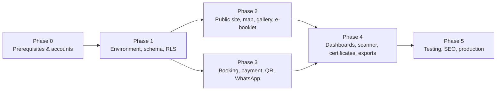

# Work Breakdown Structure & Development Checklist

## Edu Center & Edu Wisata Kelurahan Gisikdrono (Semarang Barat)

| Field | Value |
|---|---|
| Version | 1.0 |
| Date | 2026-10-15 |
| Status | Draft for review |
| Owner | Kelurahan Gisikdrono Edu Center project team |
| Companion documents | `CLAUDE.md` (root), `docs/PRD.md`, `docs/StyleGuide.md`, `docs/Security.md` |

**Contents:** 0 How to use · 1 Phase 0 Prerequisites & accounts · 2 Phase 1 Environment, schema, RLS · 3 Phase 2 Public site, map, gallery, e-booklet · 4 Phase 3 Booking engine, payments, QR & WhatsApp · 5 Phase 4 Dashboards, CRUD, scanner, certificates, exports · 6 Phase 5 Testing, SEO, production deployment · 7 Open decisions · Appendix A Environment variables · Appendix B WhatsApp templates · Appendix C Go-live security checklist · Appendix D Control-ID coverage index

Domain terms used throughout: **RW** (Rukun Warga, a neighbourhood unit inside the kelurahan), **kelurahan** (urban-village administration office), **UMKM** (micro, small and medium enterprises), **PKK** (the family-welfare women's group), **Bank Sampah** (community waste bank), **dolanan** (traditional children's games), **sanggar** (community arts studio), **Ecowastreme** (RW 05's eco-tourism programme brand), **PIC** (person in charge, the booking contact).

## 0. How to use this document

### 0.1 Legend and columns

| Mark | Meaning |
|---|---|
| `[ ]` | To do |
| `[~]` | Partially done (PR open, or merged with a follow-up item) |
| `[x]` | Done: merged to `main`, CI green, definition of done in `CLAUDE.md` §9 satisfied |

Every task row has the columns **ID**, **Status**, **Task**, **Est**, **Dep**, **Owner**.

| Column | Values |
|---|---|
| ID | `P<phase>.<module>.<nn>`, e.g. `P3.7.02` = Phase 3, module 7, item 02. IDs are stable; never renumber, append new items at the end of a module. |
| Est | `S` ≤ 0.5 developer-day, `M` ≤ 2 days, `L` ≤ 5 days. Anything larger is split. |
| Dep | IDs that must be `[x]` before the item starts (`—` = none beyond the phase order). |
| Owner | `Dev` (engineering), `Superadmin` (kelurahan staff operating the dashboard), `Kelurahan` (office decisions, legal, accounts, content), `Vendor` (external provider action: Midtrans, Meta, Resend, Cloudflare, Supabase, Vercel). |

### 0.2 Rules

1. One checklist item = one pull request. Each item names the file, table, route, function or setting it touches; names are canonical and match `docs/PRD.md` §8 (schema), `docs/PRD.md` §5 (routes), `CLAUDE.md` §3 (folders) and `docs/Security.md` §12 (controls matrix). Each module header lists the `docs/PRD.md` §6–§7 requirement IDs (`FR-*`, `NFR-*`) it implements; the PR description cites one of them.
2. Security tasks are embedded in the phase where the code lives and cite control IDs in parentheses, e.g. `(WH-01)`. Appendix D maps every control ID to its tasks; `docs/Security.md` §12 maps the other way.
3. Clean code is a project rule: the gates in P1.1 (ESLint, Prettier, `tsc`, Semgrep, coverage) are set up before any feature code and are required CI checks from the first PR. Function ≤ 40 lines, file ≤ 300 lines, no `any`, no magic values, layering UI → action → service → data-access → DB (`CLAUDE.md` §4).
4. A task is ticked only when its tests exist: migration items need a pgTAP file, pure logic needs Vitest, flows need Playwright (`CLAUDE.md` §9).
5. Phase exit criteria are gates: Phase N+1 code may start on a branch, but nothing from Phase N+1 merges to `main` until Phase N exit criteria are `[x]`.
6. Commit messages follow Conventional Commits and reference the item (`feat(payment): webhook signature pipeline (Task: P3.7.02)`).

### 0.3 Phase order

Phases 2 and 3 can run in parallel after Phase 1; Phase 3 is the critical path.

## 1. Phase 0 — Prerequisites & accounts

Goal: every external account, secret, domain and legal confirmation exists before engineering starts, under institutional ownership with MFA.

### 1.1 P0.1 Platform accounts

Requirements: NFR-01, NFR-08, NFR-10; assumptions A3, A12.

| ID | Status | Task | Est | Dep | Owner |
|---|---|---|---|---|---|
| P0.1.01 | `[ ]` | Create the Supabase organisation under the institutional email with "Require MFA" on; create projects `gisikdrono-prod` and `gisikdrono-staging` (Pro plan, region `ap-southeast-1`); max two named owners; developers as Developer role on prod (A3; STAFF-03, SEC-05) | S | — | Kelurahan |
| P0.1.02 | `[ ]` | On both projects: daily backups on, SSL enforcement on, leaked-password protection on, exposed schemas = `public` only (`graphql_public` removed), network restrictions planned for office IP + migration path (DB-01, DB-03, DB-06, RES-01) | S | P0.1.01 | Dev |
| P0.1.03 | `[ ]` | Vercel Pro team under the institutional account; project linked to the GitHub repo; environments Development / Preview / Production; Deployment Protection (Vercel Authentication) on all previews; Firewall managed rules on; functions region `sin1` (RL-06, RL-07, SEC-05) | S | P0.1.04 | Kelurahan |
| P0.1.04 | `[ ]` | GitHub repository `gisikdrono-edu-wisata` (private) with 2FA required, secret scanning + push protection on, branch protection on `main` (PR required, required checks, no force push, linear history), `CODEOWNERS` (SC-05, SEC-03) | S | — | Dev |
| P0.1.05 | `[ ]` | Midtrans production merchant account held by the designated legal entity (A12): owner login = kelurahan head official email + 2FA, named operator sub-accounts with least privilege, Server Key regeneration and payout-account change only by the owner with a written record; sandbox merchant for staging/local; record `MIDTRANS_MERCHANT_ID` (PAY-16, PAY-02; `docs/Security.md` §3.9) | M | P0.4.02 | Kelurahan |
| P0.1.06 | `[ ]` | Midtrans Dashboard → Settings → Configuration: Payment Notification URL per environment `https://<domain>/api/webhooks/midtrans/<MIDTRANS_WEBHOOK_PATH_TOKEN>` (prod) and `https://staging.<domain>/api/webhooks/midtrans/<token>` (sandbox); payment methods limited to QRIS + Virtual Account, cards never enabled (PAY-02, PAY-06, WH-04) | S | P0.1.05, P0.2.01, P0.3.02 | Dev |
| P0.1.07 | `[ ]` | Meta Business Manager verified; WhatsApp Business Account; kelurahan-owned SIM registered on the Cloud API (`WHATSAPP_PHONE_NUMBER_ID`, `WHATSAPP_BUSINESS_ACCOUNT_ID`); System User with only `whatsapp_business_messaging` and a permanent token; app secret; 2FA on every Meta login (SEC-05, EP-01) | M | — | Kelurahan |
| P0.1.08 | `[ ]` | Submit the 14 WhatsApp templates of Appendix B (`gsk_otp_v1` AUTHENTICATION, the rest UTILITY, language `id`) for approval; track status per template in `docs/notifications.md` | M | P0.1.07 | Vendor |
| P0.1.09 | `[ ]` | Resend account under the institutional email; sending domain `mail.<domain>` verified; SPF, DKIM and DMARC `p=reject` with `rua` on the root and sending domains; `EMAIL_FROM` and `RESEND_API_KEY` per environment (A11; EP-03; `docs/Security.md` §10.2) | S | P0.2.01 | Dev |
| P0.1.10 | `[ ]` | Cloudflare account: Turnstile site in managed mode for public forms (`NEXT_PUBLIC_TURNSTILE_SITE_KEY`, `TURNSTILE_SECRET_KEY`) and a second widget for Supabase Auth captcha (RL-04, AUTH-06) | S | — | Dev |
| P0.1.11 | `[ ]` | Sentry project for `@sentry/nextjs` (`NEXT_PUBLIC_SENTRY_DSN`, `SENTRY_AUTH_TOKEN` for CI), `sendDefaultPii: false`, tunnel route `/monitoring` (MON-05, OPS-01) | S | — | Dev |
| P0.1.12 | `[ ]` | Uptime monitor (Better Stack or UptimeRobot) on `GET /api/health` every 5 minutes expecting HTTP 200, alerting by email and a Telegram bot channel owned by the kelurahan (OPS-03) | S | P0.2.01 | Dev |
| P0.1.13 | `[ ]` | Cloudflare R2 bucket for weekly encrypted database dumps; `R2_*` and `BACKUP_AGE_PUBLIC_KEY` as GitHub Actions secrets; `age` private key in the vault (RES-01, DB-07) | S | P0.3.01 | Dev |

### 1.2 P0.2 Domain & DNS

Requirements: NFR-03; assumption A11.

| ID | Status | Task | Est | Dep | Owner |
|---|---|---|---|---|---|
| P0.2.01 | `[ ]` | Register the project domain (A11, default own domain such as `eduwisatagisikdrono.id`); DNS zone under the institutional account; apex + `www` → Vercel, `staging.<domain>` → Vercel preview alias; `mail.<domain>` reserved for Resend | S | P0.4.02 | Kelurahan |
| P0.2.02 | `[ ]` | HSTS `preload` directive and preload-list submission scheduled for P5.7.04, only after the domain decision is final (HDR-02) | S | P0.2.01 | Dev |

### 1.3 P0.3 Secrets & identities

Requirements: NFR-01 (SEC family).

| ID | Status | Task | Est | Dep | Owner |
|---|---|---|---|---|---|
| P0.3.01 | `[ ]` | Bitwarden organisation vault with one collection per provider (Supabase, Vercel, GitHub, Midtrans, Meta, Resend, Cloudflare, Sentry, R2): owner credentials, recovery codes, database password; named members only; quarterly access-review entry in the kelurahan calendar (SEC-05, STAFF-03) | S | — | Kelurahan |
| P0.3.02 | `[ ]` | Generate with `openssl rand`: `MIDTRANS_WEBHOOK_PATH_TOKEN` (32 bytes URL-safe), `QR_SIGNING_KEYS` as JSON `{"k1":"<base64 32 bytes>"}` with `QR_SIGNING_ACTIVE_KID=k1`, `BOOKING_LINK_SECRET`, `OTP_PEPPER`, `CRON_SECRET`, `WHATSAPP_VERIFY_TOKEN`; separate values per environment; stored in Vercel as Sensitive and in the vault; never pasted into issues or chat (SEC-01, SEC-04) | S | P0.3.01 | Dev |
| P0.3.03 | `[ ]` | Store in Supabase Vault on both projects: `CRON_SECRET` as `cron_secret` for `pg_net` job calls, and `OTP_PEPPER` as `otp_pepper` for the keyed HMAC of `login_attempts.email_hash` and `security_events.ip_hash` computed inside the Auth hook and `internal.*` (EP-02; `docs/Security.md` §5.5, §7.4) | S | P0.3.02 | Dev |

### 1.4 P0.4 Legal and policy confirmations

Requirements: NFR-09; assumptions A4, A5, A7, A9, A10, A11, A12.

| ID | Status | Task | Est | Dep | Owner |
|---|---|---|---|---|---|
| P0.4.01 | `[ ]` | A10 data residency: written confirmation from the kelurahan and Diskominfo that Supabase + Vercel in Singapore is acceptable (platform operated as a private-scope PSE via Pokdarwis/BUMKel, or with Diskominfo approval); if PP 71/2019 public-scope rules apply, hosting region changes before Phase 1 (launch blocker) | M | — | Kelurahan |
| P0.4.02 | `[ ]` | A11 domain ownership and A12 Midtrans merchant legal entity + settlement bank account confirmed in writing; masked account recorded later in `site_settings.finance.expected_payout_account_masked` (REC-02) | S | — | Kelurahan |
| P0.4.03 | `[ ]` | Name the Pejabat Pelindungan Data (data-protection contact) and create mailboxes `privasi@<domain>` and `keamanan@<domain>`; set `SECURITY_ALERT_EMAIL` and `SECURITY_ALERT_WA_PHONE` (PDP-02) | S | P0.2.01 | Kelurahan |
| P0.4.04 | `[ ]` | Confirm at least two named superadmin officers (dual control for adjustments, MFA recovery) or formally accept the single-superadmin compensating control (24 h delay + email to the kelurahan head) (REC-09) | S | — | Kelurahan |
| P0.4.05 | `[ ]` | Confirm defaults that feed the seed: revenue-share splits A4, hold TTLs A5, retention A7, manual-payment policy A9, refund policy wording for `/privasi` and the ticket PDF | S | — | Kelurahan |

### 1.5 Phase 0 exit criteria

- [ ] Every account in P0.1 exists under an institutional login with MFA, and its recovery codes are in the vault (P0.3.01).
- [ ] All secrets of Appendix A marked S exist for Preview and Production in Vercel (Sensitive) and in Supabase Vault where required.
- [ ] A10 confirmation is on file; A11 domain resolves to Vercel; A12 Midtrans merchant exists with the notification URL set for staging.
- [ ] The 14 WhatsApp templates are submitted (approval may complete during Phase 3).

## 2. Phase 1 — Environment setup, DB schema, Supabase RLS & role policies

Goal: a repository with all quality gates, the complete schema (migrations `0001_extensions` … `0008_seed`), the `internal` schema with primitives, RLS on every table, storage buckets, Auth hooks and settings, pg_cron jobs, seed data and a pgTAP suite that fails CI on any isolation regression.

### 2.1 P1.1 Repository scaffold, clean-code and quality gates

Requirements: NFR-01, NFR-07, NFR-11.

| ID | Status | Task | Est | Dep | Owner |
|---|---|---|---|---|---|
| P1.1.01 | `[x]` | Scaffold Next.js 15 App Router + React 19 + TypeScript 5 (`strict`, `noUncheckedIndexedAccess`), path alias `@/* → src/*`, Node 22 LTS (`.nvmrc`), pnpm 10 (`packageManager`); create the folder skeleton of `CLAUDE.md` §3 (`src/app`, `src/components`, `src/lib`, `src/server/{actions,services,auth}`, `src/db`, `src/types`, `src/hooks`, `src/config`, `src/styles`, `supabase/{migrations,tests}`, `public/{icons,map,fonts,og}`, `scripts`, `tests/{integration,e2e,fixtures}`, `docs`) | S | P0.1.04 | Dev |
| P1.1.02 | `[~]` | `.npmrc`: `ignore-scripts=true`; `pnpm-workspace.yaml`: `onlyBuiltDependencies: [sharp]`, `minimumReleaseAge: 10080` (7 days in minutes); commit `pnpm-lock.yaml`; CI installs with `--frozen-lockfile` (SC-01, APP-03) | S | P1.1.01 | Dev |
| P1.1.03 | `[x]` | Tailwind CSS v4 + shadcn/ui `new-york` (`components.json`), `src/styles/globals.css` with the `@theme inline` block (token values filled in P2.1.01) | S | P1.1.01 | Dev |
| P1.1.04 | `[x]` | ESLint flat config: `next/core-web-vitals`, `typescript-eslint` strict-type-checked, `import/order`, `react/no-danger: error`, `@typescript-eslint/no-explicit-any: error`, `no-console` outside `src/lib/logger.ts`, `no-restricted-syntax` on `process.env` outside `src/lib/env.ts`, `no-restricted-imports` for `@/lib/supabase/admin` with allow-list `src/app/api/webhooks/**`, `src/app/api/jobs/**`, `src/server/services/{booking,payment,ticket,notification,document,export,staff}-service.ts`, and for `createBrowserClient` under `src/app/(admin)/**` (STAFF-04, AZ-06, SEC-02, AUTH-05, APP-11) | M | P1.1.01 | Dev |
| P1.1.05 | `[x]` | Prettier + `prettier-plugin-tailwindcss`; Husky + lint-staged (eslint, prettier, `gitleaks protect --staged`) and commitlint with Conventional Commits scopes `booking, payment, qr, scanner, admin, public, db, rls, notify, pdf, seo, infra, docs, deps` (SEC-03) | S | P1.1.04 | Dev |
| P1.1.06 | `[x]` | Clean-code enforcement: ESLint `max-lines` 300, `max-lines-per-function` 40, `complexity` 10, `@typescript-eslint/naming-convention` (kebab-case files, PascalCase components, `use-*` hooks), `no-magic-numbers` with constants in `src/config` and enums in `src/db/enums.ts`; PR template with the definition-of-done checklist of `CLAUDE.md` §9 | S | P1.1.04 | Dev |
| P1.1.07 | `[x]` | `package.json` scripts exactly as the `CLAUDE.md` §10.1 command library: `dev build start lint lint:fix format format:check typecheck test test:watch test:integration test:rls e2e e2e:ui check db:start db:stop db:status db:reset db:migrate:new db:diff db:push db:types db:types:check db:seed db:test midtrans:simulate midtrans:status tunnel wa:send-test email:preview check:secrets analyze` | S | P1.1.01 | Dev |
| P1.1.08 | `[x]` | `src/lib/env.ts` with `@t3-oss/env-nextjs`: server and client schemas for every variable of Appendix A; fail-fast refinements `VERCEL_ENV=production ⇔ MIDTRANS_IS_PRODUCTION=true ⇔ MIDTRANS_SERVER_KEY startsWith Mid-server- and MIDTRANS_CLIENT_KEY startsWith Mid-client-`, otherwise `SB-` prefixes; client schema rejects any `NEXT_PUBLIC_` name containing `SECRET`, `KEY` or `TOKEN` except the known public keys; `.env.example` with placeholders only; env-matrix unit tests (PAY-01, PAY-02, SEC-01) | M | P1.1.01 | Dev |
| P1.1.09 | `[x]` | `src/lib/logger.ts`: pino JSON with `requestId` (`x-vercel-id` or `randomUUID`), closed event taxonomy, concrete redaction paths `booking.pic_phone`, `booking.pic_email`, `booking.pic_name`, `customer_details.*`, `participants[*].full_name`, `req.headers.authorization`, `req.headers.cookie`, `*.token`, `*.signature_key`, `*.snap_token`; custom ESLint rule banning `logger.*` calls with whole `bookings` or `booking_participants` objects; redactor unit test with a real booking fixture (MON-01, DATA-05, DATA-13, OPS-01) | M | P1.1.04 | Dev |
| P1.1.10 | `[x]` | Supabase clients `src/lib/supabase/{server.ts,client.ts,admin.ts}` and `src/middleware.ts` session refresh with `@supabase/ssr` and `auth.getUser()`; `admin.ts` starts with `import 'server-only'`, applies `experimental_taintUniqueValue` to `SUPABASE_SERVICE_ROLE_KEY` and `CRON_SECRET`, `persistSession: false`; every importer carries a header comment stating why RLS cannot apply (AZ-06, SEC-02, AUTH-05) | S | P1.1.08 | Dev |
| P1.1.11 | `[x]` | `next.config.ts` hardening: `poweredByHeader: false`, `productionBrowserSourceMaps: false`, `images.remotePatterns` pinned to `https://<ref>.supabase.co/storage/v1/object/public/public-media/**`, `experimental.serverActions.bodySizeLimit: '512kb'`, `serverActions.allowedOrigins` empty, `experimental.taint: true`, `outputFileTracingIncludes` for `src/lib/pdf/fonts/**`, static `headers()`: HSTS `max-age=63072000; includeSubDomains`, `X-Content-Type-Options: nosniff`, `X-Frame-Options: DENY`, `Referrer-Policy: strict-origin-when-cross-origin`, COOP/CORP `same-origin`, `X-DNS-Prefetch-Control: off`; `Cache-Control: private, no-store` and `X-Robots-Tag: noindex, nofollow` on `/dashboard/*`, `/reservasi/*`, `/api/*` and all non-production deployments (HDR-02, HDR-03, APP-01, APP-02, APP-12, APP-14, RL-05) | M | P1.1.01 | Dev |
| P1.1.12 | `[x]` | `src/middleware.ts` CSP: per-request nonce (`x-nonce`), `script-src 'self' 'nonce-…' 'strict-dynamic' 'wasm-unsafe-eval' https://challenges.cloudflare.com`, `img-src`/`connect-src` limited to the Supabase host, Turnstile and OSM tiles, `frame-src` Turnstile + Google Maps embed, `frame-ancestors 'none'`, `object-src 'none'`; no Midtrans origins (redirect mode); `Permissions-Policy: camera=()` globally and `camera=(self)` only on `/dashboard/scanner`; `Content-Security-Policy-Report-Only` on staging until P5.4.01; `src/lib/utils/safe-redirect.ts` (`^/(?![/\\])`) and `src/lib/utils/escape-like.ts` with unit tests (HDR-01, HDR-03, APP-01, APP-10, APP-13) | M | P1.1.11 | Dev |
| P1.1.13 | `[ ]` | `src/lib/rate-limit.ts` over `internal.rate_limit_hit` (service client): keys normalised with `src/lib/validations/normalize.ts` (email lower-cased, gmail dots and plus-tags stripped; phone E.164 `+62` mobile only); fail-closed for login, password reset, scanner, exports and link minting; fail-open only for booking creation with Turnstile still mandatory; `site_settings.rate_limit_profile` `normal` or `strict` doubles strictness (RL-01, BOOK-04, BOOK-11, BOOK-16) | M | P1.3.17 | Dev |
| P1.1.14 | `[~]` | `src/server/auth/guards.ts`: `requireUser()`, `requireRole('superadmin')`, `requireRwAccess(rwId)`, `requireAal2()`, `requireFreshTotp(300)`, `requireGuestToken(scope)` (body in P3.3.02); `src/types/action-result.ts` with `ActionResult<T>` and `ActionErrorCode` (`UNAUTHENTICATED, FORBIDDEN, VALIDATION, NOT_FOUND, CONFLICT, QUOTA_EXCEEDED, STATE_INVALID, PRICE_MISMATCH, RATE_LIMITED, PAYMENT, INTERNAL`); `src/lib/errors.ts` `mapError()` (`23505 → CONFLICT`, `P0001` hints, zod → `VALIDATION`); `src/lib/copy/id.ts` Indonesian messages keyed by code (APP-02, APP-05) | M | P1.1.10 | Dev |
| P1.1.15 | `[x]` | Semgrep `.semgrep/rules.yml`: rulesets `p/nextjs p/typescript p/react p/owasp-top-ten p/secrets` plus custom rules: `dangerouslySetInnerHTML` anywhere; `@/lib/supabase/admin` import outside the allow-list; `fetch(` outside `src/lib/{midtrans,notifications,email,turnstile}`; `.or(` or `.filter(` with a non-literal argument; Server Action file without `requireUser|requireRole|requireRwAccess|requireGuestToken|verifyTurnstile`; object spread into `.insert(`/`.update(` (SC-03, APP-09, APP-10, APP-14) | M | P1.1.04 | Dev |
| P1.1.16 | `[~]` | GitHub Actions `.github/workflows/ci.yml` jobs: `check` (lint, typecheck, unit, `db:types:check`, `check:secrets`), `db` (`supabase start`, migrations, pgTAP, integration), `e2e` (PRs touching booking/payment/scanner), `security` (semgrep, gitleaks, `pnpm audit --prod --audit-level=high`); all required on `main`; `backup.yml` weekly; `renovate.json` weekly grouped minor/patch, `minimumReleaseAge: '7 days'`, majors manual, `vulnerabilityAlerts` on (SC-01, SC-02, SC-03, SC-04, SC-05, SEC-03, APP-03) | M | P1.1.05 | Dev |
| P1.1.17 | `[x]` | `scripts/check-client-bundle-secrets.mjs` (`pnpm check:secrets`): after `next build`, grep `.next/static/**` for `Mid-server-`, `SB-Mid-server-`, `service_role`, `MIDTRANS_SERVER_KEY`; non-zero exit on any hit (PAY-01, SEC-01) | S | P1.1.08 | Dev |
| P1.1.18 | `[~]` | Vercel project wiring: environment variables per Appendix A, `vercel.json` with `regions: ["sin1"]`; `supabase/config.toml` with local ports, `[auth.hook.custom_access_token]` and `[auth.hook.password_verification_attempt]` enabled; `pnpm db:start` and `pnpm dev` work from a clean clone (documented in `README.md`) | S | P1.1.10 | Dev |

### 2.2 P1.2 Migrations 0001–0003: extensions, enums, tables

Requirements: NFR-02, NFR-09, NFR-12 (`docs/PRD.md` §8.3–§8.4).

| ID | Status | Task | Est | Dep | Owner |
|---|---|---|---|---|---|
| P1.2.01 | `[x]` | `supabase/migrations/0001_extensions.sql`: `pgcrypto, citext, btree_gist, pg_trgm, pg_net` in schema `extensions`, `pg_cron` in `pg_catalog`, `supabase_vault` in `vault`; `create schema internal` with no rights for `public, anon, authenticated`; `alter default privileges for role postgres in schema public revoke all on tables, sequences and execute on functions from anon, authenticated` (Supabase grants all three by default); `alter default privileges for role postgres revoke execute on functions from public` without `in schema`, because a per-schema rule cannot remove Postgres' global default; extensions are created first so their operators stay usable; pgTAP `supabase/tests/schema_extensions.sql` (AZ-02, AZ-11, DB-02, APP-04) | S | P1.1.18 | Dev |
| P1.2.02 | `[x]` | `0002_enums.sql`: all enums with the exact values of `docs/PRD.md` §8.3: `app_role, content_status, session_status, package_category, pricing_basis, product_category, booker_type, booking_channel, booking_status, booking_leg_status (unreserved, reserved, checked_in, released), addon_fulfillment_status, payment_provider, payment_method, payment_status (12 values incl. needs_review, disputed, duplicate), quotation_status, invoice_status, ticket_status (issued, used, suspended, revoked, expired), scan_phase, scan_result (12 values), certificate_kind, certificate_status, review_status, gallery_category, media_type, article_category, booklet_kind, activity_point_type, schedule_type, revenue_rule_scope, revenue_beneficiary, revenue_entry_type, adjustment_type, adjustment_status, notification_channel, notification_status, notification_template (15 values), document_kind, otp_purpose, export_kind, alert_severity`; `src/db/enums.ts` mirrors them | S | P1.2.01 | Dev |
| P1.2.03 | `[x]` | `0003_tables.sql` config group: `rw_units` (`id smallint` 5 and 8, public profile columns, private treasury columns), `profiles` (`role app_role`, `rw_id` required iff `admin_rw`, `is_active`, `mfa_required default true`, `claims_version`, `created_by`), `staff_invites` (`invite_code_hash` unique, sha256 of the code shown once; `role` never `none`; `rw_id` iff `admin_rw`; `expires_at` set by the inviting function to creation + 72 h; `accepted_at`, `accepted_user_id`, `revoked_at`, `created_by`; one open invite per email), `site_settings` (`key`, `value jsonb`, `is_public`) (AUTH-01) | M | P1.2.02 | Dev |
| P1.2.04 | `[x]` | Sessions group: `session_templates` (weekday pattern, unique `(rw_id, weekday, start_time)`), `visit_sessions` (`capacity`, `reserved_pax`, `checked_in_pax`, `status session_status`, CHECK `reserved_pax <= capacity`, unique `(rw_id, session_date, start_time)`, partial index on `status = 'open'`) | S | P1.2.03 | Dev |
| P1.2.05 | `[x]` | Catalogue group: `tour_packages` (CHECK `category = 'combo' ⇔ rw_id IS NULL`, pricing basis CHECK, `valid_from/valid_to`), `tour_package_legs` (unique `(package_id, rw_id)` and `(package_id, leg_order)`), `tour_package_price_tiers` (gist exclusion on overlapping pax ranges), `umkm_vendors` (public columns + private `bank_name, bank_account_number, bank_account_holder`), `products_umkm` (`is_addon_eligible`, `is_featured`, `min_order_qty`, `max_order_qty`), `package_price_history` (append-only: entity, before/after price, actor, changed_at) (REC-10) | M | P1.2.03 | Dev |
| P1.2.06 | `[x]` | Booking group: `bookings` (`booking_code` unique, `rw_ids smallint[]`, `status`, `package_snapshot`, money columns `bigint`, `expires_at` with CHECK `status <> 'pending_payment' OR expires_at IS NOT NULL`, `phone_verified_at`, `email_verified_at`, `consent_version`, `consented_at`, `token_version default 1`, `needs_review`, `review_reason`, `idempotency_key` unique, `admin_notes`, `source_ip`, `user_agent`), `booking_legs` (`status default 'unreserved'`, `visit_session_id`, `pax_count`, `quota_reserved_at`, `quota_released_at`, unique `(booking_id, rw_id)`), `booking_addons` (price snapshot, CHECK `line_total = unit_price * qty`), `booking_participants` (`full_name` 2–120 chars, `group_label`, `role_label` (`student`, `teacher`, `chaperone`, `participant`); no NIK, DOB or address columns), `booking_events` (append-only timeline: `from_status, to_status, actor_type, actor_id, reason, payload`), `guest_otps` (`phone`, `code_hash`, `purpose otp_purpose`, `attempts`, `expires_at`, `consumed_at`); indexes on `expires_at` (partial), `visit_date`, `rw_ids` (gin), `pic_phone`, `pic_email`, `created_at desc`, and trigram search `bookings_search_idx` on `coalesce(institution_name, '') || ' ' || pic_name` as defined in `docs/PRD.md` §8.4.4 (BOOK-05, DATA-01, DATA-03, PDP-01) | M | P1.2.05 | Dev |
| P1.2.07 | `[x]` | Payment group: `payments` (`order_id` unique, `attempt_no`, `provider`, `method`, `status payment_status`, `gross_amount`, `snap_token`, `snap_redirect_url`, `expiry_time`, `provider_txn_id`, `fraud_status`, `manual_proof_path`, `recorded_by`; partial unique index `payments_one_open_per_booking`: one `initiated`, `pending` or `needs_review` payment per booking), `payment_events` (`event_hash` unique, `source`, `payload`, `processed_at`, `processing_result`; only signature-valid events are stored), `webhook_rejections` (`provider`, `reason`, `order_id`, `status_code`, `body_sha256`, `ip`, `user_agent`, `received_at`; no body), `payment_adjustments` (`type adjustment_type`, `status adjustment_status`, `proposed_by`, `approved_by`, `evidence_path`, `reason`, `applied_at`), `reconciliation_runs`, `reconciliation_issues` (PAY-04, WH-05, REC-09) | M | P1.2.06 | Dev |
| P1.2.08 | `[x]` | Documents group: `quotations` (`quotation_number` unique, `version`, `status quotation_status`, `valid_until`, `snapshot`, `pdf_path`), `invoices` (`invoice_number` unique, `receipt_number` unique, `credit_note_number`, `status invoice_status`, `snapshot`; partial unique one live invoice per booking), `document_sequences` (PK `(kind, period)`, `last_value`), `certificates` (`certificate_number`, `verify_code` unique, `kind`, `participant_id`, `status`, `pdf_path`; partial unique indexes for group-once and participant-once; created with the tickets group of 0003, following the order of `docs/PRD.md` §8.4.6) (REC-11) | M | P1.2.07 | Dev |
| P1.2.09 | `[x]` | Tickets group: `tickets_qr` (`booking_leg_id` unique, `rw_id`, `visit_session_id`, `ticket_code` unique, `status ticket_status`, `valid_on`, `valid_from`, `valid_until`, `key_id`, `pax_count`, `checked_in_at`, `checked_in_pax`, `unpaid_pax`, `checked_in_by`, `revoked_at`; gate index `(rw_id, valid_on, status)`), `ticket_scans` (`attempt_id uuid unique`, `ticket_id`, `rw_id`, `scanned_by`, `phase scan_phase`, `result scan_result`, `attendee_count`, `raw_payload` first 128 chars, `device_info`, `ip`) (QR-01, QR-02) | S | P1.2.08 | Dev |
| P1.2.10 | `[x]` | Content group: `galleries` (`alt_text NOT NULL`, `width/height`, `blurhash`, `category gallery_category`, `media_type`), `articles` (`slug`, `body_json jsonb` ProseMirror document, `status content_status`, `author_id`, `reviewed_by`, `published_at`, `seo_title`, `seo_description`; no HTML column), `booklets` (`kind booklet_kind`, `pdf_path`, `page_images_prefix`, `page_count`, `download_count`), `hero_banners` (`product_id`, `starts_at/ends_at`, `is_active`), `activity_points` (`point_type`, `map_x`, `map_y`, `svg_hotspot_id`, `lat`, `lng`), `performance_schedules` (`schedule_type`, `starts_at/ends_at`, `recurrence_rule`, `package_id`), `reviews` (`booking_id` unique, `rw_ids`, `rating` 1–5, `body` ≤ 2000, `is_anonymous`, `status review_status`, `is_featured`, `moderation_note`) (APP-11) | M | P1.2.06 | Dev |
| P1.2.11 | `[x]` | Finance group: `revenue_share_rules` (`scope revenue_rule_scope`, `rw_id`, `package_id`, `product_id`, `effective_from`, `effective_to`), `revenue_share_rule_lines` (`beneficiary`, `rw_id`, `vendor_id`, `pct`; the deferred constraint trigger `revenue_rule_sum_guard` (sum = 100.00) comes with the other guard triggers in 0004), `revenue_share_entries` (`id bigint identity` as chain order, `booking_id`, `payment_id`, `entry_type revenue_entry_type`, `beneficiary`, `beneficiary_key`, `amount` signed, `rule_id`, `adjustment_id`, `payout_batch_id`, `prev_hash`, `entry_hash`; unique settlement key), `payout_batches` (`beneficiary_key`, period, `total_amount`, `proof_path`, `created_by`) (REC-05, REC-06, REC-10) | M | P1.2.07 | Dev |
| P1.2.12 | `[ ]` | Ops group: `notifications` (`channel`, `template notification_template`, `recipient`, `params`, `document_path`, `dedupe_key` unique, `status`, `attempts`, `max_attempts default 8`, `next_attempt_at`, `locked_at`, `provider_message_id`, `provider_status`; queue index), `security_events` (append-only; `event_type` CHECK in the 25-value list of `docs/PRD.md` §8.4.9, `severity alert_severity`, `actor_id`, `ip_hash` (keyed HMAC, `docs/Security.md` §7.4), `entity_type`/`entity_id`, `details` without PII), `security_alerts` (`fingerprint`, `severity`, `last_seen_at`, `notified_at`, `acknowledged_by`; one open alert per fingerprint), `exports` (`kind export_kind`, `filters`, `reason`, `row_count`, `watermark`, `storage_path`, `expires_at`), `dsr_requests` (`booking_code`, `request_type`, `verified_at`, `status`, `resolution_note`), `audit_logs` (`id bigint identity`, `actor_id`, `actor_role`, `action`, `entity_type`, `entity_id`, `rw_id`, `before`, `after`, `request_id`, `prev_hash`, `entry_hash`), `login_attempts` (`user_id`, `email_hash` (keyed HMAC of the lower-cased email, `docs/Security.md` §5.5), `ip`, `success`, `reason`, `attempted_at`; the lockout counts recent failures), `rate_limit_buckets` (PK `(key, window_start)`, `count`) (AUTH-08, OPS-02, DATA-06, PDP-03) | M | P1.2.06 | Dev |
| P1.2.13 | `[ ]` | Cross-cutting: `set_updated_at()` trigger on every table with `updated_at`; FK `ON DELETE RESTRICT` on all financial and operational rows; no `DELETE` grant on never-delete tables; archive-by-status for catalogue/content tables (deletion stance `docs/PRD.md` §8.1) | S | P1.2.12 | Dev |
| P1.2.14 | `[ ]` | `pnpm db:types` (`supabase gen types typescript --local > src/db/types.ts`), `src/db/rpc.ts` typed RPC wrappers, `db:types:check` drift gate in CI; `src/db/types.ts` is never hand-edited | S | P1.2.13 | Dev |

### 2.3 P1.3 Migration 0004: helpers, hooks, triggers, primitives, views

Requirements: NFR-01, NFR-02, FR-POST-08, FR-ADMIN-01 (`docs/PRD.md` §8.7).

| ID | Status | Task | Est | Dep | Owner |
|---|---|---|---|---|---|
| P1.3.01 | `[ ]` | `0004_functions.sql` RLS helpers in `public` (SQL, stable): `app_role()`, `app_rw_id()`, `is_superadmin()`, `is_admin_rw()`, `is_staff()`, `owns_rw(rw_id)`, `owns_any_rw(rw_ids)`, `aal2()`, `today_jkt()`; `app_role()` returns `none` and `app_rw_id()` NULL when the JWT `claims_version` differs from `profiles.claims_version` or `is_active = false` (AZ-01, AZ-09, AUTH-07) | M | P1.2.14 | Dev |
| P1.3.02 | `[ ]` | `public.custom_access_token_hook(event jsonb)`: injects `app_role`, `app_rw_id`, `claims_version` from `profiles`; inactive or missing profile → `app_role = 'none'`; grants to `supabase_auth_admin` only, revoked from `public, anon, authenticated`; policy `profiles_auth_admin_read`; enabled in Dashboard → Auth → Hooks on both projects (AZ-01, AUTH-07) | S | P1.3.01 | Dev |
| P1.3.03 | `[ ]` | `public.hook_password_verification_attempt(event jsonb)`: records every attempt in `login_attempts`, progressive delay (1 s, 2 s, 5 s), rejects after 5 failures per user in 15 minutes regardless of IP, writes `login_failed` and `login_locked` to `security_events`, never a hard email lockout beyond the window; granted to `supabase_auth_admin`; enabled on both projects (AUTH-10, AUTH-06, RL-02) | M | P1.3.01 | Dev |
| P1.3.04 | `[ ]` | SECURITY DEFINER template applied to every definer function: owner `postgres`, `set search_path = ''` with fully-qualified names, explicit role check as the first statement, `revoke execute from public, anon, authenticated`; all views `with (security_invoker = true)`; template documented in `CLAUDE.md` §6 (AZ-05, DB-02) | S | P1.3.01 | Dev |
| P1.3.05 | `[ ]` | `profiles` self-escalation lock: `revoke update (role, rw_id, is_active, mfa_required) on public.profiles from authenticated`; trigger `profiles_guard` allows those columns to change only when `current_setting('app.privileged_rpc', true) = 'on'`, never for the caller's own row, and never deactivates or demotes the last active superadmin (AZ-04, AZ-10, APP-08) | S | P1.3.01 | Dev |
| P1.3.06 | `[ ]` | Guard triggers: `rw_units_guard` (treasury and `code/slug/is_active` superadmin-only), `umkm_vendors_bank_guard` (bank columns superadmin-only), `products_umkm_vendor_rw_guard` (`vendor.rw_id = product.rw_id`), `tour_packages_legs_guard` (auto single leg; combo publish needs ≥ 2 distinct RW legs; combo insert/update superadmin-only), `articles_moderation_guard` (admin_rw cannot set `published`; editing a published article resets to `pending_review`), `reviews_moderation_stamp` (REC-14) | M | P1.3.01 | Dev |
| P1.3.07 | `[ ]` | Trigger `visit_sessions_guard`: forbid `DELETE`, `status = 'cancelled'`, and changes to `session_date`, `start_time`, `end_time`, `rw_id` while any `booking_legs` row in (`reserved`, `checked_in`) references the session; `capacity` never below `reserved_pax`; any other change under active bookings writes `session_changed_with_bookings` to `security_events` (REC-15) | S | P1.3.01 | Dev |
| P1.3.08 | `[ ]` | Trigger `bookings_immutable_guard` (`rw_ids`, `package_id`, `booking_code`, `created_at` immutable) and status-write fences on `bookings.status`, `payments.status`, `tickets_qr.status`, `certificates.status`, `visit_sessions.reserved_pax` and `checked_in_pax`: writes allowed only when `current_setting('app.in_rpc', true) = '1'` (set by every transition function) (REC-03, BOOK-14) | S | P1.3.01 | Dev |
| P1.3.09 | `[ ]` | Immutability triggers after settlement: financial columns of `payments`, `bookings`, `booking_addons`, `invoices` frozen once the payment is `settled` unless `current_setting('app.adjustment_id', true)` is set by `apply_adjustment`; `DELETE` on `payments` always raises (REC-03) | S | P1.3.08 | Dev |
| P1.3.10 | `[ ]` | Append-only enforcement (BEFORE UPDATE OR DELETE trigger raising + `revoke update, delete, truncate from anon, authenticated`): `payment_events` (only `processed_at`, `processing_error` updatable), `webhook_rejections`, `revenue_share_entries`, `audit_logs`, `payment_adjustments` once `applied`, `booking_events`, `security_events`, `ticket_scans`, `package_price_history`, `login_attempts` (REC-04, DB-04) | S | P1.3.08 | Dev |
| P1.3.11 | `[ ]` | Trigger `tickets_require_paid_booking` BEFORE INSERT on `tickets_qr` (booking `paid` and a `settled` payment exist) and `tickets_no_revive` (`used → issued` only inside `undo_check_in`; `ticket_code` and `booking_id` immutable) (WH-12, QR-02) | S | P1.3.08 | Dev |
| P1.3.12 | `[ ]` | Price governance triggers: `package_price_history_write` on `tour_packages`, `tour_package_price_tiers`, `products_umkm` price columns (append-only before/after + actor, `price_changed` security event); `pricing_floor_guard` rejects `price_per_pax` or tier prices below `site_settings.pricing.min_price_per_pax` (REC-13) | S | P1.3.10 | Dev |
| P1.3.13 | `[ ]` | `internal.log_audit()` row trigger on `bookings, booking_legs, payments, tickets_qr, certificates, tour_packages, products_umkm, umkm_vendors, visit_sessions, session_templates, profiles, rw_units, revenue_share_rules, revenue_share_rule_lines, revenue_share_entries, payout_batches, site_settings, reviews, articles, hero_banners` with an **allowlist** of columns per table in `before/after` (PII columns never copied); `names_only` mode via `current_setting('app.audit_mode', true)`; `actor_id = coalesce(auth.uid(), current_setting('app.actor_id', true)::uuid)` and the trigger raises when both are NULL; pgTAP asserts `audit_logs` never contains `+62` (AUD-01, AUTH-08, AZ-15, DATA-11) | M | P1.3.10 | Dev |
| P1.3.14 | `[ ]` | Hash chains: `fn_ledger_chain` BEFORE INSERT on `revenue_share_entries` under `pg_advisory_xact_lock`, `fn_audit_chain` on `audit_logs`; `internal.verify_ledger_chain()` and `internal.verify_audit_chain()` return `ok` or the first broken `entry_no` (REC-05, AUD-03) | M | P1.3.13 | Dev |
| P1.3.15 | `[ ]` | Quota primitives: `internal.reserve_session_quota(session_id, pax)` (conditional `UPDATE … WHERE reserved_pax + p_pax <= capacity` under row lock, raises `QUOTA_UNAVAILABLE` with errcode `P0001`), `internal.release_booking_quota(booking_id)` (legs `ORDER BY visit_session_id`, idempotent via `quota_released_at`) (BOOK-01) | S | P1.3.08 | Dev |
| P1.3.16 | `[ ]` | `internal.next_document_number(kind document_kind, at timestamptz)`: `INSERT … ON CONFLICT (kind, period) DO UPDATE … RETURNING` producing `SP/GSK/YYYY/MM/NNNN`, `INV/GSK/YYYY/MM/NNNN`, `KW/GSK/YYYY/MM/NNNN`, `CN/GSK/YYYY/NNNN`, `SERT/GSK/YYYY/NNNNN`; invoice numbers consumed only inside the settlement transaction (REC-11) | S | P1.3.04 | Dev |
| P1.3.17 | `[ ]` | `internal.rate_limit_hit(key text, limit int, window_seconds int) returns boolean` fixed-window counter on `rate_limit_buckets` (RL-01) | S | P1.3.04 | Dev |
| P1.3.18 | `[ ]` | Cron SQL functions: `internal.expire_stale_bookings()` (`expires_at + 5 min < now()`, `FOR UPDATE SKIP LOCKED`, releases quota, expires open payments, enqueues `booking_expired`, writes `booking_events`), `internal.close_past_bookings()` (`checked_in → completed`, `paid → no_show`, past `issued` tickets → `expired`, enqueues `review_invite`), `internal.reconcile_session_counters()` (drift → `audit_logs` action `quota.drift`, corrects only downward), `internal.enqueue_visit_reminders()` (`visit_reminder_d1` for `paid` bookings with `visit_date = today + 1`), `internal.prune_operational_tables()` (BOOK-02, PAY-05, DB-05) | M | P1.3.15 | Dev |
| P1.3.19 | `[ ]` | Retention functions for the 02:00 WIB job (A7): `internal.purge_participants()` (visit + 90 d, also deletes participant-bearing PDFs under `documents/certificates/<booking_id>/` and attendance exports), `internal.anonymise_booker_pii()` (unpaid-expired booking PII after 7 d; booker PII replaced by irreversible hashes after `pii_retention_months` with `token_version` bump), OTP rows > 24 h, `audit_logs` > 24 months, `exports` > 24 h, `uploads-quarantine` objects > 24 h; each run under `app.audit_mode = 'names_only'` and writes a `purge_run` audit row (DATA-02, DATA-08, DATA-11, DATA-12) | M | P1.3.13 | Dev |
| P1.3.20 | `[ ]` | `public.generate_visit_sessions(rw_id, from, to)` (staff in scope or cron; `on conflict do nothing`) and `public.rpc_log_ui_event(event, entity_id)` restricted to a small enum (`pii_revealed`, `scanner_opened`), `actor := auth.uid()`, `details` ≤ 1 KB, 600 calls/hour per user (AUTH-08) | S | P1.3.17 | Dev |
| P1.3.21 | `[ ]` | Staff-management RPCs `public.set_staff_role(user_id, role, rw_id)`, `public.set_staff_status(user_id, is_active, reason)`, `public.reset_staff_mfa(user_id)`: superadmin at AAL2 with a TOTP verified ≤ 5 minutes ago (`amr` timestamp), never the caller's own row, `set_config('app.privileged_rpc', 'on', true)`, bump `claims_version`, delete `auth.sessions` for the user, delete MFA factors, write `role_changed` or `staff_disabled` (AZ-04, AZ-10, AUTH-07, AUTH-12) | M | P1.3.05 | Dev |
| P1.3.22 | `[ ]` | Views (all `security_invoker = true`): `v_session_availability` (open, future, `remaining = capacity - reserved_pax`), `v_public_reviews` (`Pengunjung` when anonymous; no `booking_id`, no moderation columns), `v_bookings_staff` (masked `phone_masked`, `email_masked`, no participants; admin_rw rows limited to `visit_date between today - 7 and today + 30`; superadmin all), `v_booking_admin`, `v_attendance_today`, `v_booking_export`, `v_revenue_recap_daily`, `v_revenue_recap_by_party`, `v_revenue_recap_by_booking` (amounts from the ledger only), `v_finance_daily` (REC-07, STAFF-02, AZ-13) | M | P1.3.14 | Dev |
| P1.3.23 | `[ ]` | `public.rpc_reveal_booking_contact(booking_id, reason)` (one booking's full PIC contact; writes `pii_revealed`; daily cap 50 per user, breach → `security_alerts`) and `public.rpc_get_participants(booking_id)` (scope check, window −7/+30 days, row cap 300, audited) as the only PII paths for admin_rw (DATA-04, AZ-12) | M | P1.3.22 | Dev |
| P1.3.24 | `[ ]` | `internal.increment_booklet_download(p_booklet_id uuid) returns void`: `update public.booklets set download_count = download_count + 1 where id = p_booklet_id and status = 'published'`; service role only (EXECUTE revoked from `public`, `anon`, `authenticated`; no `public.*` counterpart), called by the booklet download route of P2.4.08; pgTAP: `anon` and `authenticated` EXECUTE denied (APP-04, AZ-11) | S | P1.3.04 | Dev |

### 2.4 P1.4 Migration 0005: RLS policies and grants

Requirements: NFR-02 (`docs/PRD.md` §8.5).

| ID | Status | Task | Est | Dep | Owner |
|---|---|---|---|---|---|
| P1.4.01 | `[ ]` | `0005_policies_grants.sql`: `enable row level security` + `force row level security` on all 49 tables (already on since `0003_tables`, where each table is born with RLS; repeating it here is harmless and keeps 0005 self-contained); `revoke all on all tables in schema public from anon, authenticated`; explicit minimal grants per the policy matrix in `docs/PRD.md` §8.5; `internal` schema and `cron`, `vault`, `auth`, `storage` never exposed (AZ-02, AZ-11, APP-04, DB-01) | M | P1.3.23 | Dev |
| P1.4.02 | `[ ]` | `anon` policies: published rows of `tour_packages`, `tour_package_legs`, `tour_package_price_tiers`, `products_umkm`, `galleries`, `articles`, `booklets`, `activity_points`, `performance_schedules`, `hero_banners` (active window), public columns of `umkm_vendors` and `rw_units` (column grants), `site_settings` where `is_public`, views `v_session_availability` and `v_public_reviews`; no `anon` write and no `anon`-executable mutating function (APP-04) | M | P1.4.01 | Dev |
| P1.4.03 | `[ ]` | `admin_rw` policies (`owns_rw(rw_id)` wrapped in `(select …)`): CRUD on `session_templates`, `visit_sessions` (UPDATE column grant excludes `reserved_pax`, `checked_in_pax`), `tour_packages` (read-only for combos with a leg in their RW; combos never insertable), `tour_package_legs`, `tour_package_price_tiers`, `umkm_vendors` (no bank columns), `products_umkm`, `galleries`, `articles` (no `published`), `booklets`, `activity_points`, `performance_schedules`; read own `revenue_share_entries` (own treasury) and `payout_batches` (AZ-03) | M | P1.4.01 | Dev |
| P1.4.04 | `[ ]` | PII tables: **no** direct SELECT for `admin_rw` on `bookings`, `booking_participants`, `payments`, `quotations`, `invoices`, `guest_otps`; staff reads only through `v_bookings_staff`, `rpc_reveal_booking_contact`, `rpc_get_participants`; `booking_addons` read own RW with UPDATE column grant `fulfillment_status`; `tickets_qr`, `ticket_scans`, `certificates`, `notifications` read own RW; `bookings` UPDATE column grant `admin_notes` only (STAFF-02, DATA-04, AZ-03) | M | P1.4.01 | Dev |
| P1.4.05 | `[ ]` | `superadmin` policies on every table plus **restrictive** AAL2 policies (`as restrictive … using ((select public.aal2()))`) on `payments`, `payment_adjustments`, `revenue_share_rules`, `revenue_share_rule_lines`, `revenue_share_entries`, `exports`, `audit_logs`, `site_settings`, `profiles`, `booking_participants`; `audit_logs` readable by superadmin only, never by `admin_rw` (AUTH-03, STAFF-01, APP-06, AUD-02) | M | P1.4.01 | Dev |
| P1.4.06 | `[ ]` | Column-level grants: `profiles` UPDATE `(full_name, phone, avatar_path)` to `authenticated`; `reviews` superadmin UPDATE `(status, is_featured, moderation_note)`; `rw_units` content columns only; `booking_addons (fulfillment_status)`; `bookings (admin_notes)` (APP-08, AZ-04) | S | P1.4.03 | Dev |
| P1.4.07 | `[ ]` | Function grants: `revoke all on all functions in schema public from public, anon, authenticated`; `grant execute to authenticated` only for the 27 staff RPCs of `docs/PRD.md` §8.7.1 (`validate_ticket, check_in_ticket, undo_check_in, mark_booking_paid_manually, cancel_booking, extend_booking_hold, reactivate_booking, record_refund, resolve_booking_review, issue_certificates, revoke_ticket, revoke_certificate, settle_revenue_entries, revenue_recap, visit_stats, generate_visit_sessions, request_notification_resend, rpc_reveal_booking_contact, rpc_get_participants, rpc_create_export, rpc_log_ui_event, propose_adjustment, approve_adjustment, apply_adjustment, set_staff_role, set_staff_status, reset_staff_mfa`); everything in `internal` service-role only (DB-02, AZ-05, AZ-11) | S | P1.4.01 | Dev |
| P1.4.08 | `[ ]` | Policy hygiene lint (pgTAP in P1.9.01): no policy reads `auth.jwt()` directly (helpers only, so `is_active` and `claims_version` apply everywhere); every helper call wrapped in `(select …)`; no policy with `using (true)` for `authenticated` | S | P1.4.07 | Dev |

### 2.5 P1.5 Migration 0006: storage buckets and policies

Requirements: NFR-01, NFR-09 (`docs/PRD.md` §8.8).

| ID | Status | Task | Est | Dep | Owner |
|---|---|---|---|---|---|
| P1.5.01 | `[ ]` | `0006_storage.sql` buckets: `uploads-quarantine` (private, `file_size_limit` 20 MB, `allowed_mime_types` `image/jpeg, image/png, image/webp, application/pdf`), `public-media` (public, 10 MB images, 50 MB PDF), `documents` (private, 20 MB) (UPL-01, AZ-07) | S | P1.4.07 | Dev |
| P1.5.02 | `[ ]` | `public.storage_owner_prefix_ok(name)` and `storage.objects` policies: `anon` read on `public-media`; staff insert/update/delete on `public-media` and `uploads-quarantine` only under `rw-05/` or `rw-08/` matching `app_rw_id()` (superadmin also `kelurahan/`); `documents` has **no** `anon`/`authenticated` policy (server-issued signed URLs only) (UPL-03, UPL-04, DOC-01) | S | P1.5.01 | Dev |
| P1.5.03 | `[ ]` | Signed-URL constants in `src/server/services/document-service.ts`: tickets and certificates 600 s, invoices/quotations/receipts 900 s, exports 300 s, WhatsApp document header 3600 s; URLs minted only after authorisation and never persisted or placed in messages (AZ-07, DOC-01) | S | P1.5.02 | Dev |

### 2.6 P1.6 Migration 0007: pg_cron and pg_net schedules

Requirements: FR-POST-07, FR-POST-08, NFR-10 (`docs/PRD.md` §8.9).

| ID | Status | Task | Est | Dep | Owner |
|---|---|---|---|---|---|
| P1.6.01 | `[ ]` | `0007_cron.sql` SQL jobs (UTC = WIB − 7): `expire_stale_bookings` `*/5 * * * *`; `enqueue_visit_reminders` `0 2 * * *` (09:00 WIB); `close_past_bookings` + `reconcile_session_counters` `30 16 * * *` (23:30 WIB); `generate_visit_sessions` for every active `rw_units` row `0 17 * * *` (00:00 WIB, horizon `booking.max_advance_days`); retention job `0 19 * * *` (02:00 WIB); `prune_operational_tables` `0 18 1 * *`; `rate_limit_buckets` purge hourly (DB-05, BOOK-02, DATA-02) | S | P1.3.19 | Dev |
| P1.6.02 | `[ ]` | `pg_net` HTTP jobs with `Authorization: Bearer` read from `vault.decrypted_secrets` (`cron_secret`): `POST /api/jobs/process-notifications` `* * * * *`; `GET /api/jobs/payments-poll` `*/5 * * * *`; `GET /api/jobs/reconcile-payments` `30 19 * * *` (02:30 WIB); `GET /api/jobs/anomaly-scan` `*/5 * * * *`; base URL per environment from `site_settings` seed (EP-02, WH-13, REC-01, MON-02) | S | P0.3.03, P1.6.01 | Dev |
| P1.6.03 | `[ ]` | pgTAP assertion that `cron.job` contains exactly the jobs above with the expected schedules; `docs/runbooks/cron.md` documents `cron.unschedule` for pausing a job during incidents | S | P1.6.02 | Dev |

### 2.7 P1.7 Supabase Auth settings (staging and production)

Requirements: FR-ADMIN-01, NFR-01.

| ID | Status | Task | Est | Dep | Owner |
|---|---|---|---|---|---|
| P1.7.01 | `[ ]` | Authentication → Providers: "Allow new users to sign up" OFF, email provider only (no OAuth, phone, anonymous or magic link), "Confirm email" ON, "Secure email change" ON (AUTH-01, DB-03) | S | P0.1.01 | Dev |
| P1.7.02 | `[ ]` | Password minimum 12 characters with lower/upper/digit/symbol classes; leaked-password protection ON; email OTP expiry 600 s and length 8; JWT expiry 900 s; refresh-token rotation ON with 10 s reuse interval; time-boxed sessions 12 h; inactivity timeout 2 h; MFA TOTP enabled, phone factor OFF (AUTH-02, AUTH-04, DB-03, STAFF-05) | S | P1.7.01 | Dev |
| P1.7.03 | `[ ]` | Bot and abuse protection = Turnstile with the Auth widget key; sign-in rate limit 10 per 5 minutes per IP; custom SMTP via Resend (`mail.<domain>`); Site URL `https://<domain>`; Redirect URLs allow-list = `https://<domain>/auth/callback` only (AUTH-06, APP-13, RL-02) | S | P0.1.09, P0.1.10 | Dev |
| P1.7.04 | `[ ]` | Enable the `custom_access_token` and `password_verification_attempt` hooks (`pg-functions://postgres/public/custom_access_token_hook`, `…/hook_password_verification_attempt`) on both projects; decode a staging JWT and verify `app_role`, `app_rw_id`, `claims_version`, `aal` (AZ-01) | S | P1.3.03 | Dev |

### 2.8 P1.8 Migration 0008 and development seed

Requirements: NFR-12; assumption A4.

| ID | Status | Task | Est | Dep | Owner |
|---|---|---|---|---|---|
| P1.8.01 | `[ ]` | `0008_seed.sql` reference data for every environment: `rw_units` (`5` RW 05 Ecowastreme, `8` RW 08 Kampung Seni Budaya), `site_settings` defaults (`booking_enabled true`, `whatsapp_enabled`, `email_enabled`, `maintenance_mode false`, `rate_limit_profile normal`, `checkin.grace_before_minutes 60`, `checkin.grace_after_minutes 120`, `booking.hold_minutes_individual 120`, `booking.hold_hours_institution 24`, `booking.quotation_valid_days 14`, `booking.min_lead_hours 12`, `booking.max_advance_days 180`, `booking.max_pax 500`, `pricing.min_price_per_pax`, `pii_retention_months 24`, `finance.expected_payout_account_masked`, public contact and SEO keys), default `revenue_share_rules` + lines per A4 (package kelurahan 20 / RW treasury 80; add-on vendor 90 / RW treasury 10; combo kelurahan 20 / RW 05 40 / RW 08 40) | S | P1.6.03, P0.4.05 | Dev |
| P1.8.02 | `[ ]` | `supabase/seed.sql` + `scripts/seed-dev.ts` (`pnpm db:seed`, refuses to run unless the Supabase URL is `127.0.0.1`): local staff users superadmin, admin_rw 05, admin_rw 08 (profiles with `claims_version 1`), sample `session_templates`, demo packages, products, galleries, articles, booklets; `pnpm db:reset` = drop + migrate + seed + `db:types` | S | P1.8.01 | Dev |

### 2.9 P1.9 pgTAP suites (`supabase/tests/`)

Requirements: NFR-02.

| ID | Status | Task | Est | Dep | Owner |
|---|---|---|---|---|---|
| P1.9.01 | `[ ]` | `rls_enumeration.sql`: zero tables in `public` without `rowsecurity`; no function in exposed schemas executable by `anon`/`authenticated` outside the P1.4.07 allow-list; every `prosecdef` function has `search_path` in `proconfig`; every `public` view is `security_invoker`; no policy references `user_metadata`; script compares `create table` names with test files and fails CI on a missing test (AZ-02, AZ-05, AZ-08, AZ-11, SC-04) | M | P1.8.02 | Dev |
| P1.9.02 | `[ ]` | `rls_matrix_<group>.sql` per table group with claim fixtures `anon`, `admin_rw 05`, `admin_rw 08`, `superadmin aal1`, `superadmin aal2`, `none`: row counts and write outcomes per the matrix; admin_rw 05 sees zero RW 08 rows across all RW-scoped tables; combo packages read-only; `none` sees nothing; AAL1 superadmin gets zero rows from `payments`, `booking_participants`, `audit_logs` (AZ-03, AZ-08, AUTH-03) | L | P1.9.01 | Dev |
| P1.9.03 | `[ ]` | `triggers.sql`: append-only raises on UPDATE/DELETE; settled-column immutability; `tickets_require_paid_booking` raises for an unpaid booking; `tickets_no_revive`; `profiles_guard` raises 42501 for `admin_rw` self-update and for `set role service_role` without `app.privileged_rpc`; `visit_sessions_guard`; `pricing_floor_guard`; `log_audit` diff never contains `+62`; service-role write without `app.actor_id` rejected (REC-03, REC-04, WH-12, AZ-04, AZ-15, AUTH-08) | M | P1.9.01 | Dev |
| P1.9.04 | `[ ]` | `quota.sql` + `tests/integration/quota.test.ts`: 50 parallel `reserve_session_quota` calls at capacity 10 leave exactly `reserved_pax = 10`; combo reservation is both-or-nothing; `release_booking_quota` idempotent; `expire_stale_bookings` restores capacity after grace (BOOK-01, BOOK-02) | M | P1.9.01 | Dev |
| P1.9.05 | `[ ]` | `numbering_chain.sql`: `next_document_number` consecutive under two concurrent sessions and gapless after rollback; `verify_ledger_chain()` reports the tampered `entry_no` after an owner-level `UPDATE`; `verify_audit_chain()` likewise (REC-05, REC-11) | S | P1.9.01 | Dev |
| P1.9.06 | `[ ]` | `retention.sql` + `storage.sql`: backdated rows are purged/anonymised by each retention function and the `purge_run` row exists; `cron.job` list; storage policy denies `admin_rw 05` insert under `rw-08/`, denies any `authenticated` read on `documents` (DATA-02, UPL-04) | S | P1.9.01 | Dev |
| P1.9.07 | `[ ]` | Vitest HTTP suite `tests/integration/rls-http.test.ts` (`pnpm test:rls`): four JWTs minted with the local `SUPABASE_JWT_SECRET` (anon, admin_rw 05, admin_rw 08, superadmin) against PostgREST and Storage, including a `../` path-traversal signed-URL attempt, a fresh `authenticated` user without a profile seeing zero rows, and `updateUser({ data: { role: 'superadmin' } })` granting nothing (AZ-08, APP-07, AZ-07) | M | P1.9.02 | Dev |

### 2.10 Phase 1 exit criteria

- [ ] `pnpm check` and the `db` and `security` CI jobs are required checks on `main` and pass on a clean clone (`pnpm db:reset && pnpm db:test && pnpm test:rls`).
- [ ] Migrations `0001`–`0008` apply on local, `gisikdrono-staging` and (dry-run) `gisikdrono-prod`; `supabase db diff` is empty; `src/db/types.ts` matches.
- [ ] pgTAP enumeration proves: every table has forced RLS, no function is exposed beyond the allow-list, every view is `security_invoker`, every definer function pins `search_path`.
- [ ] A decoded staging JWT carries `app_role`, `app_rw_id`, `claims_version`; a deactivated test user loses access within one token refresh; the Auth lockout hook rejects the sixth failed login.
- [ ] All pg_cron and pg_net jobs appear in `cron.job` on staging and `/api/jobs/*` return 401 without the bearer.
- [ ] Supabase Security Advisor shows zero errors on staging.

## 3. Phase 2 — Landing page, RW 05 & RW 08 sub-pages, interactive map, gallery, e-booklet

Goal: the complete public site (Indonesian UI, `lang="id"`) on ISR with tag revalidation, SEO/JSON-LD, the image pipeline, the interactive map and flipbook, and the content CMS that RW officers use to fill it. Visual rules come from `docs/StyleGuide.md`; nothing in this phase touches money.

### 3.1 P2.1 Design tokens, typography and base components

Requirements: NFR-04, NFR-06, NFR-11 (`docs/StyleGuide.md` §2–§5).

| ID | Status | Task | Est | Dep | Owner |
|---|---|---|---|---|---|
| P2.1.01 | `[ ]` | `src/styles/globals.css`: light/dark HSL variables exactly as `docs/StyleGuide.md` §2 (`--primary` #2563EB in both modes, `--background` #FFFFFF / #09090B, `--foreground` #0F172A / #F8FAFC, `--secondary`/`--accent` #EFF6FF / #1E293B, `--muted-foreground` #71717A / #94A3B8, `--border` #E2E8F0 / #1E293B, `--ring` #2563EB / #3B82F6, `--destructive` #DC2626 / #EF4444, `--chart-1..5`, `--sidebar-*`, `--brand-deep` #0F172A, `--brand-royal` #1E40AF, `--brand-ice` #EFF6FF, semantic `success` #16A34A / `warning` #D97706 / `info` #0284C7 / `danger` / `neutral` #71717A each with `-foreground` and `-soft`, `--radius 0.75rem`) exposed through `@theme inline`; shadows `shadow-card`, `shadow-card-hover`, `shadow-modal` | M | P1.1.03 | Dev |
| P2.1.02 | `[ ]` | `src/config/fonts.ts`: `next/font` Plus Jakarta Sans (600/700/800) as `--font-display` and Inter (400/500/600) as `--font-sans`, `display: swap`, `tabular-nums`; type scale utilities `display-xl, display-lg, h1–h4, body-lg, body, body-sm, caption, overline`; `@tailwindcss/typography` `prose-slate` for articles | S | P2.1.01 | Dev |
| P2.1.03 | `[ ]` | shadcn primitives in `src/components/ui` (`pnpm shadcn add …`): button (variants `default, secondary, outline, ghost, link, destructive, success`; sizes `sm, default, lg, xl, icon`; `loading` prop with `aria-busy`), card (`base, interactive, glass, feature`), dialog + drawer composed as `ResponsiveDialog`, alert-dialog, badge (semantic variants, `rounded-full`), tabs (underline public, pill admin), input, select, textarea, checkbox, form, calendar, popover, sheet, table, skeleton, tooltip, dropdown-menu, command, carousel (embla), sonner toaster | M | P2.1.02 | Dev |
| P2.1.04 | `[ ]` | `src/components/providers/{theme-provider,motion-provider}.tsx`: `next-themes` (`attribute="class"`, public default `light`, admin default `system`), `MotionConfig reducedMotion="user"` + `LazyMotion` (`m.*` only); `src/lib/motion/{variants,transitions}.ts` with `fadeIn, fadeInUp, fadeInDown, scaleIn, slideInRight, staggerContainer`, durations 150/200/300/500/700 ms, `easeOutExpo [0.16,1,0.3,1]`, `easeInOut [0.65,0,0.35,1]`, springs soft (300/30) and snappy (400/25), stagger 0.06 s / delay 0.1 s / cap 8; ESLint rule banning `m.*` inside `data-table`, `forms`, `sidebar`, `charts` | S | P2.1.03 | Dev |
| P2.1.05 | `[ ]` | Form components `src/components/forms/{phone-input,money-input,number-stepper,date-picker,session-picker,participants-editor,image-uploader,slug-input,form-field}.tsx` (react-hook-form + zod, `id` locale, Asia/Jakarta via `@date-fns/tz`, 44 px touch targets) and utilities `src/lib/utils/{cn,currency,dates,slugify,phone,codes}.ts` with Vitest for `currency` (`Rp 25.000`), `dates`, `phone`, `slugify` | M | P2.1.03 | Dev |

### 3.2 P2.2 Layout shell and site configuration

Requirements: FR-PUB-18, FR-PUB-22, NFR-03.

| ID | Status | Task | Est | Dep | Owner |
|---|---|---|---|---|---|
| P2.2.01 | `[ ]` | `src/app/layout.tsx` (`<html lang="id">`, fonts, providers, `Toaster`, CSP nonce passed to `next/script`, `Organization` JSON-LD), `not-found.tsx`, `error.tsx`, `global-error.tsx` with generic Indonesian copy and an error id, no stack traces (HDR-01) | S | P2.1.04 | Dev |
| P2.2.02 | `[ ]` | `src/components/layout/{site-header,site-footer,container,section,whatsapp-fab,page-header}.tsx`; `src/config/site.ts` (name, `NEXT_PUBLIC_SITE_URL`, `NEXT_PUBLIC_WHATSAPP_CONTACT_NUMBER`, template-name map), `src/config/rw.ts` (RW 05 / RW 08 metadata, slugs), `src/config/nav.ts` public navigation; `WhatsAppFab` hidden on `/pesan/*`, `/reservasi/*`, `/dashboard/*` | S | P2.2.01 | Dev |
| P2.2.03 | `[ ]` | `(public)/layout.tsx` with header, footer, FAB, skip link and `BreadcrumbList` JSON-LD; `src/components/seo/json-ld.tsx` + `src/lib/seo/{metadata,json-ld}.ts` (`schema-dts` builders for `GovernmentOrganization, WebSite, TouristAttraction, Event, Product, Offer, Article, Review, AggregateRating, BreadcrumbList, ImageGallery, DigitalDocument`; `</` escaped in output); `metadataBase` and title template `%s | Edu Wisata Gisikdrono` | S | P2.2.02 | Dev |

### 3.3 P2.3 Public data access and image pipeline

Requirements: FR-PUB-22, NFR-05.

| ID | Status | Task | Est | Dep | Owner |
|---|---|---|---|---|---|
| P2.3.01 | `[ ]` | `src/lib/queries/tags.ts` registry exactly: `packages:<rw or combo>`, `sessions:<rwId>:<YYYY-MM>`, `products:<rwId>`, `galleries:<rwId>`, `articles`, `banners`, `booklets`, `schedules`, `reviews`, `settings`, `booking:<id>`; every public query and every revalidating action imports constants from this file | S | P1.2.14 | Dev |
| P2.3.02 | `[ ]` | `src/lib/queries/{rw-units,packages,products,vendors,articles,galleries,booklets,schedules,activity-points,banners,reviews,sessions,settings}.ts`: anon client inside `unstable_cache` with the registry tags and `revalidate: 3600`; functions return narrowed DTOs from `src/types` (never raw rows); `sessions.ts` reads `v_session_availability` uncached | M | P2.3.01 | Dev |
| P2.3.03 | `[ ]` | `src/lib/images/supabase-loader.ts` (`/storage/v1/render/image/public/public-media/<path>?width=&quality=`) and `blur.ts`; `next/image` with mandatory `sizes`, hero `priority`, explicit `aspect-ratio`; widths 480 thumbs, 640 cards, 1280 hero | S | P2.3.02 | Dev |

### 3.4 P2.4 Public routes (ISR 3600 unless stated)

Requirements: FR-PUB-01, FR-PUB-02, FR-PUB-04 … FR-PUB-19, FR-PUB-22, FR-PUB-23.

| ID | Status | Task | Est | Dep | Owner |
|---|---|---|---|---|---|
| P2.4.01 | `[ ]` | `/` home: `src/components/marketing/{hero,rw-highlight,featured-packages,testimonials,latest-articles,booklet-cta,cta-band}.tsx`; hero with overline, `display-xl` H1 (no opacity animation on the LCP element), CTA pair `Pesan Kunjungan` + `Lihat Paket`, trust row, featured UMKM product carousel from `hero_banners` + `products_umkm.is_featured`; map teaser; testimonials from `v_public_reviews`; `loading.tsx`; JSON-LD `WebSite` + two `TouristAttraction` | L | P2.3.03 | Dev |
| P2.4.02 | `[ ]` | `/rw-05-ecowastreme`: profile and vision from `rw_units`, activity points (`bank_sampah, composter, maggot, urban_farming, pkk_craft`), masonry gallery, UMKM marketplace grid, RW 05 packages; `TouristAttraction` with `containedInPlace` | M | P2.4.01 | Dev |
| P2.4.03 | `[ ]` | `/rw-08-kampung-seni-budaya`: profile, performance schedule preview from `performance_schedules`, `sanggar`, `culture_house`, `stage`, `dolanan_area` points, gallery, souvenirs, RW 08 packages | M | P2.4.01 | Dev |
| P2.4.04 | `[ ]` | `/rw-08-kampung-seni-budaya/jadwal`: full schedule with `recurrence_rule` expansion (`rrule`), ISR 1800, tag `schedules`, `Event[]` JSON-LD | S | P2.4.03 | Dev |
| P2.4.05 | `[ ]` | `/paket-wisata` with `nuqs` filters `?rw=05 or 08 or combo` and `?type=regular, student, institutional, combo` (filtered in memory on the cached list), `ItemList` JSON-LD; `/paket-wisata/[slug]` with `generateStaticParams`, `src/components/packages/{package-card,package-grid,package-filters,availability-preview}.tsx` (14-day availability island, client fetch, uncached), `Product` + `Offer` (IDR), sticky mobile CTA to `/pesan/[packageSlug]`, `opengraph-image.tsx` | M | P2.3.03 | Dev |
| P2.4.06 | `[ ]` | `/produk` (`?rw=&category=`) and `/produk/[slug]` with `src/components/products/{product-card,product-grid}.tsx`, vendor public info, `Product` JSON-LD with `brand` = UMKM name, OG image | M | P2.3.03 | Dev |
| P2.4.07 | `[ ]` | `/galeri` integrated gallery with `?filter=rw05, rw08, umkm, kunjungan` mapped to `rw_id` / `category`; `ImageGallery` JSON-LD | S | P2.6.01 | Dev |
| P2.4.08 | `[ ]` | `/e-booklet` list and `/e-booklet/[slug]` flipbook page (ISR 86400, tag `booklets`, `DigitalDocument`); "Unduh PDF" goes through the server route `GET /api/documents/booklet/[id]` (public, no session; published booklets only; `rateLimit('booklet:download')` 30/min/IP), which calls `internal.increment_booklet_download(p_booklet_id)` through `document-service.ts` under the service role and then redirects (302) to the `public-media` object URL with `?download=<slug>.pdf` so the PDF is served as an attachment; the counter is never an `anon`-callable RPC (APP-04) | S | P2.7.01, P1.3.24 | Dev |
| P2.4.09 | `[ ]` | `/artikel` and `/artikel/[slug]`: `src/components/articles/{article-card,rich-text}.tsx` rendering `body_json` through the allowlisted renderer (no HTML), `Article` JSON-LD, OG image, reading time (APP-11) | M | P2.9.03 | Dev |
| P2.4.10 | `[ ]` | `/ulasan`: published reviews from `v_public_reviews` with `src/components/reviews/{review-card,rating-stars}.tsx`, `Review[]` + `AggregateRating` | S | P2.3.03 | Dev |
| P2.4.11 | `[ ]` | `/peta-kontak`: Leaflet map, Google Maps iframe embed + "Rute di Google Maps" deep link, contact block from public `site_settings`, `GovernmentOrganization` with `hasMap` and `ContactPoint` | S | P2.5.02 | Dev |
| P2.4.12 | `[ ]` | `/privasi` privacy notice (controller Kelurahan Gisikdrono, DPO contact, data inventory and retention per A7, processors with Singapore region, children's-data statement, 90-day certificate window, backup caveat, rights) and `/privasi/permintaan` DSR form (booking code + Turnstile + OTP `dsr_identity` to the phone on file; `dsr_requests` row created only after the OTP is verified; 3-day acknowledge / 14-day fulfil SLA shown) (PDP-01, PDP-03) | M | P1.2.12 | Kelurahan, Dev |
| P2.4.13 | `[ ]` | `src/app/sitemap.ts` (static routes + `paket-wisata/[slug]`, `produk/[slug]`, `artikel/[slug]`, `e-booklet/[slug]` with `lastModified`), `robots.ts` (disallow `/dashboard`, `/api`, `/pesan`, `/reservasi`, `/login`, `/v`), `manifest.ts`, root `opengraph-image.tsx` (1200×630, fonts from `public/fonts`) | S | P2.4.09 | Dev |

### 3.5 P2.5 Interactive map

Requirements: FR-PUB-03, FR-PUB-18.

| ID | Status | Task | Est | Dep | Owner |
|---|---|---|---|---|---|
| P2.5.01 | `[ ]` | `public/map/denah.svg` (site plan with `id`-tagged hotspot paths per RW, commissioned or converted from the kelurahan drawing) + `src/components/map/{site-map-svg,hotspot-popover}.tsx`: SVGR import, `react-zoom-pan-pinch`, hotspots from `activity_points` (`map_x`, `map_y`, `svg_hotspot_id`) rendered as `<button aria-label>` in keyboard order, popover with image and link | M | P2.3.02 | Kelurahan, Dev |
| P2.5.02 | `[ ]` | `src/components/map/leaflet-map.tsx` (`react-leaflet` + OpenStreetMap tiles, `next/dynamic` `ssr: false`, markers from `activity_points.lat/lng`, RW centres from `rw_units.map_lat/map_lng`); CSP `img-src`/`connect-src` entries for the OSM tile host added in `src/middleware.ts` | S | P2.5.01 | Dev |

### 3.6 P2.6 Gallery

Requirements: FR-PUB-14.

| ID | Status | Task | Est | Dep | Owner |
|---|---|---|---|---|---|
| P2.6.01 | `[ ]` | `src/components/gallery/{masonry-grid,gallery-filter,lightbox}.tsx`: CSS columns masonry (`columns-2 md:columns-3 lg:columns-4`, `break-inside-avoid`), `yet-another-react-lightbox`, `alt_text` always rendered, blurhash placeholders, "Muat lagi" cursor pagination through a public Server Action `loadMoreGalleryAction` (zod cursor, `rateLimit`) | M | P2.3.03 | Dev |

### 3.7 P2.7 E-booklet flipbook

Requirements: FR-PUB-07, FR-PUB-15.

| ID | Status | Task | Est | Dep | Owner |
|---|---|---|---|---|---|
| P2.7.01 | `[ ]` | `src/components/booklet/{flipbook-viewer,booklet-card}.tsx`: `react-pageflip` over pre-rendered `page_images_prefix` pages (`0001.webp` …), single-page mode below `md`, `next/dynamic` `ssr: false`, keyboard and swipe navigation, page counter | M | P2.3.03 | Dev |

### 3.8 P2.8 Staff sign-in and provisional dashboard shell

Requirements: FR-ADMIN-01, FR-ADMIN-02.

| ID | Status | Task | Est | Dep | Owner |
|---|---|---|---|---|---|
| P2.8.01 | `[ ]` | `(auth)/login` (Turnstile widget, `signInAction` passing `captchaToken` to `signInWithPassword`, generic error copy, `safeRedirect(next)`), `/forgot-password` and `/reset-password` (Turnstile; reset disabled for accounts that never completed onboarding), `auth/callback` PKCE exchange, `auth/signout` POST with `signOut({ scope: 'global' })`; `(auth)/layout.tsx` centred card, noindex (AUTH-05, AUTH-06, APP-13, RL-02) | M | P1.7.04 | Dev |
| P2.8.02 | `[ ]` | `/mfa/enroll` (offered only when `listFactors()` has zero verified TOTP factors; QR + verify in one flow) and `/mfa/verify`; `src/middleware.ts` redirects by `getAuthenticatorAssuranceLevel()` (`nextLevel aal2 and currentLevel aal1` → verify; `profiles.mfa_required` and no factor → enroll) (AUTH-03) | M | P2.8.01 | Dev |
| P2.8.03 | `[ ]` | `(admin)/dashboard/layout.tsx`: `requireRole()` + AAL2 gate server-side, basic shadcn `Sidebar` fed by `src/config/nav.ts` role groups (`Overview; Operasional; Konten; Katalog; Moderasi; Keuangan; Administrasi`), `force-dynamic`, `robots noindex`; `/dashboard/profile` (full name, avatar upload); `/dashboard` placeholder replaced in P4.2.03 (APP-05) | M | P2.8.02 | Dev |

### 3.9 P2.9 Content CMS (upload pipeline, editor, content modules)

Requirements: FR-ADMIN-10 … FR-ADMIN-16.

| ID | Status | Task | Est | Dep | Owner |
|---|---|---|---|---|---|
| P2.9.01 | `[ ]` | Upload pipeline: `POST /api/uploads/sign` (`requireRwAccess`, allow-list `image/jpeg, image/png, image/webp` ≤ 10 MB or `application/pdf` ≤ 50 MB for booklets, server-generated path `rw-XX/<uuid>` or `kelurahan/<uuid>`, `createSignedUploadUrl` TTL 300 s to `uploads-quarantine`); `POST /api/uploads/finalize` (`file-type` magic-byte check, `sharp` re-encode: `rotate()`, strip EXIF/GPS, max 1600 px, WebP + 480 px thumbnail + blurhash, write to `public-media`, delete the quarantine object, `upload_rejected` security event on failure); `image/svg+xml` rejected everywhere (UPL-01, UPL-02, UPL-04) | L | P1.5.03 | Dev |
| P2.9.02 | `[ ]` | Booklet PDF ingest inside `finalize`: `%PDF-` header, `pdf-lib` catalog walk rejecting `/OpenAction`, `/AA`, `/JavaScript`, `/JS`, `/Launch`, `/EmbeddedFile`, `/RichMedia` and any `/URI` outside the allow-list (name encoding and object streams decoded); pages rasterised to `public-media/<owner>/booklets/<id>/pages/0001.webp…` (admin-side `pdfjs-dist` canvas upload through the same signed-URL path), `page_count` set; hourly quarantine purge from P1.3.19 (UPL-02, UPL-05) | M | P2.9.01 | Dev |
| P2.9.03 | `[ ]` | `src/components/forms/rich-text-editor.tsx` (Tiptap StarterKit, Image, Link; stores ProseMirror JSON in `articles.body_json`) and `src/components/articles/rich-text.tsx` allowlisted node/mark renderer (paragraph, heading 2–4, lists, blockquote, image from `public-media` only, link `https?:`/`mailto:` with `rel="noopener noreferrer nofollow"`); unit test: unknown nodes dropped, `javascript:` links dropped; XSS canary fixture article in `tests/fixtures` (APP-03, APP-11) | M | P2.1.05 | Dev |
| P2.9.04 | `[ ]` | `src/lib/validations/{article,gallery,booklet,hero-banner,activity-point,schedule,rw-page}.ts`: zod `.strict()` schemas shared by forms and actions; slug regex `^[a-z0-9]+(-[a-z0-9]+)*$`; `alt_text` required; length caps (APP-09) | S | P2.9.03 | Dev |
| P2.9.05 | `[ ]` | Server Actions `src/server/actions/{articles,galleries,booklets,hero-banners,activity-points,schedules,pages}.ts` in the mandatory order (safeParse → `requireRwAccess`/`requireRole` → service → `revalidateTag` → `ok`), explicit column objects (no spreads), `ActionResult` returns; `src/lib/copy/id.ts` entries (APP-05, APP-09) | M | P2.9.04 | Dev |
| P2.9.06 | `[ ]` | Admin pages (provisional lists; ported to `DataTable` in P4.3.03): `/dashboard/articles`, `/dashboard/articles/new`, `/dashboard/articles/[id]/edit` (admin_rw drafts go `pending_review`; superadmin publishes; edit of a published article resets to `pending_review`), `/dashboard/galleries` (uploader + `alt_text`), `/dashboard/booklets`, `/dashboard/schedules` (RW 08 + superadmin), `/dashboard/activity-points` (coordinates picker on the denah), `/dashboard/pages` (`rw_units` content columns), `/dashboard/settings/hero-banners` (superadmin) | L | P2.9.05, P2.8.03 | Dev |
| P2.9.07 | `[ ]` | Real content entered on staging by RW officers through the CMS: RW 05 and RW 08 profiles, at least 6 activity points per RW with coordinates, initial galleries with alt text, one e-booklet per RW, three articles, hero banners featuring UMKM products | L | P2.9.06 | Kelurahan |

### 3.10 Phase 2 exit criteria

- [ ] Every public route of `docs/PRD.md` §5 except `/verifikasi/[code]` and `/v/[token]` (Phase 3–4) renders real staging content with Indonesian copy reviewed by the kelurahan.
- [ ] Lighthouse on `/`, `/rw-05-ecowastreme`, `/paket-wisata/[slug]` (mid-range Android profile): LCP ≤ 2.5 s, CLS ≤ 0.05, public first-load JS ≤ 170 KB.
- [ ] Google Rich Results Test passes for `TouristAttraction`, `Product`/`Offer`, `Event`, `Article`; `sitemap.xml` and `robots.txt` are correct on staging.
- [ ] Upload pipeline rejects `.svg`, polyglot JPEG/HTML and a JavaScript-bearing PDF fixture; a stored EXIF-GPS JPEG has no EXIF after finalize.
- [ ] Staff can sign in with password + TOTP on staging; an admin_rw 05 account cannot open an RW 08 article edit page (403) nor publish.
- [ ] Zero CSP report-only violations on home, RW pages, gallery and e-booklet in the browser console.

## 4. Phase 3 — Booking engine, quota logic, add-ons, B2B quotation/invoice PDF, Midtrans Snap & webhook, QR ticket & WhatsApp trigger

Goal: a visitor can book a dated session (single RW or combo), verify a phone by WhatsApp OTP, pre-order UMKM add-ons, download a non-binding quotation, pay through Midtrans Snap (redirect mode), and receive a signed QR ticket by WhatsApp and email; every rupiah, every quota unit and every status change is computed and written inside `internal.*` functions, and every external side effect goes through the `notifications` outbox. This phase is the critical path; the security rules of `docs/Security.md` §3, §4, §6.7, §9 and §10 apply to every item.

### 4.1 P3.1 Shared schemas, pricing module, codes, state map

Requirements: FR-BOOK-03, FR-BOOK-05, NFR-11, NFR-12.

| ID | Status | Task | Est | Dep | Owner |
|---|---|---|---|---|---|
| P3.1.01 | `[ ]` | `src/lib/validations/booking.ts`: `createBookingSchema` `.strict()` carrying identifiers and quantities only (`packageId`, `visitSessionIds[]`, `visitDate`, `pax` 1..`booking.max_pax`, `bookerType`, `institutionName?`, `picName`, `picPhone` `^\+62[0-9]{8,13}$`, `picEmail`, `addons[{ productId, qty }]` ≤ 20 lines, `participants[{ fullName 2–120, groupLabel? }]` ≤ 300 rows, `guardianConsent`, `consentVersion`, `marketingOptIn` default `false`, `idempotencyKey` uuid, `turnstileToken`); no price, total or discount field; Vitest: extra fields rejected, boundary values (BOOK-05, DATA-01, DATA-07, APP-09, PDP-01) | S | P1.2.14 | Dev |
| P3.1.02 | `[ ]` | `src/lib/validations/normalize.ts`: `normalizePhone()` (08xx / 62xx / +62 → E.164 `+62`, mobile prefixes only, reject landlines) and `normalizeEmail()` (lower-case; gmail dots and plus-tags stripped for limiter keys only); `src/lib/utils/phone.ts` `maskPhone()` / `lastFour()`; unit tests for Indonesian formats (BOOK-11) | S | P3.1.01 | Dev |
| P3.1.03 | `[ ]` | `src/lib/pricing/compute-booking-quote.ts`: pure `computeBookingQuote({ package, legs, tiers, products, pax, addons })` → `BookingQuote { lines[], total }` in integer IDR; `pricing_basis` `per_pax` with `tour_package_price_tiers` by pax range or `flat_group`; add-on lines `unit_price × qty`; invariant `sum(lines) = total > 0`; `formatIDR()` in `src/lib/utils/currency.ts`; golden tests for tier boundaries, flat groups, combo legs; 100 % line coverage enforced (PAY-03, PAY-11) | M | P3.1.01 | Dev |
| P3.1.04 | `[ ]` | `src/server/services/booking-state.ts`: pure transition map mirroring `docs/PRD.md` §9 (`quoted → pending_payment → paid → checked_in → completed`; exits `expired`, `cancelled`, `no_show`, `refunded`; `expired → paid` late settlement, `expired → pending_payment` reactivate, `checked_in → refunded`), `canTransition(from, to, actorType)` and `BOOKING_TRANSITIONS` constant reused by `internal.*` CHECKs; 100 % coverage (WH-07, PAY-13) | S | P3.1.01 | Dev |
| P3.1.05 | `[ ]` | `src/lib/utils/codes.ts`: `generateBookingCode()` = `GSK-` + 8 Crockford base32 chars from `crypto.randomBytes(5)`; `buildTicketCode(bookingCode, rwId)` → `<booking_code>-05`; `buildOrderId(bookingCode, attemptNo)` → `<booking_code>-01`; format and entropy tests (GUEST-01, BOOK-10, PAY-04) | S | P3.1.01 | Dev |
| P3.1.06 | `[ ]` | `src/types/booking.ts` DTOs (`BookingQuote`, `BookingSummary`, `GuestBookingView` with masked PIC fields, `BookingLegView`), `src/types/payment.ts`, `src/types/ticket.ts`; `src/db/rpc.ts` typed wrappers for every Phase 3 `internal.*` function and `src/db/enums.ts` consumers; no raw `Database` row type crosses into client code | S | P3.1.04 | Dev |

### 4.2 P3.2 Phone OTP and guest identity

Requirements: FR-BOOK-06, FR-BOOK-08.

| ID | Status | Task | Est | Dep | Owner |
|---|---|---|---|---|---|
| P3.2.01 | `[ ]` | Migration `<ts>_guest_otp_functions.sql`: `internal.issue_phone_otp(p_phone, p_purpose otp_purpose, p_ip inet, p_booking_id uuid)` (invalidates open codes, 6-digit code stored as `code_hash` with `OTP_PEPPER`, 5-min validity, 60 s cooldown, caps 5/phone/day and 20/IP/day via `internal.rate_limit_hit`, global soft breaker 500/day returns `degraded = true` instead of failing, enqueues `phone_otp` via `gsk_otp_v1`, returns `{ otp_id }`) and `internal.verify_phone_otp(p_otp_id uuid, p_code text)` (constant-time hash compare, max 5 attempts then invalidated, sets `verified_at` and `bookings.phone_verified_at`); pgTAP: 6th attempt invalidates, 6th OTP of the day rejected (GUEST-03, BOOK-12, GUEST-08) | M | P1.3.17 | Dev |
| P3.2.02 | `[ ]` | `src/lib/turnstile.ts` `verifyTurnstile(token, remoteIp)` → siteverify with `TURNSTILE_SECRET_KEY`, checks `hostname` and `challenge_ts` < 5 min, fail-closed; `src/components/forms/turnstile-widget.tsx` (`NEXT_PUBLIC_TURNSTILE_SITE_KEY`, invisible mode, interactive mode when the OTP breaker is degraded); integration tests with the Cloudflare always-pass / always-fail test keys (BOOK-03, RL-04) | S | P1.1.08 | Dev |
| P3.2.03 | `[ ]` | `src/server/actions/otp.ts`: `requestPhoneOtpAction` (validate → `rateLimit('otp:request')` → `verifyTurnstile` → `issue_phone_otp`, which enqueues `phone_otp`, then an immediate worker kick) and `verifyPhoneOtpAction` (sets httpOnly cookie `gsk_phone` = HMAC-signed `{ phone, otpId, exp 30 min }` with `BOOKING_LINK_SECRET`); booking actions read the phone from this cookie only, never from the form; degraded mode = email OTP + interactive Turnstile; `src/components/booking/phone-otp-field.tsx` with `aria-live` status (BOOK-12, GUEST-08, BOOK-16) | M | P3.2.02, P3.11.02 | Dev |

### 4.3 P3.3 Guest links and `requireGuestToken`

Requirements: FR-BOOK-15, FR-BOOK-16.

| ID | Status | Task | Est | Dep | Owner |
|---|---|---|---|---|---|
| P3.3.01 | `[ ]` | `src/lib/links/{mint,verify}.ts` (`server-only`): `base64url({ b: booking_id, s: scope, v: token_version, exp })` + `.` + `base64url(HMAC-SHA256(BOOKING_LINK_SECRET))`; scopes and TTLs `pay` 24 h, `manage` 72 h, `view` 72 h, `review` 14 d, `certificate` 90 d; `timingSafeEqual`; `token_version` compared with `bookings.token_version`; 100 % coverage incl. tampered payload, tampered signature, expired, wrong scope, stale version (GUEST-02, BOOK-10) | S | P1.1.08 | Dev |
| P3.3.02 | `[ ]` | `requireGuestToken(scope)` in `src/server/auth/guards.ts`: accepts `?t=` once, verifies, then sets httpOnly cookie `bk_<code>` (`Secure`, `SameSite=Lax`, path `/reservasi/<code>`, TTL = link TTL) and strips the query string; cookie-only on later visits; constant `notFound()` on any failure; `rateLimit('link:verify')` 30/min/IP fail-closed; `revokeGuestLinksAction` bumps `bookings.token_version` (GUEST-02, APP-15, BOOK-15) | S | P3.3.01 | Dev |
| P3.3.03 | `[ ]` | `/reservasi/cari` page + `lookupBookingAction`: `booking_code` + phone **or** email exact match (normalised) → re-send `manage` to the verified WhatsApp number or `view` to the email; identical generic response and timing class for unknown code and wrong contact; never displays booking data; limit 5/IP/15 min; Turnstile (GUEST-01, BOOK-15) | S | P3.3.02, P3.11.02 | Dev |

### 4.4 P3.4 `internal.create_booking`, holds and abuse caps

Requirements: FR-BOOK-07, FR-BOOK-08, FR-BOOK-09, FR-BOOK-18, FR-BOOK-20, FR-B2B-01.

| ID | Status | Task | Est | Dep | Owner |
|---|---|---|---|---|---|
| P3.4.01 | `[ ]` | Migration `<ts>_booking_functions.sql`: `internal.create_booking(p_package_id, p_session_ids, p_pax, p_booker, p_addons, p_participants, p_mode 'pay' | 'quote', p_channel, p_idempotency_key, p_otp_id, p_consent, p_actor_id, p_client_meta)`: validates package `published`, `visit_date` within `booking.min_lead_hours` … `booking.max_advance_days`, each session `open` and matching a `tour_package_legs` row, pax within tier bounds, products `is_addon_eligible` in the same RW, participants ≤ 300; recomputes every price from `tour_packages` / `tour_package_price_tiers` / `products_umkm` rows and raises `P0001` hint `PRICE_MISMATCH` when the client quote hash differs; inserts `bookings` (`quoted` or `pending_payment`), `booking_legs` (`unreserved` for quoted), `booking_addons` (price snapshot), `booking_participants`, `booking_events`; `idempotency_key` hit returns the existing booking; `expires_at` set once (`booking.hold_minutes_individual` 120; `booking.hold_hours_institution` 24 for school/university/government/company, capped at first session start − 1 h; 30 min when pax > 20); mode `quote` leaves legs `unreserved` with no `expires_at` and enqueues `quotation_ready`, mode `pay` enqueues `booking_created`; `set_config('app.in_rpc','1',true)` (PAY-03, BOOK-05, BOOK-06, BOOK-14) | L | P1.3.15 | Dev |
| P3.4.02 | `[ ]` | Hold path inside `internal.create_booking`: mode `pay` requires `p_otp_id` of a verified `guest_otps` row (sets `phone_verified_at`), calls `internal.reserve_session_quota` per leg `ORDER BY visit_session_id` (both-or-nothing, `QUOTA_UNAVAILABLE` → `QUOTA_EXCEEDED`); caps: ≤ 2 concurrent unpaid bookings per phone and per email, 5 bookings/day/phone, 10/day/IP+UA bucket, unpaid holds ≤ 50 % of a session's capacity (beyond: `pay_to_confirm` result, hold created only when Snap reports `pending`), pax > 60 → `needs_review = true` + `review_reason`; `quota_pressure` security event at > 60 % pending share (BOOK-01, BOOK-12, BOOK-13, RL-01, GUEST-08) | M | P3.4.01, P3.2.01 | Dev |
| P3.4.03 | `[ ]` | `src/server/services/booking-service.ts` (service role; header comment: guests have no session, every query keyed by a verified `booking_id`): `createQuotedBooking`, `createHold`, `confirmAndPay` ("Konfirmasi & Bayar": `internal.create_payment_attempt` on a `quoted` booking reserves quota, starts the 24 h institutional hold and marks the quotation `accepted`), `getGuestBookingView` (masked), `updateParticipants`; `set_config('app.actor_id', ...)` on every write; duplicate active hold for the same phone → returns `{ kind: 'resent' }` and re-sends the existing link, never another hold's code (BOOK-15, AZ-15) | M | P3.4.02, P3.3.01 | Dev |
| P3.4.04 | `[ ]` | `GET /api/jobs/expire-bookings` (`Authorization: Bearer CRON_SECRET` with `timingSafeEqual`, `maxDuration 60`) as the HTTP backstop that calls `internal.expire_stale_bookings()` and logs `{ job, processed, failed, runId }`; pg_cron SQL job from P1.6.01 stays primary; integration: hold past `expires_at + 5 min` frees capacity, `booking_expired` row enqueued (BOOK-02, PAY-05, EP-02, APP-02) | S | P3.4.01 | Dev |
| P3.4.05 | `[ ]` | `tests/integration/booking.test.ts`: 20 parallel `create_booking` calls into capacity 10 → exactly 10 succeed; combo reserves both legs or none; quoted booking leaves `reserved_pax` unchanged; tampered `total` field → `VALIDATION`; catalogue price changed between preview and hold → `PRICE_MISMATCH`; 3rd concurrent unpaid hold per phone refused; hold without OTP refused; 51 % pending share → `pay_to_confirm` (BOOK-01, PAY-03, BOOK-12, BOOK-13) | M | P3.4.03 | Dev |

### 4.5 P3.5 Booking wizard `/pesan/[packageSlug]`

Requirements: FR-BOOK-01 … FR-BOOK-05, FR-B2B-09, NFR-04.

| ID | Status | Task | Est | Dep | Owner |
|---|---|---|---|---|---|
| P3.5.01 | `[ ]` | `(booking)/layout.tsx` (slim header, `BookingStepper`, no footer, `dynamic = 'force-dynamic'`, `Cache-Control: private, no-store`, `robots noindex`); `src/components/booking/{booking-stepper,wizard-shell,session-picker-step,booker-form-step,addons-step,summary-step,hold-countdown}.tsx`; steps `?step=jadwal|data|tambahan|ringkasan`, one react-hook-form instance per step with `createBookingSchema` slices, draft in `sessionStorage` keyed by `packageSlug`; availability from `v_session_availability` through a read-only Server Action refreshed every 15 s; combo = one session per RW on the same date; wizard first-load JS ≤ 250 KB | L | P3.1.06, P2.1.05 | Dev |
| P3.5.02 | `[ ]` | Step `data`: PIC fields, `booker_type`, institution, `ParticipantsEditor` (manual rows or CSV paste, name + group label + role label only, ≤ 300), guardian-consent checkbox with link to `/privasi` (required when participants exist), marketing opt-in default off, inline `PhoneOtpField` (request → verify, 60 s resend cooldown), `consent_version` from `src/config/site.ts` (PDP-01, DATA-01) | M | P3.5.01, P3.2.03 | Dev |
| P3.5.03 | `[ ]` | Step `tambahan`: add-ons from `products_umkm` (`is_addon_eligible`, package RW(s)) with `min_order_qty` / `max_order_qty` steppers and vendor label; `previewQuoteAction` (read-only, rate-limited) returns `computeBookingQuote` lines; running total with `formatIDR` | S | P3.5.01, P3.1.03 | Dev |
| P3.5.04 | `[ ]` | Step `ringkasan` + `src/server/actions/booking.ts` `createBookingAction` in the mandatory order (safeParse → `rateLimit('booking:create')` → `verifyTurnstile` → phone from `gsk_phone` cookie → `booking-service` → `revalidateTag(TAGS.sessions(rwId, 'YYYY-MM'))` → `ok({ bookingCode, nextUrl })`); CTAs "Konfirmasi & Bayar" (hold + `pay` link) and, for institutional `booker_type`, "Minta Surat Penawaran" (quoted, P3.6.06); error codes mapped to Indonesian copy (`QUOTA_EXCEEDED`, `PRICE_MISMATCH`, `RATE_LIMITED`); client navigates to `/reservasi/<code>/bayar` after `ok` (BOOK-03, BOOK-16, RL-01) | M | P3.5.03, P3.4.03 | Dev |
| P3.5.05 | `[ ]` | Playwright `tests/e2e/booking-wizard.spec.ts` on local stack: all four steps at 360 px, OTP code read from the local `notifications` outbox row (`template = 'phone_otp'`), quota error state, `aria-live` countdown, keyboard-only completion | M | P3.5.04 | Dev |

### 4.6 P3.6 Quotation, invoice, receipt PDFs and document numbering

Requirements: FR-B2B-02, FR-B2B-03, FR-B2B-05, FR-B2B-11, FR-PUB-20.

| ID | Status | Task | Est | Dep | Owner |
|---|---|---|---|---|---|
| P3.6.01 | `[ ]` | Migration `<ts>_quotation_functions.sql`: `internal.create_quotation(p_booking_id, p_actor_id)`: requires `phone_verified_at`, max 3 per booking (`version` 1–3, previous `superseded`, 4th → `STATE_INVALID`), `quotation_number` from `internal.next_document_number('quotation', now())`, 10-char `verify_code`, `valid_until = now() + booking.quotation_valid_days` (14), `snapshot` of lines, `status issued`, enqueues `quotation_ready`; holds no quota (legs stay `unreserved`); pgTAP: 4th call raises, capacity unchanged (BOOK-08, BOOK-17, REC-11) | S | P1.3.16, P3.4.01 | Dev |
| P3.6.02 | `[ ]` | PDF base `src/lib/pdf/{document,theme}.tsx` and `src/lib/pdf/fonts/` (Plus Jakarta Sans + Inter TTF, `Font.register`, hyphenation disabled, `outputFileTracingIncludes`), `src/lib/pdf/quotation.tsx`: kop surat kelurahan, number, perihal, whitelisted length-limited fields only (no free text), item table, total, validity, Lurah signature block, fixed line "Pembayaran hanya melalui sistem (QRIS/VA); kelurahan tidak pernah meminta transfer ke rekening pribadi", verify URL `/verifikasi/<quotation_number>`; snapshot test (BOOK-17) | M | P3.6.01 | Dev |
| P3.6.03 | `[ ]` | `src/lib/pdf/invoice.tsx` (`INV/GSK/YYYY/MM/NNNN`, bill-to from PIC + institution, items, VA/QRIS instruction block, "LUNAS" stamp when `invoices.status = 'paid'`, credit-note variant `CN/GSK/YYYY/NNNN` for `kind = 'credit_note'`) and `src/lib/pdf/receipt.tsx` (`KW/GSK/YYYY/MM/NNNN`); invoice and receipt rows are created only inside `internal.apply_payment_event` at settlement (REC-11) | M | P3.6.02 | Dev |
| P3.6.04 | `[ ]` | `src/server/services/document-service.ts` + `GET /api/documents/[kind]/[id]` (`runtime nodejs`, `maxDuration 60`): authorise first (staff RLS check, or `requireGuestToken('view'|'manage'|'certificate')`; participant-bearing kinds also require last-4 of the verified phone, 5 attempts per 24 h), render lazily on first request, idempotent upsert to `documents/bookings/<booking_id>/<kind>-<number>.pdf`, `Content-Type: application/pdf`, `Content-Disposition: inline`, `Cache-Control: private, no-store`; `rateLimit('document:booking')` 30/min/IP; signed URLs never persisted (DOC-01, DOC-02, GUEST-06, UPL-03) | M | P3.6.03, P1.5.03 | Dev |
| P3.6.05 | `[ ]` | `/verifikasi/[code]` (`force-dynamic`): `verify_code` of a quotation (number, institution, validity, status) or certificate (recipient name, institution, visit date, status); unknown code → 404; nothing else shown; `rateLimit('verify:code')` 30/min/IP; `noindex` (BOOK-17) | S | P3.6.01 | Dev |
| P3.6.06 | `[ ]` | `requestQuotationAction` (`src/server/actions/booking.ts`; Turnstile + `rateLimit('quotation:create')` 3/h/IP) → `create_booking(mode = 'quote')` for a new booking or `create_quotation` for a re-issue; `quotation_ready` goes out as `gsk_quotation_ready_v1` + email link, never an attachment; status-hub button "Unduh Surat Penawaran"; Playwright: quotation does not reduce `reserved_pax`, 4th request shows the cap message (BOOK-08, BOOK-17) | S | P3.6.04, P3.11.02 | Dev |

### 4.7 P3.7 Midtrans Snap (redirect mode) and payment attempts

Requirements: FR-BOOK-10, FR-BOOK-11, FR-BOOK-19, FR-B2B-04.

| ID | Status | Task | Est | Dep | Owner |
|---|---|---|---|---|---|
| P3.7.01 | `[ ]` | `src/lib/midtrans/client.ts` (`server-only`): `createSnapTransaction`, `getTransactionStatus`, `expireTransaction`, `refundTransaction`; base URLs by `MIDTRANS_IS_PRODUCTION` from `src/lib/env.ts`; `Authorization: Basic base64(MIDTRANS_SERVER_KEY + ':')`; 10 s timeout (5 s inside the webhook); single retry on network error only; responses parsed with `src/lib/midtrans/schemas.ts`; msw tests for success, 4xx (no retry), network error (one retry), timeout; logger redacts `authorization` and `snap_token` (PAY-08, APP-14) | M | P1.1.08 | Dev |
| P3.7.02 | `[ ]` | `src/lib/midtrans/snap.ts` `buildSnapPayload(booking, legs, addons)` from DB rows only: `transaction_details.order_id = <booking_code>-NN`, `gross_amount = bookings.total`, `item_details` package / add-on / discount lines (`name` ≤ 50 chars, sum = `gross_amount`), `customer_details` = PIC `first_name`, `email`, `phone` only, `enabled_payments = ['qris','bca_va','bni_va','bri_va','permata_va','cimb_va','other_va']`, `expiry = { start_time '+0700', unit 'minute', duration = minutes until expires_at }`, `callbacks.finish = <NEXT_PUBLIC_SITE_URL>/reservasi/<code>`, `custom_field1 = booking_id`; snapshot tests incl. participants absent and expiry equal to `expires_at` (PAY-05, PAY-06, PAY-07, BOOK-14) | S | P3.7.01 | Dev |
| P3.7.03 | `[ ]` | Migration `<ts>_payment_attempt_functions.sql`: `internal.create_payment_attempt(p_booking_id, p_actor_id)` (on a `quoted` booking: reserves quota, sets `expires_at`, quotation `accepted`; on `pending_payment`: `expires_at - now() ≥ 5 min` else `STATE_INVALID`; partial unique index guarantees one `pending`/`needs_review` per booking, `attempt_no` sequential, `order_id` unique), `internal.attach_snap_token(p_payment_id, p_snap_token, p_redirect_url, p_expiry_time)`, `internal.record_payment_failure(p_payment_id, p_status, p_payload)` (closes the attempt, booking stays `pending_payment`); pgTAP: second pending insert raises, attempt refused < 5 min (PAY-04, WH-16, BOOK-14) | S | P3.4.01 | Dev |
| P3.7.04 | `[ ]` | `src/server/services/payment-service.ts` (service role; header comment) `startPayment(bookingId)`: reuse an unexpired `pending` attempt; otherwise `expireTransaction(previousOrderId)` → `create_payment_attempt` → `createSnapTransaction` → `attach_snap_token`; `src/server/actions/payment.ts` `startPaymentAction` (`requireGuestToken('pay')` or `manage`, `rateLimit('payment:start')` 10/h/booking) returning `snap_redirect_url`; `/reservasi/[bookingCode]/bayar` page: summary, hold countdown, "Bayar sekarang" → full-page redirect, VA / QRIS instructions once `pending`; `snap_redirect_url` reused in `payment_reminder` messages (PAY-04, WH-16, PAY-09) | M | P3.7.03, P3.3.02 | Dev |
| P3.7.05 | `[ ]` | `/reservasi/[bookingCode]` status hub reads DB state only: `?order_id`, `?transaction_status` and any Snap callback value are ignored; `router.refresh()` every 5 s while a payment is `pending`; copy per state; Playwright: webhook blocked → page stays pending; `payments-poll` run → `paid` (PAY-09, PAY-15) | S | P3.7.04 | Dev |

### 4.8 P3.8 Midtrans webhook pipeline and `internal.apply_payment_event`

Requirements: FR-BOOK-12, FR-BOOK-13, FR-B2B-05, FR-B2B-06.

| ID | Status | Task | Est | Dep | Owner |
|---|---|---|---|---|---|
| P3.8.01 | `[ ]` | `src/lib/midtrans/verify-signature.ts` (`sha512(order_id + status_code + gross_amount + key)` on the raw string fields, `timingSafeEqual`, accepts `MIDTRANS_SERVER_KEY_PREVIOUS` during overlap), `src/lib/midtrans/map-status.ts` (pure map of `CLAUDE.md` §7.2: `settlement` / `capture+accept` → `settled`, `capture+challenge` → `needs_review`, `deny|failure` → `denied|failed`, `cancel|expire` → `cancelled|expired`, `refund|partial_refund` → `refunded|partially_refunded`, `chargeback` → `disputed`), `schemas.ts` `midtransNotificationSchema`; unit tests: Midtrans doc example passes, tampered `gross_amount` / `order_id` fail, every status mapped (WH-01, PAY-10, REC-12) | S | P3.7.01 | Dev |
| P3.8.02 | `[ ]` | Migration `<ts>_apply_payment_event.sql`: `internal.apply_payment_event(p_event_id, p_source, p_confirmed jsonb)`: locks `payments` + `bookings` `FOR UPDATE`, transition allow-list returning `{ result: applied | ignored | duplicate | needs_review }`; on `settled`: `payments.settled`, `bookings.paid` + `paid_at`, invoice + receipt via `next_document_number`, one `tickets_qr` row per leg (`ticket_code`, `valid_on`, `valid_from/valid_until` from grace settings, `key_id` = active kid supplied by `payment-service.ts`, `pax_count`), `internal.allocate_revenue_share`, outbox `payment_received_ticket` (WhatsApp + email) and `admin_new_paid_booking`, `booking_events`, audit; late settlement on `expired`: re-reserve or `needs_review` + alert; `expired|cancelled`: `release_booking_quota`; `refunded`: tickets `revoked`, `reverse_revenue_share`, credit note; `partially_refunded`: reversal only; `disputed`: tickets `suspended`; second settlement on a `paid` booking → `payments.status = duplicate` + `security_alerts` high; pgTAP table-driven transition matrix incl. expire-after-settlement ignored and settlement-after-expire with/without capacity (WH-07, WH-12, WH-14, WH-16, REC-06, REC-08, REC-11, REC-12, PAY-13, MON-04) | L | P3.7.03, P3.9.01, P1.3.11 | Dev |
| P3.8.03 | `[ ]` | `POST /api/webhooks/midtrans/[token]/route.ts` (`runtime nodejs`, `dynamic force-dynamic`, `maxDuration 15`, excluded from the middleware matcher) in the exact 11-step order of `CLAUDE.md` §7.2: path token `timingSafeEqual` → `rateLimit('webhook:midtrans')` 30/min/IP + 600/min global before any write → 16 KB cap + JSON content type + `await req.text()` → zod → signature (mismatch → `webhook_rejections` metadata only, per-IP cap, 403) → `merchant_id` → `payment_events` insert (`event_hash` unique, replay → 200) → exact `order_id` lookup, `gross_amount` + `IDR` vs DB (mismatch → `needs_review` + high alert, 200) → Status API re-check for every state-changing status → `apply_payment_event` → 200 + `after()` kick of `process-notifications`; inline alerts (≥ 3 signature failures / 10 min for known `order_id`s, any mismatch, any Status API disagreement); 503 on Status API timeout or DB outage; integration tests for 200 / 400 / 403 / 404 / 413 / 415 / 429 / 503 (WH-01, WH-02, WH-03, WH-04, WH-05, WH-06, WH-09, WH-10, WH-11, WH-14, WH-15, PAY-12, MON-03) | L | P3.8.02 | Dev |
| P3.8.04 | `[ ]` | `payment-service.ts` `processPaymentEvent(eventId)`: Status API re-check (5 s) with `transaction_status`, `fraud_status` and integer `gross_amount` compared; disagreement → `needs_review` + critical alert, never `paid`; `recheckPaymentAction` (superadmin, fresh TOTP) inserting a `payment_events` row with `source = 'manual'`; quarantine mode: refund/cancel/expire notifications that fail confirmation are stored and ignored (WH-08, WH-14, MON-03) | M | P3.8.03 | Dev |
| P3.8.05 | `[ ]` | `scripts/midtrans-simulate.ts` (`pnpm midtrans:simulate -- --order <code> --status settlement|expire|deny|refund`, signs with the local sandbox key and posts to the local path token), `scripts/midtrans-status.ts`, `pnpm tunnel` (cloudflared) documented in `README.md`; staging sandbox notification URL verified end-to-end with one sandbox QRIS payment (PAY-02) | S | P3.8.03 | Dev |

### 4.9 P3.9 Revenue-share allocation, payments poll, reconciliation

Requirements: FR-BOOK-12, FR-B2B-10, NFR-01, NFR-10.

| ID | Status | Task | Est | Dep | Owner |
|---|---|---|---|---|---|
| P3.9.01 | `[ ]` | Migration `<ts>_revenue_share_functions.sql`: `internal.allocate_revenue_share(p_booking_id, p_payment_id)` (rule resolution `product` > `addon_default(rw)` > `package` > `package_default(rw)`; version effective at `settled_at`; largest-remainder integer split asserting `sum = amount`; combo package amount split per rule lines kelurahan / RW 05 / RW 08; `rule_id` snapshot; idempotent via the unique settlement key) and `internal.reverse_revenue_share(p_booking_id, p_amount, p_reason)` (negative `reversal` rows proportional to the refunded amount); pgTAP: odd amounts sum exactly, second call no-op, reversal mirrors (REC-06, REC-10, REC-14) | M | P1.3.14 | Dev |
| P3.9.02 | `[ ]` | `GET /api/jobs/payments-poll` (`maxDuration 60`, Bearer): Status API for `pending` / `needs_review` payments older than 2 min within 48 h → `payment_events` `source = 'poll'` → `apply_payment_event(confirmed = true)`; self-heal: `paid` bookings with zero tickets for > 2 min → `ticket-service.ensureTicketsIssued` + alert; `issued` tickets on non-paid bookings → `suspended` + critical alert; enqueues `payment_reminder` once per booking (`dedupe_key`) at `expires_at − 6 h` for institutional holds; integration: blocked webhook + sandbox settlement → paid with tickets after one run (WH-13, MON-04, EP-02) | M | P3.8.04, P3.10.04 | Dev |
| P3.9.03 | `[ ]` | `GET /api/jobs/reconcile-payments` (02:30 WIB, `maxDuration 60`): re-verify open payments (72 h) and paid payments (7 d) against the Status API; SQL invariants (one invoice per settled payment, ledger sum = amount − refunded per payment, tickets only on `paid`/`checked_in` bookings, `reserved_pax ≤ capacity`, `internal.verify_ledger_chain()`, `internal.verify_audit_chain()`); writes `reconciliation_runs` + `reconciliation_issues`; digest email to `SECURITY_ALERT_EMAIL`; chain break → critical alert; integration with seeded mismatches (REC-01, REC-05, AUD-03, PAY-14) | M | P3.9.02 | Dev |

### 4.10 P3.10 Tickets and QR signing

Requirements: FR-BOOK-13, FR-BOOK-21, FR-PUB-21.

| ID | Status | Task | Est | Dep | Owner |
|---|---|---|---|---|---|
| P3.10.01 | `[ ]` | `src/lib/qr/{sign,verify}.ts` (`server-only`): token `'GSK.' + kid + '.' + base64url(ticket_id) + '.' + base64url(HMAC-SHA256(QR_SIGNING_KEYS[kid], 'GSK.' + kid + '.' + ticket_id + '|' + rw_id + '|' + valid_on))[0..22]`; `signTicket(ticket)` uses `QR_SIGNING_ACTIVE_KID`, `verifyToken(token)` returns `{ ticketId, kid }` or `invalid_signature`, grammar check `^GSK\.[a-z0-9]+\.[A-Za-z0-9_-]+\.[A-Za-z0-9_-]{22}$`; no PII and no `booking_code`; 100 % coverage incl. wrong kid, retired kid, tampered id, truncated signature (QR-01, QR-05, GUEST-04, DATA-03) | S | P1.1.08 | Dev |
| P3.10.02 | `[ ]` | `src/server/services/ticket-service.ts` (service role; header comment): `getTicketsForBooking`, `buildQrUrl(ticket)` → `https://<site>/v/<token>`, `qrcode` → inline SVG; `src/lib/pdf/ticket.tsx` (one QR per leg, session time, `pax_count`, rules, map thumbnail, no participant names); `src/components/ticket/{ticket-card,qr-display}.tsx` (`react-qr-code`); `/reservasi/[bookingCode]/tiket` (`requireGuestToken('view')`, `private, no-store`) (QR-01, DOC-01) | M | P3.10.01, P3.6.04 | Dev |
| P3.10.03 | `[ ]` | `/v/[token]` landing (`force-dynamic`, `noindex`): HMAC verify in Node → "Tiket valid" with RW and visit date, or "Tiket tidak valid"; no PII, no booking code, no check-in state; `rateLimit('qr:landing')` 60/min/IP; Playwright: random token → invalid (QR-01, GUEST-10) | S | P3.10.01 | Dev |
| P3.10.04 | `[ ]` | `ticket-service.ensureTicketsIssued(bookingId)` (idempotent reissue through `internal.apply_payment_event` re-run with `p_source = 'poll'`, never a direct insert) and staff RPC `public.revoke_ticket(p_ticket_id, p_reason)` (superadmin, audited, outbox `booking_cancelled` when all tickets revoked); pgTAP: reissue creates no second ticket per leg (WH-12, MON-04) | S | P3.10.02, P3.8.02 | Dev |

### 4.11 P3.11 Notifications outbox, WhatsApp, email, health

Requirements: FR-BOOK-14, FR-B2B-10, FR-ADMIN-25, NFR-07, NFR-10.

| ID | Status | Task | Est | Dep | Owner |
|---|---|---|---|---|---|
| P3.11.01 | `[ ]` | Migration `<ts>_notification_functions.sql`: `internal.claim_notifications(p_limit)` (`queued` and `next_attempt_at <= now()` `FOR UPDATE SKIP LOCKED` → `sending` + `locked_at`; requeues `sending` rows stuck > 10 min), `internal.complete_notification(p_id, p_provider_message_id)`, `internal.fail_notification(p_id, p_error_code, p_error, p_permanent)` (backoff 1 / 5 / 15 / 60 / 240 min; `dead_at` set after 8 attempts or a permanent error, `notification_dead` event + alert); trigger `notifications_require_verified_phone` (WhatsApp rows need `bookings.phone_verified_at`); `dedupe_key` unique; pgTAP (EP-02, GUEST-08) | M | P1.2.12 | Dev |
| P3.11.02 | `[ ]` | `src/lib/notifications/{types,templates,enqueue}.ts`: `NotificationProvider` interface; `templates.ts` typed params per `notification_template` value with `sanitizeParam()` (strips URLs, digit runs ≥ 8, control characters; length caps) and the Meta template-name map in `src/config/site.ts` (Appendix B); `enqueueNotification({ channel, template, recipient, params, dedupeKey, attachmentPath? })` honouring `site_settings.whatsapp_enabled` / `email_enabled`; Vitest param mapping for all 15 templates (EP-04) | M | P3.11.01 | Dev |
| P3.11.03 | `[ ]` | `src/lib/notifications/whatsapp-meta.ts`: Graph `v21.0` `POST /{WHATSAPP_PHONE_NUMBER_ID}/messages`, `type: template`, `language.code: id`, `to` = E.164 digits; document header for `gsk_ticket_issued_v1` = 60-min signed ticket PDF URL (minted at send time, never stored); URL button suffix = scoped link; permanent errors (`131026`, `131047`, `132xxx`) → `fail_notification(permanent = true)`, `130429` / 5xx → retry; `scripts/wa-send-test.ts` (`pnpm wa:send-test`) (EP-04, GUEST-03) | M | P3.11.02 | Dev |
| P3.11.04 | `[ ]` | `src/lib/notifications/email-resend.ts` + React Email templates `src/lib/email/{booking-created,quotation-ready,payment-reminder,ticket-issued,booking-expired,booking-cancelled,visit-reminder-d1,checked-in-thanks,certificate-ready,review-invite,refund-processed,admin-new-paid-booking,admin-booking-needs-review,security-alert,phone-otp}.tsx` carrying links only (never attachments); `EMAIL_FROM` on `mail.<domain>`; one-click verification route `/reservasi/[bookingCode]?verify=<token>` sets `email_verified_at` and upgrades the email channel to `manage`; cap 3 messages/address/day before payment; `pnpm email:preview` (GUEST-07, EP-03) | M | P3.11.02 | Dev |
| P3.11.05 | `[ ]` | `POST /api/jobs/process-notifications` (`maxDuration 60`, Bearer `timingSafeEqual`): `claim_notifications(20)` → render missing ticket PDF → provider send → `complete_notification` / `fail_notification`; email always queued in parallel with WhatsApp so a WhatsApp failure never loses a ticket link; `after()` kicks from the Midtrans webhook and `check_in_ticket`; log `{ job, processed, failed, runId }`; integration: double invocation sends once, dead-letter alert after 8 attempts (EP-02) | M | P3.11.03, P3.11.04 | Dev |
| P3.11.06 | `[ ]` | `GET/POST /api/webhooks/whatsapp`: `hub.verify_token` handshake with `WHATSAPP_VERIFY_TOKEN`; `X-Hub-Signature-256` = HMAC-SHA256 of the raw body with `WHATSAPP_APP_SECRET` (`timingSafeEqual`), 64 KB cap, status events only (`sent → delivered → read`, `failed` with error code) updating `notifications.provider_status` by `provider_message_id`; tests: wrong token 403, wrong signature 401 (EP-01) | S | P3.11.05 | Dev |
| P3.11.07 | `[ ]` | `GET /api/health`: DB ping; returns 503 when the last successful `expire_stale_bookings` or `process-notifications` heartbeat is older than 15 min, when `notifications` has `queued` rows older than 15 min, or when `site_settings.maintenance_mode` is on; body `{ status, checks }` without secrets; uptime monitor from P0.1.12 pointed at it (OPS-06, RES-02, OPS-03) | S | P3.11.05 | Dev |
| P3.11.08 | `[ ]` | `src/lib/notifications/alerts.ts` `raiseSecurityAlert({ fingerprint, severity, details })`: `security_alerts` upsert with 60-min dedupe window; `high` / `critical` also sent out-of-band (direct Resend call with 5 s timeout to `SECURITY_ALERT_EMAIL`, `gsk_security_alert_v1` to `SECURITY_ALERT_WA_PHONE`) so a stalled outbox cannot silence alerts; `details` never contains PII (OPS-06, MON-03) | S | P3.11.04 | Dev |
| P3.11.09 | `[ ]` | `POST /api/webhooks/resend` (should-item; outside the auth middleware matcher, `maxDuration 15`): Svix signature headers `svix-id`, `svix-timestamp`, `svix-signature` verified with `RESEND_WEBHOOK_SECRET` (HMAC-SHA256 over `id.timestamp.body` on the raw body, `timingSafeEqual`, timestamp tolerance 5 min); 64 KB cap; only `email.bounced` and `email.complained` events are processed → `fail_notification(permanent = true)` on the matching `notifications` row by `provider_message_id`; informational only, never touches bookings or money; 200 for processed, replayed (`svix-id` seen) and unknown ids; tests: missing or invalid signature 401, stale timestamp 401, replay no-op (EP-03, APP-12) | S | P3.11.05 | Dev |

### 4.12 P3.12 Guest status hub and manage page

Requirements: FR-BOOK-11, FR-BOOK-15, FR-BOOK-17, FR-B2B-09, FR-PUB-19.

| ID | Status | Task | Est | Dep | Owner |
|---|---|---|---|---|---|
| P3.12.01 | `[ ]` | `/reservasi/[bookingCode]` per state: `quoted` ("Konfirmasi & Bayar", "Unduh Surat Penawaran", validity), `pending_payment` (countdown, "Bayar", VA/QRIS instructions), `paid` (ticket link, add-on summary, visit instructions), `checked_in` / `completed` (certificate and review links), `expired` (contact WhatsApp to reactivate), `cancelled` / `refunded`; PIC shown masked; `manage` scope adds cancel (unpaid only), participants editor until `visit_date − 1 d`, invoice/receipt downloads, "Cabut tautan"; `view` scope is read-only; `src/components/booking/{status-hub,booking-timeline,document-links}.tsx` (BOOK-10, GUEST-06, APP-15) | M | P3.7.05, P3.10.02 | Dev |
| P3.12.02 | `[ ]` | `src/server/actions/guest.ts`: `confirmAndPayAction` (quoted → `pending_payment` via `booking-service.confirmAndPay`, OTP cookie required), `updateParticipantsAction` (`manage`, ≤ 300, guardian consent re-affirmed), `revokeGuestLinksAction`, `resendEmailVerificationAction`, `cancelUnpaidBookingAction` (`manage`; unpaid bookings only; `cancel_booking` with `actor_type = 'visitor'`, Midtrans order expired best-effort, `booking_cancelled` enqueued); each `requireGuestToken(scope)` first, `rateLimit` second (GUEST-02, GUEST-06, BOOK-15) | M | P3.12.01 | Dev |
| P3.12.03 | `[ ]` | `/privasi/permintaan` back half: OTP `dsr_identity` verified → `dsr_requests` row (`kind`, `verified_at`), confirmation message with the 3-day / 14-day SLA; manage page "Hapus daftar peserta" self-service deletes `booking_participants` and writes `booking_events` (PDP-03, GUEST-10) | S | P3.12.02 | Dev |
| P3.12.04 | `[ ]` | Playwright `tests/e2e/guest.spec.ts`: lookup re-sends without revealing data; tampered, expired and revoked links → 404; `view` link cannot cancel; participant-bearing PDF prompts for last-4; `?t=` stripped after cookie upgrade (GUEST-01, GUEST-02, GUEST-06) | S | P3.12.02 | Dev |

### 4.13 P3.13 Phase 3 integration and end-to-end verification

Requirements: NFR-01, NFR-10, NFR-13.

| ID | Status | Task | Est | Dep | Owner |
|---|---|---|---|---|---|
| P3.13.01 | `[ ]` | `tests/integration/payment.test.ts` (msw for Midtrans): webhook pipeline for every status, replay no-op, amount mismatch → `needs_review` without tickets, Status API disagreement → `needs_review` + alert, late settlement with and without capacity, duplicate settlement → `duplicate`, refund revokes all tickets and posts reversal rows, ledger sums equal `bookings.total` for odd amounts (WH-05, WH-06, WH-08, WH-16, REC-06, REC-08) | M | P3.9.03 | Dev |
| P3.13.02 | `[ ]` | Playwright `tests/e2e/booking.spec.ts` (local or preview): wizard → hold → `startPaymentAction` returns a sandbox redirect URL → `pnpm midtrans:simulate -- --status settlement` → status hub `paid` → `/tiket` renders one QR per leg → `notifications` rows `payment_received_ticket` (whatsapp + email) and `admin_new_paid_booking` exist → `/v/<token>` valid; a second simulated settlement produces `duplicate` and an alert | M | P3.13.01 | Dev |
| P3.13.03 | `[ ]` | Staging smoke on a phone: real sandbox QRIS and one VA bank through the hosted Snap page, WhatsApp OTP and ticket delivered to a kelurahan-owned test number, email link opens the manage page; results recorded in the PR (PAY-02) | S | P3.13.02 | Dev, Superadmin |

### 4.14 Phase 3 exit criteria

- [ ] `tests/integration/booking.test.ts` and `payment.test.ts` pass in the `db` job: capacity is never exceeded under 20 parallel holds; a quoted booking never holds quota; every webhook status code path is covered.
- [ ] 100 % line coverage on `src/lib/pricing`, `src/lib/qr`, `src/lib/links` and `src/server/services/booking-state.ts` enforced by `vitest.config.ts`.
- [ ] A sandbox settlement on staging produces, in one transaction, `payments.settled`, `bookings.paid`, invoice + receipt numbers, one ticket per leg, ledger rows summing to the total, outbox rows and audit rows; a replayed notification changes nothing.
- [ ] Tampered signature → 403 + `webhook_rejections` row; tampered amount → `needs_review` and no ticket; forged refund without Status API confirmation is ignored.
- [ ] WhatsApp `gsk_otp_v1` and `gsk_ticket_issued_v1` approved and delivered on staging; the ticket PDF reaches the phone with a 60-min link; email contains links only.
- [ ] No `bookings.status`, `payments.status`, `tickets_qr.status` or `visit_sessions.reserved_pax` write exists outside `internal.*` (grep + pgTAP `app.in_rpc` fence).
- [ ] `/api/jobs/*` return 401 without the bearer and are idempotent on double invocation; `/api/health` returns 503 with a stalled outbox.

## 5. Phase 4 — Dashboards (Superadmin, RW 05, RW 08), CRUD modules, PWA camera scanner, e-certificate generator, data export

Goal: the UI8-style operations console of `docs/StyleGuide.md` §6 for the three staff personas, every remaining CRUD module on `DataTable`, the online-only PWA gate scanner with atomic check-in, certificates, exports, finance (recap, revenue share, reconciliation, adjustments), staff lifecycle with mandatory TOTP, and the security-operations screens. Every Server Action starts with `requireRole()` / `requireRwAccess()`; superadmin sees the `RwSwitcher`, admin_rw never does.

### 5.1 P4.1 Dashboard shell

Requirements: FR-ADMIN-02, FR-SCAN-12, NFR-05.

| ID | Status | Task | Est | Dep | Owner |
|---|---|---|---|---|---|
| P4.1.01 | `[ ]` | `src/components/admin/shell/{app-sidebar,topbar,rw-switcher,quick-scanner-bar,user-menu,command-menu,idle-lock}.tsx`: shadcn `Sidebar` 264 / 72 px collapsible, groups from `src/config/nav.ts` (Overview; Operasional; Konten; Katalog; Moderasi [superadmin]; Keuangan [superadmin]; Administrasi [superadmin]); `RwSwitcher` only for superadmin (scope cookie `rw_scope`, re-validated server-side on every action); `cmdk` palette; theme default `system`; `(admin)/dashboard/layout.tsx` final: `requireRole()`, AAL2 gate, `profiles.mfa_required` → `/mfa/enroll`, 10-min client idle lock overlay (APP-05, AUTH-11, AUTH-13) | M | P2.8.03 | Dev |
| P4.1.02 | `[ ]` | `src/config/status.ts` enum → label/variant map for `booking_status`, `payment_status`, `ticket_status`, `notification_status`, `content_status`, `review_status`, `certificate_status`, `adjustment_status`, `session_status`, `scan_result`; `src/components/admin/status/status-badge.tsx`; shared empty, skeleton and error components (`loading.tsx` table skeleton, `error.tsx` with error id) for every dashboard segment | S | P4.1.01 | Dev |
| P4.1.03 | `[ ]` | Admin bundle budget ≤ 350 KB first-load JS: `next/dynamic` for Recharts, Tiptap, scanner, calendar and table interactions; `pnpm analyze` budget check documented in the PR template | S | P4.1.02 | Dev |

### 5.2 P4.2 KPIs and overview

Requirements: FR-ADMIN-03.

| ID | Status | Task | Est | Dep | Owner |
|---|---|---|---|---|---|
| P4.2.01 | `[ ]` | Migration `<ts>_stats_rpcs.sql`: `public.visit_stats(p_from, p_to, p_rw_id, p_granularity)` (admin_rw forced to own RW; counts and revenue buckets from `bookings`, `booking_legs`, `tickets_qr`, `booking_addons`; no PII) and `public.revenue_recap(p_from, p_to, p_rw_id)` (admin_rw forced to own RW treasury; reads `v_revenue_recap_daily` / `v_revenue_recap_by_party` / `v_revenue_recap_by_booking` only); pgTAP: admin_rw 05 calling with `p_rw_id = 8` receives RW 05 data only (REC-07, AZ-13) | M | P1.4.07 | Dev |
| P4.2.02 | `[ ]` | `src/components/admin/kpi/{kpi-card,sparkline,trend-chip}.tsx`, `src/components/admin/charts/{revenue-area,checkins-bar,chart-container}.tsx` (Recharts via shadcn Chart, `next/dynamic`, chart tokens `--chart-1..5`); today's check-in counter from `v_attendance_today` through a read-only Server Action every 15 s (never the browser client) | M | P4.1.02 | Dev |
| P4.2.03 | `[ ]` | `/dashboard` overview: superadmin KPIs (Pendapatan bulan ini, Reservasi lunas, Pengunjung check-in, Rating rata-rata) + 30-day revenue chart + open `security_alerts` strip + PII-reveal count today; admin_rw KPIs (Kuota hari ini terpakai, Reservasi mendatang, Check-in hari ini, Produk terjual) + today's sessions; role-aware without client-side role checks (DATA-04) | M | P4.2.02, P4.2.01 | Dev |

### 5.3 P4.3 DataTable and CRUD modules

Requirements: FR-ADMIN-04 … FR-ADMIN-09, FR-ADMIN-17, FR-ADMIN-19, FR-ADMIN-26, FR-ADMIN-27, FR-ADMIN-28, FR-B2B-07, FR-B2B-08, FR-BOOK-22.

| ID | Status | Task | Est | Dep | Owner |
|---|---|---|---|---|---|
| P4.3.01 | `[ ]` | `src/components/admin/data-table/{data-table,toolbar,faceted-filter,column-header,pagination,row-actions,bulk-actions}.tsx`: TanStack Table + `nuqs` (`?q=&sort=&page=&status=&rw=`), server-side search in services with `escapeLike()`, cards below `md`, sr-only `<caption>`, sortable headers announce state; no motion inside tables (APP-10) | M | P4.1.02 | Dev |
| P4.3.02 | `[ ]` | `/dashboard/bookings` from `v_bookings_staff` (masked `phone_masked` / `email_masked`, filters status / RW / date, admin_rw window −7 / +30 days, amount-free for admin_rw) and `/dashboard/bookings/[id]` from `v_booking_admin`: legs, add-ons with `fulfillment_status` updates, timeline from `booking_events`, payments summary (superadmin), `MaskedValue` + "Tampilkan kontak" dialog → `rpc_reveal_booking_contact(booking_id, reason)` (cap 50/day), participants via `rpc_get_participants`, `admin_notes`; `src/server/services/booking-admin-service.ts` under RLS (STAFF-02, AZ-12, DATA-04) | L | P4.3.01, P1.3.23 | Dev |
| P4.3.03 | `[ ]` | Port the Phase 2 content modules (`articles`, `galleries`, `booklets`, `schedules`, `activity-points`, `pages`, `settings/hero-banners`) to `DataTable` + Sheet (≥ md) / Drawer (< md) forms with `ResponsiveDialog` confirmations; archive-by-status instead of delete; faceted filters on `content_status` and RW | M | P4.3.01, P2.9.06 | Dev |
| P4.3.04 | `[ ]` | `/dashboard/sessions`: `src/components/admin/calendar/{session-calendar,session-editor,template-editor}.tsx`; `session_templates` CRUD; "Buat sesi" → `generate_visit_sessions(rw_id, from, to)`; capacity / status edits with `visit_sessions_guard` errors mapped to `STATE_INVALID` copy; `quota_pressure` badge and "Batalkan hold" (voids an unpaid own-RW hold through `cancel_booking`); `revalidateTag(TAGS.sessions(rwId, month))` (REC-15, BOOK-13) | L | P4.3.01 | Dev |
| P4.3.05 | `[ ]` | `/dashboard/packages`, `/packages/new`, `/packages/[id]/edit`: `src/lib/validations/package.ts`, legs editor (single leg auto; combo superadmin-only with ≥ 2 distinct RW legs), `tour_package_price_tiers` editor (overlap exclusion errors), `pricing_floor_guard` copy, publish flow, `package_price_history` tab; `create|update|archivePackageAction` → `revalidateTag(TAGS.packages(rwId|'combo'))` (REC-13, REC-14) | L | P4.3.01 | Dev |
| P4.3.06 | `[ ]` | `/dashboard/products` (+ `/new`, `/[id]/edit`) and a vendors sheet: `products_umkm` CRUD (`category`, `is_addon_eligible`, `is_featured`, `min_order_qty` / `max_order_qty`, images via the upload pipeline), `umkm_vendors` with bank columns visible and editable to superadmin only; `revalidateTag(TAGS.products(rwId))` (REC-13) | M | P4.3.01 | Dev |
| P4.3.07 | `[ ]` | `/dashboard/reviews`: superadmin moderation (`status`, `is_featured`, `moderation_note` via the column grant), admin_rw read-only for own RW; `moderateReviewAction` → `revalidateTag(TAGS.reviews)` (GUEST-05) | S | P4.3.01 | Dev |
| P4.3.08 | `[ ]` | Migration `<ts>_staff_booking_rpcs.sql` + `src/server/actions/bookings.ts`: `cancel_booking(p_booking_id, p_reason)` (staff in scope; paid bookings superadmin only; revokes tickets, releases quota), `extend_booking_hold(p_booking_id, p_new_expires_at)` (`pending_payment`, ≤ now() + 14 d and before first session start; live attempt expired and recreated), `reactivate_booking(p_booking_id)` (expired → pending_payment with re-reservation), `mark_booking_paid_manually(p_booking_id, p_method, p_amount, p_reference, p_proof_path)` (superadmin `manual_transfer` with proof in `documents/`, recorded as a `manual_mark_paid` adjustment; admin_rw `cash` for `channel = 'admin'` walk-ins only), `resolve_booking_review(p_booking_id, p_action)` (`issue_tickets` or `refund`), `request_notification_resend(p_booking_id, p_template, p_channel)`; `createAdminBookingAction` for walk-in / admin-channel bookings through `internal.create_booking` (`p_channel = 'admin'`, OTP skipped, `created_by` recorded); actor from `auth.uid()`, scope re-checked inside; money actions require `requireFreshTotp(300)`; pgTAP per RPC (AUTH-11, REC-09, AZ-14) | L | P4.3.02 | Dev |
| P4.3.09 | `[ ]` | `/dashboard/attendance`: `v_attendance_today` + history (`ticket_scans` per ticket, officer, `checked_in_pax`, `unpaid_pax`), manual check-in entry point (P4.4.04), printable daily manifest through `api/export/attendance` with `date = today` (code, institution, PIC first name, pax, session; no participant names) for paper fallback, back-filled by superadmin as `manual_backfill` (QR-04) | M | P4.4.01 | Dev |

### 5.4 P4.4 PWA camera scanner, verify route, check-in RPCs

Requirements: FR-SCAN-01 … FR-SCAN-11.

| ID | Status | Task | Est | Dep | Owner |
|---|---|---|---|---|---|
| P4.4.01 | `[ ]` | Migration `<ts>_ticket_rpcs.sql`: `public.validate_ticket(p_ticket_id, p_attempt_id, p_raw, p_device)` (read-only checks in order `booking_not_paid`, `revoked`, `suspended`, `already_used`, `wrong_rw` with superadmin bypass, `wrong_date` via `today_jkt()`, `outside_window` using `checkin.grace_before_minutes` 60 / `checkin.grace_after_minutes` 120, `ticket_expired`; writes `ticket_scans` phase `validate`), `public.check_in_ticket(p_ticket_id, p_attempt_id, p_attendee_count, p_note, p_device, p_override, p_override_reason, p_source)` (SECURITY DEFINER, actor and RW from `auth.uid()`, re-checks `bookings.status in ('paid','checked_in')`, atomic `issued → used`, `checked_in_pax ≤ 2 × pax_count` with `unpaid_pax` recorded, superadmin override of `wrong_date` / `outside_window` with reason, booking `checked_in` at the first leg, `issue_certificates` when all legs are used, outbox `checked_in_thanks`, `attempt_id` unique → stored result returned on retry), `public.undo_check_in(p_ticket_id, p_reason)` (superadmin, ≤ 15 min, audited), manual check-in path (`booking_code` + last-4 of verified phone, today only, `manual_checkin` event); pgTAP: second call `already_used`, wrong RW `wrong_rw`, same `attempt_id` returns the stored result, refunded booking refused (QR-02, QR-07, QR-08, AZ-14, GUEST-04) | L | P3.10.04 | Dev |
| P4.4.02 | `[ ]` | `POST /api/tickets/verify` with `src/types/scanner.ts` `VerifyTicketRequest { token, attemptId, mode: 'preview' \| 'commit', attendeeCount?, overrideReason? }` / `VerifyTicketResponse`: staff session (AAL2) + `Origin` check, zod, grammar check (non-matching payload → `bukan tiket`, not counted), HMAC verify via `src/lib/qr/verify.ts`, `validate_ticket` for `preview`, `check_in_ticket` for `commit`; `rateLimit('scanner:user:<id>')` 120/min fail-closed; 30 distinct bad payloads / 5 min → progressive delay 1 s / 2 s / 5 s + `scanner_lockout` event (no hard lock); superadmin "unlock officer"; no service role on this path (QR-06, RL-03, AZ-14, HDR-03) | M | P4.4.01 | Dev |
| P4.4.03 | `[ ]` | PWA: `@serwist/next` service worker (shell precache for `/dashboard/scanner`, `NetworkOnly` for `/api/*`, images `StaleWhileRevalidate`, no PII cached), `src/app/manifest.ts` (`start_url: /dashboard/scanner`, `display: standalone`, icons in `public/icons`), `Permissions-Policy: camera=(self)` only on `/dashboard/scanner`, install guidance copy for Android Chrome and iOS Safari (QR-04, HDR-03) | M | P4.4.02 | Dev |
| P4.4.04 | `[ ]` | `src/components/admin/scanner/{scanner-view,scanner-modal,scan-result-sheet,manual-checkin-form}.tsx` + `src/hooks/use-scanner.ts`: `@yudiel/react-qr-scanner` (native `BarcodeDetector`, ZXing-WASM fallback), camera started by tap, torch toggle, tap-to-scan (no continuous auto-scan), same payload ignored for 3 s, `attemptId` uuid per scan reused on the 8 s timeout retry, preview card (institution, PIC first name, `pax_count`, session) → officer confirms identity + numeric keypad for attendee count → `commit`; result states per `scan_result` with colour, vibration and `aria-live`; "Tidak ada sinyal - coba lagi" offline copy; `ScannerModal` opened from `QuickScannerBar` (QR-03, QR-04) | L | P4.4.03 | Dev |
| P4.4.05 | `[ ]` | Tests: Playwright `tests/e2e/scanner.spec.ts` with a mocked camera stream (`preview` → `commit` → second scan `already_used`, wrong-RW ticket for admin_rw 05); integration: 31 bad payloads → slow-down without lock; `rpc_log_ui_event('scanner_opened')` on open; field test on two officer phones recorded in the PR (QR-06, QR-03) | M | P4.4.04 | Dev, Superadmin |

### 5.5 P4.5 E-certificate generator

Requirements: FR-POST-01 … FR-POST-04, FR-ADMIN-07.

| ID | Status | Task | Est | Dep | Owner |
|---|---|---|---|---|---|
| P4.5.01 | `[ ]` | Migration `<ts>_certificate_rpcs.sql`: `public.issue_certificates(p_booking_id)` (idempotent; group certificate once all legs are `used`; participant certificates only when participants exist and count ≤ `checked_in_pax`; released only when `unpaid_pax = 0` or a superadmin waiver is recorded in `audit_logs`; numbers `SERT/GSK/YYYY/NNNNN` via `next_document_number`, `verify_code`; outbox `certificate_ready`), `public.revoke_certificate(p_id, p_reason)`; pgTAP: partial unique group-once / participant-once, unpaid pax blocks release (QR-08, REC-11) | M | P4.4.01 | Dev |
| P4.5.02 | `[ ]` | `src/lib/pdf/certificate.tsx` (A4 landscape; group: institution; participant: name + group label; number, visit date, RW, signatures, verify URL `/verifikasi/<verify_code>`); participant certificates as one multi-page document rendered on first download, single pages extracted with `pdf-lib`; stored under `documents/certificates/<booking_id>/`; `document-service` kind `certificate` | M | P4.5.01 | Dev |
| P4.5.03 | `[ ]` | `/reservasi/[bookingCode]/sertifikat` (`requireGuestToken('certificate')`; participant PDFs require last-4 of the verified phone; refuses after `visit_date + 90 d` with the retention notice), `/dashboard/certificates` (issue / re-issue / revoke, status, waiver action), `/verifikasi/[code]` certificate branch (DOC-02, DATA-12, GUEST-06) | M | P4.5.02 | Dev |
| P4.5.04 | `[ ]` | `src/lib/crypto/pii.ts`: AES-256-GCM encryption of `booking_participants.full_name` with `PARTICIPANT_PII_KEYS` / `PARTICIPANT_PII_ACTIVE_KID`, decrypted only in `rpc_get_participants` consumers and certificate rendering; migration adds `full_name_enc` + `pii_key_id`; 90-day backlog item if not done before launch (DATA-09) | M | P4.5.03 | Dev |

### 5.6 P4.6 Data export

Requirements: FR-ADMIN-06, FR-ADMIN-22.

| ID | Status | Task | Est | Dep | Owner |
|---|---|---|---|---|---|
| P4.6.01 | `[ ]` | Migration `<ts>_export_rpc.sql`: `public.rpc_create_export(p_kind export_kind, p_format, p_filters, p_reason)` (superadmin AAL2 for `visits`, `finance`, `audit`; admin_rw only own-RW `attendance` without contact columns; caps 50 000 rows / 12 months → hint for `422`; 10 exports/h/user via `rate_limit_hit`; inserts `exports` row, `security_events` `export_downloaded`, audit) over `v_booking_export`, `v_revenue_recap_*`, `audit_logs` (DATA-06, DATA-10, AUD-04, REC-07) | M | P1.4.07 | Dev |
| P4.6.02 | `[ ]` | `src/server/services/export-service.ts` (service role; header comment) + `GET /api/export/[kind]` (`maxDuration 60`): `exceljs` streaming XLSX, UTF-8-BOM CSV, react-pdf report ≤ 60 pages; finance export typed to `LedgerRecapRow[]` only; watermark footer "Diekspor oleh {nama} {timestamp WIB}"; stored in `documents/exports/<profile_id>/`, 300 s signed URL, purged after 24 h by P1.3.19 (REC-07, DATA-06) | M | P4.6.01 | Dev |
| P4.6.03 | `[ ]` | `/dashboard/exports`: filters, mandatory purpose, history with row counts and expiry, re-download until expiry; admin_rw sees only the attendance export; Playwright: admin_rw calling `rpc_create_export('finance')` → 403 (AUD-04, DATA-06) | S | P4.6.02 | Dev |

### 5.7 P4.7 Finance: recap, revenue share, reconciliation, adjustments

Requirements: FR-ADMIN-20, FR-ADMIN-21, FR-ADMIN-26, FR-B2B-06.

| ID | Status | Task | Est | Dep | Owner |
|---|---|---|---|---|---|
| P4.7.01 | `[ ]` | `/dashboard/finance` (superadmin AAL2): recap from `v_revenue_recap_daily`, `v_revenue_recap_by_party`, `v_revenue_recap_by_booking`, `v_finance_daily`; period filters, per-party balances (kelurahan, RW 05, RW 08, each `umkm_vendors` row), charts; nothing read from editable rows (REC-07) | M | P4.2.01 | Dev |
| P4.7.02 | `[ ]` | `/dashboard/finance/revenue-share`: `revenue_share_rules` + `revenue_share_rule_lines` editor creating a new version (`effective_from`, closes the previous), sum = 100 % validation, history; `payout_batches` recording with proof upload to `documents/payouts/<batch>/` and `settle_revenue_entries(p_beneficiary_key, p_from, p_to, p_reference, p_proof_path)`; banner comparing the Midtrans payout account with `site_settings.finance.expected_payout_account_masked` (REC-10, PAY-16) | M | P4.7.01 | Dev |
| P4.7.03 | `[ ]` | Migration `<ts>_adjustment_rpcs.sql`: `propose_adjustment(p_type, p_booking_id, p_payment_id, p_amount, p_reason, p_evidence_path)`, `approve_adjustment(p_id)` (proposer ≠ approver trigger; approver account ≥ 7 days old with pre-existing MFA and not created by the proposer < 30 days ago; fresh TOTP ≤ 5 min; single-superadmin fallback = 24 h delay + email to the kelurahan head), `apply_adjustment(p_id)` (sole writer of settled money fields via `app.adjustment_id`; `manual_mark_paid` re-queries the Status API and refuses unless settled; `manual_refund` → the `record_refund` path; `pax_correction`, `write_off`, `reclassify_share`), `record_refund(p_booking_id, p_amount, p_reference, p_reason)` after the refund has been executed in Midtrans (dashboard, or `refundTransaction` for QRIS with `refund_key` = adjustment id) or by bank transfer for VA with proof: payment `refunded` / `partially_refunded`, booking `refunded` on full refund, tickets revoked, quota released if the visit is in the future, reversal rows, invoice `void` + credit note `CN/GSK/YYYY/NNNN`, `refund_processed`; pgTAP: same user approve raises, AAL1 denied, refund without evidence raises (REC-08, REC-09, REC-16, AUTH-11) | L | P3.9.01 | Dev |
| P4.7.04 | `[ ]` | `/dashboard/finance/adjustments` (propose / approve / apply with evidence upload and TOTP step-up prompt) and `/dashboard/finance/reconciliation` (`reconciliation_runs`, issues triage with resolve / ignore + note, "Cek status Midtrans" → `recheckPaymentAction`, chain status) (REC-01, REC-09) | M | P4.7.03 | Dev |
| P4.7.05 | `[ ]` | `importMidtransCsvAction` (superadmin; Midtrans dashboard transaction CSV compared by `order_id`; unknown ids, amount and status deltas → `reconciliation_issues`) and `docs/runbooks/payouts.md` monthly payout-vs-ledger procedure; 90-day item (REC-02) | M | P4.7.04 | Dev |

### 5.8 P4.8 Users, invites, onboarding, MFA management

Requirements: FR-ADMIN-01, FR-ADMIN-18.

| ID | Status | Task | Est | Dep | Owner |
|---|---|---|---|---|---|
| P4.8.01 | `[ ]` | Migration `<ts>_staff_invites.sql`: trigger `handle_new_auth_user` on `auth.users` (profile with `role = 'none'`, `is_active = false`), `staff_invites` policies (superadmin AAL2), invite consumption inside `set_staff_role` with `app.privileged_rpc` only when `invite_code` matches and is unexpired; superadmin-role invites require `approved_by` = a second superadmin or a 24 h delay; pgTAP: a user created without an invite has no access (AUTH-01, AUTH-09) | M | P1.3.21 | Dev |
| P4.8.02 | `[ ]` | `src/server/services/staff-service.ts` (service role for `auth.admin.*`; header comment) + `src/server/actions/staff.ts`: `inviteStaffAction` (creates the invite, shows `invite_code` once in the UI for out-of-band handover, sends the sign-up email with `auth.admin.inviteUserByEmail`), `completeOnboardingAction` on `/onboarding` (password ≥ 12 chars with four classes and zxcvbn ≥ 3, TOTP enrolment, `invite_code` entry → role assigned, `claims_version` bumped, forced re-login), `setStaffRoleAction`, `setStaffStatusAction` (deactivate = `is_active false`, `ban_duration`, delete sessions and factors), `resetStaffMfaAction`; all superadmin + `requireFreshTotp(300)`, never own row (AUTH-02, AUTH-07, AUTH-09, AUTH-11, AUTH-12, AZ-10) | L | P4.8.01 | Dev |
| P4.8.03 | `[ ]` | `/dashboard/users` (list, invite sheet with role + RW, status, MFA state, last login from `login_attempts`, "Buka kunci" clearing `locked_until`, per-user audit trail) and `/dashboard/profile` (own `full_name`, `phone`, avatar via the upload pipeline; MFA re-enrolment only at AAL2) (AUTH-10, AUTH-12) | M | P4.8.02 | Dev |
| P4.8.04 | `[ ]` | `src/server/actions/auth.ts` final: `signInAction` (Turnstile → `rateLimit('login:ip')` and `login:ip+email` fail-closed → `signInWithPassword` → generic error copy → `safeRedirect(next)`), `signOutAction` (`scope: 'global'`); anomaly rule for profiles with ≠ 1 verified TOTP factor; Playwright: AAL1 superadmin → `/mfa/verify`; admin_rw without a factor → `/mfa/enroll`; sixth failed login → locked generic message (AUTH-06, AUTH-13, AUTH-12, RL-02) | M | P4.8.03 | Dev |

### 5.9 P4.9 Settings and hero banners

Requirements: FR-ADMIN-23.

| ID | Status | Task | Est | Dep | Owner |
|---|---|---|---|---|---|
| P4.9.01 | `[ ]` | `/dashboard/settings` (superadmin AAL2 + fresh TOTP): typed form over `site_settings` (`booking_enabled`, `whatsapp_enabled`, `email_enabled`, `maintenance_mode`, `rate_limit_profile`, `checkin.grace_before_minutes`, `checkin.grace_after_minutes`, `booking.hold_minutes_individual`, `booking.hold_hours_institution`, `booking.min_lead_hours`, `booking.max_advance_days`, `booking.max_pax`, `pricing.min_price_per_pax`, `pii_retention_months`, `finance.expected_payout_account_masked`, `booking.quotation_valid_days`, `kelurahan.signatory_name`, `kelurahan.signatory_title`, `certificate.template_version`, public contact and SEO keys); `src/lib/validations/settings.ts`; `updateSiteSettingsAction` → `revalidateTag(TAGS.settings)`; typed accessor `getSiteSetting(key)` in `src/lib/queries/settings.ts`; `settings.changed` audit (APP-06) | M | P4.1.02 | Dev |
| P4.9.02 | `[ ]` | `/dashboard/settings/hero-banners` final: ordering, scheduling (`starts_at` / `ends_at`, `is_active`), featured `products_umkm` link, preview; `revalidateTag(TAGS.banners)` | S | P4.3.03 | Dev |

### 5.10 P4.10 Security operations screens and anomaly scan

Requirements: FR-ADMIN-24, FR-ADMIN-25, FR-PUB-19.

| ID | Status | Task | Est | Dep | Owner |
|---|---|---|---|---|---|
| P4.10.01 | `[ ]` | `GET /api/jobs/anomaly-scan` (every 5 min, `maxDuration 60`): rule set of `docs/Security.md` §11.2 — signature burst for known `order_id`s, amount mismatch, Status API disagreement, paid-without-tickets, ticket-without-payment, pending beyond TTL + 15 min, session ≥ 80 % held by unpaid bookings, `session_changed_with_bookings`, manual check-ins, check-ins before the visit date, PII reveals above cap, exports, new superadmin or MFA enrolment, lockout spikes, refund volume, chain verification failure, price anomalies (unit price < 50 % of the 30-day median; price changed → booking → restored within 7 days; add-ons > 60 % of total), large bookings (> IDR 20 000 000 or pax > 150), profiles with ≠ 1 TOTP factor; `security_alerts` fingerprint dedupe 60 min; `raiseSecurityAlert` for delivery; one seeded fixture per rule in `tests/integration/anomaly.test.ts` (MON-02, MON-07, BOOK-09, OPS-02) | L | P3.11.08 | Dev |
| P4.10.02 | `[ ]` | `/dashboard/security-alerts` (severity filter, acknowledge with `acknowledged_by`, link to the entity, daily digest state) and `/dashboard/audit-logs` (superadmin AAL2; filters actor / entity / action / date; before-after diff viewer restricted to the allow-listed columns; chain status from `verify_audit_chain`); `security_events` browser with the 24-value type filter (OPS-02, AUD-02) | M | P4.10.01 | Dev |
| P4.10.03 | `[ ]` | DSR queue for superadmin inside `/dashboard/bookings/[id]` ("Permintaan data"): acknowledge ≤ 3 days, fulfil ≤ 14 days (export the booking's data, delete participants, anonymise booker PII early with `token_version` bump), `dsr_requests.status` / `outcome` updates audited (PDP-03) | S | P4.3.02, P3.12.03 | Dev |

### 5.11 P4.11 Post-visit reviews

Requirements: FR-POST-05, FR-POST-06, FR-PUB-17.

| ID | Status | Task | Est | Dep | Owner |
|---|---|---|---|---|---|
| P4.11.01 | `[ ]` | Migration `<ts>_review_functions.sql`: `internal.submit_review(p_booking_id, p_rating, p_title, p_body, p_reviewer_name, p_is_anonymous)` (requires a `used` ticket, unique per booking, rating 1–5, body 10–2000 chars plain text, `status pending`); `internal.close_past_bookings` enqueues `review_invite` with a single-use `review` link (14 d) once `completed`; pgTAP: no check-in raises, second review raises unique violation (GUEST-05, GUEST-09) | S | P1.3.18 | Dev |
| P4.11.02 | `[ ]` | `/reservasi/[bookingCode]/ulasan` (`requireGuestToken('review')`, Turnstile, `submitReviewAction` with `rateLimit('review:submit')` 3/day/IP) + `src/components/reviews/review-form.tsx` (rating stars, title, body, display name, anonymous toggle); moderation in P4.3.07 publishes to `/ulasan` via `v_public_reviews` (GUEST-05, RL-04) | S | P4.11.01 | Dev |

### 5.12 Phase 4 exit criteria

- [ ] Every dashboard route of `docs/PRD.md` §5 exists with empty, loading and error states; admin_rw 05 receives 403 on every RW 08 resource and RPC (Playwright + pgTAP).
- [ ] Scanner: a ticket is checked in once; the retried `attemptId` returns the stored result; wrong RW, wrong date, refunded and revoked tickets are refused; 31 bad payloads slow the officer down without locking the account; the PWA installs on Android and iOS test phones.
- [ ] Certificates issue automatically after the last leg is checked in, are blocked while `unpaid_pax > 0`, and the certificate route refuses after 90 days.
- [ ] Exports are superadmin-AAL2-only (admin_rw attendance excepted), watermarked, logged in `exports` + `security_events`, and deleted after 24 h.
- [ ] Finance recap equals the ledger to the rupiah for a seeded month; an adjustment cannot be approved by its proposer or at AAL1.
- [ ] Invite → onboarding → TOTP → role assignment works on staging; a deactivated officer loses access within one token refresh; every staff account has exactly one verified factor.
- [ ] `anomaly-scan` produces exactly one alert per seeded rule per 60-min window; a critical alert reaches `SECURITY_ALERT_EMAIL` and `SECURITY_ALERT_WA_PHONE` with the outbox stalled.

## 6. Phase 5 — Testing (security, RLS isolation, E2E booking), SEO optimisation, production deployment on Vercel

Goal: prove the system before money flows: complete test suites as required checks, enforce headers, run the security tests and drills of `docs/Security.md` §13, meet the SEO and performance budgets, and cut over to production with the signed go-live checklist (Appendix C).

### 6.1 P5.1 Unit and integration suites

Requirements: NFR-01, NFR-11.

| ID | Status | Task | Est | Dep | Owner |
|---|---|---|---|---|---|
| P5.1.01 | `[ ]` | `vitest.config.ts` `coverage.thresholds` 100 % lines per file on `src/lib/pricing`, `src/lib/qr`, `src/lib/links`, `src/server/services/booking-state.ts`; remaining unit suites of `CLAUDE.md` §9.1 present and green (`env.ts` matrix, logger redaction with the real booking fixture, `escapeLike`, `safeRedirect`, phone / codes utils, every zod schema's `.strict()` test, `map-status`, `verify-signature`); `pnpm check` is the required `check` job | M | P4.11.02 | Dev |
| P5.1.02 | `[ ]` | `tests/integration/` complete and green in the `db` job: quota concurrency, combo both-or-nothing, expiry frees quota, late settlement, duplicate settlement, ledger sums, outbox double run, export 403 for admin_rw, retention purge, anomaly fixtures, OTP caps, limiter order and fail-closed matrix (BOOK-16) | M | P5.1.01 | Dev |

### 6.2 P5.2 RLS isolation (final)

Requirements: NFR-02.

| ID | Status | Task | Est | Dep | Owner |
|---|---|---|---|---|---|
| P5.2.01 | `[ ]` | `pnpm test:rls` (all `supabase/tests/rls_*.sql` + `tests/integration/rls.jwt.test.ts` with four real JWTs) wired as a required status check; `supabase/tests/README.md` explains the per-table test rule; CI script fails when a migration creates a table without a matching test file (AZ-08, SC-04) | S | P1.9.07 | Dev |
| P5.2.02 | `[ ]` | Manual IDOR / role test session on staging per `docs/Security.md` §6.9, scripted in `docs/security-tests.md`: admin_rw 05 against every RW 08 dashboard route, RPC and storage prefix; guest links across scopes and bookings; `/api/documents/*` with foreign ids; `/api/export/*` as admin_rw; findings tracked as issues and closed before P5.7 (AZ-08, AZ-03) | M | P5.2.01 | Dev |

### 6.3 P5.3 End-to-end suites

Requirements: NFR-01, NFR-13.

| ID | Status | Task | Est | Dep | Owner |
|---|---|---|---|---|---|
| P5.3.01 | `[ ]` | `tests/e2e/booking.spec.ts` full chain on the preview deployment (staging Supabase + Midtrans sandbox): wizard → hold → settlement via `pnpm midtrans:simulate` → ticket → scanner `preview` + `commit` via `/api/tickets/verify` → certificate available → review submitted → moderated → visible on `/ulasan`; `e2e` job required on PRs touching `booking\|payment\|qr\|scanner` | M | P4.11.02 | Dev |
| P5.3.02 | `[ ]` | `tests/e2e/security.spec.ts`: headers and CSP on `/`, `/paket-wisata/[slug]`, `/pesan/[packageSlug]`, `/reservasi/[bookingCode]`, `/dashboard`, `/dashboard/scanner`; `/dashboard` unauthenticated → `/login`; admin_rw 05 → RW 08 resource 403; webhooks and jobs without credentials → 401 / 403 / 404; cross-origin Server Action → 403; `.svg` upload rejected; XSS canary article renders as text; `/reservasi/<random>` → 404; `/_next/image?url=https://evil.example` → 400; `document.cookie` contains no `sb-` cookie; `Permissions-Policy` differs between `/` and `/dashboard/scanner` (HDR-01, HDR-02, HDR-03, APP-12, APP-14, AUTH-05, SC-04) | M | P5.3.01 | Dev |
| P5.3.03 | `[ ]` | Manual Midtrans sandbox checklist (simulator: QRIS, one VA bank, expire, deny; refund of a settled sandbox order) recorded in `docs/runbooks/release-checklist.md` and repeated before every production release | S | P5.3.01 | Dev |

### 6.4 P5.4 Headers and CSP enforcement

Requirements: NFR-01.

| ID | Status | Task | Est | Dep | Owner |
|---|---|---|---|---|---|
| P5.4.01 | `[ ]` | Switch `Content-Security-Policy-Report-Only` to enforced `Content-Security-Policy` after seven days with zero violations on staging (console review on home, RW pages, wizard, status hub, dashboard, scanner); nonce flows through `app/layout.tsx` to every `next/script` (HDR-01) | S | P5.3.02 | Dev |
| P5.4.02 | `[ ]` | securityheaders.com grade A and Mozilla Observatory on staging and production; `X-Robots-Tag: noindex` confirmed on preview URLs; HSTS `max-age=63072000; includeSubDomains` live (`preload` added in P5.7.04); `Cache-Control: private, no-store` verified on `/dashboard/*`, `/reservasi/*`, `/api/*` (HDR-02, RL-06) | S | P5.4.01 | Dev |
| P5.4.03 | `[ ]` | Try Next.js `experimental.sri` (Subresource Integrity, hash-based CSP) on public ISR pages; if hydration scripts can be covered by hashes, drop `'unsafe-inline'` from their `script-src` in `src/lib/csp.ts` and close risk R13 in `docs/Security.md` §2.6; otherwise record why and keep the static policy (HDR-01) | M | P5.4.01 | Dev |

### 6.5 P5.5 Security testing, drills and runbooks

Requirements: NFR-01, NFR-08, NFR-09.

| ID | Status | Task | Est | Dep | Owner |
|---|---|---|---|---|---|
| P5.5.01 | `[ ]` | OWASP ZAP baseline scan against staging (unauthenticated, plus an authenticated context with a test superadmin), triage in `docs/security-tests.md`; every medium+ finding fixed or accepted with written rationale before P5.7 (OPS-05) | M | P5.4.02 | Dev |
| P5.5.02 | `[ ]` | Chaos checklist on staging: Midtrans notification URL blocked → `payments-poll` recovers within 5 min; wrong `MIDTRANS_SERVER_KEY` → 403 + `webhook_rejections` + alert; a dropped trigger is caught by `rls_enumeration.sql` / reconciliation invariants; stalled outbox → `/api/health` 503 → uptime alert; synthetic `critical` event delivered out-of-band (OPS-06, MON-04, OPS-03) | M | P5.5.01 | Dev |
| P5.5.03 | `[ ]` | Key-rotation rehearsal on staging per `docs/runbooks/rotate-keys.md`: Midtrans Server Key with `MIDTRANS_SERVER_KEY_PREVIOUS` 15-min overlap; QR kid `k2` added, active switched, `k1` retired 30 days after its last `valid_on`; `CRON_SECRET` in Vercel + Supabase Vault; `WHATSAPP_ACCESS_TOKEN`; `BOOKING_LINK_SECRET` (invalidates all links); `key_rotated` events written (PAY-10, SEC-04, QR-05) | M | P5.5.02 | Dev |
| P5.5.04 | `[ ]` | Backup and restore drill: `.github/workflows/backup.yml` weekly `pg_dump` encrypted with `age` (`BACKUP_AGE_PUBLIC_KEY`) to R2 verified; restore into `gisikdrono-staging`, run pgTAP + Playwright smoke; RPO / RTO recorded in `docs/runbooks/restore-drills.md`; PITR add-on decision recorded (RES-01, DB-07) | M | P5.5.02 | Dev |
| P5.5.05 | `[ ]` | Runbooks in `docs/runbooks/`: `key-leak.md`, `breach.md` (UU PDP 3 × 24 h notification, containment: rotate keys, delete sessions, `maintenance_mode`), `account-takeover.md`, `defacement.md`, `dos.md` (Vercel Attack Challenge Mode, custom challenge rules for `/pesan/*` and `/reservasi/*`), `payment-discrepancy.md`, `r1-money-no-ticket.md`, `r2-ticket-no-money.md`, `cron.md`, `rotate-keys.md`, `restore-drills.md`, `payouts.md`, `release-checklist.md`; tabletop of R1 / R2 and the breach runbook with the kelurahan office recorded (OPS-04, MON-06, PDP-02, RL-07) | M | P5.5.04 | Dev, Kelurahan |
| P5.5.06 | `[ ]` | External penetration test (3–5 person-days against staging) if the budget in §7 is approved; otherwise P5.5.01 + P5.2.02 are the minimum; findings closed or accepted in `docs/security-tests.md` (OPS-05) | L | P5.5.01 | Vendor |

### 6.6 P5.6 SEO optimisation and performance

Requirements: NFR-03, NFR-04, NFR-05, NFR-06.

| ID | Status | Task | Est | Dep | Owner |
|---|---|---|---|---|---|
| P5.6.01 | `[ ]` | Lighthouse CI (`lighthouserc.json`, `budgets.json`) in the `check` job on `/`, `/rw-05-ecowastreme`, `/paket-wisata/[slug]`, `/pesan/[packageSlug]`: LCP ≤ 2.5 s, CLS ≤ 0.05, INP ≤ 200 ms, TTFB ≤ 600 ms; first-load JS public ≤ 170 KB, wizard ≤ 250 KB, admin ≤ 350 KB via `pnpm analyze` | M | P4.1.03 | Dev |
| P5.6.02 | `[ ]` | Metadata audit: canonical and title template on every route, `generateMetadata` on all dynamic pages, OG images render for packages, products, articles; JSON-LD validated (Rich Results Test + Schema Markup Validator) for `GovernmentOrganization`, `WebSite`, `TouristAttraction`, `Event`, `Product` / `Offer`, `Article`, `Review` / `AggregateRating`, `BreadcrumbList`, `ImageGallery`, `DigitalDocument`; Google Search Console and Bing Webmaster verified by DNS, `sitemap.xml` submitted, `/dashboard`, `/reservasi`, `/pesan` confirmed blocked | M | P5.6.01 | Dev |
| P5.6.03 | `[ ]` | Content SEO with the kelurahan: Indonesian keyword set per page (edu wisata Semarang, wisata edukasi Semarang Barat, Bank Sampah Gisikdrono, Kampung Seni Budaya Gisikdrono, dolanan tradisional Semarang), `seo_title` / `seo_description` on articles and packages, alt-text review, internal links RW page ↔ packages ↔ products, `@vercel/analytics` events for the two hero CTAs and "Konfirmasi & Bayar" | M | P5.6.02 | Kelurahan, Dev |
| P5.6.04 | `[ ]` | Accessibility audit: axe checks in Playwright on the public, wizard, status hub and dashboard routes; manual keyboard pass; 360 px verification matrix attached to the release PR; contrast of status badges re-checked against `docs/StyleGuide.md` §2.5 | S | P5.6.01 | Dev |

### 6.7 P5.7 Production deployment and cutover

Requirements: NFR-08, NFR-10; assumptions A10, A11, A12.

| ID | Status | Task | Est | Dep | Owner |
|---|---|---|---|---|---|
| P5.7.01 | `[ ]` | Vercel Production environment: every Appendix A variable set (server ones flagged Sensitive), `MIDTRANS_IS_PRODUCTION=true` with `Mid-server-` / `Mid-client-` keys, `NEXT_PUBLIC_SITE_URL=https://<domain>`, functions region `sin1`; `pnpm check:secrets` on the production build; Deployment Protection kept on previews (PAY-02, SEC-01, RL-06) | S | P5.5.03 | Dev |
| P5.7.02 | `[ ]` | `.github/workflows/release.yml`: on merge to `main`, `pnpm db:push --linked` to `gisikdrono-prod` (`SUPABASE_ACCESS_TOKEN`, `SUPABASE_DB_URL`; migrations are the only production schema path), then Vercel production deploy; production Supabase parity with staging (Auth hooks, custom SMTP, Turnstile, SSL enforcement, network restrictions to the office IP + Vercel egress, `graphql_public` removed, `public` the only exposed schema); Security Advisor zero errors recorded (STAFF-03, DB-01, DB-03, DB-06) | M | P5.7.01 | Dev |
| P5.7.03 | `[ ]` | Midtrans production: notification URL `https://<domain>/api/webhooks/midtrans/<MIDTRANS_WEBHOOK_PATH_TOKEN>`, payment methods QRIS + VA only, one real IDR 10 000 QRIS payment → tickets issued → refunded through `record_refund` with a credit note; `site_settings.finance.expected_payout_account_masked` set; WhatsApp production templates approved and test-sent; first DMARC aggregate report received (PAY-16, EP-03, REC-08) | M | P5.7.02 | Dev, Kelurahan |
| P5.7.04 | `[ ]` | DNS cutover: apex + `www` → Vercel production, `staging.<domain>` kept behind Vercel Authentication; after one clean week add `preload` to HSTS and submit the domain at hstspreload.org (HDR-02) | S | P5.7.03 | Dev |
| P5.7.05 | `[ ]` | Monitoring live on production: uptime monitor on `/api/health` (5-min interval, 503 = alert), Sentry production project with error-rate alert rules and `sendDefaultPii: false`, Vercel function failure alerts, Supabase resource alerts, log drain to Better Stack or Axiom (should) (OPS-03, MON-05) | S | P5.7.02 | Dev |
| P5.7.06 | `[ ]` | Appendix C go-live checklist executed with evidence attached to the release PR and signed by the product owner; `is_demo` content removed; real `rw_units`, `site_settings` and `revenue_share_rules` verified on production (OPS-05) | S | P5.7.04 | Superadmin, Kelurahan |
| P5.7.07 | `[ ]` | Staff launch: ≥ 2 superadmin accounts (or the compensating control acknowledged in writing), admin_rw 05 and 08 onboarded with TOTP, scanner PWA installed on officer phones, runbooks printed and handed over, on-call owner for R1 / R2 named, dry-run visit day with one test booking from hold to certificate (OPS-04) | M | P5.7.06 | Superadmin, Kelurahan |

### 6.8 P5.8 Post-launch cadence and backlog

Requirements: NFR-01, NFR-08.

| ID | Status | Task | Est | Dep | Owner |
|---|---|---|---|---|---|
| P5.8.01 | `[ ]` | Calendar entries per `docs/Security.md` §13.2: weekly (Renovate PRs, `reconciliation_issues` and `security_alerts` triage), monthly (`security_events` review, staff review, Security Advisor, payout report vs `v_revenue_recap_daily` and payout-account check, price / capacity diff digest), quarterly (restore drill, console access review, rotation status, R1 / R2 tabletop, chaos checklist), yearly (full key rotation, breach tabletop, privacy notice and PII inventory review, ZAP + manual re-test, document re-versioning) (OPS-05, SEC-05) | S | P5.7.07 | Superadmin, Dev |
| P5.8.02 | `[ ]` | 90-day "should" backlog, each as its own issue: `DATA-09` participant-name encryption (P4.5.04), `REC-02` Midtrans CSV import (P4.7.05), `DB-06` network restrictions if deferred, `DB-07` / `RES-01` PITR add-on, `RL-07` custom Firewall rules, `PDP-03` DSR automation polish, `MON-05` Sentry alert tuning, `RES-02` maintenance banner, log drain, hourly synthetic WhatsApp / email to the test number, price-change approval queue, `BOOK-09` thresholds review; backlog (`could`): `AUD-05` weekly chain anchoring, `BOOK-07` coupons, FR-POST-09 visit-documentation photos on the manage page | S | P5.8.01 | Dev |

### 6.9 Phase 5 exit criteria

- [ ] `check`, `db`, `security` and `e2e` jobs are required and green on `main`; `pnpm test:rls` and Playwright `security.spec.ts` are part of them.
- [ ] CSP enforced; securityheaders.com grade A on production; ZAP baseline and manual IDOR / role tests closed or accepted in writing.
- [ ] Rotation rehearsal, restore drill, chaos checklist and the R1 / R2 / breach tabletop are recorded in `docs/runbooks/`.
- [ ] Lighthouse CI budgets pass on the four audited routes; Rich Results Test passes for every JSON-LD type; sitemap submitted and private routes blocked from indexing.
- [ ] One real IDR 10 000 QRIS payment settled and refunded on production with tickets, ledger rows, credit note and reconciliation run as evidence.
- [ ] Appendix C signed by the product owner; A10 written confirmation on file; monitoring alerts tested on production.

## 7. Open decisions

Defaults below are in force until the owner decides otherwise. A10–A12 and OD-1–OD-3 map to `docs/PRD.md` §13.1 and `docs/Security.md` §13.3; OD-5 maps to `CLAUDE.md` §12.3; OD-4 is decided and OD-6 is tracked here only.

| # | Decision | Default in force | Blocks |
|---|---|---|---|
| A10 | Data residency under PP 71/2019 (Supabase + Vercel Singapore) | Acceptable as a private-scope PSE; written confirmation required | P1 start (soft), P5.7.06 (hard) |
| A11 | Own domain vs `*.semarangkota.go.id` subdomain | Own domain managed by the project team; `mail.<domain>` for Resend | P0.2.01, P0.1.09, P5.7.04 |
| A12 | Legal entity holding the Midtrans merchant and settlement account | Kelurahan-designated entity; owner login = kelurahan head with 2FA | P0.1.05, P5.7.03 |
| OD-1 | Refund policy windows and who bears the Midtrans fee | Mechanism supports any policy (`record_refund`, adjustments); wording needed for `/privasi` and the ticket PDF | P3.6.02, P4.7.03 |
| OD-2 | Second superadmin account for dual control | Compensating control: 24 h delay + email to the kelurahan head | P4.7.03, P5.7.07 |
| OD-3 | External penetration test budget | ZAP baseline + manual IDOR / role tests as the minimum | P5.5.06 |
| OD-4 | Resend bounce / complaint webhook route (env `RESEND_WEBHOOK_SECRET` exists) | **Decided:** `POST api/webhooks/resend`, Svix-signed, informational only (bounce / complaint events mark the email row `failed`), implemented as a should-item in P3.11.09; signature verification specified in `docs/Security.md` §10.2 | P3.11.09 |
| OD-5 | Vercel plan (Hobby vs Pro) | Pro; pg_cron + pg_net drive every schedule so no `vercel.json` cron is needed | P0.1.03 |
| OD-6 | Participant-name encryption at launch (`DATA-09`) | Not at launch; 90-day backlog item P4.5.04 | P5.8.02 |

## Appendix A — Environment variable checklist

Values never appear in the repository. P = public bundle (`NEXT_PUBLIC_*` only), S = server-only (flagged Sensitive in Vercel), CI = GitHub Actions secret only. Every variable is declared in `src/lib/env.ts` and `.env.example` (P1.1.08); adding one without both fails CI.

| Variable(s) | Side | Set in | Source / rotation | Task |
|---|---|---|---|---|
| `NEXT_PUBLIC_SITE_URL` | P | Vercel Preview + Production, `.env.local` | `https://staging.<domain>` / `https://<domain>` | P1.1.18, P5.7.01 |
| `NEXT_PUBLIC_SUPABASE_URL`, `NEXT_PUBLIC_SUPABASE_ANON_KEY` | P | Vercel per environment, `.env.local` | Supabase project settings; anon key rotated with the project keys | P1.1.18 |
| `SUPABASE_SERVICE_ROLE_KEY` | S | Vercel per environment, `.env.local` | Supabase; tainted in `admin.ts`; rotate yearly or on leak | P1.1.10 |
| `SUPABASE_DB_URL`, `SUPABASE_ACCESS_TOKEN` | CI | GitHub Actions secrets | Supabase; used by `db` and `release` jobs only | P1.1.16, P5.7.02 |
| `MIDTRANS_SERVER_KEY`, `MIDTRANS_SERVER_KEY_PREVIOUS`, `MIDTRANS_CLIENT_KEY`, `MIDTRANS_IS_PRODUCTION`, `MIDTRANS_MERCHANT_ID` | S | Vercel (sandbox `SB-` on Preview, `Mid-` on Production) | Midtrans dashboard (owner only); `PREVIOUS` set only during the 15-min overlap | P0.1.05, P5.5.03, P5.7.01 |
| `MIDTRANS_WEBHOOK_PATH_TOKEN` | S | Vercel per environment, Midtrans notification URL | `openssl rand -base64 32` (URL-safe); rotating it changes the notification URL | P0.3.02, P0.1.06 |
| `WHATSAPP_ACCESS_TOKEN`, `WHATSAPP_PHONE_NUMBER_ID`, `WHATSAPP_BUSINESS_ACCOUNT_ID`, `WHATSAPP_APP_SECRET`, `WHATSAPP_VERIFY_TOKEN` | S | Vercel per environment | Meta Business Manager System User (`whatsapp_business_messaging` only); token rotated yearly | P0.1.07, P3.11.03, P3.11.06 |
| `RESEND_API_KEY`, `RESEND_WEBHOOK_SECRET`, `EMAIL_FROM` | S | Vercel per environment | Resend; `EMAIL_FROM` on `mail.<domain>`; `RESEND_WEBHOOK_SECRET` is the Svix signing secret of the `api/webhooks/resend` endpoint | P0.1.09, P3.11.04, P3.11.09 |
| `QR_SIGNING_KEYS`, `QR_SIGNING_ACTIVE_KID` | S | Vercel per environment | JSON `{ "k1": "<base64 32 bytes>" }`; new kid per rotation, old kid retired 30 days after its last `valid_on` | P0.3.02, P3.10.01, P5.5.03 |
| `BOOKING_LINK_SECRET`, `OTP_PEPPER` | S | Vercel per environment; `OTP_PEPPER` also Supabase Vault `otp_pepper` | `openssl rand -base64 32`; rotating `BOOKING_LINK_SECRET` invalidates all guest links; `OTP_PEPPER` is rotated in Vercel and Vault in one change | P0.3.02, P3.3.01, P3.2.01 |
| `PARTICIPANT_PII_KEYS`, `PARTICIPANT_PII_ACTIVE_KID` | S (should) | Vercel per environment | Versioned AES-256-GCM keys; introduced with P4.5.04 | P4.5.04 |
| `CRON_SECRET` | S | Vercel per environment **and** Supabase Vault `cron_secret` | `openssl rand -base64 32`; rotated in both places in one change | P0.3.02, P0.3.03, P1.6.02 |
| `TURNSTILE_SECRET_KEY`, `NEXT_PUBLIC_TURNSTILE_SITE_KEY` | S / P | Vercel per environment | Cloudflare Turnstile (managed mode); Cloudflare test keys in CI | P0.1.10, P3.2.02 |
| `NEXT_PUBLIC_WHATSAPP_CONTACT_NUMBER` | P | Vercel per environment | Kelurahan contact number for the floating button | P2.2.02 |
| `NEXT_PUBLIC_FLAG_*` | P | Vercel per environment | Build-time feature flags read in `src/config` | P1.1.08 |
| `SECURITY_ALERT_EMAIL`, `SECURITY_ALERT_WA_PHONE` | S | Vercel per environment | `keamanan@<domain>` and a kelurahan-owned number | P0.4.03, P3.11.08 |
| `NEXT_PUBLIC_SENTRY_DSN`, `SENTRY_AUTH_TOKEN` | P / CI | Vercel; GitHub Actions | Sentry project; auth token for source maps only | P0.1.11, P5.7.05 |
| `VERCEL_AUTOMATION_BYPASS_SECRET` | CI | GitHub Actions secrets | Vercel project → Deployment Protection → Protection Bypass for Automation; regenerate on leak or when anyone with Vercel access leaves. Until the `e2e` job targets the preview, Playwright runs against a local production build | P1.1.16 |
| `BACKUP_AGE_PUBLIC_KEY`, `R2_*` | CI | GitHub Actions secrets | `age` keypair (private key in the vault); Cloudflare R2 bucket credentials | P0.1.13, P5.5.04 |

Runtime toggles are not environment variables; they live in `site_settings` (P1.8.01, P4.9.01).

## Appendix B — WhatsApp templates (Meta, language `id`)

Every template maps 1:1 to a `notification_template` value (`admin_booking_needs_review` reuses `gsk_admin_new_paid_booking_v1` with variant text) and is registered in `src/lib/notifications/templates.ts` with the Meta name from `src/config/site.ts`. Body parameters are plain text sanitised by `sanitizeParam()` (no URLs, no digit runs ≥ 8); links travel only in URL buttons as scoped guest links; Indonesian texts for Meta approval live in `docs/notifications.md` (P0.1.08).

| Meta template | Category | `notification_template` | Header / button | Body parameters (in order) | Enqueued by | Task |
|---|---|---|---|---|---|---|
| `gsk_otp_v1` | AUTHENTICATION (copy-code) | `phone_otp` | copy-code button | `{{1}}` code | `internal.issue_phone_otp` | P3.2.01 |
| `gsk_booking_created_v1` | UTILITY | `booking_created` | URL button "Bayar sekarang" → hosted payment page through the `pay` link | name, booking_code, package, date, session, pax, total, deadline | `internal.create_booking` (mode `pay`) | P3.4.01 |
| `gsk_quotation_ready_v1` | UTILITY | `quotation_ready` | URL button "Lihat penawaran" → `manage` link | name, booking_code, quotation_number, valid_until | `internal.create_booking` (mode `quote`), `internal.create_quotation` | P3.6.01 |
| `gsk_payment_reminder_v1` | UTILITY | `payment_reminder` | URL button "Bayar sekarang" → hosted payment page | name, booking_code, total, deadline | `/api/jobs/payments-poll` at `expires_at − 6 h` (institutional holds) | P3.9.02 |
| `gsk_ticket_issued_v1` | UTILITY | `payment_received_ticket` | document header = 60-min signed ticket PDF; URL button "Lihat tiket" → `view` link | name, booking_code, package, date, session, pax | `internal.apply_payment_event` | P3.8.02 |
| `gsk_booking_expired_v1` | UTILITY | `booking_expired` | URL button "Pesan lagi" → `/paket-wisata` | name, booking_code | `internal.expire_stale_bookings` | P1.3.18 |
| `gsk_booking_cancelled_v1` | UTILITY | `booking_cancelled` | none | name, booking_code | `cancel_booking` | P4.3.08 |
| `gsk_visit_reminder_d1_v1` | UTILITY | `visit_reminder_d1` | URL button "Lihat tiket" → `view` link | name, date, session, gate | `internal.enqueue_visit_reminders` | P1.3.18 |
| `gsk_checked_in_thanks_v1` | UTILITY | `checked_in_thanks` | none | name, institution | `check_in_ticket` | P4.4.01 |
| `gsk_certificate_ready_v1` | UTILITY | `certificate_ready` | URL button "Unduh sertifikat" → `certificate` link | name, booking_code | `issue_certificates` | P4.5.01 |
| `gsk_review_invite_v1` | UTILITY | `review_invite` | URL button "Beri ulasan" → `review` link | name | `internal.close_past_bookings` | P4.11.01 |
| `gsk_refund_processed_v1` | UTILITY | `refund_processed` | none | name, booking_code, amount | `record_refund` | P4.7.03 |
| `gsk_admin_new_paid_booking_v1` | UTILITY | `admin_new_paid_booking` | URL button "Buka dashboard" → `/dashboard/bookings/[id]` | booking_code, institution, date, pax, total | `internal.apply_payment_event` | P3.8.02 |
| `gsk_admin_new_paid_booking_v1` (variant text via params) | UTILITY | `admin_booking_needs_review` | URL button → `/dashboard/bookings/[id]` | booking_code, reason | `internal.apply_payment_event` (`needs_review`), `internal.create_booking` (pax > 60) | P3.8.02 |
| `gsk_security_alert_v1` | UTILITY | `security_alert` | none | severity, rule, time | `raiseSecurityAlert` | P3.11.08 |

## Appendix C — Go-live security checklist (cross-referenced to `docs/Security.md` §13.1)

All 18 items must pass with evidence attached to the release PR and the product owner's sign-off (P5.7.06).

| § 13.1 # | Check (summary) | Evidence produced by | Task(s) |
|---|---|---|---|
| 1 | Supabase Security Advisor zero errors on `gisikdrono-prod` | P5.7.02 screenshot | P5.7.02 |
| 2 | RLS forced on every table; enumeration tests green; `internal` not exposed; `graphql_public` removed | `rls_enumeration.sql` CI run | P1.9.01, P5.2.01 |
| 3 | securityheaders.com grade A; CSP enforced with zero violations on the six key routes | `security.spec.ts` report | P5.4.01, P5.4.02, P5.3.02 |
| 4 | Sign-ups disabled; both Auth hooks enabled; Turnstile on; redirect allow-list `/auth/callback` | Auth settings screenshot | P1.7.01–P1.7.04, P5.7.02 |
| 5 | Every staff account has exactly one verified TOTP factor; ≥ 2 superadmins or compensating control acknowledged | `profiles` / factors listing | P4.8.04, P5.7.07 |
| 6 | Midtrans production governance; notification URL; real IDR 10 000 QRIS test settled, ticketed and refunded; payout account recorded | reconciliation run + screenshots | P0.1.05, P5.7.03 |
| 7 | Env matrix prod ⇔ `Mid-` keys; preview on sandbox + staging; bundle secret scan clean | CI log | P1.1.08, P1.1.17, P5.7.01 |
| 8 | `gsk_*_v1` templates approved; OTP, ticket and alert delivered to the test number; `X-Hub-Signature-256` verified | outbox rows | P0.1.08, P3.11.06, P5.7.03 |
| 9 | SPF, DKIM, DMARC `p=reject` live; DMARC report received | DNS records | P0.1.09, P5.7.03 |
| 10 | Rate limits exercised on staging; fail-closed behaviour for login / scanner / exports confirmed | test report | P5.1.02, P4.4.05, P4.6.03 |
| 11 | pgTAP, Vitest, Playwright security smoke green on the production build; gitleaks history scan clean; `pnpm audit` clean | CI run link | P5.1.01, P5.2.01, P5.3.02, P1.1.16 |
| 12 | Backups on; restore drill completed; weekly R2 dump ran once | `docs/runbooks/restore-drills.md` | P0.1.13, P5.5.04 |
| 13 | Synthetic critical event delivered out-of-band; `/api/health` 503 on stalled outbox; uptime monitor configured | monitor screenshot | P3.11.07, P3.11.08, P5.5.02, P5.7.05 |
| 14 | `/privasi` live with the DPO contact; consent enforced; retention jobs in `cron.job`; `/privasi/permintaan` works | Playwright report | P2.4.12, P3.5.02, P1.6.03, P3.12.03 |
| 15 | Runbooks handed over; on-call owner for R1 / R2 named | signed handover | P5.5.05, P5.7.07 |
| 16 | ZAP baseline + manual IDOR / role tests (external pentest if funded) | findings register | P5.5.01, P5.2.02, P5.5.06 |
| 17 | A10 data residency confirmed in writing | written confirmation | P0.4.01 |
| 18 | Vendor consoles institutional with MFA; vault populated; quarterly review scheduled | SEC-05 checklist | P0.1.01, P0.3.01, P5.8.01 |

## Appendix D — Control-ID coverage index

Every control of `docs/Security.md` §12 and the tasks that implement or verify it (`must` and `should` controls all have a task; `could` controls are backlog entries in P5.8.02). Two controls per row.

| Control | Tasks | Control | Tasks |
|---|---|---|---|
| PAY-01 | P1.1.08, P1.1.17 | PAY-02 | P0.1.05, P0.1.06, P1.1.08, P3.8.05, P3.13.03, P5.7.01 |
| PAY-03 | P3.1.03, P3.4.01, P3.4.05 | PAY-04 | P1.2.07, P3.1.05, P3.7.03, P3.7.04 |
| PAY-05 | P1.3.18, P3.4.04, P3.7.02 | PAY-06 | P0.1.06, P3.7.02 |
| PAY-07 | P3.7.02 | PAY-08 | P3.7.01 |
| PAY-09 | P3.7.04, P3.7.05 | PAY-10 | P3.8.01, P5.5.03 |
| PAY-11 | P3.1.03 | PAY-12 | P3.8.03 (= WH-01/05/06/08) |
| PAY-13 | P3.1.04, P3.8.02 | PAY-14 | P3.9.03 |
| PAY-15 | P3.7.05 | PAY-16 | P0.1.05, P4.7.02, P5.7.03 |
| WH-01 | P3.8.01, P3.8.03 | WH-02 | P3.8.03 |
| WH-03 | P3.8.03 | WH-04 | P0.1.06, P3.8.03 |
| WH-05 | P1.2.07, P3.8.03, P3.13.01 | WH-06 | P3.8.03, P3.13.01 |
| WH-07 | P3.1.04, P3.8.02 | WH-08 | P3.8.04, P3.13.01 |
| WH-09 | P3.8.03 | WH-10 | P3.8.03 |
| WH-11 | P3.8.03 | WH-12 | P1.3.11, P1.9.03, P3.8.02, P3.10.04 |
| WH-13 | P1.6.02, P3.9.02 | WH-14 | P3.8.02, P3.8.03, P3.8.04 |
| WH-15 | P3.8.03 | WH-16 | P3.7.03, P3.7.04, P3.8.02, P3.13.01 |
| REC-01 | P1.6.02, P3.9.03, P4.7.04 | REC-02 | P0.4.02, P4.7.05, P5.8.02 |
| REC-03 | P1.3.08, P1.3.09, P1.9.03 | REC-04 | P1.3.10, P1.9.03 |
| REC-05 | P1.2.11, P1.3.14, P1.9.05, P3.9.03 | REC-06 | P1.2.11, P3.8.02, P3.9.01, P3.13.01 |
| REC-07 | P1.3.22, P4.2.01, P4.6.01, P4.6.02, P4.7.01 | REC-08 | P3.8.02, P3.13.01, P4.7.03, P5.7.03 |
| REC-09 | P0.4.04, P1.2.07, P4.3.08, P4.7.03, P4.7.04 | REC-10 | P1.2.05, P1.2.11, P3.9.01, P4.7.02 |
| REC-11 | P1.2.08, P1.3.16, P1.9.05, P3.6.01, P3.6.03, P3.8.02, P4.5.01 | REC-12 | P3.8.01, P3.8.02 |
| REC-13 | P1.3.12, P4.3.05, P4.3.06 | REC-14 | P1.3.06, P3.9.01, P4.3.05 |
| REC-15 | P1.3.07, P4.3.04 | REC-16 | P4.7.03 |
| BOOK-01 | P1.3.15, P1.9.04, P3.4.02, P3.4.05 | BOOK-02 | P1.3.18, P1.6.01, P1.9.04, P3.4.04 |
| BOOK-03 | P3.2.02, P3.5.04 | BOOK-04 | P1.1.13 |
| BOOK-05 | P1.2.06, P3.1.01, P3.4.01 | BOOK-06 | P3.4.01 |
| BOOK-07 | P5.8.02 (backlog) | BOOK-08 | P3.6.01, P3.6.06 |
| BOOK-09 | P4.10.01, P5.8.02 | BOOK-10 | P3.1.05, P3.3.01, P3.12.01 |
| BOOK-11 | P1.1.13, P3.1.02 | BOOK-12 | P3.2.01, P3.2.03, P3.4.02, P3.4.05 |
| BOOK-13 | P3.4.02, P3.4.05, P4.3.04 | BOOK-14 | P1.3.08, P3.4.01, P3.7.02, P3.7.03 |
| BOOK-15 | P3.3.02, P3.3.03, P3.4.03, P3.12.02 | BOOK-16 | P1.1.13, P3.2.03, P3.5.04, P5.1.02 |
| BOOK-17 | P3.6.01, P3.6.02, P3.6.05, P3.6.06 | AUD-01 | P1.3.13 |
| AUD-02 | P1.4.05, P4.10.02 | AUD-03 | P1.3.14, P3.9.03 |
| AUD-04 | P4.6.01, P4.6.03 | AUD-05 | P5.8.02 (backlog) |
| MON-01 | P1.1.09 | MON-02 | P1.6.02, P4.10.01 |
| MON-03 | P3.8.03, P3.8.04, P3.11.08 | MON-04 | P3.8.02, P3.9.02, P3.10.04, P5.5.02 |
| MON-05 | P0.1.11, P5.7.05, P5.8.02 | MON-06 | P5.5.05 |
| MON-07 | P4.10.01 | STAFF-01 | P1.4.05 |
| STAFF-02 | P1.3.22, P1.4.04, P4.3.02 | STAFF-03 | P0.1.01, P0.3.01, P5.7.02 |
| STAFF-04 | P1.1.04 | STAFF-05 | P1.7.02 |
| DOC-01 | P1.5.02, P1.5.03, P3.6.04, P3.10.02 | DOC-02 | P3.6.04, P4.5.03 |
| AUTH-01 | P1.2.03, P1.7.01, P4.8.01 | AUTH-02 | P1.7.02, P4.8.02 |
| AUTH-03 | P1.4.05, P1.9.02, P2.8.02 | AUTH-04 | P1.7.02 |
| AUTH-05 | P1.1.04, P1.1.10, P2.8.01, P5.3.02 | AUTH-06 | P0.1.10, P1.3.03, P1.7.03, P2.8.01, P4.8.04 |
| AUTH-07 | P1.3.01, P1.3.02, P1.3.21, P4.8.02 | AUTH-08 | P1.2.12, P1.3.13, P1.3.20, P1.9.03 |
| AUTH-09 | P4.8.01, P4.8.02 | AUTH-10 | P1.3.03, P4.8.03 |
| AUTH-11 | P4.1.01, P4.3.08, P4.7.03, P4.8.02 | AUTH-12 | P1.3.21, P4.8.02, P4.8.03, P4.8.04 |
| AUTH-13 | P4.1.01, P4.8.04 | AZ-01 | P1.3.01, P1.3.02, P1.7.04 |
| AZ-02 | P1.2.01, P1.4.01, P1.9.01 | AZ-03 | P1.4.03, P1.4.04, P1.9.02, P5.2.02 |
| AZ-04 | P1.3.05, P1.3.21, P1.4.06, P1.9.03 | AZ-05 | P1.3.04, P1.4.07, P1.9.01 |
| AZ-06 | P1.1.04, P1.1.10 | AZ-07 | P1.5.01, P1.5.03, P1.9.07 |
| AZ-08 | P1.9.01, P1.9.02, P1.9.07, P5.2.01, P5.2.02 | AZ-09 | P1.3.01 |
| AZ-10 | P1.3.05, P1.3.21, P4.8.02 | AZ-11 | P1.2.01, P1.3.24, P1.4.01, P1.4.07, P1.9.01 |
| AZ-12 | P1.3.23, P4.3.02 | AZ-13 | P1.3.22, P4.2.01 |
| AZ-14 | P4.3.08, P4.4.01, P4.4.02 | AZ-15 | P1.3.13, P1.9.03, P3.4.03 |
| GUEST-01 | P3.1.05, P3.3.03, P3.12.04 | GUEST-02 | P3.3.01, P3.3.02, P3.12.02, P3.12.04 |
| GUEST-03 | P3.2.01, P3.11.03 | GUEST-04 | P3.10.01, P4.4.01 |
| GUEST-05 | P4.3.07, P4.11.01, P4.11.02 | GUEST-06 | P3.6.04, P3.12.01, P3.12.02, P3.12.04, P4.5.03 |
| GUEST-07 | P3.11.04 | GUEST-08 | P3.2.01, P3.2.03, P3.4.02, P3.11.01 |
| GUEST-09 | P4.11.01 | GUEST-10 | P3.10.03, P3.12.03 |
| DATA-01 | P1.2.06, P3.1.01, P3.5.02 | DATA-02 | P1.3.19, P1.6.01, P1.9.06 |
| DATA-03 | P1.2.06, P3.10.01 | DATA-04 | P1.3.23, P1.4.04, P4.2.03, P4.3.02 |
| DATA-05 | P1.1.09 | DATA-06 | P1.2.12, P4.6.01, P4.6.02, P4.6.03 |
| DATA-07 | P3.1.01 | DATA-08 | P1.3.19 (= DATA-02) |
| DATA-09 | P4.5.04, P5.8.02 | DATA-10 | P4.6.01 |
| DATA-11 | P1.3.13, P1.3.19 | DATA-12 | P1.3.19, P4.5.03 |
| DATA-13 | P1.1.09 | PDP-01 | P1.2.06, P2.4.12, P3.1.01, P3.5.02 |
| PDP-02 | P0.4.03, P5.5.05 | PDP-03 | P1.2.12, P2.4.12, P3.12.03, P4.10.03, P5.8.02 |
| RES-01 | P0.1.02, P0.1.13, P5.5.04, P5.8.02 | RES-02 | P3.11.07, P5.8.02 |
| APP-01 | P1.1.11, P1.1.12 (= HDR-01/02) | APP-02 | P1.1.11, P1.1.14, P3.4.04 (= APP-09/12, EP-02, RL-05) |
| APP-03 | P1.1.02, P1.1.16, P2.9.03 (= SC-01/02, APP-11) | APP-04 | P1.2.01, P1.3.24, P1.4.01, P1.4.02, P2.4.08 |
| APP-05 | P1.1.14, P2.8.03, P2.9.05, P4.1.01 | APP-06 | P1.4.05, P4.9.01 |
| APP-07 | P1.9.07 | APP-08 | P1.3.05, P1.4.06 |
| APP-09 | P1.1.15, P2.9.04, P2.9.05, P3.1.01 | APP-10 | P1.1.12, P1.1.15, P4.3.01 |
| APP-11 | P1.1.04, P1.2.10, P2.4.09, P2.9.03 | APP-12 | P1.1.11, P3.11.09, P5.3.02 |
| APP-13 | P1.1.12, P1.7.03, P2.8.01 | APP-14 | P1.1.11, P1.1.15, P3.7.01, P5.3.02 |
| APP-15 | P3.3.02, P3.12.01 | HDR-01 | P1.1.12, P2.2.01, P5.3.02, P5.4.01, P5.4.03 |
| HDR-02 | P0.2.02, P1.1.11, P5.3.02, P5.4.02, P5.7.04 | HDR-03 | P1.1.11, P1.1.12, P4.4.02, P4.4.03, P5.3.02 |
| RL-01 | P1.1.13, P1.3.17, P3.4.02, P3.5.04 | RL-02 | P1.3.03, P1.7.03, P2.8.01, P4.8.04 |
| RL-03 | P4.4.02 | RL-04 | P0.1.10, P3.2.02, P4.11.02 |
| RL-05 | P1.1.11 | RL-06 | P0.1.03, P5.4.02, P5.7.01 |
| RL-07 | P0.1.03, P5.5.05, P5.8.02 | UPL-01 | P1.5.01, P2.9.01 |
| UPL-02 | P2.9.01, P2.9.02 | UPL-03 | P1.5.02, P3.6.04 |
| UPL-04 | P1.5.02, P1.9.06, P2.9.01 | UPL-05 | P2.9.02 |
| SEC-01 | P0.3.02, P1.1.08, P1.1.17, P5.7.01 | SEC-02 | P1.1.04, P1.1.10 |
| SEC-03 | P0.1.04, P1.1.05, P1.1.16 | SEC-04 | P0.3.02, P5.5.03 |
| SEC-05 | P0.1.01, P0.1.03, P0.1.07, P0.3.01, P5.8.01 | DB-01 | P0.1.02, P1.4.01, P5.7.02 |
| DB-02 | P1.2.01, P1.3.04, P1.4.07 | DB-03 | P0.1.02, P1.7.01, P1.7.02, P5.7.02 |
| DB-04 | P1.3.10 (= REC-04, DATA-11) | DB-05 | P1.3.18, P1.6.01 |
| DB-06 | P0.1.02, P5.7.02, P5.8.02 | DB-07 | P0.1.13, P5.5.04, P5.8.02 |
| EP-01 | P0.1.07, P3.11.06 | EP-02 | P0.3.03, P1.6.02, P3.4.04, P3.9.02, P3.11.01, P3.11.05 |
| EP-03 | P0.1.09, P3.11.04, P3.11.09, P5.7.03 | EP-04 | P3.11.02, P3.11.03 |
| QR-01 | P1.2.09, P3.10.01, P3.10.02, P3.10.03 | QR-02 | P1.2.09, P1.3.11, P4.4.01 |
| QR-03 | P4.4.04, P4.4.05 | QR-04 | P4.3.09, P4.4.03, P4.4.04 |
| QR-05 | P3.10.01, P5.5.03 | QR-06 | P4.4.02, P4.4.05 |
| QR-07 | P4.4.01 | QR-08 | P4.4.01, P4.5.01 |
| SC-01 | P1.1.02, P1.1.16 | SC-02 | P1.1.16 |
| SC-03 | P1.1.15, P1.1.16 | SC-04 | P1.1.16, P1.9.01, P5.2.01, P5.3.02 |
| SC-05 | P0.1.04, P1.1.16 | OPS-01 | P0.1.11, P1.1.09 |
| OPS-02 | P1.2.12, P4.10.01, P4.10.02 | OPS-03 | P0.1.12, P3.11.07, P5.5.02, P5.7.05 |
| OPS-04 | P5.5.05, P5.7.07 | OPS-05 | P5.5.01, P5.5.06, P5.7.06, P5.8.01 |
| OPS-06 | P3.11.07, P3.11.08, P5.5.02 | — | — |
