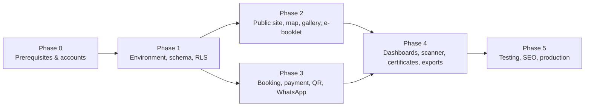

# Work Breakdown Structure & Development Checklist

## Edu Center & Edu Wisata Kelurahan Gisikdrono (Semarang Barat)

| Field | Value |
|---|---|
| Version | 1.0 |
| Date | 2026-10-15 |
| Status | Draft for review |
| Owner | Kelurahan Gisikdrono Edu Center project team |
| Companion documents | `CLAUDE.md` (root), `docs/PRD.md`, `docs/StyleGuide.md`, `docs/Security.md` |

**Contents:** 0 How to use · 1 Phase 0 Prerequisites & accounts · 2 Phase 1 Environment, schema, RLS · 3 Phase 2 Public site, map, gallery, e-booklet · 4 Phase 3 Booking engine, payments, QR & WhatsApp · 5 Phase 4 Dashboards, CRUD, scanner, certificates, exports · 6 Phase 5 Testing, SEO, production deployment · 7 Open decisions · Appendix A Environment variables · Appendix B WhatsApp templates · Appendix C Go-live security checklist · Appendix D Control-ID coverage index

Domain terms used throughout: **RW** (Rukun Warga, a neighbourhood unit inside the kelurahan), **kelurahan** (urban-village administration office), **UMKM** (micro, small and medium enterprises), **PKK** (the family-welfare women's group), **Bank Sampah** (community waste bank), **dolanan** (traditional children's games), **sanggar** (community arts studio), **Ecowastreme** (RW 05's eco-tourism programme brand), **PIC** (person in charge, the booking contact).

## 0. How to use this document

### 0.1 Legend and columns

| Mark | Meaning |
|---|---|
| `[ ]` | To do |
| `[~]` | Partially done (PR open, or merged with a follow-up item) |
| `[x]` | Done: merged to `main`, CI green, definition of done in `CLAUDE.md` §9 satisfied |

Every task row has the columns **ID**, **Status**, **Task**, **Est**, **Dep**, **Owner**.

| Column | Values |
|---|---|
| ID | `P<phase>.<module>.<nn>`, e.g. `P3.7.02` = Phase 3, module 7, item 02. IDs are stable; never renumber, append new items at the end of a module. |
| Est | `S` ≤ 0.5 developer-day, `M` ≤ 2 days, `L` ≤ 5 days. Anything larger is split. |
| Dep | IDs that must be `[x]` before the item starts (`—` = none beyond the phase order). |
| Owner | `Dev` (engineering), `Superadmin` (kelurahan staff operating the dashboard), `Kelurahan` (office decisions, legal, accounts, content), `Vendor` (external provider action: Midtrans, Meta, Resend, Cloudflare, Supabase, Vercel). |

### 0.2 Rules

1. One checklist item = one pull request. Each item names the file, table, route, function or setting it touches; names are canonical and match `docs/PRD.md` §8 (schema), `docs/PRD.md` §5 (routes), `CLAUDE.md` §3 (folders) and `docs/Security.md` §12 (controls matrix). Each module header lists the `docs/PRD.md` §6–§7 requirement IDs (`FR-*`, `NFR-*`) it implements; the PR description cites one of them.
2. Security tasks are embedded in the phase where the code lives and cite control IDs in parentheses, e.g. `(WH-01)`. Appendix D maps every control ID to its tasks; `docs/Security.md` §12 maps the other way.
3. Clean code is a project rule: the gates in P1.1 (ESLint, Prettier, `tsc`, Semgrep, coverage) are set up before any feature code and are required CI checks from the first PR. Function ≤ 40 lines, file ≤ 300 lines, no `any`, no magic values, layering UI → action → service → data-access → DB (`CLAUDE.md` §4).
4. A task is ticked only when its tests exist: migration items need a pgTAP file, pure logic needs Vitest, flows need Playwright (`CLAUDE.md` §9).
5. Phase exit criteria are gates: Phase N+1 code may start on a branch, but nothing from Phase N+1 merges to `main` until Phase N exit criteria are `[x]`.
6. Commit messages follow Conventional Commits and reference the item (`feat(payment): webhook signature pipeline (Task: P3.7.02)`).

### 0.3 Phase order

Phases 2 and 3 can run in parallel after Phase 1; Phase 3 is the critical path.

## 1. Phase 0 — Prerequisites & accounts

Goal: every external account, secret, domain and legal confirmation exists before engineering starts, under institutional ownership with MFA.

### 1.1 P0.1 Platform accounts

Requirements: NFR-01, NFR-08, NFR-10; assumptions A3, A12.

| ID | Status | Task | Est | Dep | Owner |
|---|---|---|---|---|---|
| P0.1.01 | `[ ]` | Create the Supabase organisation under the institutional email with "Require MFA" on; create projects `gisikdrono-prod` and `gisikdrono-staging` (Pro plan, region `ap-southeast-1`); max two named owners; developers as Developer role on prod (A3; STAFF-03, SEC-05) | S | — | Kelurahan |
| P0.1.02 | `[ ]` | On both projects: daily backups on, SSL enforcement on, leaked-password protection on, exposed schemas = `public` only (`graphql_public` removed), network restrictions planned for office IP + migration path (DB-01, DB-03, DB-06, RES-01) | S | P0.1.01 | Dev |
| P0.1.03 | `[ ]` | Vercel Pro team under the institutional account; project linked to the GitHub repo; environments Development / Preview / Production; Deployment Protection (Vercel Authentication) on all previews; Firewall managed rules on; functions region `sin1` (RL-06, RL-07, SEC-05) | S | P0.1.04 | Kelurahan |
| P0.1.04 | `[ ]` | GitHub repository `gisikdrono-edu-wisata` (private) with 2FA required, secret scanning + push protection on, branch protection on `main` (PR required, required checks, no force push, linear history), `CODEOWNERS` (SC-05, SEC-03) | S | — | Dev |
| P0.1.05 | `[ ]` | Midtrans production merchant account held by the designated legal entity (A12): owner login = kelurahan head official email + 2FA, named operator sub-accounts with least privilege, Server Key regeneration and payout-account change only by the owner with a written record; sandbox merchant for staging/local; record `MIDTRANS_MERCHANT_ID` (PAY-16, PAY-02; `docs/Security.md` §3.9) | M | P0.4.02 | Kelurahan |
| P0.1.06 | `[ ]` | Midtrans Dashboard → Settings → Configuration: Payment Notification URL per environment `https://<domain>/api/webhooks/midtrans/<MIDTRANS_WEBHOOK_PATH_TOKEN>` (prod) and `https://staging.<domain>/api/webhooks/midtrans/<token>` (sandbox); payment methods limited to QRIS + Virtual Account, cards never enabled (PAY-02, PAY-06, WH-04) | S | P0.1.05, P0.2.01, P0.3.02 | Dev |
| P0.1.07 | `[ ]` | Meta Business Manager verified; WhatsApp Business Account; kelurahan-owned SIM registered on the Cloud API (`WHATSAPP_PHONE_NUMBER_ID`, `WHATSAPP_BUSINESS_ACCOUNT_ID`); System User with only `whatsapp_business_messaging` and a permanent token; app secret; 2FA on every Meta login (SEC-05, EP-01) | M | — | Kelurahan |
| P0.1.08 | `[ ]` | Submit the 14 WhatsApp templates of Appendix B (`gsk_otp_v1` AUTHENTICATION, the rest UTILITY, language `id`) for approval; track status per template in `docs/notifications.md` | M | P0.1.07 | Vendor |
| P0.1.09 | `[ ]` | Resend account under the institutional email; sending domain `mail.<domain>` verified; SPF, DKIM and DMARC `p=reject` with `rua` on the root and sending domains; `EMAIL_FROM` and `RESEND_API_KEY` per environment (A11; EP-03; `docs/Security.md` §10.2) | S | P0.2.01 | Dev |
| P0.1.10 | `[ ]` | Cloudflare account: Turnstile site in managed mode for public forms (`NEXT_PUBLIC_TURNSTILE_SITE_KEY`, `TURNSTILE_SECRET_KEY`) and a second widget for Supabase Auth captcha (RL-04, AUTH-06) | S | — | Dev |
| P0.1.11 | `[ ]` | (From the review of PR #20: when the SDK goes in, `beforeSend` and `beforeBreadcrumb` run `redactLinkTokens` from `src/lib/logger.ts` over every URL, message and breadcrumb, as the logger already does, with a test.) Sentry project for `@sentry/nextjs` (`NEXT_PUBLIC_SENTRY_DSN`, `SENTRY_AUTH_TOKEN` for CI), `sendDefaultPii: false`, tunnel route `/monitoring` (MON-05, OPS-01) | S | — | Dev |
| P0.1.12 | `[ ]` | Uptime monitor (Better Stack or UptimeRobot) on `GET /api/health` every 5 minutes expecting HTTP 200, alerting by email and a Telegram bot channel owned by the kelurahan (OPS-03) | S | P0.2.01 | Dev |
| P0.1.13 | `[ ]` | Cloudflare R2 bucket for weekly encrypted database dumps; `R2_*` and `BACKUP_AGE_PUBLIC_KEY` as GitHub Actions secrets; `age` private key in the vault (RES-01, DB-07) | S | P0.3.01 | Dev |
| P0.1.14 | `[ ]` | (Hosted only: `supabase/config.toml` keeps 30 locally, since one run of `tests/integration` signs in nine times; decision of 2026-10-17.) Supabase Dashboard → Authentication → Rate Limits on both projects: sign-up and sign-in requests 10 per 5 minutes per IP (RL-02, AUTH-06) | S | P0.1.01 | Dev |
| P0.1.15 | `[ ]` | (Hosted only: captcha stays off in `supabase/config.toml`, where tests sign in without a browser.) Supabase Dashboard → Authentication → Attack Protection on both projects: captcha on, provider Turnstile, with the secret of the Auth widget of P0.1.10, so every staff sign-in, password reset and invite acceptance passes Turnstile (AUTH-06, RL-04) | S | P0.1.01, P0.1.10 | Dev |
| P0.1.16 | `[ ]` | (Hosted only: locally Mailpit catches every Auth email.) Supabase Dashboard → Authentication → SMTP Settings on both projects: custom SMTP through Resend (`smtp.resend.com`, port 465, user `resend`, the project's `RESEND_API_KEY`), sender `EMAIL_FROM` on `mail.<domain>`; send a password reset to a kelurahan test mailbox and confirm it arrives DKIM-signed (EP-03, AUTH-01) | S | P0.1.01, P0.1.09 | Dev |
| P0.1.17 | `[ ]` | (Also re-check docs/Security.md risk R19 on staging: sign in twice with one TOTP code inside its 30 seconds and record whether hosted Auth accepts the second.) Supabase Dashboard → Authentication → Multi-Factor on both projects: TOTP enroll and verify on, phone MFA off, at most one verified factor per user as `docs/Security.md` §5.2 requires; confirm a staging staff sign-in reaches `aal2` only after the TOTP step (AUTH-02, AUTH-03) | S | P0.1.01 | Dev |
| P0.1.18 | `[ ]` | Mirror the rest of `supabase/config.toml` (pinned by `scripts/supabase-config.test.mjs`) in both dashboards, since the file configures the local stack only: sign-ups off, email confirmations and secure email change on, passwords of 12 characters with all four classes, email OTP 8 characters for 600 s, JWT expiry 900 s, refresh-token rotation with a 10 s reuse interval, sessions 12 h with a 2 h inactivity timeout, Site URL and the redirect allow-list `https://<domain>/auth/callback` only, both Auth hooks of P1.7.04, API `max_rows` 100; record each screen in the vault (AUTH-01, AUTH-04, APP-13, DATA-04) | S | P0.1.01, P0.2.01 | Dev |

### 1.2 P0.2 Domain & DNS

Requirements: NFR-03; assumption A11.

| ID | Status | Task | Est | Dep | Owner |
|---|---|---|---|---|---|
| P0.2.01 | `[ ]` | Register the project domain (A11, default own domain such as `eduwisatagisikdrono.id`); DNS zone under the institutional account; apex + `www` → Vercel, `staging.<domain>` → Vercel preview alias; `mail.<domain>` reserved for Resend | S | P0.4.02 | Kelurahan |
| P0.2.02 | `[ ]` | HSTS `preload` directive and preload-list submission scheduled for P5.7.04, only after the domain decision is final (HDR-02) | S | P0.2.01 | Dev |

### 1.3 P0.3 Secrets & identities

Requirements: NFR-01 (SEC family).

| ID | Status | Task | Est | Dep | Owner |
|---|---|---|---|---|---|
| P0.3.01 | `[ ]` | Bitwarden organisation vault with one collection per provider (Supabase, Vercel, GitHub, Midtrans, Meta, Resend, Cloudflare, Sentry, R2): owner credentials, recovery codes, database password; named members only; quarterly access-review entry in the kelurahan calendar (SEC-05, STAFF-03) | S | — | Kelurahan |
| P0.3.02 | `[ ]` | Generate with `openssl rand`: `MIDTRANS_WEBHOOK_PATH_TOKEN` (32 bytes URL-safe), `QR_SIGNING_KEYS` as JSON `{"k1":"<base64 32 bytes>"}` with `QR_SIGNING_ACTIVE_KID=k1`, `BOOKING_LINK_SECRET`, `OTP_PEPPER`, `CRON_SECRET`, `WHATSAPP_VERIFY_TOKEN`; separate values per environment; stored in Vercel as Sensitive and in the vault; never pasted into issues or chat (SEC-01, SEC-04) | S | P0.3.01 | Dev |
| P0.3.03 | `[ ]` | (Decision of 2026-10-17: also `environment` = `staging` / `production` and `jobs_base_url` = the environment's site URL, which `internal.call_job` reads; a database without `environment` counts as hosted, so its missing job secrets fail loudly; the value is read through an allow-list (`local`, `staging`, `production`, case and spaces ignored), anything else counting as hosted, and `jobs_base_url` must be `https://`; the development seed refuses any database not marked `local` (security review of PR #5); `docs/runbooks/cron.md`.) Store in Supabase Vault on both projects: `CRON_SECRET` as `cron_secret` for `pg_net` job calls, and `OTP_PEPPER` as `otp_pepper` for the keyed HMAC of `login_attempts.email_hash` and `security_events.ip_hash` computed inside the Auth hook and `internal.*` (EP-02; `docs/Security.md` §5.5, §7.4) | S | P0.3.02 | Dev |

### 1.4 P0.4 Legal and policy confirmations

Requirements: NFR-09; assumptions A4, A5, A7, A9, A10, A11, A12.

| ID | Status | Task | Est | Dep | Owner |
|---|---|---|---|---|---|
| P0.4.01 | `[ ]` | A10 data residency: written confirmation from the kelurahan and Diskominfo that Supabase + Vercel in Singapore is acceptable (platform operated as a private-scope PSE via Pokdarwis/BUMKel, or with Diskominfo approval); if PP 71/2019 public-scope rules apply, hosting region changes before Phase 1 (launch blocker) | M | — | Kelurahan |
| P0.4.02 | `[ ]` | A11 domain ownership and A12 Midtrans merchant legal entity + settlement bank account confirmed in writing; masked account recorded later in `site_settings.finance.expected_payout_account_masked` (REC-02) | S | — | Kelurahan |
| P0.4.03 | `[ ]` | Name the Pejabat Pelindungan Data (data-protection contact) and create mailboxes `privasi@<domain>` and `keamanan@<domain>`; set `SECURITY_ALERT_EMAIL` and `SECURITY_ALERT_WA_PHONE` (PDP-02) | S | P0.2.01 | Kelurahan |
| P0.4.04 | `[ ]` | Confirm at least two named superadmin officers (dual control for adjustments, MFA recovery) or formally accept the single-superadmin compensating control (24 h delay + email to the kelurahan head) (REC-09) | S | — | Kelurahan |
| P0.4.05 | `[ ]` | (From 0008: until confirmed, the contact number and email, the signatory's name and the expected payout account are seeded placeholders that production's `/api/health` and go-live check #19 refuse.) Confirm defaults that feed the seed: revenue-share splits A4, hold TTLs A5, retention A7, manual-payment policy A9, refund policy wording for `/privasi` and the ticket PDF | S | — | Kelurahan |

### 1.5 Phase 0 exit criteria

- [ ] Every account in P0.1 exists under an institutional login with MFA, and its recovery codes are in the vault (P0.3.01).
- [ ] The hosted-only Auth settings P0.1.14–P0.1.18 are set on both projects (sign-in limit 10, Turnstile captcha, Resend SMTP, TOTP, and the rest of `supabase/config.toml`), with a screenshot of each in the vault.
- [ ] All secrets of Appendix A marked S exist for Preview and Production in Vercel (Sensitive) and in Supabase Vault where required.
- [ ] A10 confirmation is on file; A11 domain resolves to Vercel; A12 Midtrans merchant exists with the notification URL set for staging.
- [ ] The 14 WhatsApp templates are submitted (approval may complete during Phase 3).

## 2. Phase 1 — Environment setup, DB schema, Supabase RLS & role policies

Goal: a repository with all quality gates, the complete schema (migrations `0001_extensions` … `0008_seed`), the `internal` schema with primitives, RLS on every table, storage buckets, Auth hooks and settings, pg_cron jobs, seed data and a pgTAP suite that fails CI on any isolation regression.

### 2.1 P1.1 Repository scaffold, clean-code and quality gates

Requirements: NFR-01, NFR-07, NFR-11.

| ID | Status | Task | Est | Dep | Owner |
|---|---|---|---|---|---|
| P1.1.01 | `[x]` | Scaffold Next.js 15 App Router + React 19 + TypeScript 5 (`strict`, `noUncheckedIndexedAccess`), path alias `@/* → src/*`, Node 22 LTS (`.nvmrc`), pnpm 10 (`packageManager`); create the folder skeleton of `CLAUDE.md` §3 (`src/app`, `src/components`, `src/lib`, `src/server/{actions,services,auth}`, `src/db`, `src/types`, `src/hooks`, `src/config`, `src/styles`, `supabase/{migrations,tests}`, `public/{icons,map,fonts,og}`, `scripts`, `tests/{integration,e2e,fixtures}`, `docs`) | S | P0.1.04 | Dev |
| P1.1.02 | `[~]` | `.npmrc`: `ignore-scripts=true`; `pnpm-workspace.yaml`: `onlyBuiltDependencies: [sharp]`, `minimumReleaseAge: 10080` (7 days in minutes); commit `pnpm-lock.yaml`; CI installs with `--frozen-lockfile` (SC-01, APP-03) | S | P1.1.01 | Dev |
| P1.1.03 | `[x]` | Tailwind CSS v4 + shadcn/ui `new-york` (`components.json`), `src/styles/globals.css` with the `@theme inline` block (token values filled in P2.1.01) | S | P1.1.01 | Dev |
| P1.1.04 | `[x]` | ESLint flat config: `next/core-web-vitals`, `typescript-eslint` strict-type-checked, `import/order`, `react/no-danger: error`, `@typescript-eslint/no-explicit-any: error`, `no-console` outside `src/lib/logger.ts`, `no-restricted-syntax` on `process.env` outside `src/lib/env.ts`, `no-restricted-imports` for `@/lib/supabase/admin` with allow-list `src/app/api/webhooks/**`, `src/app/api/jobs/**`, `src/server/services/{booking,payment,ticket,notification,document,export,staff}-service.ts`, and for `createBrowserClient` under `src/app/(admin)/**` (STAFF-04, AZ-06, SEC-02, AUTH-05, APP-11) | M | P1.1.01 | Dev |
| P1.1.05 | `[x]` | Prettier + `prettier-plugin-tailwindcss`; Husky + lint-staged (eslint, prettier, `gitleaks protect --staged`) and commitlint with Conventional Commits scopes `booking, payment, qr, scanner, admin, public, db, rls, notify, pdf, seo, infra, docs, deps` (SEC-03) | S | P1.1.04 | Dev |
| P1.1.06 | `[x]` | Clean-code enforcement: ESLint `max-lines` 300, `max-lines-per-function` 40, `complexity` 10, `@typescript-eslint/naming-convention` (kebab-case files, PascalCase components, `use-*` hooks), `no-magic-numbers` with constants in `src/config` and enums in `src/db/enums.ts`; PR template with the definition-of-done checklist of `CLAUDE.md` §9 | S | P1.1.04 | Dev |
| P1.1.07 | `[x]` | `package.json` scripts exactly as the `CLAUDE.md` §10.1 command library: `dev build start lint lint:fix format format:check typecheck test test:watch test:integration test:rls e2e e2e:ui check db:start db:stop db:status db:reset db:migrate:new db:diff db:push db:types db:types:check db:seed db:test midtrans:simulate midtrans:status midtrans:check tunnel wa:send-test email:preview check:secrets analyze` | S | P1.1.01 | Dev |
| P1.1.08 | `[x]` | (Amended 2026-10-20, P1.1.19: newer Midtrans sandbox accounts issue `Mid-server-` / `Mid-client-` keys without `SB-` and `M…` merchant ids, so sandbox deployments take both key formats, production still takes `Mid-` keys only and never `SB-`, and `MIDTRANS_MERCHANT_ID` must be `G` or `M` followed by digits; the rules live in `src/lib/midtrans/environment.ts`.) `src/lib/env.ts` with `@t3-oss/env-nextjs`: server and client schemas for every variable of Appendix A; fail-fast refinements `VERCEL_ENV=production ⇔ MIDTRANS_IS_PRODUCTION=true ⇔ MIDTRANS_SERVER_KEY startsWith Mid-server- and MIDTRANS_CLIENT_KEY startsWith Mid-client-`, otherwise `SB-` prefixes; client schema rejects any `NEXT_PUBLIC_` name containing `SECRET`, `KEY` or `TOKEN` except the known public keys; `.env.example` with placeholders only; env-matrix unit tests (PAY-01, PAY-02, SEC-01) | M | P1.1.01 | Dev |
| P1.1.09 | `[x]` | `src/lib/logger.ts`: pino JSON with `requestId` (`x-vercel-id` or `randomUUID`), closed event taxonomy, concrete redaction paths `booking.pic_phone`, `booking.pic_email`, `booking.pic_name`, `customer_details.*`, `participants[*].full_name`, `req.headers.authorization`, `req.headers.cookie`, `*.token`, `*.signature_key`, `*.snap_token`; custom ESLint rule banning `logger.*` calls with whole `bookings` or `booking_participants` objects; redactor unit test with a real booking fixture (MON-01, DATA-05, DATA-13, OPS-01) | M | P1.1.04 | Dev |
| P1.1.10 | `[x]` | Supabase clients `src/lib/supabase/{server.ts,client.ts,admin.ts}` and `src/middleware.ts` session refresh with `@supabase/ssr` and `auth.getUser()`; `admin.ts` starts with `import 'server-only'`, applies `experimental_taintUniqueValue` to `SUPABASE_SERVICE_ROLE_KEY` and `CRON_SECRET`, `persistSession: false`; every importer carries a header comment stating why RLS cannot apply (AZ-06, SEC-02, AUTH-05) | S | P1.1.08 | Dev |
| P1.1.11 | `[x]` | `next.config.ts` hardening: `poweredByHeader: false`, `productionBrowserSourceMaps: false`, `images.remotePatterns` pinned to `https://<ref>.supabase.co/storage/v1/object/public/public-media/**`, `experimental.serverActions.bodySizeLimit: '512kb'`, `serverActions.allowedOrigins` empty, `experimental.taint: true`, `outputFileTracingIncludes` for `src/lib/pdf/fonts/**`, static `headers()`: HSTS `max-age=63072000; includeSubDomains`, `X-Content-Type-Options: nosniff`, `X-Frame-Options: DENY`, `Referrer-Policy: strict-origin-when-cross-origin`, COOP/CORP `same-origin`, `X-DNS-Prefetch-Control: off`; `Cache-Control: private, no-store` and `X-Robots-Tag: noindex, nofollow` on `/dashboard/*`, `/reservasi/*`, `/api/*` and all non-production deployments (HDR-02, HDR-03, APP-01, APP-02, APP-12, APP-14, RL-05) | M | P1.1.01 | Dev |
| P1.1.12 | `[x]` | `src/middleware.ts` CSP: per-request nonce (`x-nonce`), `script-src 'self' 'nonce-…' 'strict-dynamic' 'wasm-unsafe-eval' https://challenges.cloudflare.com`, `img-src`/`connect-src` limited to the Supabase host, Turnstile and OSM tiles, `frame-src` Turnstile + Google Maps embed, `frame-ancestors 'none'`, `object-src 'none'`; no Midtrans origins (redirect mode); `Permissions-Policy: camera=()` globally and `camera=(self)` only on `/dashboard/scanner`; `Content-Security-Policy-Report-Only` on staging until P5.4.01; `src/lib/utils/safe-redirect.ts` (`^/(?![/\\])`) and `src/lib/utils/escape-like.ts` with unit tests (HDR-01, HDR-03, APP-01, APP-10, APP-13) | M | P1.1.11 | Dev |
| P1.1.13 | `[x]` | (Done: `withinRateLimits(adminClient, checks)` runs over the service-role client that the allow-listed service calling it hands in, so the CLAUDE.md §6.1 allow-list is unchanged; every limit lives in `src/config/rate-limits.ts` with its outage mode, all fail-closed (an outage passes the error on and the caller refuses) until booking creation adds the one fail-open limit in P3.4.02; the subject is an HMAC with `OTP_PEPPER`, so `rate_limit_buckets` holds no IP, email or id; `strict` halves each limit, never below 1; `isFirstRefusal` lets a refused flood leave one security event. The upload limits (`config/uploads.ts`, `upload-events.ts`) and the booklet download limit (`document-service.ts`) moved here. `normalizeMobilePhone` waits for the booking limits of P3.4.02.) `src/lib/rate-limit.ts` over `internal.rate_limit_hit` (service client): keys normalised with `src/lib/validations/normalize.ts` (email lower-cased, gmail dots and plus-tags stripped; phone E.164 `+62` mobile only); fail-closed for login, password reset, scanner, exports and link minting; fail-open only for booking creation with Turnstile still mandatory; `site_settings.rate_limit_profile` `normal` or `strict` doubles strictness (RL-01, BOOK-04, BOOK-11, BOOK-16) | M | P1.3.17 | Dev |
| P1.1.14 | `[~]` | (From P2.8: `requireRole()` takes one role or several, and `readStaffSession()` adds whether a TOTP factor is verified and the session's `amr` methods for the sign-in pages; `requireGuestToken` still waits for P3.3.02.) `src/server/auth/guards.ts`: `requireUser()`, `requireRole('superadmin')`, `requireRwAccess(rwId)`, `requireAal2()`, `requireFreshTotp(300)`, `requireGuestToken(scope)` (body in P3.3.02); `src/types/action-result.ts` with `ActionResult<T>` and `ActionErrorCode` (`UNAUTHENTICATED, FORBIDDEN, VALIDATION, NOT_FOUND, CONFLICT, QUOTA_EXCEEDED, STATE_INVALID, PRICE_MISMATCH, RATE_LIMITED, PAYMENT, INTERNAL`); `src/lib/errors.ts` `mapError()` (`23505 → CONFLICT`, `P0001` hints, zod → `VALIDATION`); `src/lib/copy/id.ts` Indonesian messages keyed by code (APP-02, APP-05) | M | P1.1.10 | Dev |
| P1.1.15 | `[x]` | Semgrep `.semgrep/rules.yml`: rulesets `p/nextjs p/typescript p/react p/owasp-top-ten p/secrets` plus custom rules: `dangerouslySetInnerHTML` anywhere; `@/lib/supabase/admin` import outside the allow-list; `fetch(` outside `src/lib/{midtrans,notifications,email,turnstile}`; `.or(` or `.filter(` with a non-literal argument; Server Action file without `requireUser|requireRole|requireRwAccess|requireGuestToken|verifyTurnstile`; object spread into `.insert(`/`.update(` (SC-03, APP-09, APP-10, APP-14) | M | P1.1.04 | Dev |
| P1.1.16 | `[~]` | GitHub Actions `.github/workflows/ci.yml` jobs: `check` (lint, typecheck, unit, `db:types:check`, `check:secrets`), `db` (`supabase start`, migrations, pgTAP, integration), `e2e` (PRs touching booking/payment/scanner), `security` (semgrep, gitleaks, `pnpm audit --prod --audit-level=high`); all required on `main`; `backup.yml` weekly; `renovate.json` weekly grouped minor/patch, `minimumReleaseAge: '7 days'`, majors manual, `vulnerabilityAlerts` on (SC-01, SC-02, SC-03, SC-04, SC-05, SEC-03, APP-03) | M | P1.1.05 | Dev |
| P1.1.17 | `[x]` | `scripts/check-client-bundle-secrets.mjs` (`pnpm check:secrets`): after `next build`, grep `.next/static/**` for `Mid-server-` (live keys and both sandbox formats), `SB-Mid-server-`, `service_role`, `MIDTRANS_SERVER_KEY`; non-zero exit on any hit (PAY-01, SEC-01) | S | P1.1.08 | Dev |
| P1.1.18 | `[~]` | Vercel project wiring: environment variables per Appendix A, `vercel.json` with `regions: ["sin1"]`; `supabase/config.toml` with local ports, `[auth.hook.custom_access_token]` and `[auth.hook.password_verification_attempt]` enabled; `pnpm db:start` and `pnpm dev` work from a clean clone (documented in `README.md`) | S | P1.1.10 | Dev |
| P1.1.19 | `[x]` | (Done 2026-10-20, finding: a newer sandbox key is accepted by `api.sandbox.midtrans.com` and refused with 401 by `api.midtrans.com`, yet its prefix equals a live key's.) `scripts/midtrans-check.ts` (`pnpm midtrans:check [-- --file <path>]`, default `.env.local`): checks the key formats and merchant id of P1.1.08, then asks the Status API of the environment `MIDTRANS_IS_PRODUCTION` names about a random order; 404 `Transaction doesn't exist` passes, 401 (key unknown there: the other environment, or mistyped or revoked) or any other answer exits 1; never prints a key; answer reading in `src/lib/midtrans/environment.ts` with Vitest; required before keys are saved for staging or production (`docs/Security.md` §3.9) and for go-live check #7 (PAY-02) | S | P1.1.08 | Dev |

### 2.2 P1.2 Migrations 0001–0003: extensions, enums, tables

Requirements: NFR-02, NFR-09, NFR-12 (`docs/PRD.md` §8.3–§8.4).

| ID | Status | Task | Est | Dep | Owner |
|---|---|---|---|---|---|
| P1.2.01 | `[x]` | `supabase/migrations/0001_extensions.sql`: `pgcrypto, citext, btree_gist, pg_trgm, pg_net` in schema `extensions`, `pg_cron` in `pg_catalog`, `supabase_vault` in `vault`; `create schema internal` with no rights for `public, anon, authenticated`; `alter default privileges for role postgres in schema public revoke all on tables, sequences and execute on functions from anon, authenticated` (Supabase grants all three by default); `alter default privileges for role postgres revoke execute on functions from public` without `in schema`, because a per-schema rule cannot remove Postgres' global default; extensions are created first so their operators stay usable; pgTAP `supabase/tests/schema_extensions.sql` (AZ-02, AZ-11, DB-02, APP-04) | S | P1.1.18 | Dev |
| P1.2.02 | `[x]` | `0002_enums.sql`: all enums with the exact values of `docs/PRD.md` §8.3: `app_role, content_status, session_status, package_category, pricing_basis, product_category, booker_type, booking_channel, booking_status, booking_leg_status (unreserved, reserved, checked_in, released), addon_fulfillment_status, payment_provider, payment_method, payment_status (12 values incl. needs_review, disputed, duplicate), quotation_status, invoice_status, ticket_status (issued, used, suspended, revoked, expired), scan_phase, scan_result (12 values), certificate_kind, certificate_status, review_status, gallery_category, media_type, article_category, booklet_kind, activity_point_type, schedule_type, revenue_rule_scope, revenue_beneficiary, revenue_entry_type, adjustment_type, adjustment_status, notification_channel, notification_status, notification_template (15 values), document_kind, otp_purpose, export_kind, alert_severity`; `src/db/enums.ts` mirrors them | S | P1.2.01 | Dev |
| P1.2.03 | `[x]` | `0003_tables.sql` config group: `rw_units` (`id smallint` 5 and 8, public profile columns, private treasury columns), `profiles` (`role app_role`, `rw_id` required iff `admin_rw`, `is_active`, `mfa_required default true`, `claims_version`, `created_by`), `staff_invites` (`invite_code_hash` unique, sha256 of the code shown once; `role` never `none`; `rw_id` iff `admin_rw`; `expires_at` set by the inviting function to creation + 72 h; `accepted_at`, `accepted_user_id`, `revoked_at`, `created_by`; one open invite per email), `site_settings` (`key`, `value jsonb`, `is_public`) (AUTH-01) | M | P1.2.02 | Dev |
| P1.2.04 | `[x]` | Sessions group: `session_templates` (weekday pattern, unique `(rw_id, weekday, start_time)`), `visit_sessions` (`capacity`, `reserved_pax`, `checked_in_pax`, `status session_status`, CHECK `reserved_pax <= capacity`, unique `(rw_id, session_date, start_time)`, partial index on `status = 'open'`) | S | P1.2.03 | Dev |
| P1.2.05 | `[x]` | Catalogue group: `tour_packages` (CHECK `category = 'combo' ⇔ rw_id IS NULL`, pricing basis CHECK, `valid_from/valid_to`), `tour_package_legs` (unique `(package_id, rw_id)` and `(package_id, leg_order)`), `tour_package_price_tiers` (gist exclusion on overlapping pax ranges), `umkm_vendors` (public columns + private `bank_name, bank_account_number, bank_account_holder`), `products_umkm` (`is_addon_eligible`, `is_featured`, `min_order_qty`, `max_order_qty`), `package_price_history` (append-only: entity, before/after price, actor, changed_at) (REC-10) | M | P1.2.03 | Dev |
| P1.2.06 | `[x]` | Booking group: `bookings` (`booking_code` unique, `rw_ids smallint[]`, `status`, `package_snapshot`, money columns `bigint`, `expires_at` with CHECK `status <> 'pending_payment' OR expires_at IS NOT NULL`, `phone_verified_at`, `email_verified_at`, `consent_version`, `consented_at`, `token_version default 1`, `needs_review`, `review_reason`, `idempotency_key` unique, `admin_notes`, `source_ip`, `user_agent`), `booking_legs` (`status default 'unreserved'`, `visit_session_id`, `pax_count`, `quota_reserved_at`, `quota_released_at`, unique `(booking_id, rw_id)`), `booking_addons` (price snapshot, CHECK `line_total = unit_price * qty`), `booking_participants` (`full_name` 2–120 chars, `group_label`, `role_label` (`student`, `teacher`, `chaperone`, `participant`); no NIK, DOB or address columns), `booking_events` (append-only timeline: `from_status, to_status, actor_type, actor_id, reason, payload`), `guest_otps` (`phone`, `code_hash`, `purpose otp_purpose`, `attempts`, `expires_at`, `consumed_at`); indexes on `expires_at` (partial), `visit_date`, `rw_ids` (gin), `pic_phone`, `pic_email`, `created_at desc`, and trigram search `bookings_search_idx` on `coalesce(institution_name, '') || ' ' || pic_name` as defined in `docs/PRD.md` §8.4.4 (BOOK-05, DATA-01, DATA-03, PDP-01) | M | P1.2.05 | Dev |
| P1.2.07 | `[x]` | Payment group: `payments` (`order_id` unique, `attempt_no`, `provider`, `method`, `status payment_status`, `gross_amount`, `snap_token`, `snap_redirect_url`, `expiry_time`, `provider_txn_id`, `fraud_status`, `manual_proof_path`, `recorded_by`; partial unique index `payments_one_open_per_booking`: one `initiated`, `pending` or `needs_review` payment per booking), `payment_events` (`event_hash` unique, `source`, `payload`, `processed_at`, `processing_result`; only signature-valid events are stored), `webhook_rejections` (`provider`, `reason`, `order_id`, `status_code`, `body_sha256`, `ip`, `user_agent`, `received_at`; no body), `payment_adjustments` (`type adjustment_type`, `status adjustment_status`, `proposed_by`, `approved_by`, `evidence_path`, `reason`, `applied_at`), `reconciliation_runs`, `reconciliation_issues` (PAY-04, WH-05, REC-09) | M | P1.2.06 | Dev |
| P1.2.08 | `[x]` | Documents group: `quotations` (`quotation_number` unique, `version`, `status quotation_status`, `valid_until`, `snapshot`, `pdf_path`), `invoices` (`invoice_number` unique, `receipt_number` unique, `credit_note_number`, `status invoice_status`, `snapshot`; partial unique one live invoice per booking), `document_sequences` (PK `(kind, period)`, `last_value`), `certificates` (`certificate_number`, `verify_code` unique, `kind`, `participant_id`, `status`, `pdf_path`; partial unique indexes for group-once and participant-once; created with the tickets group of 0003, following the order of `docs/PRD.md` §8.4.6) (REC-11) | M | P1.2.07 | Dev |
| P1.2.09 | `[x]` | (Review of 0005, L2, 2026-10-17: 0005 keeps `ticket_scans.raw_payload` as the sha256 hex of the scanned string only, never its first 128 characters, and grants it to no API role.) Tickets group: `tickets_qr` (`booking_leg_id` unique, `rw_id`, `visit_session_id`, `ticket_code` unique, `status ticket_status`, `valid_on`, `valid_from`, `valid_until`, `key_id`, `pax_count`, `checked_in_at`, `checked_in_pax`, `unpaid_pax`, `checked_in_by`, `revoked_at`; gate index `(rw_id, valid_on, status)`), `ticket_scans` (`attempt_id uuid unique`, `ticket_id`, `rw_id`, `scanned_by`, `phase scan_phase`, `result scan_result`, `attendee_count`, `raw_payload` first 128 chars, `device_info`, `ip`) (QR-01, QR-02) | S | P1.2.08 | Dev |
| P1.2.10 | `[x]` | Content group: `galleries` (`alt_text NOT NULL`, `width/height`, `blurhash`, `category gallery_category`, `media_type`), `articles` (`slug`, `body_json jsonb` ProseMirror document, `status content_status`, `author_id`, `reviewed_by`, `published_at`, `seo_title`, `seo_description`; no HTML column), `booklets` (`kind booklet_kind`, `pdf_path`, `page_images_prefix`, `page_count`, `download_count`), `hero_banners` (`product_id`, `starts_at/ends_at`, `is_active`), `activity_points` (`point_type`, `map_x`, `map_y`, `svg_hotspot_id`, `lat`, `lng`), `performance_schedules` (`schedule_type`, `starts_at/ends_at`, `recurrence_rule`, `package_id`), `reviews` (`booking_id` unique, `rw_ids`, `rating` 1–5, `body` ≤ 2000, `is_anonymous`, `status review_status`, `is_featured`, `moderation_note`) (APP-11) | M | P1.2.06 | Dev |
| P1.2.11 | `[x]` | Finance group: `revenue_share_rules` (`scope revenue_rule_scope`, `rw_id`, `package_id`, `product_id`, `effective_from`, `effective_to`), `revenue_share_rule_lines` (`beneficiary`, `rw_id`, `vendor_id`, `pct`; the deferred constraint trigger `revenue_rule_sum_guard` (sum = 100.00) comes with the other guard triggers in 0004), `revenue_share_entries` (`id bigint identity` as chain order, `booking_id`, `payment_id`, `entry_type revenue_entry_type`, `beneficiary`, `beneficiary_key`, `amount` signed, `rule_id`, `adjustment_id`, `payout_batch_id`, `prev_hash`, `entry_hash`; unique settlement key), `payout_batches` (`beneficiary_key`, period, `total_amount`, `proof_path`, `created_by`) (REC-05, REC-06, REC-10) | M | P1.2.07 | Dev |
| P1.2.12 | `[x]` | Ops group: `notifications` (`channel`, `template notification_template`, `recipient`, `params`, `document_path`, `dedupe_key` unique, `status`, `attempts`, `max_attempts default 8`, `next_attempt_at`, `locked_at`, `provider_message_id`, `provider_status`; queue index), `security_events` (append-only; `event_type` CHECK in the 25-value list of `docs/PRD.md` §8.4.9 (0004 adds `mfa_reset` as the 26th), `severity alert_severity`, `actor_id`, `ip_hash` (keyed HMAC, `docs/Security.md` §7.4), `entity_type`/`entity_id`, `details` without PII), `security_alerts` (`fingerprint`, `severity`, `last_seen_at`, `notified_at`, `acknowledged_by`; one open alert per fingerprint), `exports` (`kind export_kind`, `filters`, `reason`, `row_count`, `watermark`, `storage_path`, `expires_at`), `dsr_requests` (`booking_code`, `request_type`, `verified_at`, `status`, `resolution_note`), `audit_logs` (`id bigint identity`, `actor_id`, `actor_role`, `action`, `entity_type`, `entity_id`, `rw_id`, `before`, `after`, `request_id`, `prev_hash`, `entry_hash`), `login_attempts` (`user_id`, `email_hash` (keyed HMAC of the lower-cased email, `docs/Security.md` §5.5), `ip`, `success`, `reason`, `attempted_at`; the lockout counts recent failures), `rate_limit_buckets` (PK `(key, window_start)`, `count`) (AUTH-08, OPS-02, DATA-06, PDP-03) | M | P1.2.06 | Dev |
| P1.2.13 | `[x]` | Cross-cutting: `set_updated_at()` trigger on every table with `updated_at`; FK `ON DELETE RESTRICT` on all financial and operational rows; no `DELETE` grant on never-delete tables; archive-by-status for catalogue/content tables (deletion stance `docs/PRD.md` §8.1) | S | P1.2.12 | Dev |
| P1.2.14 | `[x]` | `pnpm db:types` (`supabase gen types typescript --local > src/db/types.ts`), `src/db/rpc.ts` typed RPC wrappers (staff RPCs through the session client; `internal.*` only through the `public.svc_*` wrappers and the service-role client), `db:types:check` drift gate in CI; `src/db/types.ts` is never hand-edited | S | P1.2.13 | Dev |

### 2.3 P1.3 Migration 0004: helpers, hooks, triggers, primitives, views

Requirements: NFR-01, NFR-02, FR-POST-08, FR-ADMIN-01 (`docs/PRD.md` §8.7).

| ID | Status | Task | Est | Dep | Owner |
|---|---|---|---|---|---|
| P1.3.01 | `[x]` | `0004_functions.sql` RLS helpers in `public` (SQL, stable): `app_role()`, `app_rw_id()`, `is_superadmin()`, `is_admin_rw()`, `is_staff()`, `owns_rw(rw_id)`, `owns_any_rw(rw_ids)`, `aal2()`, `today_jkt()`; `app_role()` returns `none` and `app_rw_id()` NULL when the JWT `claims_version` differs from `profiles.claims_version` or `is_active = false`; `app_role()` is the one `security definer` helper (reads `profiles`); grants: `today_jkt()` to `anon` + `authenticated`, all other helpers to `authenticated` only (AZ-01, AZ-09, AUTH-07) | M | P1.2.14 | Dev |
| P1.3.02 | `[x]` | `public.custom_access_token_hook(event jsonb)` (caller check on `session_user`, EXECUTE for `supabase_auth_admin` only; both hooks proved through GoTrue by `tests/integration/auth-hooks.test.ts`: sign-in with claims, no role without a profile, wrong password recorded, lockout even against the right password): injects `app_role`, `app_rw_id`, `claims_version` from `profiles`; inactive or missing profile, or more than one verified MFA factor (AUTH-12) → `app_role = 'none'`; grants to `supabase_auth_admin` only, revoked from `public, anon, authenticated`; policy `profiles_auth_admin_read`; enabled in Dashboard → Auth → Hooks on both projects (AZ-01, AUTH-07) | S | P1.3.01 | Dev |
| P1.3.03 | `[x]` | `public.hook_password_verification_attempt(event jsonb)`: records every attempt in `login_attempts` (`email_hash` = keyed HMAC per `docs/Security.md` §5.5), progressive delay (1 s at the 3rd failure, 2 s at the 4th), rejects from the 5th failure per user in 15 minutes regardless of IP, writes `login_failed` and `login_locked` to `security_events`, never a hard email lockout beyond the window; granted to `supabase_auth_admin`; enabled on the local stack only, because the hosted projects are on the Pro plan, which has no attempt hooks (decision of 2026-10-20, docs/Security.md §5.5) (AUTH-10, AUTH-06, RL-02) | M | P1.3.01 | Dev |
| P1.3.04 | `[x]` | SECURITY DEFINER template applied to every definer function: owner `postgres`, `set search_path = ''` with fully-qualified names, explicit role check as the first statement, `revoke execute from public, anon, authenticated`; all views `with (security_invoker = true)`; template documented in `CLAUDE.md` §6; the stable read-only RLS helpers of P1.3.01 are the documented exception to the role-check line (AZ-05, DB-02) | S | P1.3.01 | Dev |
| P1.3.05 | `[x]` | `profiles` self-escalation lock: `revoke update (role, rw_id, is_active, mfa_required) on public.profiles from authenticated`; trigger `profiles_guard` allows those columns to change only when `current_setting('app.privileged_rpc', true) = 'on'`, never for the caller's own row, and never deactivates or demotes the last active superadmin (AZ-04, AZ-10, APP-08) (Review fix: the guard also covers INSERT, where a profile outside the privileged and system paths starts with role `none`; `claims_version` never goes back; the last-active-superadmin check runs under an advisory lock. Re-review N1: the pending-request columns `mfa_reset_requested_at/_by`, `promotion_requested_at/_by` are NULL on every new profile, change only under `app.privileged_rpc` inside their RPCs, and are in the column revoke.) | S | P1.3.01 | Dev |
| P1.3.06 | `[x]` | Guard triggers: `rw_units_guard` (treasury and `code/slug/is_active` superadmin-only), `umkm_vendors_bank_guard` (bank columns superadmin-only), `products_umkm_vendor_rw_guard` (`vendor.rw_id = product.rw_id`), `tour_packages_legs_guard` (auto single leg; combo publish needs ≥ 2 distinct RW legs; combo insert/update superadmin-only), `quotations_limit_guard` (max 3 per booking, requires `phone_verified_at`), `revenue_rule_sum_guard` (deferred constraint trigger, `sum(pct) = 100.00` per rule) and `revenue_rules_immutable_once_used`, `articles_moderation_guard` (admin_rw cannot set `published`; editing a published article resets to `pending_review`), `reviews_moderation_stamp` (REC-14) | M | P1.3.01 | Dev |
| P1.3.07 | `[x]` | Trigger `visit_sessions_guard`: forbid `DELETE`, `status = 'cancelled'`, and changes to `session_date`, `start_time`, `end_time`, `rw_id` while any `booking_legs` row in (`reserved`, `checked_in`) references the session; `capacity` never below `reserved_pax`; any other change under active bookings writes `session_changed_with_bookings` to `security_events` (REC-15) | S | P1.3.01 | Dev |
| P1.3.08 | `[x]` | (Re-review N2: `bookings_status_transition` also allows `cancelled`, `completed`, `no_show` and `pending_payment` → `refunded`; every move to `refunded` needs `app.recording_refund`, which only `record_refund` sets, a superadmin at AAL2 and a `settled` payment.) (Review fixes M4 and L2: `guard_status_inserts` makes new rows start at their state machine's start outside a transition function; `bookings_status_transition` holds `bookings.status` to the §9.2 transition table; fence flags are restored after each use.) Trigger `bookings_immutable_guard` (`rw_ids`, `package_id`, `booking_code`, `created_at`, `consent_version` immutable) and `guard_status_writes` fences on `bookings.status`, `payments.status`, `tickets_qr.status`, `certificates.status`, `booking_legs.status`, `visit_sessions.reserved_pax` and `checked_in_pax`: writes allowed only when `current_setting('app.in_rpc', true) = '1'` (set by every transition function) (REC-03, BOOK-14) | S | P1.3.01 | Dev |
| P1.3.09 | `[x]` | Immutability triggers after settlement: financial columns of `payments`, `bookings`, `booking_addons`, `invoices` frozen once the payment is `settled` unless `current_setting('app.adjustment_id', true)` is set by `apply_adjustment`; `DELETE` on `payments` always raises (REC-03) | S | P1.3.08 | Dev |
| P1.3.10 | `[x]` | Append-only enforcement (BEFORE UPDATE OR DELETE trigger raising, a BEFORE TRUNCATE statement trigger, and `revoke update, delete, truncate from anon, authenticated, service_role`): `payment_events` (only `processed_at`, `processing_result` updatable), `webhook_rejections`, `revenue_share_entries` (only `payout_batch_id`, once, from NULL), `audit_logs`, `payment_adjustments` (proposal columns never; workflow columns until `applied`, then final), `booking_events`, `security_events`, `ticket_scans`, `package_price_history`, `login_attempts`; the retention functions bypass these triggers only under `app.purge = 'on'` (REC-04, DB-04) | S | P1.3.08 | Dev |
| P1.3.11 | `[x]` | Trigger `tickets_require_paid_booking` BEFORE INSERT on `tickets_qr` (booking `paid` and a `settled` payment exist) and `tickets_no_revive` (`used → issued` only inside `undo_check_in`; `ticket_code` and `booking_id` immutable) (WH-12, QR-02) | S | P1.3.08 | Dev |
| P1.3.12 | `[x]` | (Re-review M1: a `flat_group` `flat_price` must cover `max_pax` visitors at the floor, firing on `price_per_pax`, `flat_price`, `pricing_basis` and `max_pax`; a change of `pricing_basis`, `min_pax` or `max_pax` writes `package_price_history`, which gained old/new columns for them, and `price_changed` naming the fields that changed.) Price governance triggers (names per `docs/PRD.md` §8.5.3): `tour_packages_price_history` on `tour_packages` and `tour_package_price_tiers` (every change, not the first price, which `audit_logs` holds, so a never-repriced draft stays deletable: append-only before/after + actor into `package_price_history`, `price_changed` security event); `products_umkm` price changes write only `price_changed` + `audit_logs`, because `package_price_history.package_id` is NOT NULL; `tour_packages_price_floor` rejects `price_per_pax` or tier prices below `site_settings.pricing.min_price_per_pax`, and a `flat_group` `flat_price` below `pricing.min_price_per_pax × min_pax`, firing on `price_per_pax`, `flat_price`, `pricing_basis` and `min_pax`, with Postgres `23514` and that constraint name (REC-13) | S | P1.3.10 | Dev |
| P1.3.13 | `[x]` | `internal.log_audit()` row trigger on the 25 tables of `docs/PRD.md` §8.5.3 (`bookings, booking_legs, booking_participants, payments, payment_adjustments, tickets_qr, certificates, quotations, invoices, tour_packages, products_umkm, umkm_vendors, visit_sessions, session_templates, profiles, staff_invites, rw_units, revenue_share_rules, revenue_share_rule_lines, revenue_share_entries, payout_batches, site_settings, reviews, articles, hero_banners`) with an **allowlist** of columns per table in `before/after` (PII columns never copied); `names_only` mode via `current_setting('app.audit_mode', true)`; `actor_id = coalesce(auth.uid(), current_setting('app.actor_id', true)::uuid)` and the trigger raises when both are NULL on a staff or service action (`cron`, `visitor` and `anon` may be anonymous, as the table's CHECK allows); pgTAP asserts `audit_logs` never contains `+62` (AUD-01, AUTH-08, AZ-15, DATA-11) | M | P1.3.10 | Dev |
| P1.3.14 | `[x]` | Hash chains: BEFORE INSERT triggers `ledger_chain` on `revenue_share_entries` and `audit_chain` on `audit_logs` (one function, `internal.chain_append()`, under `pg_advisory_xact_lock`; formula in `docs/Security.md` §3.8); `internal.verify_ledger_chain()` and `internal.verify_audit_chain()` return `{ok, checked, first_broken_id}` (REC-05, AUD-03) | M | P1.3.13 | Dev |
| P1.3.15 | `[x]` | Quota primitives: `internal.reserve_session_quota(session_id, pax)` (conditional `UPDATE … WHERE reserved_pax + p_pax <= capacity` under row lock, raises `QUOTA_UNAVAILABLE` with errcode `P0001`), `internal.release_booking_quota(booking_id)` (legs `ORDER BY visit_session_id`, idempotent via `quota_released_at`, an underflow floored at zero and logged as `quota.drift`); every caller that reserves for several legs locks sessions in the same `visit_session_id` order (BOOK-01) | S | P1.3.08 | Dev |
| P1.3.16 | `[x]` | `internal.next_document_number(kind document_kind, at timestamptz)`: `INSERT … ON CONFLICT (kind, period) DO UPDATE … RETURNING` producing `SP/GSK/YYYY/MM/NNNN`, `INV/GSK/YYYY/MM/NNNN`, `KW/GSK/YYYY/MM/NNNN`, `CN/GSK/YYYY/NNNN`, `SERT/GSK/YYYY/NNNNN`; invoice numbers consumed only inside the settlement transaction (REC-11) | S | P1.3.04 | Dev |
| P1.3.17 | `[x]` | `internal.rate_limit_hit(key text, limit int, window_seconds int) returns boolean` fixed-window counter on `rate_limit_buckets` (RL-01) | S | P1.3.04 | Dev |
| P1.3.18 | `[x]` | Cron SQL functions: `internal.expire_stale_bookings()` (`expires_at + 5 min < now()`, `FOR UPDATE SKIP LOCKED`, one `BEGIN … EXCEPTION` block per booking so a failure is reported as `cron_failed` and skipped, releases quota, expires open payments, enqueues `booking_expired`, writes `booking_events`), `internal.close_past_bookings()` (`checked_in → completed`, `paid → no_show`, past `issued` tickets → `expired`, enqueues `review_invite`), `internal.reconcile_session_counters()` (drift → `audit_logs` action `quota.drift`, corrects only downward), `internal.enqueue_visit_reminders()` (`visit_reminder_d1` for `paid` bookings with `visit_date = today + 1`), `internal.prune_operational_tables()` (BOOK-02, PAY-05, DB-05) | M | P1.3.15 | Dev |
| P1.3.19 | `[x]` | (Review of 0005, L3: 0005 replaces `anonymise_booker_pii` so it also clears `booking_addons.notes`.) Retention functions for the 02:00 WIB job (A7): `internal.purge_participants()` (visit + 90 d; marks certificates first, then deletes participant rows; marks expired `exports`), `internal.anonymise_booker_pii()` (unpaid `expired`/`cancelled` after 7 d and every booking after `pii_retention_months`: `pic_name = 'anon'`, `pic_phone`/`pic_email` NULL, `notes`, `admin_notes`, `cancel_reason`, `review_reason`, `discount_note` NULL, `pii_purged_at`, `token_version` bump; snapshots kept contact-free by `snapshot_without_contact`, which since the re-review (M7) holds them to the allow-listed document shape of `docs/PRD.md` §8.4.5 and refuses email- or phone-like values), OTP rows > 24 h; `prune_operational_tables()` also empties `notifications.params` > 30 d and deletes `payment_events` > 24 mo whole (they never hold customer details: the `midtrans_payload_minimise` trigger strips them on write, `docs/Security.md` §7.2); SQL never deletes storage objects: the files (participant PDFs, attendance exports, ticket PDFs > 12 months, `uploads-quarantine` > 24 h) are removed by `POST /api/jobs/purge-storage` (P1.3.25) from what the retention run marked; each run under `app.audit_mode = 'names_only'` and `app.purge = 'on'`, writing a `purge_run` audit row (DATA-02, DATA-08, DATA-11, DATA-12) | M | P1.3.13 | Dev |
| P1.3.20 | `[x]` | `public.generate_visit_sessions(rw_id, from, to)` (staff in scope at AAL2, or cron; `on conflict do nothing`) and `public.rpc_log_ui_event(p_event text, p_entity_id uuid)` restricted to (`pii_revealed`, `scanner_opened`), writing `audit_logs` with `action = 'ui.<event>'`, `actor_id := auth.uid()`, metadata `{source: 'client'}` ≤ 1 KB, 600 calls/hour per user via `rate_limit_hit` (AUTH-08) | S | P1.3.17 | Dev |
| P1.3.21 | `[x]` | (Re-review L9: deactivation sets `role = 'none'`, `rw_id = NULL` and drops pending requests; reactivation only reopens the account, so the role comes back through `set_staff_role` and a former superadmin's through the 24 h promotion.) Staff-management RPCs `public.set_staff_role(user_id, role, rw_id)`, `public.set_staff_status(user_id, is_active, reason)`, `public.reset_staff_mfa(user_id)` (completion only 24 h – 7 days after the request, `mfa_reset` security event and critical alert at every step, never the caller's own MFA; `cancel_staff_mfa_reset` by the superadmin or the targeted staff member; promotion to superadmin through `set_staff_role` waits the same way, with `cancel_superadmin_promotion`; `docs/Security.md` §5.2): superadmin at AAL2 with a TOTP verified ≤ 5 minutes ago (`amr` timestamp), never the caller's own row, `set_config('app.privileged_rpc', 'on', true)`, bump `claims_version`, delete `auth.sessions` for the user, delete MFA factors, write `role_changed` or `staff_disabled` (AZ-04, AZ-10, AUTH-07, AUTH-12) | M | P1.3.05 | Dev |
| P1.3.22 | `[x]` | Views (all `security_invoker = true`): `v_session_availability` (open, future, `remaining = capacity - reserved_pax`; no unpaid share), `v_public_reviews` (`Pengunjung` when anonymous, from the generated `reviews.public_reviewer_name`; no `booking_id`, no moderation columns), `v_bookings_staff` (reads the stored generated columns `phone_masked`, `email_masked`, `pic_first_name` added to `bookings` at the start of 0004, never `pic_phone`/`pic_email`/`pic_name`; amounts per STAFF-02 (`shows_amounts`); no participants; admin_rw rows limited to `visit_date between today - 7 and today + 30`; superadmin all), `v_booking_admin`, `v_attendance_today`, `v_booking_export`, `v_revenue_recap_daily`, `v_revenue_recap_by_party`, `v_revenue_recap_by_booking` (amounts from the ledger only), `v_finance_daily` (REC-07, STAFF-02, AZ-13) | M | P1.3.14 | Dev |
| P1.3.23 | `[x]` | `public.rpc_reveal_booking_contact(booking_id, reason)` (one booking's full PIC contact; writes `pii_revealed`; daily cap 50 per user, breach → `security_alerts`) and `public.rpc_get_participants(booking_id)` (scope check, window −7/+30 days, row cap 300, audited) as the only PII paths for every staff role, superadmin included, since no API role holds SELECT on the raw contact columns (DATA-04, AZ-12) | M | P1.3.22 | Dev |
| P1.3.24 | `[x]` | `internal.increment_booklet_download(p_booklet_id uuid) returns void`: `update public.booklets set download_count = download_count + 1 where id = p_booklet_id and status = 'published'`; service role only (EXECUTE revoked from `public`, `anon`, `authenticated`; no `public.*` counterpart), called by the booklet download route of P2.4.08; pgTAP: `anon` and `authenticated` EXECUTE denied (APP-04, AZ-11) | S | P1.3.04 | Dev |
| P1.3.25 | `[x]` | (Re-review L7: `notifications_guest_guard` also refuses any `name.tld` host and IPv4 address, in `params` and in `recipient_name`; the application checks the same free text first with `freeTextSchema` (`src/lib/validations/free-text.ts`) and the typed params of `src/lib/notifications/templates.ts`, built ahead of P3.11.02. Follow-up: refused text never raises; the message is held as `cancelled` with `last_error_code = blocked_<reason>` and a `notification_blocked` security event, so a payment that queues it still commits; Indonesian academic titles pass both checks.) `internal.enqueue_notification(p_booking_id uuid, p_template notification_template, p_channel notification_channel, p_params jsonb) returns uuid`: inserts the outbox row with `dedupe_key = 'booking:<id>:<template>:<channel>'` (`on conflict do nothing`), recipient from `pic_phone` / `pic_email`; GUEST-08: a `whatsapp` row for any template except `phone_otp` requires `bookings.phone_verified_at`, else the call is skipped and returns NULL; `params.link_scope` is the only link-related value stored (never a URL): for `email` rows it is forced to `view` while `email_verified_at` is NULL, so the worker (`src/lib/notifications`) can never mint a `manage`/`pay` link for an unverified address; the same rules hold for direct inserts and for updates of the routing or params through the `notifications_guest_guard` trigger, which also requires `link_scope` to be one of the five scopes and refuses any URL form (`docs/PRD.md` §8.5.3); pgTAP covers both rules (SQL part done in 0004; the route below is still open); `POST /api/jobs/purge-storage` (`maxDuration 60`, Bearer `CRON_SECRET` compared with `timingSafeEqual` in `src/server/auth/cron-secret.ts`, 401 otherwise) deletes through the Storage API the files marked by the retention run (P1.3.19), listed by `svc_purgeable_files` (purged participant certificates, deleted exports, ticket PDFs 12 months past the visit), then clears their paths with `svc_forget_purged_files` (logged as cron, only still-marked paths), and drops `uploads-quarantine` objects > 24 h; a failed deletion stays marked for the next run, a failed listing answers 503; idempotent; `purgeMarkedFiles` in `document-service.ts`, Vitest with a fake Storage/PostgREST fetch (GUEST-08, GUEST-07, DATA-12) | M | P1.3.19 | Dev |

### 2.4 P1.4 Migration 0005: RLS policies and grants

Requirements: NFR-02 (`docs/PRD.md` §8.5).

| ID | Status | Task | Est | Dep | Owner |
|---|---|---|---|---|---|
| P1.4.01 | `[x]` | (Done in `0005_policies_grants.sql`: every grant lists its columns; the 9 staff RPCs that exist are granted now, each later one in the migration that creates it (decision of 2026-10-16); the e2e gate also runs for `supabase/migrations/**`, `src/server/services/**` and `src/lib/{pricing,qr,links,midtrans}/**`.) `0005_policies_grants.sql`: `enable row level security` + `force row level security` on all 49 tables (already on since `0003_tables`, where each table is born with RLS; repeating it here is harmless and keeps 0005 self-contained); `revoke all on all tables in schema public from anon, authenticated`; explicit minimal grants per the policy matrix in `docs/PRD.md` §8.5; `internal` schema and `cron`, `vault`, `auth`, `storage` never exposed, and `service_role` gets no right on `internal` either (it reaches it through the `svc_*` wrappers of 0004; the 0001 comment that promised a grant here is superseded) (AZ-02, AZ-11, APP-04, DB-01) | M | P1.3.23 | Dev |
| P1.4.02 | `[x]` | (Review of 0005: only the public keys of `docs/PRD.md` §8.6 may be `is_public`, CHECK `site_settings_public_keys`.) (Public reads are policies `to anon` only, so staff see their own scope and nothing published by another RW.) `anon` policies: published rows of `tour_packages`, `tour_package_legs`, `tour_package_price_tiers`, `products_umkm`, `galleries`, `articles`, `booklets`, `activity_points`, `performance_schedules`, `hero_banners` (active window), public columns of `umkm_vendors` and `rw_units` (column grants), `site_settings` where `is_public`, views `v_session_availability` and `v_public_reviews`, which read with anon's own rights, so anon gets column-level SELECT on open future `visit_sessions` and on published `reviews` without `reviewer_name`, `booking_id` and the moderation columns; no `anon` write and no `anon`-executable mutating function (APP-04) | M | P1.4.01 | Dev |
| P1.4.03 | `[x]` | (Security review of PR #4: `tour_package_legs_guard` answers a combo, another RW's package and a missing one with the same `42501`.) (Review of 0005, 2026-10-17: a new package names its creator in `updated_by` too; the triggers `visit_sessions_template_rw_guard`, `galleries_booking_rw_guard` and `performance_schedules_package_rw_guard` hold `template_id`, `booking_id` and `package_id` to the writer's RW, the superadmin and the system excepted, and answer a missing row like another RW's (L4).) (Decisions of 2026-10-16: admin_rw deletes galleries, activity points, schedules and own sessions/templates, never packages, vendors, products, articles or booklets; legs are scoped by their own RW, and the trigger `tour_package_legs_guard` keeps combo legs to the superadmin, because Postgres refuses policies that ask each other; the ledger is read by key, never the kelurahan's; rows created through the API carry the creator's own id.) `admin_rw` policies (`owns_rw(rw_id)` wrapped in `(select …)`): CRUD on `session_templates`, `visit_sessions` (INSERT and UPDATE column grants exclude `reserved_pax`, `checked_in_pax`; the `guard_status_inserts` trigger of 0004 is the second line), `tour_packages` (read-only for combos with a leg in their RW; combos never insertable), `tour_package_legs`, `tour_package_price_tiers`, `umkm_vendors` (no bank columns), `products_umkm`, `galleries`, `articles` (no `published`), `booklets`, `activity_points`, `performance_schedules`; read own `revenue_share_entries` (own treasury) and `payout_batches` (AZ-03) | M | P1.4.01 | Dev |
| P1.4.04 | `[x]` | (Security review of PR #4, decisions of 2026-10-17: also granted to no API role: `bookings.subtotal_addons`, `discount_amount` and `discount_note`, `booking_addons.notes`, `certificates.verify_code`, `ticket_scans.ip` and `device_info`; `v_booking_export` is granted to nobody; `v_bookings_staff` and `v_booking_admin` are created again without the withheld columns; `rpc_get_participants` writes `pii_revealed` and spends the contact-reveal cap of 50 a day.) (Review of 0005, decisions of 2026-10-17: `payments.gross_amount` and `refunded_amount`, `invoices.amount_due`, `amount_paid` and `snapshot`, and `quotations.snapshot` are granted to no API role, because each carries the whole booking's money and a combo's holds the other RW's share; an RW admin's money per booking is their RW's `booking_addons` lines and ledger keys; `v_booking_admin` lists payments without amounts and `v_finance_daily` is granted to nobody, the superadmin's path being P4.7.01 (M1); `payment_events.payload` is withheld (L1); `ticket_scans.raw_payload` is withheld and digest-only (L2); staff read `reviews.public_reviewer_name`, never `reviewer_name`.) (Decisions of 2026-10-16: admin_rw reads bookings from 7 days before to 30 days after the visit, the superadmin all; payments also withhold `snap_redirect_url` and `last_payload`; certificates withhold `recipient_name`; notifications show status columns only; `booking_participants` has no grant at all.) PII tables: `authenticated` never holds SELECT on the raw contact columns of `bookings` (`pic_name`, `pic_phone`, `pic_email`, `source_ip`, `user_agent`, `idempotency_key`) nor on `booking_participants` or `guest_otps`; because every view is `security_invoker`, staff hold column-level SELECT on the other `bookings` columns (the masked generated ones included) and, per the `docs/PRD.md` §8.5 matrix, on `payments` (without `snap_token`, `va_number`), `quotations` and `invoices` of bookings in scope, which `v_bookings_staff` / `v_booking_admin` read; contacts only through `rpc_reveal_booking_contact`, participants only through `rpc_get_participants`; `booking_addons` read own RW with UPDATE column grant `fulfillment_status`; `tickets_qr`, `ticket_scans`, `certificates`, `notifications` read own RW; `bookings` UPDATE column grant `admin_notes` only (STAFF-02, DATA-04, AZ-03) | M | P1.4.01 | Dev |
| P1.4.05 | `[x]` | (Security review of PR #4, decision of 2026-10-17: restrictive `fresh_totp()` policies per command on the superadmin's writes to `staff_invites`, `site_settings`, `revenue_share_rules` and `revenue_share_rule_lines`, and on acknowledging `security_alerts`, whose `acknowledged_at` the trigger `security_alerts_acknowledge_stamp` sets.) (Review of 0005, H1, decision of 2026-10-17: the restrictive AAL2 policy sits on every table `authenticated` holds a right on, 46 tables, written in one loop at the end of 0005, so no staff read or write works at AAL1; `rls_hygiene.sql` fails when a granted table lacks it. `staff_invites` policies, planned for P4.8.01, landed here.) `superadmin` policies on every table plus **restrictive** AAL2 policies (`as restrictive … using ((select public.aal2()))`) on `payments`, `payment_adjustments`, `revenue_share_rules`, `revenue_share_rule_lines`, `revenue_share_entries`, `exports`, `audit_logs`, `site_settings`, `profiles`, `booking_participants`; `audit_logs` readable by superadmin only, never by `admin_rw` (AUTH-03, STAFF-01, APP-06, AUD-02) | M | P1.4.01 | Dev |
| P1.4.06 | `[x]` | (Security review of PR #4: the settings functions read, `pricing.min_price_per_pax`, `booking.quotation_valid_days` and `pii_retention_months`, cannot be removed and must be numbers (`site_settings_required_keys`); `price_floor()` and `anonymise_booker_pii` raise without them.) (Review of 0005: `staff_invites.invite_code_hash` is written with the invite and read by no API role, and an invite expires at most 72 h after creation, CHECK `staff_invites_expiry_72h`.) Column-level grants: `profiles` UPDATE `(full_name, phone, avatar_path)` to `authenticated`; `reviews` superadmin UPDATE `(status, is_featured, moderation_note)`; `rw_units` content columns only; `booking_addons (fulfillment_status)`; `bookings (admin_notes)`; INSERT column grants on `visit_sessions` leave out `reserved_pax` and `checked_in_pax`, and no API role gets INSERT on the status columns of `bookings`, `payments`, `tickets_qr`, `certificates`, `booking_legs` (review M4; 0004 also refuses such rows by trigger) (APP-08, AZ-04) | S | P1.4.03 | Dev |
| P1.4.07 | `[x]` | (Decision of 2026-10-17: 0005 also creates and grants `invite_superadmin`, the only way to invite a superadmin, so 10 staff RPCs are granted now.) (Granted now: the 9 staff RPCs that exist, `generate_visit_sessions, rpc_log_ui_event, set_staff_role, set_staff_status, reset_staff_mfa, cancel_staff_mfa_reset, cancel_superadmin_promotion, rpc_reveal_booking_contact, rpc_get_participants`; the other 20 get their grant in the migration that creates them.) Function grants: `revoke all on all functions in schema public from public, anon, authenticated`; `grant execute to authenticated` only for the 29 staff RPCs of `docs/PRD.md` §8.7.1 (`validate_ticket, check_in_ticket, undo_check_in, mark_booking_paid_manually, cancel_booking, extend_booking_hold, reactivate_booking, record_refund, resolve_booking_review, issue_certificates, revoke_ticket, revoke_certificate, settle_revenue_entries, revenue_recap, visit_stats, generate_visit_sessions, request_notification_resend, rpc_reveal_booking_contact, rpc_get_participants, rpc_create_export, rpc_log_ui_event, propose_adjustment, approve_adjustment, apply_adjustment, set_staff_role, set_staff_status, reset_staff_mfa, cancel_staff_mfa_reset, cancel_superadmin_promotion`); nothing in `internal` for any API role; the `svc_*` wrappers stay `service_role` only as granted in 0004 (DB-02, AZ-05, AZ-11) | S | P1.4.01 | Dev |
| P1.4.08 | `[x]` | (Landed with P1.4 as `supabase/tests/rls_hygiene.sql`, which also pins the withheld columns and the M4 status/counter rule.) Policy hygiene lint (pgTAP in P1.9.01): no policy reads `auth.jwt()` directly (helpers only, so `is_active` and `claims_version` apply everywhere); every helper call wrapped in `(select …)`; no policy with `using (true)` for `authenticated` | S | P1.4.07 | Dev |

### 2.5 P1.5 Migration 0006: storage buckets and policies

Requirements: NFR-01, NFR-09 (`docs/PRD.md` §8.8).

| ID | Status | Task | Est | Dep | Owner |
|---|---|---|---|---|---|
| P1.5.01 | `[x]` | (Done in `0006_storage.sql`, decision of 2026-10-17 following docs/Security.md §8.4: Supabase allows one size limit per bucket, so `uploads-quarantine` takes 50 MB for booklet PDFs with `api/uploads/sign` holding images to 10 MB; `public-media` 50 MB, `image/webp` and `application/pdf` only, what finalize writes; `documents` 20 MB, PDF, JPEG, PNG, WebP, CSV and XLSX only (security review of PR #5).) `0006_storage.sql` buckets: `uploads-quarantine` (private, `file_size_limit` 20 MB, `allowed_mime_types` `image/jpeg, image/png, image/webp, application/pdf`), `public-media` (public, 10 MB images, 50 MB PDF), `documents` (private, 20 MB) (UPL-01, AZ-07) | S | P1.4.07 | Dev |
| P1.5.02 | `[x]` | (Done in `0006_storage.sql`, decision of 2026-10-17 following docs/Security.md §6.8, then the security review of PR #5: no API role holds any policy on `storage.objects`; the signed upload URL and the service-role finalize are the only paths, so finalize is the only writer of `public-media` and nothing unscanned reaches it, no staff member can rename or delete a published file through the API, and without a SELECT policy nobody lists the public bucket; `storage_owner_prefix_ok` was dropped with the staff policies; `supabase/tests/rls_storage.sql`.) `public.storage_owner_prefix_ok(name)` and `storage.objects` policies: `anon` read on `public-media`; staff insert/update/delete on `public-media` and `uploads-quarantine` only under `rw-05/` or `rw-08/` matching `app_rw_id()` (superadmin also `kelurahan/`); `documents` has **no** `anon`/`authenticated` policy (server-issued signed URLs only) (UPL-03, UPL-04, DOC-01) | S | P1.5.01 | Dev |
| P1.5.03 | `[x]` | (Done: `SIGNED_URL_TTL_SECONDS` and `createDocumentSignedUrl(adminClient, path, kind)` in `src/server/services/document-service.ts`, the one place a documents URL is minted; credit notes take the invoice lifetime, as docs/Security.md §10.3 lists them together; the routes of P3/P4 call it after their own authorisation; each kind is signed only from its own folder, `bookings/`, `certificates/` or `exports/`, with no `.` or `..` segment (security review of PR #5).) Signed-URL constants in `src/server/services/document-service.ts`: tickets and certificates 600 s, invoices/quotations/receipts 900 s, exports 300 s, WhatsApp document header 3600 s; URLs minted only after authorisation and never persisted or placed in messages (AZ-07, DOC-01) | S | P1.5.02 | Dev |

### 2.6 P1.6 Migration 0007: pg_cron and pg_net schedules

Requirements: FR-POST-07, FR-POST-08, NFR-10 (`docs/PRD.md` §8.9).

| ID | Status | Task | Est | Dep | Owner |
|---|---|---|---|---|---|
| P1.6.01 | `[x]` | (Done in `0007_cron.sql`: each database job runs as `internal.run_scheduled_job('<job>')`, which calls its function from a fixed list and leaves a heartbeat in `job_heartbeats`; the session generator reads `booking.max_advance_days`, which therefore joins the settings that cannot be removed; the hourly prune is a job of that list too, and so is `check_job_responses` every 5 min, which reads the application routes' answers in `net._http_response` (security review of PR #5).) `0007_cron.sql` SQL jobs (UTC = WIB − 7): `expire_stale_bookings` `*/5 * * * *`; `enqueue_visit_reminders` `0 2 * * *` (09:00 WIB); `close_past_bookings` + `reconcile_session_counters` `30 16 * * *` (23:30 WIB); `generate_visit_sessions` for every active `rw_units` row `0 17 * * *` (00:00 WIB, horizon `booking.max_advance_days`); retention job `0 19 * * *` (02:00 WIB); `prune_operational_tables` `0 18 1 * *`; `rate_limit_buckets` purge hourly (DB-05, BOOK-02, DATA-02) | S | P1.3.19 | Dev |
| P1.6.02 | `[x]` | (Done in `0007_cron.sql`, decisions of 2026-10-17: `internal.call_job('<job>')` reads `jobs_base_url` and `cron_secret` from Vault instead of a `site_settings` key, since the seed is the same in every environment; without them it sends nothing, quietly only where the Vault secret `environment` is `'local'`, as a failed run and a `cron_failed` event everywhere else; routes report through `svc_record_job_run`, which accepts application jobs only, and `api/jobs/purge-storage` already does, counting a run that left files behind as failed; after the security review of PR #5, `call_job` keeps the pg_net request id so an answer of 400 or worse, a timeout or no answer becomes a failed run, refuses a `jobs_base_url` that is not HTTPS outside a local database, and `purge-storage` runs hourly at :15 so raw quarantine uploads go within a day.) `pg_net` HTTP jobs with `Authorization: Bearer` read from `vault.decrypted_secrets` (`cron_secret`): `POST /api/jobs/process-notifications` `* * * * *`; `POST /api/jobs/payments-poll` `*/5 * * * *`; `POST /api/jobs/reconcile-payments` `30 19 * * *` (02:30 WIB); `POST /api/jobs/anomaly-scan` `*/5 * * * *`; `POST /api/jobs/purge-storage` `15 * * * *` (hourly; 02:15 WIB follows the retention run); base URL per environment from `site_settings` seed (EP-02, WH-13, REC-01, MON-02) | S | P0.3.03, P1.6.01 | Dev |
| P1.6.03 | `[x]` | (Done: `supabase/tests/schema_cron.sql`, thirteen jobs since `check_job_responses`, and `docs/runbooks/cron.md`, which also covers the Vault secrets, the heartbeats with their `max_age`, the pg_net answers and pausing with `cron.alter_job`.) pgTAP assertion that `cron.job` contains exactly the jobs above with the expected schedules; `docs/runbooks/cron.md` documents `cron.unschedule` for pausing a job during incidents | S | P1.6.02 | Dev |

### 2.7 P1.7 Supabase Auth settings (staging and production)

Requirements: FR-ADMIN-01, NFR-01.

| ID | Status | Task | Est | Dep | Owner |
|---|---|---|---|---|---|
| P1.7.01 | `[ ]` | (Local part done in `supabase/config.toml`: sign-ups off through `[auth] enable_signup`, while `[auth.email] enable_signup` stays true because false switches email logins off altogether; confirm email and secure email change on; proven by `tests/integration/auth-settings.test.ts`. The staging and production dashboards wait for P0.1.01; the hosted settings are P0.1.14–P0.1.18.) Authentication → Providers: "Allow new users to sign up" OFF, email provider only (no OAuth, phone or anonymous; magic link and email OTP cannot be turned off while the email provider is on, accepted as docs/Security.md risk R17), "Confirm email" ON, "Secure email change" ON (AUTH-01, DB-03) | S | P0.1.01 | Dev |
| P1.7.02 | `[ ]` | (Local part done in `supabase/config.toml`: 12-character passwords with all four classes, email OTP 8 characters for 600 s, JWT 900 s, rotation with a 10 s reuse interval, sessions 12 h with 2 h inactivity, TOTP on and phone off. Leaked-password protection is hosted only. Dashboards wait for P0.1.01; the hosted settings are P0.1.14–P0.1.18.) Password minimum 12 characters with lower/upper/digit/symbol classes; leaked-password protection ON; email OTP expiry 600 s and length 8; JWT expiry 900 s; refresh-token rotation ON with 10 s reuse interval; time-boxed sessions 12 h; inactivity timeout 2 h; MFA TOTP enabled, phone factor OFF (AUTH-02, AUTH-04, DB-03, STAFF-05) | S | P1.7.01 | Dev |
| P1.7.03 | `[ ]` | (Local part done: redirect allow-list `http://127.0.0.1:3000/auth/callback` only. Turnstile captcha and Resend SMTP are hosted only, and the local sign-in limit stays 30 per 5 min because one run of `tests/integration` signs in nine times; staging and production set 10, Turnstile and Resend in the dashboard: P0.1.14, P0.1.15, P0.1.16.) Bot and abuse protection = Turnstile with the Auth widget key; sign-in rate limit 10 per 5 minutes per IP; custom SMTP via Resend (`mail.<domain>`); Site URL `https://<domain>`; Redirect URLs allow-list = `https://<domain>/auth/callback` only (AUTH-06, APP-13, RL-02) | S | P0.1.09, P0.1.10 | Dev |
| P1.7.04 | `[ ]` | (Local part done since P1.3: both hooks enabled in `supabase/config.toml`, proven by `tests/integration/auth-hooks.test.ts`; the MFA verification attempt hook joined them in the security review of PR #17 (M1, `tests/integration/mfa-hook.test.ts`), and so did the recovery email template `supabase/templates/recovery.html` (F1) and one MFA factor per account (I5); hosted projects wait for P0.1.01; the hosted settings are P0.1.14–P0.1.18. Decision of 2026-10-20 (RV-H1 of the independent review of PR #17): the project stays on Pro, where the Password and MFA Verification Attempt hooks do not exist, so they stay local and the hosted projects get the controls of docs/Security.md §5.5 instead.) Enable the `custom_access_token` hook (`pg-functions://postgres/public/custom_access_token_hook`) on both projects; set the recovery email template to the subject and text of `supabase/templates/recovery.html` (its only link `{{ .SiteURL }}/auth/callback?token_hash={{ .TokenHash }}&type=recovery`); set at most one MFA factor per account; decode a staging JWT and verify `app_role`, `app_rw_id`, `claims_version`, `aal` (AZ-01); run the staging checks (a)–(g) of docs/Security.md §13.1 #4 (captcha on `/token`, `/recover`, `/otp`; leaked-password protection; password policy; rate limits; session time-box; MFA settings; the logs endpoint for the anomaly scan) | S | P1.3.03 | Dev |
| P1.7.05 | `[ ]` | (Local part done: `[api] schemas = ["public"]` and `max_rows = 100` in `supabase/config.toml`, checked by `scripts/supabase-config.test.mjs` in `pnpm test` and by `tests/integration/auth-settings.test.ts` against the running stack (GraphQL answers 406); the dashboards wait for P0.1.01; the hosted settings are P0.1.14–P0.1.18.) (Security review of PR #4, decision of 2026-10-17.) API settings on local, staging and production: exposed schemas `public` only, removing `graphql_public` from `supabase/config.toml` `[api] schemas` and the dashboard (`docs/Security.md` §6.2), and `max_rows = 100` instead of 1000 as the R3 backstop (§6.6); a pgTAP or CI check that both hold in `config.toml` (AZ-02, DATA-04) | S | P1.4.07 | Dev |
| P1.7.06 | `[ ]` | (RV-M1 of the independent review of PR #17, decision of 2026-10-20.) Measure on `gisikdrono-staging` which IP Supabase Auth records for the calls the app makes from Vercel (`signInWithPassword`, `verifyOtp` in `auth/callback`, `/factors/{id}/verify` from `/mfa/verify`), read from the Auth logs, and the effective values of its sign-in, token-verification and MFA-verify limits. If Auth sees Vercel's egress IPs, so that one limit is shared by every staff member: raise the hosted limits enough for all staff at once (the app already counts per visitor with `login:*`, `password_reset:*` and `auth_callback:ip`), or pass the visitor's IP if Supabase supports that for server-side calls; then set the MFA-verify limit as low as the staff's own use allows, since on Pro it is the only limit in front of TOTP guessing (docs/Security.md R6). Record the measured IPs, the chosen values and why in docs/Security.md §5.5 and §8.3, and the settings in go-live #4 (d) (AUTH-10, RL-02) | S | P0.1.01, P1.7.04 | Dev |

### 2.8 P1.8 Migration 0008 and development seed

Requirements: NFR-12; assumption A4.

| ID | Status | Task | Est | Dep | Owner |
|---|---|---|---|---|---|
| P1.8.01 | `[x]` | (Done in `0008_seed.sql`, decisions of 2026-10-17: values the kelurahan has not given yet are placeholders that cannot pass for the real thing, listed by `internal.placeholder_site_settings()` and its `svc_` wrapper for production's `/api/health`, and required empty by go-live check #19; existing rows are never overwritten; `supabase/tests/schema_seed.sql`.) (From 0005: `pricing.min_price_per_pax`, `booking.quotation_valid_days` and `pii_retention_months` must be seeded in every environment, since package writes and the retention run now fail without them.) `0008_seed.sql` reference data for every environment: `rw_units` (`5` RW 05 Ecowastreme, `8` RW 08 Kampung Seni Budaya), `site_settings` defaults (`booking_enabled true`, `whatsapp_enabled`, `email_enabled`, `maintenance_mode false`, `rate_limit_profile normal`, `checkin.grace_before_minutes 60`, `checkin.grace_after_minutes 120`, `booking.hold_minutes_individual 120`, `booking.hold_hours_institution 24`, `booking.quotation_valid_days 14`, `booking.min_lead_hours 12`, `booking.max_advance_days 180`, `booking.max_pax 500`, `pricing.min_price_per_pax`, `pii_retention_months 24`, `finance.expected_payout_account_masked`, public contact and SEO keys), default `revenue_share_rules` + lines per A4 (package kelurahan 20 / RW treasury 80; add-on vendor 90 / RW treasury 10; combo kelurahan 20 / RW 05 40 / RW 08 40) | S | P1.6.03, P0.4.05 | Dev |
| P1.8.02 | `[x]` | (Done, decisions of 2026-10-17 and of the security review of PR #5: there is no `supabase/seed.sql` and `[db.seed]` is off, so `supabase db reset` seeds nothing on any database it reaches. `pnpm db:seed` runs `scripts/seed-dev.sql` in one transaction through the local stack it finds with `supabase status`, refusing anything but 127.0.0.1; it marks a fresh database local, then `internal.require_local_database()` refuses, failing closed, any database not marked `local`; it writes the DEV-ONLY staff accounts with a verified TOTP factor, since only the system path may give a profile its role, and the demo content, so no `is_demo` column is needed, skipping whatever already exists; the password and TOTP secret live only in `scripts/dev-accounts.ts` and `README.md`; CI runs it after `supabase start`; `scripts/dev-accounts.test.mjs`, `supabase/tests/schema_seed.sql`, `tests/integration/dev-accounts.test.ts`.) `scripts/seed-dev.sql` + `scripts/seed-dev.ts` (`pnpm db:seed`, refuses to run unless the Supabase URL is `127.0.0.1`): local staff users superadmin, admin_rw 05, admin_rw 08 (profiles with `claims_version 1`), sample `session_templates`, demo packages, products, galleries, articles, booklets; `pnpm db:reset` = drop + migrate + `db:seed` + `db:types` | S | P1.8.01 | Dev |

### 2.9 P1.9 pgTAP suites (`supabase/tests/`)

Requirements: NFR-02.

| ID | Status | Task | Est | Dep | Owner |
|---|---|---|---|---|---|
| P1.9.01 | `[x]` | (Done: `rls_enumeration.sql` now holds the one execute allow-list, moved there from `schema_functions.sql` with the search_path, owner, `svc_` and `security_invoker` checks, and from `schema_tables.sql` the RLS check, so a new RPC is listed in one place; it also enumerates every policy and every function body for `user_metadata`. `scripts/check-table-tests.mjs` (`pnpm check:table-tests`, part of `pnpm check` and the CI `check` job, unit-tested in `scripts/check-table-tests.test.mjs`) fails when a table a migration creates is named by no file of `supabase/tests` outside a comment.) `rls_enumeration.sql`: zero tables in `public` without `rowsecurity`; no function in exposed schemas executable by `anon`/`authenticated` outside the P1.4.07 allow-list plus the RLS helper grants of P1.3.01 (`today_jkt()` for `anon`; the other eight helpers for `authenticated`); no `svc_*` executable by `anon` or `authenticated`; every `prosecdef` function has `search_path` in `proconfig`; every `public` view is `security_invoker`; no policy references `user_metadata`; script compares `create table` names with test files and fails CI on a missing test (AZ-02, AZ-05, AZ-08, AZ-11, SC-04) | M | P1.8.02 | Dev |
| P1.9.02 | `[x]` | (Security review of PR #4: persona `superadmin_stale_totp`, at AAL2 with a TOTP code two hours old, proves the step-up policies.) (Review of 0005, L5: every suite counts and lists its own fixture rows only, so 0008_seed and other suites never change its answers; the `none` persona signs in at AAL2, so its checks test the missing role rather than the missing factor.) (Landed with P1.4: `rls_matrix_{config,sessions,catalogue,booking,payments,tickets,content,finance,ops}.sql` through `helpers/rls_personas.psql`, every check as `anon` or `authenticated` with GoTrue-shaped claims; `booking_participants` refuses even SELECT for every API role.) `rls_matrix_<group>.sql` per table group with claim fixtures `anon`, `admin_rw 05`, `admin_rw 08`, `superadmin aal1`, `superadmin aal2`, `none`: row counts and write outcomes per the matrix; admin_rw 05 sees zero RW 08 rows across all RW-scoped tables; combo packages read-only; `none` sees nothing; AAL1 superadmin gets zero rows from `payments`, `booking_participants`, `audit_logs` (AZ-03, AZ-08, AUTH-03) | L | P1.9.01 | Dev |
| P1.9.03 | `[x]` | (Done: `triggers.sql`. An RW admin's self-update stops at the column grants with 42501 before `profiles_guard` runs; the service-role case reaches `profiles_guard` itself. The TRUNCATE check reads each log's statement trigger from the catalogue, because `truncate ... cascade` would let another table's trigger answer for it.) `triggers.sql`: append-only raises on UPDATE/DELETE; settled-column immutability; `tickets_require_paid_booking` raises for an unpaid booking; `tickets_no_revive`; `profiles_guard` raises 42501 for `admin_rw` self-update and for `set role service_role` without `app.privileged_rpc`; `visit_sessions_guard`; `tour_packages_price_floor`; `log_audit` diff never contains `+62`; service-role write without `app.actor_id` rejected (REC-03, REC-04, WH-12, AZ-04, AZ-15, AUTH-08) | M | P1.9.01 | Dev |
| P1.9.04 | `[x]` | (Done: `quota.sql` covers one session: 50 one-seat calls at capacity 10, a combo's legs reserved both or neither inside one transaction, the way `create_booking` will call them, an idempotent release, and expiry only after the five-minute grace. `tests/integration/quota.test.ts` makes 50 truly parallel calls over separate connections, each winner holding the row lock for 200 ms, and exactly 10 succeed.) `quota.sql` + `tests/integration/quota.test.ts`: 50 parallel `reserve_session_quota` calls at capacity 10 leave exactly `reserved_pax = 10`; combo reservation is both-or-nothing; `release_booking_quota` idempotent; `expire_stale_bookings` restores capacity after grace (BOOK-01, BOOK-02) | M | P1.9.01 | Dev |
| P1.9.05 | `[x]` | (Done: `numbering_chain.sql`: numbers without gaps, a rolled-back number reused, and both chains naming the edited row and the row after a deleted one. Two sessions at once are in `tests/integration/document-numbers.test.ts`, since one pgTAP transaction cannot hold two sessions: 20 parallel calls get 0001–0020 exactly once, and a failed transaction's number goes to the next document.) `numbering_chain.sql`: `next_document_number` consecutive under two concurrent sessions and gapless after rollback; `verify_ledger_chain()` reports the tampered `entry_no` after an owner-level `UPDATE`; `verify_audit_chain()` likewise (REC-05, REC-11) | S | P1.9.01 | Dev |
| P1.9.06 | `[x]` | (Done: `retention.sql` covers `purge_participants`, `anonymise_booker_pii` and `prune_operational_tables`, each with rows just past and just inside its window and its `purge_run` row. There is no separate `storage.sql`: the storage checks have lived in `rls_storage.sql` since P1.5, including `admin_rw 05` under `rw-08/` and every `authenticated` read on `documents`, and it runs with `pnpm test:rls`. The full `cron.job` list is in `schema_cron.sql`.) `retention.sql` + `storage.sql`: backdated rows are purged/anonymised by each retention function and the `purge_run` row exists; `cron.job` list; storage policy denies `admin_rw 05` insert under `rw-08/`, denies any `authenticated` read on `documents` (DATA-02, UPL-04) | S | P1.9.01 | Dev |
| P1.9.07 | `[x]` | (Done; the staff tokens come from real sign-ins rather than tokens minted by hand, decision of the P1.9 review.) Vitest HTTP suite `tests/integration/rls-http.test.ts` (`pnpm test:rls`): four real JWTs against PostgREST and Storage, the anon key and the AAL2 tokens GoTrue issues to the development accounts admin_rw 05, admin_rw 08 and superadmin when they sign in with password and TOTP, so their claims come from the real access-token hook. The local `SUPABASE_JWT_SECRET` signs only a token with stale claims, which must open nothing; a token signed with a wrong secret is refused. The suite also covers the superadmin at AAL1 seeing nothing, a fresh `authenticated` user without a profile seeing zero rows, `updateUser({ data: { role: 'superadmin' } })` granting nothing, cross-RW reads and writes, and `../` path traversal on signed and public Storage URLs (AZ-08, APP-07, AZ-07) | M | P1.9.02 | Dev |

### 2.10 Phase 1 exit criteria

- [ ] `pnpm check` and the `db` and `security` CI jobs are required checks on `main` and pass on a clean clone (`pnpm db:reset && pnpm db:test && pnpm test:rls`).
- [ ] Migrations `0001`–`0008` apply on local, `gisikdrono-staging` and (dry-run) `gisikdrono-prod`; `supabase db diff` is empty; `src/db/types.ts` matches.
- [x] pgTAP enumeration proves: every table has forced RLS, no function is exposed beyond the allow-list, every view is `security_invoker`, every definer function pins `search_path`. (`supabase/tests/rls_enumeration.sql`, P1.9.01.)
- [ ] A decoded staging JWT carries `app_role`, `app_rw_id`, `claims_version`; a deactivated test user loses access within one token refresh; the Auth lockout hook rejects the sixth failed login.
- [ ] All pg_cron and pg_net jobs appear in `cron.job` on staging and `/api/jobs/*` return 401 without the bearer.
- [ ] Supabase Security Advisor shows zero errors on staging.

## 3. Phase 2 — Landing page, RW 05 & RW 08 sub-pages, interactive map, gallery, e-booklet

Goal: the complete public site (Indonesian UI, `lang="id"`) on ISR with tag revalidation, SEO/JSON-LD, the image pipeline, the interactive map and flipbook, and the content CMS that RW officers use to fill it. Visual rules come from `docs/StyleGuide.md`; nothing in this phase touches money.

### 3.1 P2.1 Design tokens, typography and base components

Requirements: NFR-04, NFR-06, NFR-11 (`docs/StyleGuide.md` §2–§5).

| ID | Status | Task | Est | Dep | Owner |
|---|---|---|---|---|---|
| P2.1.01 | `[x]` | (Done: the file follows `docs/StyleGuide.md` §2.3 value for value; a script checked all 106 HSL/HEX pairs of §2.1–§2.2 and the §2.3 block against those tables. `@tailwindcss/typography` is installed for `prose prose-slate` and listed in `CLAUDE.md` §2.1. The eleven type-scale utilities of P2.1.02 already live here as `@utility` steps.) `src/styles/globals.css`: light/dark HSL variables exactly as `docs/StyleGuide.md` §2 (`--primary` #2563EB in both modes, `--background` #FFFFFF / #09090B, `--foreground` #0F172A / #F8FAFC, `--secondary`/`--accent` #EFF6FF / #1E293B, `--muted-foreground` #71717A / #94A3B8, `--border` #E2E8F0 / #1E293B, `--ring` #2563EB / #3B82F6, `--destructive` #DC2626 / #EF4444, `--chart-1..5`, `--sidebar-*`, `--brand-deep` #0F172A, `--brand-royal` #1E40AF, `--brand-ice` #EFF6FF, semantic `success` #16A34A / `warning` #D97706 / `info` #0284C7 / `danger` / `neutral` #71717A each with `-foreground` and `-soft`, `--radius 0.75rem`) exposed through `@theme inline`; shadows `shadow-card`, `shadow-card-hover`, `shadow-modal` | M | P1.1.03 | Dev |
| P2.1.02 | `[x]` | (Done: `src/config/fonts.ts` loads both families as variable fonts, one file each, so every permitted weight is covered without static cuts; `src/app/layout.tsx` puts the two variables on `<html>`. Checked in Chromium at 360 px: body renders in Inter, h1 in Plus Jakarta Sans. The type scale and `prose` came with P2.1.01; `tabular-nums` is the built-in utility.) `src/config/fonts.ts`: `next/font` Plus Jakarta Sans (600/700/800) as `--font-display` and Inter (400/500/600) as `--font-sans`, `display: swap`, `tabular-nums`; type scale utilities `display-xl, display-lg, h1–h4, body-lg, body, body-sm, caption, overline`; `@tailwindcss/typography` `prose-slate` for articles | S | P2.1.01 | Dev |
| P2.1.03 | `[x]` | (Done: 24 primitives from `pnpm shadcn add` plus `responsive-dialog.tsx`, restyled to `docs/StyleGuide.md` §5 and §4.3: button variants and sizes with `loading` (`aria-busy`, width kept), card `base/interactive/glass/feature` (`asChild` for link cards), badge soft variants with `appearance="outline"` and `dot`, tabs `underline`/`pill`, inputs `rounded-xl` h-10 (h-11 below md), overlays `rounded-2xl shadow-modal`, menus `rounded-xl`, Indonesian screen-reader labels from `copy.ui`, Calendar in Indonesian by default. Arbitrary values were swapped for token utilities. `cn()` in `src/lib/utils/cn.ts` registers the eleven type-scale steps with `tailwind-merge` (tested); the CLI pointed every import at the `cn` npm package, which was removed. Checked at 360 px and 1280 px, light and dark: no horizontal scroll.) shadcn primitives in `src/components/ui` (`pnpm shadcn add …`): button (variants `default, secondary, outline, ghost, link, destructive, success`; sizes `sm, default, lg, xl, icon`; `loading` prop with `aria-busy`), card (`base, interactive, glass, feature`), dialog + drawer composed as `ResponsiveDialog`, alert-dialog, badge (semantic variants, `rounded-full`), tabs (underline public, pill admin), input, select, textarea, checkbox, form, calendar, popover, sheet, table, skeleton, tooltip, dropdown-menu, command, carousel (embla), sonner toaster | M | P2.1.02 | Dev |
| P2.1.04 | `[x]` | (Done: `theme-provider.tsx` takes `scope="public"` (forced light, decision D3) or `scope="admin"` (system, `gsk-admin-theme`); `motion-provider.tsx` and `src/lib/motion/{transitions,variants}.ts` are the StyleGuide §7 code, with Vitest for the stagger cap and the 24 px / 700 ms limits. ESLint refuses the full `motion` component outside `src/lib/motion` and any `m` in data-table, forms, sidebar and charts, proven in `scripts/eslint-config.test.mjs`. Checked in Chromium: public stays light on a dark OS, admin follows it, and reduced motion drops the transforms. The providers are mounted by the group layouts in P2.2.01 and P2.8; the underline tab indicator stays a CSS fade because `layoutId` needs `domMax`, not the `domAnimation` §7.1 loads.) `src/components/providers/{theme-provider,motion-provider}.tsx`: `next-themes` (`attribute="class"`, public default `light`, admin default `system`), `MotionConfig reducedMotion="user"` + `LazyMotion` (`m.*` only); `src/lib/motion/{variants,transitions}.ts` with `fadeIn, fadeInUp, fadeInDown, scaleIn, slideInRight, staggerContainer`, durations 150/200/300/500/700 ms, `easeOutExpo [0.16,1,0.3,1]`, `easeInOut [0.65,0,0.35,1]`, springs soft (300/30) and snappy (400/25), stagger 0.06 s / delay 0.1 s / cap 8; ESLint rule banning `m.*` inside `data-table`, `forms`, `sidebar`, `charts` | S | P2.1.03 | Dev |
| P2.1.05 | `[x]` | (Done: the nine components plus `input-with-prefix.tsx`; shapes in `src/types/forms.ts`, copy in `copy.forms`, upload limits in `src/config/uploads.ts`, `APP_TZ` in `src/config/site.ts`. Vitest covers `currency`, `dates`, `phone`, `slugify`, `codes`, the participant paste parser and the image checks (`src/lib/images/client-resize.ts`); the phone test caught foreign numbers being given +62. `ParticipantsEditor` is virtualised with `@tanstack/react-virtual` (listed in `CLAUDE.md` §2.1). `ImageUploader` takes the upload call as a prop until P2.9 builds `api/uploads/{sign,finalize}`; `SessionPicker` only shows availability, the 15 s refresh belongs to the wizard (P3.5.01). Exercised in Chromium at 360 px and 1280 px with react-hook-form: no horizontal scroll.) Form components `src/components/forms/{phone-input,money-input,number-stepper,date-picker,session-picker,participants-editor,image-uploader,slug-input,form-field}.tsx` (react-hook-form + zod, `id` locale, Asia/Jakarta via `@date-fns/tz`, 44 px touch targets) and utilities `src/lib/utils/{cn,currency,dates,slugify,phone,codes}.ts` with Vitest for `currency` (`Rp 25.000`), `dates`, `phone`, `slugify` | M | P2.1.03 | Dev |
| P2.1.06 | `[x]` | (Done: eight variables per mode in `globals.css` and the StyleGuide §2.3 block, checked against the §2.7 HEX table; `src/config/rw.ts` with Vitest proving every class it names exists in `@theme inline`. Rule G5 follows CLAUDE.md §6.4: demo content comes from the local development seed, no `is_demo` column.) RW accent colours and anti-generic rules: `--rw05*` / `--rw08*` (fill, foreground, soft, soft-foreground; light and dark) in `src/styles/globals.css` and `@theme inline`, contrast in `docs/StyleGuide.md` §2.5, usage rules in §2.7 (RW labels, RW page title accent, map hotspots, RW tags, combo shows both; never CTAs, statuses or body text); `src/config/rw.ts` maps `rw_id` 5 and 8 to their classes; StyleGuide §1.3 "Anti-generic rules (no AI slop)" G1–G9 and a CLAUDE.md §8 bullet | S | P2.1.01 | Dev |

### 3.2 P2.2 Layout shell and site configuration

Requirements: FR-PUB-18, FR-PUB-22, NFR-03.

| ID | Status | Task | Est | Dep | Owner |
|---|---|---|---|---|---|
| P2.2.01 | `[x]` | (Done: the root layout mounts `MotionProvider`, the `Toaster` and the `GovernmentOrganization` JSON-LD; `ThemeProvider` sits in each route group, because next-themes ignores a nested provider and the public groups are always light. The root layout reads no nonce: calling `headers()` there would render every public ISR page per request (CLAUDE.md §5.1). Next.js stamps the middleware's nonce on its own scripts on private routes, and no `next/script` exists yet; the first one goes in a private group layout. `error.tsx` and `global-error.tsx` share `ErrorNotice`, which shows only `error.digest` as `Kode`, never the message. Checked in Chromium on the production build: one `h1`, valid JSON-LD, no CSP messages in the console.) `src/app/layout.tsx` (`<html lang="id">`, fonts, providers, `Toaster`, CSP nonce passed to `next/script`, `Organization` JSON-LD), `not-found.tsx`, `error.tsx`, `global-error.tsx` with generic Indonesian copy and an error id, no stack traces (HDR-01) | S | P2.1.04 | Dev |
| P2.2.02 | `[x]` | (Done: plus `header-nav`, `mobile-menu`, `nav-link-label`, `rw-eyebrow`, `site-wordmark`, `status-page`, `error-notice` and `src/components/marketing/photo-pending.tsx` for the `Foto menyusul` slot of StyleGuide §1.3 G1. The header links show from `xl`; below that they sit in a Sheet, because the six links, the wordmark and the booking button do not fit at `md` (decision of 2026-10-17; StyleGuide §10.2 updated). The header's booking button is `secondary` so a page's own CTA stays the only primary (G9). Blue text (overlines, eyebrows, links) uses the new `--primary-text` token, #60A5FA in dark mode, because `--primary` reaches only 3.85:1 on #09090B (StyleGuide §2.5, `src/styles/globals.test.ts`). The footer ends with `pb-24` so the WhatsApp button never covers its last line (StyleGuide §5.16). The production build refuses the sample WhatsApp number (go-live check #21). The footer's street address and office hours wait for the `site_settings` queries of P2.3.02 and say so. `WhatsAppFab` hides through `WHATSAPP_FAB_HIDDEN_PREFIXES` in `src/config/routes.ts` and names the current page from `document.title` at click time; `src/lib/utils/{whatsapp,paths}.ts` have Vitest. Checked at 360, 1024 and 1280 px, light, dark OS (stays light, D3) and a forced `.dark` class: no horizontal scroll.) `src/components/layout/{site-header,site-footer,container,section,whatsapp-fab,page-header}.tsx`; `src/config/site.ts` (name, `NEXT_PUBLIC_SITE_URL`, `NEXT_PUBLIC_WHATSAPP_CONTACT_NUMBER`, template-name map), `src/config/rw.ts` (RW 05 / RW 08 metadata, slugs), `src/config/nav.ts` public navigation; `WhatsAppFab` hidden on `/pesan/*`, `/reservasi/*`, `/dashboard/*` | S | P2.2.01 | Dev |
| P2.2.03 | `[x]` | (Done: the `BreadcrumbList` comes from `PageHeader`, not the layout: a shared layout cannot know the current page's name without reading the request, and the visible trail and the JSON-LD then come from one list. `schema-dts` 2.1.0 (types only) is listed in CLAUDE.md §2.1. Vitest covers every builder, the `</script>` escape and `buildPageMetadata`.) `(public)/layout.tsx` with header, footer, FAB, skip link and `BreadcrumbList` JSON-LD; `src/components/seo/json-ld.tsx` + `src/lib/seo/{metadata,json-ld}.ts` (`schema-dts` builders for `GovernmentOrganization, WebSite, TouristAttraction, Event, Product, Offer, Article, Review, AggregateRating, BreadcrumbList, ImageGallery, DigitalDocument`; `</` escaped in output); `metadataBase` and title template `%s | Edu Wisata Gisikdrono` | S | P2.2.02 | Dev |

### 3.3 P2.3 Public data access and image pipeline

Requirements: FR-PUB-22, NFR-05.

| ID | Status | Task | Est | Dep | Owner |
|---|---|---|---|---|---|
| P2.3.01 | `[x]` | (Done: plus `rw-units`, `activity-points:<rwId>` and `galleries:kelurahan` for a photo with `rw_id` NULL, which the registry had no tag for (decision of 2026-10-18; CLAUDE.md §5.5 and Appendix A.4 updated). A session month that is not `YYYY-MM` throws, because that tag could never be revalidated. Vitest spells every tag.) `src/lib/queries/tags.ts` registry exactly: `packages:<rw or combo>`, `sessions:<rwId>:<YYYY-MM>`, `products:<rwId>`, `galleries:<rwId>`, `articles`, `banners`, `booklets`, `schedules`, `reviews`, `settings`, `booking:<id>`; every public query and every revalidating action imports constants from this file | S | P1.2.14 | Dev |
| P2.3.02 | `[x]` | (Done: DTOs in `src/types/{rw-unit,package,product,vendor,article,gallery,booklet,schedule,activity-point,banner,review,session,settings,media}.ts`; shared `cachedPublicRead`, `rowsOf` / `rowOrNull` (a failed read throws `PublicReadError` with the PostgREST code, so nothing is cached and ISR keeps the last good page) and row mappers. Vendors use the product tags, as the registry has none for them. The gallery pages 24 items by offset and reads one extra row for `hasMore`. Public settings whose value is still the 0008 placeholder (`example.invalid`, `+620…`, `[…]`) read as NULL, mirroring `internal.placeholder_site_settings()`; the footer now shows the address and email from them, office hours still say `menyusul` (no key exists). `tests/integration/public-queries.test.ts` runs every query as anon against the seeded stack, so a column anon may not read fails in CI. The public layout reads `site_settings` while `next build` prerenders, so the `security` and `e2e` CI jobs start the local stack before building.) `src/lib/queries/{rw-units,packages,products,vendors,articles,galleries,booklets,schedules,activity-points,banners,reviews,sessions,settings}.ts`: the session-less anon client (`src/lib/supabase/anon.ts`, the only client ESLint allows in `src/lib/queries`, so pages read as a visitor even for a signed-in staff member) inside `unstable_cache` with the registry tags and `revalidate: 3600`; functions return narrowed DTOs from `src/types` (never raw rows); `sessions.ts` reads `v_session_availability` uncached | M | P2.3.01 | Dev |
| P2.3.03 | `[x]` | (Done: the loader adds `resize=contain`, because with a width alone the transformer keeps the original height and crops (StyleGuide §8.2 updated); `images.loaderFile` and the device widths sit in `next.config.ts`, `sizes` presets in `src/config/images.ts`. `blur.ts` reads the blurhash's average colour, which the photo slot shows as its background while loading: a `blurDataURL` would need `data:` in the CSP `img-src`, which `docs/Security.md` §8.2 does not allow (decision of 2026-10-18; StyleGuide §5.11 and §8.2 updated). `src/lib/images/re-encode.ts` (sharp: `rotate()`, metadata dropped, ≤ 1600 px, WebP, blurhash; JPEG/PNG/WebP by content only, SVG and truncated files refused) is the step P2.9.01's `finalize` will call, and `pnpm db:seed --media <folder>` already uses it for the local demo photos, which never enter the repository. `src/components/marketing/photo.tsx` renders a photo with its caption (G8) or `Foto menyusul`. Local stack: `[storage.image_transformation]` enabled. Checked at 360 px and 1280 px.) `src/lib/images/supabase-loader.ts` (`/storage/v1/render/image/public/public-media/<path>?width=&quality=`) and `blur.ts`; `next/image` with mandatory `sizes`, hero `priority`, explicit `aspect-ratio`; widths 480 thumbs, 640 cards, 1280 hero | S | P2.3.02 | Dev |

### 3.4 P2.4 Public routes (ISR 3600 unless stated)

Requirements: FR-PUB-01, FR-PUB-02, FR-PUB-04 … FR-PUB-19, FR-PUB-22, FR-PUB-23.

| ID | Status | Task | Est | Dep | Owner |
|---|---|---|---|---|---|
| P2.4.01 | `[x]` | (Done: plus `featured-products`, `map-teaser`, `hero-carousel` (embla used directly, 6 s autoplay that holds on hover, focus and reduced motion), `hero-product-card`, `section-link`, `PackageCard`, `ProductCard`, `ArticleCard`, the `quote` `ReviewCard` and `RatingStars`; enum labels and icons in `src/config/status.ts` (StyleGuide §9.2). Data comes from `src/lib/queries/home-page.ts`, which composes the cached queries. A section with nothing published is left out whole (StyleGuide §6.9, decision of 2026-10-18): the reviews band and the trust row wait for real published reviews, nothing shows a sample, and the footer leaves out an address the kelurahan has not given and the office hours, which have no setting. The demo hero title speaks for both kampung (`Belajar mengolah sampah dan mengenal seni budaya di dua kampung Gisikdrono`); its subtitle describes the photo. Before any banner exists the hero shows the site name, `seo.default_description` and `Foto menyusul`. The hero crop is anchored top-left (`object-left-top`) so the bottom-right corner, the demo photo's fan, falls outside it; the text sits in the flow so a long title makes the slide taller on a phone. `Lihat Paket` scrolls to the featured packages (the primary CTA already opens `/paket-wisata`). The package card's booking button is `secondary` because a grid shows several (§1.3 G9 over §5.8), and a combo shows both RW tags instead of a category badge (two badges at most). The map teaser lists the activity points and the office address until the site plan exists (P2.5.01). `optimizePackageImports: ['radix-ui']` keeps `import { Slot } from 'radix-ui'` from bundling every primitive: first-load JS is 170 kB on `/` and 150 kB on the RW pages, inside the 170 kB budget. Checked at 360 px and 1280 px, light, dark OS and a forced `.dark`.) `/` home: `src/components/marketing/{hero,rw-highlight,featured-packages,testimonials,latest-articles,booklet-cta,cta-band}.tsx`; hero with overline, `display-xl` H1 (no opacity animation on the LCP element), CTA pair `Pesan Kunjungan` + `Lihat Paket`, trust row, featured UMKM product carousel from `hero_banners` + `products_umkm.is_featured`; map teaser; testimonials from `v_public_reviews`; `loading.tsx`; JSON-LD `WebSite` + two `TouristAttraction` | L | P2.3.03 | Dev |
| P2.4.02 | `[x]` | (Done: `src/components/marketing/rw-page.tsx` builds both RW pages from `src/lib/queries/rw-page.ts`: `PageHeader` with the RW eyebrow, a `display-lg` title whose programme name takes the RW accent, the RW photo, then `#profil #titik-aktivitas #galeri #produk #paket`. A section the CMS has nothing for is left out whole, heading included, and the header with its `Foto menyusul` slot always stays (StyleGuide §6.9, decision of 2026-10-18); every RW's profile before launch is go-live check #22 instead. Points show all of the RW's published points, not only the five types named here. `*_md` text renders as plain paragraphs until a Markdown renderer is chosen (React escapes it). The gallery preview is the §5.11 masonry without lightbox or paging (P2.6.01). The local seed gives RW 05 one profile line and two points, Bank Sampah Sumber Rejeki and Taman TOGA Sumber Saras, taken from the signs in the development photos (decision of 2026-10-18).) `/rw-05-ecowastreme`: profile and vision from `rw_units`, activity points (`bank_sampah, composter, maggot, urban_farming, pkk_craft`), masonry gallery, UMKM marketplace grid, RW 05 packages; `TouristAttraction` with `containedInPlace` | M | P2.4.01 | Dev |
| P2.4.03 | `[x]` | (Done: the shared RW page plus a `#jadwal` section after the profile: the next five published schedules (`src/lib/utils/schedules.ts` keeps recurring ones, whose dates P2.4.04 expands), dates and hours in WIB, and a link to `/jadwal`. With nothing ahead the schedule section is left out. RW 08 has no photo or facts yet, so its page shows the header with `Foto menyusul` and only the sections that have data (products and packages).) `/rw-08-kampung-seni-budaya`: profile, performance schedule preview from `performance_schedules`, `sanggar`, `culture_house`, `stage`, `dolanan_area` points, gallery, souvenirs, RW 08 packages | M | P2.4.01 | Dev |
| P2.4.04 | `[x]` | (Done: `expandSchedules` in `src/lib/utils/schedules.ts` expands `recurrence_rule` with `rrule` over the next 90 days, an occurrence still running counts, and a rule `rrule` cannot read falls back to its first date; occurrences are grouped by month in WIB with month links when there is more than one month, each with a link to its package, and one `Event` JSON-LD per occurrence. The RW 08 preview of P2.4.03 now uses the same expansion through `ScheduleList`. With nothing ahead the page keeps only its header.) `/rw-08-kampung-seni-budaya/jadwal`: full schedule with `recurrence_rule` expansion (`rrule`), ISR 1800, tag `schedules`, `Event[]` JSON-LD | S | P2.4.03 | Dev |
| P2.4.05 | `[x]` | (Done: the filters are `FilterChips` inside `src/components/packages/package-catalogue.tsx` (nuqs, filtered in memory on the cached list, the server grid as the Suspense fallback); `?rw=05` or `08` leaves combos out and `?rw=combo` shows combos only; a filter with no match keeps the "Hapus filter" message. The detail page has `package-details`, `package-booking-card` (price, tiers, validity, the CTA from md up) and `sticky-booking-bar` below md, which lifts the WhatsApp button; `availability-preview` lazy-loads `availability-list`, which reads `v_session_availability` for the next 14 days with the browser client. The OG image is text only: `next/og` does not draw the WebP covers of `public-media`. A package without a photo shows the wordless `PhotoPlaceholder` (StyleGuide G1).) `/paket-wisata` with `nuqs` filters `?rw=05 or 08 or combo` and `?type=regular, student, institutional, combo` (filtered in memory on the cached list), `ItemList` JSON-LD; `/paket-wisata/[slug]` with `generateStaticParams`, `src/components/packages/{package-card,package-grid,package-filters,availability-preview}.tsx` (14-day availability island, client fetch, uncached), `Product` + `Offer` (IDR), sticky mobile CTA to `/pesan/[packageSlug]`, `opengraph-image.tsx` | M | P2.3.03 | Dev |
| P2.4.06 | `[x]` | (Done: `product-catalogue.tsx` offers only the categories that exist; the detail page has `product-aside` (price, availability, order facts, the add-on hint linking to the RW's packages, a WhatsApp question) and the vendor's public name and description; `Product` JSON-LD with `brand`; a text-only OG image as in P2.4.05; category icons in `PRODUCT_CATEGORY` of `src/config/status.ts` feed the placeholder.) `/produk` (`?rw=&category=`) and `/produk/[slug]` with `src/components/products/{product-card,product-grid}.tsx`, vendor public info, `Product` JSON-LD with `brand` = UMKM name, OG image | M | P2.3.03 | Dev |
| P2.4.07 | `[x]` | (Done: `/galeri` with the four filters as links, `ImageGallery` JSON-LD when the view holds photos, in the sitemap; with nothing published the page is its header alone, and a filter with no match says `Belum ada foto untuk filter ini.` with `Hapus filter`.) `/galeri` integrated gallery with `?filter=rw05, rw08, umkm, kunjungan` mapped to `rw_id` / `category`; `ImageGallery` JSON-LD | S | P2.6.01 | Dev |
| P2.4.08 | `[x]` | (Done: the list is a `BookletCard` grid with `ItemList` JSON-LD and only its header while nothing is published; the detail page has `Unduh PDF` with the page count and file size in its header, outside the island, the flipbook, or the cover alone while the pages are missing, and `DigitalDocument` JSON-LD. `GET /api/documents/[kind]/[id]` answers only `booklet` for now (any other kind or a non-uuid id is 404 before anything is read): 30 per minute per IP (an HMAC of the IP with `OTP_PEPPER` as the bucket key, checked before the lookup), the booklet read through the anon policy (`getBookletDownload`, published only), the count through `svc_increment_booklet_download` in `document-service.ts`, then a 302 to the `public-media` file with `?download=<slug>.pdf`; 429 with `Retry-After`, 503 when the database fails, always `private, no-store`. The limit moved from `document-service.ts` to `src/config/rate-limits.ts` (`booklet:download`) with P1.1.13. The pages export `revalidate = 86400`, but the build reports one hour because the public layout's settings read is cached for an hour (CLAUDE.md §5.5); the `booklets` tag still refreshes them at once. The demo booklet comes only from `pnpm db:seed --media` (`scripts/demo-booklet.ts`): the six RW 05 development photos as pages and as a PDF, titled and described by what they show; the two SQL booklets without files are gone. Both routes are in the sitemap.) `/e-booklet` list and `/e-booklet/[slug]` flipbook page (ISR 86400, tag `booklets`, `DigitalDocument`); "Unduh PDF" goes through the server route `GET /api/documents/booklet/[id]` (public, no session; published booklets only; `rateLimit('booklet:download')` 30/min/IP), which calls `internal.increment_booklet_download(p_booklet_id)` through `document-service.ts` under the service role and then redirects (302) to the `public-media` object URL with `?download=<slug>.pdf` so the PDF is served as an attachment; the counter is never an `anon`-callable RPC (APP-04) | S | P2.7.01, P1.3.24 | Dev |
| P2.4.09 | `[x]` | (Done: the list is an `ArticleCard` grid with `ItemList` JSON-LD and only its header while nothing is published. The detail page shows category and RW as the eyebrow, date and reading time under the excerpt, the cover with its caption only when there is one, and the body through `RichText` alone (no HTML, `react/no-danger` untouched), in a 65ch column aligned with the header. Reading time is `reading_minutes` or, when empty, an estimate at 200 words a minute from the words the allowlist keeps (`src/lib/rich-text/reading-time.ts`). `Article` JSON-LD; a text-only OG image (category, RW, title, reading time) as in P2.4.05. The demo articles were rewritten without invented facts: the RW 05 one says only what the development photos and their signs show (`--media` adds its cover and a captioned photo), the kelurahan one restates the booking flow of docs/PRD.md and the payment line of §9.2. Both routes are in the sitemap.) `/artikel` and `/artikel/[slug]`: `src/components/articles/{article-card,rich-text}.tsx` rendering `body_json` through the allowlisted renderer (no HTML), `Article` JSON-LD, OG image, reading time (APP-11) | M | P2.9.03 | Dev |
| P2.4.10 | `[x]` | (Done: reviews come only from `v_public_reviews`; the rating summary sits in the page header and `review-list.tsx` filters by `?rating=`; `AggregateRating` + `Review` JSON-LD. With no published review the page keeps its header only: no rating, no sample review.) `/ulasan`: published reviews from `v_public_reviews` with `src/components/reviews/{review-card,rating-stars}.tsx`, `Review[]` + `AggregateRating` | S | P2.3.03 | Dev |
| P2.4.11 | `[x]` | (Done: `src/app/(public)/(lists)/peta-kontak/page.tsx` with `ContactBlock` reading `contact.email` and `kelurahan.address` from the public `site_settings` and the WhatsApp number from `NEXT_PUBLIC_WHATSAPP_CONTACT_NUMBER`, nothing hard-coded; a detail the kelurahan has not given is left out (§6.9). The Google Maps frame is click-to-load like the gallery's YouTube player, so Google learns nothing until the button is pressed; `/privasi` names OpenStreetMap and Google as the map's third parties. schema.org puts `hasMap` on a Place, so the organisation carries it through `location`, with the `ContactPoint` beside it. While no activity point is published the plan's place shows an empty state.) `/peta-kontak`: Leaflet map, Google Maps iframe embed + "Rute di Google Maps" deep link, contact block from public `site_settings`, `GovernmentOrganization` with `hasMap` and `ContactPoint` | S | P2.5.02 | Dev |
| P2.4.12 | `[~]` | (Done for `/privasi`, decision of 2026-10-18: the text comes from docs/PRD.md and docs/Security.md only, lists in `src/config/privacy.ts`; the controller's address and the DPO block read `kelurahan.address`, `privacy.dpo_name`, `privacy.dpo_email` and `contact.whatsapp_number` from `site_settings` (migration `20261018061037_privacy_contact_settings`), each left out while it is a placeholder, and go-live check #19 fails until they are set. The page ends with `Summary in English` (`lang="en"`, restating the Indonesian text, which is the version that applies), the recorded exception to CLAUDE.md §12.1 no. 18 (decision of 2026-10-18). `/privasi/permintaan` waits for the OTP of P3.4 and is built in P3.12.03; until then the footer does not link it and `Hak Anda` sends requests by email to `privacy.dpo_email`, and go-live check #23 holds the launch until the form is live.) `/privasi` privacy notice (controller Kelurahan Gisikdrono, DPO contact, data inventory and retention per A7, processors with Singapore region, children's-data statement, 90-day certificate window, backup caveat, rights) and `/privasi/permintaan` DSR form (booking code + Turnstile + OTP `dsr_identity` to the phone on file; `dsr_requests` row created only after the OTP is verified; 3-day acknowledge / 14-day fulfil SLA shown) (PDP-01, PDP-03) | M | P1.2.12 | Kelurahan, Dev |
| P2.4.13 | `[x]` | (Done: `sitemap.ts` lists the static public routes plus published packages and products with `lastModified` (`src/lib/queries/sitemap.ts`); `artikel/[slug]` and `e-booklet/[slug]` join when their pages exist (P2.4.09, P2.4.08). `robots.ts` disallows everything outside production. `manifest.ts` has no icons until the logo exists (P4.4.03). The root OG image uses Plus Jakarta Sans Bold and Inter Regular from `public/fonts` (OFL texts beside them), colours from `src/config/brand.ts`, which a test keeps equal to the tokens.) `src/app/sitemap.ts` (static routes + `paket-wisata/[slug]`, `produk/[slug]`, `artikel/[slug]`, `e-booklet/[slug]` with `lastModified`), `robots.ts` (disallow `/dashboard`, `/api`, `/pesan`, `/reservasi`, `/login`, `/v`), `manifest.ts`, root `opengraph-image.tsx` (1200×630, fonts from `public/fonts`) | S | P2.4.09 | Dev |

### 3.5 P2.5 Interactive map

Requirements: FR-PUB-03, FR-PUB-18.

| ID | Status | Task | Est | Dep | Owner |
|---|---|---|---|---|---|
| P2.5.01 | `[~]` | (Done except the drawing itself: `public/map/denah.svg` is a PROVISIONAL schematic of the three RW areas, marked so in its comment, until the kelurahan's drawing arrives (open decision D2); its layer and hotspot ids are stable, so the commissioned plan replaces the file and nothing else. SVGR imports it inline with SVGO off (the ids are what `svg_hotspot_id` binds to), every colour comes from a `.denah-*` class on the tokens, and the admin `MapPositionPicker` shows the same plan under the pin. Hotspots are `<button aria-label="{name}, {RW}">` in keyboard order (`src/lib/utils/site-plan.ts`, tested), kept at one size while the plan zooms, with the popover of §5.13; `RwPointsList` is the readable alternative on the home page and `/peta-kontak`. Review of PR #29: the wheel zooms the plan only with Ctrl or Meta held and a drag pans only once zoomed in, so the page keeps scrolling over it; a press on a hotspot never starts a pan (`PLAN_HOTSPOT_CLASS` excluded), so the popover opens once and keeps focus; the Leaflet map carries `isolate` so its panes stay under the 44 px zoom buttons, and its popups, tooltips and links take the popover tokens in both themes; `svg_hotspot_id` is now a CMS field, a select over `PLAN_HOTSPOT_IDS` (the ids of `denah.svg`, which the schema checks), written by the service under the grants 0005 already gives; every located point in `RwPointsList` carries its route link, since the Leaflet markers answer the mouse only; `/peta-kontak` reads the WhatsApp number from `site_settings` `contact.whatsapp_number` before the env value, as `/privasi` does.) `public/map/denah.svg` (site plan with `id`-tagged hotspot paths per RW, commissioned or converted from the kelurahan drawing) + `src/components/map/{site-map-svg,hotspot-popover}.tsx`: SVGR import, `react-zoom-pan-pinch`, hotspots from `activity_points` (`map_x`, `map_y`, `svg_hotspot_id`) rendered as `<button aria-label>` in keyboard order, popover with image and link | M | P2.3.02 | Kelurahan, Dev |
| P2.5.02 | `[x]` | (Done: `LeafletMap` behind `GeoMap` (`next/dynamic`, `ssr: false`, skeleton of the map's proportions), vector `CircleMarker`s in the RW palette instead of Leaflet's PNG pins, 44 px zoom buttons, the OSM credit under the map, and a map that appears only once a row has coordinates. The CSP (`src/lib/csp.ts`, which `src/middleware.ts` applies) allows the one tile host the map loads from, `https://tile.openstreetmap.org`, in `img-src` alone: Leaflet loads tiles as images, so `connect-src` needs nothing, and the `*.tile.openstreetmap.org` mirrors, which the tile URL does not use, were dropped from the policy and from docs/Security.md §8.2.) `src/components/map/leaflet-map.tsx` (`react-leaflet` + OpenStreetMap tiles, `next/dynamic` `ssr: false`, markers from `activity_points.lat/lng`, RW centres from `rw_units.map_lat/map_lng`); CSP `img-src`/`connect-src` entries for the OSM tile host added in `src/middleware.ts` | S | P2.5.01 | Dev |

### 3.6 P2.6 Gallery

Requirements: FR-PUB-14.

| ID | Status | Task | Est | Dep | Owner |
|---|---|---|---|---|---|
| P2.6.01 | `[x]` | (Done, decision of 2026-10-18: `Muat lagi` is a server-rendered `Link` to `?halaman=<n+1>#foto-<first new>` instead of the public Server Action named below, so no rate limit, Turnstile or new action is needed and the gallery works without script. The page renders every page up to `n` from the cached reads (`listGalleryPages`), capped at 20 pages (`GALLERY_MAX_PAGES`) and at the last page that exists. `src/middleware.ts` sends any other `?halaman=` or `?filter=` (not an integer, zero, negative, too large, `1`, an unknown filter) to the valid address with a 307 before the page renders (`canonicalGalleryPathFor`, tested); a page past the last one is redirected by the page, inside the stream of `(public)/loading.tsx`. Components: `masonry-grid` (client; photo tiles open the lightbox, focus returns to the tile of the photo last shown), `gallery-filter` (pill links), `lightbox` (`yet-another-react-lightbox` with captions, loaded on first open, srcSet 960/1280/1600), and `video-tile`: click-to-load YouTube from `youtube-nocookie.com` in a sandboxed iframe, the still from `thumbnail_path` or `i.ytimg.com`; only the 11-character id leaves the server (`src/lib/utils/youtube.ts`, tested), and the public CSP gains those two paths only (docs/Security.md §8.2). The RW pages use the same grid.) `src/components/gallery/{masonry-grid,gallery-filter,lightbox}.tsx`: CSS columns masonry (`columns-2 md:columns-3 lg:columns-4`, `break-inside-avoid`), `yet-another-react-lightbox`, `alt_text` always rendered, blurhash placeholders, "Muat lagi" cursor pagination through a public Server Action `loadMoreGalleryAction` (zod cursor, `rateLimit`) | M | P2.3.03 | Dev |

### 3.7 P2.7 E-booklet flipbook

Requirements: FR-PUB-07, FR-PUB-15.

| ID | Status | Task | Est | Dep | Owner |
|---|---|---|---|---|---|
| P2.7.01 | `[x]` | (Done: `page-flip` (StPageFlip) is used directly, not its `react-pageflip` wrapper, which never destroys the book on unmount and depends on `page-flip@latest` (decision of 2026-10-20, CLAUDE.md §2.1, StyleGuide §5.12). `useFlipBook` (`src/hooks/use-flip-book.ts`) builds the page elements with the DOM (`src/lib/booklet/flipbook-pages.ts`), measures the first page for the proportions (no page size is stored), shows the cover alone and then spreads, one page below md (page-flip's own switch, set at the 720 px md container), sets each page's `srcset` through the Supabase loader for the open pages and two either side, and destroys the book on unmount. Swipe and click come from page-flip, ← and → work anywhere on the page, the counter is spoken through `aria-live`, fullscreen shows where the browser offers it, and reduced motion turns pages without the animation. `Flipbook` (`flipbook.tsx`) is the `next/dynamic` `ssr: false` island: a 12.7 kB gzip chunk loaded only on `/e-booklet/[slug]`.) `src/components/booklet/{flipbook-viewer,booklet-card}.tsx`: `react-pageflip` over pre-rendered `page_images_prefix` pages (`0001.webp` …), single-page mode below `md`, `next/dynamic` `ssr: false`, keyboard and swipe navigation, page counter | M | P2.3.03 | Dev |

### 3.8 P2.8 Staff sign-in and provisional dashboard shell

Requirements: FR-ADMIN-01, FR-ADMIN-02.

| ID | Status | Task | Est | Dep | Owner |
|---|---|---|---|---|---|
| P2.8.01 | `[x]` | (Done: `signInAction` counts `login:ip` (10 per 5 min) and `login:ip+email` (5 per 15 min) fail-closed before Supabase Auth, which checks the Turnstile token itself, so the server never spends it with `siteverify` first; a wrong address, a wrong password and a locked account read the same, `Email atau kata sandi tidak cocok. Setelah beberapa kali gagal, akun dikunci sementara selama 15 menit.`; the next page is always the TOTP step, `next` honoured only below `/dashboard` (`staffNextPath`). `/forgot-password` checks `password_reset:ip` (10 an hour) and `password_reset:ip+email` (3 an hour) and its own Turnstile token, answers the same for every address, and only then, in `after()`, counts `password_reset:email` (10 a day), checks that the account is active with a role (`canResetPassword` in `staff-service.ts`, the first service-role reader of `profiles` before sign-in) and sends the email through the service-role client (`sendPasswordResetEmail`), so no cookie and no timing differs by address (security review of PR #17, F1 and F2; probe: nine answers, one header set, no `Set-Cookie`). The email of `supabase/templates/recovery.html` links to `auth/callback?token_hash=…&type=recovery`, which opens the recovery session with `verifyOtp` in any browser (the PKCE exchange this item named is gone); Supabase Auth names that session `otp` in `amr` (`RECOVERY_AUTH_METHOD`). An account without a verified factor gets `Hubungi superadmin untuk memulihkan akun.` instead of the form (M2, R24). Per-IP limits count an IPv6 /64 as one address (L3). Measured on the local stack: Supabase Auth refuses `updateUser({ password })` with `insufficient_aal` while an account with a factor is at AAL1, so `/reset-password` asks for the TOTP code with the new password, checks its own Turnstile token with `verifyTurnstile` (`src/lib/turnstile.ts`, which accepts Cloudflare's testing keys outside production only and, since the PR #17 review, only a token whose `action` names its own form, I1) and ends every session afterwards. `auth/signout` posts `signOut({ scope: 'global' })`; when Supabase Auth cannot end the other sessions, there and after a password change, sign-in says so and `session_revoke_failed` (high) is recorded (S1); both auth routes answer with a relative `Location`, and `isSameOriginRequest` now compares the Origin with the Host header as Next.js does for Server Actions, because a route handler's `request.url` says `localhost` when the browser used `127.0.0.1`. Every action form posts with `method="post"` (`PostForm`), so a submit before hydration never puts a password in a URL. `/onboarding` is P4.8.02.) `(auth)/login` (Turnstile widget, `signInAction` passing `captchaToken` to `signInWithPassword`, generic error copy, `safeRedirect(next)`), `/forgot-password` and `/reset-password` (Turnstile; reset disabled for accounts that never completed onboarding), `auth/callback` PKCE exchange, `auth/signout` POST with `signOut({ scope: 'global' })`; `(auth)/layout.tsx` centred card, noindex (AUTH-05, AUTH-06, APP-13, RL-02) | M | P1.7.04 | Dev |
| P2.8.02 | `[x]` | (Done: `/mfa/verify` checks Turnstile with `verifyTurnstile`, then the code against the one verified factor, and logs `mfa_failed` by staff id; `/mfa/enroll` makes the QR code only when asked, removes a half-finished enrolment first, refuses a second factor with `CONFLICT` (AUTH-12) and draws the code as an SVG path (`src/lib/utils/qr-path.ts`, `qrcode` on the server), since Supabase's own `qr_code` is a `data:` URL the CSP refuses. Both refuse an account without a staff role (`NoAccessNotice`), so a mailbox that reached AAL1 before onboarding cannot attach its own factor. The middleware asks `getAuthenticatorAssuranceLevel()` on `/dashboard/*` only; it cannot read `profiles.mfa_required` before AAL2 (the profile is behind the AAL2 policy), so it treats every account as `mfa_required`, which docs/Security.md §5.2 says every staff account is. `mfa_enrolled` is logged; its high security event and the superadmin notification wait for the alert sender of P4.10. Security review of PR #17: on the local stack (the hosted Pro projects have no such hook, decision of 2026-10-20) the MFA verification attempt hook locks an account in Supabase Auth after five wrong codes in 15 minutes and records `mfa_failed`, `mfa_locked` and the `mfa_locked` alert, and every verify step says `Terlalu banyak kode yang salah. Coba lagi dalam 15 menit.` on the lock (M1, P1.7.04 for the hosted projects); a confirmation that lost a race with a second enrolment removes its own factor and answers `CONFLICT` (M3); Supabase Auth holds one factor per account, `max_enrolled_factors = 1` (I5 of the independent review).) `/mfa/enroll` (offered only when `listFactors()` has zero verified TOTP factors; QR + verify in one flow) and `/mfa/verify`; `src/middleware.ts` redirects by `getAuthenticatorAssuranceLevel()` (`nextLevel aal2 and currentLevel aal1` → verify; `profiles.mfa_required` and no factor → enroll) (AUTH-03) | M | P2.8.01 | Dev |
| P2.8.03 | `[~]` | (Done except the avatar upload, which moved to P4.8.03, where the same page already lists it, because an `avatar` purpose changes the reviewed upload pipeline of P2.9.01 and needs its own review. `requireDashboardStaff()` (`src/server/auth/session.ts`) runs `requireRole('superadmin', 'admin_rw')` and the AAL2 check in the layout and again in every page, since Next.js renders a page alongside its layout; a role-less account gets `NoAccessNotice`. The sidebar is a basic 264 px column built from shadcn primitives, not shadcn's own `Sidebar`, whose single file breaks the 300-line and 40-line limits; the collapsible rail comes with P4.1.01. Nav groups are filtered on the server (`dashboardNavFor`), with Jadwal Pertunjukan for RW 08 and the superadmin; the overview group reads `Ringkasan` and its item `Dasbor`, Indonesian copy (CLAUDE.md §12.1 no. 18). The superadmin's `RwSwitcher` (`setRwScopeAction`, cookie `rw_scope`) is here already; an RW officer never gets one. `/dashboard/profile` edits `full_name` under `profiles_update_own`. Playwright `tests/e2e/staff-sign-in.spec.ts`: signed out → `/login?next=`, AAL1 → `/mfa/verify`, enrolment, a role-less account, the superadmin's groups and switcher, RW 05 without it, at 1280 and 360 px.) `(admin)/dashboard/layout.tsx`: `requireRole()` + AAL2 gate server-side, basic shadcn `Sidebar` fed by `src/config/nav.ts` role groups (`Overview; Operasional; Konten; Katalog; Moderasi; Keuangan; Administrasi`), `force-dynamic`, `robots noindex`; `/dashboard/profile` (full name, avatar upload); `/dashboard` placeholder replaced in P4.2.03 (APP-05) | M | P2.8.02 | Dev |

### 3.9 P2.9 Content CMS (upload pipeline, editor, content modules)

Requirements: FR-ADMIN-10 … FR-ADMIN-16.

| ID | Status | Task | Est | Dep | Owner |
|---|---|---|---|---|---|
| P2.9.01 | `[x]` | (From the security review of PR #5: staff hold no Storage policy, so `finalize` with the service role is the only writer of `public-media`; it must re-check that the quarantine path is under the caller's own RW prefix before it moves anything.) Upload pipeline: `POST /api/uploads/sign` (`requireRwAccess`, allow-list `image/jpeg, image/png, image/webp` ≤ 10 MB or `application/pdf` ≤ 50 MB for booklets, server-generated path `rw-XX/<uuid>` or `kelurahan/<uuid>`, `createSignedUploadUrl` TTL 300 s to `uploads-quarantine`); `POST /api/uploads/finalize` (`file-type` magic-byte check, `sharp` re-encode: `rotate()`, strip EXIF/GPS, max 1600 px, WebP + 480 px thumbnail + blurhash, write to `public-media`, delete the quarantine object, `upload_rejected` security event on failure); `image/svg+xml` rejected everywhere (UPL-01, UPL-02, UPL-04) | L | P1.5.03 | Dev |
| P2.9.02 | `[x]` | Booklet PDF ingest inside `finalize`: `%PDF-` header, `pdf-lib` catalog walk rejecting `/OpenAction`, `/AA`, `/JavaScript`, `/JS`, `/Launch`, `/EmbeddedFile`, `/RichMedia` and any `/URI` outside the allow-list (name encoding and object streams decoded); pages rasterised to `public-media/<owner>/booklets/<id>/pages/0001.webp…` (admin-side `pdfjs-dist` canvas upload through the same signed-URL path), `page_count` set; hourly quarantine purge from P1.3.19 (UPL-02, UPL-05). Decisions of 2026-10-18 (docs/Security.md §8.4): at most 100 pages, signed all at once by `api/uploads/sign-pages` as one signature with each page bound in its object name; a page-only `/OpenAction` is left out of the copy and recorded as `upload_sanitized`. Security review of PR #14 (2026-10-19, §8.4): allowlist walk, inflate cap, once-per-node page tree, single-use signed URLs, pages to quarantine before finalize, one `sign-pages` per booklet, access read from `profiles`; follow-up: comments deleted whole, tests that read the inflated copy, object and time limits, the page claim in `booklet_page_claims` | M | P2.9.01 | Dev |
| P2.9.03 | `[x]` | `src/components/forms/rich-text-editor.tsx` (Tiptap StarterKit, Image, Link; stores ProseMirror JSON in `articles.body_json`) and `src/components/articles/rich-text.tsx` allowlisted node/mark renderer (paragraph, heading 2–4, lists, blockquote, image from `public-media` only, link `https?:`/`mailto:` with `rel="noopener noreferrer nofollow"`); unit test: unknown nodes dropped, `javascript:` links dropped; XSS canary fixture article in `tests/fixtures` (APP-03, APP-11) | M | P2.1.05 | Dev |
| P2.9.04 | `[x]` | `src/lib/validations/{article,gallery,booklet,hero-banner,activity-point,schedule,rw-page}.ts`: zod `.strict()` schemas shared by forms and actions; slug regex `^[a-z0-9]+(-[a-z0-9]+)*$`; `alt_text` required; length caps (APP-09). Done in PR #18: the building blocks in `src/lib/validations/content.ts` (each schema parses its own output again, so the form and the action share it); a booklet names only its id and the `pdfPath` the upload answered, the page count and size are read back from Storage; an article body is checked for nesting (iteratively, `ARTICLE_JSON_MAX_DEPTH`) and size before anything walks it; a banner button leads to a path of this site only, with no space or backslash | S | P2.9.03 | Dev |
| P2.9.05 | `[x]` | Server Actions `src/server/actions/{articles,galleries,booklets,hero-banners,activity-points,schedules,pages}.ts` in the mandatory order (safeParse → `requireRwAccess`/`requireRole` → service → `revalidateTag` → `ok`), explicit column objects (no spreads), `ActionResult` returns; `src/lib/copy/id.ts` entries (APP-05, APP-09). Done in PR #18: every action runs `requireAal2()`; a new row's owner comes from the session (`src/server/auth/content-owner.ts`: an RW admin's own RW whatever the `rw_scope` cookie says, the superadmin's RwSwitcher choice, the kelurahan under Semua), an existing row's owner from the database, checked with `canWriteFor` and named again in every write beside RLS; hero banners, publishing an article and removing an article or a booklet are the superadmin's; each action revalidates the tag of its public read (`galleries:<owner>`, `booklets`, `banners`, `articles`, `activity-points:<rw>`, `schedules`, `rw-units`). Tests: `src/server/actions/*.test.ts` (the guard half of the cross-RW proof), `supabase/tests/rls_content_writes.sql` and `tests/integration/rls-content-http.test.ts` (the RLS half, the latter with the real AAL2 token of the RW 05 admin through PostgREST) | M | P2.9.04 | Dev |
| P2.9.06 | `[x]` | Admin pages (provisional lists; ported to `DataTable` in P4.3.03): `/dashboard/articles`, `/dashboard/articles/new`, `/dashboard/articles/[id]/edit` (admin_rw drafts go `pending_review`; superadmin publishes; edit of a published article resets to `pending_review`), `/dashboard/galleries` (uploader + `alt_text`), `/dashboard/booklets` (`BookletUploader` from `src/components/forms/booklet-uploader.tsx` with `uploadBooklet` from `src/lib/uploads/upload-client.ts`, which publishes the PDF, then its pages; the form stores `pdf_path`, `page_count`, `file_size_bytes` and `page_images_prefix` from its answer), `/dashboard/schedules` (RW 08 + superadmin), `/dashboard/activity-points` (coordinates picker on the denah), `/dashboard/pages` (`rw_units` content columns), `/dashboard/settings/hero-banners` (superadmin). Done in PR #18 (decisions recorded there): `public/map/denah.svg` does not exist yet, so the coordinates picker is a plain 16:10 area and `svg_hotspot_id` stays out of the form; the gallery's visit link (`booking_id`) waits for the booking module and multi-upload is "Simpan dan tambah lagi"; another RW's article answers 404 inside the dashboard, like one that does not exist (RLS hides the row; decision of 2026-10-21); removing a row, or replacing or taking off its photo, removes the files it no longer shows in the same action (gallery photos once no gallery item, RW page or schedule shows them, a booklet's PDF and pages, an article's or point's own folder, hero photos once no banner shows them; decision of 2026-10-21, R34), and the officer is told when one could not be removed; the independent review of PR #18 and its fixes are recorded in docs/Security.md §8.4; `tests/e2e/cms-content.spec.ts` checks booklet, RW page and article changes on the public pages right after saving, on a production build | L | P2.9.05, P2.8.03 | Dev |
| P2.9.07 | `[ ]` | Real content entered on staging by RW officers through the CMS: RW 05, RW 13 and RW 08 profiles, at least 6 activity points per RW with coordinates, initial galleries with alt text, one e-booklet per RW, three articles, hero banners featuring UMKM products | L | P2.9.06 | Kelurahan |
| P2.9.09 | `[ ]` | (Go-live blocker, second re-review of PR #14; docs/Security.md R21 and §13.1 #24.) Run the booklet scan (`scanBookletPdf` for `api/uploads/finalize`, `countPublishedPages` for `api/uploads/sign-pages`) in a `worker_threads` worker created per scan with `resourceLimits` (`maxOldGenerationSizeMb` sized below the function's memory) and terminated when `MAX_PDF_SCAN_SECONDS` passes, so pdf-lib's `PDFRef` and `PDFName` pools, which never empty in a long-lived process, end with each scan and memory and time are capped by the runtime rather than by counting; the worker gets the bytes and returns the copy and its report, nothing else; a worker that dies or is terminated answers `pdf_too_complex`; integration test: the main process's heap is unchanged after a scan of a million distinct names, and a scan past the deadline is terminated (UPL-05) | M | P2.9.02 | Dev |
| P2.9.10 | `[ ]` | (Independent review of PR #14, F7; docs/Security.md R22.) A quota of live `uploads-quarantine` bytes per staff member: `api/uploads/sign` sums the sizes declared by that officer's signatures still inside the two-hour URL lifetime and refuses past a limit set in `site_settings`, and the hourly purge raises a `security_alerts` row when an officer's quarantine objects pass it, since a signed URL cannot be bound to the declared size; integration test: the signature past the quota is refused and the alert is raised (UPL-01) | S | P2.9.01 | Dev |
| P2.9.08 | `[x]` | (Decision of 2026-10-18, review of PR #13.) The video form of `/dashboard/galleries` recommends uploading a still of its own (`thumbnail_path`, through the upload pipeline of P2.9.01): a note by the field says that without one the public gallery loads YouTube's still from `i.ytimg.com` as soon as the page opens, which gives Google the visitor's IP address before anyone presses play (docs/Security.md §7.6, §8.2); the form previews the still the gallery will show. Recommended, not required: a video without its own still keeps working. Done in PR #18: the note sits under the still's uploader and the form previews the still the gallery will show | S | P2.9.06 | Dev |
| P2.9.11 | `[ ]` | (Go-live blocker, decision of 2026-10-21 on the independent review of PR #18; docs/Security.md R34 and §13.1 #25.) The hourly `api/jobs/purge-storage` also removes `public-media` objects that no row references once they are 24 hours old: photos and booklets finalize published for a CMS form that was closed without saving, attempts of a booklet whose pages broke off (R20), and anything a failed removal left (the action told the officer). The job reads the references the CMS writes (every path column of `20261021090100_content_media_paths.sql`, the image nodes of `articles.body_json` included), removes only objects under `rw-05/`, `rw-08/` and `kelurahan/` that finalize names, logs counts only, and leaves a heartbeat; integration test: an unreferenced photo older than 24 hours is removed, a referenced one and a fresh one stay (UPL-02, DATA-06) | M | P2.9.06 | Dev |
| P2.9.12 | `[x]` | (Done: `FormField` takes `wrapsOwnControl`, and `SelectField` / `OptionalSelectField` put `FormControl` around `SelectTrigger` through one `LabelledSelect`, as the booker-type field does, so the label, helper and error reach the trigger; `StatusField` is now a `SelectField` and `status-select.tsx` is gone. Every CMS select goes through these two.) (Found while building P3.5.02, PR #27; a small fix of its own.) `SelectField` in `src/components/admin/cms/fields.tsx` wraps the Select root in `FormControl`, which renders no element of its own, so the label's `htmlFor`, `aria-describedby` and `aria-invalid` never reach the trigger, and a screen reader announces each CMS select without its name. Move `FormControl` onto `SelectTrigger`, as `booker-form-step.tsx` does for the booker type, and check that every CMS select is named by its label (docs/StyleGuide.md accessibility; WCAG 2.1 AA 4.1.2) | S | P2.9.06 | Dev |

### 3.10 P2.10 RW units as data

Requirements: FR-PUB-02, FR-PUB-08, FR-PUB-09, FR-PUB-10, FR-PUB-24, FR-ADMIN-15, FR-ADMIN-28, FR-ADMIN-29.

(Decision of 2026-10-21, at the kelurahan's request, from the official site gisikdrono.semarangkota.go.id /potensi and /seni-budaya.) Edu wisata covers three RWs: RW 05 Ecowastreme, unchanged; RW 13 Kampung Budaya & Seni (Jl. Jatisari), which takes over everything that is now RW 08 Kampung Seni Budaya; and RW 08, whose programme becomes Kampung Inklusif & Ramah Anak (Pusat Pelayanan, Semar Cakep, Ketan Ronggolawe; studi banding). RW pages, the menu and the accent colours are read from `rw_units`, so the superadmin can add the next RW without a developer.

| ID | Status | Task | Est | Dep | Owner |
|---|---|---|---|---|---|
| P2.10.01 | `[x]` | Migration `20261021120000_rw_units_data_driven.sql`: enums `rw_accent` (`leaf`, `terracotta`, `mulberry`, spares `teal`, `violet`) and `rw_icon` (`recycle`, `drama`, `heart_handshake`, spares `landmark`, `users`); `rw_units.short_name`, `accent_key`, `icon_key`, `schedule_enabled`, backfilled so RW 05 and RW 08 look exactly as before; CHECKs `id` 1–99, `code` and `slug` (`rw-NN-…`) follow the id, `name` = `RW NN` + `short_name`; `is_active` defaults to false and is not insertable; inserting an RW needs a fresh TOTP (AUTH-11); staff RPC `set_rw_unit_status` (superadmin, fresh TOTP) refuses to take an RW online without its current `package_default` and `addon_default` rules; `audit_columns` keeps the new values. Migration `20261021120100_activity_point_types_rw08.sql`: `activity_point_type` `inclusion_center` (Semar Cakep) and `child_friendly_space` (Ketan Ronggolawe) with labels and icons in `src/config/status.ts`. pgTAP `rw_units_data_driven.sql`; fixtures, `schema_*`, `rls_matrix_config`, `rls_hygiene`, `rls_enumeration` updated | M | — | Dev |
| P2.10.02 | `[x]` | The app reads RWs from `rw_units`: `src/config/rw.ts` maps `accent_key` to static class strings (Tailwind only builds classes written out) over tokens `--rw-leaf*`, `--rw-terracotta*`, `--rw-mulberry*`, `--rw-teal*`, `--rw-violet*` (never `--accent-*`, the shadcn token), with their values, contrast and colour-blindness checks in `docs/StyleGuide.md` §2.3, §2.5 and §2.7, and `icon_key` to lucide icons; `RwId` becomes a number and `toRwId` stops throwing; one route `src/app/(public)/rw-page/[rwSlug]/page.tsx` (`generateStaticParams` from active RWs and `dynamicParams = true`, so an RW taken online later is reachable at once; `src/middleware.ts` serves only an address shaped like an RW page from that internal folder and answers a direct request for it with a 404, so any other unknown address keeps its real 404; the slug is looked up in the one cached list of RWs) and `[rwSlug]/jadwal` for RWs with `schedule_enabled`; DTOs that name an RW carry an `RwBadge` (`rw` / `rws`: id, label, accent) resolved by the public reads, so RW tags, eyebrows and photo placeholders stay server components; the product section's heading moves into `rw_units.products_heading` (migration `20261021130000_rw_units_products_heading.sql`); header, footer, mobile menu, `RwSwitcher`, sitemap, Open Graph images and JSON-LD from `listRwUnits()`; upload owners, the rich-text image allowlist and the quarantine purge by the `rw-NN` pattern; list reads tagged with umbrella tags (`packages:all`, `products:all`, `galleries:all`, `activity-points:all`, registered in `src/lib/queries/tags.ts` and `CLAUDE.md` §5.5); the schedule module gated by `schedule_enabled` instead of `SCHEDULE_RW_ID`. With RW 05 and RW 08 only, every page looks as before (screenshots) | L | P2.10.01 | Dev |
| P2.10.03 | `[x]` | (Done: migration `20261022080000_rw_13_and_rw_08_programme.sql`, which also moves the arts tagline and product heading to RW 13 and rewrites the seeded `seo.default_description`; the redirects live in `src/config/redirects.ts`, answered by `next.config.ts` before `src/middleware.ts`; the stop before RW 08 takes on its new programme is `internal.require_rw_programme_change` over `internal.rw_programme_ties` (bookings and money, what can still be booked or bought, the schedule and the RW's admins stop it; content, the profile and files only report), and RW 13 goes online only through `internal.has_current_default_rules`, which `set_rw_unit_status` now shares; `pnpm db:seed` moves an old RW 08 arts demo to RW 13 (`tests/integration/seed-convergence.test.ts`); pgTAP `rw_13_and_rw_08_programme.sql`, `rw_programme_guard.sql` and `rls_three_rws.sql` (reads and writes of every RW-scoped content and catalogue table), the HTTP suite with five tokens; `docs/runbooks/release-checklist.md` and go-live check #26: migrate before the deploy; the home page's RW section (`/#kampung`) counts the RWs and alternates photo and text, one RW to a row, and the desktop header links to it as `Kampung Wisata` instead of naming each RW, which no longer fit at 1280 px (decision of 2026-10-22, `docs/StyleGuide.md` §10.2). The combo default rule of `0008_seed.sql` still pays RW 05 and RW 08 40 % each until P3.9.04 replaces it; nothing allocates revenue before P3.9.01.) RW 13 and RW 08's new programme: a migration that refuses to run while any booking, ticket, payment or ledger row of RW 8 exists, inserts RW 13 (`RW13`, `rw-13-kampung-budaya-seni`, "RW 13 Kampung Budaya & Seni", `terracotta`, `drama`, schedule on) with its default revenue-share rules (20/80, 90/10), and makes RW 08 `rw-08-inklusif-ramah-anak` "RW 08 Kampung Inklusif & Ramah Anak", theme "Inklusif & Ramah Anak", `mulberry`, `heart_handshake`, schedule off, profile only (packages later through the CMS); display order 05 → 13 → 08; 308 redirects from `/rw-08-kampung-seni-budaya` and `/rw-08-kampung-seni-budaya/jadwal` to RW 13; development accounts (`admin-rw08` becomes `admin-rw13`, a new `admin-rw08`), demo content moved to RW 13, demo combo RW 05 + RW 13; pgTAP persona `admin_rw_13` and three-way isolation; copy, README, PRD, Security, StyleGuide and `CLAUDE.md` | L | P2.10.02 | Dev |
| P2.10.04 | `[x]` | (Done, decisions of 2026-10-22: no directory business and no product without a price is seeded, since `products_umkm` needs a price and an RW and the source gives neither; whether catalogue-only products without a price are wanted is the user's decision; the invented demo packages, sessions, vendors and products stay as `DATA CONTOH`.) Content from the kelurahan's own site (gisikdrono.semarangkota.go.id `/zero-wastreme`, `/seni-budaya`, `/potensi`, `/umkm`, with the kelurahan's permission for its photos and UMKM data): `docs/content/konten-situs-kelurahan.md` holds every fact with its page and date, status belum dikonfirmasi, the source of each of the 19 photos used and of the products, and the 159 directory businesses a visit can use with their map pins and an empty RW column (no phone numbers or owner names); the photos sit in a folder outside the repository with a manifest and reach the local stack through `pnpm db:seed --official-media <folder>` (`scripts/official-media.ts`, sharing `scripts/seed-photos.ts` with the development photos); `scripts/seed-dev.sql` writes the RW 05 and RW 13 profiles and twelve activity points from those facts, with no schedule (the site gives no times), no awards or study-visit guests (they wait for permission) and no population figures; a photo of children is never an RW page photo or an activity point photo (`scripts/official-media.test.mjs`), so RW 08's page keeps its placeholder | M | P2.10.03 | Dev |

### 3.11 Phase 2 exit criteria

- [ ] Every public route of `docs/PRD.md` §5 except `/verifikasi/[code]` and `/v/[token]` (Phase 3–4) renders real staging content with Indonesian copy reviewed by the kelurahan.
- [ ] Lighthouse on `/`, `/rw-05-ecowastreme`, `/paket-wisata/[slug]` (mid-range Android profile): LCP ≤ 2.5 s, CLS ≤ 0.05, public first-load JS ≤ 170 KB.
- [ ] Google Rich Results Test passes for `TouristAttraction`, `Product`/`Offer`, `Event`, `Article`; `sitemap.xml` and `robots.txt` are correct on staging.
- [ ] Upload pipeline rejects `.svg`, polyglot JPEG/HTML and a JavaScript-bearing PDF fixture; a stored EXIF-GPS JPEG has no EXIF after finalize.
- [ ] Staff can sign in with password + TOTP on staging; an admin_rw 05 account cannot open an RW 08 article edit page (404: RLS hides the row, so it answers like a missing one; decision of 2026-10-21) nor publish.
- [ ] Zero CSP report-only violations on home, RW pages, gallery and e-booklet in the browser console.

## 4. Phase 3 — Booking engine, quota logic, add-ons, B2B quotation/invoice PDF, Midtrans Snap & webhook, QR ticket & WhatsApp trigger

Goal: a visitor can book a dated session (single RW or combo), verify a phone by WhatsApp OTP, pre-order UMKM add-ons, download a non-binding quotation, pay through Midtrans Snap (redirect mode), and receive a signed QR ticket by WhatsApp and email; every rupiah, every quota unit and every status change is computed and written inside `internal.*` functions, and every external side effect goes through the `notifications` outbox. This phase is the critical path; the security rules of `docs/Security.md` §3, §4, §6.7, §9 and §10 apply to every item.

### 4.1 P3.1 Shared schemas, pricing module, codes, state map

Requirements: FR-BOOK-03, FR-BOOK-05, NFR-11, NFR-12.

| ID | Status | Task | Est | Dep | Owner |
|---|---|---|---|---|---|
| P3.1.01 | `[x]` | (Done: `createBookingSchema(maxPax)` takes `booking.max_pax` from the page, as `freeTextSchema` takes its length; the package's own `min_pax..max_pax` is checked by `computeBookingQuote`, which has the row. The PIC phone is not in it (approved on the review of PR #19): docs/Security.md §4.1, P3.2.03 and P3.5.04 take the phone from the `gsk_phone` cookie only, so `.strict()` refuses a `picPhone` key, and the `+62` rule lives in `picPhoneSchema` for the OTP field, Indonesian mobile numbers only (decision of 2026-10-21, docs/PRD.md §13.1 A13). Added beside the list below: `notes` (FR-BOOK-03, ≤ 1000, free text), `roleLabel` (the `role_label` CHECK, P3.5.02), participants ≤ `pax`, the guardian's consent once participants are listed, the institution for every `booker_type` but `individual`, add-on `qty` 1–1000 and one line per product; limits in `src/config/booking.ts`, copy in `copy.booking`, `optionalFreeTextSchema` and Indonesian length messages in `free-text.ts`.) (Review of 0005, L3: `booking_addons.notes` is the visitor's own text for the RW's kitchen and an RW admin reads it, so an add-on line's optional `notes` passes `freeTextSchema`; `anonymise_booker_pii` erases it with the contact.) `src/lib/validations/booking.ts`: `createBookingSchema` `.strict()` carrying identifiers and quantities only (`packageId`, `visitSessionIds[]`, `visitDate`, `pax` 1..`booking.max_pax`, `bookerType`, `institutionName?` and `picName` through `freeTextSchema` (`src/lib/validations/free-text.ts`), so a visitor hears about a host-like name at the form instead of finding their messages held (academic titles such as `S.Pd.` pass), `picPhone` `^\+62[0-9]{8,13}$`, `picEmail`, `addons[{ productId, qty }]` ≤ 20 lines, `participants[{ fullName 2–120, groupLabel? }]` ≤ 300 rows, `guardianConsent`, `consentVersion`, `marketingOptIn` default `false`, `idempotencyKey` uuid, `turnstileToken`); no price, total or discount field; Vitest: extra fields rejected, boundary values (BOOK-05, DATA-01, DATA-07, APP-09, PDP-01) | S | P1.2.14 | Dev |
| P3.1.02 | `[x]` | (Done in P1.1.13 and P2.1.05 under the names `normalizeMobilePhone()` (`normalize.ts`; `normalizePhone()` in `phone.ts` keeps landlines, as the `pic_phone` CHECK does) and `lastFourDigits()`; this PR adds the Indonesian formats to `normalize.test.ts`: 08xx, 62xx, +62, landlines with and without +62, foreign numbers, 0 after the country code.) `src/lib/validations/normalize.ts`: `normalizePhone()` (08xx / 62xx / +62 → E.164 `+62`, mobile prefixes only, reject landlines) and `normalizeEmail()` (lower-case; gmail dots and plus-tags stripped for limiter keys only); `src/lib/utils/phone.ts` `maskPhone()` / `lastFour()`; unit tests for Indonesian formats (BOOK-11) | S | P3.1.01 | Dev |
| P3.1.03 | `[x]` | (Done: `computeBookingQuote` answers `{ ok: true, quote }`, or `{ ok: false, problem }` for a choice the catalogue does not allow (`pax_out_of_range`; `addon_unavailable` and `addon_quantity_out_of_range` with the `productId`), which the wizard turns into copy; a broken row throws (a fraction, a negative or unsafe amount, no price for its basis, a zero total). A tier covers the group when pax lies inside it, otherwise the package's own price per person applies; a flat group ignores tiers; an add-on comes from an RW the package visits, within `min_order_qty..max_order_qty`. `BookingQuote` is in `src/types/booking.ts` (package line first, then one line per add-on); the module is `server-only`; the thresholds already in `vitest.config.ts` hold it at 100 % lines.) `src/lib/pricing/compute-booking-quote.ts`: pure `computeBookingQuote({ package, legs, tiers, products, pax, addons })` → `BookingQuote { lines[], total }` in integer IDR; `pricing_basis` `per_pax` with `tour_package_price_tiers` by pax range or `flat_group`; add-on lines `unit_price × qty`; invariant `sum(lines) = total > 0`; `formatIDR()` in `src/lib/utils/currency.ts`; golden tests for tier boundaries, flat groups, combo legs; 100 % line coverage enforced (PAY-03, PAY-11) | M | P3.1.01 | Dev |
| P3.1.04 | `[x]` | (Done: the actors are `booking_events.actor_type` with `admin` split into `admin_rw` and `superadmin`, since only a superadmin cancels a paid booking, records a refund or undoes a check-in; `canOpenBooking` covers the rows of §9.2 that start from "—"; staying in a status is not a transition, as in the trigger. `booking-state.test.ts` reads the newest migration that defines `internal.bookings_status_transition` and fails when its pairs and `BOOKING_TRANSITIONS` differ.) `src/server/services/booking-state.ts`: pure transition map mirroring `docs/PRD.md` §9 (`quoted → pending_payment → paid → checked_in → completed`; exits `expired`, `cancelled`, `no_show`, `refunded`; `expired → paid` late settlement, `expired → pending_payment` reactivate, `checked_in → refunded`), `canTransition(from, to, actorType)` and `BOOKING_TRANSITIONS` constant reused by `internal.*` CHECKs; 100 % coverage (WH-07, PAY-13) | S | P3.1.01 | Dev |
| P3.1.05 | `[x]` | (Done, then narrowed by the decision of 2026-10-21 on the review of PR #19: the database makes all three codes, `booking_code` in `internal.create_booking` (P3.4.01), `order_id` in `create_payment_attempt` and `ticket_code` in `apply_payment_event`, so no application code would call a TypeScript generator or builder, and `generateBookingCode`, `buildOrderId` and `buildTicketCode` were removed (CLAUDE.md §4 no. 10). The application reads the formats only: `normalizeBookingCode` / `isBookingCode` for the lookup and manual check-in forms, and `isOrderId`, the shape docs/Security.md §3.3 step 8 checks before alerting on an unknown order (P3.8.03). The format and entropy test moves with the generator to pgTAP in P3.4.01.) `src/lib/utils/codes.ts`: `generateBookingCode()` = `GSK-` + 8 Crockford base32 chars from `crypto.randomBytes(5)`; `buildTicketCode(bookingCode, rwId)` → `<booking_code>-05`; `buildOrderId(bookingCode, attemptNo)` → `<booking_code>-01`; format and entropy tests (GUEST-01, BOOK-10, PAY-04) | S | P3.1.01 | Dev |
| P3.1.06 | `[ ]` | (Partly done with P3.1.03: `BookingQuote` and its lines in `src/types/booking.ts`. The other DTOs and the `rpc.ts` wrappers come with the pages and migrations that use them (P3.2–P3.12): `rpc.ts` can type only a function the generated `types.ts` has, and CLAUDE.md §4 no. 10 keeps unused exports out.) `src/types/booking.ts` DTOs (`BookingQuote`, `BookingSummary`, `GuestBookingView` with masked PIC fields, `BookingLegView`), `src/types/payment.ts`, `src/types/ticket.ts`; `src/db/rpc.ts` typed wrappers for every Phase 3 `internal.*` function and `src/db/enums.ts` consumers; no raw `Database` row type crosses into client code | S | P3.1.04 | Dev |

### 4.2 P3.2 Phone OTP and guest identity

Requirements: FR-BOOK-06, FR-BOOK-08.

| ID | Status | Task | Est | Dep | Owner |
|---|---|---|---|---|---|
| P3.2.01 | `[x]` | (Done in `20261021100100_guest_otp_functions.sql`, then `20261021110100_browser_bound_otps.sql` after the review of PR #20; `supabase/tests/guest_otp_functions.sql` (50 tests). Differs from the text below on purpose: OTP_PEPPER lives only in the server, so the server draws the code and sends its keyed hash with the code itself, which goes only into the outbox message (`issue_phone_otp(p_otp_id, p_purpose, p_channel, p_browser_hash, p_code_hash, p_code, p_phone, p_email, p_booking_id, p_ip)`; `verify_phone_otp(p_purpose, p_channel, p_browser_hash, p_code_hash, p_phone, p_email)`; approved 2026-10-21, PRD §13.1 A14). A code belongs to the browser that asked for it (`gsk_otp_browser`, `guest_otps.browser_hash`): a new code replaces only that browser's open code, the cooldown and 5 a day count per number and browser, 15 a day per number from all browsers, and a code is found by purpose, channel, contact and browser (M1, L3). The caps count the `guest_otps` rows under per-number and per-IP advisory locks instead of `rate_limit_hit`, whose keys would hold the raw number. The breaker counts WhatsApp codes issued in a rolling day (L1; it first counted messages sent), raises `otp_breaker` alerts at half (high) and when tripped (critical), and also answers `degraded` while `whatsapp_enabled` is off; an email code is refused while WhatsApp works. A new code cancels the unsent message of the code it replaces; a code about a booking goes only to its own contact.) Migration `<ts>_guest_otp_functions.sql`: `internal.issue_phone_otp(p_phone, p_purpose otp_purpose, p_ip inet, p_booking_id uuid)` (invalidates open codes, 6-digit code stored as `code_hash` with `OTP_PEPPER`, 5-min validity, 60 s cooldown, caps 5/phone/day and 20/IP/day via `internal.rate_limit_hit`, global soft breaker 500/day returns `degraded = true` instead of failing, enqueues `phone_otp` via `gsk_otp_v1`, returns `{ otp_id }`) and `internal.verify_phone_otp(p_otp_id uuid, p_code text)` (constant-time hash compare, max 5 attempts then invalidated, sets `verified_at` and `bookings.phone_verified_at`); pgTAP: 6th attempt invalidates, 6th OTP of the day rejected (GUEST-03, BOOK-12, GUEST-08) | M | P1.3.17 | Dev |
| P3.2.02 | `[x]` | (Done: `verifyTurnstile(token, remoteIp, expectedAction)` was in place since PR #17 with the action check; the widget is `src/components/forms/turnstile-field.tsx`. Added `otp_request`, `otp_email` and `booking_lookup` actions and `tests/integration/turnstile.test.ts` against Cloudflare with its always-pass and always-fail secret keys. "Interactive" for the email fallback: it asks for its own token (`otp_email`) with the widget shown; whether Cloudflare demands a click is set by the site key's mode, which P0.1.10 sets to Managed. Review of PR #20: `src/lib/env.ts` and `src/lib/public-env.ts` refuse Cloudflare's test keys on preview and production, and a testing-key answer counts only on a local or CI server; the e2e job against the preview therefore meets the real widget.) `src/lib/turnstile.ts` `verifyTurnstile(token, remoteIp)` → siteverify with `TURNSTILE_SECRET_KEY`, checks `hostname` and `challenge_ts` < 5 min, fail-closed; `src/components/forms/turnstile-widget.tsx` (`NEXT_PUBLIC_TURNSTILE_SITE_KEY`, invisible mode, interactive mode when the OTP breaker is degraded); integration tests with the Cloudflare always-pass / always-fail test keys (BOOK-03, RL-04) | S | P1.1.08 | Dev |
| P3.2.03 | `[x]` | (Done: the immediate kick is `after(kickNotificationWorker)`, one in-process batch, not an HTTP call. `gsk_phone` records the channel the code proved; in email mode its phone is only what the visitor typed. `PhoneOtpField` renders no `<form>`, since it sits inside the booking form (P3.5.02). To try it before the wizard exists: `pnpm dev`, open `/dev/otp` (a `page.dev.tsx`, which no build contains; it also answers 404 unless `src/lib/local-development.ts` says the server is local) and read the code in Mailpit, http://127.0.0.1:54324, where the outbox delivers on a local development server instead of Meta and Resend (decision of 2026-10-21). Tried in Chromium at 360 px: code requested, read from Mailpit, verified, `gsk_phone` set httpOnly/Secure/Lax. Review of PR #20: every request sets `gsk_otp_browser` and answers `requested` alike for sent, cooldown and capped, no sooner than 1.2 s (L4); no OTP id reaches the browser, and verification sends the contact and code, checked against this browser's code for purpose `booking_phone` only (L3).) `src/server/actions/otp.ts`: `requestPhoneOtpAction` (validate → `rateLimit('otp:request')` → `verifyTurnstile` → `issue_phone_otp`, which enqueues `phone_otp`, then an immediate worker kick) and `verifyPhoneOtpAction` (sets httpOnly cookie `gsk_phone` = HMAC-signed `{ phone, otpId, exp 30 min }` with `BOOKING_LINK_SECRET`); booking actions read the phone from this cookie only, never from the form; degraded mode = email OTP + interactive Turnstile; `src/components/booking/phone-otp-field.tsx` with `aria-live` status (BOOK-12, GUEST-08, BOOK-16) | M | P3.2.02, P3.11.02 | Dev |

### 4.3 P3.3 Guest links and `requireGuestToken`

Requirements: FR-BOOK-15, FR-BOOK-16.

| ID | Status | Task | Est | Dep | Owner |
|---|---|---|---|---|---|
| P3.3.01 | `[x]` | (Done, with the payload `{ s, v, exp }` and no booking id: the HMAC covers `booking_code + '.' + payload`, so the token is bound to the code in its address and not even an encoded uuid travels (decision of 2026-10-21). Verification is two steps, signature and expiry first (`readGuestLink`), then version and scope against the booking row (`isCurrentLink`), so a forged token never reaches the database. Also `token.ts` (format only), `hmac.ts` (one key, a label per kind of token; Web Crypto since the review of PR #20, so the Edge middleware verifies with the same code), `phone-proof.ts` (the `gsk_phone` cookie), `otp-browser.ts` (the `gsk_otp_browser` cookie) and `redirect.ts`; 100 % lines.) `src/lib/links/{mint,verify}.ts` (`server-only`): `base64url({ b: booking_id, s: scope, v: token_version, exp })` + `.` + `base64url(HMAC-SHA256(BOOKING_LINK_SECRET))`; scopes and TTLs `pay` 24 h, `manage` 72 h, `view` 72 h, `review` 14 d, `certificate` 90 d; `timingSafeEqual`; `token_version` compared with `bookings.token_version`; 100 % coverage incl. tampered payload, tampered signature, expired, wrong scope, stale version (GUEST-02, BOOK-10) | S | P1.1.08 | Dev |
| P3.3.02 | `[x]` | (Done as `requireGuestToken(bookingCode, scope)`. `src/middleware.ts` accepts `?t=` once, through `src/lib/links/redirect.ts`: the token goes into `bk_<code>` (httpOnly, Secure, Lax, path `/reservasi/<code>`, life = the token's) and a 303 drops it from the address. Since the review of PR #20 (L2) it stores only a token whose signature and expiry pass for that booking, and any other value leaves the existing cookie untouched; what the token opens is still decided by the guard. The guard reads only the cookie and answers `NOT_FOUND` for every failure, the limiter and database outages included. `revokeGuestLinksAction` is in `src/server/actions/guest.ts` through `internal.revoke_guest_links` (audited); its button comes with the manage page, P3.12.) `requireGuestToken(scope)` in `src/server/auth/guards.ts`: accepts `?t=` once, verifies, then sets httpOnly cookie `bk_<code>` (`Secure`, `SameSite=Lax`, path `/reservasi/<code>`, TTL = link TTL) and strips the query string; cookie-only on later visits; constant `notFound()` on any failure; `rateLimit('link:verify')` 30/min/IP fail-closed; `revokeGuestLinksAction` bumps `bookings.token_version` (GUEST-02, APP-15, BOOK-15) | S | P3.3.01 | Dev |
| P3.3.03 | `[x]` | (Done: the match runs in `internal.resend_booking_link`, so the booking's contact never leaves the database; the action answers the same `ok(null)` for queued, capped and no match, no sooner than 1.2 s (`LOOKUP_MIN_RESPONSE_MS`). The link travels in a new template, `booking_link` / `gsk_booking_link_v1` (decision of 2026-10-21; text in `docs/notifications.md`), as `manage` to the verified WhatsApp number while WhatsApp is on, else by email; one message per booking and channel per 15 min, three a day; audited `booking.access_link_resent`. Tested end to end against the local stack in `tests/integration/guest-identity.test.ts`.) `/reservasi/cari` page + `lookupBookingAction`: `booking_code` + phone **or** email exact match (normalised) → re-send `manage` to the verified WhatsApp number or `view` to the email; identical generic response and timing class for unknown code and wrong contact; never displays booking data; limit 5/IP/15 min; Turnstile (GUEST-01, BOOK-15) | S | P3.3.02, P3.11.02 | Dev |

### 4.4 P3.4 `internal.create_booking`, holds and abuse caps

Requirements: FR-BOOK-07, FR-BOOK-08, FR-BOOK-09, FR-BOOK-18, FR-BOOK-20, FR-B2B-01.

| ID | Status | Task | Est | Dep | Owner |
|---|---|---|---|---|---|
| P3.4.01 | `[x]` | (Done: `20261022120000_booking_functions.sql`, with the decisions of 2026-10-22 on the sources that disagreed: a hold writes no payment attempt, so attempt 01 comes from `startPayment` (Q1); a quotation booking needs the verified OTP too and queues nothing, `create_quotation` queuing `quotation_ready` in P3.6 (Q2); the summary's quote travels as `quoteHash`, SHA-256 of a canonical line text that `src/lib/pricing/quote-hash.ts` and `internal.booking_quote_hash` compute alike, pinned by one golden pair (Q6); the hold lasts 24 h for a school, university, government office or company, else 120 min or 30 min above 20 visitors, never past the first session start − 1 h (Q5); only the `web` channel, the officers' walk-ins coming with P4.3.10. The code is `GSK-` + `internal.crockford_base32` of 40 random bits; the deadline is written once (`bookings_hold_deadline_guard`, BOOK-14). pgTAP `booking_quote.sql` and `create_booking.sql`.) (Decision of 2026-10-21, review of PR #19: the booking code is drawn here, in SQL, from 40 random bits of pgcrypto `extensions.gen_random_bytes(5)` written as `GSK-` + 8 Crockford base32 characters, drawing again when the code already exists; pgTAP: every code matches the `booking_code` CHECK, every symbol appears in every position and none repeats over a few thousand draws (BOOK-10, GUEST-01), the test the removed TypeScript generator of P3.1.05 had.) Migration `<ts>_booking_functions.sql`: `internal.create_booking(p_package_id, p_session_ids, p_pax, p_booker, p_addons, p_participants, p_mode 'pay' | 'quote', p_channel, p_idempotency_key, p_otp_id, p_consent, p_actor_id, p_client_meta)`: validates package `published`, `visit_date` within `booking.min_lead_hours` … `booking.max_advance_days`, each session `open` and matching a `tour_package_legs` row, exactly one session per leg of the package (at most `MAX_PACKAGE_LEGS`, 4, in `src/config/booking.ts`, Task P3.9.04), pax within tier bounds, products `is_addon_eligible` in the same RW, participants ≤ 300; recomputes every price from `tour_packages` / `tour_package_price_tiers` / `products_umkm` rows and raises `P0001` hint `PRICE_MISMATCH` when the client quote hash differs; inserts `bookings` (`quoted` or `pending_payment`), `booking_legs` (`unreserved` for quoted), `booking_addons` (price snapshot), `booking_participants`, `booking_events`; `idempotency_key` hit returns the existing booking; `expires_at` set once (`booking.hold_minutes_individual` 120; `booking.hold_hours_institution` 24 for school/university/government/company, capped at first session start − 1 h; 30 min when pax > 20); mode `quote` leaves legs `unreserved` with no `expires_at` and enqueues `quotation_ready`, mode `pay` enqueues `booking_created`; `set_config('app.in_rpc','1',true)` (PAY-03, BOOK-05, BOOK-06, BOOK-14) | L | P1.3.15 | Dev |
| P3.4.02 | `[x]` | (Done in the same migration. An email code stands in for the phone only while WhatsApp codes are degraded (`internal.whatsapp_otp_open`, the breaker of `issue_phone_otp` read without its alerts) and sets `email_verified_at` alone (Q7); a hold beyond half a session answers `pay_to_confirm` and writes nothing, the OTP left unspent (Q3); pax > 60 raises one info `security_alerts` row `large_group` and leaves `needs_review` alone (Q4); a repeat for the same phone and session answers `duplicate`, a repeated form key `existing`, a form key of another phone a conflict. The `quota_pressure` event stays with `anomaly-scan`: with the 50 % bound `create_booking` never reaches a 60 % share. Independent review of PR #26: every writer of bookings, legs and sessions takes the audit chain's turn first (`internal.take_audit_turn` and its statement triggers, M1); the duplicate check, the caps, their lock and the daily limit count only the proven contact, an address in its `internal.email_key` spelling (M2, L3), with the lock before the duplicate check (L4); a repeated form key answers `existing` only with the code that booking spent (L1), and a form sent twice at once finds the first booking (L2); a package outside its validity window, an add-on of an inactive vendor, a session of an RW that is offline and a hold whose deadline has already passed are refused (L5).) Hold path inside `internal.create_booking`: mode `pay` requires `p_otp_id` of a verified `guest_otps` row (sets `phone_verified_at`), calls `internal.reserve_session_quota` per leg `ORDER BY visit_session_id` (both-or-nothing, `QUOTA_UNAVAILABLE` → `QUOTA_EXCEEDED`); caps: ≤ 2 concurrent unpaid bookings per phone and per email, 5 bookings/day/phone, 10/day/IP+UA bucket, unpaid holds ≤ 50 % of a session's capacity (beyond: `pay_to_confirm` result, hold created only when Snap reports `pending`), pax > 60 → one info `security_alerts` row `large_group` (decision of 2026-10-22, Q4); `quota_pressure` security event at > 60 % pending share (BOOK-01, BOOK-12, BOOK-13, RL-01, GUEST-08) | M | P3.4.01, P3.2.01 | Dev |
| P3.4.03 | `[x]` | (Done as `createHold` and `createQuotedBooking`, which count the proven contact (`booking:phone`, or `booking:email` for an email proof, M2) and `booking:ip+ua` first and call `svc_create_booking`, once more on a deadlock (40P01, M1); a duplicate sends the hold's link again through `svc_resend_booking_link` and answers `{ kind: 'resent' }`. `confirmAndPay` moves to P3.7.03/04, being `create_payment_attempt` on a quoted booking (decision of 2026-10-22, Q1); `getGuestBookingView` and `updateParticipants` come with their callers in P3.12.01 and P3.12.02, since a function no code calls is dead code (CLAUDE.md §4 no. 10).) `src/server/services/booking-service.ts` (service role; header comment: guests have no session, every query keyed by a verified `booking_id`): `createQuotedBooking`, `createHold`, `confirmAndPay` ("Konfirmasi & Bayar": `internal.create_payment_attempt` on a `quoted` booking reserves quota, starts the 24 h institutional hold and marks the quotation `accepted`), `getGuestBookingView` (masked), `updateParticipants`; `set_config('app.actor_id', ...)` on every write; duplicate active hold for the same phone → returns `{ kind: 'resent' }` and re-sends the existing link, never another hold's code (BOOK-15, AZ-15) | M | P3.4.02, P3.3.01 | Dev |
| P3.4.04 | `[x]` | (Done; the route records no heartbeat, which belongs to the pg_cron job it backs up and would otherwise hide that job stopping. Failures inside the function are `cron_failed` events, one booking rolled back at a time, and `svc_expire_stale_bookings` reports `{ processed, failed }`. Every job route is a `POST` (independent review of PR #26).) `POST /api/jobs/expire-bookings` (`Authorization: Bearer CRON_SECRET` with `timingSafeEqual`, `maxDuration 60`) as the HTTP backstop that calls `internal.expire_stale_bookings()` and logs `{ job, processed, failed, runId }`; pg_cron SQL job from P1.6.01 stays primary; integration: hold past `expires_at + 5 min` frees capacity, `booking_expired` row enqueued (BOOK-02, PAY-05, EP-02, APP-02) | S | P3.4.01 | Dev |
| P3.4.05 | `[x]` | (Done, through `booking-service.ts` against the local stack. The race runs in a session of 40 with 30 seats already taken, so the 50 % unpaid share of P3.4.02 does not stop it before the room does: exactly 10 of 20 succeed and the counter ends at 40. `tests/integration/booking-races.test.ts` (independent review of PR #26) calls `internal.create_booking` straight, so no retry hides a deadlock: holds, quotations and an expiry run on one session at once, one form sent twice at once, and four holds for one phone at once, of which two are made.) `tests/integration/booking.test.ts`: 20 parallel `create_booking` calls into capacity 10 → exactly 10 succeed; combo reserves both legs or none; quoted booking leaves `reserved_pax` unchanged; tampered `total` field → `VALIDATION`; catalogue price changed between preview and hold → `PRICE_MISMATCH`; 3rd concurrent unpaid hold per phone refused; hold without OTP refused; 51 % pending share → `pay_to_confirm` (BOOK-01, PAY-03, BOOK-12, BOOK-13) | M | P3.4.03 | Dev |

### 4.5 P3.5 Booking wizard `/pesan/[packageSlug]`

Requirements: FR-BOOK-01 … FR-BOOK-05, FR-B2B-09, NFR-04.

| ID | Status | Task | Est | Dep | Owner |
|---|---|---|---|---|---|
| P3.5.01 | `[x]` | (Done: `src/app/(booking)/pesan/[packageSlug]/page.tsx` and `src/components/booking/wizard-shell.tsx`. The stepper sits in the wizard, since a layout is not told `?step=`; the booking layout lets each page set its width, `max-w-3xl` here. Steps move through the History API, which Next.js keeps in step with `useSearchParams`, so a step change asks the server for nothing; the draft is `gsk-booking-draft:<slug>` in `sessionStorage` (`src/hooks/use-booking-draft.ts`), with no price and no code, and an address that skips a step whose check fails is sent back by the wizard itself, the draft being in the browser. The seats left come from `listBookableSessionsAction` every 15 s (`session_availability:ip`, 30 a minute since the independent review of PR #27, L7, for a school lab or a kampung behind one IP; a read that is refused or fails leaves the seats on screen with a note that they may be out of date), which also hides sessions inside `booking.min_lead_hours` or past `max_advance_days` and outside the package's `valid_from`/`valid_to`; a day is offered only when every RW of a combo has a session with room on it. `hold-countdown.tsx` moves to P3.7.03, its first caller.) (Independent review of PR #27, L5: a draft untouched for two hours, `DRAFT_TTL_MS`, is dropped when the wizard opens, and the draft goes on a `resent` answer too, the wizard then saying that the existing hold's link went out again.) `(booking)/layout.tsx` (slim header, `BookingStepper`, no footer, `dynamic = 'force-dynamic'`, `Cache-Control: private, no-store`, `robots noindex`); `src/components/booking/{booking-stepper,wizard-shell,session-picker-step,booker-form-step,addons-step,summary-step,hold-countdown}.tsx`; steps `?step=jadwal|data|tambahan|ringkasan`, one react-hook-form instance per step with `createBookingSchema` slices, draft in `sessionStorage` keyed by `packageSlug`; availability from `v_session_availability` through a read-only Server Action refreshed every 15 s; combo = one session per RW on the same date; wizard first-load JS ≤ 250 KB | L | P3.1.06, P2.1.05 | Dev |
| P3.5.02 | `[x]` | (Done in `booker-form-step.tsx`: participants are name and class or group, as the `ParticipantsEditor` of StyleGuide §5.6 takes them, and `role_label` stays empty until a screen asks for it; the guardian checkbox shows once a name is listed. No marketing opt-in is asked for, and `marketingOptIn` left `createBookingSchema`: it returns only with a real marketing channel and a column for it (decision of 2026-10-22 on P3.5, Q4). While WhatsApp is limited, the PIC email is the address the code proved, read-only, so the booking names the proven contact. `PhoneOtpField` remembers a verified contact on return, and the summary uses it again with the number fixed.) (Independent review of PR #27. L4: the guardian's consent goes to `internal.create_booking` as `p_consent.guardian_consent`, a list without it is refused there as well, and the booking keeps `guardian_consented_at`. L6: Enter in the number, address or code field asks for or checks the code, never sends the step.) Step `data`: PIC fields, `booker_type`, institution, `ParticipantsEditor` (manual rows or CSV paste, name + group label + role label only, ≤ 300), guardian-consent checkbox with link to `/privasi` (required when participants exist), marketing opt-in default off, inline `PhoneOtpField` (request → verify, 60 s resend cooldown), `consent_version` from `src/config/site.ts` (PDP-01, DATA-01) | M | P3.5.01, P3.2.03 | Dev |
| P3.5.03 | `[x]` | (Done in `addons-step.tsx` and `src/lib/queries/products.ts` `listAddonProducts`, which leaves out a product whose vendor is no longer active, as `internal.booking_quote` does (independent review of PR #26, L5); `previewQuoteAction` is `quote_preview:ip`, 30 a minute, and asked again once the choice stops changing.) Step `tambahan`: add-ons from `products_umkm` (`is_addon_eligible`, package RW(s)) with `min_order_qty` / `max_order_qty` steppers and vendor label; `previewQuoteAction` (read-only, rate-limited) returns `computeBookingQuote` lines; running total with `formatIDR` | S | P3.5.01, P3.1.03 | Dev |
| P3.5.04 | `[x]` | (Done: `createBookingAction` checks the booking against the package's `booking.max_pax`, then Turnstile `booking_create`, then the `gsk_phone` proof, answering `reverify` when it is missing or more than eight minutes old, then `createHold` / `createQuotedBooking` with their `booking:phone` or `booking:email` and `booking:ip+ua` limits, then `revalidateTag(TAGS.sessions(rwId, month))` for every RW of the package. It leaves the new booking's manage link in this browser as `bk_<code>` and forgets the spent proof, and answers `{ kind, bookingCode, nextUrl }`: `/reservasi/<code>/bayar` for a hold and `/reservasi/<code>` for a quotation (decision of 2026-10-22 on P3.5, Q1). Both pages arrive with P3.7.03 and P3.12.01, so until those land the target answers 404. "Minta Surat Penawaran" is refused for any booker outside school, university, government and company. The summary asks again for a proof older than eight minutes (Q2) and carries the unticked privacy-notice checkbox, `privacyAccepted` in the schema and `PRIVACY_NOTICE_VERSION` as `consent_version` (Q3). A full session and `pay_to_confirm` (Q5) offer "Pilih sesi lain", which keeps the draft.) (Independent review of PR #27, `20261022140000_booking_wizard_review.sql`. M1: the request names the contact the summary shows as verified (`shownContact`); a `gsk_phone` proof of another contact, as another tab may have left it, answers `reverify`. The database refuses an unproven contact with a hint of its own, `CONTACT_UNVERIFIED`, which `booking-service.ts` answers as `reverify`. An email proof's address comes from the proof. A form sent again with a fresh code of its booking's own contact opens that booking. M2: `consent_version` is the server's `PRIVACY_NOTICE_VERSION`, and the form names none. L1: `booking_create:ip`, 20 in 15 minutes, fail-closed, before Turnstile. L2: a full session, `pay_to_confirm`, a duplicate hold and a repeat of the same form give back their `booking:phone` or `booking:email` and `booking:ip+ua` hits (`svc_rate_limit_refund`). L3: the sessions revalidated are those of the visit days the database booked. L8: the proof holds only beside the `gsk_otp_browser` cookie it was made under.) (Second review of PR #27. N1: `20261023090000` turns `booking_enabled` off on every database until P3.7.03 and P3.12.01 exist; the e2e run opens it through `tests/e2e/helpers/booking-flag.ts`, before the build in CI. N4: `guardian_consented_at` is audited and immutable (`20261023090100`). L5: an unusable draft is removed from `sessionStorage` as soon as it is read. Accepted as is: N2, a refund lands in the current window rather than the one the hit was counted in, at most one extra booking per contact at the UTC rollover and still bounded by the IP limit; N3, one hostile user behind a shared NAT can fill `booking_create:ip` for everyone behind it, to revisit with real traffic in P5; N5, `rate_limit_refund` follows `rate_limit_hit`'s pattern of a revoke plus a `service_role` grant with no in-body role check.) (From P3.4: the summary step hands out `bookingQuoteHash(quote)` of `src/lib/pricing/quote-hash.ts`, the form sends it as `quoteHash`, and `createBookingAction` calls `createHold` or `createQuotedBooking` with the `gsk_phone` proof; `pay_to_confirm` and `resent` are answers, not errors.) (Condition from the review of PR #20, PRD §13.1 A14: an email proof, `gsk_phone` with channel `email`, is never used to verify the phone or WhatsApp number. Such a booking keeps `phone_verified_at` empty, gets no WhatsApp message, and receives its links by email.) Step `ringkasan` + `src/server/actions/booking.ts` `createBookingAction` in the mandatory order (safeParse → `rateLimit('booking:create')` → `verifyTurnstile` → phone from `gsk_phone` cookie → `booking-service` → `revalidateTag(TAGS.sessions(rwId, 'YYYY-MM'))` → `ok({ bookingCode, nextUrl })`); CTAs "Konfirmasi & Bayar" (hold + `pay` link) and, for institutional `booker_type`, "Minta Surat Penawaran" (quoted, P3.6.06); error codes mapped to Indonesian copy (`QUOTA_EXCEEDED`, `PRICE_MISMATCH`, `RATE_LIMITED`); client navigates to `/reservasi/<code>/bayar` after `ok` (BOOK-03, BOOK-16, RL-01) | M | P3.5.03, P3.4.03 | Dev |
| P3.5.05 | `[x]` | (Done: three tests, each on sessions of its own. The code is read from its outbox row while the request waits out its 1.2 s, since the worker erases it once it sends or gives up, and the numbers are of the 0850 range no operator serves. The hold lands on its pay page with the `bk_<code>` cookie; a session filled meanwhile shows the quota message and "Pilih sesi lain"; the desktop run is completed with the keyboard. The `aria-live` countdown is checked with `HoldCountdown` in P3.7.03.) Playwright `tests/e2e/booking-wizard.spec.ts` on local stack: all four steps at 360 px, OTP code read from the local `notifications` outbox row (`template = 'phone_otp'`), quota error state, `aria-live` countdown, keyboard-only completion | M | P3.5.04 | Dev |

### 4.6 P3.6 Quotation, invoice, receipt PDFs and document numbering

Requirements: FR-B2B-02, FR-B2B-03, FR-B2B-05, FR-B2B-11, FR-PUB-20.

| ID | Status | Task | Est | Dep | Owner |
|---|---|---|---|---|---|
| P3.6.01 | `[x]` | (Done: `20261023100000_quotation_functions.sql`. `create_quotation` locks the booking row after the audit chain's turn, supersedes the issued version, inserts the next one with `next_document_number('quotation')`, a ten-symbol Crockford `verify_code` unique across quotations and certificates (`new_verify_code`), `valid_until = today + booking.quotation_valid_days`, and the snapshot of `quotation_snapshot` (`quotation_lines`: the package line, then the add-ons as the booking priced them; the booker as `institution_name` only; the signatory of `site_settings` at issue time; `template_version` `quotation-v1`). The limit guard of 0004 still refuses a fourth version and an unverified number. A `booking_events` row (`quotation_issued`) and `quotation_ready` on both channels with `quotation_number` and `valid_until`; the worker sends it from P3.11.02. `svc_create_quotation(p_booking_id, p_actor_id)`; pgTAP `create_quotation.sql`, 18 tests.) Migration `<ts>_quotation_functions.sql`: `internal.create_quotation(p_booking_id, p_actor_id)`: requires `phone_verified_at`, max 3 per booking (`version` 1–3, previous `superseded`, 4th → `STATE_INVALID`), `quotation_number` from `internal.next_document_number('quotation', now())`, 10-char `verify_code`, `valid_until = now() + booking.quotation_valid_days` (14), `snapshot` in the document shape of `docs/PRD.md` §8.4.5, `status issued`, enqueues `quotation_ready`; holds no quota (legs stay `unreserved`); pgTAP: 4th call raises, capacity unchanged (BOOK-08, BOOK-17, REC-11) | S | P1.3.16, P3.4.01 | Dev |
| P3.6.02 | `[x]` | (Done: `src/lib/pdf/{theme.ts,document.tsx,quotation.tsx}`; fonts Plus Jakarta Sans Bold (from `public/fonts`) and Inter 4.1 Regular and SemiBold, OFL texts beside them; `registerPdfFonts` reads them from `src/lib/pdf/fonts` with `process.cwd()`, which `outputFileTracingIncludes` already carries for `/api/documents/**`; hyphenation off. The snapshot is parsed by `documentSnapshotSchema` (`src/lib/validations/document-snapshot.ts`), the same shape `snapshot_without_contact` enforces, before anything is rendered. Copy in `src/lib/copy/documents.ts`; the trust line reused word for word. A superseded, expired, void or accepted quotation carries its stamp. `quotation.test.ts` reads the rendered PDF's text back through pdfjs (`tests/fixtures/pdf-text.ts`).) PDF base `src/lib/pdf/{document,theme}.tsx` and `src/lib/pdf/fonts/` (Plus Jakarta Sans + Inter TTF, `Font.register`, hyphenation disabled, `outputFileTracingIncludes`), `src/lib/pdf/quotation.tsx`: kop surat kelurahan, number, perihal, whitelisted length-limited fields only (no free text), item table, total, validity, Lurah signature block, fixed line "Pembayaran hanya melalui sistem (QRIS/VA); kelurahan tidak pernah meminta transfer ke rekening pribadi", verify URL `/verifikasi/<quotation_number>`; snapshot test (BOOK-17) | M | P3.6.01 | Dev |
| P3.6.03 | `[x]` | (Done: `invoice.tsx` (paid: how and when, `LUNAS`; unpaid: how to pay, through the system only; void: `BATAL`; `kind: 'credit_note'` prints the refund note of the same row) and `receipt.tsx` (the sum received against the invoice). Only the rendering: the rows and numbers come from `apply_payment_event` (P3.8) and `record_refund` (P4.7).) `src/lib/pdf/invoice.tsx` (`INV/GSK/YYYY/MM/NNNN`, bill-to from PIC + institution, items, VA/QRIS instruction block, "LUNAS" stamp when `invoices.status = 'paid'`, credit-note variant `CN/GSK/YYYY/NNNN` for `kind = 'credit_note'`) and `src/lib/pdf/receipt.tsx` (`KW/GSK/YYYY/MM/NNNN`); invoice and receipt rows are created only inside `internal.apply_payment_event` at settlement (REC-11) | M | P3.6.02 | Dev |
| P3.6.04 | `[x]` | (Done: `GET /api/documents/{quotation,invoice,receipt}/[id]` beside the booklet kind. Order: `document:ip` (30/min) before the row is read, `document:booking` (20 per 10 min) once it is, then `requireDocumentReader` (`src/server/auth/document-access.ts`: a staff session whose RLS returns the row, else the booking's link cookie with `view`), every refusal one 404. A final document (an issued quotation, a paid invoice, a receipt) is rendered once, kept at `documents/bookings/<id>/<kind>-<number>.pdf` and served from there; any other state is rendered as it stands so its stamp is never stale. Streamed inline, `private, no-store`, no signed URL handed out (`booking-documents.ts` takes the admin client from `document-service.ts`). Certificates and the last-4 step-up come with P4.5; the credit-note kind with P4.7.) `src/server/services/document-service.ts` + `GET /api/documents/[kind]/[id]` (`runtime nodejs`, `maxDuration 60`): authorise first (staff RLS check, or `requireGuestToken('view'|'manage'|'certificate')`; participant-bearing kinds also require last-4 of the verified phone, 5 attempts per 24 h), render lazily on first request, idempotent upsert to `documents/bookings/<booking_id>/<kind>-<number>.pdf`, `Content-Type: application/pdf`, `Content-Disposition: inline`, `Cache-Control: private, no-store`; `rateLimit('document:booking')` 30/min/IP; signed URLs never persisted (DOC-01, DOC-02, GUEST-06, UPL-03) | M | P3.6.03, P1.5.03 | Dev |
| P3.6.05 | `[x]` | (Done: `src/app/(booking)/verifikasi/[code]/page.tsx` + `VerifiedDocumentCard`; `verifyDocumentCode` counts `verify:code` (30/min/IP) then `lookupVerifyCode` under the service role by the random code alone; `QUOTATION_STATUS` and `CERTIFICATE_STATUS` in `src/config/status.ts` with `StatusMetaBadge`. Rendered on demand, `noindex`; it stays under the public CSP as `docs/Security.md` §8.2 and `csp.test.ts` record.) `/verifikasi/[code]` (`force-dynamic`): `verify_code` of a quotation (number, institution, validity, status) or certificate (recipient name, institution, visit date, status); unknown code → 404; nothing else shown; `rateLimit('verify:code')` 30/min/IP; `noindex` (BOOK-17) | S | P3.6.01 | Dev |
| P3.6.06 | `[x]` | (Independent review of PR #33, `20261023110000_quotation_review.sql`: the kept file's path is written by `svc_record_document_pdf` under the reader's name, which the audit trigger needs (finding 1, `tests/integration/documents.test.ts`); on the staff path only the superadmin reads these documents (finding 2, decision above); `createQuotedBooking` asks `svc_issue_first_quotation` on every try, so a replay issues the first quotation the first try lost (finding 3); `create_quotation` checks its caller and takes its actor role from `p_actor_id`'s profile (finding 4); `quotation:create` is counted right after the request parses (finding 5); the booking's own document limit answers the same 404 (finding 6).) (Decisions 2026-10-23 on PR #33: 1. `document:ip` stays 30/min, the Task's value and the stricter one, and docs/Security.md §8.3 says so; 2. a quotation needs `phone_verified_at` (`quotations_limit_guard`), so a booking proved by email while WhatsApp codes are degraded gets none, accepted for the degraded mode only, and an officer can issue one from the dashboard later (P4.3.08); 3. `quotation_ready` is queued now and sent from P3.11.02.) (Done: `requestQuotationAction` (`quotation:create` 3/h/IP, then the hold's own checks) and `createQuotedBooking`, which issues the Surat Penawaran right after the quoted booking and nothing on a replay; `createBookingAction` holds only, and the request names no mode. The wizard's "Minta Surat Penawaran" calls it and lands on `/reservasi/<code>` (404 until P3.12.01); e2e asserts the quoted row, one issued quotation, two queued `quotation_ready` rows and an unchanged `reserved_pax`. The fourth-version cap is proven in pgTAP; a re-issue from the status hub and the "Unduh Surat Penawaran" button come with P3.12.01. The message is queued here and sent by the worker of P3.11.02, which also adds `gsk_quotation_ready_v1` to `docs/notifications.md`.) (From P3.5.04: the summary's "Minta Surat Penawaran" makes the quoted booking through `createBookingAction` in mode `quote` until this task moves it onto `requestQuotationAction`, with `quotation:create` and `create_quotation`.) `requestQuotationAction` (`src/server/actions/booking.ts`; Turnstile + `rateLimit('quotation:create')` 3/h/IP) → `create_booking(mode = 'quote')` for a new booking or `create_quotation` for a re-issue; `quotation_ready` goes out as `gsk_quotation_ready_v1` + email link, never an attachment; status-hub button "Unduh Surat Penawaran"; Playwright: quotation does not reduce `reserved_pax`, 4th request shows the cap message (BOOK-08, BOOK-17) | S | P3.6.04, P3.11.02 | Dev |

### 4.7 P3.7 Midtrans Snap (redirect mode) and payment attempts

Requirements: FR-BOOK-10, FR-BOOK-11, FR-BOOK-19, FR-B2B-04.

| ID | Status | Task | Est | Dep | Owner |
|---|---|---|---|---|---|
| P3.7.01 | `[ ]` | `src/lib/midtrans/client.ts` (`server-only`): `createSnapTransaction`, `getTransactionStatus`, `expireTransaction`, `refundTransaction`; base URLs by `MIDTRANS_IS_PRODUCTION` from `src/lib/env.ts`; `Authorization: Basic base64(MIDTRANS_SERVER_KEY + ':')`; 10 s timeout (5 s inside the webhook); single retry on network error only; responses parsed with `src/lib/midtrans/schemas.ts`; msw tests for success, 4xx (no retry), network error (one retry), timeout; logger redacts `authorization` and `snap_token` (PAY-08, APP-14) | M | P1.1.08 | Dev |
| P3.7.02 | `[ ]` | `src/lib/midtrans/snap.ts` `buildSnapPayload(booking, legs, addons)` from DB rows only: `transaction_details.order_id = <booking_code>-NN`, `gross_amount = bookings.total`, `item_details` package / add-on / discount lines (`name` ≤ 50 chars, sum = `gross_amount`), `customer_details` = PIC `first_name`, `email`, `phone` only, `enabled_payments = ['qris','bca_va','bni_va','bri_va','permata_va','cimb_va','other_va']`, `expiry = { start_time '+0700', unit 'minute', duration = minutes until expires_at }`, `callbacks.finish = <NEXT_PUBLIC_SITE_URL>/reservasi/<code>`, `custom_field1 = booking_id`; snapshot tests incl. participants absent and expiry equal to `expires_at` (PAY-05, PAY-06, PAY-07, BOOK-14) | S | P3.7.01 | Dev |
| P3.7.03 | `[ ]` | (Review of PR #27, N1: `booking_enabled` is off on every database until this page and P3.12.01 both exist; whichever lands last turns it back on in a migration.) (From P3.5: `src/components/booking/hold-countdown.tsx` of P3.5.01 comes here with its first caller, with the `aria-live` check P3.5.05 left for it; the wizard already lands a hold on `/reservasi/<code>/bayar` with its `bk_<code>` manage cookie.) (From P3.4, decision of 2026-10-22, Q1 and Q3: `confirmAndPay` of `booking-service.ts` comes here, as `create_payment_attempt` on a quoted booking; so does the pay-first flow for a hold beyond half a session, which `create_booking` answers as `pay_to_confirm` without writing anything.) Migration `<ts>_payment_attempt_functions.sql`: `internal.create_payment_attempt(p_booking_id, p_actor_id)` (on a `quoted` booking: reserves quota, sets `expires_at`, quotation `accepted`; on `pending_payment`: `expires_at - now() ≥ 5 min` else `STATE_INVALID`; partial unique index guarantees one `pending`/`needs_review` per booking, `attempt_no` sequential, `order_id` unique), `internal.attach_snap_token(p_payment_id, p_snap_token, p_redirect_url, p_expiry_time)`, `internal.record_payment_failure(p_payment_id, p_status, p_payload)` (closes the attempt, booking stays `pending_payment`); pgTAP: second pending insert raises, attempt refused < 5 min (PAY-04, WH-16, BOOK-14) | S | P3.4.01 | Dev |
| P3.7.04 | `[ ]` | `src/server/services/payment-service.ts` (service role; header comment) `startPayment(bookingId)`: reuse an unexpired `pending` attempt; otherwise `expireTransaction(previousOrderId)` → `create_payment_attempt` → `createSnapTransaction` → `attach_snap_token`; `src/server/actions/payment.ts` `startPaymentAction` (`requireGuestToken('pay')` or `manage`, `rateLimit('payment:start')` 10/h/booking) returning `snap_redirect_url`; `/reservasi/[bookingCode]/bayar` page: summary, hold countdown, "Bayar sekarang" → full-page redirect, VA / QRIS instructions once `pending`; `snap_redirect_url` reused in `payment_reminder` messages (PAY-04, WH-16, PAY-09) | M | P3.7.03, P3.3.02 | Dev |
| P3.7.05 | `[ ]` | `/reservasi/[bookingCode]` status hub reads DB state only: `?order_id`, `?transaction_status` and any Snap callback value are ignored; `router.refresh()` every 5 s while a payment is `pending`; copy per state; Playwright: webhook blocked → page stays pending; `payments-poll` run → `paid` (PAY-09, PAY-15) | S | P3.7.04 | Dev |

### 4.8 P3.8 Midtrans webhook pipeline and `internal.apply_payment_event`

Requirements: FR-BOOK-12, FR-BOOK-13, FR-B2B-05, FR-B2B-06.

| ID | Status | Task | Est | Dep | Owner |
|---|---|---|---|---|---|
| P3.8.01 | `[ ]` | `src/lib/midtrans/verify-signature.ts` (`sha512(order_id + status_code + gross_amount + key)` on the raw string fields, `timingSafeEqual`, accepts `MIDTRANS_SERVER_KEY_PREVIOUS` during overlap), `src/lib/midtrans/map-status.ts` (pure map of `CLAUDE.md` §7.2: `settlement` / `capture+accept` → `settled`, `capture+challenge` → `needs_review`, `deny|failure` → `denied|failed`, `cancel|expire` → `cancelled|expired`, `refund|partial_refund` → `refunded|partially_refunded`, `chargeback` → `disputed`), `schemas.ts` `midtransNotificationSchema`; unit tests: Midtrans doc example passes, tampered `gross_amount` / `order_id` fail, every status mapped (WH-01, PAY-10, REC-12) | S | P3.7.01 | Dev |
| P3.8.02 | `[ ]` | (Decision of 2026-10-21, review of PR #19: the migrations and docs/PRD.md §9.2 decide the booking effects, not docs/Security.md §3.4 nor the `expired|cancelled` and `refunded` clauses below, which this item corrects together with Security.md §3.4. A Midtrans `cancel` or `expire` closes the attempt only, and the booking stays `pending_payment` until `expire_stale_bookings` expires it at `expires_at + 5 min` and releases its quota; a `refund` or `partial_refund` notification never moves the booking, which becomes `refunded` only through `record_refund` (superadmin at AAL2, `bookings_status_transition`). Because that trigger refunds a booking only while it still has a `settled` payment, this item also settles what a refund notification arriving before `record_refund` does to the payment. `src/server/services/booking-state.ts` already follows §9.2.) Migration `<ts>_apply_payment_event.sql`: `internal.apply_payment_event(p_event_id, p_source, p_confirmed jsonb)`: locks `payments` + `bookings` `FOR UPDATE`, transition allow-list returning `{ result: applied | ignored | duplicate | needs_review }`; on `settled`: `payments.settled`, `bookings.paid` + `paid_at`, invoice + receipt via `next_document_number`, one `tickets_qr` row per leg (`ticket_code`, `valid_on`, `valid_from/valid_until` from grace settings, `key_id` = active kid supplied by `payment-service.ts`, `pax_count`), `internal.allocate_revenue_share`, outbox `payment_received_ticket` (WhatsApp + email) and `admin_new_paid_booking`, `booking_events`, audit; late settlement on `expired`: re-reserve or `needs_review` + alert; `expired|cancelled`: `release_booking_quota`; `refunded`: tickets `revoked`, `reverse_revenue_share`, credit note; `partially_refunded`: reversal only; `disputed`: tickets `suspended`; second settlement on a `paid` booking → `payments.status = duplicate` + `security_alerts` high; pgTAP table-driven transition matrix incl. expire-after-settlement ignored, settlement-after-expire with/without capacity, and a settlement whose `pic_name` puts a host in the greeting (booking `paid`, tickets issued, only the messages held as `cancelled`) (WH-07, WH-12, WH-14, WH-16, REC-06, REC-08, REC-11, REC-12, PAY-13, MON-04) | L | P3.7.03, P3.9.01, P1.3.11 | Dev |
| P3.8.03 | `[ ]` | (From P3.1.05: the unknown-order alert of docs/Security.md §3.3 step 8 checks the id with `isOrderId` in `src/lib/utils/codes.ts`.) `POST /api/webhooks/midtrans/[token]/route.ts` (`runtime nodejs`, `dynamic force-dynamic`, `maxDuration 15`, excluded from the middleware matcher) in the exact 11-step order of `CLAUDE.md` §7.2: path token `timingSafeEqual` → `rateLimit('webhook:midtrans')` 30/min/IP + 600/min global before any write → 16 KB cap + JSON content type + `await req.text()` → zod → signature (mismatch → `webhook_rejections` metadata only, per-IP cap, 403) → `merchant_id` → `payment_events` insert (`event_hash` unique, replay → 200) → exact `order_id` lookup, `gross_amount` + `IDR` vs DB (mismatch → `needs_review` + high alert, 200) → Status API re-check for every state-changing status → `apply_payment_event` → 200 + `after()` kick of `process-notifications`; inline alerts (≥ 3 signature failures / 10 min for known `order_id`s, any mismatch, any Status API disagreement); 503 on Status API timeout or DB outage; integration tests for 200 / 400 / 403 / 404 / 413 / 415 / 429 / 503 (WH-01, WH-02, WH-03, WH-04, WH-05, WH-06, WH-09, WH-10, WH-11, WH-14, WH-15, PAY-12, MON-03) | L | P3.8.02 | Dev |
| P3.8.04 | `[ ]` | `payment-service.ts` `processPaymentEvent(eventId)`: Status API re-check (5 s) with `transaction_status`, `fraud_status` and integer `gross_amount` compared; disagreement → `needs_review` + critical alert, never `paid`; `recheckPaymentAction` (superadmin, fresh TOTP) inserting a `payment_events` row with `source = 'manual'`; quarantine mode: refund/cancel/expire notifications that fail confirmation are stored and ignored (WH-08, WH-14, MON-03) | M | P3.8.03 | Dev |
| P3.8.05 | `[ ]` | `scripts/midtrans-simulate.ts` (`pnpm midtrans:simulate -- --order <code> --status settlement|expire|deny|refund`, signs with the local sandbox key and posts to the local path token), `scripts/midtrans-status.ts`, `pnpm tunnel` (cloudflared) documented in `README.md`; staging sandbox notification URL verified end-to-end with one sandbox QRIS payment (PAY-02) | S | P3.8.03 | Dev |

### 4.9 P3.9 Revenue-share allocation, payments poll, reconciliation

Requirements: FR-BOOK-12, FR-B2B-10, NFR-01, NFR-10.

| ID | Status | Task | Est | Dep | Owner |
|---|---|---|---|---|---|
| P3.9.01 | `[ ]` | (Independent review of PR #24, decision of 2026-10-22: a refusal from `internal.revenue_split` or `internal.resolve_package_rule` inside `internal.apply_payment_event` routes the booking to `needs_review` with an alert and never rolls back the settlement; the legs go to `revenue_split` in leg order from `booking_legs` (`array_agg(rw_id order by leg_order)`), not from `bookings.rw_ids`; an equal-split leg's `revenue_share_entries.pct` is the line's pct over the legs, which `numeric(5,2)` rounds (26.67 three times is 80.01): the amounts are exact and `pct` is for reading only, never summed; the rule day is `(payments.settled_at at time zone 'Asia/Jakarta')::date`, not the UTC date.) Migration `<ts>_revenue_share_functions.sql`: `internal.allocate_revenue_share(p_booking_id, p_payment_id)` (rule resolution `product` > `addon_default(rw)` > `package` > `package_default(rw)`; version effective at `settled_at`; largest-remainder integer split asserting `sum = amount`; each amount split by `internal.revenue_split` over the rule `internal.resolve_package_rule` returns for the settlement day (Task P3.9.04: a combo's default pays the kelurahan its share and the RWs of the booking's legs the rest in equal parts, a per-package rule may override, none or several rules in force refuse); `rule_id` snapshot; idempotent via the unique settlement key) and `internal.reverse_revenue_share(p_booking_id, p_amount, p_reason)` (negative `reversal` rows proportional to the refunded amount); pgTAP: odd amounts sum exactly, second call no-op, reversal mirrors (REC-06, REC-10, REC-14) | M | P1.3.14, P3.9.04 | Dev |
| P3.9.02 | `[ ]` | (From 0007: the route reports each run through `svcRecordJobRun` (`src/db/rpc.ts`), success when it finishes, `succeeded: false` with a code when it fails; `/api/health` watches this job.) `POST /api/jobs/payments-poll` (`maxDuration 60`, Bearer): Status API for `pending` / `needs_review` payments older than 2 min within 48 h → `payment_events` `source = 'poll'` → `apply_payment_event(confirmed = true)`; self-heal: `paid` bookings with zero tickets for > 2 min → `ticket-service.ensureTicketsIssued` + alert; `issued` tickets on non-paid bookings → `suspended` + critical alert; enqueues `payment_reminder` once per booking (`dedupe_key`) at `expires_at − 6 h` for institutional holds; integration: blocked webhook + sandbox settlement → paid with tickets after one run (WH-13, MON-04, EP-02) | M | P3.8.04, P3.10.04 | Dev |
| P3.9.03 | `[ ]` | (From 0007: the route reports each run through `svcRecordJobRun`, like `api/jobs/purge-storage`.) `POST /api/jobs/reconcile-payments` (02:30 WIB, `maxDuration 60`): re-verify open payments (72 h) and paid payments (7 d) against the Status API; SQL invariants (one invoice per settled payment, ledger sum = amount − refunded per payment, tickets only on `paid`/`checked_in` bookings, `reserved_pax ≤ capacity`, `internal.verify_ledger_chain()`, `internal.verify_audit_chain()`); writes `reconciliation_runs` + `reconciliation_issues`; digest email to `SECURITY_ALERT_EMAIL`; chain break → critical alert; integration with seeded mismatches (REC-01, REC-05, AUD-03, PAY-14) | M | P3.9.02 | Dev |
| P3.9.04 | `[x]` | (Done: `20261022100000_combo_revenue_share_any_rws.sql`. `internal.largest_remainder_split` (pure), `internal.revenue_split` (a rule over an amount and the booking's legs, ties to the kelurahan, then the RW treasuries in leg order, then vendors), `internal.resolve_package_rule` (package rule, else the default; none or several in force refused) and `revenue_rule_shape_guard` (one equal-split line, no named RW beside it, package rules only); pgTAP `revenue_split.sql` (golden cases) and `combo_revenue_share.sql`; `MAX_PACKAGE_LEGS` = 4 in `src/config/booking.ts` bounds the wizard's sessions. After the independent review of PR #24: two rules in force for one target on one day are refused when written (`revenue_share_rules_no_overlap`, an exclusion constraint; `resolve_package_rule` still refuses them as a backstop), a rule names each beneficiary once (`revenue_share_rule_lines_one_per_beneficiary`), the split is exact up to the bigint maximum, and the shape and sum guards take an advisory lock on the rule before they count, since a row lock on it deadlocks with the other writer's foreign-key check (`tests/integration/revenue-rule-writers.test.ts`). No TypeScript twin: the split runs in the settlement transaction, and a copy no code calls would be dead code, as P3.1.05 decided for the code generators.) (Decision of 2026-10-21, taken explicitly under `CLAUDE.md` §12.2; Task P2.10.) A combo pays for any number of RWs: its default rule pays the kelurahan 20 % and splits the remaining 80 % equally over the RWs of the booking's legs, by largest remainder (a `rw_treasury` line without an RW, replacing `rule_line_target_ok`; the 0008 combo rule naming RW 05 and RW 08 is closed, which no ledger entry uses yet); a `package` rule still overrides it; there is no global fallback, so `allocate_revenue_share` refuses a booking whose rule it cannot resolve, and pays a `rw_treasury` line only to an RW in `booking.rw_ids`. `docs/PRD.md` §11.2 and §13.1 A4 updated; pgTAP for two and three legs and for a line naming an RW outside the booking | M | P2.10.01 | Dev |

### 4.10 P3.10 Tickets and QR signing

Requirements: FR-BOOK-13, FR-BOOK-21, FR-PUB-21.

| ID | Status | Task | Est | Dep | Owner |
|---|---|---|---|---|---|
| P3.10.01 | `[ ]` | `src/lib/qr/{sign,verify}.ts` (`server-only`): token `'GSK.' + kid + '.' + base64url(ticket_id) + '.' + base64url(HMAC-SHA256(QR_SIGNING_KEYS[kid], 'GSK.' + kid + '.' + ticket_id + '|' + rw_id + '|' + valid_on))[0..22]`; `signTicket(ticket)` uses `QR_SIGNING_ACTIVE_KID`, `verifyToken(token)` returns `{ ticketId, kid }` or `invalid_signature`, grammar check `^GSK\.[a-z0-9]+\.[A-Za-z0-9_-]+\.[A-Za-z0-9_-]{22}$`; no PII and no `booking_code`; 100 % coverage incl. wrong kid, retired kid, tampered id, truncated signature (QR-01, QR-05, GUEST-04, DATA-03) | S | P1.1.08 | Dev |
| P3.10.02 | `[ ]` | `src/server/services/ticket-service.ts` (service role; header comment): `getTicketsForBooking`, `buildQrUrl(ticket)` → `https://<site>/v/<token>`, `qrcode` → inline SVG; `src/lib/pdf/ticket.tsx` (one QR per leg, session time, `pax_count`, rules, map thumbnail, no participant names); `src/components/ticket/{ticket-card,qr-display}.tsx` (`react-qr-code`); `/reservasi/[bookingCode]/tiket` (`requireGuestToken('view')`, `private, no-store`) (QR-01, DOC-01) | M | P3.10.01, P3.6.04 | Dev |
| P3.10.03 | `[ ]` | `/v/[token]` landing (`force-dynamic`, `noindex`): HMAC verify in Node → "Tiket valid" with RW and visit date, or "Tiket tidak valid"; no PII, no booking code, no check-in state; `rateLimit('qr:landing')` 60/min/IP; Playwright: random token → invalid (QR-01, GUEST-10) | S | P3.10.01 | Dev |
| P3.10.04 | `[ ]` | `ticket-service.ensureTicketsIssued(bookingId)` (idempotent reissue through `internal.apply_payment_event` re-run with `p_source = 'poll'`, never a direct insert) and staff RPC `public.revoke_ticket(p_ticket_id, p_reason)` (superadmin, audited, outbox `booking_cancelled` when all tickets revoked); pgTAP: reissue creates no second ticket per leg (WH-12, MON-04) | S | P3.10.02, P3.8.02 | Dev |

### 4.11 P3.11 Notifications outbox, WhatsApp, email, health

Requirements: FR-BOOK-14, FR-B2B-10, FR-ADMIN-25, NFR-07, NFR-10.

| ID | Status | Task | Est | Dep | Owner |
|---|---|---|---|---|---|
| P3.11.01 | `[x]` | (Done in `20261021100200_notification_worker_functions.sql` with P3.2, since the OTP needs delivery; `supabase/tests/notification_worker.sql`. `claim_notifications(p_limit, p_templates)` claims only the templates the application can send so far and cancels OTP messages past their 5 minutes; complete and a dead fail empty an OTP's params. The `notifications_require_verified_phone` rule is `notifications_guest_guard` of P1.3.25.) Migration `<ts>_notification_functions.sql`: `internal.claim_notifications(p_limit)` (`queued` and `next_attempt_at <= now()` `FOR UPDATE SKIP LOCKED` → `sending` + `locked_at`; requeues `sending` rows stuck > 10 min), `internal.complete_notification(p_id, p_provider_message_id)`, `internal.fail_notification(p_id, p_error_code, p_error, p_permanent)` (backoff 1 / 5 / 15 / 60 / 240 min; `dead_at` set after 8 attempts or a permanent error, `notification_dead` event + alert); trigger `notifications_require_verified_phone` (WhatsApp rows need `bookings.phone_verified_at`); `dedupe_key` unique; pgTAP (EP-02, GUEST-08) | M | P1.2.12 | Dev |
| P3.11.02 | `[ ]` | (Partly done with P3.2: `NotificationProvider` in `src/lib/notifications/types.ts`, and `booking_link` in `templates.ts`. Open: `enqueue.ts` (the OTP and the lookup enqueue in SQL) and the param mapping of the other templates; `SENDABLE_TEMPLATES` in `message-text.ts` lists what the worker claims so far.) `src/lib/notifications/{types,templates,enqueue}.ts`: `NotificationProvider` interface; `templates.ts` typed params per `notification_template` value (already in place since the PR #3 re-review: `templateParamsSchemas` and `parseTemplateParams`, free text through `freeTextSchema`, which refuses links, hosts, IP addresses, email addresses, phone numbers and digit runs ≥ 8) and the Meta template-name map in `src/config/site.ts` (Appendix B); `enqueueNotification({ channel, template, recipient, params, dedupeKey, attachmentPath? })` honouring `site_settings.whatsapp_enabled` / `email_enabled`; Vitest param mapping for all 15 templates (EP-04) | M | P3.11.01 | Dev |
| P3.11.03 | `[ ]` | (Partly done with P3.2: `whatsapp-meta.ts` is built to Meta's documented contract (template payload, copy-code and URL buttons, permanent and retried errors) and unit-tested against recorded answers only. **Not yet tried against a real number**: the developer's WhatsApp test number is blocked (2026-10-21), so the first real send, `pnpm wa:send-test` (not built yet) and the template approvals of P0.1.08 remain. Until then local development delivers to Mailpit and staging without WhatsApp credentials fails WhatsApp messages permanently (`whatsapp_not_configured`); switching `whatsapp_enabled` off on staging sends OTPs by email instead.) `src/lib/notifications/whatsapp-meta.ts`: Graph `v21.0` `POST /{WHATSAPP_PHONE_NUMBER_ID}/messages`, `type: template`, `language.code: id`, `to` = E.164 digits; document header for `gsk_ticket_issued_v1` = 60-min signed ticket PDF URL (minted at send time, never stored); URL button suffix = scoped link; permanent errors (`131026`, `131047`, `132xxx`) → `fail_notification(permanent = true)`, `130429` / 5xx → retry; `scripts/wa-send-test.ts` (`pnpm wa:send-test`) (EP-04, GUEST-03) | M | P3.11.02 | Dev |
| P3.11.04 | `[ ]` | (Partly done with P3.2: `email-resend.ts` sends plain-text bodies from `message-text.ts` for `phone_otp` and `booking_link`. Open: the React Email templates, email verification and the per-address cap.) `src/lib/notifications/email-resend.ts` + React Email templates `src/lib/email/{booking-created,quotation-ready,payment-reminder,ticket-issued,booking-expired,booking-cancelled,visit-reminder-d1,checked-in-thanks,certificate-ready,review-invite,refund-processed,admin-new-paid-booking,admin-booking-needs-review,security-alert,phone-otp}.tsx` carrying links only (never attachments); `EMAIL_FROM` on `mail.<domain>`; one-click verification route `/reservasi/[bookingCode]?verify=<token>` sets `email_verified_at` and upgrades the email channel to `manage`; cap 3 messages/address/day before payment; `pnpm email:preview` (GUEST-07, EP-03) | M | P3.11.02 | Dev |
| P3.11.05 | `[ ]` | (Partly done with P3.2: `POST /api/jobs/process-notifications` and `notification-service.ts` claim a batch of 20, mint guest links, send through the selected providers and record each outcome; the OTP and lookup actions kick it with `after()`. Open: the ticket PDF header and the kicks from the Midtrans webhook and check-in.) (From 0007: the route reports each run through `svcRecordJobRun`; `/api/health` watches this job.) `POST /api/jobs/process-notifications` (`maxDuration 60`, Bearer `timingSafeEqual`): `claim_notifications(20)` → render missing ticket PDF → provider send → `complete_notification` / `fail_notification`; email always queued in parallel with WhatsApp so a WhatsApp failure never loses a ticket link; `after()` kicks from the Midtrans webhook and `check_in_ticket`; log `{ job, processed, failed, runId }`; integration: double invocation sends once, dead-letter alert after 8 attempts (EP-02) | M | P3.11.03, P3.11.04 | Dev |
| P3.11.06 | `[ ]` | `GET/POST /api/webhooks/whatsapp`: `hub.verify_token` handshake with `WHATSAPP_VERIFY_TOKEN`; `X-Hub-Signature-256` = HMAC-SHA256 of the raw body with `WHATSAPP_APP_SECRET` (`timingSafeEqual`), 64 KB cap, status events only (`sent → delivered → read`, `failed` with error code) updating `notifications.provider_status` by `provider_message_id`; tests: wrong token 403, wrong signature 401 (EP-01) | S | P3.11.05 | Dev |
| P3.11.07 | `[ ]` | (From 0007 and 0008: the heartbeats come from `svc_job_health()`, 503 while any job reports `is_stalled`, that is, has gone longer than its `max_age` without a success (security review of PR #5, which widens the watch from three jobs to all thirteen); in production also 503 while `svc_placeholder_site_settings()` returns any key; read through an allow-listed service.) `GET /api/health`: DB ping; returns 503 when the last successful `expire_stale_bookings` or `process-notifications` heartbeat is older than 15 min, when `notifications` has `queued` rows older than 15 min, or when `site_settings.maintenance_mode` is on; body `{ status, checks }` without secrets; uptime monitor from P0.1.12 pointed at it (OPS-06, RES-02, OPS-03) | S | P3.11.05 | Dev |
| P3.11.08 | `[ ]` | `src/lib/notifications/alerts.ts` `raiseSecurityAlert({ fingerprint, severity, details })`: `security_alerts` upsert with 60-min dedupe window; `high` / `critical` also sent out-of-band (direct Resend call with 5 s timeout to `SECURITY_ALERT_EMAIL`, `gsk_security_alert_v1` to `SECURITY_ALERT_WA_PHONE`) so a stalled outbox cannot silence alerts; `details` never contains PII (OPS-06, MON-03) | S | P3.11.04 | Dev |
| P3.11.09 | `[ ]` | `POST /api/webhooks/resend` (should-item; outside the auth middleware matcher, `maxDuration 15`): Svix signature headers `svix-id`, `svix-timestamp`, `svix-signature` verified with `RESEND_WEBHOOK_SECRET` (HMAC-SHA256 over `id.timestamp.body` on the raw body, `timingSafeEqual`, timestamp tolerance 5 min); 64 KB cap; only `email.bounced` and `email.complained` events are processed → `fail_notification(permanent = true)` on the matching `notifications` row by `provider_message_id`; informational only, never touches bookings or money; 200 for processed, replayed (`svix-id` seen) and unknown ids; tests: missing or invalid signature 401, stale timestamp 401, replay no-op (EP-03, APP-12) | S | P3.11.05 | Dev |

### 4.12 P3.12 Guest status hub and manage page

Requirements: FR-BOOK-11, FR-BOOK-15, FR-BOOK-17, FR-B2B-09, FR-PUB-19.

| ID | Status | Task | Est | Dep | Owner |
|---|---|---|---|---|---|
| P3.12.01 | `[ ]` | (Review of PR #27, N1: switch `booking_enabled` back on in a migration once this page and P3.7.03 both exist, reversing `20261023090000`; keep the release-checklist note until then.) (From P3.5.04: the wizard lands a quotation booking on this page, holding its `bk_<code>` manage cookie.) `/reservasi/[bookingCode]` per state: `quoted` ("Konfirmasi & Bayar", "Unduh Surat Penawaran", validity), `pending_payment` (countdown, "Bayar", VA/QRIS instructions), `paid` (ticket link, add-on summary, visit instructions), `checked_in` / `completed` (certificate and review links), `expired` (contact WhatsApp to reactivate), `cancelled` / `refunded`; PIC shown masked; `manage` scope adds cancel (unpaid only), participants editor until `visit_date − 1 d`, invoice/receipt downloads, "Cabut tautan"; `view` scope is read-only; `src/components/booking/{status-hub,booking-timeline,document-links}.tsx` (BOOK-10, GUEST-06, APP-15) | M | P3.7.05, P3.10.02 | Dev |
| P3.12.02 | `[ ]` | (Review of PR #27, N4: `bookings.guardian_consented_at` is immutable (`20261023090100`), so `updateParticipantsAction` needs its own fenced path, like `app.hold_extension`, to set it when a list is first added, and a grant of the column to `authenticated` for the staff screens of P4.3.02 goes with it.) `src/server/actions/guest.ts`: `confirmAndPayAction` (quoted → `pending_payment` via `booking-service.confirmAndPay`, OTP cookie required), `updateParticipantsAction` (`manage`, ≤ 300, guardian consent re-affirmed), `revokeGuestLinksAction`, `resendEmailVerificationAction`, `cancelUnpaidBookingAction` (`manage`; unpaid bookings only; `cancel_booking` with `actor_type = 'visitor'`, Midtrans order expired best-effort, `booking_cancelled` enqueued); each `requireGuestToken(scope)` first, `rateLimit` second (GUEST-02, GUEST-06, BOOK-15) | M | P3.12.01 | Dev |
| P3.12.03 | `[ ]` | (Decision of 2026-10-18: the form also brings back the footer link `Permintaan data pribadi` in `src/config/nav.ts` and replaces the email paragraph of `Hak Anda` on `/privasi`, which sends requests to `privacy.dpo_email` until then; go-live check #23.) `/privasi/permintaan` back half: OTP `dsr_identity` verified → `dsr_requests` row (`kind`, `verified_at`), confirmation message with the 3-day / 14-day SLA; manage page "Hapus daftar peserta" self-service deletes `booking_participants` and writes `booking_events` (PDP-03, GUEST-10) | S | P3.12.02 | Dev |
| P3.12.04 | `[ ]` | Playwright `tests/e2e/guest.spec.ts`: lookup re-sends without revealing data; tampered, expired and revoked links → 404; `view` link cannot cancel; participant-bearing PDF prompts for last-4; `?t=` stripped after cookie upgrade (GUEST-01, GUEST-02, GUEST-06) | S | P3.12.02 | Dev |

### 4.13 P3.13 Phase 3 integration and end-to-end verification

Requirements: NFR-01, NFR-10, NFR-13.

| ID | Status | Task | Est | Dep | Owner |
|---|---|---|---|---|---|
| P3.13.01 | `[ ]` | `tests/integration/payment.test.ts` (msw for Midtrans): webhook pipeline for every status, replay no-op, amount mismatch → `needs_review` without tickets, Status API disagreement → `needs_review` + alert, late settlement with and without capacity, duplicate settlement → `duplicate`, refund revokes all tickets and posts reversal rows, ledger sums equal `bookings.total` for odd amounts (WH-05, WH-06, WH-08, WH-16, REC-06, REC-08) | M | P3.9.03 | Dev |
| P3.13.02 | `[ ]` | Playwright `tests/e2e/booking.spec.ts` (local or preview): wizard → hold → `startPaymentAction` returns a sandbox redirect URL → `pnpm midtrans:simulate -- --status settlement` → status hub `paid` → `/tiket` renders one QR per leg → `notifications` rows `payment_received_ticket` (whatsapp + email) and `admin_new_paid_booking` exist → `/v/<token>` valid; a second simulated settlement produces `duplicate` and an alert | M | P3.13.01 | Dev |
| P3.13.03 | `[ ]` | Staging smoke on a phone: real sandbox QRIS and one VA bank through the hosted Snap page, WhatsApp OTP and ticket delivered to a kelurahan-owned test number, email link opens the manage page; results recorded in the PR (PAY-02) | S | P3.13.02 | Dev, Superadmin |

### 4.14 Phase 3 exit criteria

- [ ] `tests/integration/booking.test.ts` and `payment.test.ts` pass in the `db` job: capacity is never exceeded under 20 parallel holds; a quoted booking never holds quota; every webhook status code path is covered.
- [ ] 100 % line coverage on `src/lib/pricing`, `src/lib/qr`, `src/lib/links` and `src/server/services/booking-state.ts` enforced by `vitest.config.ts`.
- [ ] A sandbox settlement on staging produces, in one transaction, `payments.settled`, `bookings.paid`, invoice + receipt numbers, one ticket per leg, ledger rows summing to the total, outbox rows and audit rows; a replayed notification changes nothing.
- [ ] Tampered signature → 403 + `webhook_rejections` row; tampered amount → `needs_review` and no ticket; forged refund without Status API confirmation is ignored.
- [ ] WhatsApp `gsk_otp_v1` and `gsk_ticket_issued_v1` approved and delivered on staging; the ticket PDF reaches the phone with a 60-min link; email contains links only.
- [ ] No `bookings.status`, `payments.status`, `tickets_qr.status` or `visit_sessions.reserved_pax` write exists outside `internal.*` (grep + pgTAP `app.in_rpc` fence).
- [ ] `/api/jobs/*` return 401 without the bearer and are idempotent on double invocation; `/api/health` returns 503 with a stalled outbox.

## 5. Phase 4 — Dashboards (Superadmin, RW 05, RW 08), CRUD modules, PWA camera scanner, e-certificate generator, data export

Goal: the UI8-style operations console of `docs/StyleGuide.md` §6 for the three staff personas, every remaining CRUD module on `DataTable`, the online-only PWA gate scanner with atomic check-in, certificates, exports, finance (recap, revenue share, reconciliation, adjustments), staff lifecycle with mandatory TOTP, and the security-operations screens. Every Server Action starts with `requireRole()` / `requireRwAccess()`; superadmin sees the `RwSwitcher`, admin_rw never does.

### 5.1 P4.1 Dashboard shell

Requirements: FR-ADMIN-02, FR-SCAN-12, NFR-05.

| ID | Status | Task | Est | Dep | Owner |
|---|---|---|---|---|---|
| P4.1.01 | `[ ]` | (Decision of 2026-10-20 on PR #17: the files the shadcn CLI generates into `src/components/ui`, such as `sidebar.tsx`, are exempt from the 300-line file limit (`max-lines`); the ESLint override for that folder and the matching line in CLAUDE.md §4 rule 12 land with this task, so the full shadcn `Sidebar` can come in as generated.) (From P2.8.03: `app-sidebar`, `topbar` and `rw-switcher` exist in their basic form, the switcher already superadmin-only with the `rw_scope` cookie; the full shadcn `Sidebar`, the rail, `quick-scanner-bar`, `user-menu`, `command-menu`, `idle-lock` and the scope filter on queries remain.) `src/components/admin/shell/{app-sidebar,topbar,rw-switcher,quick-scanner-bar,user-menu,command-menu,idle-lock}.tsx`: shadcn `Sidebar` 264 / 72 px collapsible, groups from `src/config/nav.ts` (Overview; Operasional; Konten; Katalog; Moderasi [superadmin]; Keuangan [superadmin]; Administrasi [superadmin]); `RwSwitcher` only for superadmin (scope cookie `rw_scope`, re-validated server-side on every action); `cmdk` palette; theme default `system`; `(admin)/dashboard/layout.tsx` final: `requireRole()`, AAL2 gate, `profiles.mfa_required` → `/mfa/enroll`, 10-min client idle lock overlay (APP-05, AUTH-11, AUTH-13) | M | P2.8.03 | Dev |
| P4.1.02 | `[ ]` | `src/config/status.ts` enum → label/variant map for `booking_status`, `payment_status`, `ticket_status`, `notification_status`, `content_status`, `review_status`, `certificate_status`, `adjustment_status`, `session_status`, `scan_result`; `src/components/admin/status/status-badge.tsx`; shared empty, skeleton and error components (`loading.tsx` table skeleton, `error.tsx` with error id) for every dashboard segment | S | P4.1.01 | Dev |
| P4.1.03 | `[ ]` | Admin bundle budget ≤ 350 KB first-load JS: `next/dynamic` for Recharts, Tiptap, scanner, calendar and table interactions; `pnpm analyze` budget check documented in the PR template | S | P4.1.02 | Dev |

### 5.2 P4.2 KPIs and overview

Requirements: FR-ADMIN-03.

| ID | Status | Task | Est | Dep | Owner |
|---|---|---|---|---|---|
| P4.2.01 | `[ ]` | (From P1.4: the bookings RLS window of a week back to a month ahead limits admin_rw row reads only; `visit_stats` and `revenue_recap` are security definer aggregates that count every period, admin_rw forced to their own RW, with a pgTAP case for a visit two months old.) Migration `<ts>_stats_rpcs.sql`: `public.visit_stats(p_from, p_to, p_rw_id, p_granularity)` (admin_rw forced to own RW; counts and revenue buckets from `bookings`, `booking_legs`, `tickets_qr`, `booking_addons`; no PII) and `public.revenue_recap(p_from, p_to, p_rw_id)` (admin_rw forced to own RW treasury; reads `v_revenue_recap_daily` / `v_revenue_recap_by_party` / `v_revenue_recap_by_booking` only); pgTAP: admin_rw 05 calling with `p_rw_id = 8` receives RW 05 data only (REC-07, AZ-13) | M | P1.4.07 | Dev |
| P4.2.02 | `[ ]` | `src/components/admin/kpi/{kpi-card,sparkline,trend-chip}.tsx`, `src/components/admin/charts/{revenue-area,checkins-bar,chart-container}.tsx` (Recharts via shadcn Chart, `next/dynamic`, chart tokens `--chart-1..5`); today's check-in counter from `v_attendance_today` through a read-only Server Action every 15 s (never the browser client) | M | P4.1.02 | Dev |
| P4.2.03 | `[ ]` | `/dashboard` overview: superadmin KPIs (Pendapatan bulan ini, Reservasi lunas, Pengunjung check-in, Rating rata-rata) + 30-day revenue chart + open `security_alerts` strip + PII-reveal count today; admin_rw KPIs (Kuota hari ini terpakai, Reservasi mendatang, Check-in hari ini, Produk terjual) + today's sessions; role-aware without client-side role checks (DATA-04) | M | P4.2.02, P4.2.01 | Dev |

### 5.3 P4.3 DataTable and CRUD modules

Requirements: FR-ADMIN-04 … FR-ADMIN-09, FR-ADMIN-17, FR-ADMIN-19, FR-ADMIN-26, FR-ADMIN-27, FR-ADMIN-28, FR-B2B-07, FR-B2B-08, FR-BOOK-22.

| ID | Status | Task | Est | Dep | Owner |
|---|---|---|---|---|---|
| P4.3.01 | `[ ]` | `src/components/admin/data-table/{data-table,toolbar,faceted-filter,column-header,pagination,row-actions,bulk-actions}.tsx`: TanStack Table + `nuqs` (`?q=&sort=&page=&status=&rw=`), server-side search in services with `escapeLike()`, cards below `md`, sr-only `<caption>`, sortable headers announce state; no motion inside tables (APP-10) | M | P4.1.02 | Dev |
| P4.3.02 | `[ ]` | (Decision of 2026-10-23 on PR #33: an RW admin cannot open a booking's quotation, invoice or receipt yet, since `/api/documents/[kind]/[id]` prints the whole snapshot and 0005 withholds the money of a combo's other RW, the add-ons and the discount from them (STAFF-02); this booking detail brings their redacted document view, and `requireDocumentReader` lets them in again only to it.) (Review of PR #27, N4: `guardian_consented_at` is granted to no API role yet; the booking detail here shows it once P3.12.02 grants it.) (Security review of PR #4: an add-on's `notes` reaches the kitchen only through a booking detail RPC added here, inside the booking window, its name registered in CLAUDE.md Appendix A; the add-on subtotal and the discount come from the finance RPC of P4.7.01.) (Review of 0005, M1: `v_booking_admin` lists payments and invoices without amounts; the page shows the booking's own amounts per `shows_amounts`, and the superadmin's payment and invoice amounts come from the finance RPC of P4.7.01.) `/dashboard/bookings` from `v_bookings_staff` (masked `phone_masked` / `email_masked`, filters status / RW / date, admin_rw window −7 / +30 days, amounts per STAFF-02 via `shows_amounts`) and `/dashboard/bookings/[id]` from `v_booking_admin`: legs, add-ons with `fulfillment_status` updates, timeline from `booking_events`, payments summary (amounts per `shows_amounts`), `MaskedValue` + "Tampilkan kontak" dialog → `rpc_reveal_booking_contact(booking_id, reason)` (cap 50/day), participants via `rpc_get_participants`, `admin_notes`; `src/server/services/booking-admin-service.ts` under RLS (STAFF-02, AZ-12, DATA-04) | L | P4.3.01, P1.3.23 | Dev |
| P4.3.03 | `[ ]` | Port the Phase 2 content modules (`articles`, `galleries`, `booklets`, `schedules`, `activity-points`, `pages`, `settings/hero-banners`) to `DataTable` + Sheet (≥ md) / Drawer (< md) forms with `ResponsiveDialog` confirmations; archive-by-status instead of delete; faceted filters on `content_status` and RW | M | P4.3.01, P2.9.06 | Dev |
| P4.3.04 | `[ ]` | `/dashboard/sessions`: `src/components/admin/calendar/{session-calendar,session-editor,template-editor}.tsx`; `session_templates` CRUD; "Buat sesi" → `generate_visit_sessions(rw_id, from, to)`; capacity / status edits with `visit_sessions_guard` errors mapped to `STATE_INVALID` copy; `quota_pressure` badge and "Batalkan hold" (voids an unpaid own-RW hold through `cancel_booking`); `revalidateTag(TAGS.sessions(rwId, month))` (REC-15, BOOK-13) | L | P4.3.01 | Dev |
| P4.3.05 | `[ ]` | `/dashboard/packages`, `/packages/new`, `/packages/[id]/edit`: `src/lib/validations/package.ts`, legs editor (single leg auto; combo superadmin-only with ≥ 2 distinct RW legs), `tour_package_price_tiers` editor (overlap exclusion errors), `tour_packages_price_floor` copy (Postgres `23514` with that constraint name), publish flow, `package_price_history` tab; `create|update|archivePackageAction` → `revalidateTag(TAGS.allPackages)` (REC-13, REC-14) | L | P4.3.01 | Dev |
| P4.3.06 | `[ ]` | (From P1.4: 0005 grants the vendor bank columns and the `rw_units` treasury columns to no API role, so the superadmin reads and edits them through new superadmin RPCs added here, with fresh TOTP and their names registered in CLAUDE.md Appendix A.) `/dashboard/products` (+ `/new`, `/[id]/edit`) and a vendors sheet: `products_umkm` CRUD (`category`, `is_addon_eligible`, `is_featured`, `min_order_qty` / `max_order_qty`, images via the upload pipeline), `umkm_vendors` with bank columns visible and editable to superadmin only; `revalidateTag(TAGS.allProducts)` (REC-13) | M | P4.3.01 | Dev |
| P4.3.07 | `[ ]` | (Review of 0005: staff read `public_reviewer_name`; `reviewer_name` is granted to no API role, the superadmin included.) `/dashboard/reviews`: superadmin moderation (`status`, `is_featured`, `moderation_note` via the column grant), admin_rw read-only for own RW; `moderateReviewAction` → `revalidateTag(TAGS.reviews)` (GUEST-05) | S | P4.3.01 | Dev |
| P4.3.08 | `[ ]` | (Decision of 2026-10-23 on PR #33: the officer's booking screen also issues a Surat Penawaran for a booking proved by email while WhatsApp codes were degraded, which `create_quotation` refuses without `phone_verified_at`; it needs its own path past `quotations_limit_guard`, with the officer as `issued_by`.) (From P1.4: a superadmin discount needs an RPC here that recomputes `total_amount`, while unpaid and with `discount_note`, since 0005 grants staff `admin_notes` only.) Migration `<ts>_staff_booking_rpcs.sql` + `src/server/actions/bookings.ts`: `cancel_booking(p_booking_id, p_reason)` (staff in scope; paid bookings superadmin only; revokes tickets, releases quota), `extend_booking_hold(p_booking_id, p_new_expires_at)` (`pending_payment`, ≤ now() + 14 d and before first session start; live attempt expired and recreated), `reactivate_booking(p_booking_id)` (expired → pending_payment with re-reservation), `mark_booking_paid_manually(p_booking_id, p_method, p_amount, p_reference, p_proof_path)` (superadmin `manual_transfer` with proof in `documents/`, recorded as a `manual_mark_paid` adjustment; admin_rw `cash` for `channel = 'admin'` walk-ins only), `resolve_booking_review(p_booking_id, p_action)` (`issue_tickets` or `refund`), `request_notification_resend(p_booking_id, p_template, p_channel)`; `createAdminBookingAction` for walk-in / admin-channel bookings through `internal.create_booking` (`p_channel = 'admin'`, OTP skipped, `created_by` recorded); actor from `auth.uid()`, scope re-checked inside; money actions require `requireFreshTotp(300)`; pgTAP per RPC (AUTH-11, REC-09, AZ-14) | L | P4.3.02 | Dev |
| P4.3.09 | `[ ]` | `/dashboard/attendance`: `v_attendance_today` + history (`ticket_scans` per ticket, officer, `checked_in_pax`, `unpaid_pax`), manual check-in entry point (P4.4.04), printable daily manifest through `api/export/attendance` with `date = today` (code, institution, PIC first name, pax, session; no participant names) for paper fallback, back-filled by superadmin as `manual_backfill` (QR-04) | M | P4.4.01 | Dev |
| P4.3.10 | `[ ]` | (Decision of 2026-10-21, docs/PRD.md §13.1 A13, review of PR #19.) Officer booking form for walk-ins and groups from abroad (`channel = 'admin'`): a Sheet (≥ md) / Drawer (< md) on `/dashboard/bookings` that submits to `createAdminBookingAction` of P4.3.08, with its own schema in `src/lib/validations/booking.ts` beside `createBookingSchema`. The officer may enter the PIC phone as an Indonesian number or as an international number in E.164 (`+`, a country code that does not start with 0, 8–15 digits in all), because this path has no OTP and the officer checks the number with the group; web bookings keep `picPhoneSchema` (`+62` mobile only). Migration `<ts>_admin_channel_pic_phone.sql`: the `bookings.pic_phone` CHECK becomes `pic_phone ~ '^\+62[0-9]{8,13}$' or (channel = 'admin' and pic_phone ~ '^\+[1-9][0-9]{7,14}$')`, `guest_otps.phone` stays `+62`; an E.164 reader for numbers outside Indonesia next to `normalizeMobilePhone`, and `formatPhone` / `maskPhone` handle them. This item also settles whether the officer's check sets `phone_verified_at` (audited), since a WhatsApp row needs it (GUEST-08), or such a group receives email only. docs/PRD.md §8.4.4 and CLAUDE.md §7.6 follow the new CHECK; pgTAP: a `web` booking with a foreign number is refused and an `admin` one accepted; Vitest for the schema (BOOK-05, BOOK-11) | M | P4.3.08 | Dev |

### 5.4 P4.4 PWA camera scanner, verify route, check-in RPCs

Requirements: FR-SCAN-01 … FR-SCAN-11.

| ID | Status | Task | Est | Dep | Owner |
|---|---|---|---|---|---|
| P4.4.01 | `[ ]` | (Review of 0005, L2: `validate_ticket` and `check_in_ticket` store `raw_payload = encode(sha256(convert_to(p_raw, 'UTF8')), 'hex')`, never `p_raw`, which for a valid ticket is the signed token; the CHECK refuses anything else.) Migration `<ts>_ticket_rpcs.sql`: `public.validate_ticket(p_ticket_id, p_attempt_id, p_raw, p_device)` (read-only checks in order `booking_not_paid`, `revoked`, `suspended`, `already_used`, `wrong_rw` with superadmin bypass, `wrong_date` via `today_jkt()`, `outside_window` using `checkin.grace_before_minutes` 60 / `checkin.grace_after_minutes` 120, `ticket_expired`; writes `ticket_scans` phase `validate`), `public.check_in_ticket(p_ticket_id, p_attempt_id, p_attendee_count, p_note, p_device, p_override, p_override_reason, p_source)` (SECURITY DEFINER, actor and RW from `auth.uid()`, re-checks `bookings.status in ('paid','checked_in')`, atomic `issued → used`, `checked_in_pax ≤ 2 × pax_count` with `unpaid_pax` recorded, superadmin override of `wrong_date` / `outside_window` with reason, booking `checked_in` at the first leg, `issue_certificates` when all legs are used, outbox `checked_in_thanks`, `attempt_id` unique → stored result returned on retry), `public.undo_check_in(p_ticket_id, p_reason)` (superadmin, ≤ 15 min, audited), manual check-in path (`booking_code` + last-4 of verified phone, today only, `manual_checkin` event); pgTAP: second call `already_used`, wrong RW `wrong_rw`, same `attempt_id` returns the stored result, refunded booking refused (QR-02, QR-07, QR-08, AZ-14, GUEST-04) | L | P3.10.04 | Dev |
| P4.4.02 | `[ ]` | `POST /api/tickets/verify` with `src/types/scanner.ts` `VerifyTicketRequest { token, attemptId, mode: 'preview' \| 'commit', attendeeCount?, overrideReason? }` / `VerifyTicketResponse`: staff session (AAL2) + `Origin` check, zod, grammar check (non-matching payload → `bukan tiket`, not counted), HMAC verify via `src/lib/qr/verify.ts`, `validate_ticket` for `preview`, `check_in_ticket` for `commit`; `rateLimit('scanner:user:<id>')` 120/min fail-closed; 30 distinct bad payloads / 5 min → progressive delay 1 s / 2 s / 5 s + `scanner_lockout` event (no hard lock); superadmin "unlock officer"; no service role on this path (QR-06, RL-03, AZ-14, HDR-03) | M | P4.4.01 | Dev |
| P4.4.03 | `[ ]` | PWA: `@serwist/next` service worker (shell precache for `/dashboard/scanner`, `NetworkOnly` for `/api/*`, images `StaleWhileRevalidate`, no PII cached), `src/app/manifest.ts` (`start_url: /dashboard/scanner`, `display: standalone`, icons in `public/icons`), `Permissions-Policy: camera=(self)` only on `/dashboard/scanner`, install guidance copy for Android Chrome and iOS Safari (QR-04, HDR-03) | M | P4.4.02 | Dev |
| P4.4.04 | `[ ]` | `src/components/admin/scanner/{scanner-view,scanner-modal,scan-result-sheet,manual-checkin-form}.tsx` + `src/hooks/use-scanner.ts`: `@yudiel/react-qr-scanner` (native `BarcodeDetector`, ZXing-WASM fallback), camera started by tap, torch toggle, tap-to-scan (no continuous auto-scan), same payload ignored for 3 s, `attemptId` uuid per scan reused on the 8 s timeout retry, preview card (institution, PIC first name, `pax_count`, session) → officer confirms identity + numeric keypad for attendee count → `commit`; result states per `scan_result` with colour, vibration and `aria-live`; "Tidak ada sinyal - coba lagi" offline copy; `ScannerModal` opened from `QuickScannerBar` (QR-03, QR-04) | L | P4.4.03 | Dev |
| P4.4.05 | `[ ]` | Tests: Playwright `tests/e2e/scanner.spec.ts` with a mocked camera stream (`preview` → `commit` → second scan `already_used`, wrong-RW ticket for admin_rw 05); integration: 31 bad payloads → slow-down without lock; `rpc_log_ui_event('scanner_opened')` on open; field test on two officer phones recorded in the PR (QR-06, QR-03) | M | P4.4.04 | Dev, Superadmin |

### 5.5 P4.5 E-certificate generator

Requirements: FR-POST-01 … FR-POST-04, FR-ADMIN-07.

| ID | Status | Task | Est | Dep | Owner |
|---|---|---|---|---|---|
| P4.5.01 | `[ ]` | Migration `<ts>_certificate_rpcs.sql`: `public.issue_certificates(p_booking_id)` (idempotent; group certificate once all legs are `used`; participant certificates only when participants exist and count ≤ `checked_in_pax`; released only when `unpaid_pax = 0` or a superadmin waiver is recorded in `audit_logs`; numbers `SERT/GSK/YYYY/NNNNN` via `next_document_number`, `verify_code`; outbox `certificate_ready`), `public.revoke_certificate(p_id, p_reason)`; pgTAP: partial unique group-once / participant-once, unpaid pax blocks release (QR-08, REC-11) | M | P4.4.01 | Dev |
| P4.5.02 | `[ ]` | (Security review of PR #4: staff read no `verify_code`; the server builds the `/verifikasi/<verify_code>` URL when it renders the PDF.) `src/lib/pdf/certificate.tsx` (A4 landscape; group: institution; participant: name + group label; number, visit date, RW, signatures, verify URL `/verifikasi/<verify_code>`); participant certificates as one multi-page document rendered on first download, single pages extracted with `pdf-lib`; stored under `documents/certificates/<booking_id>/`; `document-service` kind `certificate` | M | P4.5.01 | Dev |
| P4.5.03 | `[ ]` | `/reservasi/[bookingCode]/sertifikat` (`requireGuestToken('certificate')`; participant PDFs require last-4 of the verified phone; refuses after `visit_date + 90 d` with the retention notice), `/dashboard/certificates` (issue / re-issue / revoke, status, waiver action), `/verifikasi/[code]` certificate branch (DOC-02, DATA-12, GUEST-06) | M | P4.5.02 | Dev |
| P4.5.04 | `[ ]` | `src/lib/crypto/pii.ts`: AES-256-GCM encryption of `booking_participants.full_name` with `PARTICIPANT_PII_KEYS` / `PARTICIPANT_PII_ACTIVE_KID`, decrypted only in `rpc_get_participants` consumers and certificate rendering; migration adds `full_name_enc` + `pii_key_id`; 90-day backlog item if not done before launch (DATA-09) | M | P4.5.03 | Dev |

### 5.6 P4.6 Data export

Requirements: FR-ADMIN-06, FR-ADMIN-22.

| ID | Status | Task | Est | Dep | Owner |
|---|---|---|---|---|---|
| P4.6.01 | `[ ]` | (Security review of PR #4: `v_booking_export` is granted to no API role, so this security definer RPC is its only reader.) Migration `<ts>_export_rpc.sql`: `public.rpc_create_export(p_kind export_kind, p_format, p_filters, p_reason)` (superadmin AAL2 for `visits`, `finance`, `audit`; admin_rw only own-RW `attendance` without contact columns; caps 50 000 rows / 12 months → hint for `422`; 10 exports/h/user via `rate_limit_hit`; inserts `exports` row, `security_events` `export_downloaded`, audit) over `v_booking_export`, `v_revenue_recap_*`, `audit_logs` (DATA-06, DATA-10, AUD-04, REC-07) | M | P1.4.07 | Dev |
| P4.6.02 | `[ ]` | (From P1.4: the route reads under the service role, so it applies the RW scope itself, and the admin_rw bookings window of 0005 does not shorten a 12-month attendance export.) `src/server/services/export-service.ts` (service role; header comment) + `GET /api/export/[kind]` (`maxDuration 60`): `exceljs` streaming XLSX, UTF-8-BOM CSV, react-pdf report ≤ 60 pages; finance export typed to `LedgerRecapRow[]` only; watermark footer "Diekspor oleh {nama} {timestamp WIB}"; stored in `documents/exports/<profile_id>/`, 300 s signed URL, purged after 24 h by P1.3.19 (REC-07, DATA-06) | M | P4.6.01 | Dev |
| P4.6.03 | `[ ]` | `/dashboard/exports`: filters, mandatory purpose, history with row counts and expiry, re-download until expiry; admin_rw sees only the attendance export; Playwright: admin_rw calling `rpc_create_export('finance')` → 403 (AUD-04, DATA-06) | S | P4.6.02 | Dev |

### 5.7 P4.7 Finance: recap, revenue share, reconciliation, adjustments

Requirements: FR-ADMIN-20, FR-ADMIN-21, FR-ADMIN-26, FR-B2B-06.

| ID | Status | Task | Est | Dep | Owner |
|---|---|---|---|---|---|
| P4.7.01 | `[ ]` | (Review of 0005, M1, decision of 2026-10-17: `payments.gross_amount` and `refunded_amount`, the invoice amounts and snapshots and the quotation snapshots are granted to no API role, and `v_finance_daily` to nobody, so this page needs a superadmin finance RPC added here, security definer, superadmin at AAL2, its name registered in CLAUDE.md Appendix A, that serves the daily payment totals and a booking's payment and document amounts.) `/dashboard/finance` (superadmin AAL2): recap from `v_revenue_recap_daily`, `v_revenue_recap_by_party`, `v_revenue_recap_by_booking`, `v_finance_daily`; period filters, per-party balances (kelurahan, RW 05, RW 08, each `umkm_vendors` row), charts; nothing read from editable rows (REC-07) | M | P4.2.01 | Dev |
| P4.7.02 | `[ ]` | `/dashboard/finance/revenue-share`: `revenue_share_rules` + `revenue_share_rule_lines` editor creating a new version (`effective_from`, closes the previous on the day before, since `effective_to` is a rule's last day and two rules in force for one target are refused by `revenue_share_rules_no_overlap` with SQLSTATE 23P01, which the action turns into a readable refusal), sum = 100 % validation, history; `payout_batches` recording with proof upload to `documents/payouts/<batch>/` and `settle_revenue_entries(p_beneficiary_key, p_from, p_to, p_reference, p_proof_path)`; banner comparing the Midtrans payout account with `site_settings.finance.expected_payout_account_masked` (REC-10, PAY-16) | M | P4.7.01 | Dev |
| P4.7.03 | `[ ]` | Migration `<ts>_adjustment_rpcs.sql`, opening with the workflow trigger the RPCs rely on (security review of PR #3, finding L4, deferred to here on 2026-10-16): a BEFORE UPDATE trigger on `payment_adjustments` that allows only `proposed → approved \| rejected` and `approved → applied`, refuses `approved_by = proposed_by` unless `apply_not_before >= approved_at + 24 h`, never lets `apply_not_before` move earlier, refuses `applied` before `apply_not_before`, and checks the REC-16 approver conditions, with a pgTAP case for each; then `propose_adjustment(p_type, p_booking_id, p_payment_id, p_amount, p_reason, p_evidence_path)`, `approve_adjustment(p_id)` (proposer ≠ approver trigger; approver account ≥ 7 days old with pre-existing MFA and not created by the proposer < 30 days ago; fresh TOTP ≤ 5 min; single-superadmin fallback = 24 h delay + email to the kelurahan head), `apply_adjustment(p_id)` (sole writer of settled money fields via `app.adjustment_id`; `manual_mark_paid` re-queries the Status API and refuses unless settled; `manual_refund` → the `record_refund` path; `pax_correction`, `write_off`, `reclassify_share`), `record_refund(p_booking_id, p_amount, p_reference, p_reason)` after the refund has been executed in Midtrans (dashboard, or `refundTransaction` for QRIS with `refund_key` = adjustment id) or by bank transfer for VA with proof: payment `refunded` / `partially_refunded`, booking `refunded` on full refund, tickets revoked, quota released if the visit is in the future, reversal rows, invoice `void` + credit note `CN/GSK/YYYY/NNNN`, `refund_processed`; pgTAP: same user approve raises, AAL1 denied, refund without evidence raises (REC-08, REC-09, REC-16, AUTH-11) | L | P3.9.01 | Dev |
| P4.7.04 | `[ ]` | `/dashboard/finance/adjustments` (propose / approve / apply with evidence upload and TOTP step-up prompt) and `/dashboard/finance/reconciliation` (`reconciliation_runs`, issues triage with resolve / ignore + note, "Cek status Midtrans" → `recheckPaymentAction`, chain status) (REC-01, REC-09) | M | P4.7.03 | Dev |
| P4.7.05 | `[ ]` | `importMidtransCsvAction` (superadmin; Midtrans dashboard transaction CSV compared by `order_id`; unknown ids, amount and status deltas → `reconciliation_issues`) and `docs/runbooks/payouts.md` monthly payout-vs-ledger procedure; 90-day item (REC-02) | M | P4.7.04 | Dev |

### 5.8 P4.8 Users, invites, onboarding, MFA management

Requirements: FR-ADMIN-01, FR-ADMIN-18.

| ID | Status | Task | Est | Dep | Owner |
|---|---|---|---|---|---|
| P4.8.01 | `[ ]` | (From 0005, decision of 2026-10-17: `staff_invites_guard` already refuses a superadmin invite outside `invite_superadmin`, any change to an invite's email, role, RW, code hash, creator or creation time, any un-revoke, accepting a revoked invite, and accepting a superadmin invite before `created_at + 24 h`; consumption here sets `accepted_at` with a named actor and decides whether a superadmin invite, already delayed, skips the promotion delay of `set_staff_role`.) (From P1.4: the `staff_invites` policies already exist in 0005: superadmin at AAL2, an invite inserted in its creator's own name and revoked through `revoked_at`.) Migration `<ts>_staff_invites.sql`: trigger `handle_new_auth_user` on `auth.users` (profile with `role = 'none'`, `is_active = false`), `staff_invites` policies (superadmin AAL2), invite consumption inside `set_staff_role` with `app.privileged_rpc` only when `invite_code` matches and is unexpired; superadmin-role invites require `approved_by` = a second superadmin or a 24 h delay; pgTAP: a user created without an invite has no access (AUTH-01, AUTH-09) | M | P1.3.21 | Dev |
| P4.8.02 | `[ ]` | (From 0005: `inviteStaffAction` inserts `admin_rw` invites directly and calls `invite_superadmin` for a superadmin, showing its `completes_after`; revoking is final, so a corrected invite is a new one.) (Security review of PR #4: the database itself refuses an invite insert or revoke without a fresh TOTP code.) (Review of 0005: the invite insert writes `invite_code_hash` and never reads it back, so it returns `id` only; `expires_at` is at most `created_at + 72 h`.) `src/server/services/staff-service.ts` (service role for `auth.admin.*`; header comment) + `src/server/actions/staff.ts`: `inviteStaffAction` (creates the invite, shows `invite_code` once in the UI for out-of-band handover, sends the sign-up email with `auth.admin.inviteUserByEmail`), `completeOnboardingAction` on `/onboarding` (password ≥ 12 chars with four classes and zxcvbn ≥ 3, TOTP enrolment, `invite_code` entry → role assigned, `claims_version` bumped, forced re-login), `setStaffRoleAction`, `setStaffStatusAction` (deactivate = `is_active false`, `ban_duration`, delete sessions and factors), `resetStaffMfaAction`; all superadmin + `requireFreshTotp(300)`, never own row (AUTH-02, AUTH-07, AUTH-09, AUTH-11, AUTH-12, AZ-10) | L | P4.8.01 | Dev |
| P4.8.03 | `[ ]` | (From P2.8.03: `/dashboard/profile` exists with `full_name`; the phone, the avatar through the upload pipeline (an `avatar` purpose owned by the profile's own id) and MFA re-enrolment remain.) `/dashboard/users` (list, invite sheet with role + RW, status, MFA state, last login from `login_attempts`, "Buka kunci" clearing `locked_until`, per-user audit trail) and `/dashboard/profile` (own `full_name`, `phone`, avatar via the upload pipeline; MFA re-enrolment only at AAL2) (AUTH-10, AUTH-12) | M | P4.8.02 | Dev |
| P4.8.04 | `[ ]` | (From P2.8: `signInAction` with both login limits fail-closed and `signOut({ scope: 'global' })` exist, and `tests/e2e/staff-sign-in.spec.ts` covers AAL1 → `/mfa/verify` and an account without a factor → `/mfa/enroll`; the anomaly rule and the sixth-failure Playwright case remain.) `src/server/actions/auth.ts` final: `signInAction` (Turnstile → `rateLimit('login:ip')` and `login:ip+email` fail-closed → `signInWithPassword` → generic error copy → `safeRedirect(next)`), `signOutAction` (`scope: 'global'`); anomaly rule for profiles with ≠ 1 verified TOTP factor; Playwright: AAL1 superadmin → `/mfa/verify`; admin_rw without a factor → `/mfa/enroll`; sixth failed login → locked generic message (AUTH-06, AUTH-13, AUTH-12, RL-02) | M | P4.8.03 | Dev |
| P4.8.05 | `[ ]` | (Decision of 2026-10-20 on PR #17, docs/Security.md R24; lands no later than `resetStaffMfaAction` of P4.8.02, so no reset ever completes without it.) Re-enrolment of an onboarded account that has no verified factor, which is what `reset_staff_mfa` leaves behind, only with a one-time code from the superadmin: when the reset deletes the factors, the superadmin's UI shows a re-enrolment code once (20 Crockford characters, handed over in person or by voice, never emailed, stored only as a keyed hash with a short expiry, as `staff_invites` keeps its `invite_code`); `/mfa/enroll` outside onboarding asks for the code before it makes a QR code, and an account without a valid code is told to ask the superadmin; `startMfaEnrolmentAction` checks the code and `confirmMfaEnrolmentAction` consumes it in the same request as the first TOTP verification, through a service-role `svc_*` wrapper, so a code works once and only for its own account; wrong codes are limited fail-closed and recorded as security events, and the code's issue and use raise the alerts of `mfa_reset`; `/reset-password` keeps refusing an account without a verified factor (M2 of the PR #17 review, R24: a recovery link alone never sets its password), so such an account recovers through the superadmin and this code, and enrols before it may change its password; migration + pgTAP (a used, expired or another account's code is refused) and Playwright (after a reset, enrolment without the code is refused and with it succeeds; the recovery link of an account without a factor still shows `Hubungi superadmin untuk memulihkan akun.`) (AUTH-12, AUTH-09) | M | P1.3.21, P2.8.02 | Dev |

### 5.9 P4.9 Settings and hero banners

Requirements: FR-ADMIN-23.

| ID | Status | Task | Est | Dep | Owner |
|---|---|---|---|---|---|
| P4.9.01 | `[ ]` | `/dashboard/settings` (superadmin AAL2 + fresh TOTP): typed form over `site_settings` (`booking_enabled`, `whatsapp_enabled`, `email_enabled`, `maintenance_mode`, `rate_limit_profile`, `checkin.grace_before_minutes`, `checkin.grace_after_minutes`, `booking.hold_minutes_individual`, `booking.hold_hours_institution`, `booking.min_lead_hours`, `booking.max_advance_days`, `booking.max_pax`, `pricing.min_price_per_pax`, `pii_retention_months`, `finance.expected_payout_account_masked`, `booking.quotation_valid_days`, `kelurahan.signatory_name`, `kelurahan.signatory_title`, `certificate.template_version`, public contact and SEO keys); `src/lib/validations/settings.ts`; `updateSiteSettingsAction` → `revalidateTag(TAGS.settings)`; typed accessor `getSiteSetting(key)` in `src/lib/queries/settings.ts`; `settings.changed` audit (APP-06) | M | P4.1.02 | Dev |
| P4.9.02 | `[ ]` | `/dashboard/settings/hero-banners` final: ordering, scheduling (`starts_at` / `ends_at`, `is_active`), featured `products_umkm` link, preview; `revalidateTag(TAGS.banners)` | S | P4.3.03 | Dev |
| P4.9.03 | `[ ]` | (Decision of 2026-10-21, deferred from Task P2.10.) `/dashboard/settings/rw-units` (superadmin AAL2 + fresh TOTP): add an RW (number, slug `rw-NN-…`, name, programme name, theme, accent from the palette keys, placeholder icon), its default revenue-share rules, and take it online or offline through `set_rw_unit_status` with a checklist of what the RW still lacks (admin, session templates, profile); a migration granting the superadmin updates of `accent_key`, `icon_key` and `schedule_enabled` (with `rw_units_guard`); the route registered in `CLAUDE.md` Appendix A.3 | M | P2.10.03 | Dev |

### 5.10 P4.10 Security operations screens and anomaly scan

Requirements: FR-ADMIN-24, FR-ADMIN-25, FR-PUB-19.

| ID | Status | Task | Est | Dep | Owner |
|---|---|---|---|---|---|
| P4.10.01 | `[ ]` | (From 0007: the route reports each run through `svcRecordJobRun`.) `POST /api/jobs/anomaly-scan` (every 5 min, `maxDuration 60`): rule set of `docs/Security.md` §11.2 — signature burst for known `order_id`s, amount mismatch, Status API disagreement, paid-without-tickets, ticket-without-payment, pending beyond TTL + 15 min, session ≥ 80 % held by unpaid bookings, `session_changed_with_bookings`, manual check-ins, check-ins before the visit date, PII reveals above cap, exports, new superadmin or MFA enrolment, lockout spikes, refund volume, chain verification failure, price anomalies (unit price < 50 % of the 30-day median; price changed → booking → restored within 7 days; add-ons > 60 % of total), large bookings (> IDR 20 000 000 or pax > 150), profiles with ≠ 1 TOTP factor; failed sign-ins and TOTP codes read from the Auth logs, because the Pro plan runs no attempt hook and GoTrue records no failure in Postgres (decision of 2026-10-20, docs/Security.md §5.5): `GET /v1/projects/{ref}/analytics/endpoints/logs` over the last run's window (at most 24 h per query) with a fine-grained token holding only `analytics_logs_read`, after measuring on staging what a failed password grant and a failed `/factors/{id}/verify` look like in the Auth logs. Before it is built, CLAUDE.md must name its server-only env var and allow `api.supabase.com` as an outbound host in its own module (§7.7, §12.1 no. 15–17); `security_alerts` fingerprint dedupe 60 min; `raiseSecurityAlert` for delivery; one seeded fixture per rule in `tests/integration/anomaly.test.ts` (MON-02, MON-07, BOOK-09, OPS-02) | L | P3.11.08 | Dev |
| P4.10.02 | `[ ]` | `/dashboard/security-alerts` (severity filter, acknowledge with `acknowledged_by`, link to the entity, daily digest state) and `/dashboard/audit-logs` (superadmin AAL2; filters actor / entity / action / date; before-after diff viewer restricted to the allow-listed columns; chain status from `verify_audit_chain`); `security_events` browser with the 24-value type filter (OPS-02, AUD-02) | M | P4.10.01 | Dev |
| P4.10.03 | `[ ]` | DSR queue for superadmin inside `/dashboard/bookings/[id]` ("Permintaan data"): acknowledge ≤ 3 days, fulfil ≤ 14 days (export the booking's data, delete participants, anonymise booker PII early with `token_version` bump), `dsr_requests.status` / `outcome` updates audited (PDP-03) | S | P4.3.02, P3.12.03 | Dev |

### 5.11 P4.11 Post-visit reviews

Requirements: FR-POST-05, FR-POST-06, FR-PUB-17.

| ID | Status | Task | Est | Dep | Owner |
|---|---|---|---|---|---|
| P4.11.01 | `[ ]` | Migration `<ts>_review_functions.sql`: `internal.submit_review(p_booking_id, p_rating, p_title, p_body, p_reviewer_name, p_is_anonymous)` (requires a `used` ticket, unique per booking, rating 1–5, body 10–2000 chars plain text, `status pending`); `internal.close_past_bookings` enqueues `review_invite` with a single-use `review` link (14 d) once `completed`; pgTAP: no check-in raises, second review raises unique violation (GUEST-05, GUEST-09) | S | P1.3.18 | Dev |
| P4.11.02 | `[ ]` | `/reservasi/[bookingCode]/ulasan` (`requireGuestToken('review')`, Turnstile, `submitReviewAction` with `rateLimit('review:submit')` 3/day/IP) + `src/components/reviews/review-form.tsx` (rating stars, title, body, display name, anonymous toggle); moderation in P4.3.07 publishes to `/ulasan` via `v_public_reviews` (GUEST-05, RL-04) | S | P4.11.01 | Dev |

### 5.12 Phase 4 exit criteria

- [ ] Every dashboard route of `docs/PRD.md` §5 exists with empty, loading and error states; admin_rw 05 receives 403 on every RW 08 resource and RPC (Playwright + pgTAP).
- [ ] Scanner: a ticket is checked in once; the retried `attemptId` returns the stored result; wrong RW, wrong date, refunded and revoked tickets are refused; 31 bad payloads slow the officer down without locking the account; the PWA installs on Android and iOS test phones.
- [ ] Certificates issue automatically after the last leg is checked in, are blocked while `unpaid_pax > 0`, and the certificate route refuses after 90 days.
- [ ] Exports are superadmin-AAL2-only (admin_rw attendance excepted), watermarked, logged in `exports` + `security_events`, and deleted after 24 h.
- [ ] Finance recap equals the ledger to the rupiah for a seeded month; an adjustment cannot be approved by its proposer or at AAL1.
- [ ] Invite → onboarding → TOTP → role assignment works on staging; a deactivated officer loses access within one token refresh; every staff account has exactly one verified factor.
- [ ] `anomaly-scan` produces exactly one alert per seeded rule per 60-min window; a critical alert reaches `SECURITY_ALERT_EMAIL` and `SECURITY_ALERT_WA_PHONE` with the outbox stalled.

## 6. Phase 5 — Testing (security, RLS isolation, E2E booking), SEO optimisation, production deployment on Vercel

Goal: prove the system before money flows: complete test suites as required checks, enforce headers, run the security tests and drills of `docs/Security.md` §13, meet the SEO and performance budgets, and cut over to production with the signed go-live checklist (Appendix C).

### 6.1 P5.1 Unit and integration suites

Requirements: NFR-01, NFR-11.

| ID | Status | Task | Est | Dep | Owner |
|---|---|---|---|---|---|
| P5.1.01 | `[ ]` | `vitest.config.ts` `coverage.thresholds` 100 % lines per file on `src/lib/pricing`, `src/lib/qr`, `src/lib/links`, `src/server/services/booking-state.ts`; remaining unit suites of `CLAUDE.md` §9.1 present and green (`env.ts` matrix, logger redaction with the real booking fixture, `escapeLike`, `safeRedirect`, phone / codes utils, every zod schema's `.strict()` test, `map-status`, `verify-signature`); `pnpm check` is the required `check` job | M | P4.11.02 | Dev |
| P5.1.02 | `[ ]` | `tests/integration/` complete and green in the `db` job: quota concurrency, combo both-or-nothing, expiry frees quota, late settlement, duplicate settlement, ledger sums, outbox double run, export 403 for admin_rw, retention purge, anomaly fixtures, OTP caps, limiter order and fail-closed matrix (BOOK-16) | M | P5.1.01 | Dev |

### 6.2 P5.2 RLS isolation (final)

Requirements: NFR-02.

| ID | Status | Task | Est | Dep | Owner |
|---|---|---|---|---|---|
| P5.2.01 | `[ ]` | `pnpm test:rls` (all `supabase/tests/rls_*.sql` + `tests/integration/rls-http.test.ts` with four real JWTs) wired as a required status check; `supabase/tests/README.md` explains the per-table test rule; CI script fails when a migration creates a table without a matching test file (AZ-08, SC-04) | S | P1.9.07 | Dev |
| P5.2.02 | `[ ]` | Manual IDOR / role test session on staging per `docs/Security.md` §6.9, scripted in `docs/security-tests.md`: each RW admin (RW 05, RW 13, RW 08) against every other RW's dashboard route, RPC and storage prefix; guest links across scopes and bookings; `/api/documents/*` with foreign ids; `/api/export/*` as admin_rw; findings tracked as issues and closed before P5.7 (AZ-08, AZ-03) | M | P5.2.01 | Dev |

### 6.3 P5.3 End-to-end suites

Requirements: NFR-01, NFR-13.

| ID | Status | Task | Est | Dep | Owner |
|---|---|---|---|---|---|
| P5.3.01 | `[ ]` | `tests/e2e/booking.spec.ts` full chain on the preview deployment (staging Supabase + Midtrans sandbox): wizard → hold → settlement via `pnpm midtrans:simulate` → ticket → scanner `preview` + `commit` via `/api/tickets/verify` → certificate available → review submitted → moderated → visible on `/ulasan`; `e2e` job required on PRs touching `booking\|payment\|qr\|scanner` | M | P4.11.02 | Dev |
| P5.3.02 | `[ ]` | `tests/e2e/security.spec.ts`: headers and CSP on `/`, `/paket-wisata/[slug]`, `/pesan/[packageSlug]`, `/reservasi/[bookingCode]`, `/dashboard`, `/dashboard/scanner`; `/dashboard` unauthenticated → `/login`; admin_rw 05 → RW 08 resource 403; webhooks and jobs without credentials → 401 / 403 / 404; cross-origin Server Action → 403; `.svg` upload rejected; XSS canary article renders as text; `/reservasi/<random>` → 404; `/_next/image?url=https://evil.example` → 400; `document.cookie` contains no `sb-` cookie; `Permissions-Policy` differs between `/` and `/dashboard/scanner` (HDR-01, HDR-02, HDR-03, APP-12, APP-14, AUTH-05, SC-04) | M | P5.3.01 | Dev |
| P5.3.03 | `[ ]` | Manual Midtrans sandbox checklist (simulator: QRIS, one VA bank, expire, deny; refund of a settled sandbox order) recorded in `docs/runbooks/release-checklist.md` and repeated before every production release | S | P5.3.01 | Dev |

### 6.4 P5.4 Headers and CSP enforcement

Requirements: NFR-01.

| ID | Status | Task | Est | Dep | Owner |
|---|---|---|---|---|---|
| P5.4.01 | `[ ]` | Switch `Content-Security-Policy-Report-Only` to enforced `Content-Security-Policy` after seven days with zero violations on staging (console review on home, RW pages, wizard, status hub, dashboard, scanner); nonce flows through `app/layout.tsx` to every `next/script` (HDR-01) | S | P5.3.02 | Dev |
| P5.4.02 | `[ ]` | securityheaders.com grade A and Mozilla Observatory on staging and production; `X-Robots-Tag: noindex` confirmed on preview URLs; HSTS `max-age=63072000; includeSubDomains` live (`preload` added in P5.7.04); `Cache-Control: private, no-store` verified on `/dashboard/*`, `/reservasi/*`, `/api/*` (HDR-02, RL-06) | S | P5.4.01 | Dev |
| P5.4.03 | `[ ]` | Try Next.js `experimental.sri` (Subresource Integrity, hash-based CSP) on public ISR pages; if hydration scripts can be covered by hashes, drop `'unsafe-inline'` from their `script-src` in `src/lib/csp.ts` and close risk R13 in `docs/Security.md` §2.6; otherwise record why and keep the static policy (HDR-01) | M | P5.4.01 | Dev |

### 6.5 P5.5 Security testing, drills and runbooks

Requirements: NFR-01, NFR-08, NFR-09.

| ID | Status | Task | Est | Dep | Owner |
|---|---|---|---|---|---|
| P5.5.01 | `[ ]` | OWASP ZAP baseline scan against staging (unauthenticated, plus an authenticated context with a test superadmin), triage in `docs/security-tests.md`; every medium+ finding fixed or accepted with written rationale before P5.7 (OPS-05) | M | P5.4.02 | Dev |
| P5.5.02 | `[ ]` | Chaos checklist on staging: Midtrans notification URL blocked → `payments-poll` recovers within 5 min; wrong `MIDTRANS_SERVER_KEY` → 403 + `webhook_rejections` + alert; a dropped trigger is caught by `rls_enumeration.sql` / reconciliation invariants; stalled outbox → `/api/health` 503 → uptime alert; synthetic `critical` event delivered out-of-band (OPS-06, MON-04, OPS-03) | M | P5.5.01 | Dev |
| P5.5.03 | `[ ]` | Key-rotation rehearsal on staging per `docs/runbooks/rotate-keys.md`: Midtrans Server Key with `MIDTRANS_SERVER_KEY_PREVIOUS` 15-min overlap; QR kid `k2` added, active switched, `k1` retired 30 days after its last `valid_on`; `CRON_SECRET` in Vercel + Supabase Vault; `WHATSAPP_ACCESS_TOKEN`; `BOOKING_LINK_SECRET` (invalidates all links); `key_rotated` events written (PAY-10, SEC-04, QR-05) | M | P5.5.02 | Dev |
| P5.5.04 | `[ ]` | Backup and restore drill: `.github/workflows/backup.yml` weekly `pg_dump` encrypted with `age` (`BACKUP_AGE_PUBLIC_KEY`) to R2 verified; restore into `gisikdrono-staging`, run pgTAP + Playwright smoke; RPO / RTO recorded in `docs/runbooks/restore-drills.md`; PITR add-on decision recorded (RES-01, DB-07) | M | P5.5.02 | Dev |
| P5.5.05 | `[ ]` | Runbooks in `docs/runbooks/`: `key-leak.md`, `breach.md` (UU PDP 3 × 24 h notification, containment: rotate keys, delete sessions, `maintenance_mode`), `account-takeover.md`, `defacement.md`, `dos.md` (Vercel Attack Challenge Mode, custom challenge rules for `/pesan/*` and `/reservasi/*`), `payment-discrepancy.md`, `r1-money-no-ticket.md`, `r2-ticket-no-money.md`, `cron.md`, `rotate-keys.md`, `restore-drills.md`, `payouts.md`, `release-checklist.md`; tabletop of R1 / R2 and the breach runbook with the kelurahan office recorded (OPS-04, MON-06, PDP-02, RL-07) | M | P5.5.04 | Dev, Kelurahan |
| P5.5.06 | `[ ]` | External penetration test (3–5 person-days against staging) if the budget in §7 is approved; otherwise P5.5.01 + P5.2.02 are the minimum; findings closed or accepted in `docs/security-tests.md` (OPS-05) | L | P5.5.01 | Vendor |

### 6.6 P5.6 SEO optimisation and performance

Requirements: NFR-03, NFR-04, NFR-05, NFR-06.

| ID | Status | Task | Est | Dep | Owner |
|---|---|---|---|---|---|
| P5.6.01 | `[ ]` | Lighthouse CI (`lighthouserc.json`, `budgets.json`) in the `check` job on `/`, `/rw-05-ecowastreme`, `/paket-wisata/[slug]`, `/pesan/[packageSlug]`: LCP ≤ 2.5 s, CLS ≤ 0.05, INP ≤ 200 ms, TTFB ≤ 600 ms; first-load JS public ≤ 170 KB, wizard ≤ 250 KB, admin ≤ 350 KB via `pnpm analyze` | M | P4.1.03 | Dev |
| P5.6.02 | `[ ]` | Metadata audit: canonical and title template on every route, `generateMetadata` on all dynamic pages, OG images render for packages, products, articles; JSON-LD validated (Rich Results Test + Schema Markup Validator) for `GovernmentOrganization`, `WebSite`, `TouristAttraction`, `Event`, `Product` / `Offer`, `Article`, `Review` / `AggregateRating`, `BreadcrumbList`, `ImageGallery`, `DigitalDocument`; Google Search Console and Bing Webmaster verified by DNS, `sitemap.xml` submitted, `/dashboard`, `/reservasi`, `/pesan` confirmed blocked | M | P5.6.01 | Dev |
| P5.6.03 | `[ ]` | Content SEO with the kelurahan: Indonesian keyword set per page (edu wisata Semarang, wisata edukasi Semarang Barat, Bank Sampah Gisikdrono, Kampung Budaya & Seni Gisikdrono, Kampung Ramah Anak Gisikdrono, dolanan tradisional Semarang), `seo_title` / `seo_description` on articles and packages, alt-text review, internal links RW page ↔ packages ↔ products, `@vercel/analytics` events for the two hero CTAs and "Konfirmasi & Bayar" | M | P5.6.02 | Kelurahan, Dev |
| P5.6.04 | `[ ]` | Accessibility audit: axe checks in Playwright on the public, wizard, status hub and dashboard routes; manual keyboard pass; 360 px verification matrix attached to the release PR; contrast of status badges re-checked against `docs/StyleGuide.md` §2.5 | S | P5.6.01 | Dev |
| P5.6.05 | `[x]` | (Done: the loading boundary moved below the segments that read a row. `(public)` now holds two route groups: `(lists)` (home, `/paket-wisata`, `/produk`, `/artikel`, `/e-booklet`, `/ulasan`, `/privasi`) carries `loading.tsx`; `(rows)` (every `[slug]` page, `rw-page/[rwSlug]` with its `/jadwal`, `/galeri`) carries none, so `notFound()` and `redirect()` run before anything streams and each answers a real 404 or 307 with no ISR entry. URLs are unchanged (route groups), the ESLint `src/app/(public)/**` rules still apply, and `src/lib/utils/{paths,gallery-search}.ts` and CLAUDE.md §5.1 and A.3 say where the pages now live. `tests/e2e/security.spec.ts` requests each address with redirects off and checks 404 for the four unknown slugs, `/rw-99-…` and its `/jadwal`, and RW 05's `/jadwal` (no `schedule_enabled`), 307 to `/galeri` for `?filter=rw99`, plus the two checks of P2.10.02, a 200 for an RW page that exists, a seeded package page and RW 13's `/jadwal`, and the 308 of the old RW 08 address; the e2e job's scope grep now includes `tests/e2e/`, so a change to the suite runs it. Review of PR #30: `(rows)` lost its loading feedback, so `/galeri`, rendered per request, fetches its items inside its own `<Suspense>` behind `GallerySkeleton` once its redirects have run (a page past the last one is still redirected from inside the stream, since the count is known only with the items), and every public nav link shows `LinkPending`, a pulsing `bg-primary` dot from `useLinkStatus` placed in the link's padding, still under reduced motion.) Real status codes on the public pages that look a row up: `(public)/loading.tsx` streams the shell before a page can call `notFound()` or `redirect()`, so `/paket-wisata/<unknown>`, `/produk/<unknown>`, `/artikel/<unknown>`, `/e-booklet/<unknown>` and an unknown address shaped like an RW page (`/rw-99-…`, the `/jadwal` of an RW without `schedule_enabled`) answer 200 with a `noindex` meta and leave an ISR entry each, and `/galeri?filter=rw<NN>` for an RW that is not online is redirected by the browser only. Move the loading boundary below the segments that read a row, or settle the row before it streams, so each answers a real 404 or 307; `tests/e2e/security.spec.ts` checks them next to the ones that already hold (an unknown top-level address 404, a direct `/rw-page/*` request 404, Task P2.10.02) | M | P5.6.02 | Dev |

### 6.7 P5.7 Production deployment and cutover

Requirements: NFR-08, NFR-10; assumptions A10, A11, A12.

| ID | Status | Task | Est | Dep | Owner |
|---|---|---|---|---|---|
| P5.7.01 | `[ ]` | Vercel Production environment: every Appendix A variable set (server ones flagged Sensitive), `MIDTRANS_IS_PRODUCTION=true` with `Mid-server-` / `Mid-client-` keys that `pnpm midtrans:check` confirmed as production keys before they were saved (`docs/Security.md` §3.9), `NEXT_PUBLIC_SITE_URL=https://<domain>`, functions region `sin1`; `pnpm check:secrets` on the production build; Deployment Protection kept on previews (PAY-02, SEC-01, RL-06) | S | P5.5.03 | Dev |
| P5.7.02 | `[ ]` | `.github/workflows/release.yml`: on merge to `main`, `pnpm db:push --linked` to `gisikdrono-prod` (`SUPABASE_ACCESS_TOKEN`, `SUPABASE_DB_URL`; migrations are the only production schema path), then Vercel production deploy; production Supabase parity with staging (Auth hooks, custom SMTP, Turnstile, SSL enforcement, network restrictions to the office IP + Vercel egress, `graphql_public` removed, `public` the only exposed schema); Security Advisor zero errors recorded (STAFF-03, DB-01, DB-03, DB-06) | M | P5.7.01 | Dev |
| P5.7.03 | `[ ]` | Midtrans production: notification URL `https://<domain>/api/webhooks/midtrans/<MIDTRANS_WEBHOOK_PATH_TOKEN>`, payment methods QRIS + VA only, one real IDR 10 000 QRIS payment → tickets issued → refunded through `record_refund` with a credit note; `site_settings.finance.expected_payout_account_masked` set; WhatsApp production templates approved and test-sent; first DMARC aggregate report received (PAY-16, EP-03, REC-08) | M | P5.7.02 | Dev, Kelurahan |
| P5.7.04 | `[ ]` | DNS cutover: apex + `www` → Vercel production, `staging.<domain>` kept behind Vercel Authentication; after one clean week add `preload` to HSTS and submit the domain at hstspreload.org (HDR-02) | S | P5.7.03 | Dev |
| P5.7.05 | `[ ]` | Monitoring live on production: uptime monitor on `/api/health` (5-min interval, 503 = alert), Sentry production project with error-rate alert rules and `sendDefaultPii: false`, Vercel function failure alerts, Supabase resource alerts, log drain to Better Stack or Axiom (should) (OPS-03, MON-05) | S | P5.7.02 | Dev |
| P5.7.06 | `[ ]` | Appendix C go-live checklist executed with evidence attached to the release PR and signed by the product owner; real `rw_units` (every active RW with its profile, Appendix C #22), `site_settings` (no placeholder left, Appendix C #19) and `revenue_share_rules` verified on production; demo content never reaches it, since only `pnpm db:seed` writes it, on the local stack alone, and its SQL refuses any database not marked local (OPS-05) | S | P5.7.04 | Superadmin, Kelurahan |
| P5.7.07 | `[ ]` | Staff launch: ≥ 2 superadmin accounts (or the compensating control acknowledged in writing), admin_rw 05 and 08 onboarded with TOTP, scanner PWA installed on officer phones, runbooks printed and handed over, on-call owner for R1 / R2 named, dry-run visit day with one test booking from hold to certificate (OPS-04) | M | P5.7.06 | Superadmin, Kelurahan |

### 6.8 P5.8 Post-launch cadence and backlog

Requirements: NFR-01, NFR-08.

| ID | Status | Task | Est | Dep | Owner |
|---|---|---|---|---|---|
| P5.8.01 | `[ ]` | Calendar entries per `docs/Security.md` §13.2: weekly (Renovate PRs, `reconciliation_issues` and `security_alerts` triage), monthly (`security_events` review, staff review, Security Advisor, payout report vs `v_revenue_recap_daily` and payout-account check, price / capacity diff digest), quarterly (restore drill, console access review, rotation status, R1 / R2 tabletop, chaos checklist), yearly (full key rotation, breach tabletop, privacy notice and PII inventory review, ZAP + manual re-test, document re-versioning) (OPS-05, SEC-05) | S | P5.7.07 | Superadmin, Dev |
| P5.8.02 | `[ ]` | 90-day "should" backlog, each as its own issue: `DATA-09` participant-name encryption (P4.5.04), `REC-02` Midtrans CSV import (P4.7.05), `DB-06` network restrictions if deferred, `DB-07` / `RES-01` PITR add-on, `RL-07` custom Firewall rules, `PDP-03` DSR automation polish, `MON-05` Sentry alert tuning, `RES-02` maintenance banner, log drain, hourly synthetic WhatsApp / email to the test number, price-change approval queue, `BOOK-09` thresholds review; backlog (`could`): `AUD-05` weekly chain anchoring (the hash chains alone cannot reveal a full rewrite by someone holding the service role; noted again by the security review of PR #3 on 2026-10-16), `BOOK-07` coupons, FR-POST-09 visit-documentation photos on the manage page | S | P5.8.01 | Dev |

### 6.9 Phase 5 exit criteria

- [ ] `check`, `db`, `security` and `e2e` jobs are required and green on `main`; `pnpm test:rls` and Playwright `security.spec.ts` are part of them.
- [ ] CSP enforced; securityheaders.com grade A on production; ZAP baseline and manual IDOR / role tests closed or accepted in writing.
- [ ] Rotation rehearsal, restore drill, chaos checklist and the R1 / R2 / breach tabletop are recorded in `docs/runbooks/`.
- [ ] Lighthouse CI budgets pass on the four audited routes; Rich Results Test passes for every JSON-LD type; sitemap submitted and private routes blocked from indexing.
- [ ] One real IDR 10 000 QRIS payment settled and refunded on production with tickets, ledger rows, credit note and reconciliation run as evidence.
- [ ] Appendix C signed by the product owner; A10 written confirmation on file; monitoring alerts tested on production.

## 7. Open decisions

Defaults below are in force until the owner decides otherwise. A10–A12 and OD-1–OD-3 map to `docs/PRD.md` §13.1 and `docs/Security.md` §13.3; OD-5 maps to `CLAUDE.md` §12.3; OD-4 is decided and OD-6 is tracked here only.

| # | Decision | Default in force | Blocks |
|---|---|---|---|
| A10 | Data residency under PP 71/2019 (Supabase + Vercel Singapore) | Acceptable as a private-scope PSE; written confirmation required | P1 start (soft), P5.7.06 (hard) |
| A11 | Own domain vs `*.semarangkota.go.id` subdomain | Own domain managed by the project team; `mail.<domain>` for Resend | P0.2.01, P0.1.09, P5.7.04 |
| A12 | Legal entity holding the Midtrans merchant and settlement account | Kelurahan-designated entity; owner login = kelurahan head with 2FA | P0.1.05, P5.7.03 |
| OD-1 | Refund policy windows and who bears the Midtrans fee | Mechanism supports any policy (`record_refund`, adjustments); wording needed for `/privasi` and the ticket PDF | P3.6.02, P4.7.03 |
| OD-2 | Second superadmin account for dual control | Compensating control: 24 h delay + email to the kelurahan head | P4.7.03, P5.7.07 |
| OD-3 | External penetration test budget | ZAP baseline + manual IDOR / role tests as the minimum | P5.5.06 |
| OD-4 | Resend bounce / complaint webhook route (env `RESEND_WEBHOOK_SECRET` exists) | **Decided:** `POST api/webhooks/resend`, Svix-signed, informational only (bounce / complaint events mark the email row `failed`), implemented as a should-item in P3.11.09; signature verification specified in `docs/Security.md` §10.2 | P3.11.09 |
| OD-5 | Vercel plan (Hobby vs Pro) | Pro; pg_cron + pg_net drive every schedule so no `vercel.json` cron is needed | P0.1.03 |
| OD-6 | Participant-name encryption at launch (`DATA-09`) | Not at launch; 90-day backlog item P4.5.04 | P5.8.02 |

## Appendix A — Environment variable checklist

Values never appear in the repository. P = public bundle (`NEXT_PUBLIC_*` only), S = server-only (flagged Sensitive in Vercel), CI = GitHub Actions secret only. Every variable is declared in `src/lib/env.ts` and `.env.example` (P1.1.08); adding one without both fails CI.

| Variable(s) | Side | Set in | Source / rotation | Task |
|---|---|---|---|---|
| `NEXT_PUBLIC_SITE_URL` | P | Vercel Preview + Production, `.env.local` | `https://staging.<domain>` / `https://<domain>` | P1.1.18, P5.7.01 |
| `NEXT_PUBLIC_SUPABASE_URL`, `NEXT_PUBLIC_SUPABASE_ANON_KEY` | P | Vercel per environment, `.env.local` | Supabase project settings; anon key rotated with the project keys | P1.1.18 |
| `SUPABASE_SERVICE_ROLE_KEY` | S | Vercel per environment, `.env.local` | Supabase; tainted in `admin.ts`; rotate yearly or on leak | P1.1.10 |
| `SUPABASE_DB_URL`, `SUPABASE_ACCESS_TOKEN` | CI | GitHub Actions secrets | Supabase; used by `db` and `release` jobs only | P1.1.16, P5.7.02 |
| `MIDTRANS_SERVER_KEY`, `MIDTRANS_SERVER_KEY_PREVIOUS`, `MIDTRANS_CLIENT_KEY`, `MIDTRANS_IS_PRODUCTION`, `MIDTRANS_MERCHANT_ID` | S | Vercel (sandbox keys, `SB-Mid-` or the newer `Mid-`, on Preview; live `Mid-` keys, never `SB-`, on Production; each set saved only after `pnpm midtrans:check` passed with it, `docs/Security.md` §3.9) | Midtrans dashboard (owner only); `PREVIOUS` set only during the 15-min overlap | P0.1.05, P5.5.03, P5.7.01 |
| `MIDTRANS_WEBHOOK_PATH_TOKEN` | S | Vercel per environment, Midtrans notification URL | `openssl rand -base64 32` (URL-safe); rotating it changes the notification URL | P0.3.02, P0.1.06 |
| `WHATSAPP_ACCESS_TOKEN`, `WHATSAPP_PHONE_NUMBER_ID`, `WHATSAPP_BUSINESS_ACCOUNT_ID`, `WHATSAPP_APP_SECRET`, `WHATSAPP_VERIFY_TOKEN` | S | Vercel per environment | Meta Business Manager System User (`whatsapp_business_messaging` only); token rotated yearly | P0.1.07, P3.11.03, P3.11.06 |
| `RESEND_API_KEY`, `RESEND_WEBHOOK_SECRET`, `EMAIL_FROM` | S | Vercel per environment | Resend; `EMAIL_FROM` on `mail.<domain>`; `RESEND_WEBHOOK_SECRET` is the Svix signing secret of the `api/webhooks/resend` endpoint | P0.1.09, P3.11.04, P3.11.09 |
| `QR_SIGNING_KEYS`, `QR_SIGNING_ACTIVE_KID` | S | Vercel per environment | JSON `{ "k1": "<base64 32 bytes>" }`; new kid per rotation, old kid retired 30 days after its last `valid_on` | P0.3.02, P3.10.01, P5.5.03 |
| `BOOKING_LINK_SECRET`, `OTP_PEPPER` | S | Vercel per environment; `OTP_PEPPER` also Supabase Vault `otp_pepper` | `openssl rand -base64 32`; rotating `BOOKING_LINK_SECRET` invalidates all guest links; `OTP_PEPPER` is rotated in Vercel and Vault in one change | P0.3.02, P3.3.01, P3.2.01 |
| `PARTICIPANT_PII_KEYS`, `PARTICIPANT_PII_ACTIVE_KID` | S (should) | Vercel per environment | Versioned AES-256-GCM keys; introduced with P4.5.04 | P4.5.04 |
| `CRON_SECRET` | S | Vercel per environment **and** Supabase Vault `cron_secret` | `openssl rand -base64 32`; rotated in both places in one change | P0.3.02, P0.3.03, P1.6.02 |
| `TURNSTILE_SECRET_KEY`, `NEXT_PUBLIC_TURNSTILE_SITE_KEY` | S / P | Vercel per environment | Cloudflare Turnstile (managed mode); Cloudflare test keys only locally and in CI, refused on preview and production | P0.1.10, P3.2.02 |
| `NEXT_PUBLIC_WHATSAPP_CONTACT_NUMBER` | P | Vercel per environment | Kelurahan contact number for the floating button | P2.2.02 |
| `NEXT_PUBLIC_FLAG_*` | P | Vercel per environment | Build-time feature flags read in `src/config` | P1.1.08 |
| `SECURITY_ALERT_EMAIL`, `SECURITY_ALERT_WA_PHONE` | S | Vercel per environment | `keamanan@<domain>` and a kelurahan-owned number | P0.4.03, P3.11.08 |
| `NEXT_PUBLIC_SENTRY_DSN`, `SENTRY_AUTH_TOKEN` | P / CI | Vercel; GitHub Actions | Sentry project; auth token for source maps only | P0.1.11, P5.7.05 |
| `VERCEL_AUTOMATION_BYPASS_SECRET` | CI | GitHub Actions secrets | Vercel project → Deployment Protection → Protection Bypass for Automation; regenerate on leak or when anyone with Vercel access leaves. Until the `e2e` job targets the preview, Playwright runs against a local production build | P1.1.16 |
| `BACKUP_AGE_PUBLIC_KEY`, `R2_*` | CI | GitHub Actions secrets | `age` keypair (private key in the vault); Cloudflare R2 bucket credentials | P0.1.13, P5.5.04 |

Runtime toggles are not environment variables; they live in `site_settings` (P1.8.01, P4.9.01).

## Appendix B — WhatsApp templates (Meta, language `id`)

Every template maps 1:1 to a `notification_template` value (`admin_booking_needs_review` reuses `gsk_admin_new_paid_booking_v1` with variant text) and is registered in `src/lib/notifications/templates.ts` with the Meta name from `src/config/site.ts`. Body parameters are typed in `src/lib/notifications/templates.ts` (`parseTemplateParams`): codes, dates and amounts have exact shapes, and free text passes `freeTextSchema`, which refuses links, `name.tld` hosts, IP addresses, email addresses, phone numbers and digit runs ≥ 8; links travel only in URL buttons as scoped guest links; Indonesian texts for Meta approval live in `docs/notifications.md` (P0.1.08).

| Meta template | Category | `notification_template` | Header / button | Body parameters (in order) | Enqueued by | Task |
|---|---|---|---|---|---|---|
| `gsk_otp_v1` | AUTHENTICATION (copy-code) | `phone_otp` | copy-code button | `{{1}}` code | `internal.issue_phone_otp` | P3.2.01 |
| `gsk_booking_created_v1` | UTILITY | `booking_created` | URL button "Bayar sekarang" → hosted payment page through the `pay` link | name, booking_code, package, date, session, pax, total, deadline | `internal.create_booking` (mode `pay`) | P3.4.01 |
| `gsk_quotation_ready_v1` | UTILITY | `quotation_ready` | URL button "Lihat penawaran" → `manage` link | name, booking_code, quotation_number, valid_until | `internal.create_booking` (mode `quote`), `internal.create_quotation` | P3.6.01 |
| `gsk_payment_reminder_v1` | UTILITY | `payment_reminder` | URL button "Bayar sekarang" → hosted payment page | name, booking_code, total, deadline | `/api/jobs/payments-poll` at `expires_at − 6 h` (institutional holds) | P3.9.02 |
| `gsk_ticket_issued_v1` | UTILITY | `payment_received_ticket` | document header = 60-min signed ticket PDF; URL button "Lihat tiket" → `view` link | name, booking_code, package, date, session, pax | `internal.apply_payment_event` | P3.8.02 |
| `gsk_booking_expired_v1` | UTILITY | `booking_expired` | URL button "Pesan lagi" → `/paket-wisata` | name, booking_code | `internal.expire_stale_bookings` | P1.3.18 |
| `gsk_booking_cancelled_v1` | UTILITY | `booking_cancelled` | none | name, booking_code | `cancel_booking` | P4.3.08 |
| `gsk_visit_reminder_d1_v1` | UTILITY | `visit_reminder_d1` | URL button "Lihat tiket" → `view` link | name, date, session, gate | `internal.enqueue_visit_reminders` | P1.3.18 |
| `gsk_checked_in_thanks_v1` | UTILITY | `checked_in_thanks` | none | name, institution | `check_in_ticket` | P4.4.01 |
| `gsk_certificate_ready_v1` | UTILITY | `certificate_ready` | URL button "Unduh sertifikat" → `certificate` link | name, booking_code | `issue_certificates` | P4.5.01 |
| `gsk_review_invite_v1` | UTILITY | `review_invite` | URL button "Beri ulasan" → `review` link | name | `internal.close_past_bookings` | P4.11.01 |
| `gsk_refund_processed_v1` | UTILITY | `refund_processed` | none | name, booking_code, amount | `record_refund` | P4.7.03 |
| `gsk_admin_new_paid_booking_v1` | UTILITY | `admin_new_paid_booking` | URL button "Buka dashboard" → `/dashboard/bookings/[id]` | booking_code, institution, date, pax, total | `internal.apply_payment_event` | P3.8.02 |
| `gsk_admin_new_paid_booking_v1` (variant text via params) | UTILITY | `admin_booking_needs_review` | URL button → `/dashboard/bookings/[id]` | booking_code, reason | `internal.apply_payment_event` (`needs_review`), `internal.create_booking` (pax > 60) | P3.8.02 |
| `gsk_booking_link_v1` | UTILITY | `booking_link` | URL button "Buka reservasi" → `manage` link (decision of 2026-10-21) | name, booking_code | `internal.resend_booking_link` | P3.3.03 |
| `gsk_security_alert_v1` | UTILITY | `security_alert` | none | severity, rule, time | `raiseSecurityAlert` | P3.11.08 |

## Appendix C — Go-live security checklist (cross-referenced to `docs/Security.md` §13.1)

All 24 items must pass with evidence attached to the release PR and the product owner's sign-off (P5.7.06).

| § 13.1 # | Check (summary) | Evidence produced by | Task(s) |
|---|---|---|---|
| 1 | Supabase Security Advisor zero errors on `gisikdrono-prod` | P5.7.02 screenshot | P5.7.02 |
| 2 | RLS forced on every table; enumeration tests green; `internal` not exposed; `graphql_public` removed | `rls_enumeration.sql` CI run | P1.9.01, P5.2.01 |
| 3 | securityheaders.com grade A; CSP enforced with zero violations on the six key routes | `security.spec.ts` report | P5.4.01, P5.4.02, P5.3.02 |
| 4 | Sign-ups disabled; custom access token hook enabled (no attempt hooks on Pro); Turnstile on; recovery email template with the `token_hash` link; redirect allow-list `/auth/callback`; staging checks of the Pro controls: captcha on `/token`, `/recover` and `/otp`, leaked-password protection, password policy, rate limits, session time-box, MFA settings with one factor per account, logs endpoint for the anomaly scan | Auth settings and template screenshots; Management API output; smoke-test output | P1.7.01–P1.7.04, P1.7.06, P5.7.02 |
| 5 | Every staff account has exactly one verified TOTP factor; ≥ 2 superadmins or compensating control acknowledged | `profiles` / factors listing | P4.8.04, P5.7.07 |
| 6 | Midtrans production governance; notification URL; real IDR 10 000 QRIS test settled, ticketed and refunded; payout account recorded | reconciliation run + screenshots | P0.1.05, P5.7.03 |
| 7 | Env matrix prod ⇔ `Mid-` keys, never `SB-`; preview on sandbox + staging; `pnpm midtrans:check` passed with the production and the staging keys; bundle secret scan clean | CI log; `midtrans:check` output | P1.1.08, P1.1.17, P1.1.19, P5.7.01 |
| 8 | `gsk_*_v1` templates approved; OTP, ticket and alert delivered to the test number; `X-Hub-Signature-256` verified | outbox rows | P0.1.08, P3.11.06, P5.7.03 |
| 9 | SPF, DKIM, DMARC `p=reject` live; DMARC report received | DNS records | P0.1.09, P5.7.03 |
| 10 | Rate limits exercised on staging; fail-closed behaviour for login / scanner / exports confirmed | test report | P5.1.02, P4.4.05, P4.6.03 |
| 11 | pgTAP, Vitest, Playwright security smoke green on the production build; gitleaks history scan clean; `pnpm audit` clean | CI run link | P5.1.01, P5.2.01, P5.3.02, P1.1.16 |
| 12 | Backups on; restore drill completed; weekly R2 dump ran once | `docs/runbooks/restore-drills.md` | P0.1.13, P5.5.04 |
| 13 | Synthetic critical event delivered out-of-band; every unnotified `high` / `critical` `security_alerts` row (e.g. a `reset_staff_mfa` request, the PII reveal cap) reaches `SECURITY_ALERT_EMAIL` and `SECURITY_ALERT_WA_PHONE`, also with the outbox stalled; `/api/health` 503 on stalled outbox; uptime monitor configured | monitor screenshot, alert delivery log | P3.11.07, P3.11.08, P5.5.02, P5.7.05 |
| 14 | `/privasi` live with the DPO contact; consent enforced; retention jobs in `cron.job`; `/privasi/permintaan` works | Playwright report | P2.4.12, P3.5.02, P1.6.03, P3.12.03 |
| 15 | Runbooks handed over; on-call owner for R1 / R2 named | signed handover | P5.5.05, P5.7.07 |
| 16 | ZAP baseline + manual IDOR / role tests (external pentest if funded) | findings register | P5.5.01, P5.2.02, P5.5.06 |
| 17 | A10 data residency confirmed in writing | written confirmation | P0.4.01 |
| 18 | Vendor consoles institutional with MFA; vault populated; quarterly review scheduled | SEC-05 checklist | P0.1.01, P0.3.01, P5.8.01 |
| 19 | No seeded `site_settings` placeholder left on production (`internal.placeholder_site_settings()` empty); Vault `environment = 'production'` | query result | P1.8.01, P3.11.07, P5.7.06 |
| 20 | Hosted-only Auth settings on production: sign-in limit 10 per 5 min per IP, Turnstile captcha, Resend SMTP, TOTP on and phone off, and the rest of `supabase/config.toml` mirrored | Management API `GET /v1/projects/{ref}/config/auth` and `GET /v1/projects/{ref}/postgrest`, secrets redacted (`GET /auth/v1/settings` shows almost none of these) | P0.1.14, P0.1.15, P0.1.16, P0.1.17, P0.1.18 |
| 21 | Official kelurahan WhatsApp number in Vercel Production (`NEXT_PUBLIC_WHATSAPP_CONTACT_NUMBER`), equal to `site_settings.contact.whatsapp_number`; the production build already refuses the local and CI sample numbers | written confirmation + `wa.me` screenshot | P0.4.05, P2.2.02, P5.7.06 |
| 22 | Every active RW has `description_md`, `vision_md` and `hero_image_path` on production (the public pages hide an empty section, so the site itself would not show the gap) | query result | P2.4.02, P2.9.07, P5.7.06 |
| 23 | DSR form `/privasi/permintaan` active: OTP `dsr_identity` to the verified channel before a `dsr_requests` row, linked from the footer and `/privasi`, which until then sends requests by email to `privacy.dpo_email` | Playwright report + `/privasi` screenshot | P2.4.12, P3.12.03, P5.7.06 |
| 24 | Booklet scan isolated in a `worker_threads` worker with `resourceLimits`, terminated at its deadline, so pdf-lib's pools end with each scan (R21) | integration test report | P2.9.09 |
| 25 | Orphaned `public-media` files go with the hourly `purge-storage` once 24 hours old (R34) | job run log and the staging object listing | P2.9.11 |
| 26 | The release carrying RW 13 and RW 08's new programme migrated before it deployed (`docs/runbooks/release-checklist.md`): the migration ran without stopping, `internal.rw_programme_ties(8::smallint)` lists no blocking tie, and the old arts address answers 308 to RW 13 | release job log and `curl -I` answers | P2.10.03, P5.7.02 |
| 27 | The kelurahan's visit terms (cancellation, reschedule, refund) written by the kelurahan and shown in the wizard's summary beside the privacy notice; none invented meanwhile (decision of 2026-10-22 on P3.5, Q3) | the summary step on production | P3.5.04 |

## Appendix D — Control-ID coverage index

Every control of `docs/Security.md` §12 and the tasks that implement or verify it (`must` and `should` controls all have a task; `could` controls are backlog entries in P5.8.02). Two controls per row.

| Control | Tasks | Control | Tasks |
|---|---|---|---|
| PAY-01 | P1.1.08, P1.1.17 | PAY-02 | P0.1.05, P0.1.06, P1.1.08, P1.1.19, P3.8.05, P3.13.03, P5.7.01 |
| PAY-03 | P3.1.03, P3.4.01, P3.4.05 | PAY-04 | P1.2.07, P3.1.05, P3.7.03, P3.7.04 |
| PAY-05 | P1.3.18, P3.4.04, P3.7.02 | PAY-06 | P0.1.06, P3.7.02 |
| PAY-07 | P3.7.02 | PAY-08 | P3.7.01 |
| PAY-09 | P3.7.04, P3.7.05 | PAY-10 | P3.8.01, P5.5.03 |
| PAY-11 | P3.1.03 | PAY-12 | P3.8.03 (= WH-01/05/06/08) |
| PAY-13 | P3.1.04, P3.8.02 | PAY-14 | P3.9.03 |
| PAY-15 | P3.7.05 | PAY-16 | P0.1.05, P4.7.02, P5.7.03 |
| WH-01 | P3.8.01, P3.8.03 | WH-02 | P3.8.03 |
| WH-03 | P3.8.03 | WH-04 | P0.1.06, P3.8.03 |
| WH-05 | P1.2.07, P3.8.03, P3.13.01 | WH-06 | P3.8.03, P3.13.01 |
| WH-07 | P3.1.04, P3.8.02 | WH-08 | P3.8.04, P3.13.01 |
| WH-09 | P3.8.03 | WH-10 | P3.8.03 |
| WH-11 | P3.8.03 | WH-12 | P1.3.11, P1.9.03, P3.8.02, P3.10.04 |
| WH-13 | P1.6.02, P3.9.02 | WH-14 | P3.8.02, P3.8.03, P3.8.04 |
| WH-15 | P3.8.03 | WH-16 | P3.7.03, P3.7.04, P3.8.02, P3.13.01 |
| REC-01 | P1.6.02, P3.9.03, P4.7.04 | REC-02 | P0.4.02, P4.7.05, P5.8.02 |
| REC-03 | P1.3.08, P1.3.09, P1.9.03 | REC-04 | P1.3.10, P1.9.03 |
| REC-05 | P1.2.11, P1.3.14, P1.9.05, P3.9.03 | REC-06 | P1.2.11, P3.8.02, P3.9.01, P3.13.01 |
| REC-07 | P1.3.22, P4.2.01, P4.6.01, P4.6.02, P4.7.01 | REC-08 | P3.8.02, P3.13.01, P4.7.03, P5.7.03 |
| REC-09 | P0.4.04, P1.2.07, P4.3.08, P4.7.03, P4.7.04 | REC-10 | P1.2.05, P1.2.11, P3.9.01, P4.7.02 |
| REC-11 | P1.2.08, P1.3.16, P1.9.05, P3.6.01, P3.6.03, P3.8.02, P4.5.01 | REC-12 | P3.8.01, P3.8.02 |
| REC-13 | P1.3.12, P4.3.05, P4.3.06 | REC-14 | P1.3.06, P3.9.01, P4.3.05 |
| REC-15 | P1.3.07, P4.3.04 | REC-16 | P4.7.03 |
| BOOK-01 | P1.3.15, P1.9.04, P3.4.02, P3.4.05 | BOOK-02 | P1.3.18, P1.6.01, P1.9.04, P3.4.04 |
| BOOK-03 | P3.2.02, P3.5.04 | BOOK-04 | P1.1.13 |
| BOOK-05 | P1.2.06, P3.1.01, P3.4.01, P4.3.10 | BOOK-06 | P3.4.01 |
| BOOK-07 | P5.8.02 (backlog) | BOOK-08 | P3.6.01, P3.6.06 |
| BOOK-09 | P4.10.01, P5.8.02 | BOOK-10 | P3.1.05, P3.3.01, P3.4.01, P3.12.01 |
| BOOK-11 | P1.1.13, P3.1.02, P4.3.10 | BOOK-12 | P3.2.01, P3.2.03, P3.4.02, P3.4.05 |
| BOOK-13 | P3.4.02, P3.4.05, P4.3.04 | BOOK-14 | P1.3.08, P3.4.01, P3.7.02, P3.7.03 |
| BOOK-15 | P3.3.02, P3.3.03, P3.4.03, P3.12.02 | BOOK-16 | P1.1.13, P3.2.03, P3.5.04, P5.1.02 |
| BOOK-17 | P3.6.01, P3.6.02, P3.6.05, P3.6.06 | AUD-01 | P1.3.13 |
| AUD-02 | P1.4.05, P4.10.02 | AUD-03 | P1.3.14, P3.9.03 |
| AUD-04 | P4.6.01, P4.6.03 | AUD-05 | P5.8.02 (backlog) |
| MON-01 | P1.1.09 | MON-02 | P1.6.02, P4.10.01 |
| MON-03 | P3.8.03, P3.8.04, P3.11.08 | MON-04 | P3.8.02, P3.9.02, P3.10.04, P5.5.02 |
| MON-05 | P0.1.11, P5.7.05, P5.8.02 | MON-06 | P5.5.05 |
| MON-07 | P4.10.01 | STAFF-01 | P1.4.05 |
| STAFF-02 | P1.3.22, P1.4.04, P4.3.02 | STAFF-03 | P0.1.01, P0.3.01, P5.7.02 |
| STAFF-04 | P1.1.04 | STAFF-05 | P1.7.02 |
| DOC-01 | P1.5.02, P1.5.03, P3.6.04, P3.10.02 | DOC-02 | P3.6.04, P4.5.03 |
| AUTH-01 | P1.2.03, P1.7.01, P4.8.01 | AUTH-02 | P1.7.02, P4.8.02 |
| AUTH-03 | P1.4.05, P1.9.02, P2.8.02 | AUTH-04 | P1.7.02 |
| AUTH-05 | P1.1.04, P1.1.10, P2.8.01, P5.3.02 | AUTH-06 | P0.1.10, P1.3.03, P1.7.03, P2.8.01, P4.8.04 |
| AUTH-07 | P1.3.01, P1.3.02, P1.3.21, P4.8.02 | AUTH-08 | P1.2.12, P1.3.13, P1.3.20, P1.9.03 |
| AUTH-09 | P4.8.01, P4.8.02, P4.8.05 | AUTH-10 | P1.3.03, P4.8.03 |
| AUTH-11 | P2.10.01, P4.1.01, P4.3.08, P4.7.03, P4.8.02, P4.9.03 | AUTH-12 | P1.3.21, P4.8.02, P4.8.03, P4.8.04, P4.8.05 |
| AUTH-13 | P4.1.01, P4.8.04 | AZ-01 | P1.3.01, P1.3.02, P1.7.04 |
| AZ-02 | P1.2.01, P1.4.01, P1.9.01 | AZ-03 | P1.4.03, P1.4.04, P1.9.02, P5.2.02 |
| AZ-04 | P1.3.05, P1.3.21, P1.4.06, P1.9.03 | AZ-05 | P1.3.04, P1.4.07, P1.9.01 |
| AZ-06 | P1.1.04, P1.1.10 | AZ-07 | P1.5.01, P1.5.03, P1.9.07 |
| AZ-08 | P1.9.01, P1.9.02, P1.9.07, P5.2.01, P5.2.02 | AZ-09 | P1.3.01 |
| AZ-10 | P1.3.05, P1.3.21, P4.8.02 | AZ-11 | P1.2.01, P1.3.24, P1.4.01, P1.4.07, P1.9.01 |
| AZ-12 | P1.3.23, P4.3.02 | AZ-13 | P1.3.22, P4.2.01 |
| AZ-14 | P4.3.08, P4.4.01, P4.4.02 | AZ-15 | P1.3.13, P1.9.03, P3.4.03 |
| GUEST-01 | P3.1.05, P3.3.03, P3.4.01, P3.12.04 | GUEST-02 | P3.3.01, P3.3.02, P3.12.02, P3.12.04 |
| GUEST-03 | P3.2.01, P3.11.03 | GUEST-04 | P3.10.01, P4.4.01 |
| GUEST-05 | P4.3.07, P4.11.01, P4.11.02 | GUEST-06 | P3.6.04, P3.12.01, P3.12.02, P3.12.04, P4.5.03 |
| GUEST-07 | P3.11.04 | GUEST-08 | P3.2.01, P3.2.03, P3.4.02, P3.11.01 |
| GUEST-09 | P4.11.01 | GUEST-10 | P3.10.03, P3.12.03 |
| DATA-01 | P1.2.06, P3.1.01, P3.5.02 | DATA-02 | P1.3.19, P1.6.01, P1.9.06 |
| DATA-03 | P1.2.06, P3.10.01 | DATA-04 | P1.3.23, P1.4.04, P4.2.03, P4.3.02 |
| DATA-05 | P1.1.09 | DATA-06 | P1.2.12, P4.6.01, P4.6.02, P4.6.03 |
| DATA-07 | P3.1.01 | DATA-08 | P1.3.19 (= DATA-02) |
| DATA-09 | P4.5.04, P5.8.02 | DATA-10 | P4.6.01 |
| DATA-11 | P1.3.13, P1.3.19 | DATA-12 | P1.3.19, P4.5.03 |
| DATA-13 | P1.1.09 | PDP-01 | P1.2.06, P2.4.12, P3.1.01, P3.5.02 |
| PDP-02 | P0.4.03, P5.5.05 | PDP-03 | P1.2.12, P2.4.12, P3.12.03, P4.10.03, P5.8.02 |
| RES-01 | P0.1.02, P0.1.13, P5.5.04, P5.8.02 | RES-02 | P3.11.07, P5.8.02 |
| APP-01 | P1.1.11, P1.1.12 (= HDR-01/02) | APP-02 | P1.1.11, P1.1.14, P3.4.04 (= APP-09/12, EP-02, RL-05) |
| APP-03 | P1.1.02, P1.1.16, P2.9.03 (= SC-01/02, APP-11) | APP-04 | P1.2.01, P1.3.24, P1.4.01, P1.4.02, P2.4.08 |
| APP-05 | P1.1.14, P2.8.03, P2.9.05, P4.1.01 | APP-06 | P1.4.05, P4.9.01 |
| APP-07 | P1.9.07 | APP-08 | P1.3.05, P1.4.06 |
| APP-09 | P1.1.15, P2.9.04, P2.9.05, P3.1.01 | APP-10 | P1.1.12, P1.1.15, P4.3.01 |
| APP-11 | P1.1.04, P1.2.10, P2.4.09, P2.9.03 | APP-12 | P1.1.11, P3.11.09, P5.3.02 |
| APP-13 | P1.1.12, P1.7.03, P2.8.01 | APP-14 | P1.1.11, P1.1.15, P3.7.01, P5.3.02 |
| APP-15 | P3.3.02, P3.12.01 | HDR-01 | P1.1.12, P2.2.01, P5.3.02, P5.4.01, P5.4.03 |
| HDR-02 | P0.2.02, P1.1.11, P5.3.02, P5.4.02, P5.7.04 | HDR-03 | P1.1.11, P1.1.12, P4.4.02, P4.4.03, P5.3.02 |
| RL-01 | P1.1.13, P1.3.17, P3.4.02, P3.5.04 | RL-02 | P1.3.03, P1.7.03, P2.8.01, P4.8.04 |
| RL-03 | P4.4.02 | RL-04 | P0.1.10, P3.2.02, P4.11.02 |
| RL-05 | P1.1.11 | RL-06 | P0.1.03, P5.4.02, P5.7.01 |
| RL-07 | P0.1.03, P5.5.05, P5.8.02 | UPL-01 | P1.5.01, P2.9.01, P2.9.10 |
| UPL-02 | P2.9.01, P2.9.02 | UPL-03 | P1.5.02, P3.6.04 |
| UPL-04 | P1.5.02, P1.9.06, P2.9.01 | UPL-05 | P2.9.02, P2.9.09 |
| SEC-01 | P0.3.02, P1.1.08, P1.1.17, P5.7.01 | SEC-02 | P1.1.04, P1.1.10 |
| SEC-03 | P0.1.04, P1.1.05, P1.1.16 | SEC-04 | P0.3.02, P5.5.03 |
| SEC-05 | P0.1.01, P0.1.03, P0.1.07, P0.3.01, P5.8.01 | DB-01 | P0.1.02, P1.4.01, P5.7.02 |
| DB-02 | P1.2.01, P1.3.04, P1.4.07 | DB-03 | P0.1.02, P1.7.01, P1.7.02, P5.7.02 |
| DB-04 | P1.3.10 (= REC-04, DATA-11) | DB-05 | P1.3.18, P1.6.01 |
| DB-06 | P0.1.02, P5.7.02, P5.8.02 | DB-07 | P0.1.13, P5.5.04, P5.8.02 |
| EP-01 | P0.1.07, P3.11.06 | EP-02 | P0.3.03, P1.6.02, P3.4.04, P3.9.02, P3.11.01, P3.11.05 |
| EP-03 | P0.1.09, P3.11.04, P3.11.09, P5.7.03 | EP-04 | P3.11.02, P3.11.03 |
| QR-01 | P1.2.09, P3.10.01, P3.10.02, P3.10.03 | QR-02 | P1.2.09, P1.3.11, P4.4.01 |
| QR-03 | P4.4.04, P4.4.05 | QR-04 | P4.3.09, P4.4.03, P4.4.04 |
| QR-05 | P3.10.01, P5.5.03 | QR-06 | P4.4.02, P4.4.05 |
| QR-07 | P4.4.01 | QR-08 | P4.4.01, P4.5.01 |
| SC-01 | P1.1.02, P1.1.16 | SC-02 | P1.1.16 |
| SC-03 | P1.1.15, P1.1.16 | SC-04 | P1.1.16, P1.9.01, P5.2.01, P5.3.02 |
| SC-05 | P0.1.04, P1.1.16 | OPS-01 | P0.1.11, P1.1.09 |
| OPS-02 | P1.2.12, P4.10.01, P4.10.02 | OPS-03 | P0.1.12, P3.11.07, P5.5.02, P5.7.05 |
| OPS-04 | P5.5.05, P5.7.07 | OPS-05 | P5.5.01, P5.5.06, P5.7.06, P5.8.01 |
| OPS-06 | P3.11.07, P3.11.08, P5.5.02 | — | — |
